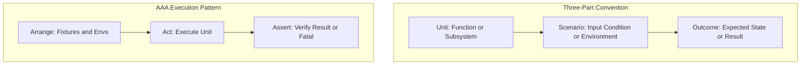

# Architecture Spec: 309 - Test Naming & Three-Part Semantic Conventions

## 1. Executive Summary & Intent
This specification formalizes compliance with `01-prompts/15-cg-execute/11-testing-and-coverage.md` and repository guidelines (`02-spec/02-coding-guidelines/01-cross-language/14-test-naming-and-structure.md`).
All unit and integration test functions must follow the three-part semantic convention:
`Test{Unit}_{Scenario}_{ExpectedOutcome}`
This ensures every test function self-documents its target subject, preconditions, and asserted results without ambiguous phrasing.

## 2. Test Structure Diagram

## 3. Disjoint Micro-Batch Allocation
- **Worker 01 (UIPref Test Naming):**
  - File: `cli/uipref/uipref_test.go`
  - Action: Rename all test functions to three-part semantic names (`TestIsQuiet_WhenEnvSet_HonorsFlag`, `TestIsNoColor_WhenStdEnvSet_ReturnsTrue`, etc.).
- **Worker 02 (ProjectBinder Test Naming):**
  - File: `cli/usercontext/project_binder_test.go`
  - Action: Rename test functions to three-part semantic names (`TestBindAndResolveProject_ValidProfile_ResolvesSuccessfully`, etc.).
- **Worker 03 (PathGuard Test Naming):**
  - File: `cli/workspacesync/path_guard_test.go`
  - Action: Rename test functions to three-part semantic names (`TestIsTempOrTestPath_GivenTempDir_IdentifiesAsTemp`, `TestSyncAll_WhenRestrictedTempPath_SafeNoOp`).

## 4. Verification & Quality Gates
- `FastGate`: `python 03-ai-scripts/50-fastgate.py` must report clean.
- `Newline Styling`: `python linter-scripts/check-newline-styling.py` must report PASS.
- `Forbidden Strings`: `python linter-scripts/check-forbidden-strings.py` must report PASS.
