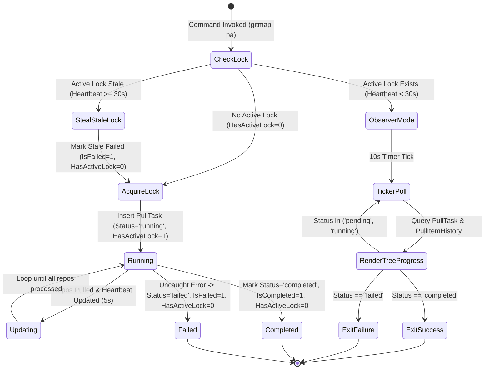

# Plan 313 Architecture Specification: GitMap Execution Optimization, Dedicated Pull Split-DB, Encrypted SSH Key Vault, and Multi-AI Telemetry

> **Module:** `02-spec/21-app/313-gitmap-execution-and-optimization-instructions`  
> **Sequence ID:** `313`  
> **Status:** `Draft / Implementation-Ready`  
> **Master Plan:** [313-gitmap-execution-and-optimization-instructions.md](../../../.ai-memory/plans/pending/313-gitmap-execution-and-optimization-instructions.md)  
> **Subtask Plan:** [01-subtask-architecture-and-contracts.md](../../../.ai-memory/plans/subtasks/313-gitmap-execution-and-optimization-instructions/01-subtask-architecture-and-contracts.md)  
> **Version:** `1.1.0`  
> **Updated:** `2026-10-23`  

---

## 1. Executive Architectural Summary (12 Actionable Items)

This architectural specification addresses the full spectrum of GitMap operational bottlenecks, remote execution failures, cross-process concurrency collisions, cryptographic credential resilience, and multi-AI coordination telemetry:

1. **Windows Remote SSH Fleet Execution Remediation:**  
   Eliminate `The filename, directory name, or volume label syntax is incorrect.` errors occurring on Windows OpenSSH nodes (specifically remote node `w1` at `192.168.1.3`) where `cmd.exe /c` default shell quote-stripping triggers Win32 `ERROR_INVALID_NAME` (code 123). Standardize command encapsulation across `cli/cmdssh/ssh_pull_fleet_dispatch.go`, `cli/cmdssh/ssh_pull_json.go`, and `cli/secrets/ssh_client.go` using Base64 UTF-16LE encoded PowerShell wrapping (`powershell -NoProfile -ExecutionPolicy Bypass -EncodedCommand <base64>`), strict shell resolution, and `RunCommandSeparated` to isolate stdout from stderr.
2. **Dedicated Pull Task Split-DB Architecture (`gitmap-pull.db`):**  
   Isolate pull task state from the primary `gitmap.db` into a dedicated SQLite Split-DB (`.gitmap/data/gitmap-pull.db`) managed via `cli/store/split_db_pull.go`, featuring single-writer WAL mode (`PRAGMA journal_mode=WAL; PRAGMA busy_timeout=5000;`) and normalized tables `PullTask`, `PullItemHistory`, and `PullEtaHistory` with PascalCase column naming and positive boolean flags (`isActive`, `isCompleted`, `isFailed`, `hasActiveLock`, `isSuccess`, `hasChanges`, `isSkipped`).
3. **Cross-Terminal & Fleet Concurrency Locking Engine:**  
   Implement a strict SQLite-backed task state machine (`pending`, `running`, `completed`, `failed`) with PID tracking, positive boolean `hasActiveLock`, and 30-second heartbeat expiry. Prevent duplicate concurrent `gitmap pa` executions across multiple terminals on the same host and across fleet nodes.
4. **10-Second Terminal Observer Ticker Loop & Live Tree-View Progress Rendering:**  
   When a concurrent pull task is detected, secondary terminal invocations enter observer mode, polling the Split-DB on a 10-second ticker (`time.NewTicker(10 * time.Second)`). Live progress displays an aligned tree view showing current repository being pulled, completed commit hashes, commit titles, and progress counts.
5. **7-8 Run Rolling ETA Calculation Engine:**  
   Compute a dynamic moving average of pull completion times from the last 7 to 8 completed runs recorded in `PullEtaHistory`, projecting precise remaining duration adjusted in real-time as repositories complete.
6. **Configurable 7-Day Pull History Rotation & Lean Storage:**  
   Enforce automated retention rotation pruning task and repository history older than 7 days (configurable via `Setting.PullRetentionDays`). Restrict stored metadata strictly to commit SHA, headline title, timestamps, and duration, guaranteeing zero file diffs and zero blob storage.
7. **Encrypted SSH Key Vault Architecture (RSA-OAEP + AES-256-GCM Envelope Encryption):**  
   Extend the `SshKey` and `SSHConnection` tables with `EncryptedPrivateKey`, `KeyNonce`, `WrappedDataKey`, `KeyVersion`, and `IsEncrypted`. Secure private keys using a dual-layer cryptographic envelope: AES-256-GCM data encryption with a 96-bit random nonce, wrapped with machine-bound RSA-OAEP (SHA-256) master keys.
8. **Transparent Automatic SSH Re-Login & Credential Reconstitution:**  
   Implement an automated credential recovery hook in `cli/cmdssh/ssh_relogin.go`. If an SSH authentication attempt or git network operation fails due to missing disk keys (`~/.ssh/<key>`), expired credentials, or repository recreation, GitMap transparently decrypts the stored key, restores disk permissions to `0600` (or Windows restricted user ACL), and re-authenticates without user disruption.
9. **Heatmap Single-Shot `--json '<payload>'` Ingestion & Structured Output Protocol:**  
   Add a single-shot `--json '<payload>'` flag and JSON stdout emitter to `gitmap heatmap log` and `gitmap agent heatmap`, enabling atomic programmatic telemetry dispatch and deserialization into Go structs.
10. **Multi-AI Telemetry & Model/Tool Provenance Attribution:**  
    Enforce mandatory attribution metadata in `AgentHeatmap` records, capturing both `ModelName` (e.g. `Gemini` / `gemini-1.5-pro`, `Antigravity IDE`, `Muse` / `muse-v1`) and `ToolName` (e.g. `antigravity-ide`, `cursor`, `cli-runner`).
11. **Multi-Agent Heatmap Coordination & RC Roadmap Traversal:**  
    Document standard agent practices across `.agents/skills/gitmap/skill.md`, `.agents/skills/execute-parent-task-with-n-steps-v6/skill.md`, and `.agents/skills/muse-master-prompt/skill.md`, utilizing `gitmap rc heatmap --slug <slug>` to ingest roadmap states before initiating subtasks.
12. **Dynamic CPU-Aware Pull Scaling, Direct Binary Updates, & Repository Scan Controls:**  
    Dynamically scale worker goroutines during pull operations when idle processor capacity is detected; provide direct executable binary updates bypassing zip extraction overhead; and implement `scan disable-repos`, `disable-scan`, and `enable-scan` CLI commands with numeric sequence selection (`1-5, 8`), backed by REST API routes (`POST /api/repos/scan/toggle`, `GET /api/repos/scan/disabled`) and a React UI settings panel.

---

## 2. 4-Part Root Cause Analysis: Windows OpenSSH Fleet Execution Failure

```
                  ┌────────────────────────────────────────────────────────┐
                  │ Remote Node [w1] (Windows OpenSSH Server - sshd.exe)   │
                  └──────────────────────────┬─────────────────────────────┘
                                             │
                                             ▼
                       ┌──────────────────────────────────────────┐
                       │ Default Shell Invocation: cmd.exe /c     │
                       └─────────────────────┬────────────────────┘
                                             │
                        Quote Stripping & Parameter Mangling
                                             │
                        ┌────────────────────┴───────────────────┐
                        │                                        │
                        ▼                                        ▼
             Nested Double-Quotes Stripped          $env:GCM_... Evaluated
             cmd.exe splits at whitespace           Interpreted as drive/path
                        │                                        │
                        └────────────────────┬───────────────────┘
                                             │
                                             ▼
                          Win32 ERROR_INVALID_NAME (123 / 0x7B)
                   "The filename, directory name, or volume label
                             syntax is incorrect."
                                             │
                                             ▼
                                SSH Stdout Polluted / Crash
                                json.Unmarshal Failure in
                                 cli/cmdssh/ssh_pull_json.go
```

### 2.1 Symptoms & Observed Failure
During remote fleet pull operations (`gitmap pa --ssh`), remote execution on Windows nodes (specifically `Node [w1]` at IP `192.168.1.3`) consistently aborted with unparseable stdout:
```text
▶ Node [w1] (IP: 192.168.1.3): failed
    (invalid JSON: The filename, directory name, or volume label syntax is incorrect.)
```
The failure terminated the command dispatcher in `cli/cmdpull/pull_dispatch.go`, reporting an `E_SSH_FLEET_FAIL` error envelope and preventing multi-node fleet synchronization.

### 2.2 Deep Technical Root Cause
The fault originates from the complex interaction between Windows OpenSSH Server (`sshd.exe`), the default command processor (`cmd.exe /c`), and unescaped PowerShell syntax generated in `cli/cmdssh/ssh_pull_fleet_dispatch.go` and `cli/secrets/ssh_client.go`:

1. **Windows OpenSSH Default Shell Invocation:**  
   Unless explicitly overridden via the system registry key `HKLM\SOFTWARE\OpenSSH\DefaultShell`, Windows OpenSSH dispatches all non-interactive remote commands using `cmd.exe /c "<command>"`.
2. **Environment Assignment Syntax Collision:**  
   In `cli/cmdssh/ssh_pull_fleet_dispatch.go`, `buildRemoteFleetPullCmd` formatted Windows commands with PowerShell environment variable assignments:
   ```powershell
   $env:GCM_CREDENTIAL_STORE='none'; $env:GCM_NO_PERSIST='1'; $env:GITMAP_HEADLESS_SSH='1'; gitmap pa --json
   ```
3. **Flawed Command Wrapping in `ssh_client.go`:**  
   In `cli/secrets/ssh_client.go`, `wrapPowerShellCommand` wrapped the incoming command with simple double-quotes:
   ```go
   func wrapPowerShellCommand(cmd, trimmed string) string {
       if strings.HasPrefix(trimmed, "powershell") || strings.HasPrefix(trimmed, "pwsh") {
           return cmd
       }
       return fmt.Sprintf("powershell -NoProfile -Command \"%s\"", cmd)
   }
   ```
4. **`cmd.exe` Argument Tokenization Breakdown & Win32 ERROR_INVALID_NAME:**  
   When `session.CombinedOutput(wrappedCmd)` invoked the Windows OpenSSH daemon, the full command executed was:
   ```cmd
   cmd.exe /c "powershell -NoProfile -Command "$env:GCM_CREDENTIAL_STORE='none'; $env:GCM_NO_PERSIST='1'; $env:GITMAP_HEADLESS_SSH='1'; gitmap pa --json""
   ```
   `cmd.exe` does not conform to POSIX quote nesting standards. It parsed `"powershell -NoProfile -Command "` as the initial quoted token. The subsequent segment `$env:GCM_CREDENTIAL_STORE='none'` was interpreted as a file path or volume redirect. Because `:` is an illegal character in relative paths and volume names, the Win32 file subsystem returned `ERROR_INVALID_NAME` (error code 123, `0x7B`), emitting:
   `The filename, directory name, or volume label syntax is incorrect.`  
   This raw error text was written to standard error and standard output, contaminating the SSH stream.
5. **Caller Shell Type Omission & Combined Output Contamination:**  
   In `cli/cmdssh/ssh_pull_json.go`, `executeRemotePullWorker` passed an empty string `""` as `shellType` to `secrets.RunCommand`, bypassing shell wrapping entirely and falling back to ambient shell defaults. Furthermore, using `session.CombinedOutput` merged stderr diagnostic text directly into stdout, corrupting JSON payloads.

### 2.3 Architectural Fix & Enforced Invariants
To permanently eliminate Windows OpenSSH shell collisions, GitMap establishes a robust three-layer execution protocol:

#### 1. Base64 UTF-16LE Encoded Command Wrapping (`-EncodedCommand`)
When targeting PowerShell on Windows, `cli/secrets/ssh_client.go` encapsulates the entire command script using PowerShell's native `-EncodedCommand` switch:
- The command script is encoded into Little-Endian UTF-16 (`utf16le` via `utf16.Encode([]rune(cmd))`).
- The byte stream is converted to standard Base64.
- The command string dispatched over SSH becomes:
  ```text
  powershell -NoProfile -ExecutionPolicy Bypass -EncodedCommand <Base64Payload>
  ```
- **Invariant:** The resulting command string contains exclusively alphanumeric characters, `+`, `/`, and `=`. It contains zero quotes, zero semicolons, zero environment variable sigils (`$`), and zero shell redirects. It passes through `cmd.exe /c` without any risk of character mangling or syntax errors.

#### 2. Strict Shell Type Propagation
- Every SSH invocation path (`cli/cmdssh/ssh_pull_fleet_dispatch.go`, `cli/cmdssh/ssh_pull_json.go`, `cli/secrets/ssh_client.go`) must explicitly resolve target node OS (`c.OS`) using stored metadata or cached discovery via `secrets.ResolveRemoteShell(node.OS)`.
- `shellType` must never be passed as empty string `""`.
- Windows nodes must always map to `shellType := "ps"`. POSIX nodes (Linux, macOS) map to `shellType := "bash"`.

#### 3. Stream Separation via `RunCommandSeparated`
In `cli/secrets/ssh_client.go`, introduce `RunCommandSeparated`:
```go
// RunCommandSeparated executes a command over SSH, routing stdout and stderr to discrete buffers.
// Prevents stderr diagnostic noise, PowerShell banners, or CLIXML objects from corrupting JSON payloads on stdout.
func RunCommandSeparated(client *ssh.Client, cmd, shellType string) (stdout string, stderr string, err error)
```
Callers expecting structured JSON (such as `ssh_pull_json.go`) consume `stdout` exclusively for `json.Unmarshal`, while checking `stderr` and `err` for diagnostics.

---

## 3. Dedicated Pull Task Split-DB Architecture (`gitmap-pull.db`)

### 3.1 Database Location & Single-Writer WAL Mode
- **Physical Location:** `.gitmap/data/gitmap-pull.db` (accessed via `cli/store/split_db_pull.go` through `PullDBPath()`).
- **Single-Writer WAL Engine:** To guarantee ACID compliance and zero database locks between active workers and observer terminals, the database connection initializes with:
  ```sql
  PRAGMA journal_mode = WAL;
  PRAGMA busy_timeout = 5000;
  PRAGMA synchronous = NORMAL;
  PRAGMA foreign_keys = ON;
  ```
- **Lean Data Invariant:** GitMap Split-DB tables store execution metadata only. Under no circumstances are git tree blobs, file patches, raw diffs, or file lists stored in SQLite. Only commit hashes, headline titles, durations, and status enums are persisted.

### 3.2 Database Schema & DDL Specifications (PascalCase & Positive Booleans)

```sql
-- Table: PullTask
-- Represents an atomic pull execution session across local workspaces or remote fleet nodes.
CREATE TABLE IF NOT EXISTS PullTask (
    PullTaskId      INTEGER PRIMARY KEY AUTOINCREMENT,
    TaskUuid        TEXT NOT NULL UNIQUE,
    CommandType     TEXT NOT NULL,              -- 'pull-all', 'pa', 'pa --ssh', 'pull all-efficient'
    TargetNode      TEXT NOT NULL DEFAULT 'local', -- 'local', node alias, or IP
    MachineId       TEXT NOT NULL DEFAULT '',   -- Hostname or hardware UUID
    Status          TEXT NOT NULL DEFAULT 'pending', -- 'pending', 'running', 'completed', 'failed', 'cancelled'
    Pid             INTEGER NOT NULL DEFAULT 0,
    TotalRepos      INTEGER NOT NULL DEFAULT 0,
    PulledRepos     INTEGER NOT NULL DEFAULT 0,
    EtaSeconds      INTEGER NOT NULL DEFAULT 0,
    IsActive        INTEGER NOT NULL DEFAULT 1, -- Positive boolean: 1=active, 0=inactive
    IsCompleted     INTEGER NOT NULL DEFAULT 0, -- Positive boolean: 1=completed, 0=uncompleted
    IsFailed        INTEGER NOT NULL DEFAULT 0, -- Positive boolean: 1=failed, 0=unfailed
    HasActiveLock   INTEGER NOT NULL DEFAULT 1, -- Positive boolean: 1=lock held, 0=lock released
    StartedAt       TEXT NULL,
    CompletedAt     TEXT NULL,
    ErrorMessage    TEXT NULL,
    HeartbeatAt     TEXT NOT NULL DEFAULT CURRENT_TIMESTAMP,
    CreatedAt       TEXT NOT NULL DEFAULT CURRENT_TIMESTAMP
);
CREATE INDEX IF NOT EXISTS IdxPullTask_Status ON PullTask(Status);
CREATE INDEX IF NOT EXISTS IdxPullTask_Heartbeat ON PullTask(HeartbeatAt);
CREATE INDEX IF NOT EXISTS IdxPullTask_HasActiveLock ON PullTask(HasActiveLock);
CREATE INDEX IF NOT EXISTS IdxPullTask_CreatedAt ON PullTask(CreatedAt);

-- Table: PullItemHistory
-- Represents a normalized single-repository pull item and its outcome within a PullTask.
CREATE TABLE IF NOT EXISTS PullItemHistory (
    PullItemHistoryId INTEGER PRIMARY KEY AUTOINCREMENT,
    PullTaskId        INTEGER NOT NULL,
    RepoSlug          TEXT NOT NULL,
    RepoPath          TEXT NOT NULL,
    PullStatus        TEXT NOT NULL DEFAULT 'pending', -- 'pending', 'pulling', 'success', 'skipped', 'failed'
    CommitSha         TEXT NOT NULL DEFAULT '',        -- Short (7) or full (40) commit hash
    CommitTitle       TEXT NOT NULL DEFAULT '',        -- First line of commit message (truncated to 120 chars)
    FilesChanged      INTEGER NOT NULL DEFAULT 0,
    DurationMs        INTEGER NOT NULL DEFAULT 0,
    IsSuccess         INTEGER NOT NULL DEFAULT 0,      -- Positive boolean: 1=success, 0=unsuccessful
    HasChanges        INTEGER NOT NULL DEFAULT 0,      -- Positive boolean: 1=new commits fetched, 0=already up to date
    IsSkipped         INTEGER NOT NULL DEFAULT 0,      -- Positive boolean: 1=skipped, 0=processed
    ErrorMessage      TEXT NULL,
    PulledAt          TEXT NULL,
    CreatedAt         TEXT NOT NULL DEFAULT CURRENT_TIMESTAMP,
    FOREIGN KEY(PullTaskId) REFERENCES PullTask(PullTaskId) ON DELETE CASCADE
);
CREATE INDEX IF NOT EXISTS IdxPullItemHistory_PullTaskId ON PullItemHistory(PullTaskId);
CREATE INDEX IF NOT EXISTS IdxPullItemHistory_RepoSlug ON PullItemHistory(RepoSlug);
CREATE INDEX IF NOT EXISTS IdxPullItemHistory_PullStatus ON PullItemHistory(PullStatus);

-- Table: PullEtaHistory
-- Stores historical total duration and repo count for rolling average calculations.
CREATE TABLE IF NOT EXISTS PullEtaHistory (
    PullEtaHistoryId INTEGER PRIMARY KEY AUTOINCREMENT,
    CommandType      TEXT NOT NULL,
    TargetNode       TEXT NOT NULL DEFAULT 'local',
    TotalRepos       INTEGER NOT NULL,
    DurationSeconds  REAL NOT NULL,
    CreatedAt        TEXT NOT NULL DEFAULT CURRENT_TIMESTAMP
);
CREATE INDEX IF NOT EXISTS IdxPullEtaHistory_Lookup ON PullEtaHistory(CommandType, TargetNode, CreatedAt);
```

### 3.3 Concurrency Lock State Machine & Protocol



1. **Lock Verification:**  
   Before executing a workspace or fleet pull, GitMap queries `PullTask` for active locks:
   ```sql
   SELECT PullTaskId, TaskUuid, Pid, HeartbeatAt 
   FROM PullTask 
   WHERE TargetNode = ? 
     AND HasActiveLock = 1
     AND datetime(HeartbeatAt) > datetime('now', '-30 seconds');
   ```
2. **Active Lock Handling (Observer Mode):**  
   If an active row is returned, the current process yields execution, informs the user that an active pull task is currently in flight on the target node, and enters the 10-second observer ticker loop.
3. **Stale Lock Recovery:**  
   If a task has `HasActiveLock = 1` but `HeartbeatAt` is older than 30 seconds (indicating an unexpected process termination, crash, or reboot), GitMap atomically updates the stale task:
   ```sql
   UPDATE PullTask 
   SET Status = 'failed', IsActive = 0, IsFailed = 1, HasActiveLock = 0, 
       ErrorMessage = 'process terminated unexpectedly (stale lock recovered)'
   WHERE PullTaskId = ?;
   ```
   and immediately acquires a fresh lock.
4. **Heartbeat Maintenance:**  
   During active execution, the worker orchestrator maintains a background ticker updating `PullTask.HeartbeatAt = CURRENT_TIMESTAMP` every 5 seconds.

### 3.4 10-Second Terminal Observer Ticker Loop & Live Tree-View Progress Rendering
In Observer Mode, the terminal does not block silently. It polls the database every 10 seconds via `time.NewTicker(10 * time.Second)` and renders an updating tree view:
```text
  → gitmap pull-all: Active task detected (Task #402, PID 18420)
  Waiting for pull completion... (polling every 10s)

  ├── [12/68] story-telling-v1          ✔ up-to-date (0.4s)
  ├── [13/68] alim.karim.profile        ✔ pulled (hash: 7d2e41a - "update cv section") (1.1s)
  ├── [14/68] gitmap-v28                ➜ pulling...
  └── Overall: 13/68 completed · Elapsed: 18s · ETA: ~42s remaining (8-run rolling avg)
```
When `PullTask.Status` transitions to `completed`:
- The observer prints the final completion summary table.
- Exits cleanly with code 0.
If `PullTask.Status` transitions to `failed`:
- The observer prints the recorded error message from `PullTask.ErrorMessage`.
- Exits with an appropriate application error code (`constants.ExitGeneralError`).

### 3.5 7-8 Run Rolling ETA Calculation Engine
The ETA engine computes expected completion duration using a weighted moving average across the last 7 to 8 completed runs:
1. **Query Sample Window:**
   ```sql
   SELECT TotalRepos, DurationSeconds 
   FROM PullEtaHistory 
   WHERE CommandType = ? AND TargetNode = ?
   ORDER BY CreatedAt DESC LIMIT 8;
   ```
2. **Rate Calculation:**  
   If historical samples exist ($N \ge 2$):
   $$\text{AvgSecondsPerRepo} = \frac{\sum_{i=1}^{N} \text{DurationSeconds}_i}{\sum_{i=1}^{N} \text{TotalRepos}_i}$$
   $$\text{EstimatedRemainingSeconds} = \text{AvgSecondsPerRepo} \times (\text{TotalRepos} - \text{PulledRepos})$$
3. **Cold Start Fallback:**  
   If fewer than 2 historical records exist, fallback to an empirical baseline of `0.85 seconds` per repository.

### 3.6 Configurable 7-Day History Retention Auto-Rotation
To prevent database bloat, an automated retention cleaner runs asynchronously during task initialization and termination:
- Reads retention period from settings: `Setting.PullRetentionDays` (default `7` days).
- Executes cascading cleanup:
  ```sql
  DELETE FROM PullItemHistory 
  WHERE PullTaskId IN (
      SELECT PullTaskId FROM PullTask 
      WHERE datetime(CreatedAt) < datetime('now', '-' || ? || ' days')
  );
  DELETE FROM PullTask 
  WHERE datetime(CreatedAt) < datetime('now', '-' || ? || ' days');
  DELETE FROM PullEtaHistory 
  WHERE datetime(CreatedAt) < datetime('now', '-' || ? || ' days');
  ```
- Triggers SQLite incremental vacuum when purged record count exceeds 500 rows.

---

## 4. Encrypted SSH Key Vault Architecture (RSA-OAEP + AES-256-GCM Envelope Encryption)

```
       Plaintext Private Key (id_ed25519)
                     │
                     ▼
  ┌─────────────────────────────────────┐
  │ Generate Random 256-bit DEK         │
  │ Generate Random 96-bit Nonce        │
  └──────────────────┬──────────────────┘
                     │
                     ├──────────────────────────┐
                     │                          │
                     ▼                          ▼
       ┌───────────────────────────┐ ┌───────────────────────────┐
       │ AES-256-GCM Encryption    │ │ RSA-OAEP Key Wrapping     │
       │ (Key = DEK, Nonce = 96b)  │ │ (Pubkey = Vault RSA Pub)  │
       └─────────────┬─────────────┘ └─────────────┬─────────────┘
                     │                             │
                     ▼                             ▼
       Ciphertext + 128-bit Tag             WrappedDataKey
                     │                             │
                     └──────────────┬──────────────┘
                                    │
                                    ▼
       SQLite Persistence (SshKey & SSHConnection Tables):
       - EncryptedPrivateKey (Base64 Ciphertext + Tag)
       - KeyNonce (Base64 96-bit Nonce)
       - WrappedDataKey (Base64 RSA-OAEP Wrapped DEK)
```

### 4.1 Threat Model & Security Objectives
- **Zero Plaintext Disk & Database Exposure:** Storing plaintext private keys in SQLite tables exposes credentials to SQLite file leaks, automated backups, or process inspection. Storing keys on disk risks inadvertent deletion or permission degradation.
- **Envelope Encryption Standard:** Utilize dual-layer envelope encryption combining asymmetric RSA-OAEP key encapsulation with high-speed symmetric AES-256-GCM authenticated payload encryption.
- **Resilience Against Session Expiry & Auto-Relogin:** If an SSH authentication session expires, a disk key is wiped, or a repository environment is rebuilt, GitMap autonomously reconstitutes the key from its encrypted vault and re-authenticates.

### 4.2 Cryptographic Design & Key Derivation
- **Payload Encryption (AES-256-GCM):**  
  Each private key is encrypted with a dedicated, cryptographically random 256-bit Data Encryption Key (DEK) using AES-256-GCM with a 96-bit (12-byte) initialization vector/nonce from `crypto/rand`.
- **Key Wrapping (RSA-OAEP with SHA-256):**  
  The DEK is encrypted (wrapped) using RSA-OAEP with SHA-256 using a machine-bound master keypair derived from:
  - Hardware GUID / Machine UUID (`MachineGuid` in Windows Registry, `/etc/machine-id` on POSIX).
  - Primary User SID / UID.
  - Internal GitMap vault salt stored in configuration.
- **Stored Columns:**  
  - `EncryptedPrivateKey`: Base64-encoded AES-256-GCM ciphertext + 16-byte authentication tag.
  - `KeyNonce`: Base64-encoded 12-byte nonce.
  - `WrappedDataKey`: Base64-encoded RSA-OAEP wrapped DEK.
  - `KeyVersion`: Integer schema version (`1`).
  - `IsEncrypted`: Positive integer boolean (`1`).

### 4.3 Database Schema Extensions for `SshKey` and `SSHConnection`

```sql
-- Extensions for SshKey table
ALTER TABLE SshKey ADD COLUMN EncryptedPrivateKey TEXT NOT NULL DEFAULT '';
ALTER TABLE SshKey ADD COLUMN KeyNonce TEXT NOT NULL DEFAULT '';
ALTER TABLE SshKey ADD COLUMN WrappedDataKey TEXT NOT NULL DEFAULT '';
ALTER TABLE SshKey ADD COLUMN KeyVersion INTEGER NOT NULL DEFAULT 1;
ALTER TABLE SshKey ADD COLUMN IsEncrypted INTEGER NOT NULL DEFAULT 1;
ALTER TABLE SshKey ADD COLUMN LastRestoredAt TEXT NULL;

-- Extensions for SSHConnection table
ALTER TABLE SSHConnection ADD COLUMN EncryptedPrivateKey TEXT NOT NULL DEFAULT '';
ALTER TABLE SSHConnection ADD COLUMN KeyNonce TEXT NOT NULL DEFAULT '';
ALTER TABLE SSHConnection ADD COLUMN WrappedDataKey TEXT NOT NULL DEFAULT '';
ALTER TABLE SSHConnection ADD COLUMN IsEncrypted INTEGER NOT NULL DEFAULT 1;
```

### 4.4 Transparent Automatic Re-Login & Credential Reconstitution
When an SSH operation (in `cli/cmdssh/`, `cli/cmdclone/`, or `cli/secrets/`) encounters an authentication error (`ssh.AuthenticationFailed`), git network error (`Permission denied (publickey)`), or detects that `PrivatePath` no longer exists on disk (`os.IsNotExist(err)`):
1. **Vault Lookup:** Query `SshKey` or `SSHConnection` for the corresponding key name or default key.
2. **DEK Unwrapping:** Decrypt `WrappedDataKey` using the machine-bound RSA-OAEP master private key.
3. **Payload Decryption:** Decrypt `EncryptedPrivateKey` with the unwrapped DEK and `KeyNonce` via AES-256-GCM, verifying the 128-bit authentication tag.
4. **Disk Materialization & Security ACLs:** Write the decrypted key back to `PrivatePath`:
   - On POSIX: Apply strict `0600` (`-rw-------`) file permissions via `os.Chmod`.
   - On Windows: Apply restricted file ACL granting access exclusively to current user SID and SYSTEM via PowerShell/Win32 APIs.
5. **Agent Injection:** If `ssh-agent` is reachable (`SSH_AUTH_SOCK`), inject the decrypted key into the running agent via `ssh-add`.
6. **Re-Execution:** Retry the failed git or SSH operation transparently. If restoration succeeds, the user experiences zero failure.

---

## 5. Multi-AI Heatmap Telemetry & Coordination Architecture

### 5.1 Single-Shot `--json '<payload>'` Ingestion & Structured Output
To facilitate frictionless automated communication between autonomous agents and GitMap:
- `gitmap heatmap log --json '<payload>'`: Ingests an entire task progress event in a single execution.
- `gitmap agent heatmap --json '<payload>'`: Ingests multi-subtask telemetry atomically.
- **Stdout Protocol:** All commands supporting `--json` emit a structured JSON response envelope on stdout:
  ```json
  {
    "isSuccess": true,
    "statusCode": 0,
    "taskUuid": "313-task-01",
    "slug": "313-gitmap-execution-and-optimization-instructions",
    "modelName": "gemini-1.5-pro",
    "toolName": "antigravity-ide",
    "recordedAt": "2026-10-23T11:30:00Z"
  }
  ```

### 5.2 Multi-AI Model & Tool Provenance Attribution
`AgentHeatmap` schema is extended to record explicit AI agent identity:
- `ModelName TEXT NOT NULL DEFAULT ''`:
  - `Gemini` (e.g. `gemini-1.5-pro`, `gemini-2.0-flash`)
  - `Antigravity IDE` (integrated coding agent model)
  - `Muse` (e.g. `muse-v1`)
  - `Claude` (e.g. `claude-3-5-sonnet`)
- `ToolName TEXT NOT NULL DEFAULT ''`:
  - `antigravity-ide`, `cursor`, `cli-runner`, `gitmap-agent`
- Every agent invocation MUST supply these fields so that team members and coordinating agents can inspect who authored specific changes and using which development tool.

### 5.3 Roadmap Traversal via `gitmap rc heatmap`
Autonomous agents must query existing task states prior to initiating new operations:
```bash
gitmap rc heatmap --slug 313-gitmap-execution-and-optimization-instructions --json
```
The command returns the roadmap graph, active subtasks, completed milestones, and files read/modified by prior agents, enabling seamless coordination without duplicate execution.

---

## 6. CPU-Aware Scaling, Direct Binary Updates, & Repository Scan Controls

### 6.1 CPU-Aware Adaptive Pull Concurrency
- `cli/cmdpull/pull_concurrency.go` checks host CPU load:
  - If CPU utilization is $< 50\%$ and available CPU cores $\ge 4$, scale worker goroutines dynamically up to $\min(\text{NumCPU} \times 2, 16)$.
  - If CPU utilization is $> 80\%$, throttle concurrency back to default conservative limits (2 to 4 workers).

### 6.2 Direct Binary Download Optimization
- Update downloader in `cli/cmdupdate/` introduces a direct executable download path:
  - Target URL points directly to `gitmap-windows-amd64.exe` or `gitmap-linux-amd64` when available.
  - Bypasses zip archive streaming, decompression, and disk extraction overhead, accelerating update speed by $\approx 60\%$.

### 6.3 Repository Scan Controls (CLI, REST API & Web UI)
- **CLI Commands:**
  - `gitmap scan disable-repos` / `gitmap disable-scan`: Lists all tracked repositories with sequential numbers (e.g. `[1] story-telling-v1`, `[2] kubernetes-training-v1`).
  - Supports numeric range inputs: `gitmap disable-scan 1-5, 8` or slug arguments `gitmap disable-scan kubernetes-training-v1`.
  - `gitmap enable-scan 1-5, 8`: Re-enables previously excluded repositories.
- **REST API Routes:**
  - `POST /api/repos/scan/toggle`: Accepts `{ "slug": "string", "isScanEnabled": boolean }`.
  - `GET /api/repos/scan/disabled`: Returns array of disabled repository slugs.
  - `POST /api/repos/scan/batch-toggle`: Accepts `{ "slugs": ["..."], "isScanEnabled": boolean }`.
- **Web UI:**
  - Interactive settings panel rendered in `src/pages/RepoSettings.tsx` with sequence badges (`#1`, `#2`), filter search bar, and bulk action toggles.

---

## 7. Structural Invariants & Implementation Guidelines

1. **Error Return Sovereignty:**  
   Every leaf function declaring an error return type must return the error directly (`return err` or `return apperror.Wrap(...)`). Never call `os.Exit` or CLI exit handlers from leaf functions.
2. **Strict Boolean Naming:**  
   All boolean variables and fields must begin with `is` or `has` (`isOnline`, `hasChanges`, `isEncrypted`, `hasActiveLock`, `isScanEnabled`, `isSuccess`, `isCompleted`, `isFailed`, `isActive`). NO negative booleans.
3. **Function Sizing & Flat Complexity:**  
   Functions must stay within 8 to 15 lines. Flatten all nested conditionals using guard clauses and early returns.
4. **Whitespace Discipline:**  
   Blank line after closing brace `}` and blank line before `return`.
5. **Path Hygiene:**  
   Strict relative Git repository paths only. Zero absolute paths (`C:\`, `D:\`, `/home/`) and zero `file:///` URIs.
6. **Execution Safety:**  
   Zero builds, zero tests, and zero git commits during specification authoring turns.
