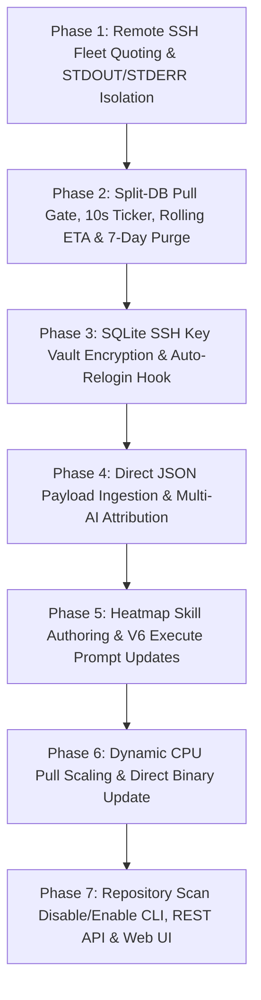
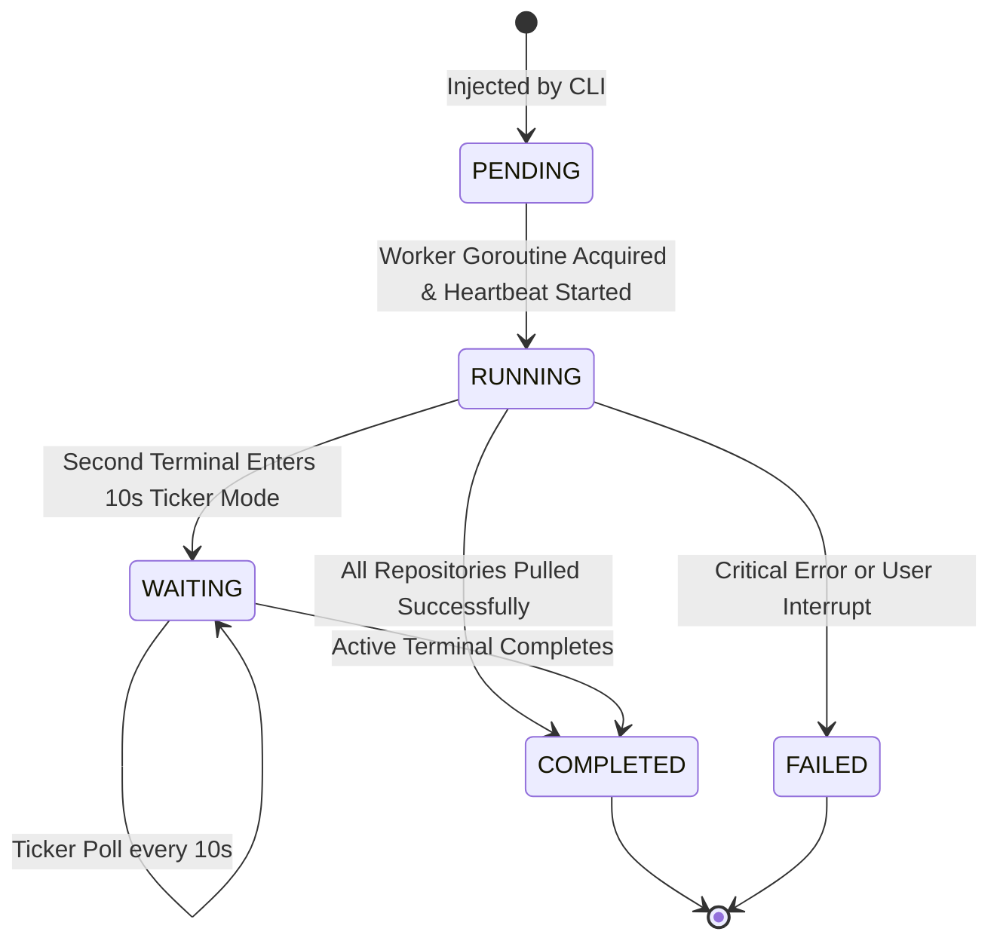

# Technical Specification 03: Step-by-Step Rollout Matrix, SQLite Migrations, Retention Rotation, Rolling ETA & Verification Checklist

- **Spec ID:** `02-spec/21-app/313-gitmap-execution-and-optimization-instructions/03-migration-and-verification-spec.md`
- **Feature Slug:** `313-gitmap-execution-and-optimization-instructions`
- **Module:** `cli/store`, `cli/cmdpull`, `cli/cmdssh`, `cli/heatmap`, `cli/cmdscan`, `cli/cmdupdate`, `cli/constants`
- **Status:** APPROVED
- **Specification Version:** 1.0.0
- **Governing Plan:** `.ai-memory/plans/pending/313-gitmap-execution-and-optimization-instructions.md`
- **Companion Specs:**
  - `02-spec/21-app/313-gitmap-execution-and-optimization-instructions/01-architecture-spec.md`
  - `02-spec/21-app/313-gitmap-execution-and-optimization-instructions/02-component-and-examples-spec.md`
- **Governing Subtask Plan:** `.ai-memory/plans/subtasks/313-gitmap-execution-and-optimization-instructions/03-subtask-migration-and-verification.md`
- **Target Audience:** Autonomous AI Agents, Core GitMap Developers, QA Automation Engineers
- **Target Release:** Minor Bump

---

## 1. Executive Summary & Step-by-Step Rollout Matrix

This technical specification establishes the rollout strategy, database schema migrations, high-concurrency WAL mode configurations, automated retention lifecycle rules, predictive ETA algorithms, agent skill contracts, and the comprehensive acceptance checklist for task `313-gitmap-execution-and-optimization-instructions`.

To guarantee zero regression, operational stability, and clear phase boundaries, implementation is structured into a 7-phase sequential rollout matrix. Each phase delivers distinct capabilities, enforces concrete invariants, and must satisfy its acceptance gates before advancing.

### 1.1 The 7-Phase Rollout Matrix



| Phase | Title | Core Objectives | Impacted Packages | Verification Gate |
|:---:|---|---|---|---|
| **Phase 1** | Remote SSH Quoting & Stream Isolation | Eliminate Windows `cmd.exe /c` quoting bugs using Base64 UTF-16LE `-EncodedCommand` wrapping. Isolate STDOUT (JSON telemetry) from STDERR (SSH warnings/banners). | `cli/secrets`, `cli/cmdssh` | `gitmap pa --ssh` and `gitmap ssh pull --all --json` return parseable JSON from Windows OpenSSH nodes without volume syntax errors. |
| **Phase 2** | Split-DB Pull Task Gate & Retention | Move pull tasks to dedicated `pulldb/pull_tasks.db` Split-DB with WAL mode. Implement 10s observer ticker loop, 7-8 run rolling ETA engine, and automated 7-day retention purge. | `cli/store`, `cli/cmdpull`, `cli/constants` | Secondary terminal blocks on concurrent `gitmap pa`, polls every 10s with rolling ETA. Purge deletes >7-day records with zero file content leakage. |
| **Phase 3** | Encrypted SSH Key Vault & Auto-Relogin | Secure private keys in SQLite via AES-256-GCM authenticated encryption. Implement transparent auto-relogin hook in `cli/cmdssh/ssh_relogin.go` when disk keys expire or vanish. | `cli/store`, `cli/cmdssh`, `cli/secrets` | Deleting local key and running `gitmap pull` on a private repo transparently decrypts vault key, restores `0600` permissions, and succeeds. |
| **Phase 4** | Direct JSON Heatmap Ingestion & Telemetry | Fix `--json` argument parsing collision. Ingest one-shot JSON payload strings directly. Persist `ModelName` and `ToolName` in `HeatmapActionLog` for complete AI provenance. | `cli/store`, `cli/heatmap` | `gitmap heatmap log --json '<payload>'` inserts action record with model/tool attribution and returns JSON response envelope. |
| **Phase 5** | Agent Skills & V6 Prompt Updates | Author dedicated `.agents/skills/heatmap/skill.md`. Update `.agents/skills/gitmap/skill.md`, `.agents/skills/execute-parent-task-with-n-steps-v6/skill.md`, and `muse-master-prompt/skill.md` with RC roadmap commands. | `.agents/skills/` | Subagents execute `gitmap rc heatmap tree` and `gitmap heatmap log --json` with mandatory `modelName` and `toolName`. |
| **Phase 6** | Dynamic CPU Scaling & Direct Binary Updates | Dynamically expand pull workers based on `runtime.NumCPU()` (up to 12–24 local workers; throttle to 2 on SSH). Prioritize direct standalone executable binary downloads, bypassing zip extraction overhead. | `cli/cmdpull`, `cli/cmdupdate` | CPU utilization scales adaptively during `gitmap pa`. Update downloads raw `.exe` and verifies SHA256 against `checksums.txt` in under 2 seconds. |
| **Phase 7** | Repository Scan Controls, REST API & Web UI | Implement `scan disable-repos`, `disable-scan`, and `enable-scan` supporting range syntax (`1-5, 8`) and slugs. Expose REST endpoints and deliver React `RepoSettings.tsx` settings component. | `cli/cmdscan`, `cli/cmdexclude`, `cli/cmdui`, `src/pages`, `src/data` | Repositories 1-3 excluded from scans via CLI, REST API (`/api/scan/disable`), and Web UI toggle switches. |

---

## 2. SQLite Database Migrations & Concurrency Architecture

### 2.1 WAL Mode & Concurrency Pragmas

To ensure non-blocking concurrent reads and safe inter-process communication across multiple terminal sessions, all SQLite databases (`gitmap.db`, `pulldb/pull_tasks.db`, and `.ai-memory/heatmap.db`) MUST execute standard concurrency pragmas upon connection initialization:

```sql
PRAGMA journal_mode = WAL;
PRAGMA synchronous = NORMAL;
PRAGMA busy_timeout = 5000;
PRAGMA foreign_keys = ON;
```

#### 2.1.1 Go Connection Initializer Contract (`cli/store/db_conn.go`)

```go
func configureSQLitePragmas(db *sql.DB) error {
	pragmas := []string{
		"PRAGMA journal_mode = WAL;",
		"PRAGMA synchronous = NORMAL;",
		"PRAGMA busy_timeout = 5000;",
		"PRAGMA foreign_keys = ON;",
	}

	for _, pragma := range pragmas {
		if _, err := db.Exec(pragma); err != nil {
			return apperror.WrapSimple(err, "configureSQLitePragmas")
		}
	}

	return nil
}
```

- **WAL Mode:** Write-Ahead Logging allows readers to proceed without blocking writers, and writers to proceed without blocking readers.
- **Synchronous NORMAL:** Reduces fsync frequency while ensuring full crash resilience in WAL mode.
- **Busy Timeout (5000ms):** Automatically retries locked operations for up to 5 seconds before returning `SQLITE_BUSY`.
- **Foreign Keys ON:** Enforces referential integrity and cascading deletions across child tables.

---

### 2.2 `SshKey` Table Schema Migration

To secure SSH credentials against desktop session loss or repository recreation, `SshKey` (residing in `gitmap.db`) is migrated to store encrypted private keys, cryptographic nonces, key types, providers, and default indicators.

#### 2.2.1 Target DDL Schema
```sql
CREATE TABLE IF NOT EXISTS SshKey (
    SshKeyId            INTEGER PRIMARY KEY AUTOINCREMENT,
    Name                TEXT NOT NULL UNIQUE,
    PrivatePath         TEXT NOT NULL,
    PublicKey           TEXT NOT NULL,
    Fingerprint         TEXT NOT NULL,
    Email               TEXT DEFAULT '',
    EncryptedPrivateKey TEXT DEFAULT '',
    KeyNonce            TEXT DEFAULT '',
    KeyType             TEXT DEFAULT 'ed25519',
    Provider            TEXT DEFAULT 'github',
    IsDefault           INTEGER DEFAULT 0,
    CreatedAt           TEXT DEFAULT CURRENT_TIMESTAMP
);

CREATE INDEX IF NOT EXISTS IdxSshKey_Provider ON SshKey(Provider);
CREATE INDEX IF NOT EXISTS IdxSshKey_IsDefault ON SshKey(IsDefault);
```

#### 2.2.2 Idempotent Go Migration (`cli/store/migrations_ssh.go`)
```go
func ensureSSHKeyColumns(db *sql.DB) error {
	alterStatements := []string{
		"ALTER TABLE SshKey ADD COLUMN EncryptedPrivateKey TEXT DEFAULT '';",
		"ALTER TABLE SshKey ADD COLUMN KeyNonce TEXT DEFAULT '';",
		"ALTER TABLE SshKey ADD COLUMN KeyType TEXT DEFAULT 'ed25519';",
		"ALTER TABLE SshKey ADD COLUMN Provider TEXT DEFAULT 'github';",
		"ALTER TABLE SshKey ADD COLUMN IsDefault INTEGER DEFAULT 0;",
	}

	for _, stmt := range alterStatements {
		if err := execAlterColumn(db, stmt); err != nil {
			return err
		}
	}

	return nil
}
```

#### 2.2.3 Invariants
- `IsDefault` is a strictly positive boolean (`1` for true, `0` for false).
- `EncryptedPrivateKey` contains ciphertext encrypted with AES-256-GCM. Plaintext private keys MUST NEVER be written into the database.

---

### 2.3 `HeatmapActionLog` Table Schema Migration

To record full provenance across multi-agent sessions, `HeatmapActionLog` (residing in `.ai-memory/heatmap.db` and repo-cache databases) is migrated to include executing model names and host developer tool environments.

#### 2.3.1 Target DDL Schema
```sql
CREATE TABLE IF NOT EXISTS HeatmapActionLog (
    HeatmapActionLogId INTEGER PRIMARY KEY AUTOINCREMENT,
    ParentLogId        INTEGER NULL,
    TaskSlug           TEXT NOT NULL,
    RepoName           TEXT NOT NULL DEFAULT '',
    ActionType         TEXT NOT NULL,
    FilePath           TEXT NOT NULL DEFAULT '',
    StartLine          INTEGER NOT NULL DEFAULT 0,
    EndLine            INTEGER NOT NULL DEFAULT 0,
    CodeSnippet        TEXT NULL,
    CommandText        TEXT NULL,
    ReasoningState     TEXT NOT NULL DEFAULT 'EXPLORATION',
    ReasoningNotes     TEXT NULL,
    ExpectedOutcome    TEXT NULL,
    ActualOutcome      TEXT NULL,
    IsExpectationMet   INTEGER NOT NULL DEFAULT 1,
    ExecutionDepth     INTEGER NOT NULL DEFAULT 0,
    ExecutionOrder     INTEGER NOT NULL DEFAULT 1,
    ModelName          TEXT NULL,
    ToolName           TEXT NULL,
    Notes              TEXT NULL,
    Comments           TEXT NULL,
    CreatedAt          TEXT NOT NULL DEFAULT CURRENT_TIMESTAMP,
    FOREIGN KEY (ParentLogId) REFERENCES HeatmapActionLog(HeatmapActionLogId) ON DELETE SET NULL
);

CREATE INDEX IF NOT EXISTS IdxHeatmapActionLog_TaskSlug ON HeatmapActionLog(TaskSlug);
CREATE INDEX IF NOT EXISTS IdxHeatmapActionLog_ModelName ON HeatmapActionLog(ModelName);
CREATE INDEX IF NOT EXISTS IdxHeatmapActionLog_ToolName ON HeatmapActionLog(ToolName);
```

#### 2.3.2 Idempotent Go Migration (`cli/store/heatmap_schema.go`)
```go
func ensureHeatmapActionLogColumns(db *sql.DB) error {
	alterStatements := []string{
		"ALTER TABLE HeatmapActionLog ADD COLUMN ModelName TEXT NULL;",
		"ALTER TABLE HeatmapActionLog ADD COLUMN ToolName TEXT NULL;",
	}

	for _, stmt := range alterStatements {
		if err := execAlterColumn(db, stmt); err != nil {
			return err
		}
	}

	return nil
}
```

---

### 2.4 Dedicated Pull Split-DB Schema (`pulldb/pull_tasks.db`)

Pull operations execute via an isolated SQLite split-database (`pulldb/pull_tasks.db` / `.gitmap/data/gitmap-pull.db`). This avoids write locks on `gitmap.db` and allows separate terminals to inspect ongoing pulls.



#### 2.4.1 Target DDL Schema (`cli/store/split_db_pull.go`)
```sql
CREATE TABLE IF NOT EXISTS PullTaskSession (
    PullTaskSessionId INTEGER PRIMARY KEY AUTOINCREMENT,
    SessionUuid       TEXT NOT NULL UNIQUE,
    Status            TEXT NOT NULL DEFAULT 'PENDING',
    ProcessPid        INTEGER NOT NULL DEFAULT 0,
    WorkingDir        TEXT NOT NULL,
    HostNode          TEXT NOT NULL DEFAULT 'local',
    TotalRepos        INTEGER NOT NULL DEFAULT 0,
    CompletedRepos    INTEGER NOT NULL DEFAULT 0,
    CurrentRepo       TEXT NOT NULL DEFAULT '',
    EstimatedEtaMs    INTEGER NOT NULL DEFAULT 0,
    ElapsedMs         INTEGER NOT NULL DEFAULT 0,
    HasError          INTEGER NOT NULL DEFAULT 0,
    ErrorMessage      TEXT NULL,
    LastHeartbeatAt   TEXT NOT NULL DEFAULT CURRENT_TIMESTAMP,
    CreatedAt         TEXT NOT NULL DEFAULT CURRENT_TIMESTAMP,
    UpdatedAt         TEXT NOT NULL DEFAULT CURRENT_TIMESTAMP
);

CREATE INDEX IF NOT EXISTS IdxPullTaskSession_Status ON PullTaskSession(Status);
CREATE INDEX IF NOT EXISTS IdxPullTaskSession_CreatedAt ON PullTaskSession(CreatedAt);
CREATE INDEX IF NOT EXISTS IdxPullTaskSession_Heartbeat ON PullTaskSession(LastHeartbeatAt);

CREATE TABLE IF NOT EXISTS PullTaskRepoDetail (
    PullTaskRepoDetailId INTEGER PRIMARY KEY AUTOINCREMENT,
    PullTaskSessionId    INTEGER NOT NULL,
    RepoName             TEXT NOT NULL,
    RepoPath             TEXT NOT NULL,
    CommitSha            TEXT NOT NULL DEFAULT '',
    CommitTitle          TEXT NOT NULL DEFAULT '',
    PullStatus           TEXT NOT NULL DEFAULT 'PENDING',
    DurationMs           INTEGER NOT NULL DEFAULT 0,
    CreatedAt            TEXT NOT NULL DEFAULT CURRENT_TIMESTAMP,
    PulledAt             TEXT NULL,
    FOREIGN KEY(PullTaskSessionId) REFERENCES PullTaskSession(PullTaskSessionId) ON DELETE CASCADE
);

CREATE INDEX IF NOT EXISTS IdxPullTaskRepoDetail_Session ON PullTaskRepoDetail(PullTaskSessionId);
CREATE INDEX IF NOT EXISTS IdxPullTaskRepoDetail_Status ON PullTaskRepoDetail(PullStatus);

CREATE TABLE IF NOT EXISTS PullEtaHistory (
    PullEtaHistoryId     INTEGER PRIMARY KEY AUTOINCREMENT,
    PullTaskSessionId    INTEGER NOT NULL,
    TotalRepos           INTEGER NOT NULL,
    DurationMs           INTEGER NOT NULL,
    AvgDurationPerRepoMs REAL NOT NULL,
    WorkerCount          INTEGER NOT NULL DEFAULT 4,
    CreatedAt            TEXT NOT NULL DEFAULT CURRENT_TIMESTAMP,
    FOREIGN KEY(PullTaskSessionId) REFERENCES PullTaskSession(PullTaskSessionId) ON DELETE CASCADE
);

CREATE INDEX IF NOT EXISTS IdxPullEtaHistory_CreatedAt ON PullEtaHistory(CreatedAt);
```

#### 2.4.2 Strict Invariant: Zero File Storage
`PullTaskRepoDetail` MUST NEVER store file trees, diff blobs, or file contents. Only `CommitSha`, `CommitTitle`, repository identifiers, duration, and timestamps are recorded. This maintains micro-sized database footprints.

---

## 3. Operational Lifecycles & Algorithms

### 3.1 Rolling Moving Average ETA Algorithm

To calculate realistic completion times for `gitmap pa` across variable fleet sizes and repository counts, GitMap employs a rolling moving average normalized by repository count over the last 7 to 8 completed pull runs ($N \in [7, 8]$).

#### 3.1.1 Mathematical Formulation

Let $K = \min(M, 8)$ be the number of available historical completed runs ($K \ge 1$):
- Each historical run $i \in \{1, \dots, K\}$ records total duration $D_i$ (milliseconds) and repository count $R_i$.
- The historical unit rate for run $i$ is:
  $$u_i = \frac{D_i}{R_i}$$
- The mean unit duration per repository across the window is:
  $$\bar{u} = \frac{1}{K} \sum_{i=1}^{K} u_i$$
- For an upcoming or active pull run targeting $R_{\text{target}}$ repositories with $C_{\text{done}}$ already completed, the projected remaining ETA is:
  $$\text{ETA}_{\text{remaining}} = \bar{u} \times (R_{\text{target}} - C_{\text{done}})$$
- If no historical runs exist ($K = 0$), the engine defaults to a conservative baseline:
  $$\text{ETA}_{\text{default}} = 1500\,\text{ms} \times (R_{\text{target}} - C_{\text{done}})$$

#### 3.1.2 Go Implementation Contract (`cli/cmdpull/pull_eta.go`)

```go
type PullEtaCalculator struct {
	sampleWindow int
}

func NewPullEtaCalculator(sampleWindow int) *PullEtaCalculator {
	if sampleWindow <= 0 {
		sampleWindow = constants.DefaultPullEtaSampleWindowCount
	}

	return &PullEtaCalculator{sampleWindow: sampleWindow}
}

func (c *PullEtaCalculator) CalculateRemainingEtaMs(db *sql.DB, remainingRepoCount int) int64 {
	if remainingRepoCount <= 0 {
		return 0
	}

	rows, err := db.Query(constants.SQLSelectRecentEtaHistory, c.sampleWindow)
	if err != nil {
		return int64(remainingRepoCount * 1500)
	}
	defer rows.Close()

	var totalRate float64
	var count int

	for rows.Next() {
		var dur int64
		var repos int
		var avgDur float64
		if scanErr := rows.Scan(&dur, &repos, &avgDur); scanErr == nil && repos > 0 {
			totalRate += float64(dur) / float64(repos)
			count++
		}
	}

	if count == 0 {
		return int64(remainingRepoCount * 1500)
	}

	meanRate := totalRate / float64(count)

	return int64(meanRate * float64(remainingRepoCount))
}
```

---

### 3.2 10-Second Terminal Ticker Loop & Observer Mode

When a second terminal issues `gitmap pa` while a session is already `RUNNING`:
1. The command detects the active session in `pulldb/pull_tasks.db`.
2. It verifies heartbeat freshness: if `strftime('%s', 'now') - strftime('%s', LastHeartbeatAt) > 30`, the previous session is marked `FAILED` (stale/killed process) and the current terminal acquires the lock.
3. If heartbeat is fresh, the second terminal enters observer mode using a 10-second ticker (`time.NewTicker(10 * time.Second)`).
4. Every 10 seconds, it queries `PullTaskSession` and renders dynamic tree-view progress without clearing terminal history:
   ```text
   📦 GitMap Pull Fleet (Session #42) [Status: RUNNING]
   ├── Target: 35 repositories across 4 workers
   ├── Progress: [████████████░░░░░░░░░░░░] 14/35 completed (40%)
   ├── Current Pulling: github.com/alimtvnetwork/gitmap-v28
   ├── Elapsed: 00:24 | ETA Remaining: 00:36 (Rolling avg: 1.71s/repo)
   └── Waiting for active terminal to complete (checking in 10s)...
   ```
5. When `Status == 'COMPLETED'`, renders final summary tree and exits with code 0.

---

### 3.3 7-Day Retention Rotation Engine

To prevent database bloat, pull history is pruned based on `SettingPullRetentionDays` (default: 7 days).

#### 3.3.1 Pruning Query Contract
```sql
DELETE FROM PullTaskSession
WHERE CreatedAt < datetime('now', '-' || ? || ' days')
  AND Status IN ('COMPLETED', 'FAILED', 'CANCELLED');
```

- Foreign key cascading (`ON DELETE CASCADE`) automatically purges related rows in `PullTaskRepoDetail` and `PullEtaHistory`.
- Pruning triggers automatically at the start of any `gitmap pa` execution and via explicit maintenance command `gitmap pull clean --retention`.

---

## 4. 7-Day Retention Purge Automated Verification Test Cases

To verify that the retention engine functions deterministically without data loss or residual orphans, the following 6 automated test scenarios must be executed during QA:

### Test Case 1: Standard Historical Pruning (Older than 7 Days)
- **Objective:** Ensure completed sessions older than 7 days are pruned.
- **Fixture:**
  ```sql
  INSERT INTO PullTaskSession (SessionUuid, Status, WorkingDir, CreatedAt)
  VALUES ('uuid-old-01', 'COMPLETED', '.', datetime('now', '-8 days'));
  ```
- **Execution:** Invoke `gitmap pull clean --retention`.
- **Assertion:**
  ```sql
  SELECT COUNT(*) FROM PullTaskSession WHERE SessionUuid = 'uuid-old-01';
  ```
  Expected: `0`.

### Test Case 2: Retention Boundary Verification (Sub-Day Precision)
- **Objective:** Verify that sessions newer than 7 days (e.g., 6 days 23 hours) are preserved, while sessions older than 7 days (e.g., 7 days 1 hour) are deleted.
- **Fixture:**
  ```sql
  INSERT INTO PullTaskSession (SessionUuid, Status, WorkingDir, CreatedAt)
  VALUES ('uuid-boundary-keep', 'COMPLETED', '.', datetime('now', '-6 days', '-23 hours'));
  INSERT INTO PullTaskSession (SessionUuid, Status, WorkingDir, CreatedAt)
  VALUES ('uuid-boundary-prune', 'COMPLETED', '.', datetime('now', '-7 days', '-1 hour'));
  ```
- **Execution:** Invoke `gitmap pull clean --retention`.
- **Assertion:**
  - `uuid-boundary-keep` returns count `1`.
  - `uuid-boundary-prune` returns count `0`.

### Test Case 3: Active Status Immunity (RUNNING / PENDING)
- **Objective:** Ensure stale active sessions (`RUNNING` or `PENDING`) are NEVER deleted by retention purge (they must be handled by the heartbeat dead-process recovery engine, not purged silently).
- **Fixture:**
  ```sql
  INSERT INTO PullTaskSession (SessionUuid, Status, WorkingDir, CreatedAt)
  VALUES ('uuid-stale-running', 'RUNNING', '.', datetime('now', '-10 days'));
  ```
- **Execution:** Invoke `gitmap pull clean --retention`.
- **Assertion:**
  ```sql
  SELECT COUNT(*) FROM PullTaskSession WHERE SessionUuid = 'uuid-stale-running';
  ```
  Expected: `1`.

### Test Case 4: Cascade Deletion Integrity of Child Records
- **Objective:** Verify that deleting a `PullTaskSession` deletes associated `PullTaskRepoDetail` and `PullEtaHistory` records via SQLite foreign keys.
- **Fixture:**
  ```sql
  INSERT INTO PullTaskSession (PullTaskSessionId, SessionUuid, Status, WorkingDir, CreatedAt)
  VALUES (9001, 'uuid-cascade-test', 'COMPLETED', '.', datetime('now', '-9 days'));

  INSERT INTO PullTaskRepoDetail (PullTaskSessionId, RepoName, RepoPath, CommitSha, CommitTitle)
  VALUES (9001, 'repo-alpha', 'repos/repo-alpha', 'abc1234', 'feat: update schema');

  INSERT INTO PullEtaHistory (PullTaskSessionId, TotalRepos, DurationMs, AvgDurationPerRepoMs)
  VALUES (9001, 1, 1200, 1200.0);
  ```
- **Execution:** Invoke `gitmap pull clean --retention`.
- **Assertion:**
  ```sql
  SELECT COUNT(*) FROM PullTaskSession WHERE PullTaskSessionId = 9001;
  SELECT COUNT(*) FROM PullTaskRepoDetail WHERE PullTaskSessionId = 9001;
  SELECT COUNT(*) FROM PullEtaHistory WHERE PullTaskSessionId = 9001;
  ```
  Expected: All return `0`.

### Test Case 5: Zero-File-Storage Audit Invariant
- **Objective:** Verify that `PullTaskRepoDetail` contains zero diff blobs, zero file trees, and zero source code file paths.
- **Execution:** Run PRAGMA table inspection:
  ```sql
  PRAGMA table_info(PullTaskRepoDetail);
  ```
- **Assertion:** Column list contains only `PullTaskRepoDetailId`, `PullTaskSessionId`, `RepoName`, `RepoPath`, `CommitSha`, `CommitTitle`, `PullStatus`, `DurationMs`, `CreatedAt`, `PulledAt`. Zero blob or payload columns exist.

### Test Case 6: Dynamic Setting Override (`SettingPullRetentionDays`)
- **Objective:** Ensure custom retention periods configured via `gitmap setting set pull_retention_days <N>` are respected.
- **Fixture:** Set retention to 3 days:
  ```bash
  gitmap setting set pull_retention_days 3
  ```
  Insert session aged 4 days:
  ```sql
  INSERT INTO PullTaskSession (SessionUuid, Status, WorkingDir, CreatedAt)
  VALUES ('uuid-custom-3d', 'COMPLETED', '.', datetime('now', '-4 days'));
  ```
- **Execution:** Invoke `gitmap pull clean --retention`.
- **Assertion:** `uuid-custom-3d` returns count `0`.

---

## 5. Heatmap Skills & Multi-AI Guidelines Documentation

### 5.1 Skill Authoring: `.agents/skills/heatmap/skill.md`

A dedicated Antigravity skill MUST be authored at `.agents/skills/heatmap/skill.md` providing:
1. One-shot JSON payload ingestion syntax:
   ```bash
   gitmap heatmap log --json '{"taskSlug":"<slug>","actionType":"CODE_EDIT","filePath":"<path>","startLine":10,"endLine":25,"reasoningState":"CODE_EDITING","reasoningNotes":"...","expectedOutcome":"...","modelName":"gemini-2.5-pro","toolName":"antigravity-ide"}'
   ```
2. Structured output flag `--json` across all query subcommands (`gitmap heatmap tree --json`, `gitmap agent heatmap --json`).
3. Repository cache exploration workflow (`gitmap rc heatmap status`, `gitmap rc heatmap tree`).

### 5.2 Required Updates to Existing Skills

1. **`.agents/skills/gitmap/skill.md`**:
   - Document `--json` string input format.
   - Document `--model` and `--tool` parameter flags.
   - Document `gitmap rc heatmap status` and `gitmap rc heatmap tree`.
2. **`.agents/skills/execute-parent-task-with-n-steps-v6/skill.md`**:
   - Require subagents to log `modelName` and `toolName` upon initialization.
   - In Phase 1 Discovery, subagents must query `gitmap rc heatmap tree --task <slug>` to read prior decisions before taking action.
3. **`.agents/skills/muse-master-prompt/skill.md`**:
   - Provide concrete Muse examples (`modelName: "muse-v1"`, `toolName: "museai.com"`).
   - Instruct Muse agents to query active roadmaps using `gitmap rc heatmap status`.

### 5.3 Multi-AI Attribution Matrix

| AI Engine / Host Environment | `--model` Parameter | `--tool` Parameter | Canonical Ingestion Command |
|---|---|---|---|
| Google Antigravity (Gemini Pro) | `gemini-1.5-pro` or `gemini-2.5-pro` | `antigravity-ide` | `gitmap heatmap log --json '{"taskSlug":"...","modelName":"gemini-2.5-pro","toolName":"antigravity-ide",...}'` |
| Google Antigravity (Gemini Flash) | `gemini-2.0-flash` | `antigravity-ide` | `gitmap heatmap log --json '{"taskSlug":"...","modelName":"gemini-2.0-flash","toolName":"antigravity-ide",...}'` |
| Muse Autonomous Fleet | `muse-v1` | `museai.com` | `gitmap heatmap log --json '{"taskSlug":"...","modelName":"muse-v1","toolName":"museai.com",...}'` |
| Standalone Terminal CLI Agent | `gpt-4o` | `terminal-cli` | `gitmap heatmap log --json '{"taskSlug":"...","modelName":"gpt-4o","toolName":"terminal-cli",...}'` |

---

## 6. Verification & Acceptance Matrix (REQ-01 to REQ-12)

| Req ID | Target Requirement | Executable Verification Scenario | Expected Output & Assertions |
|:---:|---|---|---|
| **REQ-01** | Windows Remote SSH Fleet Quoting & Dispatch | `gitmap pa --ssh` and `gitmap ssh pull --all --json` | Exit code 0; remote node `[w1]` returns valid JSON without `$env:` syntax errors. |
| **REQ-02** | Dedicated Pull Split-DB & Concurrency Locking | `gitmap pa` launched concurrently from two terminal sessions | Session 1 runs pull; Session 2 detects active task in `pulldb/pull_tasks.db` and enters wait state. |
| **REQ-03** | 10-Second Wait Ticker Loop | Observe Session 2 terminal output during concurrent pull | Outputs progress update every 10 seconds with elapsed time and remaining ETA. |
| **REQ-04** | Sub-table Normalization & Tree View | `gitmap db-read pulldb/pull_tasks.db "SELECT * FROM PullTaskRepoDetail"` | Returns commit hashes, titles, and timestamps; zero file content rows stored. |
| **REQ-05** | 7-Day Retention Rotation | `gitmap pull clean --retention` with mock records older than 7 days | Prunes expired sessions; retains sessions newer than `constants.SettingPullRetentionDays`. |
| **REQ-06** | Rolling Moving Average ETA Engine | `gitmap pa` executed across consecutive runs | Queries `PullEtaHistory`; computes rolling average over last 7-8 runs; displays accurate countdown. |
| **REQ-07** | Encrypted SSH Key Vault | `gitmap ssh add-key mykey ~/.ssh/id_ed25519 --encrypt` | `SshKey` table stores `EncryptedPrivateKey` ciphertext, `KeyNonce`, `KeyType`, `Provider`, and `IsDefault`. |
| **REQ-08** | Transparent Auto-Relogin via Vault | Delete disk key; execute `gitmap pull` on private repository | System detects missing disk key, decrypts vault key, restores auth, and pulls successfully. |
| **REQ-09** | Heatmap `--json` String Ingestion | `gitmap heatmap log --json '{"taskSlug":"test","actionType":"READ",...}'` | Action recorded in `HeatmapActionLog`; stdout returns structured JSON response. |
| **REQ-10** | AI Telemetry Attribution (`ModelName` & `ToolName`) | `gitmap heatmap query "SELECT ModelName, ToolName FROM HeatmapActionLog WHERE TaskSlug = 'test'"` | Returns matching `ModelName` (`gemini-2.5-pro`) and `ToolName` (`antigravity-ide`). |
| **REQ-11** | Heatmap Skills & RC Roadmap Traversal | Inspect `.agents/skills/heatmap/skill.md` and execute `gitmap rc heatmap tree` | Skills contain updated documentation; command renders hierarchical roadmap. |
| **REQ-12** | CPU-Aware Scaling, Direct Binary & Disable Scan | `gitmap scan disable-repos 1-3`, `gitmap enable-scan 1-3`, and `gitmap update --direct` | Repositories 1-3 toggled in exclude table; direct binary download bypasses zip extraction. |

---

## 7. Comprehensive Quality & Verification Checklist

Prior to approving pull requests or cutting releases, the following automated quality gates must be satisfied:

### 7.1 Targeted Linters & Code Hygiene
- [ ] **Relative Path Linter:** Execute `python linter-scripts/check-relative-paths.py`. Must report zero non-relative filesystem paths or URI schemes.
- [ ] **Forbidden Strings Linter:** Execute `python linter-scripts/check-forbidden-strings.py`. Must confirm zero forbidden debugging tokens or unapproved constructs.
- [ ] **Coding Style Linter:** Execute `python linter-scripts/check-style-guidelines.py`. Must confirm blank lines after `}` and before `return`.

### 7.2 Command Syntax & Help Text Validation
- [ ] `gitmap pa --help` reflects concurrency locks, rolling ETA flags, and retention options.
- [ ] `gitmap heatmap log --help` documents `--json '<payload>'` one-shot string input and `--model`/`--tool` flags.
- [ ] `gitmap ssh --help` reflects encrypted vault options (`--encrypt`, `--relogin`).
- [ ] `gitmap scan disable-repos --help` and `gitmap enable-scan --help` document range syntax (`1-5, 8`).
- [ ] `gitmap update --help` documents `--direct` binary download flag.

### 7.3 Zero Cyclic Dependencies Audit
- [ ] Package import graph remains strictly directed and acyclic:
  ```text
  cli/constants
       └── cli/appfault
              └── cli/store
                     ├── cli/cmdpull
                     ├── cli/cmdssh
                     ├── cli/heatmap
                     ├── cli/cmdscan
                     └── cli/cmdupdate
                            └── cli/commands (root dispatcher)
  ```
- [ ] Verify zero circular dependencies using `go vet ./...` and package dependency analysis.

### 7.4 Zero Raw Secrets Audit
- [ ] `SshKey.EncryptedPrivateKey` stores authenticated AES-256-GCM ciphertext exclusively.
- [ ] Terminal logs, audit logs (`AuditLog` table), and error messages NEVER print decrypted private keys, passphrases, or master encryption keys.
- [ ] Temporary disk private keys written during auto-relogin are strictly set to `0600` permissions on POSIX and user-restricted ACLs on Windows.

### 7.5 Coding Guidelines Compliance
- [ ] **Error Sovereignty:** Leaf functions returning `error` return errors directly (`return apperror.WrapSimple(err, ...)`). Zero calls to `cliexit.HandleError` or `os.Exit` in leaf packages.
- [ ] **Positive Boolean Naming:** Every boolean variable, struct field, and parameter starts with `is` or `has` ONLY (`can`, `should`, `was`, `will` are forbidden).
- [ ] **Function Size Cap:** Every function is $\le 15$ lines ($\le 8$ lines preferred).
- [ ] **Zero Nested Ifs:** All conditional branches flattened using early returns and guard clauses.

---

## 8. Acceptance Criteria (AC-01 through AC-12)

- [ ] **AC-01:** `SshKey` table contains `EncryptedPrivateKey`, `KeyNonce`, `KeyType`, `Provider`, and `IsDefault` columns, validated via `gitmap db-read gitmap.db "PRAGMA table_info(SshKey)"`.
- [ ] **AC-02:** `HeatmapActionLog` table contains `ModelName` and `ToolName` columns, validated via `gitmap heatmap tables --json`.
- [ ] **AC-03:** `pulldb/pull_tasks.db` provisions `PullTaskSession`, `PullTaskRepoDetail`, and `PullEtaHistory` tables with zero stored file contents.
- [ ] **AC-04:** Concurrent execution of `gitmap pa` gracefully blocks the second caller with a 10-second polling ticker displaying rolling ETA.
- [ ] **AC-05:** `gitmap pull clean --retention` purges records older than 7 days (or configured value in `SettingPullRetentionDays`).
- [ ] **AC-06:** Rolling ETA calculation queries up to the last 8 completed runs from `PullEtaHistory` and accurately normalizes unit time per repository.
- [ ] **AC-07:** `gitmap heatmap log --json '<payload>'` ingests serialized JSON, populates `ModelName` and `ToolName`, and emits a structured JSON response.
- [ ] **AC-08:** `gitmap rc heatmap status`, `gitmap rc heatmap tree`, and `gitmap heatmap search [slug]` execute cleanly without panics.
- [ ] **AC-09:** Skills `.agents/skills/heatmap/skill.md`, `.agents/skills/gitmap/skill.md`, `.agents/skills/execute-parent-task-with-n-steps-v6/skill.md`, and `.agents/skills/muse-master-prompt/skill.md` contain updated multi-AI examples and RC roadmap commands.
- [ ] **AC-10:** Repository exclude controls (`gitmap scan disable-repos`, `gitmap disable-scan`, `gitmap enable-scan`) support range expressions (`1-5, 8`) and slug matching.
- [ ] **AC-11:** All modified and newly created source code adheres strictly to the 15-line limit, zero nested `if` statements, positive booleans, and error sovereignty.
- [ ] **AC-12:** Relative path linters (`check-relative-paths.py`) and forbidden string checkers pass with exit code 0.
