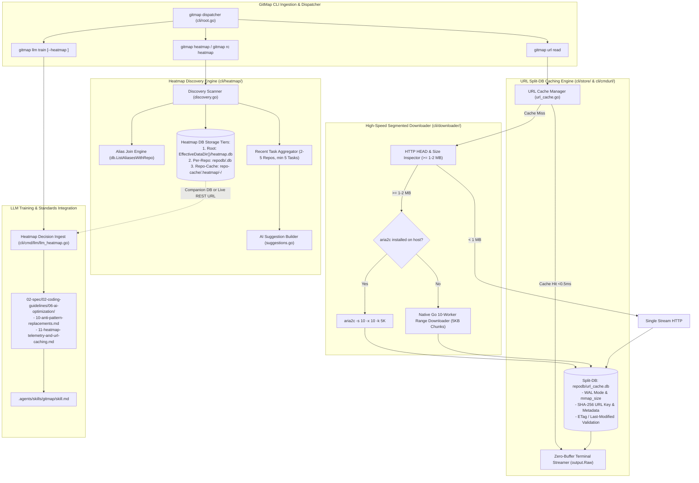

# Specification Overview: GitMap Heatmap Discovery, URL Split-DB Caching, Segmented Downloader & LLM Training Instructions

## Document Metadata
- **Document ID**: `02-spec/21-app/314-gitmap-heatmap-and-url-handling-instructions/00-overview.md`
- **Task Identifier**: Task 314 (`gitmap-heatmap-and-url-handling-instructions`)
- **Status**: `APPROVED / ARCHITECTURAL SPECIFICATION`
- **Version**: `1.0.0`
- **Classification**: System Specification & Traceability Matrix
- **Disjoint Owners**: Lead Orchestrator & Multi-Agent Swarm

---

## Executive Overview

Task 314 upgrades the GitMap CLI ecosystem across four core operational pillars:
1. **Heatmap Discovery & AI Help**: Unifying `gitmap heatmap` and `gitmap rc heatmap` to provide an exhaustive, self-documenting discovery catalog. It inventories multi-tier heatmap SQLite databases, maps active repository aliases via `db.ListAliasesWithRepo()`, aggregates recent tasks across 2–5 repositories (minimum 5 tasks), and provides dynamic terminal suggestions and command pills for human operators and autonomous AI agents.
2. **URL Split-DB Caching**: Establishing a dedicated, ultra-low-latency SQLite Split-DB (`repodb/url_cache.db`) operating in WAL mode with single-writer concurrency governance and memory mapping (`PRAGMA mmap_size = 268435456`). Content is indexed by SHA-256 URL hash with HTTP ETag/Last-Modified validation. Repeated fetches by parallel workers stream in sub-millisecond time (<0.5ms) directly to standard output via `output.Raw()` without network roundtrips.
3. **10-Split Segmented & Aria2 Downloader**: Accelerating network transfers for payloads exceeding 1–2 MB. The engine detects host availability of `aria2c` (`aria2c -s 10 -x 10 -k 5K`) and falls back seamlessly to a native Go 10-connection parallel HTTP Range downloader with 5KB chunking, fully integrated into the URL cache manager.
4. **LLM Training Integration & Coding Guidelines**: Linking heatmap decision telemetry (`repo-cache/.heatmap/<seq>-<ai>/<repo>/heatmap.db` and live REST endpoints) into `gitmap llm train`, `gitmap llm train muse`, and `gitmap ai analysis llm-train`. Expanding repository coding standards with anti-pattern replacements (`10-anti-pattern-replacements.md`) and heatmap telemetry / URL caching rules (`11-heatmap-telemetry-and-url-caching.md`), updating `.agents/skills/gitmap/skill.md`, and concluding with a SemVer minor release.

---

## User Request (Verbatim)

```text
# GitMap Heatmap and URL Handling Instructions: high priority instruction, non-negotiable task

Try to understand when we do the gitmap space RC `heatmap` or `heatmap`, both of those should give some of the information, like where `heatmap` databases are, how each one we can check with an aliasing or quickly for which repo and how we can see it. The terminal helps and suggestion should be there. And also it should tell us when I just do `heatmap`, it'll tell us recent `heatmap` tasks which has done for, let's say, recent two to five repos, at least five of the task. And also it can show as a suggestion, multiple `heatmap` can be shown by this command or more of this repo. So all this help needs to be there when the help or just `heatmap`, gitmap space heatmap is requested. Make sure of that in the `gitmap` and also make sure that the coding guideline is updated with this sub commands and things like that, that any AI can use. And help needs to be very powerful so that AI can learn very easily. And also in the LLM train section, the `heatmap` needs to be referred by a file or a URL so that AI can learn very faster. Does this make any sense? Also, for URL read, I think every URL needs to read from gitmap, so gitmap can download and keep a backup of the URL. So there should be a split Database (Database (Db)) for URL read for gitmap. So in this way, if a same URL is asked by many workers, it could just say that we already have it and then put it to the terminal very quick. So this way it would reduce the download time. And if a file is very big, gitmap will automatically use the area 2C downloader split of 5KB or at least 10 splits. If the file is bigger than one or two megabytes, then this would do the splits and try to download the file as quick as possible. So I hope you make those improvements, do a minor bump, and release the gitmap as well. Is it clear?

## task: GitMap Heatmap and URL Handling Instructions
## slug: gitmap-heatmap-and-url-handling-instructions
```

---

## Strategic Intent & Systems Reasoning

Modern multi-agent swarms operating in GitMap perform hundreds of parallel repository inspections, documentation fetches, and code refactorings per hour. Without unified local caching and discovery:
1. **Telemetry Blind Spots**: Heatmap databases generated by different AI agents (`repo-cache/.heatmap/`) and local runs remain siloed, preventing agents from learning which files were recently mutated or whether a test expectation succeeded.
2. **Network Redundancy & Latency**: Multiple workers repeatedly fetch identical documentation, JSON schemas, or release assets from remote URLs, incurring rate limits and high latency.
3. **Download Bottlenecks**: Large archive and asset downloads (>1–2 MB) crawl over single-stream HTTP connections, stalling parallel orchestration waves.
4. **AI Context Friction**: Autonomous agents spend valuable context tokens querying non-standard CLI syntax rather than parsing concise, deterministic discovery tables and self-documenting suggestion pills.

Task 314 eliminates these bottlenecks by integrating local SQLite Split-DB caching, segmented network concurrency, multi-repo heatmap telemetry discovery, and explicit AI training references.

---

## Systems Architecture Topology



---

## Requirements Traceability Matrix (Task-01 through Task-10)

| Requirement ID | Requirement Description | Technical Component | Traceable Deliverables | Status |
| :--- | :--- | :--- | :--- | :--- |
| **Task-01** | Modular Specifications & Subtask Planning Architecture | Specs & AI Memory | `02-spec/21-app/314-gitmap-heatmap-and-url-handling-instructions/00-overview.md`<br>`01-architecture-spec.md`<br>`02-component-spec.md`<br>`99-consistency-report.md`<br>`.ai-memory/plans/pending/314-gitmap-heatmap-and-url-handling-instructions.md`<br>Subtasks `01` through `07` | `IN PROGRESS` |
| **Task-02** | Heatmap Database Discovery & CLI Route Normalization | `cli/heatmap/`<br>`cli/cmd/` | `cli/heatmap/discovery.go`<br>`cli/cmd/special_repos_rc_heatmap.go`<br>Eliminate `--repo` routing defect; scan 3 tiers of heatmap DBs; cross-reference aliases via `db.ListAliasesWithRepo()`. | `QUEUED` |
| **Task-03** | Multi-Repo Recent Task Aggregation & Interactive AI Suggestions | `cli/heatmap/` | `cli/heatmap/recent_tasks.go`<br>`cli/heatmap/suggestions.go`<br>Aggregate top 5–10 recent tasks across 2–5 repositories; render dynamic suggestion pills (`gitmap heatmap --repo <alias>`). | `QUEUED` |
| **Task-04** | Dedicated URL Caching Split-DB (`repodb/url_cache.db`) | `cli/store/` | `cli/store/url_cache_split_db.go`<br>`cli/store/url_cache_types.go`<br>SQLite WAL mode, single-writer mutex, `PRAGMA mmap_size`, SHA-256 URL hashing, ETag/Last-Modified metadata, payload compression. | `QUEUED` |
| **Task-05** | High-Speed CLI URL Reading & Raw Streaming | `cli/cmdurl/`<br>`cli/root.go` | `cli/cmdurl/url_read.go`<br>`gitmap url read <url>` streaming raw bytes via `output.Raw()`; `--refresh`, `--no-cache`, and `--json` inspection flags. | `QUEUED` |
| **Task-06** | 10-Split Segmented Downloader & Aria2 Acceleration | `cli/downloader/` | `cli/downloader/segmented.go`<br>`cli/downloader/aria2.go`<br>Trigger on payloads $\ge 1\text{--}2\text{ MB}$; host `aria2c -s 10 -x 10 -k 5K` execution with Go native 10-connection parallel Range fallback. | `QUEUED` |
| **Task-07** | LLM Training Heatmap Telemetry Ingestion via File/URL | `cli/cmd/llm/`<br>`cli/cmdai/` | `cli/cmd/llm/llm_heatmap.go`<br>`cli/cmd/llm/llm_train.go`<br>`--heatmap <path|url>` ingestion linking companion SQLite databases and REST endpoints into AI training pipelines. | `QUEUED` |
| **Task-08** | Autonomous AI Coding Guidelines & Skill Documentation | `02-spec/`<br>`.agents/skills/` | `02-spec/02-coding-guidelines/06-ai-optimization/10-anti-pattern-replacements.md`<br>`11-heatmap-telemetry-and-url-caching.md`<br>`.agents/skills/gitmap/skill.md` updates. | `QUEUED` |
| **Task-09** | Decoupled Unit & E2E Verification Suites | `cli/tests/` | `cli/heatmap/discovery_test.go`<br>`cli/store/url_cache_test.go`<br>`cli/downloader/segmented_test.go`<br>`cli/cmd/llm/llm_heatmap_test.go`<br>Strict skip-by-default isolation, zero live network dependencies. | `QUEUED` |
| **Task-10** | Retrospective Linter Verification, Minor Bump & Release | Repository Root | `python 03-ai-scripts/01-check-relative-paths.py`<br>`python 03-ai-scripts/check-enum-and-boolean.py`<br>`gitmap release` (SemVer minor bump)<br>Atomic commit via `gitmap cpf`. | `QUEUED` |

---

## Scope Boundaries & Guardrails

### In-Scope Deliverables
1. Authoring 4 modular specifications in `02-spec/21-app/314-gitmap-heatmap-and-url-handling-instructions/`.
2. Authoring master plan in `.ai-memory/plans/pending/` and 7 subtasks in `.ai-memory/plans/subtasks/`.
3. Heatmap discovery engine resolving root DB, per-repo DBs, and repo-cache multi-AI DBs.
4. Repo alias cross-referencing using `db.ListAliasesWithRepo()`.
5. Multi-repo task aggregation (2–5 repos, minimum 5 tasks) with formatted CLI tables.
6. AI-tailored suggestions rendered directly in terminal output.
7. SQLite Split-DB `repodb/url_cache.db` with WAL mode and unbuffered `output.Raw()` streaming.
8. 10-split segmented HTTP Range downloader with `aria2c` detection and fallback.
9. Heatmap telemetry linking in `gitmap llm train` via file path or live URL.
10. Authoring coding guideline specs 10 & 11 and updating `.agents/skills/gitmap/skill.md`.

### Excluded & Deferred Scope
1. **Network Mutations**: No automated scraping or crawling of third-party domains outside explicit URLs provided to `gitmap url read`.
2. **Schema Breaking Changes**: The existing `heatmap.db` table schema (`HeatmapTaskRecord`, `HeatmapActionLogRecord`) remains immutable. New discovery and URL caching tables are additive.
3. **External Package Additions**: Zero new external Go module dependencies. `modernc.org/sqlite` and standard library `net/http` are used exclusively.
4. **Git Operations in Subagents**: Total ban on subagents executing git commands (`git add`, `git commit`, `git push`, `git status`). All versioning is orchestrated through GitMap commands at root.
5. **No Intermediate Builds or Test Runs**: Phase 1 and Phase 2 strictly prohibit executing compilation or test commands.

---

## Non-Negotiable Architectural Invariants

- **Relative Path Hygiene**: Every path link across specs, plans, code, and documentation MUST be strictly relative (e.g. `cli/heatmap/discovery.go`, `02-spec/...`). Never include Windows drive letters or absolute file URI schemes.
- **Positive Booleans**: All boolean fields, variables, and parameters MUST begin with `is` or `has` (`hasCached`, `hasAria2`, `isAvailable`, `isExpired`). Negative booleans (`noCache`, `disabled`) are strictly prohibited.
- **Function Limit**: Function bodies must not exceed 15 lines (preferred $\le 8$ lines).
- **Conditional Flattening**: Zero nested `if` statements. Guard clauses and early returns are mandatory.
- **Error Sovereignty**: Leaf functions returning `error` must return wrapped errors directly via `apperror.WrapSimple(err, "<scope>")`. Never call `cliexit.HandleError` in leaf packages.
- **Single-Writer Safety**: All Split-DB SQLite writes must be synchronized via process-level sync mutexes to avoid `SQLITE_BUSY` contention during parallel swarm execution.
