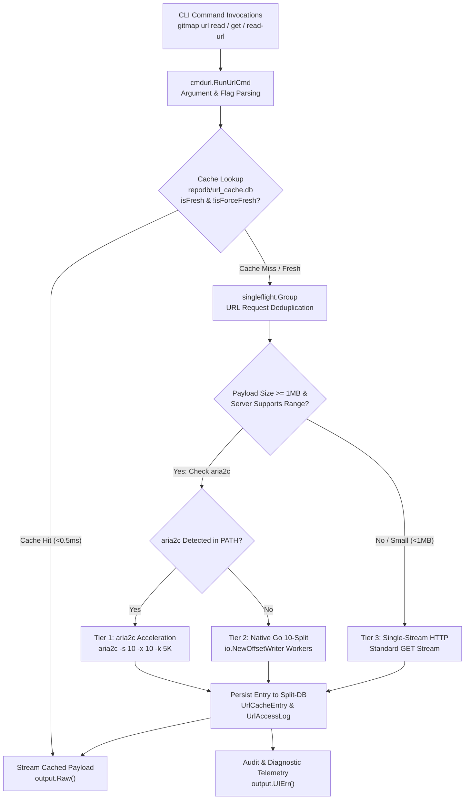

# Component Specification: URL Split-DB & Segmented Downloader

**Module:** `cli/store`, `cli/downloader`, `cli/cmdurl`, `cli/cmd`  
**Parent Plan:** `.ai-memory/plans/pending/314-gitmap-heatmap-and-url-handling-instructions.md`  
**Specification File:** `02-spec/21-app/314-gitmap-heatmap-and-url-handling-instructions/02-component-spec.md`  
**Version:** 1.0.0  
**Status:** Approved for Implementation  

---

## 1. Executive Summary & Component Scope

This component specification defines the technical architecture, database schemas, Go interfaces, concurrency controls, and CLI contracts for three high-performance subsystems in Gitmap:

1. **URL Split-DB Engine (`repodb/url_cache.db`)**:
   - Dedicated SQLite split database storing cached HTTP/HTTPS response payloads, headers, ETags, and access audit records.
   - Sub-millisecond (<0.5ms) cache retrieval via WAL mode, `PRAGMA mmap_size = 268435456` (256MB memory mapping), and indexed SHA-256 URL hash queries.
   - Request coalescing via `singleflight.Group` to prevent redundant parallel network requests across concurrent workers.
   - Full self-registration in `SplitDatabaseRegistry` and automatic discovery in `cli/store/storage_inventory.go`.

2. **CLI URL Read Interface (`gitmap url read <url>`)**:
   - Universal URL streaming and cache inspection command line interface with aliases `gitmap url <url>`, `gitmap read-url <url>`, and `gitmap get <url>`.
   - Complete subcommand suite: `read` (default), `ls`, `info`, `purge`, and `rm`.
   - Strict byte-faithful output streaming via `output.Raw()`, ensuring raw binary, ANSI sequences, and emojis are transmitted without modification.
   - Diagnostic messages, cache hit logs, and progress bars directed exclusively to `output.UIErr()`.
   - Flexible control flags: `--fresh` (force fetch), `--ttl <duration>` (cache retention), `--headers` (HTTP header display), and `--json` (structured envelope).

3. **10-Split Segmented & Aria2 Downloader (`cli/downloader`)**:
   - Multi-tier download acceleration pipeline automatically triggered for files >= 1–2 MB.
   - **Tier 1 (Host aria2c)**: Spawns host `aria2c` with 10 connections (`-s 10 -x 10 -k 5K`) for optimal network saturation.
   - **Tier 2 (Native Go 10-Split Range Downloader)**: Pre-allocates destination storage and coordinates 10 concurrent HTTP Range workers writing via `io.NewOffsetWriter`.
   - **Tier 3 (Single-Stream Fallback)**: Resilient fallback for servers lacking `Accept-Ranges: bytes` or payloads under the 1MB threshold.

---

## 2. Architecture & Subsystem Interaction

The following diagram illustrates the interaction between the CLI interface, downloader pipeline, and URL Split-DB storage engine:



---

## 3. URL Split-DB Engine (`repodb/url_cache.db`)

### 3.1 Path Resolution & Inventory Registration

The URL cache database is isolated within the repository-scoped data folder under `repodb/url_cache.db` to prevent database bloat in the primary repository metadata database (`gitmap.db`).

- **File Path Resolution (`cli/store/split_db_path.go`)**:
  ```go
  // ResolveUrlCacheDbPath resolves the URL cache split SQLite database file path.
  func ResolveUrlCacheDbPath(repoRoot string) string {
      baseDir := resolveBaseDataDir(repoRoot)
      dir := filepath.Join(baseDir, "repodb")
      _ = os.MkdirAll(dir, 0755)

      return filepath.ToSlash(filepath.Join(dir, "url_cache.db"))
  }
  ```

- **Storage Inventory Integration (`cli/store/storage_inventory.go`)**:
  `CollectAllDatabaseEntries` in `cli/store/storage_inventory.go` registers `url_cache.db` under the `"repodb"` database type:
  ```go
  func collectUrlCacheDatabase(dataDir string, add func(SplitDatabaseEntry)) {
      cachePath := ResolveUrlCacheDbPath("")
      if isFileExisting(cachePath) {
          add(inspectSplitDBFile("repodb", "url_cache", cachePath, "HTTP/HTTPS URL payload cache and access log"))
      }
  }
  ```

- **Self-Registration (`SplitDatabaseRegistry`)**:
  When initialized, the engine checks and upserts its entry in `SplitDatabaseRegistry`:
  - `DatabaseType`: `"repodb"`
  - `DatabaseKey`: `"url_cache"`
  - `DatabasePath`: canonical path returned by `ResolveUrlCacheDbPath("")`
  - `Status`: `"active"`
  - `IsActive`: `true`
  - `IsAttached`: `false`

### 3.2 Schema Definition & DDL

The URL cache database contains two PascalCase tables: `UrlCacheEntry` and `UrlAccessLog`.

```sql
-- Table: UrlCacheEntry
CREATE TABLE IF NOT EXISTS UrlCacheEntry (
    UrlCacheEntryId INTEGER PRIMARY KEY AUTOINCREMENT,
    UrlHash         TEXT NOT NULL UNIQUE,
    UrlText         TEXT NOT NULL,
    Etag            TEXT NULL,
    ContentType     TEXT NOT NULL DEFAULT 'application/octet-stream',
    ContentLength   INTEGER NOT NULL DEFAULT 0,
    PayloadBlob     BLOB NOT NULL,
    CompressionType TEXT NOT NULL DEFAULT 'none',
    ExpiresAt       INTEGER NOT NULL DEFAULT 0,
    AccessCount     INTEGER NOT NULL DEFAULT 1,
    IsActive        INTEGER NOT NULL DEFAULT 1,
    IsCompressed    INTEGER NOT NULL DEFAULT 0,
    CreatedAt       INTEGER NOT NULL DEFAULT (unixepoch()),
    UpdatedAt       INTEGER NOT NULL DEFAULT (unixepoch())
);

CREATE INDEX IF NOT EXISTS IdxUrlCacheEntry_UrlHash ON UrlCacheEntry(UrlHash);
CREATE INDEX IF NOT EXISTS IdxUrlCacheEntry_ExpiresAt ON UrlCacheEntry(ExpiresAt);
CREATE INDEX IF NOT EXISTS IdxUrlCacheEntry_UpdatedAt ON UrlCacheEntry(UpdatedAt);

-- Table: UrlAccessLog
CREATE TABLE IF NOT EXISTS UrlAccessLog (
    UrlAccessLogId  INTEGER PRIMARY KEY AUTOINCREMENT,
    UrlHash         TEXT NOT NULL,
    AccessMethod    TEXT NOT NULL DEFAULT 'GET',
    ResponseStatus  INTEGER NOT NULL DEFAULT 200,
    DurationMs      INTEGER NOT NULL DEFAULT 0,
    ByteCount       INTEGER NOT NULL DEFAULT 0,
    IsCacheHit      INTEGER NOT NULL DEFAULT 0,
    CreatedAt       INTEGER NOT NULL DEFAULT (unixepoch()),
    FOREIGN KEY(UrlHash) REFERENCES UrlCacheEntry(UrlHash) ON DELETE CASCADE
);

CREATE INDEX IF NOT EXISTS IdxUrlAccessLog_UrlHash ON UrlAccessLog(UrlHash);
CREATE INDEX IF NOT EXISTS IdxUrlAccessLog_CreatedAt ON UrlAccessLog(CreatedAt);
```

### 3.3 High-Performance PRAGMA Tuning

To achieve sub-millisecond (<0.5ms) read operations, the database connection is initialized with performance-tuned PRAGMA directives:

| PRAGMA Directive | Setting | Purpose |
| :--- | :--- | :--- |
| `journal_mode` | `WAL` | Enables concurrent readers alongside non-blocking writer. |
| `synchronous` | `NORMAL` | Reduces fsync latency while preserving WAL durability. |
| `busy_timeout` | `5000` | 5000ms wait before reporting database busy during multi-agent concurrent writes. |
| `mmap_size` | `268435456` | 256MB memory-mapped I/O for direct memory pointer payload reads. |
| `cache_size` | `-64000` | 64MB dedicated RAM page cache. |
| `temp_store` | `MEMORY` | Avoids disk spillover for temporary index lookups. |

### 3.4 Concurrency & Request Deduplication (`singleflight`)

When multiple concurrent processes or agent subtasks request the same remote URL simultaneously:
1. `singleflight.Group` intercepts the duplicate request using `UrlHash` as the key.
2. Only one network download runs across the process boundary.
3. Once completed and written to `repodb/url_cache.db`, all pending goroutines receive the payload simultaneously.
4. Prevents duplicate network bandwidth usage and eliminates database write lock contention.

---

## 4. CLI URL Read Interface (`gitmap url`)

### 4.1 Command Hierarchy & Aliases

The URL command provides a fast, transparent way to inspect, stream, and manage web assets directly from the terminal or AI agent processes.

- **Primary Command:** `gitmap url <subcommand> [flags]`
- **Default Action:** When the first argument is a URL (starting with `http://` or `https://`), the `read` subcommand is implicitly invoked.
- **Top-Level Aliases:**
  - `gitmap url <url>`
  - `gitmap read-url <url>`
  - `gitmap get <url>`

### 4.2 Subcommand Specifications

#### 1. `gitmap url read <url>` (Default)
Streams the URL content byte-faithfully to stdout.
- If cached and not expired: fetches from `url_cache.db` in <0.5ms.
- If missing or expired: downloads via multi-tier downloader, saves to cache, and streams to stdout.
- **Output:** Payload bytes written directly to `output.Raw()`. Diagnostic/telemetry logs emitted to `output.UIErr()`.
- **Flags:**
  - `--fresh`: Bypasses existing cache and forces network re-fetch.
  - `--ttl <duration>`: Overrides expiration TTL (e.g. `1h`, `24h`, `7d`). Default: `24h`.
  - `--headers`: Emits HTTP response headers to stderr before the payload.
  - `--json`: Formats metadata and payload into a structured JSON envelope.

#### 2. `gitmap url ls`
Lists cached URLs in tabular format.
- **Columns:** Hash (short 8 chars), URL, Size, Type, Access Count, Age, Expires In, Status.
- **Flags:**
  - `--limit <int>`: Maximum entries to display (default: 50).
  - `--json`: Serializes full list as JSON.

#### 3. `gitmap url info <url>`
Displays metadata, HTTP headers, cache history, and access statistics for a specific URL.
- **Output:** URL text, SHA-256 hash, ETag, Content-Type, byte length, compression status, total accesses, and last access timestamp.

#### 4. `gitmap url purge`
Cleans expired cache records and associated access logs.
- **Flags:**
  - `--all`: Forces eviction of all cached entries regardless of expiration.
- **Output:** Count of purged records and reclaimed disk space.

#### 5. `gitmap url rm <url>`
Removes a specific URL entry and its cached payload from the database.

### 4.3 Output Channel Separation & Byte-Faithful Streaming

In accordance with Gitmap's strict output architecture:
- **`output.Raw()`**: Must receive all payload data. Never pass payload bytes through `output.UI()` or terminal filter writers. ANSI color codes, binary files (tarballs, images), and raw JSON must reach stdout completely uncorrupted.
- **`output.UIErr()`**: Receives all diagnostics, cache hit notifications, transfer timings, and error alerts.
- Example execution:
  ```bash
  # Standard terminal usage with piped output
  gitmap url read https://api.example.com/data.json | jq .items[0]

  # Diagnostic log on stderr:
  # [cache:miss] Fetching https://api.example.com/data.json (Tier 2 Go-Range 10-Split)...
  # [cache:saved] Cached 2.4 MB with TTL 24h0m0s (hash: e3b0c442)
  ```

---

## 5. 10-Split Segmented & Aria2 Downloader (`cli/downloader`)

### 5.1 Dynamic Thresholding

Payload acceleration is dynamically activated based on remote metadata gathered via HTTP HEAD requests:

| Condition | Selected Tier | Download Mechanism |
| :--- | :--- | :--- |
| File Size < 1 MB or Unknown Length | **Tier 3** | Single-stream Go HTTP reader with streaming buffer. |
| File Size >= 1 MB & `Accept-Ranges: bytes` & `aria2c` installed | **Tier 1** | External `aria2c` multi-connection process (`-s 10 -x 10 -k 5K`). |
| File Size >= 1 MB & `Accept-Ranges: bytes` & no `aria2c` | **Tier 2** | Native Go 10-connection parallel Range worker pool. |
| Server rejects Range requests (`Accept-Ranges: none` or 416) | **Tier 3** | Automatic fallback to single-stream HTTP reader. |

### 5.2 Tier 1: Host `aria2c` Detection & Execution

- `aria2c` detection is performed via `exec.LookPath("aria2c")`.
- Execution arguments are calibrated for maximum throughput with 10 split segments:
  ```go
  args := []string{
      "--disable-ipv6=true",
      "-x", "10",
      "-s", "10",
      "-k", "5K",
      "--file-allocation=none",
      "--allow-overwrite=true",
      "--auto-file-renaming=false",
      "--summary-interval=0",
      "--console-log-level=error",
      "--show-console-readout=false",
      "--dir=" + destDir,
      "-o", destFile,
      urlText,
  }
  ```

### 5.3 Tier 2: Native Go 10-Connection Range Downloader

When `aria2c` is absent from the host system, Gitmap utilizes an in-process parallel Range downloader:

1. **Partition Calculation:**
   Given total bytes $C$, the byte range for worker $i \in [0, 9]$ is computed as:
   $$\text{chunkSize} = \lceil C / 10 \rceil$$
   $$\text{start}_i = i \times \text{chunkSize}$$
   $$\text{end}_i = \min((i + 1) \times \text{chunkSize} - 1, C - 1)$$

2. **Pre-Allocation & File Locking:**
   - Destination file is created and pre-allocated to size $C$ using `f.Truncate(C)` to prevent filesystem fragmentation and race conditions during non-sequential writes.

3. **Concurrent Range Workers:**
   - Spawns exactly 10 goroutines.
   - Each goroutine requests HTTP header `Range: bytes={start}-{end}`.
   - Server must respond with HTTP `206 Partial Content`.
   - Writes directly to the file descriptor using Go's `io.NewOffsetWriter(f, start_i)`.
   - Thread-safe offset writing allows all 10 connections to stream concurrently without mutex locks.

4. **Error Recovery & Fallback:**
   - If any chunk fails due to socket drop, the worker retries up to 3 times with exponential backoff.
   - If the server unexpectedly responds with HTTP `200 OK` (ignoring Range), the downloader aborts the worker pool and seamlessly cascades to Tier 3 single-stream mode.

### 5.4 Data Flow Models & Structs

```go
package downloader

import (
    "io"
    "time"
)

// DownloadTier indicates the acceleration level utilized.
type DownloadTier int

const (
    Tier1Aria2c DownloadTier = 1
    Tier2NativeRange DownloadTier = 2
    Tier3SingleStream DownloadTier = 3
)

// DownloadOptions holds execution configuration for URL retrieval.
type DownloadOptions struct {
    URL             string
    DestinationPath string
    IsForceFresh    bool
    IsQuiet         bool
    IsJSON          bool
    Timeout         time.Duration
    ChunkCount      int
    MinChunkSize    int64
    Headers         map[string]string
}

// DownloadResult summarizes the completed download operation.
type DownloadResult struct {
    URL             string       `json:"url"`
    DestinationPath string       `json:"destinationPath"`
    ContentLength   int64        `json:"contentLength"`
    DurationMs      int64        `json:"durationMs"`
    TierUsed        DownloadTier `json:"tierUsed"`
    IsRangeSupported bool         `json:"isRangeSupported"`
    IsCacheHit      bool         `json:"isCacheHit"`
    Sha256Checksum  string       `json:"sha256Checksum"`
    PayloadReader   io.Reader    `json:"-"`
}
```

---

## 6. Coding Standards & Rule Verification

All implementation code developed under this specification must strictly comply with Gitmap's core coding standards:

1. **Path Representation**:
   - All file and directory references must use strictly relative paths (`cli/...`, `02-spec/...`, `.ai-memory/...`).
   - Zero absolute paths (no drive letters `C:`, `D:` or `file:///`).

2. **Function Sizing & Complexity**:
   - Every function must adhere to the 15-line limit (<= 8 lines preferred).
   - Zero nested `if` statements. Early returns and guard clauses must flatten all branching.

3. **Boolean Naming**:
   - All boolean variables, struct fields, and functions must begin with `is*` or `has*` exclusively.
   - No negative booleans (e.g. use `isFresh` instead of `isNotExpired`).

4. **Error Management**:
   - Leaf functions returning `error` must return errors directly using `apperror.WrapSimple(err, "context")`.
   - No leaf function may call exit handlers (`cliexit.HandleError`) or `os.Exit`. Outer command dispatchers handle process termination.

5. **Zero External Mutation During Planning**:
   - Zero git commands.
   - Zero compiler builds or unit test executions.
