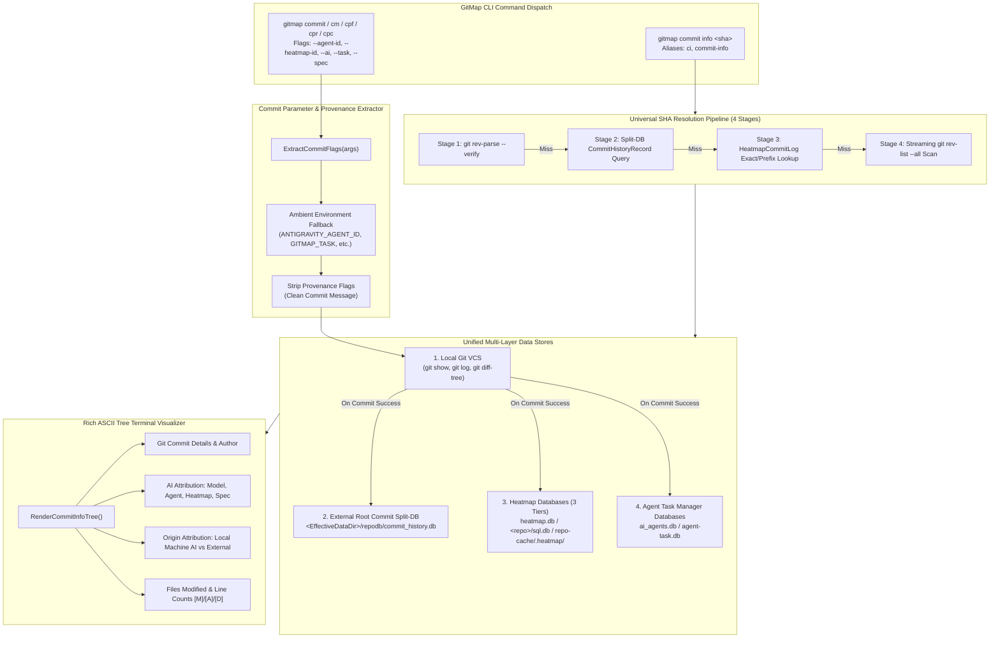

# Specification: GitMap Commit Tracking and Database Integration (Task 315)

## Document Metadata
- **Document Path**: `02-spec/21-app/315-gitmap-commit-tracking-and-database-integration/00-overview.md`
- **Specification Sequence**: `315`
- **Task Slug**: `gitmap-commit-tracking-and-database-integration`
- **Status**: `PROPOSED`
- **Target Release**: `v6.593.0` (SemVer Minor Bump)
- **Author**: Authoring Subagent 3 (Master Spec & Plan Author)
- **Reviewers**: Lead Orchestrator, Authoring Swarm
- **Parent Plan**: `.ai-memory/plans/pending/315-gitmap-commit-tracking-and-database-integration.md`
- **Subtasks Location**: `.ai-memory/plans/subtasks/315-gitmap-commit-tracking-and-database-integration/`

---

## 1. Executive Summary

Task 315 delivers an enterprise-grade **Commit Provenance Tracking & Cross-Database Integration System** for GitMap (`v6.593.0`). In modern distributed agentic engineering environments, multiple autonomous AI agents (operating in swarms across Claude, Gemini, GPT, DeepSeek, and local Muse instances) and human developers concurrently commit changes to repositories. When defects, regressions, or unintended mutations occur, developers and root orchestrators face severe attribution opacity: git logs record only the author's local git config username/email, completely obscuring which specific AI model, toolchain, subagent ID, heatmap session, parent task, or specification authorized and executed the commit.

Task 315 solves this by establishing a **four-layer integrated architecture**:
1. **Universal Commit Info Command (`gitmap commit info <sha>`)**: Provides instant SHA resolution accepting any full 40-character SHA, 7-character short SHA, prefix, suffix, or arbitrary substring. Resolves through a 4-stage pipeline and outputs a rich ASCII tree visualization rendering Git metadata, AI model attribution, transmission IDs, agent IDs, heatmap sessions, task slugs, subtask counts, spec links, modified file touch statistics, and origin attribution.
2. **External Root Commit Split-DB (`<EffectiveDataDir>/repodb/commit_history.db`)**: Operates outside working repositories in GitMap's central split-db tier. Runs in SQLite WAL mode with `PRAGMA synchronous = NORMAL`, `PRAGMA busy_timeout = 5000`, single-writer mutex locking, and 256MB memory mapping (`PRAGMA mmap_size = 268435456`) to guarantee $< 0.5\text{ ms}$ search performance. Stores normalized `CommitHistoryRecord` and `CommitFileTouch` records with covering indexes.
3. **Universal Commit Provenance Flags & Auto-Ingestion**: Extends all GitMap commit commands (`commit`, `cm`, `cpf`, `cpb`, `cpr`, `cpc`, `pcp`) with optional human/mandatory AI flags (`--agent-id`, `--heatmap-id`, `--ai`, `--spec`, `--task`) and ambient environment variable fallbacks (`ANTIGRAVITY_AGENT_ID`, `GITMAP_TASK`, `GITMAP_HEATMAP_ID`, `AI_MODEL`). Strips flags prior to committing to preserve clean messages, hooks into `commitAndOptionalPush`, and records commit metadata into the split-db and heatmap databases atomically.
4. **Origin Attribution & Machine Disambiguation**: Deterministically checks whether the committing AI originated from the local machine's heatmap/agent database or an external node/human. When external, displays the explicit origin declaration: `"The current machine's AI has not committed this (likely another worker/node/human)"`.
5. **Coding Guidelines, Skills & V6 Prompt Synchronization**: Authors canonical guideline `02-spec/02-coding-guidelines/06-ai-optimization/12-commit-provenance-and-tracking.md`, updates `.agents/skills/gitmap/skill.md`, updates `01-prompts/14-execute/02-execute-parent-task-with-n-steps-v6.md` and `.agents/skills/execute-parent-task-with-n-steps-v6/skill.md`, synchronizes connected repositories, and completes the SemVer minor release ceremony to `v6.593.0`.

---

## 2. User Request (Verbatim)

The following block records the verbatim, unedited instruction provided by the user:

```markdown
# GitMap Commit Tracking and Database Integration: high priority instruction, non-negotiable task

Also using the `gitmap`, we should be able to see using a commit SHA, if we just put it there on a repository, it will automatically tell. So there should be a commit info command that would actually take a look into the RC `gitmap` or also the `heatmap` and agent Database (Database (Db)) for that commit information. And every time a commit happens, the commit information needs to be informed by `gitmap`, `heatmap`, and agent Database (Database (Db)) both. Okay? So when we ask for any commit SHA, half of the SHA, first part or second part, any one of these, it should automatically search fast and should tell us where and which AI has committed based on which task it actually did those stuff. So everything should come up for that history, how many plans has been done, what was the spec that was related to this, absolutely everything. So that would be very much powerful so that we can track if a commit has a mistake, we can figure out which AI has made the mistake. So that would come up, which AI made the commit. So each time made a commit, the AI will also write itself so that we understand where it is coming from. But let's say it is done from another AI, which we don't have it in here in the `heatmap`, then we will understand, we can say the current machine's AI has not done it, so it will write it like this. So as many information it would have, it would share that in the terminal, as a tree view, so that the user can understand or the AI can understand. So based on that, you need to update the `gitmap` skills, coding guideline as well, and also the execute prompt in V6 that with the steps and understanding. And `gitmap` skills is very crucial so that AI can understand what to do and how to inform the commit. And `gitmap` commands like `gitmap` C, E, F or CPF or CPR or CPC. These commands will be automatically putting the AI information along with it. So these commands will have a parameter for the `heatmap` ``Id`` or the agent ``Id``, both of these it can put as optional item and that is must for AI when they are working. It is optional for the user when they do it, but not for the AI agent. For AI agent, they have to put their, let's say, agent transmission ``Id`` and slug and `heatmap` one. And with that, the `gitmap` will know where to update the database in the `heatmap` RC and also the agent Database (Database (Db)) will connect with that commit history. Does this make sense? Also in the root commit Database (Database (Db)) will have the information about this, let's say caching. Okay? So root Database (Database (Db)) means there should be a repo root Database (Database (Db)), not inside the repository, but where the CLI is close nearby, there should be a split Database (Database (Db)) for git commit history, something like this. And inside this it would have its sub repo Database (Database (Db)) where this information would be saved as a cache so that it can retrieve very fast. Do you understand all the steps? Can you please follow through and do a minor bound and make a release? And also update the coding guideline, `gitmap` skills and execute V6 prompt according to this and also sync with other repositories. Is it clear and understood?

## task: GitMap Commit Tracking and Database Integration
## slug: gitmap-commit-tracking-and-database-integration

# Actionable Items Must Follow Non-Negotiable

1. Git pull BEFORE starting any work — first try `gitmap pull <repo path>` (or run `gitmap pull` in repository folder); if that fails, fall back to regular `git pull` and resolve any merge conflicts so the repository is completely up to date and clean before starting.
2. Write spec under 02-spec/21-app/XX-gitmap-commit-tracking-and-database-integration/ and enqueue plan task in .ai-memory/plans/pending/XX-gitmap-commit-tracking-and-database-integration.md (subtasks in .ai-memory/plans/subtasks/XX-gitmap-commit-tracking-and-database-integration/) first, (xx should be figured out by the folder structure and running AI tools, xx is sequence 01, 02)
3. Search codebase exclusively via GitMap (gitmap aum search, gitmap find, gitmap cat, gitmap ps, gitmap py, gitmap llm train); TOTAL BAN on rg, ripgrep, grep, git grep, Select-String
4. Strictly use relative Git paths (02-spec/..., .ai-memory/..., cmd/...); only add the relative paths, never add the absolute path during your work, and ensure this is respected on the release page and in release notes as well
5. Implement a commit info command that integrates with RC `gitmap`, `heatmap`, and agent Database (Database (Db)) to provide comprehensive commit history and AI involvement.
6. Update `gitmap` skills and coding guidelines to include new commit tracking features and ensure AI agents include their transmission ``Id`` and `heatmap` ``Id`` in commits.
7. Ensure the root commit Database (Database (Db)) is established outside the repository for fast retrieval of commit history and caching.
8. Sync updates with other repositories and make a minor release.

## Must follow and spawn agent using

@[.agents/skills/execute-parent-task-with-n-steps-v6]

## Additional Instructions

- /plan first before doing work for improved work or less friction, faster execution for AI and coding without errors and following Coding Guidelines.
- /learn from @[.agents/skills/gitmap] skill to leverage GitMap high-speed search, toolchain discovery, and caching.
- Track in-flight file touches and prevent write collisions using GitMap RC Heatmap (`gitmap rc heatmap status` / `gitmap rc heatmap tree` / `gitmap rc heatmap live` / `gitmap rc heatmap sync`).
- Only add relative paths, never add absolute paths during work; this must be respected on release page and in release notes as well.
```

---

## 3. Strategic Intent & Systems Architecture Topology

### 3.1 Systems Architecture Overview
The GitMap commit tracking system operates as a unified cognitive bridge between the local Git VCS, the central split database engine, the multi-tier cognitive heatmap, and autonomous agent swarms.



---

## 4. Requirements Traceability Matrix (Task-01 through Task-08)

The table below maps each non-negotiable requirement from the user mandate to concrete architectural specifications, subtask plans, target code files, and verification targets.

| Requirement ID | Mandate Description | Specification Anchor | Subtask Plan | Target Code Files | Verification Target |
| :--- | :--- | :--- | :--- | :--- | :--- |
| **Task-01** | Pre-flight git synchronization (`gitmap pull`) before starting work. | `00-overview.md` § 1 | Pre-Flight Checkpoint | CLI working tree | Working tree clean, zero merge conflicts, synchronized upstream. |
| **Task-02** | Author comprehensive specifications in `02-spec/21-app/315-...` and master plan in `.ai-memory/plans/pending/315-...`. | `00-overview.md`<br>`01-architecture-spec.md`<br>`02-component-spec.md`<br>`99-consistency-report.md` | Authoring Swarm ($A=3$) | `02-spec/21-app/315-...`<br>`.ai-memory/plans/` | 100% specification coverage, zero absolute paths, disjoint file ownership. |
| **Task-03** | Implement `gitmap commit info <sha>` with shorthands (`ci`, `commit-info`), accepting any SHA fragment (40-char, 7-char, prefix, suffix, substring) via a 4-stage resolution pipeline. | `01-architecture-spec.md` § 2<br>`02-component-spec.md` § 3 | `01-subtask-commit-info-command.md`<br>`02-subtask-sha-resolver-and-tree-view.md` | `cli/cmdcommit/commit_info.go`<br>`cli/cmdcommit/commit_info_resolve.go`<br>`cli/cmd/rootcore.go` | Sub-millisecond lookup, partial SHA matches found in Git and Split-DB. |
| **Task-04** | Establish external Root Commit Split-DB (`<EffectiveDataDir>/repodb/commit_history.db`) outside repo with WAL mode, 256MB mmap, single-writer mutex, covering indexes, and self-registration in `SplitDatabaseRegistry`. | `01-architecture-spec.md` § 3<br>`02-component-spec.md` § 1 | `03-subtask-commit-history-split-db.md` | `cli/store/split_db_path.go`<br>`cli/store/commit_history_*.go`<br>`cli/store/split_database_registry_sync.go` | $< 0.5\text{ ms}$ retrieval, database outside working repository, WAL active. |
| **Task-05** | Extend commit commands (`commit`, `cm`, `cpf`, `cpb`, `cpr`, `cpc`, `pcp`) with provenance flags (`--agent-id`, `--heatmap-id`, `--ai`, `--spec`, `--task`), ambient environment fallbacks, flag stripping, and automatic ingestion on every commit. | `02-component-spec.md` § 2 & 4 | `04-subtask-commit-flags-and-ingestion.md` | `cli/cmdcommit/commit_types.go`<br>`cli/cmdcommit/commit_flags.go`<br>`cli/cmdcommit/commit_cmd.go`<br>`cli/cmdcommit/commit_push.go`<br>`cli/cmdcommit/commit_history_hook.go` | Flags parsed, stripped from commit message, and recorded in Split-DB on every commit. |
| **Task-06** | Cross-database AI provenance and origin attribution: query Split-DB, Heatmap DBs, and Agent Task DB. If not found in local heatmap, display explicit statement: `"The current machine's AI has not committed this (likely another worker/node/human)"`. | `01-architecture-spec.md` § 4<br>`02-component-spec.md` § 3 | `02-subtask-sha-resolver-and-tree-view.md` | `cli/cmdcommit/commit_info_query.go`<br>`cli/cmdcommit/commit_info_tree.go` | Accurate AI attribution rendered; non-local commits display fallback origin notice. |
| **Task-07** | Author coding guideline `12-commit-provenance-and-tracking.md`, update guidelines index, update `.agents/skills/gitmap/skill.md`, and update V6 execution prompt and skill. | `00-overview.md` § 6<br>`99-consistency-report.md` § 3 | `05-subtask-guidelines-and-skills-sync.md`<br>`06-subtask-v6-prompt-sync-and-release.md` | `02-spec/02-coding-guidelines/06-ai-optimization/`<br>`.agents/skills/gitmap/skill.md`<br>`01-prompts/14-execute/`<br>`.agents/skills/execute-.../` | Guidelines indexed, skill cheatsheets expanded, V6 prompt instructs AI commit flags. |
| **Task-08** | Synchronize updates across connected repositories, execute targeted linter checks, and execute SemVer minor release ceremony to `v6.593.0` via `gitmap cpf`. | `99-consistency-report.md` § 4 | `06-subtask-v6-prompt-sync-and-release.md` | `cli/constants/constants.go`<br>Changelogs, release notes | Version `v6.593.0` tagged, release notes written, atomic commit pushed upstream. |

---

## 5. Scope Boundaries (In-Scope vs. Excluded)

To prevent scope creep, accidental regressions, and architectural bloat, strict boundaries are enforced:

| In-Scope Capabilities | Strictly Excluded / Deferred Items |
| :--- | :--- |
| **CLI Commands**: `gitmap commit info <sha>`, `gitmap ci <sha>`, `gitmap commit-info <sha>` with `--json` support. | **Interactive Commit Amenders**: No interactive rebasing or git history rewriting. |
| **Universal SHA Resolution**: Full 40-char, short 7-char, prefix, suffix, and substring searches across Git, Split-DB, and Heatmap. | **Remote Git Server Telemetry**: No direct network scraping of GitHub/GitLab REST APIs during local commit info queries. |
| **External Split-DB Storage**: Central SQLite database `<EffectiveDataDir>/repodb/commit_history.db` with WAL mode and 256MB mmap. | **In-Repository SQLite Databases**: Never create `.db` or `.sqlite` files inside repository working trees. |
| **Commit Provenance Flags**: Extraction of `--agent-id`, `--heatmap-id`, `--ai`, `--spec`, `--task` across all commit commands. | **Mandatory Flags for Human Users**: Flag requirements apply strictly to AI agents; optional for humans. |
| **Automatic Ingestion Hook**: Seamless commit capture in `commitAndOptionalPush`, `performCommitPush`, and batch commits. | **Blocking Commit Failures on DB Errors**: Database logging failures must be logged safely without aborting successful git commits. |
| **Origin Disambiguation**: Deterministic detection of local machine AI vs. external worker/node/human. | **Cryptographic GPG Signature Verification**: Attribution is based on database correlation, not GPG public key rings. |
| **Terminal ASCII Tree Rendering**: Structured tree using `constants.TreeBranch`, `TreeCorner`, and `termout`. | **Web Visualizer UI**: Web frontend visualizations deferred to future releases. |
| **Guideline & Prompt Synchronization**: Authoring guideline 12, updating GitMap skills, and updating V6 execution prompt. | **Modifying Legacy Prompts V1–V5**: Only the active V6 execution prompt and skill are updated. |

---

## 6. Non-Negotiable Coding Guidelines & Quality Invariants

All source code and documentation created for Task 315 must strictly comply with GitMap's established coding standards:
1. **Error Sovereignty**: Leaf functions returning an `error` must return it directly (`return err` or `return apperror.Wrap(...)`). Leaf functions must NEVER invoke exit handlers (`cliexit.HandleError`) or `os.Exit`.
2. **Outer Caller Handles Exits**: Only top-level command dispatchers in `rootcore.go` or `main.go` decide how to terminate.
3. **Strongly-Typed Exit Enums**: No magic integer exit codes. Always use typed constants from `cli/constants`.
4. **Positive Boolean Naming**: All booleans must begin with `is` or `has` (`isLocalAI`, `hasHeatmapMatch`, `hasAgentMatch`, `isDryRun`). Banned: `can`, `should`, `was`, `will`, and double negatives.
5. **15-Line Function Limit**: Functions $\le 8$ lines preferred, $\le 15$ lines maximum. Split larger routines into concise private helpers.
6. **Zero Nested Ifs**: Flatten all nested conditional structures with guard clauses and early returns.
7. **Strict Relative Paths**: All paths in documentation, release notes, and code comments must use Git relative syntax (`02-spec/...`, `.ai-memory/...`, `cli/...`). Absolute paths (`C:`, `D:`, `file:///`) are forbidden.
8. **Strict Lowercase Filenames**: All markdown, spec, and plan filenames must be strictly lowercase.
9. **Zero Builds & Tests Mandate**: Do not trigger repository-wide builds (`go build ./...`) or test suites (`go test ./...`) during routine implementation.
10. **Zero Worker Git Commands**: Autonomous subagents must never run git commands directly. All staging, committing, and pushing is performed exclusively by the Lead Orchestrator using `gitmap cpf`.
