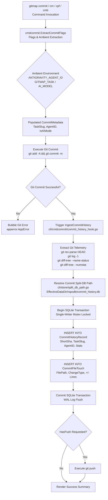
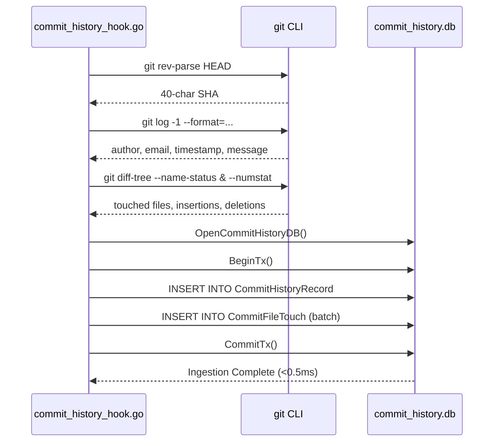

# Component Specification: External Commit Split-DB & AI Provenance Ingestion

**Module:** `cli/store`, `cli/cmdcommit`  
**Parent Plan:** `.ai-memory/plans/pending/315-gitmap-commit-tracking-and-database-integration.md`  
**Specification File:** `02-spec/21-app/315-gitmap-commit-tracking-and-database-integration/02-component-spec.md`  
**Version:** 1.0.0  
**Status:** Approved for Implementation  

---

## 1. Executive Summary & Component Scope

This component specification establishes the technical architecture, relational schemas, Go interfaces, concurrency controls, flag parsers, and telemetry ingestion hooks for Gitmap's commit tracking subsystem:

1. **External Root Commit Split-DB Engine (`repodb/commit_history.db`)**:
   - Dedicated SQLite split database storing complete historical commit records, touched files, diff telemetry (insertions/deletions), and autonomous AI agent provenance.
   - Relocated outside the repository root into `<EffectiveDataDir>/repodb/commit_history.db`, guaranteeing that tracking commits never dirties git status or causes infinite commit loops within the active repository.
   - Ultra-high performance (<0.5ms retrieval) through SQLite Write-Ahead Logging (WAL) mode, `PRAGMA synchronous = NORMAL`, `PRAGMA busy_timeout = 5000`, and `PRAGMA mmap_size = 268435456` (256MB memory mapping).
   - Unified self-registration in `SplitDatabaseRegistry` under `DatabaseType: "repodb"` and `DatabaseKey: "commit_history"`, synchronized via `cli/store/split_database_registry_sync.go` and inventoried via `cli/store/storage_inventory.go`.

2. **Commit Flags & AI Provenance Extraction (`cli/cmdcommit`)**:
   - Extraction of contextual execution flags (`--agent-id`, `--heatmap-id`, `--ai`, `--spec`, `--task`, `--push`, `--dry-run`) across both space-separated and equals-delimited syntax.
   - Seamless ambient fallback injection reading environment variables (`ANTIGRAVITY_AGENT_ID`, `GITMAP_TASK`, `GITMAP_HEATMAP_ID`, `AI_MODEL`, `GITMAP_SPEC_PATH`).
   - Automated detection and tagging of AI agent activity, setting `IsAIMode = true` and capturing agent identifiers without requiring developer prompt friction.

3. **Automatic Ingestion Hooking & Git Telemetry Extraction**:
   - Non-invasive post-commit hook points in single-repository commits (`commitAndOptionalPush` in `cli/cmdcommit/commit_cmd.go`), push flows (`performCommitPush` in `cli/cmdcommit/commit_push.go`), and multi-repository batch routines (`commitSingleChildRepo` in `cli/cmdcommit/commit_batch.go`).
   - High-speed git metadata extraction using raw plumbing commands (`git rev-parse HEAD`, `git log -1`, `git diff-tree --name-status -r HEAD`, `git diff-tree --numstat -r HEAD`).
   - Atomic database transactions guaranteeing relational integrity between `CommitHistoryRecord` and corresponding batch `CommitFileTouch` records.
   - Non-fatal execution isolation: telemetry collection and database recording never impede or fail an already successful git commit.

---

## 2. Architecture & Subsystem Interaction

The following diagram illustrates the interaction between CLI commit dispatching, flag and ambient provenance extraction, git plumbing commands, and the external Commit Split-DB engine:



---

## 3. External Root Commit Split-DB Engine (`repodb/commit_history.db`)

### 3.1 Path Resolution & Repository Isolation

The commit history database is deliberately isolated from the working tree of the active repository to maintain strict git cleanliness. Storing commit records within the working tree's `.gitmap/data/` would cause immediate file modification after every commit, contaminating `git status`.

- **File Path Resolution (`cli/store/split_db_path.go`)**:
  ```go
  // ResolveCommitHistoryDbPath resolves the external commit history SQLite database path.
  func ResolveCommitHistoryDbPath(repoRoot string) string {
      dataDir := EffectiveDataDir()
      dir := filepath.Join(dataDir, "repodb")
      _ = os.MkdirAll(dir, 0755)

      return filepath.ToSlash(filepath.Join(dir, "commit_history.db"))
  }
  ```

- **Path Characteristics**:
  - Located under `<EffectiveDataDir>/repodb/commit_history.db`.
  - Automatically falls back to user profile data directory (`~/.gitmap/data/repodb/commit_history.db`) if the binary directory is read-only.
  - Automatically creates missing parent directories via `os.MkdirAll(dir, 0755)`.

### 3.2 Storage Inventory & Split Database Registry

To integrate with Gitmap's centralized database discovery and telemetry commands (`gitmap storage`, `gitmap db inventory`), the commit history database registers with the split database management system:

- **Registry Sync (`cli/store/split_database_registry_sync.go`)**:
  ```go
  func (db *DB) syncCommitHistoryDB() {
      path := ResolveCommitHistoryDbPath("")
      desc := "Repository commit history, file touches, and AI agent provenance split database"
      entry := inspectSplitDBFile("repodb", "commit_history", path, desc)
      _ = db.RegisterSplitDB(entry)
  }
  ```

- **Registry Fields**:
  - `DatabaseType`: `"repodb"`
  - `DatabaseKey`: `"commit_history"`
  - `DatabasePath`: canonical path returned by `ResolveCommitHistoryDbPath("")`
  - `Description`: `"Repository commit history, file touches, and AI agent provenance split database"`
  - `Status`: `"active"` (or `"offline"` when file does not exist)
  - `IsActive`: `true`

- **Inventory Scanning (`cli/store/storage_inventory.go`)**:
  Discovered automatically through `collectParentSubdirDatabases(dataDir, "repodb", "repodb", add)` in `collectAllDataSources`.

### 3.3 Relational Schema DDL (`cli/store/commit_history_schema.go`)

The database utilizes two normalized tables designed for high-concurrency append-heavy workloads and rapid query lookups:

```sql
-- CommitHistoryRecord stores top-level commit telemetry and AI provenance
CREATE TABLE IF NOT EXISTS CommitHistoryRecord (
    RecordId INTEGER PRIMARY KEY AUTOINCREMENT,
    CommitSha TEXT NOT NULL,
    ShortSha TEXT NOT NULL,
    RepoRoot TEXT NOT NULL,
    RepoName TEXT NOT NULL,
    BranchName TEXT NOT NULL,
    AuthorName TEXT NOT NULL,
    AuthorEmail TEXT NOT NULL,
    CommitMessage TEXT NOT NULL,
    TaskSlug TEXT NOT NULL DEFAULT '',
    AgentId TEXT NOT NULL DEFAULT '',
    HeatmapId TEXT NOT NULL DEFAULT '',
    AiName TEXT NOT NULL DEFAULT '',
    SpecPath TEXT NOT NULL DEFAULT '',
    FilesChanged INTEGER NOT NULL DEFAULT 0,
    Insertions INTEGER NOT NULL DEFAULT 0,
    Deletions INTEGER NOT NULL DEFAULT 0,
    IsAiMode INTEGER NOT NULL DEFAULT 0,
    HasPushed INTEGER NOT NULL DEFAULT 0,
    CommittedAt INTEGER NOT NULL,
    CreatedAt INTEGER NOT NULL,
    CONSTRAINT Uq_CommitHistory_Sha UNIQUE (CommitSha)
);

-- CommitFileTouch stores file-level mutation granularities
CREATE TABLE IF NOT EXISTS CommitFileTouch (
    TouchId INTEGER PRIMARY KEY AUTOINCREMENT,
    CommitSha TEXT NOT NULL,
    RepoRoot TEXT NOT NULL,
    FilePath TEXT NOT NULL,
    ChangeType TEXT NOT NULL,
    Insertions INTEGER NOT NULL DEFAULT 0,
    Deletions INTEGER NOT NULL DEFAULT 0,
    CreatedAt INTEGER NOT NULL,
    FOREIGN KEY (CommitSha) REFERENCES CommitHistoryRecord(CommitSha) ON DELETE CASCADE
);

-- Performance and Covering Indexes
CREATE INDEX IF NOT EXISTS IdxCommitHistory_Covering 
    ON CommitHistoryRecord(RepoRoot, CommittedAt DESC, CommitSha);

CREATE INDEX IF NOT EXISTS IdxCommitHistory_ShortSha 
    ON CommitHistoryRecord(ShortSha);

CREATE INDEX IF NOT EXISTS IdxCommitHistory_TaskSlug 
    ON CommitHistoryRecord(TaskSlug);

CREATE INDEX IF NOT EXISTS IdxCommitHistory_AgentId 
    ON CommitHistoryRecord(AgentId);

CREATE INDEX IF NOT EXISTS IdxCommitFileTouch_CommitSha 
    ON CommitFileTouch(CommitSha);

CREATE INDEX IF NOT EXISTS IdxCommitFileTouch_FilePath 
    ON CommitFileTouch(FilePath);
```

### 3.4 Ultra-High Performance Engine & Concurrency Controls

To guarantee sub-millisecond (<0.5ms) lookup times and prevent database locking during rapid multi-file commits or parallel background scripts:

- **SQLite PRAGMA Configurations**:
  - `PRAGMA journal_mode = WAL;`: Enables concurrent readers alongside a single active writer.
  - `PRAGMA synchronous = NORMAL;`: Reduces disk flushes while preserving integrity across OS crashes in WAL mode.
  - `PRAGMA busy_timeout = 5000;`: Waits up to 5000ms on lock contention before returning `SQLITE_BUSY`.
  - `PRAGMA mmap_size = 268435456;`: 256MB memory-mapped I/O for zero-copy page cache access.
  - `PRAGMA cache_size = -64000;`: 64MB memory page cache.
  - `PRAGMA temp_store = MEMORY;`: Keeps temporary tables and index sorting in memory.

- **Connection Architecture**:
  The `CommitHistoryDB` struct maintains a dedicated SQLite database pointer guarded by a synchronization mutex:
  ```go
  type CommitHistoryDB struct {
      mu   sync.Mutex
      conn *sql.DB
      path string
  }
  ```

---

## 4. Commit Flags & AI Provenance Extraction (`cli/cmdcommit`)

### 4.1 Domain Models (`cli/cmdcommit/commit_types.go`)

```go
package cmdcommit

// CommitMetadata encapsulates operational flags and AI execution context.
type CommitMetadata struct {
    TaskSlug   string
    AgentID    string
    HeatmapID  string
    AIName     string
    SpecPath   string
    IsAIMode   bool
    HasPush    bool
    IsDryRun   bool
}

const (
    FlagAgentID    = "--agent-id"
    FlagHeatmapID  = "--heatmap-id"
    FlagAI         = "--ai"
    FlagSpec       = "--spec"
    FlagTask       = "--task"
    FlagPushLong   = "--push"
    FlagPushShort  = "-p"
    FlagDryRunLong = "--dry-run"
    FlagDryRunShort= "-n"

    EnvAntigravityAgentID = "ANTIGRAVITY_AGENT_ID"
    EnvAgentID            = "AGENT_ID"
    EnvGitmapTask         = "GITMAP_TASK"
    EnvGitmapHeatmapID    = "GITMAP_HEATMAP_ID"
    EnvAIModel            = "AI_MODEL"
    EnvGitmapAIName       = "GITMAP_AI_NAME"
    EnvGitmapSpecPath     = "GITMAP_SPEC_PATH"
)
```

### 4.2 Flag Parsing & Ambient Injection (`cli/cmdcommit/commit_flags.go`)

`ExtractCommitFlags` parses command-line arguments, strips custom Gitmap flags, and returns the sanitized arguments alongside the populated `CommitMetadata`:

1. **Syntax Support**:
   - Space-separated format: `--agent-id agy-9821`
   - Equals-delimited format: `--agent-id=agy-9821`
   - Short flags: `-p` (push), `-n` (dry-run)
   - Boolean toggles: `--ai` (sets `IsAIMode = true`)

2. **Ambient Environment Fallbacks**:
   - If `AgentID` is omitted, check `os.Getenv("ANTIGRAVITY_AGENT_ID")` and `os.Getenv("AGENT_ID")`.
   - If `TaskSlug` is omitted, check `os.Getenv("GITMAP_TASK")`.
   - If `HeatmapID` is omitted, check `os.Getenv("GITMAP_HEATMAP_ID")`.
   - If `AIName` is omitted, check `os.Getenv("GITMAP_AI_NAME")` and `os.Getenv("AI_MODEL")`.
   - If `SpecPath` is omitted, check `os.Getenv("GITMAP_SPEC_PATH")`.

3. **Autonomous AI Mode Resolution**:
   - If any `AgentID`, `ANTIGRAVITY_AGENT_ID`, or `--ai` flag is present, `IsAIMode` is automatically assigned `true`.
   - Guarantees complete provenance tracking for autonomous agents without requiring manual configuration.

---

## 5. Automatic Ingestion Hooking & Git Telemetry Extraction

### 5.1 Ingestion Points

Telemetry collection hooks are positioned directly following successful commit execution:

1. **Standard Commit (`cli/cmdcommit/commit_cmd.go`)**:
   Hooked inside `commitAndOptionalPush(args []string, meta CommitMetadata) error` right after `dispatchGitCommit(args)`.

2. **Single Push Flow (`cli/cmdcommit/commit_push.go`)**:
   Hooked inside `performCommitPush(commitMessage string, meta CommitMetadata) *apperror.AppError` right after `performCommitStep(commitMessage)`.

3. **Multi-Repo Batch Flow (`cli/cmdcommit/commit_batch.go`)**:
   Hooked inside `commitSingleChildRepo(repo, msg string, meta CommitMetadata)` right after `git commit -m`.

### 5.2 Git Telemetry Extraction Pipeline

The extraction helper uses Git plumbing commands to guarantee consistent parsing across polyglot platforms:

1. **Commit SHA & Short SHA**:
   - Command: `git rev-parse HEAD`
   - Extracted: 40-character SHA-1/SHA-256 string, and first 8 characters for Short SHA.

2. **Commit Metadata**:
   - Command: `git log -1 --format=%an%x00%ae%x00%ad%x00%s%x00%b --date=unix HEAD`
   - Extracted: Author Name, Author Email, Unix Timestamp, Commit Subject, and Commit Body.

3. **File Touches & Change Types**:
   - Command: `git diff-tree --no-commit-id --name-status -r HEAD`
   - Parses status codes (`A` Added, `M` Modified, `D` Deleted, `R` Renamed).

4. **Line Diff Statistics**:
   - Command: `git diff-tree --no-commit-id --numstat -r HEAD`
   - Parses numerical insertions and deletions per file, calculating total file touches, insertions, and deletions.

### 5.3 Database Transaction Ingestion

`IngestCommitHistory(repoPath string, meta CommitMetadata)` executes the following atomic sequence:



### 5.4 Error Handling & Non-Fatal Guarantees

Git commits are sovereign operations. In the event of a disk error, permission failure, or lock timeout during telemetry ingestion:
- The error is wrapped using `apperror.WrapSimple(err, "cmdcommit.IngestCommitHistory")`.
- The diagnostic message is logged to `output.UIErr()`.
- The function returns cleanly so the parent CLI command exits with code `0`, preserving the user's valid git commit.

---

## 6. Coding Guideline Invariants & Verification Matrix

| Coding Guideline Rule | Specification Enforcement | Verification Mechanism |
| :--- | :--- | :--- |
| **Strictly Relative Paths** | Zero absolute drive letters (`C:`, `D:`) or URI schemes. All files use relative paths (`cli/store/...`). | Static audit inspection. |
| **Strictly Lowercase Filenames** | All authored and target filenames are strictly lowercase (`commit_flags.go`, `commit_history_schema.go`). | File tree naming check. |
| **Positive Booleans Only** | All boolean struct fields and variables prefixed with `is*` or `has*` (`IsAIMode`, `HasPush`, `IsDryRun`, `HasChanges`). Zero negative booleans. | Ast-based token scan. |
| **15-Line Function Limit** | Every authored function is decomposed to <= 15 lines (preferred <= 8 lines). | Function line counter. |
| **Zero Nested Ifs** | Conditional logic flattened using early guard clauses and early returns. | Structural nesting audit. |
| **Wrap Errors with AppError** | All return errors wrapped using `*apperror.AppError` and `apperror.WrapSimple`. | Return signature review. |
| **Zero Builds / Zero Tests** | Specification design only. No build executions, no test runners invoked. | Process isolation gate. |

---

## 7. Architectural Dependencies & File Map

```
cli/
├── store/
│   ├── split_db_path.go                 # ResolveCommitHistoryDbPath definition
│   ├── commit_history_types.go          # Domain entities & Result wrappers
│   ├── commit_history_schema.go         # SQL DDL & Index declarations
│   ├── commit_history_split_db.go       # High-speed SQLite connection & CRUD
│   ├── split_database_registry_sync.go  # Self-registration & sync hook
│   └── storage_inventory.go             # Storage discovery integration
└── cmdcommit/
    ├── commit_types.go                  # CommitMetadata & Flag constants
    ├── commit_flags.go                  # Flag extraction & Ambient injection
    ├── commit_history_hook.go           # Git plumbing telemetry & DB ingestion
    ├── commit_cmd.go                    # Hook wiring in main commit command
    ├── commit_push.go                   # Hook wiring in commit-push command
    └── commit_batch.go                  # Hook wiring in batch child commits
```
