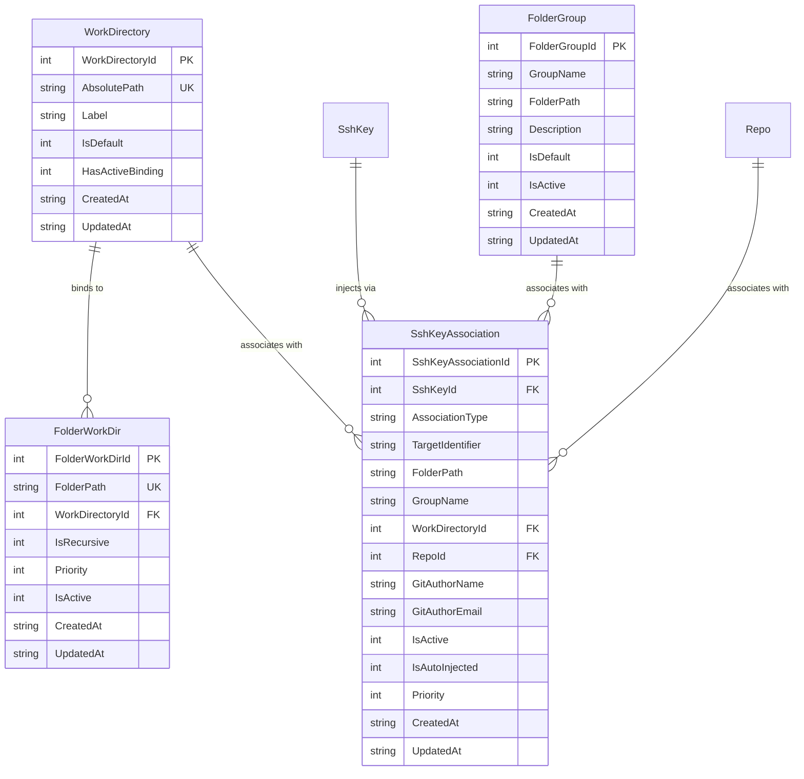

# 01-database-schema-spec: Database & Schema Specification

> **Module:** `02-spec/21-app/317-system-for-folder-specific-work-directories-and-ssh-key-automation`  
> **Sequence ID:** `317`  
> **Subtask Plan:** [.ai-memory/plans/subtasks/317-system-for-folder-specific-work-directories-and-ssh-key-automation/subtask-01-database-schema.md](../../../.ai-memory/plans/subtasks/317-system-for-folder-specific-work-directories-and-ssh-key-automation/subtask-01-database-schema.md)  
> **Schema Version Target:** `SchemaVersionCurrent = 34`  
> **Status:** `Implementation-Ready`  
> **Version:** `1.0.0`  
> **Updated:** `2026-10-24`  

---

## 1. Executive Summary & Intent

This specification establishes the database architecture, schema definitions, migration pipeline, and Go entity models for the **Folder-Specific Work Directories and SSH Key Automation Subsystem** in GitMap.

### 1.1 Core Problems Addressed
1. **Monolithic Working Directory Friction:** Previously, GitMap supported only a flat collection of work directories with a single global default (`work_directories` table). Developers working across distinct environments (e.g., enterprise client repositories, personal open-source projects, and remote fleet nodes) had to manually reconfigure target paths.
2. **Manual Credential Switching:** Developers managing multiple SSH keys (e.g., corporate SSO vs. personal GitHub/GitLab vs. custom deployment keys) suffered from recurring authentication errors, git credential prompts, and leaked commits under wrong author identities.
3. **Legacy Schema Casing & Fragility:** The existing `work_directories` table used snake_case table names and legacy snake_case columns (`id`, `absolute_path`, `is_default`), conflicting with GitMap's repository-wide PascalCase architecture guidelines (`02-spec/02-coding-guidelines/01-cross-language/07-database-naming.md` and `02-spec/04-database-conventions/02-naming-conventions.md`).

### 1.2 System Capabilities Delivered
- **PascalCase Modernization:** Replaces snake_case `work_directories` with a first-class PascalCase `WorkDirectory` table while maintaining a 100% backward-compatible view `work_directories`.
- **Folder-to-WorkDir Mapping (`FolderWorkDir`):** Binds filesystem folder trees to dedicated working directories with longest-prefix hierarchy inheritance and Windows/Unix case-insensitive collation (`COLLATE NOCASE`).
- **Work Group Categorization (`FolderGroup`):** Organizes arbitrary folders and repositories into cohesive workgroups (e.g., `client-alpha`, `agency-fleet`, `personal-foss`).
- **Automated Credential Binding (`SshKeyAssociation`):** Automatically maps SSH keys to folders, groups, workdirs, or specific repos. Persists custom Git author name/email overrides for automatic identity masking.
- **Migration Engine Advancement (`SchemaVersionCurrent = 34`):** Advances schema version from 33 to 34 with idempotent migration, automatic data backfill from legacy tables, and zero downtime or data loss.

---

## 2. Database Topology & Split-DB Placement

GitMap enforces a Three-Tier SQLite Split-DB storage pattern (`02-spec/05-split-db-architecture/readme.md`). The placement of entities defined in this specification is governed by the following architecture:

```
+----------------------------------------------------------------------------------------------------+
|                                Three-Tier SQLite Split-DB Architecture                             |
+----------------------------------------------------------------------------------------------------+
|  Tier 1: Machine-Local Master Database (~/.gitmap/gitmap.db)                                       |
|  - Repo (Repository catalog, remotes, transports, branch tracking)                                 |
|  - WorkDirectory (Master catalog of registered workspaces)                                         |
|  - FolderWorkDir (Path-to-WorkDirectory binding table)                                             |
|  - FolderGroup (Folder and WorkGroup association table)                                             |
|  - SshKeyAssociation (Credential routing & author override table)                                  |
|  - SshKey (SSH key metadata & encrypted private key vault)                                         |
|  - Setting (Key-value engine configuration & schema_version tracking)                              |
+----------------------------------------------------------------------------------------------------+
|  Tier 2: Installation Database (~/.gitmap/installation.db)                                          |
|  - SshHosts / Node (Remote fleet nodes, SSH connection parameters)                                 |
|  - Bookmark / AntigravityProject (Host-level IDE workspace registrations)                           |
+----------------------------------------------------------------------------------------------------+
|  Tier 3: Telemetry & Pipeline Database (.gitmap/repodb/pipeline.db, heatmap.db)                    |
|  - PipelineRun / PullError / StageTiming / HeatmapActionLog                                        |
+----------------------------------------------------------------------------------------------------+
```

### 2.1 Concurrency & Storage Invariants
- **Write-Ahead Logging (WAL):** `PRAGMA journal_mode = WAL;` is enforced across all connections to enable non-blocking concurrent reads during batch operations.
- **Busy Timeout:** `PRAGMA busy_timeout = 5000;` ensures queries wait up to 5 seconds before reporting lock contention.
- **Foreign Key Integrity:** `PRAGMA foreign_keys = ON;` is strictly enabled. Deletion of a `WorkDirectory` or `SshKey` cleanly cascades or re-binds dependent associations.
- **Single-Writer Pool:** All write connections maintain `db.SetMaxOpenConns(1)` to eliminate SQLite locking panics in Go.

---

## 3. PascalCase Database Schema Specification (DDL)

All tables, primary keys, and column attributes strictly adhere to PascalCase formatting, `{TableName}Id` primary keys, and positive-only boolean naming (`Is...`, `Has...`).



### 3.1 Table `WorkDirectory`

Defines the master registry of recognized root working directories on the host machine. Replaces the legacy `work_directories` table.

```sql
CREATE TABLE IF NOT EXISTS WorkDirectory (
    WorkDirectoryId    INTEGER PRIMARY KEY AUTOINCREMENT,
    AbsolutePath       TEXT NOT NULL UNIQUE COLLATE NOCASE,
    Label              TEXT NOT NULL DEFAULT '',
    IsDefault          INTEGER NOT NULL DEFAULT 0,
    HasActiveBinding   INTEGER NOT NULL DEFAULT 1,
    CreatedAt          TEXT NOT NULL DEFAULT CURRENT_TIMESTAMP,
    UpdatedAt          TEXT NOT NULL DEFAULT CURRENT_TIMESTAMP
);

CREATE UNIQUE INDEX IF NOT EXISTS IdxWorkDirectory_AbsolutePath 
    ON WorkDirectory(AbsolutePath COLLATE NOCASE);

CREATE INDEX IF NOT EXISTS IdxWorkDirectory_IsDefault 
    ON WorkDirectory(IsDefault);
```

#### Field Specifications:
- `WorkDirectoryId`: Monotonically increasing primary key.
- `AbsolutePath`: Canonical, normalized filesystem directory path. Windows and Unix case-insensitivity enforced via `COLLATE NOCASE`.
- `Label`: Human-readable identifier or tag (e.g. `Client Enterprise`, `Main Workspaces`).
- `IsDefault`: Positive boolean flag (`1` for default fallback workspace, `0` otherwise). Exactly one active directory should be default.
- `HasActiveBinding`: Positive boolean flag indicating whether the directory is actively bound and available for automated project cloning and discovery.
- `CreatedAt` / `UpdatedAt`: UTC ISO-8601 timestamps.

---

### 3.2 Table `FolderWorkDir`

Maps arbitrary directories or parent directories to a target `WorkDirectory`. Enables hierarchical matching so child repositories automatically adopt the parent folder's designated workspace settings.

```sql
CREATE TABLE IF NOT EXISTS FolderWorkDir (
    FolderWorkDirId    INTEGER PRIMARY KEY AUTOINCREMENT,
    FolderPath         TEXT NOT NULL UNIQUE COLLATE NOCASE,
    WorkDirectoryId    INTEGER NOT NULL REFERENCES WorkDirectory(WorkDirectoryId) ON DELETE CASCADE,
    IsRecursive        INTEGER NOT NULL DEFAULT 1,
    Priority           INTEGER NOT NULL DEFAULT 100,
    IsActive           INTEGER NOT NULL DEFAULT 1,
    CreatedAt          TEXT NOT NULL DEFAULT CURRENT_TIMESTAMP,
    UpdatedAt          TEXT NOT NULL DEFAULT CURRENT_TIMESTAMP
);

CREATE UNIQUE INDEX IF NOT EXISTS IdxFolderWorkDir_FolderPath 
    ON FolderWorkDir(FolderPath COLLATE NOCASE);

CREATE INDEX IF NOT EXISTS IdxFolderWorkDir_WorkDirId 
    ON FolderWorkDir(WorkDirectoryId);

CREATE INDEX IF NOT EXISTS IdxFolderWorkDir_Priority 
    ON FolderWorkDir(Priority DESC);
```

#### Field Specifications:
- `FolderWorkDirId`: Primary key.
- `FolderPath`: Directory path to match. Case-insensitive via `COLLATE NOCASE`.
- `WorkDirectoryId`: Foreign key to `WorkDirectory`. Cascades on deletion.
- `IsRecursive`: Positive boolean (`1` = applies to all child repositories and subdirectories; `0` = applies strictly to the exact folder).
- `Priority`: Resolution precedence integer (defaults to `100`). Higher values take precedence when multiple overlapping path rules exist.
- `IsActive`: Positive boolean flag allowing temporary disabling of a path mapping without deleting historical configuration.

---

### 3.3 Table `FolderGroup`

Enables organizing folders and repositories into logical workgroups (e.g. `team-backend`, `client-payments`, `oss-tools`).

```sql
CREATE TABLE IF NOT EXISTS FolderGroup (
    FolderGroupId      INTEGER PRIMARY KEY AUTOINCREMENT,
    GroupName          TEXT NOT NULL COLLATE NOCASE,
    FolderPath         TEXT NOT NULL COLLATE NOCASE,
    Description        TEXT NOT NULL DEFAULT '',
    IsDefault          INTEGER NOT NULL DEFAULT 0,
    IsActive           INTEGER NOT NULL DEFAULT 1,
    CreatedAt          TEXT NOT NULL DEFAULT CURRENT_TIMESTAMP,
    UpdatedAt          TEXT NOT NULL DEFAULT CURRENT_TIMESTAMP,
    UNIQUE (GroupName COLLATE NOCASE, FolderPath COLLATE NOCASE)
);

CREATE UNIQUE INDEX IF NOT EXISTS IdxFolderGroup_NamePath 
    ON FolderGroup(GroupName COLLATE NOCASE, FolderPath COLLATE NOCASE);

CREATE INDEX IF NOT EXISTS IdxFolderGroup_GroupName 
    ON FolderGroup(GroupName COLLATE NOCASE);

CREATE INDEX IF NOT EXISTS IdxFolderGroup_FolderPath 
    ON FolderGroup(FolderPath COLLATE NOCASE);
```

#### Field Specifications:
- `FolderGroupId`: Primary key.
- `GroupName`: Human-friendly workgroup name (e.g. `finance-portal`, `infrastructure`).
- `FolderPath`: Folder path participating in this group.
- `Description`: Optional documentation regarding group responsibilities.
- `IsDefault`: Indicates whether this group is the primary group for the folder.
- `IsActive`: Active status flag.

---

### 3.4 Table `SshKeyAssociation`

Automates SSH key injection and Git commit author overrides. Associates an SSH key record (`SshKeyId`) with a specific context (folder path, group name, work directory, or individual repository).

```sql
CREATE TABLE IF NOT EXISTS SshKeyAssociation (
    SshKeyAssociationId INTEGER PRIMARY KEY AUTOINCREMENT,
    SshKeyId            INTEGER NOT NULL REFERENCES SshKey(SshKeyId) ON DELETE CASCADE,
    AssociationType     TEXT NOT NULL,
    TargetIdentifier    TEXT NOT NULL COLLATE NOCASE,
    FolderPath          TEXT NOT NULL DEFAULT '' COLLATE NOCASE,
    GroupName           TEXT NOT NULL DEFAULT '' COLLATE NOCASE,
    WorkDirectoryId     INTEGER NULL REFERENCES WorkDirectory(WorkDirectoryId) ON DELETE SET NULL,
    RepoId              INTEGER NULL REFERENCES Repo(RepoId) ON DELETE CASCADE,
    GitAuthorName       TEXT NOT NULL DEFAULT '',
    GitAuthorEmail      TEXT NOT NULL DEFAULT '',
    IsActive            INTEGER NOT NULL DEFAULT 1,
    IsAutoInjected      INTEGER NOT NULL DEFAULT 1,
    Priority            INTEGER NOT NULL DEFAULT 100,
    CreatedAt           TEXT NOT NULL DEFAULT CURRENT_TIMESTAMP,
    UpdatedAt           TEXT NOT NULL DEFAULT CURRENT_TIMESTAMP,
    UNIQUE (AssociationType, TargetIdentifier COLLATE NOCASE, SshKeyId)
);

CREATE UNIQUE INDEX IF NOT EXISTS IdxSshKeyAssoc_TargetKey 
    ON SshKeyAssociation(AssociationType, TargetIdentifier COLLATE NOCASE, SshKeyId);

CREATE INDEX IF NOT EXISTS IdxSshKeyAssoc_SshKeyId 
    ON SshKeyAssociation(SshKeyId);

CREATE INDEX IF NOT EXISTS IdxSshKeyAssoc_FolderPath 
    ON SshKeyAssociation(FolderPath COLLATE NOCASE);

CREATE INDEX IF NOT EXISTS IdxSshKeyAssoc_GroupName 
    ON SshKeyAssociation(GroupName COLLATE NOCASE);

CREATE INDEX IF NOT EXISTS IdxSshKeyAssoc_WorkDirId 
    ON SshKeyAssociation(WorkDirectoryId);

CREATE INDEX IF NOT EXISTS IdxSshKeyAssoc_RepoId 
    ON SshKeyAssociation(RepoId);

CREATE INDEX IF NOT EXISTS IdxSshKeyAssoc_Priority 
    ON SshKeyAssociation(Priority DESC);
```

#### Field Specifications:
- `SshKeyAssociationId`: Primary key.
- `SshKeyId`: Foreign key to `SshKey(SshKeyId)`. Cascades on deletion.
- `AssociationType`: Context discriminator enum string: `'folder'`, `'group'`, `'workdir'`, or `'repo'`.
- `TargetIdentifier`: Canonical matching key (normalized folder path, group name, work directory string ID, or repo slug/ID).
- `FolderPath`: Populated when `AssociationType = 'folder'` for fast prefix matching.
- `GroupName`: Populated when `AssociationType = 'group'`.
- `WorkDirectoryId`: Nullable foreign key when bound to a specific workspace.
- `RepoId`: Nullable foreign key when bound to a specific repository.
- `GitAuthorName`: Automatic commit author override (e.g. `John Doe (Work)`).
- `GitAuthorEmail`: Automatic commit email override (e.g. `john@client.corp`).
- `IsActive`: Positive boolean flag.
- `IsAutoInjected`: Positive boolean flag indicating whether `-i <key>` and `GIT_SSH_COMMAND` should be automatically synthesized during `git pull`, `git push`, and `git fetch`.
- `Priority`: Precedence integer (default `100`).

---

### 3.5 Backward-Compatibility Layer (`work_directories` View)

To ensure that existing external tooling, legacy test suites, and read queries continue operating without disruption, a bidirectional backward-compatibility view is maintained:

```sql
CREATE VIEW IF NOT EXISTS work_directories AS
SELECT
    WorkDirectoryId    AS id,
    AbsolutePath       AS absolute_path,
    Label              AS label,
    IsDefault          AS is_default,
    CreatedAt          AS created_at,
    UpdatedAt          AS updated_at
FROM WorkDirectory;
```

---

## 4. Data Access Queries & Operations (SQL)

All queries are parameterized with `?` placeholders to enforce zero SQL injection and compiled once within the Go repository layer.

### 4.1 WorkDirectory Operations

#### Upsert WorkDirectory
```sql
INSERT INTO WorkDirectory (AbsolutePath, Label, IsDefault, HasActiveBinding, UpdatedAt)
VALUES (?, ?, ?, ?, CURRENT_TIMESTAMP)
ON CONFLICT(AbsolutePath) DO UPDATE SET
    Label = CASE WHEN ? != '' THEN ? ELSE Label END,
    IsDefault = CASE WHEN ? != 0 THEN ? ELSE IsDefault END,
    HasActiveBinding = CASE WHEN ? != 0 THEN ? ELSE HasActiveBinding END,
    UpdatedAt = CURRENT_TIMESTAMP;
```

#### List All Work Directories
```sql
SELECT WorkDirectoryId, AbsolutePath, Label, IsDefault, HasActiveBinding, CreatedAt, UpdatedAt
FROM WorkDirectory
ORDER BY IsDefault DESC, AbsolutePath ASC;
```

#### Find WorkDirectory by Absolute Path
```sql
SELECT WorkDirectoryId, AbsolutePath, Label, IsDefault, HasActiveBinding, CreatedAt, UpdatedAt
FROM WorkDirectory
WHERE AbsolutePath = ? COLLATE NOCASE;
```

#### Set Default WorkDirectory
```sql
UPDATE WorkDirectory 
SET IsDefault = CASE WHEN WorkDirectoryId = ? OR AbsolutePath = ? COLLATE NOCASE THEN 1 ELSE 0 END,
    UpdatedAt = CURRENT_TIMESTAMP;
```

#### Delete WorkDirectory
```sql
DELETE FROM WorkDirectory 
WHERE WorkDirectoryId = ? OR AbsolutePath = ? COLLATE NOCASE;
```

---

### 4.2 FolderWorkDir Operations & Hierarchical Ancestor Resolution

#### Bind Folder to WorkDirectory
```sql
INSERT INTO FolderWorkDir (FolderPath, WorkDirectoryId, IsRecursive, Priority, IsActive, UpdatedAt)
VALUES (?, ?, ?, ?, 1, CURRENT_TIMESTAMP)
ON CONFLICT(FolderPath) DO UPDATE SET
    WorkDirectoryId = excluded.WorkDirectoryId,
    IsRecursive = excluded.IsRecursive,
    Priority = excluded.Priority,
    IsActive = 1,
    UpdatedAt = CURRENT_TIMESTAMP;
```

#### Resolve Nearest Ancestor WorkDirectory for Path
Resolves the effective `WorkDirectory` for an arbitrary repository path by evaluating exact path matches and recursive ancestor prefixes across Windows (`\`) and Unix (`/`) separators in a single query:

```sql
SELECT f.FolderWorkDirId, f.FolderPath, f.WorkDirectoryId, f.IsRecursive, f.Priority, f.IsActive,
       w.AbsolutePath, w.Label, w.IsDefault, w.HasActiveBinding
FROM FolderWorkDir f
JOIN WorkDirectory w ON f.WorkDirectoryId = w.WorkDirectoryId
WHERE f.IsActive = 1
  AND (
      ? = f.FolderPath COLLATE NOCASE
      OR (f.IsRecursive = 1 AND ? LIKE f.FolderPath || '/%')
      OR (f.IsRecursive = 1 AND ? LIKE f.FolderPath || '\%')
  )
ORDER BY LENGTH(f.FolderPath) DESC, f.Priority DESC
LIMIT 1;
```

---

### 4.3 FolderGroup Operations

#### Add Folder to Group
```sql
INSERT INTO FolderGroup (GroupName, FolderPath, Description, IsDefault, IsActive, UpdatedAt)
VALUES (?, ?, ?, ?, 1, CURRENT_TIMESTAMP)
ON CONFLICT(GroupName, FolderPath) DO UPDATE SET
    Description = CASE WHEN excluded.Description != '' THEN excluded.Description ELSE Description END,
    IsDefault = excluded.IsDefault,
    IsActive = 1,
    UpdatedAt = CURRENT_TIMESTAMP;
```

#### List Folders in Group
```sql
SELECT FolderGroupId, GroupName, FolderPath, Description, IsDefault, IsActive, CreatedAt, UpdatedAt
FROM FolderGroup
WHERE GroupName = ? COLLATE NOCASE AND IsActive = 1
ORDER BY FolderPath ASC;
```

#### List All Active Groups with Folder Counts
```sql
SELECT GroupName, COUNT(FolderPath) AS FolderCount, MIN(CreatedAt) AS CreatedAt
FROM FolderGroup
WHERE IsActive = 1
GROUP BY GroupName COLLATE NOCASE
ORDER BY GroupName ASC;
```

---

### 4.4 SshKeyAssociation & Cascading Resolution Queries

#### Upsert SSH Key Association
```sql
INSERT INTO SshKeyAssociation (
    SshKeyId, AssociationType, TargetIdentifier, FolderPath, GroupName,
    WorkDirectoryId, RepoId, GitAuthorName, GitAuthorEmail, IsActive, IsAutoInjected, Priority, UpdatedAt
)
VALUES (?, ?, ?, ?, ?, ?, ?, ?, ?, ?, ?, ?, CURRENT_TIMESTAMP)
ON CONFLICT(AssociationType, TargetIdentifier, SshKeyId) DO UPDATE SET
    GitAuthorName = CASE WHEN excluded.GitAuthorName != '' THEN excluded.GitAuthorName ELSE GitAuthorName END,
    GitAuthorEmail = CASE WHEN excluded.GitAuthorEmail != '' THEN excluded.GitAuthorEmail ELSE GitAuthorEmail END,
    IsActive = excluded.IsActive,
    IsAutoInjected = excluded.IsAutoInjected,
    Priority = excluded.Priority,
    UpdatedAt = CURRENT_TIMESTAMP;
```

#### 5-Stage Cascading Credential Resolution
When GitMap executes any git operation in a repository path, it resolves credentials using a 5-stage cascading priority order:
1. **Repo Association:** Exact match on `AssociationType = 'repo'` for the target `RepoId` or repo path.
2. **Folder Association:** Longest matching ancestor path on `AssociationType = 'folder'`.
3. **Group Association:** Matching `AssociationType = 'group'` for any group containing the folder.
4. **WorkDirectory Association:** Matching `AssociationType = 'workdir'` for the folder's bound workspace.
5. **Default Fallback:** Host default SSH key (`SshKey.IsDefault = 1`).

```sql
SELECT a.SshKeyAssociationId, a.AssociationType, a.TargetIdentifier,
       k.SshKeyId, k.Name AS KeyName, k.PrivatePath, k.PublicKey, k.Fingerprint,
       k.EncryptedPrivateKey, k.KeyType, k.Provider,
       a.GitAuthorName, a.GitAuthorEmail, a.IsAutoInjected, a.Priority
FROM SshKeyAssociation a
JOIN SshKey k ON a.SshKeyId = k.SshKeyId
WHERE a.IsActive = 1
  AND (
      (a.AssociationType = 'repo' AND a.RepoId = ?)
      OR
      (a.AssociationType = 'folder' AND (
          ? = a.FolderPath COLLATE NOCASE
          OR ? LIKE a.FolderPath || '/%'
          OR ? LIKE a.FolderPath || '\%'
      ))
      OR
      (a.AssociationType = 'group' AND a.GroupName IN (
          SELECT g.GroupName FROM FolderGroup g 
          WHERE g.IsActive = 1 AND (
              ? = g.FolderPath COLLATE NOCASE 
              OR ? LIKE g.FolderPath || '/%' 
              OR ? LIKE g.FolderPath || '\%'
          )
      ))
      OR
      (a.AssociationType = 'workdir' AND a.WorkDirectoryId = ?)
  )
ORDER BY 
    CASE a.AssociationType
        WHEN 'repo' THEN 1
        WHEN 'folder' THEN 2
        WHEN 'group' THEN 3
        WHEN 'workdir' THEN 4
        ELSE 5
    END ASC,
    LENGTH(a.FolderPath) DESC,
    a.Priority DESC
LIMIT 1;
```

---

## 5. Go Entity Models & Data Structures

The Go entity models are defined in `cli/model/` with strict affirmative boolean prefixes (`Is...`, `Has...`), JSON tags matching camelCase conventions, and comprehensive struct tags.

### 5.1 `model.WorkDirectory` (`cli/model/workdir.go`)

```go
package model

// WorkDirectory represents a registered parent workspace root.
type WorkDirectory struct {
	WorkDirectoryId  int64  `json:"workDirectoryId"`
	AbsolutePath     string `json:"absolutePath"`
	Label            string `json:"label"`
	IsDefault        bool   `json:"isDefault"`
	HasActiveBinding bool   `json:"hasActiveBinding"`
	RepoCount        int    `json:"repoCount,omitempty"`
	CreatedAt        string `json:"createdAt"`
	UpdatedAt        string `json:"updatedAt"`
}
```

### 5.2 `model.FolderWorkDir` (`cli/model/folder_workdir.go`)

```go
package model

// FolderWorkDir binds a specific directory tree to a target WorkDirectory.
type FolderWorkDir struct {
	FolderWorkDirId int64  `json:"folderWorkDirId"`
	FolderPath      string `json:"folderPath"`
	WorkDirectoryId int64  `json:"workDirectoryId"`
	IsRecursive     bool   `json:"isRecursive"`
	Priority        int    `json:"priority"`
	IsActive        bool   `json:"isActive"`
	CreatedAt       string `json:"createdAt"`
	UpdatedAt       string `json:"updatedAt"`
}
```

### 5.3 `model.FolderGroup` (`cli/model/folder_group.go`)

```go
package model

// FolderGroup represents a named organizational collection of folders.
type FolderGroup struct {
	FolderGroupId int64  `json:"folderGroupId"`
	GroupName     string `json:"groupName"`
	FolderPath    string `json:"folderPath"`
	Description   string `json:"description"`
	IsDefault     bool   `json:"isDefault"`
	IsActive      bool   `json:"isActive"`
	CreatedAt     string `json:"createdAt"`
	UpdatedAt     string `json:"updatedAt"`
}
```

### 5.4 `model.SshKeyAssociation` (`cli/model/ssh_association.go`)

```go
package model

// SshKeyAssociation maps an SSH key to a folder, group, workspace, or repository.
type SshKeyAssociation struct {
	SshKeyAssociationId int64   `json:"sshKeyAssociationId"`
	SshKeyId            int64   `json:"sshKeyId"`
	AssociationType     string  `json:"associationType"`
	TargetIdentifier    string  `json:"targetIdentifier"`
	FolderPath          string  `json:"folderPath,omitempty"`
	GroupName           string  `json:"groupName,omitempty"`
	WorkDirectoryId     *int64  `json:"workDirectoryId,omitempty"`
	RepoId              *int64  `json:"repoId,omitempty"`
	GitAuthorName       string  `json:"gitAuthorName,omitempty"`
	GitAuthorEmail      string  `json:"gitAuthorEmail,omitempty"`
	IsActive            bool    `json:"isActive"`
	IsAutoInjected      bool    `json:"isAutoInjected"`
	Priority            int     `json:"priority"`
	CreatedAt           string  `json:"createdAt"`
	UpdatedAt           string  `json:"updatedAt"`
}
```

### 5.5 `model.EffectiveFolderCredentials` (`cli/model/effective_credentials.go`)

```go
package model

// EffectiveFolderCredentials holds the fully resolved credential payload for a git operation.
type EffectiveFolderCredentials struct {
	HasCustomKey   bool   `json:"hasCustomKey"`
	SshKeyId       int64  `json:"sshKeyId"`
	KeyName        string `json:"keyName"`
	PrivatePath    string `json:"privatePath"`
	PublicKey      string `json:"publicKey"`
	Fingerprint    string `json:"fingerprint"`
	AssociationType string `json:"associationType"`
	GitAuthorName  string `json:"gitAuthorName,omitempty"`
	GitAuthorEmail string `json:"gitAuthorEmail,omitempty"`
	IsAutoInjected bool   `json:"isAutoInjected"`
}
```

---

## 6. Migration Engine & Version Mechanics

### 6.1 `SchemaVersionCurrent = 34` Transition Policy
In `cli/constants/constants_settings.go`:
```go
// SchemaVersionCurrent advances to 34 to incorporate PascalCase WorkDirectory,
// FolderWorkDir, FolderGroup, and SshKeyAssociation tables and indexes.
const SchemaVersionCurrent = 34
```

### 6.2 Step-by-Step Migration Algorithm
The migration execution is encapsulated in `cli/store/migrations_v34.go`:

```
┌────────────────────────────────────────────────────────┐
│      Schema Version 34 Migration Execution Flow        │
└────────────────────────────────────────────────────────┘
                           │
                           ▼
          Check Setting: current_version >= 34?
                 │                 │
              YES│                 │NO
                 ▼                 ▼
             [Return]     Inspect legacy `work_directories`
                                   │
                                   ▼
                       CREATE TABLE WorkDirectory
                                   │
                                   ▼
                   Migrate rows from legacy table
                                   │
                                   ▼
                   DROP VIEW/TABLE legacy objects
                                   │
                                   ▼
                  CREATE VIEW work_directories (compat)
                                   │
                                   ▼
                       CREATE TABLE FolderWorkDir
                                   │
                                   ▼
                       CREATE TABLE FolderGroup
                                   │
                                   ▼
                   CREATE TABLE SshKeyAssociation
                                   │
                                   ▼
                   CREATE All Secondary Indexes
                                   │
                                   ▼
                  UPDATE Setting: schema_version = 34
```

### 6.3 Safe Data Backfill & Zero-Loss Guarantees
```go
func migrateLegacyWorkDirectories(conn *sql.DB) error {
	if !isTablePresent(conn, "work_directories") {
		return nil
	}

	const sqlBackfill = `
		INSERT OR IGNORE INTO WorkDirectory (
			WorkDirectoryId, AbsolutePath, Label, IsDefault, HasActiveBinding, CreatedAt, UpdatedAt
		)
		SELECT id, absolute_path, COALESCE(label, ''), is_default, 1, created_at, updated_at
		FROM work_directories;`

	_, err := conn.Exec(sqlBackfill)
	if err != nil {
		return apperror.WrapSimple(err, "migrateLegacyWorkDirectories.Backfill")
	}

	return nil
}
```

### 6.4 Clean Rollback and Reset Semantics (`db.Reset()`)
In `cli/store/store.go:Reset()`, drops are executed in strict reverse foreign key order:
```go
drops := []string{
	"DROP TABLE IF EXISTS SshKeyAssociation",
	"DROP TABLE IF EXISTS FolderWorkDir",
	"DROP TABLE IF EXISTS FolderGroup",
	"DROP VIEW IF EXISTS work_directories",
	"DROP TABLE IF EXISTS WorkDirectory",
	// ... followed by existing tables
}
```

---

## 7. Store Implementation & Coding Guidelines

All repository methods and helper functions strictly follow GitMap's coding rules:

1. **Error Sovereignty:** Leaf functions returning `error` return `apperror.WrapSimple(err, ...)` directly. No exit handlers (`cliexit.HandleError`) or `os.Exit` inside store functions.
2. **Positive Booleans Only:** Every boolean variable, field, and parameter is prefixed with `is` or `has` (`isActive`, `hasKey`, `isRecursive`). Zero negative booleans.
3. **15-Line Function Limit:** Functions must be <= 15 lines max (<= 8 lines preferred). Longer logic is partitioned into discrete single-responsibility sub-functions.
4. **Zero Nested Ifs:** All conditional branches are flattened using guard clauses and early returns.
5. **Whitespace Rules:** Exactly one blank line after `}` and one blank line before `return`.

---

## 8. Verification & Acceptance Criteria

| Invariant | Test Command / Verification Path | Acceptance Gate |
| :--- | :--- | :--- |
| **PascalCase Tables** | `PRAGMA table_info(WorkDirectory)` | `WorkDirectoryId`, `AbsolutePath`, `IsDefault`, `HasActiveBinding` exist |
| **FolderWorkDir Linking** | `PRAGMA table_info(FolderWorkDir)` | FK constraint to `WorkDirectory(WorkDirectoryId)` active |
| **FolderGroup Uniqueness** | `INSERT INTO FolderGroup` with duplicate name/path | Triggers `UNIQUE constraint failed` error |
| **SshKeyAssociation FK** | `DELETE FROM SshKey WHERE SshKeyId = ?` | Cascades delete to `SshKeyAssociation` |
| **Backward Compatibility** | `SELECT * FROM work_directories` | Returns identical rows via view matching `WorkDirectory` |
| **Ancestor Path Resolution** | Querying `/path/to/repo/subdir` | Correctly resolves nearest parent `FolderWorkDir` |
| **Schema Version Advance** | `SELECT Value FROM Setting WHERE Key='schema_version'` | Returns `'34'` |

---

## 9. Conclusion

This specification provides the authoritative architectural schema for folder-specific workspace isolation and autonomous SSH key injection in GitMap. Subtask implementation proceeds according to [.ai-memory/plans/subtasks/317-system-for-folder-specific-work-directories-and-ssh-key-automation/subtask-01-database-schema.md](../../../.ai-memory/plans/subtasks/317-system-for-folder-specific-work-directories-and-ssh-key-automation/subtask-01-database-schema.md).
