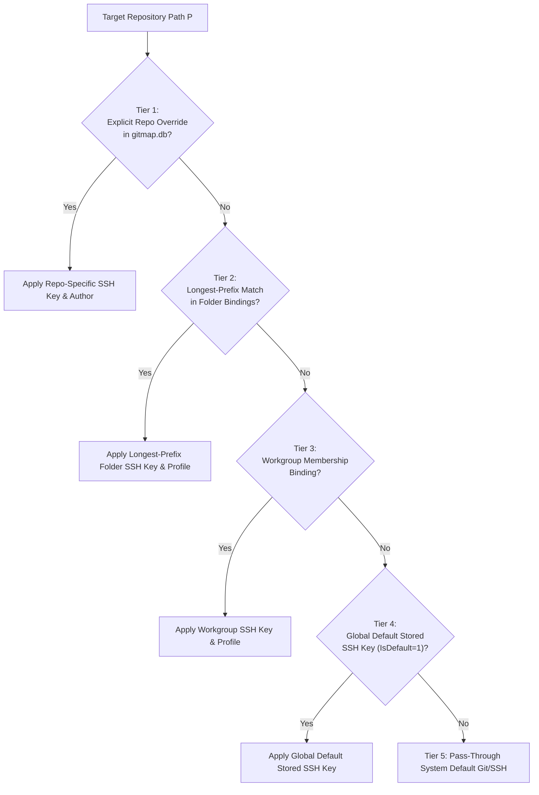
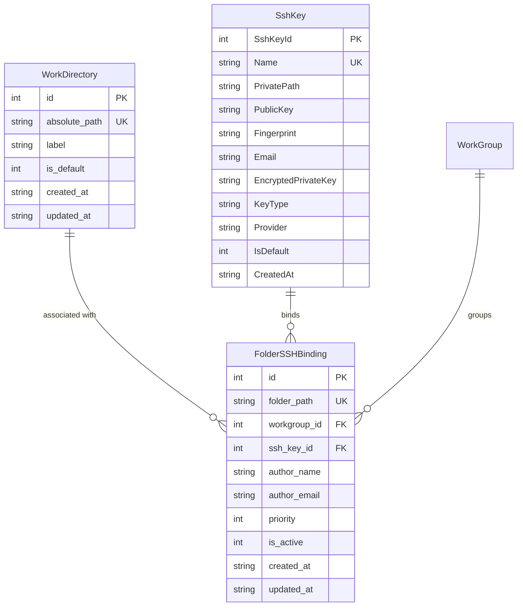
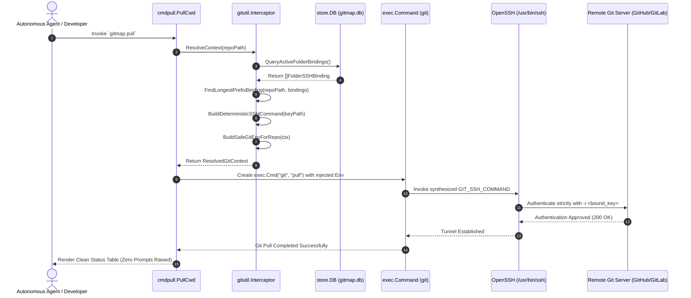

# Architecture & Technical Specification: Autonomous Git & SSH Operation Interceptor

- **Spec ID:** `02-spec/21-app/317-system-for-folder-specific-work-directories-and-ssh-key-automation/02-git-ssh-interceptor-spec.md`
- **Feature Slug:** `system-for-folder-specific-work-directories-and-ssh-key-automation`
- **Subsystem:** Autonomous Git & SSH Interceptor Engine
- **Module:** `cli/gitutil`, `cli/store`, `cli/cmdpull`, `cli/cloner`, `cli/constants`, `cli/model`
- **Status:** APPROVED
- **Version:** 1.0.0
- **Target Audience:** GitMap Core Developers, Autonomous AI Swarms, Fleet Automation Engineers
- **Target Release:** Minor Bump

---

## 1. Executive Summary & Problem Space

In modern polyglot engineering environments and multi-agent AI swarms, developers and autonomous workers routinely operate across dozens of repositories segregated across distinct filesystem directories (e.g., `d:/work/client-alpha/...`, `d:/work/personal/...`, `/var/git/infra/...`). Each directory or workgroup frequently requires:
1. **Isolated SSH Credentials:** Specific private keys registered with distinct enterprise GitHub/GitLab organizations or personal accounts.
2. **Distinct Git Author Identities:** Dedicated `user.name` and `user.email` configurations.
3. **Dedicated Working Directory Anchor:** Folder-specific repository discovery roots and tracking policies.

### The Multi-Identity Automation Failure Modes

When automated tools, background daemons, or autonomous AI agents invoke `git pull`, `git push`, `git fetch`, or `git sync`, standard Git execution suffers from severe failure modes:
- **SSH Agent Identity Flooding:** By default, OpenSSH attempts every loaded identity in `ssh-agent` or `~/.ssh/`. After 3 to 6 failed key attempts, servers like GitHub reject the connection with `Too many authentication failures for git` or `Permission denied (publickey)`.
- **SSH Config Hijacking:** Unmanaged `~/.ssh/config` files introduce unintended host overrides, wrong user identities, or custom proxy commands that break programmatic automation.
- **Interactive Prompt Hangs:** In headless environments or background tasks, Git or SSH may prompt for host key acceptance (`The authenticity of host... can't be established`) or password passphrases, causing background worker processes to block indefinitely.
- **Global Configuration Drift:** Inadvertently running `git config --global user.email` mutates machine-wide configuration, polluting commit history across unrelated workgroups.

### The Autonomous Interceptor Solution

GitMap establishes the **Autonomous Git & SSH Operation Interceptor**. This subsystem transparently wraps every Git operation across `git pull`, `git push`, `git fetch`, and fleet sync:
1. **Longest-Prefix Directory Matcher:** Automatically evaluates the active repository's location against SQLite-persisted work directories and folder bindings, selecting the most specific credential binding.
2. **Deterministic SSH Command Synthesis:** Synthesizes an isolated, non-interactive `GIT_SSH_COMMAND` containing `-F /dev/null -o IdentitiesOnly=yes -i <key_path> -o StrictHostKeyChecking=accept-new -o BatchMode=yes`.
3. **Safe Subprocess Environment Injection:** Injects zero-prompt safeguards (`GIT_TERMINAL_PROMPT=0`, `GIT_ASKPASS=""`, `SSH_ASKPASS=""`, `GCM_INTERACTIVE=never`, `GCM_NO_PERSIST=1`) directly into execution contexts.
4. **Zero-Prompt Persistence:** All mappings are remembered in GitMap's SQLite Split-DB (`gitmap.db`), completely eliminating repeated questions, configuration re-entry, or prompt interruptions.

---

## 2. Longest-Prefix Matching & Directory Resolution Engine

### 2.1 Resolution Hierarchy

When an operation is executed on a repository at path `P`, the Interceptor resolves the effective working directory and bound SSH key through a strict 5-tier fallback cascade:



### 2.2 Longest-Prefix Path Matching Algorithm

Given target path $P$ and registered folder bindings $\{B_1, B_2, \ldots, B_n\}$:

1. **Path Normalization:**
   - Convert all backslashes to forward slashes: $P_{\text{norm}} = \text{NormalizeToForwardSlashes}(P)$.
   - Strip trailing slashes: $P_{\text{clean}} = \text{TrimTrailingSlashes}(P_{\text{norm}})$.
   - On Windows (or Windows volume paths `C:/...`), convert to lowercase for case-insensitive matching: $P_{\text{key}} = \text{CanonicalPathKey}(P_{\text{clean}})$.
2. **Prefix Boundary Checking:**
   - A folder binding with path $F$ matches $P$ if and only if:
     - $P_{\text{key}} == F_{\text{key}}$, OR
     - $P_{\text{key}}$ starts with $F_{\text{key}} + \text{"/"}$.
   - This boundary check guarantees that `D:/work/client-api` never falsely matches binding `D:/work/client`.
3. **Specificity & Longest Length Selection:**
   - From all matching bindings, select the candidate where $\text{len}(F_{\text{key}})$ is maximized.
   - If two bindings share identical length, pick the one with highest explicit `Priority`, followed by most recent `UpdatedAt`.

#### Concrete Resolution Examples

| Target Repository Path | Registered Folders in SQLite | Resolved Binding Folder | Bound SSH Key |
|---|---|---|---|
| `d:/work/client-a/api-service` | `d:/work`, `d:/work/client-a` | `d:/work/client-a` (Length: 17) | `id_client_a` |
| `d:/work/client-b/frontend` | `d:/work`, `d:/work/client-a` | `d:/work` (Length: 7) | `id_work_general` |
| `d:/work/client-a-extra/docs` | `d:/work`, `d:/work/client-a` | `d:/work` (Boundary guard prevents false match on `client-a`) | `id_work_general` |
| `/home/user/oss/repo1` | `/home/user/oss` | `/home/user/oss` (Length: 14) | `id_ed25519_oss` |
| `/home/user/random/test` | `/home/user/oss` | None (Tier 4/5 Fallback applied) | `id_default` / System |

---

## 3. Autonomous SSH Command Synthesis (`GIT_SSH_COMMAND`)

### 3.1 Command Format & Flag Specification

When a valid SSH private key path is resolved for a repository, GitMap dynamically constructs the `GIT_SSH_COMMAND` string. The generated command conforms strictly to:

```text
ssh -F /dev/null -o IdentitiesOnly=yes -i "<escaped_private_key_path>" -o StrictHostKeyChecking=accept-new -o BatchMode=yes -o ConnectTimeout=15
```

### 3.2 Security & Operational Rationale for Each Parameter

| Parameter | Value / Syntax | Operational Purpose & Protection |
|---|---|---|
| `-F /dev/null` | Explicit config bypass | Completely disables loading of `/etc/ssh/ssh_config` and `~/.ssh/config`. Prevents user config drift, rogue ProxyCommands, or conflicting `Host` wildcards from altering the connection. |
| `-o IdentitiesOnly=yes` | Enforce isolated key | Instructs OpenSSH to use **ONLY** the identity explicitly specified with the `-i` option. Completely blocks `ssh-agent` identity cycling, eliminating GitHub's `Too many authentication failures` error. |
| `-i "<path>"` | Private key file | Direct path to the resolved SSH private key. Enclosed in escaped double quotes to safely accommodate filesystem paths containing whitespace (e.g., `C:/Users/Jane Doe/.ssh/id_rsa`). |
| `-o StrictHostKeyChecking=accept-new` | Headless host verification | Automatically accepts and appends new host keys to `~/.ssh/known_hosts` on first connection without interactive prompts. Automatically **rejects** connections if the remote host key has changed (full MITM defense). |
| `-o BatchMode=yes` | Suppress interactive queries | Disables all terminal passphrase queries, password prompts, and interaction requests. Guarantees that headless agents and automated pipelines fail fast with actionable errors rather than hanging indefinitely. |
| `-o ConnectTimeout=15` | Network boundary cap | Binds connection establishment to 15 seconds, preventing subprocess zombies when remote gateways or firewalls drop packets silently. |

### 3.3 Platform-Specific Path Normalization for OpenSSH

On Windows systems, OpenSSH interprets backslashes inside argument strings as escape characters. To ensure absolute cross-platform reliability:
1. All backslashes in the private key path are converted to forward slashes: `NormalizeToForwardSlashes(keyPath)`.
2. Paths containing spaces are quoted using escaped standard double quotes: `"\"" + path + "\""`.
3. Example Windows Output:
   `ssh -F /dev/null -o IdentitiesOnly=yes -i "C:/Users/Administrator/.ssh/id_ed25519_work" -o StrictHostKeyChecking=accept-new -o BatchMode=yes -o ConnectTimeout=15`
4. Example POSIX Output:
   `ssh -F /dev/null -o IdentitiesOnly=yes -i "/home/ubuntu/.ssh/id_ed25519_infra" -o StrictHostKeyChecking=accept-new -o BatchMode=yes -o ConnectTimeout=15`

---

## 4. Safe Subprocess Environment Injection Pipeline

### 4.1 Injected Environment Variables

The Interceptor decorates Git subprocesses using `cli/gitutil/git_env.go`. The environment slice merges existing process environment variables with mandatory zero-prompt directives:

```text
GIT_SSH_COMMAND=ssh -F /dev/null -o IdentitiesOnly=yes -i "<key>" -o StrictHostKeyChecking=accept-new -o BatchMode=yes -o ConnectTimeout=15
GIT_TERMINAL_PROMPT=0
GIT_ASKPASS=
SSH_ASKPASS=
GCM_INTERACTIVE=never
GCM_NO_PERSIST=1
```

### 4.2 Variable Responsibilities

- `GIT_TERMINAL_PROMPT=0`: Instructs the Git binary never to prompt for credentials or input on standard input.
- `GIT_ASKPASS=""` & `SSH_ASKPASS=""`: Neutralizes any configured GUI prompt dialogs or external credential helpers.
- `GCM_INTERACTIVE=never`: Suppresses Git Credential Manager OAuth browser popups or modal dialogs.
- `GCM_NO_PERSIST=1`: Disallows saving temporary credentials to OS credential stores that could collide with subsequent operations.
- `GCM_CREDENTIAL_STORE`: Configures the appropriate platform store (`dpapi` in headless Windows SSH sessions, `wincredman` in interactive Windows, and `cache` on Linux/macOS).

---

## 5. Zero-Prompt Persistence & SQLite Architecture

### 5.1 Relational Schema & Tables

All folder bindings, work directories, and SSH keys are persisted in GitMap's root SQLite database (`gitmap.db`), managed via `cli/store`:



### 5.2 Zero-Prompt Persistence Invariant

- Once a binding is recorded via `gitmap workdir add`, `gitmap group bind`, or programmatic setup, GitMap **never** prompts the user or calling agent for confirmation or credentials again.
- Every Git operation queries SQLite using an in-memory cached lookup table with write-through invalidation.
- If a bound SSH key file does not exist on disk, the Interceptor does not fall back to an interactive prompt; it immediately returns a structured `*appfault.AppError` (`ErrCodeSSHKeyNotFound`) detailing the missing path and remediation command.

---

## 6. Git Operation Interception Matrix

The Interceptor transparently guards all Git invocations across the GitMap command ecosystem:

| Operation | Invocation Module | Interception Mechanism | Injected Context |
|---|---|---|---|
| `gitmap pull` (CWD) | `cli/cmdpull/pull_cwd.go` | `gitutil.CreateGitCmdInDir(cwd, "pull")` | Longest-prefix key for `cwd`, zero-prompt env |
| `gitmap pull --all` | `cli/cmdpull/pull_worker.go` | `cloner.SafePullOne(rec, rec.AbsolutePath)` | Per-repo longest-prefix key, parallel-safe env |
| `gitmap push` (CWD) | `cli/cmdpull/push_exec.go` | `runGitCapturingStderr(args)` | Longest-prefix key for `cwd`, auto-rebase support |
| `gitmap push --all` | `cli/cmdpull/push_exec.go`, `cloner.SafePushOne` | `cloner.SafePushOne(rec, rec.AbsolutePath)` | Per-repo longest-prefix key, retry loop |
| `gitmap fetch` | `cli/gitutil/git_cmd_exec.go` | `gitutil.RunGitInDir(repoPath, "fetch")` | Longest-prefix key for `repoPath` |
| `gitmap sync` | `cli/workspacesync` | `workspacesync.ExecuteSyncStep(...)` | Folder-aware key injection during clone/pull |

---

## 7. Data Contracts & Go Type Architecture

All code implementations conform strictly to GitMap coding guidelines:
- **Positive Booleans Only:** Field names and functions use `is` or `has` prefixes exclusively (`hasBoundKey`, `hasCustomSSHCommand`, `isExactMatch`, `hasFallbackDefault`).
- **Function Limit:** Maximum 15 lines per function (<= 8 lines preferred).
- **Zero Nested Ifs:** All branching is flattened with guard clauses and early returns.
- **Return Spacing:** Empty line after `}` and before `return`.
- **Error Return Sovereignty:** Leaf functions return errors directly; exit handlers are forbidden in leaf functions.

### 7.1 Core Domain Models (`cli/model/folder_ssh.go`)

```go
package model

import "time"

// FolderSSHBinding models the persistent link between a directory and an SSH credential.
type FolderSSHBinding struct {
	ID          int64     `json:"id" db:"id"`
	FolderPath  string    `json:"folderPath" db:"folder_path"`
	WorkgroupID int64     `json:"workgroupId,omitempty" db:"workgroup_id"`
	SSHKeyID    int64     `json:"sshKeyId" db:"ssh_key_id"`
	KeyPath     string    `json:"keyPath,omitempty" db:"-"`
	AuthorName  string    `json:"authorName,omitempty" db:"author_name"`
	AuthorEmail string    `json:"authorEmail,omitempty" db:"author_email"`
	Priority    int       `json:"priority" db:"priority"`
	IsActive    bool      `json:"isActive" db:"is_active"`
	CreatedAt   time.Time `json:"createdAt" db:"created_at"`
	UpdatedAt   time.Time `json:"updatedAt" db:"updated_at"`
}

// ResolvedGitContext contains all injected parameters resolved for a target repository.
type ResolvedGitContext struct {
	RepoPath      string   `json:"repoPath"`
	WorkdirAnchor string   `json:"workdirAnchor"`
	BoundKeyPath  string   `json:"boundKeyPath"`
	AuthorName    string   `json:"authorName"`
	AuthorEmail   string   `json:"authorEmail"`
	GitSSHCommand string   `json:"gitSSHCommand"`
	HasInjectedSSH bool    `json:"hasInjectedSSH"`
	Environment   []string `json:"-"`
}
```

### 7.2 Deterministic SSH Command Builder (`cli/gitutil/git_ssh_cmd.go`)

```go
package gitutil

import (
	"fmt"
	"strings"

	"github.com/alimtvnetwork/gitmap-v28/cli/constants"
	"github.com/alimtvnetwork/gitmap-v28/cli/fsutil"
)

// BuildDeterministicSSHCommand synthesizes a strictly isolated OpenSSH invocation string.
func BuildDeterministicSSHCommand(privateKeyPath string) string {
	cleanPath := fsutil.NormalizeToForwardSlashes(privateKeyPath)
	quotedKey := "\"" + cleanPath + "\""

	return fmt.Sprintf(
		"%s %s %s %s %s %s %s %s %s %s %s %s",
		constants.SSHBin,
		constants.SSHFlagConfigFile,
		constants.DevNullPath,
		constants.SSHOptionFlag,
		constants.SSHIdentitiesOnlyYes,
		constants.SSHFlagIdentity,
		quotedKey,
		constants.SSHOptionFlag,
		constants.SSHStrictHostKeyAcceptNew,
		constants.SSHOptionFlag,
		constants.SSHBatchModeYes,
		constants.SSHConnectTimeout15,
	)
}

// BuildSafeGitEnvForRepo constructs a subprocess environment with resolved SSH credentials.
func BuildSafeGitEnvForRepo(ctx ResolvedGitContext, extra ...string) []string {
	hasSSH := ctx.HasInjectedSSH && len(ctx.GitSSHCommand) > 0
	if !hasSSH {
		return BuildSafeGitEnv(extra...)
	}

	sshVar := constants.EnvGitSSHCommand + constants.EnvAssignmentSeparator + ctx.GitSSHCommand
	combinedExtra := make([]string, 0, len(extra)+1)
	combinedExtra = append(combinedExtra, sshVar)
	combinedExtra = append(combinedExtra, extra...)

	return BuildSafeGitEnv(combinedExtra...)
}
```

### 7.3 Longest-Prefix Matcher Engine (`cli/gitutil/git_ssh_interceptor.go`)

```go
package gitutil

import (
	"strings"

	"github.com/alimtvnetwork/gitmap-v28/cli/fsutil"
	"github.com/alimtvnetwork/gitmap-v28/cli/model"
)

// FindLongestPrefixBinding identifies the most specific folder binding for the target path.
func FindLongestPrefixBinding(targetPath string, bindings []model.FolderSSHBinding) (model.FolderSSHBinding, bool) {
	targetKey := fsutil.CanonicalPathKey(fsutil.NormalizeToForwardSlashes(targetPath))
	var bestMatch model.FolderSSHBinding
	hasMatch := false
	maxLen := -1

	for _, b := range bindings {
		if !b.IsActive {
			continue
		}

		folderKey := fsutil.CanonicalPathKey(fsutil.NormalizeToForwardSlashes(b.FolderPath))
		isCandidate := isPathPrefixMatch(targetKey, folderKey)
		if !isCandidate {
			continue
		}

		matchLen := len(folderKey)
		if matchLen > maxLen || (matchLen == maxLen && b.Priority > bestMatch.Priority) {
			maxLen = matchLen
			bestMatch = b
			hasMatch = true
		}
	}

	return bestMatch, hasMatch
}

// isPathPrefixMatch checks if target matches folder exactly or as a child directory boundary.
func isPathPrefixMatch(targetKey, folderKey string) bool {
	if targetKey == folderKey {
		return true
	}

	if !strings.HasPrefix(targetKey, folderKey) {
		return false
	}

	return strings.HasPrefix(targetKey[len(folderKey):], "/")
}
```

---

## 8. Detailed Flow & Sequence Architecture

### 8.1 End-to-End Interception Sequence Diagram



---

## 9. Failure Modes, Security & Defensive Guards

### 9.1 Missing or Inaccessible Private Key
- **Risk:** Stored binding references a key file that was moved or deleted.
- **Defensive Guard:** Before synthesizing `GIT_SSH_COMMAND`, `fsutil.FileExists(keyPath)` verifies file presence. If missing, execution halts with structured `appfault.AppError` (`E_SSH_KEY_NOT_FOUND`) detailing the key name and missing path, preventing a cryptic Git remote hang.

### 9.2 POSIX Loose File Permissions (0644 vs 0600)
- **Risk:** OpenSSH on Linux/macOS refuses keys with permissions wider than `0600` (`Permissions 0644 for 'id_rsa' are too open`).
- **Defensive Guard:** On POSIX runtimes, the Interceptor inspects `os.Stat(keyPath).Mode().Perm()`. If permissions exceed `0600`, it attempts automatic hardening to `0600`, logging a diagnostic warning if remediation requires elevated permissions.

### 9.3 Windows Path Whitespace & Escaping
- **Risk:** User home directories like `C:\Users\John Doe\.ssh\key` break shell execution when unquoted.
- **Defensive Guard:** Private key paths are strictly enclosed in escaped double quotes `\"` and forward slashes are applied unconditionally.

### 9.4 Passphrase-Protected Keys in Headless Runs
- **Risk:** If a key requires an interactive passphrase, `-o BatchMode=yes` triggers immediate exit code 255 rather than blocking the agent.
- **Defensive Guard:** GitMap intercepts the exit and prints actionable instructions: `Run 'ssh-add <key>' or use unencrypted deployment key for headless mode`.

---

## 10. Verification & Test Plan

1. **Unit Test: Longest-Prefix Matching (`gitutil.TestFindLongestPrefixBinding`)**:
   - Verify exact match takes precedence.
   - Verify deeply nested folder (`d:/work/org/team/sub`) matches `d:/work/org/team` over `d:/work/org` over `d:/work`.
   - Verify boundary condition guard: `d:/work/org-2` does NOT match `d:/work/org`.
   - Verify case-insensitivity on Windows and case-sensitivity on Linux.
2. **Unit Test: Deterministic Command Builder (`gitutil.TestBuildDeterministicSSHCommand`)**:
   - Verify inclusion of `-F /dev/null`, `-o IdentitiesOnly=yes`, `-o StrictHostKeyChecking=accept-new`, `-o BatchMode=yes`.
   - Verify path quoting and forward slash normalization.
3. **Unit Test: Environment Injection (`gitutil.TestBuildSafeGitEnvForRepo`)**:
   - Verify presence of `GIT_TERMINAL_PROMPT=0`, `GIT_ASKPASS=""`, `SSH_ASKPASS=""`, `GCM_INTERACTIVE=never`.
   - Verify `GIT_SSH_COMMAND` matches synthesized command.
4. **Integration Test: Headless Pull Execution**:
   - Execute mock `git pull` in a simulated test repo with injected environment; verify zero prompts are emitted.
