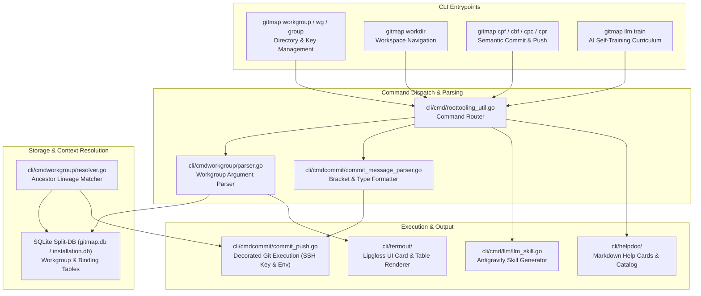
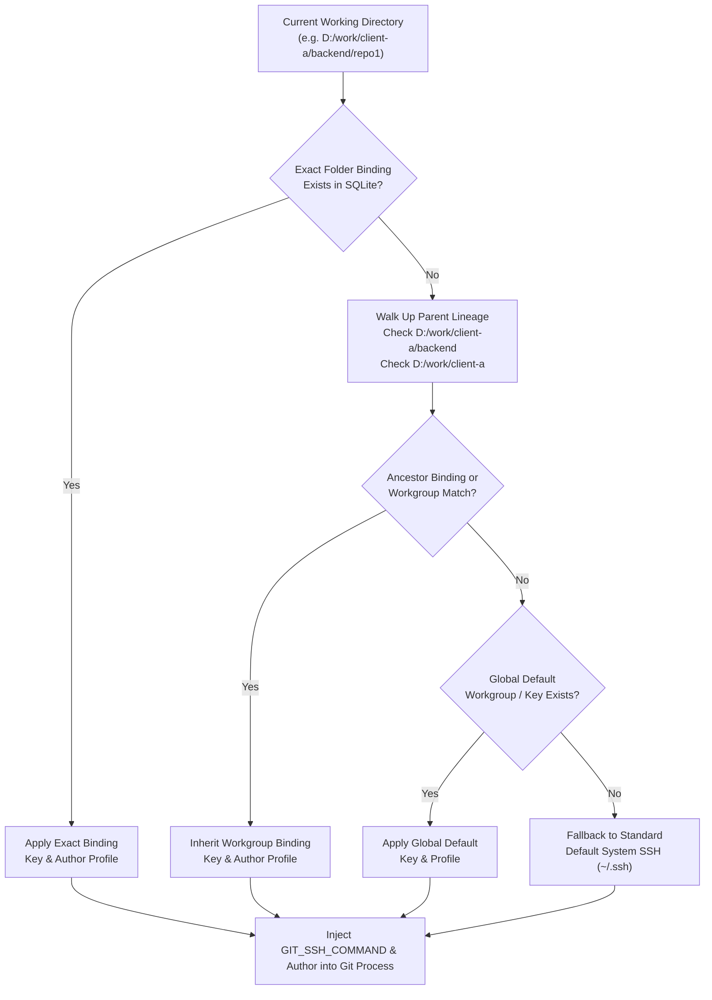
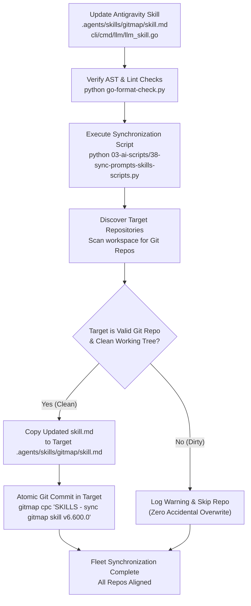

# CLI Commands, Commit Formatter & Documentation Specification

**Module:** `cli/cmdworkgroup`, `cli/cmdcommit`, `cli/termout`, `cli/helpdoc`, `cli/cmd/llm`  
**Parent Task:** `317-system-for-folder-specific-work-directories-and-ssh-key-automation`  
**Specification File:** `02-spec/21-app/317-system-for-folder-specific-work-directories-and-ssh-key-automation/03-cli-commands-and-commit-format-spec.md`  
**Version:** 1.0.0  
**Status:** Approved for Implementation  

---

## 1. Executive Summary & Specification Scope

This specification establishes the user-facing CLI command suite, commit message formatting engine, interactive terminal UI menus, markdown help documentation, and AI agent self-training protocols for the folder-specific work directory and SSH automation subsystem in GitMap:

1. **Workgroup CLI Command Suite (`gitmap workgroup` / `gitmap wg`, `gitmap group`, `gitmap workdir`)**:
   - High-ergonomic management commands allowing developers to organize directories into named workgroups, bind dedicated SSH keys and Git author profiles to individual directories, inspect hierarchical bindings, and test remote authentication.
   - Intelligent ancestor resolution: child repositories dynamically inherit workgroup settings and SSH credentials from parent directories without per-repo reconfiguration.

2. **Enhanced `cpf` and `cbf` Commit Message Parser and Formatter**:
   - Universal parser supporting the Hyphen-Separated Uppercase Module Standard (Zero Third Brackets):
     - Uppercase module hyphen format: `MODULE - <item>` (e.g. `AUTH - implement refresh token rotation`)
     - Conventional syntax without brackets: `feat(module): <item>`, `fix(module): <item>`, `chore(module): <item>`, `release(version): <item>`
   - First-class `cbf` alias alongside `cpf`, `cpb`, `cpc`, and `cpr`, providing instantaneous stage-commit-push cycles with semantic validation.
   - Normalization pipeline that sanitizes duplicate prefixes, strips unwanted shell quotation, sanitizes legacy brackets, normalizes module to uppercase, and produces canonical hyphen format.

3. **UI Help Menus (`cli/termout/`) & HD Markdown Help Cards (`cli/helpdoc/`)**:
   - Lipgloss-styled terminal cards with responsive borders, semantic ANSI color palettes, command syntax tables, and real-world examples.
   - Comprehensive high-definition markdown help cards (`workgroup.md`, `commit-format.md`, `cbf.md`) registered in the static help catalog.

4. **LLM Self-Training Documentation & Cross-Repository Skills Synchronization**:
   - Integration into the 6-phase LLM training curriculum (`gitmap llm train`) and JSON catalog output.
   - Automatic generation and persistence of the updated Antigravity skill (`.agents/skills/gitmap/skill.md`).
   - Synchronization protocol via `03-ai-scripts/38-sync-prompts-skills-scripts.py` distributing skill updates across connected workspace repositories.

---

## 2. Architectural Subsystem Interaction

The following diagram illustrates the interaction between CLI invocations, flag parsing, commit message formatting, database persistence, and git execution hooks:



---

## 3. Workgroup CLI Command Suite Specification

### 3.1 Command Aliases & Routing Matrix

The workgroup management engine provides ergonomic primary commands and concise shorthand aliases registered in `cli/constants/constants_commands.go` and `cli/cmd/roottooling_util.go`:

| Command Signature | Primary Aliases | Description | Target Scope |
|:---|:---|:---|:---|
| `gitmap workgroup [subcommand]` | `gitmap wg`, `gitmap group` | Comprehensive workgroup and folder SSH key management | Multi-repo / Folder |
| `gitmap workdir [subcommand]` | `gitmap wd` | Workspace root registration and default directory navigation | Workspace / Global |
| `gitmap workgroup add <name> <dir>` | `gitmap wg add`, `gitmap group add` | Register a named workgroup bound to a filesystem directory | Directory / Workgroup |
| `gitmap workgroup bind <dir> <key>` | `gitmap wg bind` | Bind a specific folder to an SSH private key and identity | Folder / Key |
| `gitmap workgroup unbind <dir>` | `gitmap wg unbind` | Remove folder-specific SSH key binding (revert to global) | Folder |
| `gitmap workgroup list` | `gitmap wg ls`, `gitmap group ls` | Render Lipgloss tabular summary of all workgroups and keys | Global |
| `gitmap workgroup show [name\|dir]` | `gitmap wg show` | Display detailed inspection card for a workgroup or path | Workgroup / Path |
| `gitmap workgroup test-ssh [name\|dir]`| `gitmap wg test` | Test remote SSH handshake (e.g. GitHub/GitLab) with bound key | Verification |
| `gitmap workgroup rm <name\|id>` | `gitmap wg rm` | Safely remove workgroup registration (preserves filesystem) | Workgroup |

### 3.2 Detailed Subcommand Behavior

#### 3.2.1 `gitmap workgroup add <name> <path> [flags]`
- **Purpose**: Creates a logical grouping of repositories under a root folder, optionally binding a dedicated SSH key and Git identity.
- **Flags**:
  - `--ssh-key <path>`: Path to the private SSH key file (e.g. `~/.ssh/id_ed25519_client_a`).
  - `--desc <text>`: Human-readable description of the workgroup.
  - `--user-name <name>`: Custom `user.name` applied to commits within this group.
  - `--user-email <email>`: Custom `user.email` applied to commits within this group.
  - `--default`: Designates this workgroup as the active default for `gitmap cd work`.
- **Validation**:
  - Validates that `<path>` exists and resolves to an absolute path.
  - If `--ssh-key` is supplied, verifies file readability, checks for private key header, and generates a key fingerprint.
  - Rejects duplicate workgroup names with a descriptive `*apperror.AppError`.

#### 3.2.2 `gitmap workgroup bind <path> <ssh-key-path> [flags]`
- **Purpose**: Directly associates any directory with an SSH private key without creating a formal named workgroup.
- **Behavior**:
  - Stores the association in SQLite (`FolderSSHBindingRecord`).
  - Supports recursive matching: any repository located inside `<path>` or its descendant subfolders inherits this SSH key automatically.
  - Prints key fingerprint and detected key type (`ED25519`, `RSA`, `ECDSA`).

#### 3.2.3 `gitmap workgroup list` / `ls`
- **Output Rendering**:
  - Renders a styled Lipgloss table using `cli/termout/table.go`.
  - Columns: `ID`, `NAME`, `ROOT DIRECTORY`, `SSH KEY`, `FINGERPRINT`, `REPOS`, `DEFAULT`.
  - Color styling: active default highlighted in cyan/green; missing key paths flagged in amber.

#### 3.2.4 `gitmap workgroup show [name|path]`
- **Purpose**: Inspects active configuration, resolved SSH credentials, and descendant repository status.
- **Display Fields**:
  - Workgroup Name & ID
  - Root Filesystem Path
  - Bound SSH Key Path & Exists Status (`hasValidKey`)
  - SSH Key Fingerprint (SHA256) & Key Comment
  - Associated Repositories Count & Listing
  - Resolved Git Author (`user.name <user.email>`)
  - Inheritance Chain (Folder -> Workgroup -> Default Fallback)

#### 3.2.5 `gitmap workgroup test-ssh [name|path] [flags]`
- **Purpose**: Verifies that the configured SSH key successfully authenticates against remote Git hosts.
- **Flags**:
  - `--host <hostname>`: Remote SSH host (default: `github.com`; supported: `gitlab.com`, `bitbucket.org`).
- **Execution Mechanism**:
  - Executes isolated command: `ssh -T -i <boundKeyPath> -o StrictHostKeyChecking=accept-new -o IdentitiesOnly=yes -F /dev/null git@<host>`.
  - Parses stderr/stdout for host confirmation messages (e.g. `Hi <user>! You've successfully authenticated...`).
  - Displays formatted success or diagnosis card in terminal UI.

### 3.3 Dynamic Folder Lineage Resolution Engine

When a Git command (`git pull`, `git push`, `git fetch`, `cpf`, `cbf`) is executed in any directory, GitMap resolves the effective SSH key and identity using hierarchical ancestor matching:



---

## 4. Enhanced Commit Message Parser & Formatter Specification

### 4.1 Specification Motivation & Colon Modernization

Historically, GitMap strictly prohibited colons inside commit arguments to prevent duplicate prefix accidents (e.g., `gitmap cpf "Feature: my title"` turning into `Feature: Feature: my title`).

Under this specification, GitMap modernizes the commit message engine to natively embrace and standardize the **hyphen-separated uppercase module syntax** and **Conventional Commit syntax** while strictly eliminating square brackets:
- **Uppercase Module Pattern**: `MODULE - <item>`
- **Conventional Scope Pattern**: `type(module): <item>`

The parser strips legacy bracket artifacts, normalizes the module token to uppercase, and formats output with clean space-padded hyphens.

### 4.2 Format Grammar & Supported Syntaxes

The commit message parser recognizes the following canonical syntax grammar:

```ebnf
CommitMessage      ::= SemanticHeader | ConventionalItem | FlatHeader ;
SemanticHeader     ::= SemanticPrefix Whitespace ModuleIdentifier Whitespace "-" Whitespace Subject ;
ConventionalItem   ::= CommitType "(" ModuleName "):" Whitespace ItemSummary ;
FlatHeader         ::= ModuleIdentifier Whitespace "-" Whitespace Subject ;

SemanticPrefix     ::= "Feature:" | "Bug:" | "Chore:" | "Release:" ;
ModuleIdentifier   ::= [A-Z0-9_\-/]+ ;
ModuleName         ::= [A-Za-z0-9_\-\./]+ ;
CommitType         ::= "feat" | "fix" | "chore" | "release" | "refactor" | "test" | "docs" | "perf" ;
Subject            ::= [^\r\n]+ ;
ItemSummary        ::= [^\r\n]+ ;
Whitespace         ::= " " ;
```

### 4.3 Semantic Verb to Commit Type Mapping

When calling GitMap's specialized semantic commit commands (`cpf`, `cbf`, `cpc`, `cpr`), the CLI command dictates the default type prefix unless already specified in the message:

| Invocation Command | Alias | Injected Standard Prefix | Conventional Equivalent | Description |
|:---|:---|:---|:---|:---|
| `gitmap commit-push-feature` | `gitmap cpf` | `Feature: ` | `feat(module): ` | Feature development |
| `gitmap commit-push-bug` | `gitmap cpb`, `gitmap cbf` | `Bug: ` | `fix(module): ` | Bug fixes and patches |
| `gitmap commit-push-chore` | `gitmap cpc` | `Chore: ` | `chore(module): ` | Maintenance and tooling |
| `gitmap commit-push-release` | `gitmap cpr` | `Release: ` | `release(module): ` | Release and version bump |
| `gitmap pull-commit-push` | `gitmap pcp` | (Contextual / Raw) | (Contextual / Raw) | Pre-pull then commit |

### 4.4 Examples Matrix Across Message Types

| User Input Message | Command | Formatted Commit Subject | Module | Type |
|:---|:---|:---|:---|:---|
| `"AUTH - support jwt refresh tokens"` | `gitmap cpf` | `Feature: AUTH - support jwt refresh tokens` | `AUTH` | `Feature` |
| `"SQLITE - handle connection pool lock"` | `gitmap cbf` | `Bug: SQLITE - handle connection pool lock` | `SQLITE` | `Bug` |
| `"feat(workgroup): add folder ssh key binding"`| `gitmap cpf` | `feat(workgroup): add folder ssh key binding` | `workgroup` | `feat` |
| `"fix(ssh): handle missing private key"` | `gitmap cbf` | `fix(ssh): handle missing private key` | `ssh` | `fix` |
| `"SKILLS - sync gitmap skill across repositories"`| `gitmap cpc` | `Chore: SKILLS - sync gitmap skill across repositories` | `SKILLS` | `Chore` |
| `"V6.600.0 - folder-specific workdirs & ssh automation"`| `gitmap cpr` | `Release: V6.600.0 - folder-specific workdirs & ssh automation` | `V6.600.0` | `Release` |
| `"[auth]: add jwt validation"` (legacy sanitized) | `gitmap cpf` | `Feature: AUTH - add jwt validation` | `AUTH` | `Feature` |

### 4.5 Normalization & Sanitization Pipeline

The normalization engine executes five sequential filter passes:

1. **Outer Quote Strip**: Removes wrapping quotes (`"..."`, `'...'`) injected by Windows cmd or PowerShell argument splitting.
2. **Duplicate Prefix Trimming**: Strips redundant prefixes matching the command's target type (e.g. `Feature: AUTH - ...` passed to `cpf` does not produce `Feature: Feature: AUTH - ...`).
3. **Bracket Sanitization**: Strips any square brackets from module tokens or input headers.
4. **Hyphen Syntax Resolution**: Extracts module and summary, converts module to uppercase (`strings.ToUpper(mod)`).
5. **Standard Output Assembly**: Formats as `prefix + upperMod + " - " + item`.

### 4.6 Go Structural Design (`cli/cmdcommit/commit_formatter.go`)

```go
package cmdcommit

import (
	"regexp"
	"strings"
)

// ParsedCommitMessage contains the decomposed components of a semantic commit message.
type ParsedCommitMessage struct {
	RawInput           string
	FormattedMessage   string
	CommitType         string
	Module             string
	ItemDescription    string
	HasModule          bool
	HasHyphenSeparator bool
	IsConventional     bool
}

// ParseAndFormatCommitMessage processes raw arguments according to the target semantic verb.
func ParseAndFormatCommitMessage(verb string, rawArgs []string) ParsedCommitMessage {
	cleansed := sanitizeInput(verb, rawArgs)
	
	if parsed, ok := tryParseConventionalSyntax(verb, cleansed); ok {
		return parsed
	}
	
	if parsed, ok := tryParseHyphenSyntax(verb, cleansed); ok {
		return parsed
	}
	
	return buildFallbackCommitMessage(verb, cleansed)
}
```

---

## 5. UI Help Menus & HD Markdown Help Cards

### 5.1 Terminal UI Help Menu Architecture (`cli/termout/`)

The terminal help menus use GitMap's custom Lipgloss styling engine (`cli/termout/theme_lipgloss.go` and `cli/termout/termpad.go`), providing high-contrast visual cues:

- **Header Banner**: Dark slate background with cyan/purple title rendering.
- **Syntax Cards**: Inverted rounded boxes highlighting `[module]: <item>` usage.
- **Visual Color Token Rules**:
  - Command verbs: `LipglossCyan` (`#38bdf8`)
  - Subcommands: `LipglossPurple` (`#c084fc`)
  - Modules in brackets `[module]`: `LipglossYellow` (`#facc15`)
  - Descriptions: `LipglossMutedGray` (`#94a3b8`)
  - Status Indicators (`✓`, `!`, `✕`): Green, Yellow, Red

#### Sample Terminal Output Mockup:
```text
╭─────────────────────────────────────────────────────────────────────────────╮
│  GITMAP WORKGROUP & FOLDER SSH AUTOMATION                                   │
╰─────────────────────────────────────────────────────────────────────────────╯

SYNOPSIS:
  gitmap workgroup [add|bind|unbind|ls|show|test-ssh|rm] [arguments...]
  gitmap wg <command>          # Short alias
  gitmap group <command>       # Grouping alias

WORKGROUP COMMANDS:
  add <name> <dir>             Register named workgroup for directory root
  bind <dir> <key>             Bind folder to specific SSH private key
  unbind <dir>                 Remove folder-specific SSH key binding
  ls, list                     Display all registered workgroups & bindings
  show [name|dir]              Inspect detailed configuration & key fingerprint
  test-ssh [name|dir]          Test remote SSH handshake against GitHub/GitLab
  rm <name|id>                 Safely remove workgroup registration

COMMIT FORMATTER ENHANCEMENTS (cpf / cbf):
  gitmap cpf "AUTH - add jwt validation"
  gitmap cbf "DB - fix sqlite connection lock timeout"
  gitmap cpc "CI - update go version in workflows"
  gitmap cpr "V6.600.0 - release folder-specific workdirs & ssh automation"
```

### 5.2 HD Markdown Help Cards (`cli/helpdoc/`)

Dedicated high-definition markdown help cards are maintained under `cli/helpdoc/`:

1. **`cli/helpdoc/workgroup.md`**:
   - Comprehensive reference card covering workgroup registration, SQLite storage mechanisms, inheritance resolution, SSH key binding, Git author overriding, and remote authentication testing.
2. **`cli/helpdoc/commit-format.md`**:
   - Complete developer guide detailing the zero-bracket uppercase hyphen standard `MODULE - <item>`, conventional format `type(module): <item>`, semantic aliases (`cpf`, `cbf`, `cpc`, `cpr`), and normalization algorithms.
3. **`cli/helpdoc/cbf.md`**:
   - Shorthand documentation card explaining the `cbf` (`commit-push-bug` / bug fix) command.

#### Registration in Help Registry:
- Update `cli/helpdoc/catalog.go`:
  ```go
  "workgroup":     "Manage folder-specific work directories, SSH key bindings, and grouping.",
  "wg":            "Short alias for workgroup.",
  "group":         "Grouping alias for workgroup.",
  "commit-format": "Guide and syntax reference for uppercase hyphen MODULE - <item> commit formatting.",
  "cbf":           "Stages all changes, commits with bug fix prefix and uppercase module, and pushes.",
  ```
- Update `cli/helpdoc/aliases.go`:
  ```go
  "wg":    "workgroup",
  "group": "workgroup",
  "cbf":   "commit-push-bug",
  ```

---

## 6. LLM Self-Training Documentation & Skills Sync Protocol

### 6.1 LLM Curriculum Integration (`cli/cmd/llm/llm_train.go`)

The autonomous 6-phase LLM training curriculum is extended to explicitly guide AI models in utilizing folder-specific workgroups and bracketed commit messages:

1. **Phase 1 [Discovery]**:
   - Introduce `gitmap workgroup ls` to inspect repository groupings and bound SSH credentials before initiating clone or sync operations.
2. **Phase 4 [Semantic Commit]**:
   - Update instructions to mandate uppercase module hyphen syntax: `gitmap cpf "MODULE - <item>"` and `gitmap cbf "MODULE - <item>"`.
   - Explicitly document that square brackets are strictly forbidden in commit messages.
3. **Phase 6 [Heal & Fix]**:
   - Document `gitmap workgroup test-ssh` as a diagnostic tool for resolving SSH handshake failures (`Permission denied (publickey)`).
4. **JSON Catalog (`outputTrainJSON`)**:
   - Add `workgroup`, `wg`, and `cbf` to the phase command listings.

### 6.2 Antigravity Skill Persistence (`.agents/skills/gitmap/skill.md`)

The embedded skill template in `cli/cmd/llm/llm_skill.go` and the persistent file `.agents/skills/gitmap/skill.md` are updated with the following additions:

1. **Semantic Commit & Push Section**:
   - Update rule table: Replace the previous blanket colon ban with the refined rule:
     - ❌ **Forbidden**: Square brackets in commit messages (`gitmap cpf "[module]: add feature"`) or naked leading colons.
     - ✅ **Authorized & Standard**: Uppercase module hyphen syntax: `gitmap cpf "MODULE - <summary>"` and `gitmap cbf "MODULE - <summary>"`.
     - ✅ **Authorized Conventional**: `gitmap cpf "feat(module): <summary>"` and `gitmap cbf "fix(module): <summary>"`.
2. **Workgroup & SSH Automation Section**:
   - Add cheat sheet section detailing `gitmap workgroup add`, `gitmap workgroup bind`, and `gitmap workgroup ls`.

### 6.3 Cross-Repository Skills Synchronization Protocol

To ensure consistency across the developer's entire workspace fleet (e.g. `<workspace-root>/gitmap`, `<workspace-root>/gitmap-v28`, and connected client repositories):



---

## 7. Strict Coding Guidelines Compliance

All code implemented under this specification strictly follows GitMap coding standards:

1. **Positive Booleans Only**:
   - Every boolean field and variable MUST start with `is` or `has` only (`isDefault`, `hasActiveBinding`, `isValidKey`, `hasModule`, `hasHyphenSeparator`, `isConventional`, `hasPushRequested`, `isVerbose`).
   - Banned prefixes: `can`, `should`, `was`, `will`. Negative booleans are completely forbidden.
2. **15-Line Function Limit**:
   - Functions <= 8 lines preferred, <= 15 lines maximum.
   - Complex logic decomposed into discrete helper functions.
3. **Zero Nested Ifs**:
   - All nested conditionals flattened using guard clauses and early returns.
4. **Spacing & Return Styling**:
   - Mandatory blank line after closing brace `}`.
   - Mandatory blank line before `return` statements.
5. **AppError Sovereignty**:
   - Leaf functions return `*apperror.AppError` directly.
   - No leaf functions call `os.Exit` or exit handlers directly.

---

## 8. Verification & Acceptance Criteria

| ID | Verification Area | Target Acceptance Criteria |
|:---|:---|:---|
| **AC-01** | Workgroup CLI Dispatch | `gitmap workgroup`, `gitmap wg`, and `gitmap group` dispatch identically without errors. |
| **AC-02** | Workgroup Add & List | `gitmap wg add client-a D:\work\client-a --ssh-key ~/.ssh/id_test` registers record; `gitmap wg ls` renders formatted Lipgloss table. |
| **AC-03** | Lineage Key Resolution | Invocations within child directory `D:\work\client-a\sub\repo` inherit `client-a`'s bound SSH key. |
| **AC-04** | Bracket Commit Sanitization | `gitmap cpf "[auth]: add jwt"` outputs commit subject `Feature: AUTH - add jwt`. |
| **AC-05** | Conventional Type Parsing | `gitmap cpf "feat(workgroup): add ssh binding"` preserves `feat(workgroup): add ssh binding`. |
| **AC-06** | `cbf` Command Alias | `gitmap cbf "DB - fix lock"` executes `commit-push-bug` with `Bug: DB - fix lock`. |
| **AC-07** | Duplicate Prefix Trimming | `gitmap cpf "Feature: AUTH - test"` normalizes cleanly to `Feature: AUTH - test` without duplication. |
| **AC-08** | Terminal UI Menus | `gitmap workgroup help` and `gitmap cpf --help` render high-contrast Lipgloss ANSI cards. |
| **AC-09** | HD Markdown Docs | `cli/helpdoc/workgroup.md` and `commit-format.md` present and registered in `catalog.go`. |
| **AC-10** | LLM Training Curriculum | `gitmap llm train` includes workgroups and zero-bracket commit formatting in Stage 1 & 4. |
| **AC-11** | Cross-Repo Skill Sync | `03-ai-scripts/38-sync-prompts-skills-scripts.py` synchronizes updated skill across repositories cleanly. |
| **AC-12** | Coding Standards | Zero nested ifs, functions <= 15 lines, positive booleans (`is`/`has` only), clean AST formatting. |
