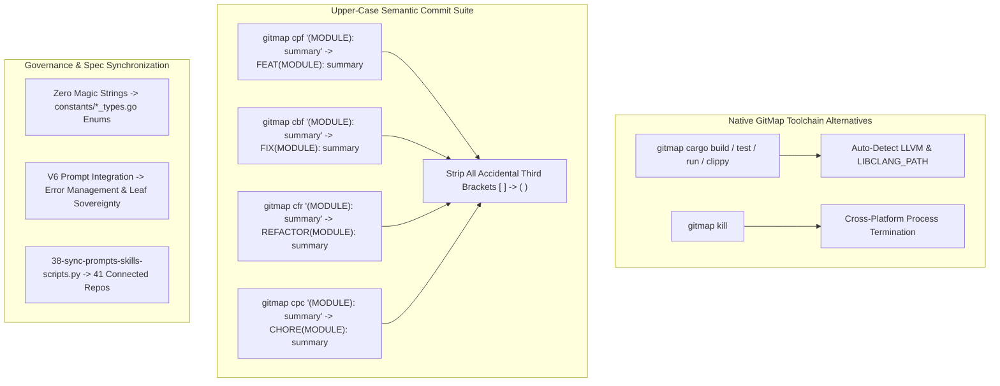

# Specification: GitMap Command and Coding Guideline Synchronization

## Metadata
- **Task ID:** 318-gitmap-command-and-coding-guideline-synchronization
- **Slug:** gitmap-command-and-coding-guideline-synchronization
- **Path:** `02-spec/21-app/318-gitmap-command-and-coding-guideline-synchronization/00-overview.md`
- **Status:** In-Progress (Phase 1: Architecture & Specification)
- **Version:** 1.0.0

---

## 1. Executive Summary & Intent

During autonomous development sessions in environments such as Cursor, external AI agents frequently execute raw shell commands, manual environment variable injections (such as `$env:LIBCLANG_PATH='D:\LLVM\LLVM\bin'`), process terminations (`taskkill /PID ... /F`), and unstructured commit messages with third brackets (`[` `]`).

This specification establishes:
1. **Toolchain Automation & Rust/Cargo Alternatives:** Native `gitmap cargo` and `gitmap rust` commands that automatically discover and inject compiler environments (e.g. LLVM/libclang) and handle process termination (`gitmap kill`), eliminating manual shell workarounds.
2. **Commit Message Format Invariant:** Complete elimination of third brackets (`[` `]`) in git commit messages in favor of uppercase semantic types and parenthesized modules: `TYPE(MODULE): <summary>` (e.g. `FEAT(WORKGROUP): add folder binding`, `FIX(DB): resolve lock`, `REFACTOR(ENGINE): optimize resolver`). Support for `cfr` (commit-push-refactor) alongside `cpf` and `cbf`.
3. **Zero Magic Strings & Strongly-Typed Enums:** Systematic elimination of raw magic string literals across implementation packages, replacing them with strongly-typed enums ending in `Type` in dedicated `constants/` files adhering to `02-spec/02-coding-guidelines/`.
4. **V6 Execute Prompt Error Management Integration:** Explicitly embedding `02-spec/03-error-manage/` principles (Leaf Error Sovereignty, No Magic Exit Codes, Specialized Handlers, Positive Booleans, <= 15-line limit) directly into `.agents/skills/execute-parent-task-with-n-steps-v6/skill.md`.
5. **Fleet Synchronization:** Propagating all updated prompts, skills, and coding guidelines across all 41 connected fleet repositories.

---

## 2. User Request (Verbatim)

```text
On these that this is actually ran by cursor. Why it ran this code? That's the first observation. Second is that why we shouldn't have the alternative commands in `gitmap`. Even building the Rust tools, things like that, installing and building, we should have `gitmap` command and these commands as an alternative and things like that should be updated in the `gitmap` skills in the coding guideline and sync with all the other repositories. Do you understand? Can you please follow through and make sure in the code base there is no magic string other than logs. Every magic string should be replaced with proper constant or enum. If it is from a same group, then it should be coming from the enum by reading the enum guideline from the coding guidelines inside the spec. Can you please follow through and do that? Also make sure that in the execute prompt in V6, it should also refer to the coding guideline error manage, and some of the principles should be embedded in the execute parent task in inner steps in the coding guideline. Make sure of that. And do not write, let's say, commits like this third bracket, update the coding guideline for the execute prompt in V6. It should be done using the `gitmap` CFR CBF, and it should be in uppercase, and in bracket, there should be no third brackets for the commits. So that needs to be corrected everywhere with an example. Do you understand the task? Can you follow through?
```

---

## 3. Subsystem Architecture & Boundaries


