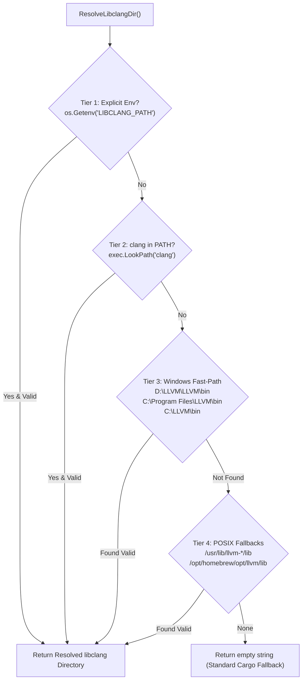

# Specification: Native Toolchain Commands (Cargo, Rust, Kill) & Automatic LLVM Environment

## 1. Overview & Operational Problem
In AI-assisted agent environments (Cursor, Claude, Grok), agents frequently need to build and test Rust components (such as Tauri binaries, SQLite crates, or CLI tools). When building crates with C/C++ bindings (e.g. `bindgen`), Windows builds fail unless `LIBCLANG_PATH` is set and LLVM binaries are accessible. Agents were forced to execute raw PowerShell snippets like:
```powershell
$env:LIBCLANG_PATH='D:\LLVM\LLVM\bin'; cargo build --bin agm --offline
taskkill /PID 13948 /F
```

GitMap provides native, sovereign alternative commands:
- `gitmap cargo <subcommand> [args...]` (alias: `crg`)
- `gitmap rust <subcommand> [args...]` (alias: `rst`, `rustc`)
- `gitmap kill <pid|name|:port>` (alias: `terminate`)

These commands automatically discover LLVM/libclang installations, inject `LIBCLANG_PATH` and augmented `PATH` into child process environments without polluting global host state, and handle process termination safely.

---

## 2. LLVM & `libclang` Auto-Discovery Algorithm

The resolution engine (`ResolveLibclangDir()`) searches candidate directories in deterministic order:



### Validation Invariant: `isValidLibclangDir(dir string) bool`
A directory is considered valid if:
1. The directory exists on disk.
2. It contains the platform-specific library:
   - Windows: `libclang.dll` (located in `bin/` or `lib/`)
   - Linux: `libclang.so` (located in `lib/`)
   - macOS: `libclang.dylib` (located in `lib/`)

---

## 3. Environment Augmentation: `EnrichToolchainEnv(baseBin string) []string`
When launching `cargo`, `rustc`, or child build processes:
1. `newPath` prepends `filepath.Dir(baseBin)` and `libclangDir` to existing `PATH`.
2. `LIBCLANG_PATH` is set to `libclangDir` in the child environment.
3. System environment variables (`SYSTEMROOT`, `COMSPEC`, `TMP`, `TEMP`, `USERPROFILE`) are preserved.

---

## 4. `gitmap rust` Command Architecture
- **Command**: `gitmap rust`
- **Aliases**: `rst`, `rustc` (Note: `rs` is preserved for `repo-secrets`).
- **Subcommands**:
  - `status` / `info`: Displays terminal dashboard showing `rustc`, `cargo`, `rustup`, `llvm/clang`, and `LIBCLANG_PATH`.
  - `build`, `test`, `check`, `run`, `clippy`, `fmt`, `clean`: Forwards directly to `cargo` with enriched environment.
  - `c <args>`: Forwards to `rustc`.
  - `up <args>`: Forwards to `rustup`.

---

## 5. `gitmap kill` Process Termination Engine
- **Command**: `gitmap kill <pid|name|:port>`
- **Safety Guards**:
  - Protected System PIDs: Rejects PID 0, PID 4 (Windows System), and PID 1 (POSIX Init).
  - Protected Current Process: Rejects `os.Getpid()`.
  - Protected IDEs & Shells: Rejects `antigravity`, `code`, `pwsh`, `bash` unless explicit `--force`.
- **Port Resolution**: `:3000` or `--port 3000` automatically finds listening PID via netstat/tasklist.
- **Tree Termination**: `--tree` / `-t` flag terminates process tree (e.g. `taskkill /F /T /PID`).
