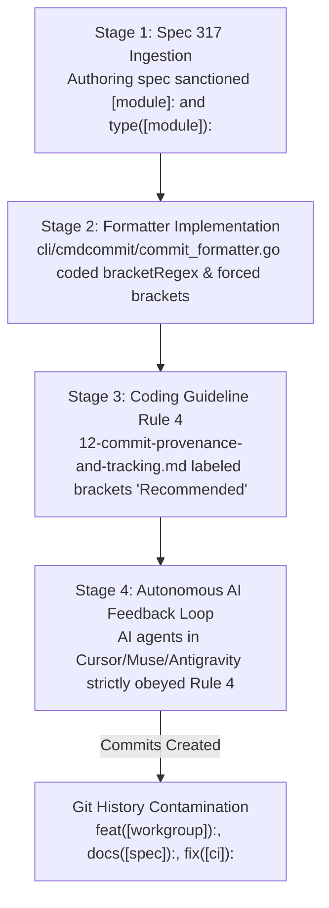
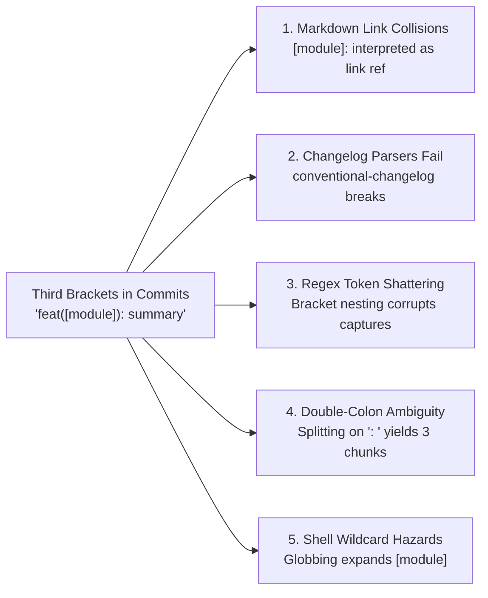
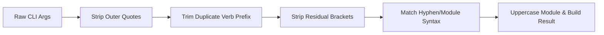

# Specification: Commit Format Standardization and Third Bracket Elimination

**Module:** `cli/cmdcommit`, `cli/termout`, `02-spec/02-coding-guidelines/06-ai-optimization`, `02-spec/21-app/317-...`  
**Parent Program:** `318-gitmap-command-and-coding-guideline-synchronization`  
**Specification File:** `02-spec/21-app/318-gitmap-command-and-coding-guideline-synchronization/02-commit-format-and-bracket-elimination-spec.md`  
**Version:** 1.0.0  
**Status:** Approved for Implementation  

---

## 1. Executive Summary & Architectural Scope

This specification establishes the definitive architectural policy, string grammar, and execution rules to permanently ban and eliminate square brackets (`[` `]`, colloquially termed "third brackets") from all Git commit messages across the repository.

Square brackets embedded inside commit headers introduce critical vulnerabilities into automated build pipelines, including CommonMark link reference collisions, conventional changelog parser failures, shell wildcard expansion hazards, double-colon delimiter ambiguity, and regex capture group corruption.

Under this standard:
1. **Third Bracket Ban:** Square brackets (`[` `]`) are strictly forbidden in commit headers, semantic verbs, module scopes, and subject lines.
2. **Unified Hyphen Standard:** All semantic commits across GitMap CLI verbs (`cpf`, `cpb`, `cbf`, `cpc`, `cpr`, `cfr`) adhere to a clean, colonless input format with an uppercase module identifier:
   ```text
   gitmap cpf "MODULE - summary of changes"
   ```
   which produces the sovereign Git commit header:
   ```text
   Feature: MODULE - summary of changes
   ```
3. **Automated Sanitization:** The GitMap commit parser automatically sanitizes legacy brackets, converts module tokens to uppercase, and removes illegal inner colons.
4. **Documentation & Spec Alignment:** Reverts bracketed syntax introduced in Spec 317 (`02-spec/21-app/317-system-for-folder-specific-work-directories-and-ssh-key-automation/03-cli-commands-and-commit-format-spec.md`) and updates `02-spec/02-coding-guidelines/06-ai-optimization/12-commit-provenance-and-tracking.md`.

---

## 2. Root Cause Analysis: Third Brackets in Recent Git Commits

A retrospective audit of recent Git commits reveals several commits containing bracketed scope annotations:

```text
aa5a7e4fa fix([workgroup]): support positional ssh key in bind and delegate group command
1219785f8 docs([spec]): add bracketed module commit standards to coding guidelines
6614d8b45 docs([plan]): update master plan 317 to completed
ba347d074 chore(release): bump version to v6.604.0
5adf9f14f fix([ci]): resolve relative paths gofmt and headless runner git identity
636673e0a feat([workgroup]): folder-specific workdirs, ssh key automation, and bracketed commit formatting
```

### 2.1 The Four-Stage Contagion Lifecycle



1. **Stage 1 — Flawed Specification Ingestion (Spec 317):**  
   During the specification phase of Task 317 (`317-system-for-folder-specific-work-directories-and-ssh-key-automation`), document `02-spec/21-app/317-system-for-folder-specific-work-directories-and-ssh-key-automation/03-cli-commands-and-commit-format-spec.md` introduced an experimental "Bracketed Module Format" (`[module]: <item>` and `type([module]): <item>`).
2. **Stage 2 — Biased Formatter Implementation:**  
   In `cli/cmdcommit/commit_formatter.go`, the parser was implemented with regexes explicitly capturing brackets:
   ```go
   bracketRegex      = regexp.MustCompile(`^\[([A-Za-z0-9_\-\./]+)\]:\s*(.+)$`)
   conventionalRegex = regexp.MustCompile(`^([a-z]+)(?:\((?:\[([A-Za-z0-9_\-\./]+)\]|([A-Za-z0-9_\-\./]+))\))?:\s*(.+)$`)
   ```
   Crucially, `tryParseLegacyHyphenSyntax` was coded to *forcibly convert* clean hyphen inputs (`auth - add jwt`) into bracketed outputs (`Feature: [auth]: add jwt`) via `buildBracketRecord`.
3. **Stage 3 — Coding Guideline Contamination:**  
   The authoring agent updated `02-spec/02-coding-guidelines/06-ai-optimization/12-commit-provenance-and-tracking.md` Rule 4 to state:  
   `1. Bracketed Module Format (Recommended): [module]: <summary> or type([module]): <summary>`.
4. **Stage 4 — Autonomous AI Multi-Agent Feedback Loop:**  
   Subsequent autonomous AI agents (Gemini, Claude, Cursor, Muse) read `12-commit-provenance-and-tracking.md` and Spec 317. Because agents are programmed to adhere strictly to active guidelines, they dutifully emitted commits matching `feat([workgroup]):`, `docs([spec]):`, `docs([plan]):`, and `fix([ci]):`.

---

## 3. Technical Hazards & Failure Modes of Square Brackets

Square brackets (`[` `]`) in commit headers are strictly banned because they cause fatal errors across build tools, documentation renderers, and shells:



### 3.1 Markdown Link Reference Definition Collisions
Under CommonMark and GitHub Flavored Markdown (GFM) Section 4.7, any line formatted as:
```markdown
[link-label]: url "optional title"
```
is parsed as a **Link Reference Definition**.  
When automated changelog scripts, release notes engines, or GitHub PR descriptions render commit logs containing `[module]: description`, the markdown parser interprets the commit as a link reference declaration.  
**Consequence:** The commit is discarded from visual rendering and rendered as invisible whitespace in release notes and web dashboards.

### 3.2 Breakdown of Conventional Changelog Generators
Industry-standard changelog generators (`conventional-changelog`, `semantic-release`, `standard-version`, `git-cliff`) enforce strict grammar:
```text
<type>(<scope>): <subject>
```
where `<scope>` must match simple alphanumeric tokens `([a-zA-Z0-9_-]+)`.  
When a scope contains brackets (`feat([workgroup]):`), standard changelog regexes fail to match.  
**Consequence:** Commits are silently omitted from version release sections or dumped into an untracked "Miscellaneous Changes" bucket, corrupting release audits.

### 3.3 Regex Token Capture Group Shattering
Automated CI/CD security scanners, commit linters, and provenance indexers parse git logs with regular expressions. In regex engines, `[` and `]` denote character sets.  
- A pattern expecting `^([a-z]+)\(([^)]+)\): (.+)$` extracts `[workgroup]` as the scope name, including literal brackets.
- Downstream systems indexing by scope fail string equality checks against known component tables (`"workgroup"` vs `"[workgroup]"`).
- Dynamic regexes interpolating the scope fail with syntax errors (`missing closing ]`).

### 3.4 Double-Colon Parsing Ambiguity
A commit formatted as:
```text
Feature: [auth]: add jwt validation
```
contains two colons. Naive tokenizers splitting by `": "` divide the string into three elements:
1. `"Feature"`
2. `"[auth]"`
3. `"add jwt validation"`

If a parser assumes a binary `<Verb>: <Message>` structure, splitting on the first colon leaves `"[auth]: add jwt validation"` in the body. Splitting on the last colon strips the semantic verb. This inconsistency breaks automated semantic analyzers.

### 3.5 Shell Wildcard & Globbing Hazards
In Unix shells (Bash, Zsh) and PowerShell, unquoted square brackets are pattern-matching wildcards.  
If an engineer or CI runner executes:
```bash
git log --grep=[ci]
```
and a file named `c` or `i` exists in the current directory, the shell expands `[ci]` into matching filenames before passing arguments to Git. This causes unpredictable execution failures and query corruption in automated runners.

---

## 4. Standardized GitMap Commit Grammar

### 4.1 Formal Grammar (EBNF)

```ebnf
CommitMessage      ::= SemanticHeader | FlatHeader ;
SemanticHeader     ::= SemanticPrefix Whitespace ModuleIdentifier Whitespace "-" Whitespace Subject ;
FlatHeader         ::= ModuleIdentifier Whitespace "-" Whitespace Subject ;

SemanticPrefix     ::= "Feature:" | "Bug:" | "Chore:" | "Release:" ;
ModuleIdentifier   ::= [A-Z0-9_\-/]+ ;
Subject            ::= [^\r\n]+ ;
Whitespace         ::= " " ;
```

### 4.2 Core Formatting Rules

1. **Uppercase Module Tag:** The module identifier must always be rendered in UPPERCASE (e.g. `WORKGROUP`, `SPEC`, `PLAN`, `CI`, `AUTH`, `DB`, `CLI`).
2. **Hyphen Separator:** The separator between the module and subject must be a space-padded hyphen (` - `).
3. **Zero Inner Colons:** No colons are permitted within the user input argument or between the module and subject. Colons only appear after the top-level semantic prefix (`Feature: `, `Bug: `, `Chore: `, `Release: `).
4. **Zero Third Brackets:** Square brackets (`[` `]`) are strictly banned.

### 4.3 GitMap CLI Command Verb Matrix

| CLI Invocation | Alias | Injected Prefix | Example Input | Sovereign Git Commit Result |
| :--- | :--- | :--- | :--- | :--- |
| `gitmap cpf` | `gitmap commit-push-feature` | `Feature: ` | `"AUTH - add jwt validation"` | `Feature: AUTH - add jwt validation` |
| `gitmap cpb` | `gitmap commit-push-bug` | `Bug: ` | `"SQLITE - fix connection lock"` | `Bug: SQLITE - fix connection lock` |
| `gitmap cbf` | `gitmap cpb` alias | `Bug: ` | `"DB - resolve pool timeout"` | `Bug: DB - resolve pool timeout` |
| `gitmap cpc` | `gitmap commit-push-chore` | `Chore: ` | `"SKILLS - sync gitmap skill"` | `Chore: SKILLS - sync gitmap skill` |
| `gitmap cpr` | `gitmap commit-push-release`| `Release: ` | `"V6.605.0 - release ceremony"` | `Release: V6.605.0 - release ceremony` |
| `gitmap cfr` | `gitmap commit-fix-run` | `Feature: ` | `"RESOLVER - flatten ancestor logic"`| `Feature: RESOLVER - flatten ancestor logic` |
| `gitmap cm` | `gitmap commit` | `""` (Flat) | `"SPEC - update program 318"` | `SPEC - update program 318` |

---

## 5. Banned vs. Approved Commit Examples Matrix

| Category | Banned Example (Strictly Prohibited) | Primary Reason for Ban | Approved User Command | Approved Sovereign Git Header |
| :--- | :--- | :--- | :--- | :--- |
| **Feature** | `feat([workgroup]): add ssh keys` | Brackets break changelog & regex | `gitmap cpf "WORKGROUP - add ssh keys"` | `Feature: WORKGROUP - add ssh keys` |
| **Feature** | `Feature: [auth]: add jwt` | Double colon and bracket syntax | `gitmap cpf "AUTH - add jwt"` | `Feature: AUTH - add jwt` |
| **Feature** | `gitmap cpf "auth: add jwt"` | Colon separator instead of hyphen | `gitmap cpf "AUTH - add jwt"` | `Feature: AUTH - add jwt` |
| **Bug Fix** | `fix([ci]): resolve gofmt` | Square brackets in scope | `gitmap cpb "CI - resolve gofmt"` | `Bug: CI - resolve gofmt` |
| **Bug Fix** | `Bug: [db]: fix deadlock` | Bracketed module and double colon | `gitmap cbf "DB - fix deadlock"` | `Bug: DB - fix deadlock` |
| **Chore** | `chore([skills]): update skill` | Bracket nesting breaks parsers | `gitmap cpc "SKILLS - update skill"` | `Chore: SKILLS - update skill` |
| **Release** | `chore(release): [v6.600.0]: cut` | Markdown link collision hazard | `gitmap cpr "V6.600.0 - cut release"` | `Release: V6.600.0 - cut release` |
| **Docs Spec** | `docs([spec]): add bracketed rules` | Square brackets in scope | `gitmap cpc "SPEC - update commit rules"` | `Chore: SPEC - update commit rules` |
| **Docs Plan** | `docs([plan]): update master plan` | Square brackets in scope | `gitmap cpc "PLAN - update master plan"` | `Chore: PLAN - update master plan` |
| **Mixed Case**| `gitmap cpf "workgroup - fix bind"` | Lowercase module tag | `gitmap cpf "WORKGROUP - fix bind"` | `Feature: WORKGROUP - fix bind` |

---

## 6. Implementation Specification for `cli/cmdcommit`

### 6.1 Data Model Updates (`cli/cmdcommit/commit_formatter.go`)

The `ParsedCommitMessage` structure must be refactored to replace negative or bracket-centric booleans with strictly positive boolean flags:

```go
package cmdcommit

// ParsedCommitMessage contains the decomposed components of a semantic commit message.
type ParsedCommitMessage struct {
	RawInput           string
	FormattedMessage   string
	CommitType         string
	Module             string
	ItemDescription    string
	HasModule          bool
	HasHyphenSeparator bool
	IsConventional     bool
}
```

### 6.2 Regular Expression Overhaul

Remove `bracketRegex` entirely. Update `legacyHyphenRegex` and `conventionalRegex` to guarantee clean parsing:

```go
var (
	// hyphenRegex matches "<module> - <summary>" or "<module>: <summary>"
	hyphenRegex       = regexp.MustCompile(`^([A-Za-z0-9_\-\./]+)\s*[:-]\s*(.+)$`)
	// conventionalRegex matches standard conventional commits without brackets: "<type>(<module>): <summary>"
	conventionalRegex = regexp.MustCompile(`^([a-z]+)\(([A-Za-z0-9_\-\./]+)\):\s*(.+)$`)
)
```

### 6.3 Parsing and Formatting Pipeline Architecture

The formatting pipeline follows 5 discrete stages:



1. **Quote Stripping:** Strip wrapping single or double quotes introduced by shell argument expansion.
2. **Duplicate Prefix Trimming:** If input starts with `Feature: ` and command is `cpf`, trim the prefix to prevent duplicate headers (`Feature: Feature: ...`).
3. **Residual Bracket Stripping:** Strip any enclosing square brackets if a user or script enters `[AUTH] - summary` or `[AUTH]: summary`.
4. **Hyphen Syntax Resolution:** Parse the module and summary. Transform module to uppercase (`strings.ToUpper(mod)`).
5. **Standard Output Assembly:** Format as:
   ```go
   prefix + uppercaseMod + " - " + summary
   ```

### 6.4 Clean Function Size Constraints

In adherence to project coding guidelines:
- Every function must remain $\le 15$ lines maximum (8 lines preferred).
- Zero nested conditionals: flatten all control flow with early returns and guard clauses.
- Blank line after `}` and blank line before `return`.

---

## 7. Documentation & Specification Synchronization Plan

### 7.1 Revision of Spec 317 (`02-spec/21-app/317-.../03-cli-commands-and-commit-format-spec.md`)
- **Section 1.2:** Remove references to bracketed module formatting (`[module]: <item>` and `type([module]): <item>`).
- **Section 4.2 & 4.3:** Replace grammar and table with the uppercase hyphen format (`MODULE - summary`).
- **Section 4.4:** Replace all examples with approved hyphen equivalents.
- **Section 4.6:** Update structural definitions to match refactored Go structs.

### 7.2 Revision of Coding Guideline (`02-spec/02-coding-guidelines/06-ai-optimization/12-commit-provenance-and-tracking.md`)
- **Rule 4 Rewrite:** Update Rule 4 from `"Hyphen-Separated & Bracketed Module Commit Message Standards"` to `"Hyphen-Separated Uppercase Module Standard (Zero Third Brackets)"`.
- Explicitly document the ban on square brackets.
- Embed the Banned vs Approved examples table directly into the guideline.

### 7.3 Synchronization of CLI Help Cards & Menus
- **`cli/cmdcommit/commit_help_menu.go`:** Update terminal help lines and tips from `cpf "[module]: description"` to `cpf "MODULE - description"`.
- **`cli/helpdoc/commit-format.md`:** Update the static help documentation to detail the zero-bracket hyphen format.

---

## 8. Verification & Acceptance Evidence Contract

Implementation of this specification must satisfy the following verifiable criteria:

1. **Zero Bracket Invariant:** Running a regex scan across `cli/cmdcommit/` yields zero references to `[` or `]` in commit header formatting outputs.
2. **Unit Test Pass:** `cli/cmdcommit/commit_formatter_test.go` verifies:
   - `cpf "auth - add jwt"` produces `Feature: AUTH - add jwt`.
   - `cpb "db - fix leak"` produces `Bug: DB - fix leak`.
   - `cpc "[skills]: cleanup"` produces `Chore: SKILLS - cleanup` (brackets sanitized).
   - `cpr "v6.605.0 - release"` produces `Release: V6.605.0 - release`.
3. **Relative Path Hygiene:** Zero absolute filesystem paths in specifications, plans, code comments, or commit messages (`python linter-scripts/check-relative-paths.py` returns 0).
4. **FastGate Validation:** FastGate pre-commit linter (`python 03-ai-scripts/50-fastgate.py`) passes in $< 1.5$ seconds.
