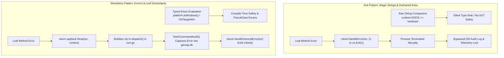
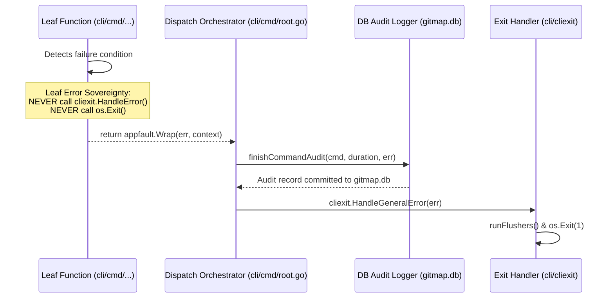
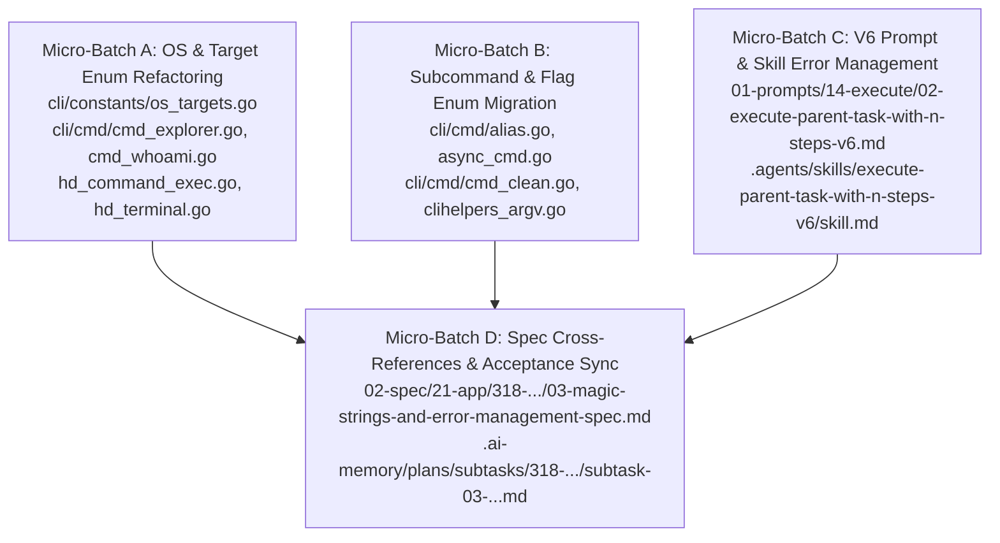

# Specification: Magic Strings Elimination and V6 Error Management Integration

**Module:** `cli/cmd`, `cli/constants`, `01-prompts/14-execute`, `.agents/skills/execute-parent-task-with-n-steps-v6`, `02-spec/02-coding-guidelines`, `02-spec/03-error-manage`  
**Parent Program:** `318-gitmap-command-and-coding-guideline-synchronization`  
**Specification File:** `02-spec/21-app/318-gitmap-command-and-coding-guideline-synchronization/03-magic-strings-and-error-management-spec.md`  
**Version:** 1.0.0  
**Status:** Approved for Implementation  

---

## 1. Executive Summary & Strategic Rationale

This specification establishes the architectural standard, migration blueprints, and verification rules for two critical repository pillars:
1. **Magic Strings Elimination across `cli/cmd/` and `cli/constants/`:** Replacing raw string literals in runtime checks, operating system evaluations, target filters, and subcommands with strongly-typed PascalCase enums ending in `Type`.
2. **Error Management Integration into the V6 Execution Framework:** Formally embedding Leaf Error Sovereignty, zero `os.Exit` in leaf methods, `*appfault.AppError` wrapping, strongly-typed exit code enums (`ExitCodeType`), specialized exit helpers, and database audit capture into `01-prompts/14-execute/02-execute-parent-task-with-n-steps-v6.md` and `.agents/skills/execute-parent-task-with-n-steps-v6/skill.md`.

### 1.1 Root Cause Analysis: Magic Literals and Error Fractures

An exhaustive codebase audit revealed two persistent architectural anti-patterns:
- **Magic String Comparisons:** Handlers in `cli/cmd/` perform raw string comparisons against ad-hoc string literals (e.g. `runtime.GOOS == "windows"`, `runtime.GOOS == "darwin"`, `sub == "ls"`, `tok == "presentation"`). In `cli/constants/os_targets.go`, constants such as `OSTargetWin = "win"` and `OSGroupWindows = "windows"` are untyped string literals lacking the mandatory `*Type` suffix and missing enum validation methods (`IsValid()`, `Is{Value}()`, `Parse()`).
- **Orphaned Exits & Bypassed Audit Capture:** Leaf utility functions and sub-orchestrators occasionally call `cliexit.HandleError(err, 1)` or `os.Exit(1)` directly and return `nil`. This abruptly terminates the operating system process before errors can bubble up to the central `runDispatch` / `dispatch` handler in `cli/cmd/root.go`, completely bypassing `finishCommandAudit()` and `persistLastError()` in `gitmap.db`.



---

## 2. Magic Strings Elimination Across `cli/cmd/`

### 2.1 Targeted Anti-Patterns in `cli/cmd/`

Raw string comparisons in `cli/cmd/` introduce fragility into command routing, cross-platform adaptation, and terminal user experience.

| File Path | Raw String Occurrence | Architectural Risk | Mandated Replacement |
| :--- | :--- | :--- | :--- |
| `cli/cmd/cmd_explorer.go` | `runtime.GOOS == "darwin"` | Hardcoded OS string; silent typo hazard | `platform.IsDarwin()` / `constants.OSTargetMac` |
| `cli/cmd/cmd_whoami.go` | `runtime.GOOS == "windows"` | Unvalidated platform branch | `platform.IsWindows()` / `constants.OSTargetWin` |
| `cli/cmd/hd_command_exec.go` | `runtime.GOOS == "windows"` | Inconsistent OS execution logic | `platform.IsWindows()` |
| `cli/cmd/hd_terminal.go` | `isWindows := runtime.GOOS == "windows"` | Inlined string check | `platform.IsWindows()` |
| `cli/cmd/async_exec.go` | `if constants.OSWindows == "windows"` | Redundant string check against constant | `constants.IsWindowsPlatform()` |
| `cli/cmd/alias.go` | `sub == "ls" \|\| sub == "set"` | Unbounded subcommand strings | `AliasActionType` enum |
| `cli/cmd/async_cmd.go` | `sub == "ls" \|\| sub == "list"` | Unbounded subcommand strings | `AsyncActionType` enum |
| `cli/cmd/cmd_clean.go` | `sub == "terminal" \|\| sub == "dev"` | Multi-string branch chains | `CleanCategoryType` enum |
| `cli/constants/os_targets.go` | Untyped `OSTarget*` and `OSGroup*` | Missing `*Type` suffix and methods | `OSTargetType`, `OSGroupType`, `OrderModeType` |

### 2.2 Standardized OS & Target Enum Specification

In `cli/constants/os_targets.go`, all OS identifiers must be declared as strongly-typed enums ending in `Type`, with backwards-compatible type aliases:

```go
package constants

import (
	"strings"
)

// OSTargetType defines supported installer operating system targets.
type OSTargetType string

// Backwards-compatible type alias.
type OSTarget = OSTargetType

const (
	OSTargetInvalid OSTargetType = ""
	OSTargetWin     OSTargetType = "win"
	OSTargetUbuntu  OSTargetType = "ubuntu"
	OSTargetCentOS  OSTargetType = "centos"
	OSTargetDebian  OSTargetType = "debian"
	OSTargetFedora  OSTargetType = "fedora"
	OSTargetArch    OSTargetType = "arch-linux"
	OSTargetMac     OSTargetType = "macos"
	OSTargetUnix    OSTargetType = "unix"
	OSTargetAll     OSTargetType = "all"
)

// OSGroupType categorizes operating system families.
type OSGroupType string

// Backwards-compatible type alias.
type OSGroup = OSGroupType

const (
	OSGroupInvalid OSGroupType = ""
	OSGroupWindows OSGroupType = "windows"
	OSGroupUnix    OSGroupType = "unix"
	OSGroupMac     OSGroupType = "macos"
	OSGroupPOSIX   OSGroupType = "posix"
)

// OrderModeType specifies installer execution ordering.
type OrderModeType string

// Backwards-compatible type alias.
type OrderMode = OrderModeType

const (
	OrderModeInvalid   OrderModeType = ""
	OrderModeUnixFirst OrderModeType = "unix-first"
	OrderModeOSFirst   OrderModeType = "os-first"
	OrderModeOSOnly    OrderModeType = "os-only"
	OrderModeFallback  OrderModeType = "fallback"
)
```

### 2.3 Required Enum Methods on OS Enums

To adhere to `02-spec/02-coding-guidelines/03-golang/01-enum-specification/`, the following methods must be provided:

```go
// IsValid verifies whether the target is a known supported operating system.
func (t OSTargetType) IsValid() bool {
	hasTarget := t.IsWindows() || t.IsUbuntu() || t.IsDebian() || 
		t.IsCentOS() || t.IsFedora() || t.IsArch() || 
		t.IsMac() || t.IsUnix() || t.IsAll()

	return hasTarget
}

func (t OSTargetType) IsWindows() bool { return t == OSTargetWin }
func (t OSTargetType) IsUbuntu() bool  { return t == OSTargetUbuntu }
func (t OSTargetType) IsDebian() bool  { return t == OSTargetDebian }
func (t OSTargetType) IsCentOS() bool  { return t == OSTargetCentOS }
func (t OSTargetType) IsFedora() bool  { return t == OSTargetFedora }
func (t OSTargetType) IsArch() bool    { return t == OSTargetArch }
func (t OSTargetType) IsMac() bool     { return t == OSTargetMac }
func (t OSTargetType) IsUnix() bool    { return t == OSTargetUnix }
func (t OSTargetType) IsAll() bool     { return t == OSTargetAll }

// String returns the canonical serialized string representation.
func (t OSTargetType) String() string {
	return string(t)
}

// Label returns the human-readable display label.
func (t OSTargetType) Label() string {
	return t.String()
}
```

---

## 3. Exact Enum Guideline Rules

Every enum in the repository MUST strictly satisfy the specifications codified in `02-spec/02-coding-guidelines/04-constants-and-enums/`, `02-spec/02-coding-guidelines/02-enums/`, `02-spec/02-coding-guidelines/03-golang/01-enum-specification/`, and `02-spec/02-coding-guidelines/01-cross-language/26-magic-values-and-immutability.md`.

### 3.1 The 10 Core Enum Rules

1. **Mandatory Type Identifier Suffix:** All enum type definitions MUST end in `Type` (e.g. `ExitCodeType`, `OSTargetType`, `OSGroupType`, `OrderModeType`, `CleanCategoryType`, `AliasActionType`).
2. **Backwards-Compatible Aliases:** Provide `type MyEnum = MyEnumType` to ensure legacy callers continue compiling cleanly without disruption.
3. **Underlying Type Selection:**
   - **Byte-based iota enums:** Preferred for internal domain models, state machines, and performance-critical switches (`type Variant byte`). The zero value MUST be `Invalid` (`Invalid Variant = iota`).
   - **Typed string constants:** Mandated for external boundary serialization, CLI flags, JSON protocol envelopes, and SQLite database storage (`type ActionType string`).
4. **PascalCase for Identifiers and Serialization Labels:** Both constant identifiers (`SerpApi`, `OSTargetWin`) and lookup table entries (`variantLabels`) MUST use PascalCase. Abbreviations are treated as words (`BaseUrl`, not `BaseURL`; `SerpApi`, not `SerpAPI`).
5. **No Negative Booleans in Methods:** All predicates and inspection methods MUST be positive (`IsValid()`, `HasPermission()`, `IsWindows()`). Negative methods (`IsNotValid()`, `IsDisabled()`) are strictly banned.
6. **Required Methods Suite:**
   - `String() string` — string representation.
   - `Label() string` — display label (delegates directly to `String()`).
   - `IsValid() bool` — positive boolean validity check.
   - `Is{Value}() bool` — individual boolean predicates for each variant.
   - `IsOther(other Type) bool` — positive boolean equality exclusion.
   - `IsAnyOf(others ...Type) bool` — variadic matching helper eliminating chained `||` checks.
   - `All() []Type` — slice of all valid variants.
   - `Parse(s string) (Type, error)` — case-insensitive parsing via `strings.EqualFold`.
7. **Total Ban on Inline Magic Strings in Logic:** Comparing raw string literals (`if status == "active"` or `if runtime.GOOS == "windows"`) is strictly forbidden. Logic must invoke enum predicates (`if status.IsActive()` or `if platform.IsWindows()`).
8. **No Magic Numbers or Raw Rune Casts:** Raw rune casts such as `rune(0)` or `rune(10)` are forbidden; use literal characters `'\x00'` or named constants.
9. **Exhaustive Switch Handling:** All switches on enum values MUST include all valid variants or provide a deterministic `default:` branch returning a structured error.
10. **Positive Boolean Naming Only:** Variable flags and parameters associated with enums must begin with `is` or `has` (`isValid`, `hasMatch`).

---

## 4. Error Management Integration into the V6 Execute Framework

### 4.1 Architectural Invariants from `02-spec/03-error-manage/`

In accordance with `02-spec/03-error-manage/` and `02-spec/02-coding-guidelines/01-cross-language/40-database-repository-pattern-and-error-sovereignty.md`:
1. **Leaf Error Return Sovereignty:** Leaf functions that return an `error` or `result.Wrap[T]` container MUST return the error directly upward (`return appfault.Wrap(...)`). Leaf methods MUST NEVER call exit handlers (`cliexit.HandleError`) or `os.Exit` and return `nil`.
2. **Outer Caller Handles Exits:** Only the root command dispatcher (`runDispatch` / `dispatch` in `cli/cmd/root.go`) or the top-level CLI orchestrator receives errors and terminates the runtime process.
3. **Database Audit Capture:** When errors bubble up to `dispatch`, they are captured by `finishCommandAudit(cmd, duration, err)` and `persistLastError(command, err)`, writing execution telemetry, exit codes, and error messages into SQLite `gitmap.db`. Bypassing this layer causes silent data loss in CI/CD telemetry.
4. **No Magic Integer Exit Codes:** Passing raw integers (`1`, `2`) to exit handlers is banned. Callers must supply strongly-typed `cliexit.ExitCodeType` constants (`ExitCodeSuccess = 0`, `ExitCodeGeneralError = 1`, `ExitCodeUsageError = 2`, `ExitCodeValidationError = 5`).
5. **Specialized Exit Helpers:** Repetitive error handling sites must call specialized helpers: `cliexit.HandleGeneralError(err)`, `cliexit.HandleUsageError(err)`, `cliexit.HandleValidationError(err)`, `cliexit.HandleNotFound(err)`.
6. **Structured Wrapping via `*appfault.AppError`:** Bare standard library errors (`errors.New`, `fmt.Errorf`) are forbidden across public boundaries; errors must be wrapped with rich diagnostic context via `appfault.Wrap` or `apperror.WrapSimple`.



### 4.2 Concrete Updates to `01-prompts/14-execute/02-execute-parent-task-with-n-steps-v6.md`

The canonical V6 execution prompt must be updated in four specific locations:

#### Update 1: Section 1.1.E Coding Guideline Enforcement Matrix
Add explicit requirements for Leaf Error Sovereignty, typed exit codes, and database audit capture:

```markdown
1. **Error Management & Leaf Sovereignty:** 
   - Zero orphaned or swallowed errors (`_ = err` is strictly banned).
   - Leaf functions returning `error` or `result.Wrap[T]` MUST return the error directly upward (`return appfault.Wrap(...)`). Leaf methods MUST NEVER invoke `cliexit.HandleError` or `os.Exit` and return `nil`.
   - All errors bubble up to top-level command dispatchers so they are recorded by `finishCommandAudit` and `persistLastError` in `gitmap.db`.
   - Never pass raw integer exit codes (`1`, `2`); always use strongly-typed `ExitCodeType` enums or specialized helpers (`cliexit.HandleGeneralError`, `cliexit.HandleUsageError`, `cliexit.HandleValidationError`).
   - Structured errors must return `*appfault.AppError` from `pkg/appfault` or `cli/apperror`.
```

#### Update 2: Rule R11 (Error Sovereignty & Audit Preservation)
Embed Rule R11 in the master rules section:

```markdown
- **Rule R11 (Leaf Error Sovereignty & DB Audit Capture):** Every leaf function across `cli/`, `pkg/`, and `store/` must return errors directly to its caller. Calling `os.Exit()` or exit handlers inside leaf logic is an immediate auto-reject violation. Exits belong exclusively to the top-level command dispatch orchestrator in `cli/cmd/root.go` to guarantee that SQLite command audit records are committed to `gitmap.db`.
```

#### Update 3: Phase 2 Code Execution Constraints
Add error audit preservation checks to Phase 2:

```markdown
- Verify that no newly authored or refactored leaf functions contain `os.Exit` or `cliexit.HandleError`.
- Ensure all process termination relies on strongly-typed `ExitCodeType` enums.
```

#### Update 4: Section 13 Quality Checklist
Add dedicated checklist items:

```markdown
- [ ] Error Management: Enforced `02-spec/03-error-manage/` using domain-specific `*appfault.AppError`, never generic error.
- [ ] Leaf Error Sovereignty: Verified zero `os.Exit` or `cliexit.HandleError` calls inside leaf methods; errors bubble to root dispatcher for DB audit capture.
- [ ] Strongly-Typed Exit Codes: Verified all exit paths utilize `ExitCodeType` constants or specialized helpers (`HandleGeneralError`, `HandleUsageError`, `HandleValidationError`).
```

### 4.3 Concrete Updates to `.agents/skills/execute-parent-task-with-n-steps-v6/skill.md`

The Antigravity skill `.agents/skills/execute-parent-task-with-n-steps-v6/skill.md` mirrors `01-prompts/14-execute/02-execute-parent-task-with-n-steps-v6.md` and must synchronize the identical four updates:
1. Embed Leaf Error Sovereignty and database audit logging into Section 1.1.E.
2. Formulate Rule R11 in the Rules taxonomy.
3. Include error audit checks in Phase 2.
4. Add the Leaf Error Sovereignty verification item to the Section 13 completion checklist.

---

## 5. Subtask Breakdown & Disjoint Micro-Batches

Execution is partitioned into four strictly disjoint micro-batches to eliminate file lock collisions during multi-agent execution:



### 5.1 Micro-Batch Details

| Batch | Owned Files | Core Action | Concurrency Safety |
| :--- | :--- | :--- | :--- |
| **Micro-Batch A** | `cli/constants/os_targets.go`<br>`cli/cmd/cmd_explorer.go`<br>`cli/cmd/cmd_whoami.go`<br>`cli/cmd/hd_command_exec.go`<br>`cli/cmd/hd_terminal.go`<br>`cli/cmd/async_exec.go` | Refactor `OSTarget*` constants to `OSTargetType`, add `*Type` suffixes, implement `IsValid()` and `Is{OS}()` predicates, replace `runtime.GOOS == "windows"` with `platform.IsWindows()`. | Disjoint file set; isolated to OS detection and installer target files. |
| **Micro-Batch B** | `cli/cmd/alias.go`<br>`cli/cmd/async_cmd.go`<br>`cli/cmd/cmd_clean.go`<br>`cli/cmd/clihelpers_argv.go` | Eliminate raw string comparisons (`sub == "ls"`, `tok == "presentation"`), define PascalCase action enums ending in `Type`, use `IsAnyOf` predicates. | Disjoint file set; isolated to CLI command argument routers. |
| **Micro-Batch C** | `01-prompts/14-execute/02-execute-parent-task-with-n-steps-v6.md`<br>`.agents/skills/execute-parent-task-with-n-steps-v6/skill.md` | Embed Leaf Error Sovereignty, Rule R11, `*appfault.AppError` wrappers, typed exit code enums, and database audit capture. | Disjoint file set; isolated to prompt and skill definitions. |
| **Micro-Batch D** | `02-spec/21-app/318-gitmap-command-and-coding-guideline-synchronization/03-magic-strings-and-error-management-spec.md`<br>`.ai-memory/plans/subtasks/318-gitmap-command-and-coding-guideline-synchronization/subtask-03-magic-strings-and-error-management.md` | Author, validate, and synchronize canonical specification and subtask tracking documents. | Disjoint file set; documentation and plan ledger only. |

---

## 6. Acceptance Criteria & Verification Evidence Contract

### 6.1 Acceptance Criteria

#### AC-318-03-01: PascalCase Enum Standards with Mandatory `Type` Suffix
- **Given** target constants and operating system definitions in `cli/constants/os_targets.go`.
- **When** the file is audited against repository coding guidelines.
- **Then** all enum types bear the mandatory `Type` suffix (`OSTargetType`, `OSGroupType`, `OrderModeType`), backwards-compatible aliases are preserved (`type OSTarget = OSTargetType`), and mandatory predicate methods (`IsValid()`, `IsWindows()`, `IsMac()`, `IsUnix()`) are provided with positive boolean returns.

#### AC-318-03-02: OS & Subcommand Magic String Elimination across `cli/cmd/`
- **Given** source files `cli/cmd/cmd_explorer.go`, `cli/cmd/cmd_whoami.go`, `cli/cmd/hd_command_exec.go`, and `cli/cmd/hd_terminal.go`.
- **When** searched for inline `runtime.GOOS == "windows"` or `"darwin"`.
- **Then** zero raw string equality comparisons remain; all checks invoke strongly-typed enum predicates or platform helper methods.

#### AC-318-03-03: Leaf Error Sovereignty & DB Audit Preservation in V6 Prompts
- **Given** canonical prompt `01-prompts/14-execute/02-execute-parent-task-with-n-steps-v6.md` and skill `.agents/skills/execute-parent-task-with-n-steps-v6/skill.md`.
- **When** audited for error management guidelines.
- **Then** Section 1.1.E, Rule R11, Phase 2, and Section 13 explicitly mandate Leaf Error Sovereignty, ban `os.Exit` and `cliexit.HandleError` in leaf methods, require `*appfault.AppError` wrapping, and enforce that errors bubble to root command dispatchers to guarantee SQLite audit capture in `gitmap.db`.

#### AC-318-03-04: Strongly-Typed Exit Codes and Specialized Exit Helpers Integration
- **Given** CLI command error handling across `cli/cmd/`.
- **When** errors are dispatched or process termination is invoked.
- **Then** all exit calls utilize `ExitCodeType` constants or specialized helpers (`HandleGeneralError`, `HandleUsageError`, `HandleValidationError`), with zero magic integer exit codes (`1`, `2`) passed directly.

#### AC-318-03-05: Strict Relative Git Paths and Positive Boolean Hygiene
- **Given** all newly authored and refactored specification, prompt, and Go source files.
- **When** audited for path syntax and boolean naming.
- **Then** 100% of filesystem references use strict relative Git paths (no drive letters or `file:///` URIs) and all boolean variables and methods use positive naming (`is*`, `has*`, with zero negative prefixes).

### 6.2 Verification Evidence Commands

| Verification Gate | Command | Expected Outcome |
| :--- | :--- | :--- |
| **FastGate AST Linter** | `python 03-ai-scripts/50-fastgate.py` | Exit 0; all syntax and AST checks pass in < 1.5s. |
| **Forbidden Strings Check** | `python linter-scripts/check-forbidden-strings.py` | Exit 0; zero raw integer exit codes or prohibited string literals. |
| **Enum Guidelines Linter** | `python linter-scripts/check-enum-guidelines.py` | Exit 0; all enum types bear `Type` suffix. |
| **Relative Path Hygiene** | `python linter-scripts/check-relative-paths.py` | Exit 0; 100% relative Git paths across repository files. |
| **Atomic GitMap Commit** | `gitmap cpf "SPEC - add magic strings and error management spec for 318"` | Clean atomic commit using GitMap semantic hyphen format. |
