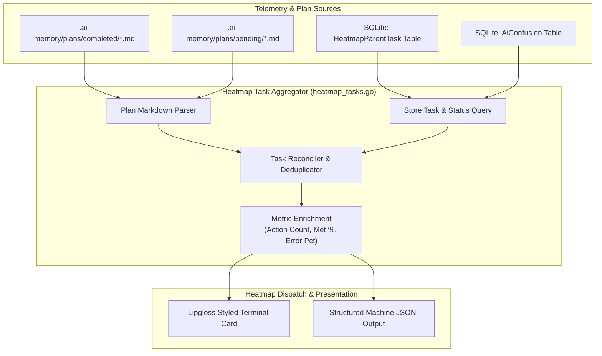
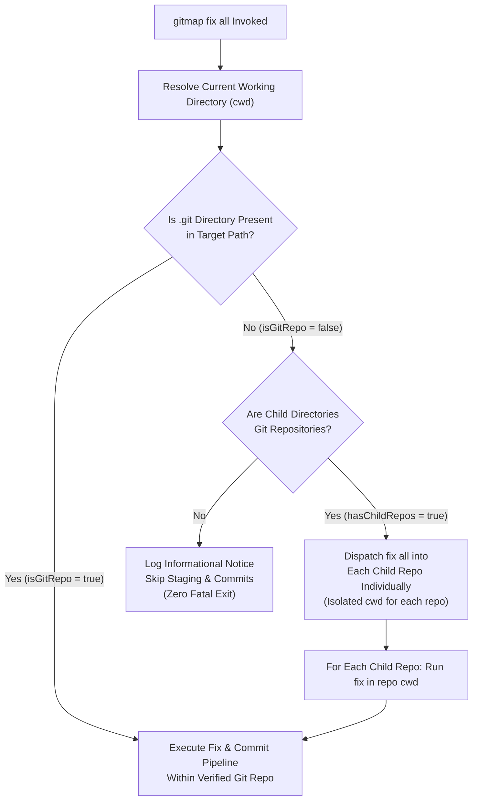
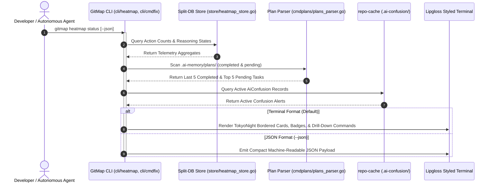

# Architecture Specification: Heatmap Status Telemetry Overhaul & AI Confusion Subsystem

- **Spec ID:** `02-spec/21-app/326-heatmap-status-improvement-and-ai-confusion-database/01-architecture-spec.md`
- **Feature Slug:** `heatmap-status-improvement-and-ai-confusion-database`
- **Module:** `cli/heatmap`, `cli/cmdfix`, `cli/cmdpull`, `cli/store`, `cli/cmdcommit`, `repo-cache/.ai-confusion`
- **Status:** APPROVED
- **Version:** 1.0.0
- **Target Audience:** Autonomous AI Agents, Multi-Agent Swarms, GitMap Core Engineers
- **Target Release:** Minor Bump

---

## 1. Executive Summary & Problem Statement

GitMap provides autonomous telemetry, multi-repository orchestration, and automated workspace maintenance across polyglot environments. As multi-agent engineering swarms operate simultaneously on large codebases, several systemic friction points have emerged:

1. **Primitive Heatmap Status Presentation:** The current `gitmap heatmap status` command renders unpadded, monochromatic text without visual hierarchy. It lacks visibility into recently completed and currently pending architectural plans from `.ai-memory/plans/` and SQLite registries.
2. **Missing Machine-Readable Status Payload:** Autonomous agents executing V6 swarm protocols require a lightweight, structured JSON output (`gitmap heatmap status --json`) containing completed tasks, pending tasks, action ratios, and active confusion alerts to steer task execution loops.
3. **Absence of Actionable Drill-Down CLI Examples:** Users and agents observing task statuses currently lack explicit, copy-pasteable tree inspection commands (e.g., `gitmap heatmap tree --task=<slug>`) to drill into execution steps.
4. **Non-Repository Parent Directory Commit Hazards:** Running `gitmap fix all` from a parent workspace directory (such as a workspace root containing multiple repository subdirectories) erroneously attempts `git commit` or `git add` in non-git directories, triggering execution crashes and polluted audit logs.
5. **Opaque and Alarming Auto-Stashing UX:** The current auto-stashing output during fix and pull routines produces wall-of-text diagnostic warnings that frighten developers. It lacks transparent file status flags (`[M]`, `[D]`, `[?]`), clear before/after outcome summaries, and repository list collapsing for unchanged codebases.
6. **Lack of Persistent AI Confusion Memory:** When AI agents encounter ambiguous requirements, unresolved merge conflicts, or complex refactoring dilemmas, their reasoning state, affected line spans, and code snippets are lost upon context eviction. There is no normalized SQLite store in `repo-cache` to preserve, query, and synchronize confusion states across AI agent sessions.
7. **Malformed Commit Prefix Regressions:** AI agents and execution prompts have regressed into generating malformed commit messages featuring conventional colon delimiters (e.g., `feature:`, `feat(release):`), bracketed tags (`[FIX]`), and raw uppercase prefixes (`FIX: ...`), violating GitMap's strict semantic verb and `MODULE - summary` discipline.

This specification defines the comprehensive architecture to address these seven challenges holistically.

---

## 2. Heatmap Visual Telemetry & Status Redesign

### 2.1 Visual Design Philosophy & TokyoNight Palette

The terminal presentation of `gitmap heatmap status` is upgraded from raw standard text to Lipgloss-styled visual containers adhering to GitMap's canonical **TokyoNight Storm** palette (defined in `cli/termout/theme_lipgloss.go` and `cli/termout/themes.go`).

| UI Element | Lipgloss Role / Token | Hex Value | Purpose |
| :--- | :--- | :--- | :--- |
| **Card Border** | `TokyoMuted` | `#565f89` | Subtle rounded borders encapsulating telemetry cards |
| **Header Accent** | `TokyoPrimary` | `#7aa2f7` | High-authority module banners and section titles |
| **Success Badges** | `TokyoOK` | `#9ece6a` | Highlighting completed tasks and high expectation ratios |
| **Warning Badges** | `TokyoWarn` | `#e0af68` | Flagging in-progress tasks, pending reviews, and retries |
| **Error / Alert Badges** | `TokyoError` | `#f7768e` | Highlighting failed actions, active AI confusions, or fatal states |
| **Surface Background** | `TokyoSurface` | `#24283b` | Padding and badge container background fills |
| **Muted Labels** | `TokyoMuted` | `#565f89` | Timestamps, file paths, and table dividers |

### 2.2 Padding & Layout Geometry

The revamped heatmap status view uses structured vertical and horizontal spacing:
- **Outer Box Padding:** Top/Bottom: 0, Left/Right: 2 characters.
- **Card Separation:** Exactly 1 vertical blank line between summary headers, task queues, and touch tables.
- **Column Alignment:** Monospaced tabular alignment ensuring all task slugs, state counts, and file paths align across standard 80-column and wide 120-column terminal emulators.
- **Terminal Width Responsiveness:** Dynamically queries `termout.TerminalWidth()` with an 80-column fallback floor to wrap long paths and reasoning notes cleanly without horizontal clipping.

```text
╭──────────────────────────────────────────────────────────────────────────────╮
│  GITMAP HEATMAP TELEMETRY STATUS                                            │
│  Workspace: gitmap  •  AI: 01-antigravity  •  Active Task: 326-heatmap       │
╰──────────────────────────────────────────────────────────────────────────────╯

  Telemetry Summary
  ───────────────────────────────────────────────────────────────────────────
  Total Actions Recorded : 1,428 actions
  Expectation Pass Rate  : 96.4% [1,377 / 1,428]
  Active Reasoning State : OPTIMAL (1,120)  •  RETRY (35)  •  CRITICAL (4)

  Completed Tasks (Last 5)
  ───────────────────────────────────────────────────────────────────────────
  [✓] 321-package-constants-and-enums-dry-restructuring        (142 actions)
  [✓] 322-package-constants-and-enums-dry-restructuring        (89 actions)
  [✓] 323-package-constants-and-enums-dry-restructuring        (112 actions)
  [✓] 324-package-constants-and-enums-dry-restructuring        (94 actions)
  [✓] 325-gitmap-and-antigravity-cicd-and-code-refactoring     (315 actions)

  Pending Tasks Queue (Top 5)
  ───────────────────────────────────────────────────────────────────────────
  [⏳] 326-heatmap-status-improvement-and-ai-confusion-database (Active)
  [ ] 327-polyglot-macro-replay-engine                         (Queued)
  [ ] 328-cluster-fleet-ssh-credential-vault                   (Queued)

  Drill-Down Inspection Commands
  ───────────────────────────────────────────────────────────────────────────
  • Tree View   : gitmap heatmap tree --task=326-heatmap-status-improvement
  • Search Logs : gitmap heatmap search --state=ERROR --limit=10
  • Confusions  : gitmap rc ai-confusion view --task=326-heatmap-status-improvement
```

---

## 3. Task Integration Subsystem

### 3.1 Dual-Source Task Aggregation Engine

The task integration subsystem (`cli/heatmap/heatmap_tasks.go`) pulls task intelligence from two complementary sources:

1. **Filesystem Architectural Plans (`.ai-memory/plans/`):**
   - Scans `.ai-memory/plans/completed/` for finalized task specifications.
   - Scans `.ai-memory/plans/pending/` for scheduled and in-progress tasks.
   - Parses Markdown frontmatter to extract `Task Sequence`, `Task Slug`, `Title`, and `Status`.
2. **SQLite Telemetry Registries (`HeatmapParentTask`):**
   - Queries `root-heatmap.db` and per-repo `heatmap.db` for registered `HeatmapParentTask` records.
   - Correlates action log volumes, error counts, and touch metrics against task slugs.



### 3.2 Task Reconciler Rules
- **Task Sorting:** Completed tasks sorted descending by task sequence ID or finish date (most recent first). Pending tasks sorted ascending by sequence ID (next up first).
- **Default Limit:** Returns top 5 completed tasks and top 5 pending tasks by default in terminal rendering; configurable via `--limit=<N>`.
- **Status Normalization:** Maps status values to positive booleans (`isCompleted`, `isActive`, `hasPendingSubtasks`).

---

## 4. Compact JSON Payload Architecture

### 4.1 CLI Output Contract (`--json`)

When invoked with `gitmap heatmap status --json`, the command bypasses Lipgloss ANSI formatting and emits a single, compact, valid JSON object to standard output. This contract is consumed directly by AI coding agents executing the V6 swarm prompt and automated quality verification scripts.

### 4.2 JSON Schema Definition

```json
{
  "$schema": "https://json-schema.org/draft/2020-12/schema",
  "title": "HeatmapStatusPayload",
  "type": "object",
  "required": [
    "isSuccess",
    "workspaceSlug",
    "activeTaskSlug",
    "telemetry",
    "completedTasks",
    "pendingTasks",
    "confusionAlerts",
    "suggestedCommands"
  ],
  "properties": {
    "isSuccess": { "type": "boolean" },
    "workspaceSlug": { "type": "string" },
    "activeTaskSlug": { "type": "string" },
    "telemetry": {
      "type": "object",
      "required": ["totalActions", "expectationsMetCount", "expectationsMetPct", "reasoningStates"],
      "properties": {
        "totalActions": { "type": "integer" },
        "expectationsMetCount": { "type": "integer" },
        "expectationsMetPct": { "type": "number" },
        "reasoningStates": {
          "type": "object",
          "additionalProperties": { "type": "integer" }
        }
      }
    },
    "completedTasks": {
      "type": "array",
      "items": {
        "type": "object",
        "required": ["taskSequence", "taskSlug", "title", "totalActions", "isCompleted"],
        "properties": {
          "taskSequence": { "type": "integer" },
          "taskSlug": { "type": "string" },
          "title": { "type": "string" },
          "totalActions": { "type": "integer" },
          "isCompleted": { "type": "boolean" }
        }
      }
    },
    "pendingTasks": {
      "type": "array",
      "items": {
        "type": "object",
        "required": ["taskSequence", "taskSlug", "title", "isActive", "isCompleted"],
        "properties": {
          "taskSequence": { "type": "integer" },
          "taskSlug": { "type": "string" },
          "title": { "type": "string" },
          "isActive": { "type": "boolean" },
          "isCompleted": { "type": "boolean" }
        }
      }
    },
    "confusionAlerts": {
      "type": "array",
      "items": {
        "type": "object",
        "required": ["confusionId", "taskSlug", "filePath", "reasoningNote", "isResolved"],
        "properties": {
          "confusionId": { "type": "integer" },
          "taskSlug": { "type": "string" },
          "filePath": { "type": "string" },
          "startLine": { "type": "integer" },
          "endLine": { "type": "integer" },
          "reasoningNote": { "type": "string" },
          "isResolved": { "type": "boolean" }
        }
      }
    },
    "suggestedCommands": {
      "type": "object",
      "required": ["treeViewCommand", "searchErrorCommand", "aiConfusionSyncCommand"],
      "properties": {
        "treeViewCommand": { "type": "string" },
        "searchErrorCommand": { "type": "string" },
        "aiConfusionSyncCommand": { "type": "string" }
      }
    }
  }
}
```

---

## 5. Drill-Down Tree View & Actionable CLI Suggestions

### 5.1 Drill-Down Command Synthesis
The terminal status renderer generates contextual CLI one-liners derived from the active execution state:
- If an active task is set: `gitmap heatmap tree --task=<activeTaskSlug>`
- If errors or retries were registered: `gitmap heatmap search --state=ERROR --task=<activeTaskSlug>`
- If active AI confusions are present: `gitmap rc ai-confusion view --task=<activeTaskSlug>`
- If historical comparison is needed: `gitmap heatmap status --limit=20`

### 5.2 Tree View Formatting
When the user or AI executes the suggested tree command, the tree subsystem outputs hierarchical parent-to-child reasoning nodes using UTF-8 branch glyphs (`├── `, `└── `, `│   `), color-coded by reasoning state.

---

## 6. Work Directory Commit Guard & Repository Boundary Enforcement

### 6.1 Root Cause of Non-Git Parent Commits
During `gitmap fix all` execution, GitMap crawls parent workspaces (e.g. `d:/work/` or user home folders) containing multiple standalone Git repositories. If a fixer script, cleanup rule, or auto-commit invocation is triggered from the working directory root (`cwd`), GitMap historically attempted to invoke `git commit` or `git add` directly against the parent workspace directory. Because the parent workspace contains no `.git` metadata directory, Git aborted with fatal errors:
```text
fatal: not a git repository (or any of the parent directories): .git
```

### 6.2 Pre-Flight Repository Boundary Guard Architecture
GitMap enforces strict boundary validation before any staging, committing, or stashing operation:



### 6.3 Mandatory Enforcement Invariants
1. **Never Commit in Non-Git CWD:** Any leaf function in `cli/cmdfix/` or `cli/cmdcommit/` must verify `store.IsGitRepository(targetDir)`. If false, commit operations are strictly skipped with a clean debug log.
2. **CWD Context Isolation:** Multi-repo operations must explicitly set `cmd.Dir = repoPath` on all child git processes, preventing leakage of parent working directory context.
3. **Audit Log Sovereignty:** Non-git directory skips are recorded as informational audit events (`constants.AuditStatusSkipped`) rather than fatal application errors.

---

## 7. Humanized Auto-Stashing & Granular File Flags

### 7.1 UX Humanization Principles
Automated stashing during `gitmap pull` and `gitmap fix all` is necessary to prevent merge aborts, but unformatted stashing logs cause panic among developers. GitMap humanizes auto-stashing through four principles:

1. **Explicit Intent Declaration:** Clearly announce *why* stashing is occurring before touching the working tree.
2. **Standard Git File Flags:** List modified, deleted, and untracked files using standard Git shorthand badges:
   - `[M]` - Modified tracked file
   - `[D]` - Deleted tracked file
   - `[?]` - Untracked new file
3. **End-Result Assurance:** Display a crystal-clear post-operation summary confirming that stashed files were successfully re-applied (`git stash pop`), preserving all local work intact.
4. **Condensed Unchanged Repositories:** Collapse repositories with zero modifications into a single clean summary line (e.g., `✓ Updated all other 67 repositories (no local changes)`), highlighting only repositories requiring attention.

### 7.2 Humanized Stashing Visual Layout

```text
╭──────────────────────────────────────────────────────────────────────────────╮
│  SAFE AUTO-STASHING ACTIVATED: gitmap                                        │
│  Preserving uncommitted working tree modifications before upstream pull...   │
╰──────────────────────────────────────────────────────────────────────────────╯

  Detected Local Changes:
    [M] cli/heatmap/heatmap_cmd_render.go
    [M] cli/heatmap/types.go
    [?] .ai-memory/plans/subtasks/326-heatmap-status-improvement/
    [D] legacy_unused_file.go

  Operation Sequence:
    1. [✓] Created temporary safety stash: "gitmap-auto-stash-20261025-104800"
    2. [✓] Pulled latest upstream commits via fast-forward rebase
    3. [✓] Restored local modifications cleanly onto updated HEAD
    4. [✓] Zero merge conflicts detected. All local changes preserved.

  Repository Fleet Rollup:
    • Updated 1 repository with local modifications safely preserved.
    • Updated all other 67 repositories (clean working trees, zero changes).

  Inspect detailed status anytime:
    gitmap st
```

---

## 8. `repo-cache` AI Confusion Database Architecture

### 8.1 Purpose & Storage Topology
When AI agents encounter ambiguous requirements, contradictory specs, circular dependencies, or unexpected compiler errors during execution, they must record their cognitive confusion instead of silently guessing, hallucinating, or failing.

GitMap establishes the **AI Confusion Subsystem** in the companion repository `repo-cache` (resolved via `store.ResolveSpecialRepoPath("rc")`). Telemetry is partitioned by repository slug under `.ai-confusion/`:

```text
<repo-cache>/
└── .ai-confusion/
    ├── gitmap/
    │   ├── ai-confusion.db
    │   ├── ai-confusion.db-shm
    │   ├── ai-confusion.db-wal
    │   └── instructions/
    │       ├── 20261025-confusion-001.json
    │       └── 20261025-confusion-002.json
    ├── scripts-fixer/
    │   └── ai-confusion.db
    └── wp-html-automate/
        └── ai-confusion.db
```

### 8.2 Normalized SQLite Schema: `AiConfusion`

Following GitMap's PascalCase table and camelCase column conventions (`02-spec/04-database-conventions/`), the database schema comprises two primary tables:

```sql
CREATE TABLE IF NOT EXISTS AiConfusion (
    AiConfusionId     INTEGER PRIMARY KEY AUTOINCREMENT,
    TaskSlug          TEXT NOT NULL,
    SubtaskSlug       TEXT NOT NULL DEFAULT '',
    AgentSlug         TEXT NOT NULL,
    AiEngine          TEXT NOT NULL,
    SpecPath          TEXT NOT NULL DEFAULT '',
    FilePath          TEXT NOT NULL,
    StartLine         INTEGER NOT NULL DEFAULT 0,
    EndLine           INTEGER NOT NULL DEFAULT 0,
    CodeSnippet       TEXT NOT NULL DEFAULT '',
    ConfusionState    TEXT NOT NULL,
    IntendedGoal      TEXT NOT NULL,
    ReasoningNotes    TEXT NOT NULL,
    BlockerQuestion   TEXT NOT NULL,
    IsResolved        INTEGER NOT NULL DEFAULT 0,
    ResolutionNotes   TEXT NULL,
    ResolvedByAgent   TEXT NULL,
    CreatedAt         TEXT NOT NULL DEFAULT CURRENT_TIMESTAMP,
    UpdatedAt         TEXT NOT NULL DEFAULT CURRENT_TIMESTAMP
);

CREATE INDEX IF NOT EXISTS IdxAiConfusion_Task ON AiConfusion(TaskSlug);
CREATE INDEX IF NOT EXISTS IdxAiConfusion_File ON AiConfusion(FilePath);
CREATE INDEX IF NOT EXISTS IdxAiConfusion_Resolved ON AiConfusion(IsResolved);

CREATE TABLE IF NOT EXISTS AiConfusionContextFile (
    AiConfusionContextFileId INTEGER PRIMARY KEY AUTOINCREMENT,
    AiConfusionId            INTEGER NOT NULL,
    ContextFilePath          TEXT NOT NULL,
    FileRole                 TEXT NOT NULL,
    CreatedAt                TEXT NOT NULL DEFAULT CURRENT_TIMESTAMP,
    FOREIGN KEY (AiConfusionId) REFERENCES AiConfusion(AiConfusionId) ON DELETE CASCADE
);
```

### 8.3 CLI Command Suite (`gitmap rc ai-confusion`)

| Subcommand | Syntax | Description |
| :--- | :--- | :--- |
| `add` | `gitmap rc ai-confusion add --file=<path> --task=<slug> --question="<text>" [flags]` | Interactively or via flags records a new confusion event |
| `inject` | `gitmap rc ai-confusion inject --file=<instruction.json>` | Ingests a structured JSON instruction file emitted by an AI agent |
| `view` | `gitmap rc ai-confusion view [--task=<slug>] [--file=<path>] [--all]` | Renders confusion entries, line numbers, code snippets, and reasoning |
| `complete` | `gitmap rc ai-confusion complete <id> --notes="<resolution>"` | Marks a confusion entry as resolved with explanatory closure notes |
| `sync` | `gitmap rc ai-confusion sync [--push]` | Pulls upstream `repo-cache`, replays local uncommitted confusions, and synchronizes |

### 8.4 Safe Pull & Sync Strategy (Export-Revert-Pull-Replay)
Because SQLite binary databases cannot be cleanly merged by `git merge`, GitMap executes a deterministic 4-step sync protocol:
1. **Export:** Export pending uncommitted `AiConfusion` rows to temporary JSON ledger.
2. **Clean:** Revert local changes to binary `.db` files (`git checkout HEAD -- ai-confusion.db*`).
3. **Pull:** Execute fast-forward upstream sync (`git pull --rebase origin main`).
4. **Replay:** Ingest exported JSON records into updated SQLite database using `INSERT OR IGNORE` keyed on unique task/file/timestamp hashes.

---

## 9. Standardized Semantic Commit Formatting & Skill Purification

### 9.1 Root Cause of Commit Prefix Regressions
Autonomous AI agents executing the V6 prompt and Muse onboarding skills have recently generated commit messages such as:
- `feature: 326-heatmap spec authoring`
- `[FIX] update heatmap rendering`
- `FIX: file size reduction`
- `chore(release): minor version bump`

These formats violate GitMap's core engineering discipline (`02-spec/02-coding-guidelines/` and `.agents/rules/gitmap_guidelines.md`). The root causes were identified as:
1. Conventional Commit examples (`feature:`, `fix:`) lingering in legacy prompt templates.
2. Uppercase prefix examples (`FIX`, `REFACTOR`) appearing in older skill files.
3. Lack of automated sanitization in `cli/cmdcommit/commit_formatter.go`.

### 9.2 Strict Semantic Commit Standards

All commits in GitMap repositories MUST use dedicated GitMap semantic commit verbs with the strict format:
```text
"MODULE - summary"
```

| Commit Verb | Semantic Purpose | Permitted Contexts |
| :--- | :--- | :--- |
| `gitmap cpr` | **Release** | Minor and patch version releases ONLY |
| `gitmap cpc` | **Chore** | Maintenance, documentation, dependency, and sync chores ONLY |
| `gitmap cbf` | **Bug Fix** | Defect repairs and error handling fixes ONLY |
| `gitmap cfr` | **Refactor** | Architecture improvements, DRY refactors, guideline fixes ONLY |
| `gitmap cpf` | **Feature** | New functionality and specification implementations ONLY |

### 9.3 Total Bans & Automated Sanitizer
- **TOTAL BAN:** Using `cpf` for releases or chores.
- **TOTAL BAN:** Raw `git commit` or `git add -A`.
- **TOTAL BAN:** Colons inside commit arguments (e.g., `gitmap cpf "feature: ..."`).
- **TOTAL BAN:** Square brackets (e.g., `gitmap cbf "[FIX] ..."`).
- **TOTAL BAN:** All-uppercase prefix tokens (e.g., `gitmap cbf "FIX ..."`).
- **Defensive Sanitizer in `cli/cmdcommit/`:** `SanitizeCommitMessage()` automatically strips leading brackets, lowercases conventional prefixes, strips colons, and enforces `MODULE - summary` formatting before executing commits.

---

## 10. Mermaid Architecture & Data Flow



---

## 11. Acceptance Criteria

1. **AC-1 (Visual Quality):** `gitmap heatmap status` renders with rounded Lipgloss borders, TokyoNight palette tokens, and safe ANSI fallback on monochrome terminals.
2. **AC-2 (Task Integration):** Displays the last 5 completed tasks and top 5 pending tasks discovered from `.ai-memory/plans/` and SQLite registries.
3. **AC-3 (Actionable Drill-Down):** Displays copy-pasteable CLI commands (`gitmap heatmap tree --task=<slug>`) corresponding to active tasks.
4. **AC-4 (Machine JSON):** `gitmap heatmap status --json` outputs valid, well-formed JSON strictly matching the schema in Section 4.2.
5. **AC-5 (Work Directory Guard):** `gitmap fix all` executed in a non-git parent workspace completes cleanly without executing `git commit` in non-git directories.
6. **AC-6 (Humanized Stashing):** Auto-stashing displays explicit file flags (`[M]`, `[D]`, `[?]`), clear restoration guarantees, and collapses unchanged repositories.
7. **AC-7 (AI Confusion Store):** `repo-cache/.ai-confusion/<repo-slug>/ai-confusion.db` persists agent confusions with full task, subtask, file, and code snippet context.
8. **AC-8 (Commit Standard Sanitization):** Commit formatter strips conventional prefixes, brackets, and colons, guaranteeing `MODULE - summary` format across all GitMap commit verbs.
