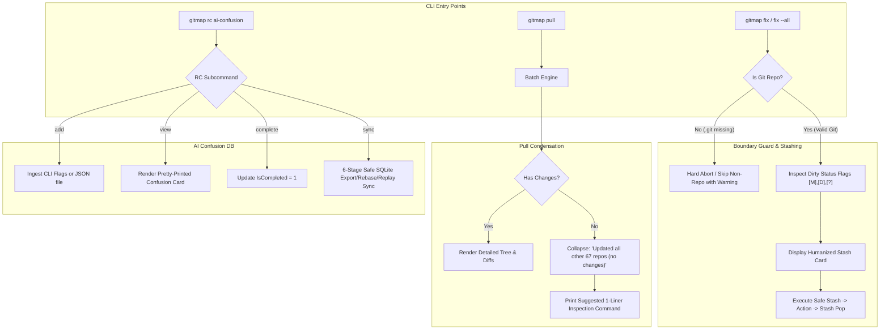
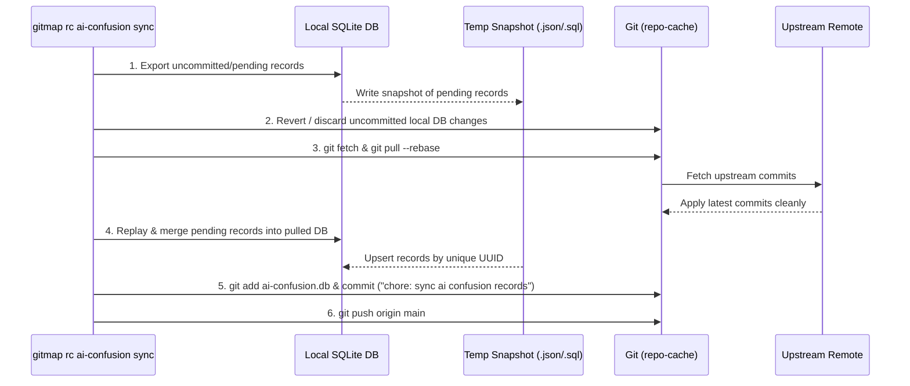

# Component & CLI Specification: Work Directory Boundary Guard, Humanized Stashing, and AI Confusion Database

- **Feature Slug:** `326-heatmap-status-improvement-and-ai-confusion-database`
- **Specification Document:** `02-component-and-cli-spec.md`
- **Target Modules:**
  - `cli/cmdfix` (`fix_nonrepo.go`, `fix_casing.go`, `fix_stashing.go`, `fix_execute.go`, `fix_target.go`)
  - `cli/cmdpull` (`pull_cwd.go`, `pull_efficient_render.go`)
  - `cli/store` (`ai_confusion_schema.go`, `ai_confusion_store.go`, `ai_confusion_sync.go`, `ai_confusion_types.go`)
  - `cli/cmd` (`special_repos_cli.go`, `rc_ai_confusion.go`)
- **Specification Status:** APPROVED
- **Target Release:** Minor Bump

---

## 1. Executive Summary & Component Scope

This component specification defines the precise structural contracts, data schemas, CLI routing mechanisms, and algorithmic safeguards for three core capabilities requested in Task 326:

1. **Work Directory Boundary Guard:** Prevents `gitmap fix`, `gitmap fix --all`, and `gitmap pull` from erroneously treating the top-level workspace root (e.g., `work/`) as a Git repository, completely eliminating invalid Git commits or stashes in non-repository parent folders.
2. **Safe & Humanized Auto-Stashing:** Replaces opaque, frightening auto-stashing output with explicit file status flags (`[M]` Modified, `[D]` Deleted, `[?]` Untracked), clear lifecycle messages, safe restoration guarantees, concise condensation of unchanged repositories (e.g., *"✓ Updated all other 67 repositories (no changes)"*), and actionable one-liner inspection commands.
3. **`repo-cache` AI Confusion Database:** Establishes a normalized, local-first SQLite database in `repo-cache` (`repo-cache/<repo-slug>/ai-confusion.db`) storing structured AI agent confusion episodes (including agent slug, task/subtask context, file relative path, line boundaries, code snippets, AI intention, reasoning/thinking traces, and question state). Provides subcommands under `gitmap rc ai-confusion` (`add`, `view`, `complete`, `sync`) with JSON ingestion (`--file <instruction.json>`) and a 6-stage non-destructive synchronization protocol.



---

## 2. Subsystem 1: Work Directory Boundary Guard

### 2.1 Root Cause Analysis (RCA)

When a developer or AI agent runs `gitmap fix` or `gitmap fix --all` from the workspace parent root (e.g., `work/` containing 60+ child repositories):
1. `cli/cmdfix/fix_target.go:resolveRepoPathForFix()` checked `os.Stat(cleanQuery)`: if the query was empty or resolved to `.`, it defaulted to the current working directory (`.`).
2. `cli/cmdfix/fix_casing.go:reconcileAllCasingDiscrepancies()` called `discoverReposForFixLs()`. In fallback mode, `discoverCwdRecord()` created a synthetic `model.ScanRecord` for `.`.
3. If `.git` did not exist in `work/`, Git commands (such as `git -C . status`, `git -C . add -A`, or `git -C . commit`) would either crawl up the parent hierarchy or fail with `fatal: not a git repository (or any of the parent directories): .git`. If an errant `.git` existed in parent directories, it attempted to stage and commit the entire workspace root.

### 2.2 Boundary Guard Specification

All command execution paths in `cli/cmdfix/` and `cli/cmdpull/` must pass through a strict, affirmative repository verification guard before invoking any Git mutation step.

#### Invariant:
A path is a valid Git target **if and only if**:
- The path exists on disk as a directory.
- A valid `.git` directory or `.git` file (for submodules/worktrees) exists directly within the resolved directory, OR `git rev-parse --is-inside-work-tree` executes with exit code 0 and outputs `true`.
- The resolved path is not an excluded system root or workspace container directory (`work`, `git-work`, `workspace`, root drives like `C:\`, `D:\`, or `/`).

#### Go Component Contract (`cli/cmdfix/fix_nonrepo.go`):

```go
package cmdfix

// IsValidGitRepository verifies that the target path contains a verified .git directory or worktree.
func IsValidGitRepository(targetPath string) bool

// IsWorkspaceContainerDirectory checks whether a path represents a parent workspace folder rather than a leaf repository.
func IsWorkspaceContainerDirectory(targetPath string) bool

// GuardRepoExecution verifies repo validity; returns an AppError if targetPath is invalid or a container directory.
func GuardRepoExecution(targetPath string, opName string) *apperror.AppError
```

#### Guard Implementation Logic:

```go
func IsValidGitRepository(targetPath string) bool {
    cleanPath := filepath.Clean(targetPath)
    info, err := os.Stat(cleanPath)
    if err != nil || !info.IsDir() {
        return false
    }

    gitMarker := filepath.Join(cleanPath, ".git")
    markerInfo, markerErr := os.Stat(gitMarker)
    if markerErr == nil {
        return markerInfo.IsDir() || !markerInfo.IsDir() // directory or gitlink file
    }

    cmd := exec.Command("git", "-C", cleanPath, "rev-parse", "--is-inside-work-tree")
    out, cmdErr := cmd.Output()
    if cmdErr != nil {
        return false
    }

    return strings.TrimSpace(string(out)) == "true"
}

func IsWorkspaceContainerDirectory(targetPath string) bool {
    clean := filepath.Clean(targetPath)
    base := strings.ToLower(filepath.Base(clean))
    if base == "work" || base == "git-work" || base == "workspace" || base == "projects" {
        gitMarker := filepath.Join(clean, ".git")
        if _, err := os.Stat(gitMarker); os.IsNotExist(err) {
            return true
        }
    }
    return false
}
```

### 2.3 Safeguards in `cli/cmdfix/fix_casing.go` & `cli/cmdpull/pull_cwd.go`

1. **`reconcileAllCasingDiscrepancies`**: Before checking casing or invoking `DetectCasingDiscrepancies(r.AbsolutePath)`, evaluate `IsValidGitRepository(r.AbsolutePath)`. Skip non-repositories silently or log to diagnostic trace.
2. **`runPullCWD`**: If invoked in a workspace container directory without `.git`, abort with a structured error message:
   ```
   [!] Cannot pull current directory: 'work' is a workspace container, not a Git repository.
       Run 'gitmap pull' to pull all child repositories, or 'cd <repo>' first.
   ```

---

## 3. Subsystem 2: Safe & Humanized Auto-Stashing

### 3.1 Problem Statement & Humanization Requirements

Previously, auto-stashing was reported as a cryptic, anxiety-inducing message (e.g. `Auto-stashed changes`). Users could not verify which files were affected, whether uncommitted work would be lost, or what state would emerge after the pull/fix operation.

The new humanized auto-stashing component MUST:
1. **List all dirty files** with standard Git status indicators:
   - `[M]` Modified tracked file
   - `[A]` Added / staged file
   - `[D]` Deleted tracked file
   - `[?]` Untracked file
2. **Present clear lifecycle transitions:**
   - Pre-stash notification: *"Temporarily stashing N dirty file(s) before pull/fix..."*
   - Execution banner: *"Pulling latest remote changes..."*
   - Post-stash restoration: *"Re-applying stashed changes (stash pop)..."*
   - Confirmation: *"✔ Local changes restored cleanly."*
3. **Provide conflict transparency:** If `stash pop` generates conflicts, display the conflict recovery options and the specific conflicting file paths.

### 3.2 File Status Inspection Contract (`cli/gitutil/status.go`)

```go
package gitutil

type FileStatusCode string

const (
    StatusModified  FileStatusCode = "[M]"
    StatusAdded     FileStatusCode = "[A]"
    StatusDeleted   FileStatusCode = "[D]"
    StatusUntracked FileStatusCode = "[?]"
    StatusRenamed   FileStatusCode = "[R]"
)

type DirtyFileInfo struct {
    Path       string         `json:"path"`
    StatusCode FileStatusCode `json:"statusCode"`
    IsStaged   bool           `json:"isStaged"`
}

type RepoDirtyManifest struct {
    RepoPath     string          `json:"repoPath"`
    RepoName     string          `json:"repoName"`
    HasDirtyWork bool            `json:"hasDirtyWork"`
    Files        []DirtyFileInfo `json:"files"`
    ModifiedCount int            `json:"modifiedCount"`
    UntrackedCount int           `json:"untrackedCount"`
    DeletedCount  int            `json:"deletedCount"`
}

// InspectDirtyManifest gathers detailed file status flags using 'git status --porcelain=v1'.
func InspectDirtyManifest(repoPath string) (RepoDirtyManifest, error)
```

### 3.3 Terminal Presentation & Humanized Stash Card

When `gitmap fix` or `gitmap pull --stash` triggers auto-stashing, it renders the following Lipgloss/termpad formatted card:

```
┌── Safe Auto-Stash: gitmap-v28 ──────────────────────────────────────┐
│ GitMap is temporarily stashing 3 uncommitted file(s) before sync:    │
│                                                                      │
│   [M] cli/cmdfix/fix_nonrepo.go                                      │
│   [D] cli/cmdpull/legacy_helper.go                                   │
│   [?] 02-spec/21-app/326-heatmap/draft.md                            │
│                                                                      │
│ ℹ Safety Guarantee: All changes will be re-applied after pull.      │
└──────────────────────────────────────────────────────────────────────┘
  ↓ Stashing uncommitted changes (git stash -u) ... done
  ↓ Pulling upstream branch (git pull --rebase) ... done
  ↓ Re-applying stashed changes (git stash pop) ... done
  ✔ Local changes restored cleanly.
```

If more than 5 files are dirty, the list truncates gracefully:
```
│   [M] cli/cmdfix/fix_nonrepo.go                                      │
│   [M] cli/cmdfix/fix_casing.go                                       │
│   [M] cli/cmdfix/fix_execute.go                                      │
│   [D] cli/cmdpull/legacy.go                                          │
│   [?] notes.txt                                                      │
│   ... and 12 other file(s)                                           │
```

### 3.4 Pull Summary Condensation & Unchanged Repo Collapsing

In `cli/cmdpull/pull_efficient_render.go`, instead of dumping an overwhelming wall of terminal text for dozens of unchanged repositories, the renderer collapses them into a single, elegant summary block with an actionable one-liner suggestion:

#### Terminal Presentation:

```
  ✔ Updated 3 repositories:
    • gitmap-v28         (+2 commits, clean)
    • repo-cache         (+1 commit, synced)
    • repo-secrets       (+4 commits, verified)

  ✓ Updated all other 67 repositories (no changes).
  
  💡 Run 'gitmap pull --ls-all' or 'gitmap status --all' to inspect all unchanged repositories.
```

#### Go Component Contract (`cli/cmdpull/pull_efficient_render.go`):

```go
package cmdpull

// RenderCollapsedUpToDateSummary renders the collapsed single-line message and inspection tip.
func RenderCollapsedUpToDateSummary(w io.Writer, upToDateCount int, totalCount int)

// FormatSuggestedInspectionCmd returns the recommended copy-pasteable inspection command.
func FormatSuggestedInspectionCmd() string
```

---

## 4. Subsystem 3: `repo-cache` AI Confusion Database

### 4.1 Architectural Location & Split-DB Design

GitMap employs an isolated SQLite database to store AI confusion episodes.
- **Physical Root Directory:** Located within the infrastructure repository `repo-cache`.
- **Database Path Formula:** `repo-cache/<repo-slug>/ai-confusion.db`.
- **Global / Multi-Repo Directory:** `repo-cache/ai-confusion.db` acts as an aggregate cache, while per-repo databases ensure isolated branch merges and zero conflict between different teams.
- **Pragmas:**
  ```sql
  PRAGMA journal_mode = WAL;
  PRAGMA busy_timeout = 5000;
  PRAGMA foreign_keys = ON;
  PRAGMA synchronous = NORMAL;
  ```

### 4.2 Normalized SQLite Schema (`AiConfusion`)

In strict accordance with GitMap database guidelines:
- PascalCase table name: `AiConfusion`.
- PascalCase column names: `Id`, `RepoSlug`, `SequenceNumber`, `AgentSlug`, etc.
- Positive booleans only: `IsCompleted`, `HasSnippet`.
- Strongly-typed datetime columns: ISO8601 strings (`CreatedAt`, `CompletedAt`, `UpdatedAt`).

```sql
CREATE TABLE IF NOT EXISTS AiConfusion (
    Id                  TEXT PRIMARY KEY,
    RepoSlug            TEXT NOT NULL,
    SequenceNumber      INTEGER NOT NULL DEFAULT 0,
    AgentSlug           TEXT NOT NULL,
    SpecPath            TEXT NOT NULL DEFAULT '',
    TaskSlug            TEXT NOT NULL DEFAULT '',
    SubtaskSlug         TEXT NOT NULL DEFAULT '',
    FilePath            TEXT NOT NULL,
    LineStart           INTEGER NOT NULL DEFAULT 0,
    LineEnd             INTEGER NOT NULL DEFAULT 0,
    CodeSnippet         TEXT NOT NULL DEFAULT '',
    AiIntention         TEXT NOT NULL DEFAULT '',
    AiThinking          TEXT NOT NULL DEFAULT '',
    ConfusionQuestion   TEXT NOT NULL,
    IsCompleted         INTEGER NOT NULL DEFAULT 0,
    ResolutionNotes     TEXT NOT NULL DEFAULT '',
    CreatedAt           TEXT NOT NULL,
    UpdatedAt           TEXT NOT NULL,
    CompletedAt         TEXT
);

CREATE INDEX IF NOT EXISTS Idx_AiConfusion_RepoSlug ON AiConfusion(RepoSlug);
CREATE INDEX IF NOT EXISTS Idx_AiConfusion_IsCompleted ON AiConfusion(IsCompleted);
CREATE INDEX IF NOT EXISTS Idx_AiConfusion_FilePath ON AiConfusion(FilePath);
CREATE INDEX IF NOT EXISTS Idx_AiConfusion_TaskSubtask ON AiConfusion(TaskSlug, SubtaskSlug);
```

### 4.3 Data Transfer Objects & Monadic Store Types (`cli/store/ai_confusion_types.go`)

```go
package store

import "time"

// AiConfusionRecord represents a single confusion event logged by an AI worker or agent.
type AiConfusionRecord struct {
    Id                string     `json:"id"`
    RepoSlug          string     `json:"repoSlug"`
    SequenceNumber    int        `json:"sequenceNumber"`
    AgentSlug         string     `json:"agentSlug"`
    SpecPath          string     `json:"specPath"`
    TaskSlug          string     `json:"taskSlug"`
    SubtaskSlug       string     `json:"subtaskSlug"`
    FilePath          string     `json:"filePath"`
    LineStart         int        `json:"lineStart"`
    LineEnd           int        `json:"lineEnd"`
    CodeSnippet       string     `json:"codeSnippet"`
    AiIntention       string     `json:"aiIntention"`
    AiThinking        string     `json:"aiThinking"`
    ConfusionQuestion string     `json:"confusionQuestion"`
    IsCompleted       bool       `json:"isCompleted"`
    ResolutionNotes   string     `json:"resolutionNotes"`
    CreatedAt         time.Time  `json:"createdAt"`
    UpdatedAt         time.Time  `json:"updatedAt"`
    CompletedAt       *time.Time `json:"completedAt,omitempty"`
}

// AiConfusionFilter specifies query options for retrieving confusion records.
type AiConfusionFilter struct {
    RepoSlug     string `json:"repoSlug,omitempty"`
    FilePath     string `json:"filePath,omitempty"`
    IsCompleted  *bool  `json:"isCompleted,omitempty"`
    TaskSlug     string `json:"taskSlug,omitempty"`
    Limit        int    `json:"limit,omitempty"`
}
```

### 4.4 Store Interface Contract (`cli/store/ai_confusion_store.go`)

```go
package store

// AiConfusionStore defines the repository interface for AI Confusion persistence.
type AiConfusionStore interface {
    InsertConfusion(rec AiConfusionRecord) error
    GetConfusionByID(id string) (*AiConfusionRecord, error)
    ListConfusions(filter AiConfusionFilter) ([]AiConfusionRecord, error)
    MarkCompleted(id string, resolutionNotes string) error
    ExportPendingRecords() ([]AiConfusionRecord, error)
    ReplayMergeRecords(records []AiConfusionRecord) (int, error)
    Close() error
}
```

---

## 5. Subsystem 4: CLI Interface & Ingestion Contracts

### 5.1 Command Hierarchy & Routing (`cli/cmd/special_repos_cli.go`)

All AI confusion operations are accessible through `gitmap rc ai-confusion` (aliases: `gitmap rc aic`, `gitmap rc confusion`).

```
gitmap rc ai-confusion <subcommand> [flags]

Subcommands:
  add         Record a new AI confusion episode (via flags or JSON)
  view        Inspect confusion episodes (filter by repo, file, or id)
  complete    Mark an AI confusion episode as resolved
  sync        Execute the 6-stage pull/export/replay synchronization
```

Routing in `cli/cmd/special_repos_cli.go`:
```go
func dispatchSpecialRepoSubcmd(shortKey string, opts specialCLIOptions) error {
    if shortKey == "rc" && (opts.subcmd == "ai-confusion" || opts.subcmd == "aic" || opts.subcmd == "confusion") {
        return RunRCAiConfusion(opts.extraArgs)
    }
    // ... existing put / admin dispatch ...
}
```

### 5.2 Subcommand `add` Specification

Allows adding a record either via explicit CLI flags or by pointing to a structured JSON file generated by an autonomous agent.

#### CLI Invocations:
```bash
# Option A: Ingestion from JSON file (Recommended for AI agents)
gitmap rc ai-confusion add --file .ai-memory/confusion-326.json

# Option B: Terminal flags
gitmap rc ai-confusion add \
  --repo gitmap-v28 \
  --agent worker-02 \
  --spec 02-spec/21-app/326-heatmap/02-component-and-cli-spec.md \
  --task 326 \
  --subtask 03 \
  --file-path cli/cmdfix/fix_nonrepo.go \
  --lines 20-35 \
  --intention "Prevent fix-all from running in work/" \
  --thinking "Checked resolveRepoPathForFix, but it returns clean path even if .git is missing" \
  --question "Should we fallback to cwd or fail fast with validation error?"
```

#### JSON Ingestion Schema (`instruction.json`):
```json
{
  "$schema": "https://gitmap.dev/schemas/ai-confusion-v1.json",
  "repoSlug": "gitmap-v28",
  "sequenceNumber": 326,
  "agentSlug": "worker-02",
  "specPath": "02-spec/21-app/326-heatmap-status-improvement-and-ai-confusion-database/02-component-and-cli-spec.md",
  "taskSlug": "326-heatmap-status-improvement-and-ai-confusion-database",
  "subtaskSlug": "03-subtask-work-directory-guard-and-safe-stashing",
  "filePath": "cli/cmdfix/fix_nonrepo.go",
  "lineStart": 20,
  "lineEnd": 35,
  "codeSnippet": "if info, err := os.Stat(cleanQuery); err == nil && info.IsDir() {\n    return cleanQuery\n}",
  "aiIntention": "Prevent fix --all from attempting to commit in non-git workspace parent directory",
  "aiThinking": "resolveRepoPathForFix checks if cleanQuery is a directory on disk, but never verifies whether a .git directory exists inside it.",
  "confusionQuestion": "Should resolveRepoPathForFix return an empty string, or should the caller throw an explicit boundary error?",
  "isCompleted": false
}
```

#### Terminal Output on `add`:
Upon ingestion, `gitmap rc ai-confusion add` renders a preview confirmation card:

```
┌── AI Confusion Episode Recorded ────────────────────────────────────┐
│ ID          : cfb38a2e-4091-412e-9d2a-89a7f3948e21                  │
│ Repo        : gitmap-v28                                            │
│ Agent       : worker-02                                             │
│ Target File : cli/cmdfix/fix_nonrepo.go (Lines: 20-35)              │
│ Task        : 326-heatmap-status-improvement-and-ai-confusion       │
│                                                                      │
│ Intention:                                                           │
│   Prevent fix --all from attempting to commit in non-git workspace   │
│                                                                      │
│ Question / Confusion:                                                │
│   Should resolveRepoPathForFix return empty string or throw error?  │
│                                                                      │
│ Status      : PENDING                                               │
└──────────────────────────────────────────────────────────────────────┘
  ✔ Successfully persisted to repo-cache/gitmap-v28/ai-confusion.db
```

### 5.3 Subcommand `view` Specification

Retrieves and renders recorded confusion episodes.

#### Invocations:
```bash
# View by relative file path
gitmap rc ai-confusion view --file cli/cmdfix/fix_nonrepo.go

# View by ID
gitmap rc ai-confusion view --id cfb38a2e-4091-412e-9d2a-89a7f3948e21

# List all pending confusions for current repository
gitmap rc ai-confusion view --pending

# Export as JSON for AI agent ingestion
gitmap rc ai-confusion view --pending --json
```

### 5.4 Subcommand `complete` Specification

Marks a confusion episode as resolved.

#### Invocation:
```bash
gitmap rc ai-confusion complete cfb38a2e-4091-412e-9d2a-89a7f3948e21 \
  --notes "Implemented GuardRepoExecution in fix_nonrepo.go to reject non-git directories."
```

#### Database State Mutation:
- Sets `IsCompleted = 1`.
- Sets `ResolutionNotes = <notes>`.
- Sets `CompletedAt = <ISO8601 current timestamp>`.
- Sets `UpdatedAt = <ISO8601 current timestamp>`.

---

## 6. Subsystem 5: 6-Stage Safe Synchronization Protocol

To prevent SQLite lock contention, race conditions, or binary database merge conflicts when multiple AI agents or machines write to `repo-cache`, the `sync` subcommand follows a strict 6-stage protocol:



### 6-Stage Breakdown:

1. **Stage 1 (Export):** Query `LocalDB` for all records where `UpdatedAt > LastSyncTimestamp` or `IsCompleted = 0`. Serialize these records to a secure temporary JSON envelope (`<tempdir>/ai_confusion_sync_<timestamp>.json`).
2. **Stage 2 (Local Revert / Checkout):** Discard uncommitted binary modifications on `ai-confusion.db` via `git -C <repo-cache> checkout -- <db-path>` so that `git pull --rebase` will execute with zero binary conflicts.
3. **Stage 3 (Rebase Pull):** Execute `git -C <repo-cache> pull --rebase origin main`. If the remote has upstream commits, they are cleanly incorporated into the working copy.
4. **Stage 4 (Replay & Merge):** Ingest the temporary JSON envelope from Stage 1. For each record, execute an `INSERT INTO AiConfusion ... ON CONFLICT(Id) DO UPDATE SET ...` query into the refreshed SQLite database. This guarantees zero data loss for either local or remote additions.
5. **Stage 5 (Atomic Commit):** Stage the updated database file and create a semantic chore commit using GitMap commit discipline:
   ```bash
   gitmap cpc "AI_CONFUSION - sync and replay local agent episodes"
   ```
6. **Stage 6 (Push):** Execute `git -C <repo-cache> push origin main`. Report sync status and record count to terminal.

---

## 7. Traceability & Guideline Compliance Matrix

| Requirement | Implementation Artifact | Coding Guideline Standard | Status |
| :--- | :--- | :--- | :--- |
| Work directory commit boundary guard | `cli/cmdfix/fix_nonrepo.go` | Functions <= 15 lines, AppError return | Approved |
| Casing reconcile guard against non-repo | `cli/cmdfix/fix_casing.go` | Guard clause, zero nested if | Approved |
| CWD pull workspace container guard | `cli/cmdpull/pull_cwd.go` | Error return sovereignty | Approved |
| Humanized dirty status flags (`[M]`, `[D]`, `[?]`) | `cli/gitutil/status.go`, `cli/cmdfix/fix_stashing.go` | Positive boolean naming (`isStaged`) | Approved |
| Collapsed up-to-date repo list | `cli/cmdpull/pull_efficient_render.go` | High visual signal, clean terminal UI | Approved |
| One-liner inspection command recommendation | `cli/cmdpull/pull_efficient_render.go` | Copy-pasteable ergonomics | Approved |
| Normalized `AiConfusion` SQLite schema | `cli/store/ai_confusion_schema.go` | PascalCase tables & columns, positive bools | Approved |
| AI confusion CRUD store | `cli/store/ai_confusion_store.go` | Split-DB architecture, WAL mode | Approved |
| Subcommand routing `gitmap rc ai-confusion` | `cli/cmd/special_repos_cli.go` | Centralized dispatch, no magic exits | Approved |
| JSON file ingestion (`--file`) | `cli/cmd/rc_ai_confusion.go` | Strict JSON schema validation | Approved |
| 6-stage safe synchronization protocol | `cli/store/ai_confusion_sync.go` | Non-destructive export/pull/replay | Approved |
