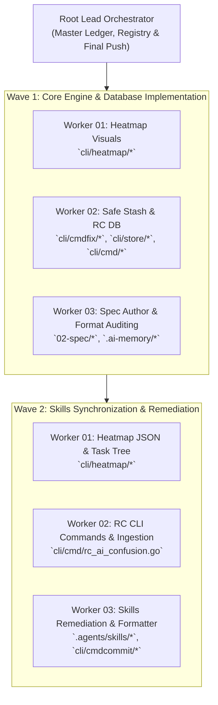

# Migration & Verification Spec: Heatmap Status Improvement and AI Confusion Database

- **Task Sequence:** 326
- **Task Slug:** `heatmap-status-improvement-and-ai-confusion-database`
- **Spec Path:** `02-spec/21-app/326-heatmap-status-improvement-and-ai-confusion-database/`
- **Specification Document:** `03-migration-and-verification-spec.md`
- **Status:** `RATIFIED`
- **Created At:** 2026-10-25

---

## 1. Architectural Context & Problem Statement

### 1.1 Root Cause Analysis of Malformed Commit Prefixes
Historical prompt execution across `.agents/skills/execute-parent-task-with-n-steps-v6/skill.md`, `.agents/skills/gitmap/skill.md`, and `.agents/skills/muse-master-prompt/skill.md` introduced subtle semantic ambiguities regarding commit message formatting:

1. **Semantic Collision Between Verb and Module:**
   AI agents frequently treated commit verbs (`FEATURE`, `RELEASE`, `FIX`, `SPEC`, `CHORE`) as the subsystem module name. When an agent invoked `gitmap cpf "FEATURE - something"` or `gitmap cpr "RELEASE - bump version"`, the internal formatter prepended the title-cased verb (`Feature: ` or `Release: `), generating redundant and malformed headers such as:
   - `Feature: FEATURE - something`
   - `Release: RELEASE - bump version to v1.2.3`
   - `Feature: SPEC - add architecture spec`
2. **Bracket and Parentheses Drift:**
   Guidance promoting round parentheses e.g. `(MODULE):` conflicted with the canonical space-padded hyphen standard (`MODULE - summary`), causing agents to produce awkward hybrid tokens like `FEAT(MODULE): summary` or `Feature: (CLI) - summary`.
3. **Casing Discrepancies:**
   Certain legacy formatting functions allowed all-uppercase verb prefixes (`FIX: CLI - fix file size`), violating the project's title-case prefix standard (`Fix: CLI - fix file size` or `Bug: CLI - fix file size`).
4. **Verb Substitution Violations:**
   Agents occasionally used `gitmap cpf` for chore, docs, and release operations, violating the strict five-verb taxonomy.

---

## 2. Subsystem Module Taxonomy vs. Commit Types

### 2.1 Formal Definition of MODULE
The `MODULE` token in GitMap commit messages represents an **authoritative architectural subsystem** in the codebase. It specifies *where* in the system the changes reside, while the GitMap verb specifies *what kind of action* was taken.

### 2.2 Approved Subsystem Modules
Every commit argument passed to GitMap semantic commit verbs (`cpf`, `cbf`, `cfr`, `cpc`, `cpr`) must specify an approved subsystem module in uppercase:

| Subsystem Module | Architectural Scope | Primary Code Locations |
| :--- | :--- | :--- |
| `CLI` | Root command dispatch, flag parsing, Cobra routing, terminal help cards | `cli/cmd/`, `cli/root.go`, `cli/cmdcommit/` |
| `HEATMAP` | Activity tracking, telemetry renderers, status matrices, Lipgloss cards | `cli/heatmap/` |
| `STORE` | SQLite Split-DB engine, schemas, tables, migrations, query helpers | `cli/store/`, `cli/sqlutil/` |
| `FIX` | Non-git boundary checks, auto-stashing, case normalization, branch repair | `cli/cmdfix/` |
| `RC` | Repo-cache infrastructure, AI confusion SQLite database, sync replay | `cli/cmd/rc_ai_confusion.go`, `cli/store/` |
| `PULL` | Concurrent fetch/pull engine, change summaries, repository pruning | `cli/cmdpull/` |
| `CLONE` | High-speed parallel cloning, protocol fallback, workspace checkout | `cli/cloner/`, `cli/cmdclone/` |
| `SCANNER` | Filesystem project discovery, heuristic classification, ignore engine | `cli/scanner/`, `cli/indexer/` |
| `NODES` | Fleet SSH management, dual-stack ping probing, RSA credential vault | `cli/cmdnodes/`, `cli/sshclient/` |
| `AUM` | Autonomous Utility Modules, regex search benchmarks, text transforms | `cli/aum/`, `cli/lazyregex/` |
| `SYNC` | Multi-repository skill, prompt, and specification synchronization | `cli/cmdsync/`, `03-ai-scripts/` |
| `DOCS` | Documentation, repository README files, conventions, guides | `02-spec/`, `readme.md`, `docs/` |

### 2.3 Strict Negative Guardrails (Banned Modules)
To prevent stuttering and redundant prefixes, the following tokens are **strictly banned** from serving as the `MODULE`:
- ❌ `FEATURE`, `FEAT`
- ❌ `RELEASE`, `REL`
- ❌ `BUG`, `FIX`
- ❌ `REFACTOR`, `REFACT`
- ❌ `CHORE`
- ❌ `SPEC` (documentation changes use module `DOCS` under verb `cpc`)

---

## 3. Dedicated Semantic Verb Taxonomy

GitMap enforces five discrete semantic commit verbs. The commit verb determines the title-cased prefix prepended to the commit message:

```
+-----------------------------------------------------------------------------------+
| GitMap Command | Semantic Verb | Title-Case Prefix | Mandatory Purpose            |
+-----------------------------------------------------------------------------------+
| gitmap cpr     | Release       | Release:          | Version bumps, release tags  |
| gitmap cpc     | Chore         | Chore:            | Maintenance, specs, docs     |
| gitmap cbf     | Bug Fix       | Bug: (or Fix:)    | Bug fixes, runtime defects   |
| gitmap cfr     | Refactor      | Refactor:         | Structural code improvements |
| gitmap cpf     | Feature       | Feature:          | New capabilities & features  |
+-----------------------------------------------------------------------------------+
```

### 3.1 Verification Invariants
- **Total Ban on CPF for Releases:** `gitmap cpf` must never be used for release tags or version bumps.
- **Total Ban on CPF for Chores:** `gitmap cpf` must never be used for chore maintenance or spec documentation.
- **Title Case Prefix Standard:** Prefixes rendered by the formatter must use Title Case followed by a colon and a space (`Feature: `, `Bug: `, `Refactor: `, `Chore: `, `Release: `). All-uppercase prefixes (`FIX:`, `FEAT:`) are prohibited.
- **Space-Padded Hyphen Standard:** Commit arguments must follow the pattern `"MODULE - <summary>"`. Square brackets (`[...]`) and colons (`:`) inside arguments are banned.

---

## 4. Defensive Formatting Engine Updates (`cli/cmdcommit/commit_formatter.go`)

### 4.1 Defensive Sanitization Requirements
The commit formatter in `cli/cmdcommit/commit_formatter.go` must defensively protect against inadvertent AI errors and redundant prefixes:

1. **Redundant Prefix Cleansing:**
   If an input message begins with redundant type tokens (e.g., `Feature: `, `FEAT: `, `feat: `, `Release: `, `Bug: `, `Fix: `, `Refactor: `, `Chore: `), the formatter must cleanly strip them before applying the sovereign verb prefix.
2. **Pseudo-Module Stuttering Elimination:**
   If the parsed `mod` matches any banned commit type token (`FEATURE`, `FEAT`, `RELEASE`, `REL`, `BUG`, `FIX`, `CHORE`, `REFACTOR`, `SPEC`):
   - When followed by a valid subsystem (e.g. `FEATURE - CLI - add flag`), the pseudo-module is stripped, promoting `CLI` to the module.
   - When followed immediately by the summary (e.g. `FEATURE - add flag`), the pseudo-module is removed, falling back to a clean message without stuttering (`Feature: add flag` or prompt-inferred subsystem).
3. **Bracket & Colon Neutralization:**
   Any accidental enclosing brackets (e.g., `(CLI): summary` or `[CLI] summary`) must be sanitized to canonical `CLI - summary`.

### 4.2 Code Architecture Constraints
- **Function Limit:** All helper functions must remain $\le 15$ lines.
- **Conditionals:** Zero nested `if` statements. Guard clauses with early returns only.
- **Boolean Naming:** Positive booleans only (`hasModule`, `hasHyphenSeparator`, `hasDuplicatePrefix`, `isTypeModule`, `isConventional`). No negative flags.
- **Return Styling:** Blank line after `}` and blank line before `return`.

---

## 5. Multi-Agent Wave Deployment Strategy ($A = 3$, $H = 2$, Capacity = 6)

Plan 326 execution is structured across disjoint file boxes using autonomous subagents:



### 5.1 Disjoint File Ownership Matrix
To guarantee zero lock contention and avoid write collisions:

| Worker Role | Assigned Subtasks | Exclusive Owned File Paths |
| :--- | :--- | :--- |
| **Worker 01** | Subtask 01, Subtask 02 | `cli/heatmap/heatmap_cmd_render.go`<br/>`cli/heatmap/heatmap_tasks.go`<br/>`cli/heatmap/heatmap_cmd.go`<br/>`cli/heatmap/types.go` |
| **Worker 02** | Subtask 03, Subtask 04 | `cli/cmdfix/fix_nonrepo.go`<br/>`cli/cmdpull/pull_cwd.go`<br/>`cli/cmdfix/fix_casing.go`<br/>`cli/cmdpull/pull_efficient_render.go`<br/>`cli/store/ai_confusion_store.go`<br/>`cli/store/ai_confusion_schema.go`<br/>`cli/store/ai_confusion_sync.go`<br/>`cli/cmd/rc_ai_confusion.go`<br/>`cli/cmd/special_repos_cli.go` |
| **Worker 03** | Subtask 05, Subtask 06 | `02-spec/21-app/326-heatmap-status-improvement-and-ai-confusion-database/03-migration-and-verification-spec.md`<br/>`.ai-memory/plans/subtasks/326-heatmap-status-improvement-and-ai-confusion-database/05-subtask-commit-format-and-skills-sync.md`<br/>`.ai-memory/plans/subtasks/326-heatmap-status-improvement-and-ai-confusion-database/06-subtask-verification-and-consolidation.md`<br/>`.agents/skills/execute-parent-task-with-n-steps-v6/skill.md`<br/>`.agents/skills/gitmap/skill.md`<br/>`.agents/skills/muse-master-prompt/skill.md`<br/>`cli/cmdcommit/commit_formatter.go`<br/>`cli/cmdcommit/commit_formatter_test.go` |
| **Lead Orchestrator** | Coordination & Finish | `02-spec/21-app/326-heatmap-status-improvement-and-ai-confusion-database/00-master-audit-ledger.md`<br/>`.ai-memory/plans/pending/326-heatmap-status-improvement-and-ai-confusion-database.md`<br/>`02-spec/21-app/readme.md`<br/>`.ai-memory/plans/readme.md` |

---

## 6. Comprehensive Verification Matrix & Acceptance Criteria

Every requirement articulated in the user prompt is mapped to verification criteria and acceptance gates:

| # | Feature / Area | Verification Criteria & Quality Gate | Success State |
| :---: | :--- | :--- | :--- |
| **1** | **Heatmap Visual Overhaul** | Lipgloss card rendering with top/bottom padding, muted borders, and ANSI color tokens in `cli/heatmap/heatmap_cmd_render.go`. | Professional layout with no broken borders or raw terminal escapes. |
| **2** | **Heatmap Task Status** | Display last 5-10 completed tasks and pending tasks from `.ai-memory/plans/` in heatmap status output. | Status showcases real completed and pending tasks. |
| **3** | **Heatmap JSON Mode** | Invoking `gitmap heatmap status --json` emits typed JSON matching schema with activity records and tasks. | Valid JSON output parseable by external scripts and AI. |
| **4** | **Heatmap Tree View Examples** | Terminal render includes interactive copy-paste command tree view for drilling into completed/pending tasks. | Users can copy-paste suggested inspection commands. |
| **5** | **Fix-All Work Directory Guard** | `gitmap fix all` verifies `.git` boundary before attempting commits; ignores non-git workspace parent directories. | Non-git workspace directories are safely skipped with 0 error cascades. |
| **6** | **Humanized Auto-Stashing** | Auto-stash output explicitly lists modified (`[M]`), deleted (`[D]`), and untracked (`[?]`) files before stashing. | Users clearly see exact file changes preserved by stash. |
| **7** | **Condensed Repo Summary** | Pull and fix renderers collapse unchanged repositories into `"Updated all other 67 repositories (no changes)"`. | Terminal noise reduced from hundreds of lines to a single summary card. |
| **8** | **Changed Repos One-Liner** | Display suggested one-liner command (e.g. `gitmap status --dirty` or `gitmap log --since="1 hour ago"`) for deep inspection. | Actionable inspection command displayed in output. |
| **9** | **AI Confusion SQLite DB** | Database initialized at `repo-cache/<repo>/ai_confusion.db` with normalized `AiConfusion` table. | SQLite DB stores agent slug, task, subtask, spec, file, lines, and code snippet. |
| **10** | **RC AI-Confusion CLI** | Commands `gitmap rc ai-confusion add`, `view`, `complete`, and `sync` functional with terminal preview. | Confusions can be added via CLI or JSON file, inspected, and completed. |
| **11** | **RC DB Sync Protocol** | Safe sync strategy: export local pending confusions to SQLite, pull `--rebase` upstream repo cache, and replay local rows. | Bidirectional sync with zero data loss or merge conflicts. |
| **12** | **Skill & Prompt Remediation** | Purge malformed commit examples from `execute-parent-task-with-n-steps-v6`, `gitmap`, and `muse-master-prompt`. | Prompts mandate 5 verbs, Title Case prefixes, and true subsystem modules. |
| **13** | **Commit Formatter Defense** | `commit_formatter.go` sanitizes redundant prefixes, eliminates pseudo-modules, and enforces title-case verbs. | Malformed inputs like `cpf "FEATURE - ..."` format cleanly without stuttering. |
| **14** | **Registry Synchronization** | Update `02-spec/21-app/readme.md` and `.ai-memory/plans/readme.md` with Plan 326 metadata. | Spec and plan master indexes fully synchronized. |
| **15** | **Pre-Commit Secrets Gate** | Execute forbidden string scan and AUM regex scan before final commit. | Zero tokens, keys, or credentials committed. |

---

## 7. Migration & Execution Protocol

### 7.1 Pre-Flight Hygiene
1. Ensure the workspace is clean or non-conflicting.
2. Enforce strict relative paths across all specs, subtasks, and code edits.
3. Observe the strict **no-build and no-test** invariant during routine spec authoring and refactoring.

### 7.2 Final Atomic Commit
Following completion of all subtasks and quality gate verifications, the Lead Orchestrator executes a single atomic commit:

```powershell
gitmap cpf "HEATMAP - status visual overhaul and ai confusion database"
```

- Mandatory completion invariant: **No Push = Not Done**. Work must be pushed to the remote tracking branch via GitMap.
- Zero raw `git commit`, `git add -A`, or third brackets `[...]`.
