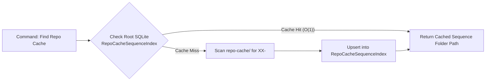
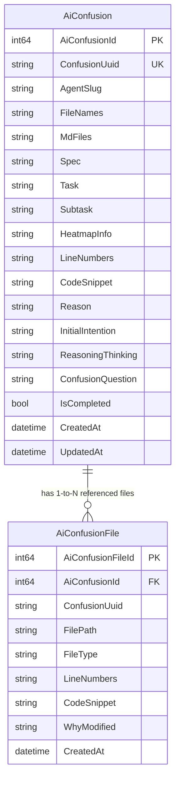
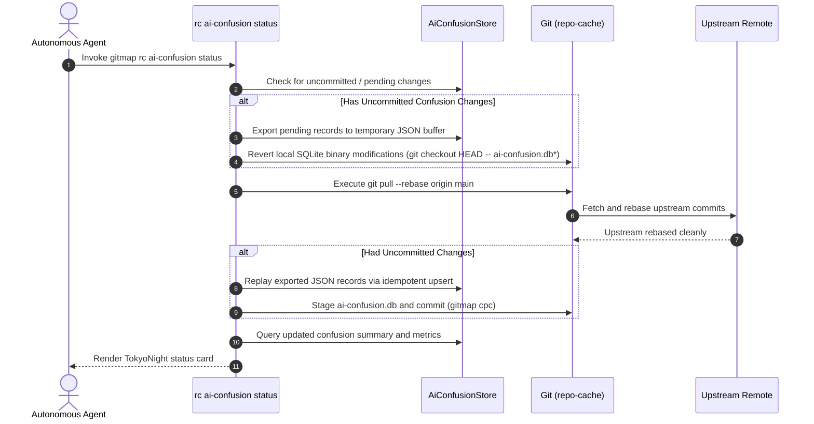
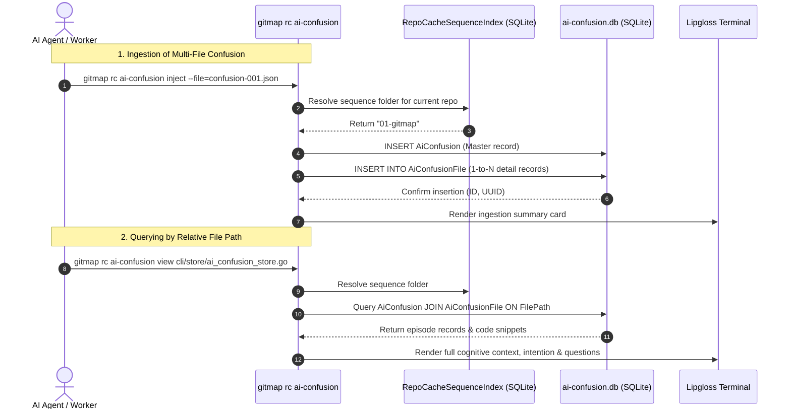

# Architecture Specification: Heatmap Status Improvement & AI Confusion Handling

- **Spec ID:** `02-spec/21-app/327-heatmap-status-improvement-and-ai-confusion-handling/01-architecture-spec.md`
- **Feature Slug:** `heatmap-status-improvement-and-ai-confusion-handling`
- **Module:** `cli/store`, `cli/cmd`, `cli/heatmap`, `cli/cmdpull`, `cli/cloner`, `repo-cache/.ai-confusion`
- **Status:** APPROVED
- **Version:** 1.0.0
- **Target Audience:** Autonomous AI Agents, Multi-Agent Swarms, GitMap Core Engineers
- **Target Release:** Minor Bump (`v6.611.0`)

---

## 1. Executive Summary & Problem Statement

In large-scale multi-repository swarms, autonomous AI agents continuously execute feature implementations, refactoring tasks, and CI/CD remediations. Several operational gaps have been identified during sustained production usage:

1. **Repetitive Filesystem Scanning for Repo-Cache Folders:** `repo-cache` organizes repository caches under sequence-prefixed folders (e.g. `01-gitmap`, `02-scripts-fixer`). Currently, GitMap scans the entire `repo-cache` directory structure on every invocation to locate a repository's cache, causing disk I/O bottlenecks. A root SQLite sequence folder cache (`RepoCacheSequenceIndex`) is required to provide O(1) repository-to-folder lookups.
2. **Denormalized File References in AI Confusion Episodes:** AI confusion episodes frequently touch multiple source files, markdown specifications, and heatmap-modified artifacts. Storing file paths as concatenated comma-separated strings prevents granular querying by file path or line number. A normalized 1-to-N database schema (`AiConfusion` $\rightarrow$ `AiConfusionFile`) is required.
3. **Multi-File Context Ingestion:** AI agents need structured schemas to report multiple affected files, line spans, why each file was touched, and extracted code snippets in both terminal interactions and JSON instruction payloads (`AiConfusionFileInput`).
4. **Autonomous Conflict-Free Synchronization:** Binary SQLite files (`ai-confusion.db`) in `repo-cache` cannot be merged by standard Git line-based algorithms. `gitmap rc ai-confusion status` must execute an automated export-revert-pull-replay synchronization protocol before reporting status.
5. **Contextual Relative Path Lookups:** When an agent inspects a source file (e.g. `cli/store/ai_confusion_store.go`), it must be able to query all recorded confusion episodes, agent thinking, intention, and open questions associated with that specific file via `gitmap rc ai-confusion view <filepath>`.
6. **Ghost Repository Remediation Artifacts:** Commit messages (such as `COMMIT - chore: ...`) have occasionally leaked into failed repository lists in pull remediation outputs. Strict repository slug candidate validation is required to reject malformed entries.
7. **Pull Output Clutter:** Up-to-date repositories overwhelm terminal output when hundreds of repos are pulled. Unchanged repositories must be collapsed into concise rollups with clear drill-down one-liners.

This specification details the end-to-end architecture addressing each of these seven areas.

---

## 2. Root SQLite Sequence Folder Cache Architecture

### 2.1 Problem & Performance Objective
`repo-cache` contains dozens of sequence-prefixed repository directories formatted as `XX-<repo-slug>` (e.g., `01-gitmap`, `12-wp-html-automate`). Scanning the filesystem on every command introduces unnecessary directory traversals.

The root SQLite sequence index caches the mapping from `RepoSlug` to its canonical sequence folder, enabling instantaneous $O(1)$ resolution:



### 2.2 DDL Schema: `RepoCacheSequenceIndex`

The table resides in GitMap's root SQLite database (resolved via `store.ResolveRootDBPath()`):

```sql
CREATE TABLE IF NOT EXISTS RepoCacheSequenceIndex (
    RepoCacheSequenceIndexId INTEGER PRIMARY KEY AUTOINCREMENT,
    RepoSlug                 TEXT NOT NULL UNIQUE,
    SequenceFolder           TEXT NOT NULL,
    ResolvedPath             TEXT NOT NULL,
    LastVerifiedAt           TEXT NOT NULL DEFAULT CURRENT_TIMESTAMP,
    CreatedAt                TEXT NOT NULL DEFAULT CURRENT_TIMESTAMP,
    UpdatedAt                TEXT NOT NULL DEFAULT CURRENT_TIMESTAMP
);

CREATE UNIQUE INDEX IF NOT EXISTS IdxRepoCacheSeq_Slug ON RepoCacheSequenceIndex(RepoSlug);
CREATE INDEX IF NOT EXISTS IdxRepoCacheSeq_Folder ON RepoCacheSequenceIndex(SequenceFolder);
```

### 2.3 Resolution Algorithm & Invalidation Rules
1. **Primary Lookup:** Query `RepoCacheSequenceIndex` by `RepoSlug`. If found and the directory exists on disk, return the cached path immediately.
2. **Fallback Directory Scan:** If the record is missing or the cached path no longer exists on disk, scan `repo-cache/` for directories matching `^(\d{2,3})-(.+)$`. Match the suffix against `RepoSlug`.
3. **Cache Ingestion:** If found on disk, upsert the entry into `RepoCacheSequenceIndex`. If absent, generate the next sequence prefix, create the directory, and cache it.
4. **Invalidation:** Cache entries older than 24 hours or pointing to missing paths are refreshed lazily on miss or directory modification.

---

## 3. Normalized 1-to-N AI Confusion Database Subsystem

### 3.1 Entity-Relationship Model



### 3.2 Normalized SQLite Schema: `AiConfusionFile`

```sql
CREATE TABLE IF NOT EXISTS AiConfusionFile (
    AiConfusionFileId INTEGER PRIMARY KEY AUTOINCREMENT,
    AiConfusionId     INTEGER NOT NULL,
    ConfusionUuid     TEXT NOT NULL,
    FilePath          TEXT NOT NULL,
    FileType          TEXT NOT NULL DEFAULT 'SOURCE',
    LineNumbers       TEXT NOT NULL DEFAULT '',
    CodeSnippet       TEXT NULL,
    WhyModified       TEXT NOT NULL DEFAULT '',
    CreatedAt         TEXT NOT NULL DEFAULT CURRENT_TIMESTAMP,
    FOREIGN KEY (AiConfusionId) REFERENCES AiConfusion(AiConfusionId) ON DELETE CASCADE
);

CREATE INDEX IF NOT EXISTS IdxAiConfusionFile_ConfusionId ON AiConfusionFile(AiConfusionId);
CREATE INDEX IF NOT EXISTS IdxAiConfusionFile_FilePath ON AiConfusionFile(FilePath);
```

### 3.3 File Type Classification
The `FileType` attribute categorizes each referenced file:
- `SOURCE`: Implementation source code file (e.g. `.go`, `.ts`, `.py`, `.rs`).
- `SPEC`: Formal specification or architecture document (`02-spec/...`).
- `MD`: General markdown documentation or subtask plan (`.ai-memory/...`).
- `HEATMAP_MODIFIED`: File tracked as modified in active heatmap telemetry.
- `CONFIG`: Build or project configuration (`package.json`, `go.mod`, `.gitignore`).
- `TEST`: Unit or integration test file.

### 3.4 Go Data Models & Monadic Envelopes
The data structures in `cli/store/ai_confusion_types.go` model this 1-to-N relationship:

```go
type AiConfusionFileRecord struct {
    AiConfusionFileId int64  `json:"aiConfusionFileId,omitempty"`
    AiConfusionId     int64  `json:"aiConfusionId,omitempty"`
    ConfusionUuid     string `json:"confusionUuid"`
    FilePath          string `json:"filePath"`
    FileType          string `json:"fileType"`
    LineNumbers       string `json:"lineNumbers"`
    CodeSnippet       string `json:"codeSnippet"`
    WhyModified       string `json:"whyModified"`
    CreatedAt         string `json:"createdAt,omitempty"`
}

type AiConfusionRecord struct {
    AiConfusionId     int64                   `json:"aiConfusionId,omitempty"`
    ConfusionUuid     string                  `json:"confusionUuid"`
    AgentSlug         string                  `json:"agentSlug"`
    FileNames         string                  `json:"fileNames"`
    MdFiles           string                  `json:"mdFiles"`
    Spec              string                  `json:"spec"`
    Task              string                  `json:"task"`
    Subtask           string                  `json:"subtask"`
    HeatmapInfo       string                  `json:"heatmapInfo"`
    LineNumbers       string                  `json:"lineNumbers"`
    CodeSnippet       string                  `json:"codeSnippet"`
    Reason            string                  `json:"reason"`
    InitialIntention  string                  `json:"initialIntention"`
    ReasoningThinking string                  `json:"reasoningThinking"`
    ConfusionQuestion string                  `json:"confusionQuestion"`
    IsCompleted       bool                    `json:"isCompleted"`
    ReferencedFiles   []AiConfusionFileRecord `json:"referencedFiles,omitempty"`
    CreatedAt         time.Time               `json:"createdAt"`
    UpdatedAt         time.Time               `json:"updatedAt"`
}
```

---

## 4. Autonomous Conflict-Free Pull & Rebase Sync Protocol

### 4.1 SQLite Merge Invariant
SQLite binary files (`ai-confusion.db`) corrupt if subjected to standard Git 3-way merges. GitMap guarantees zero merge conflicts through a deterministic 6-step export-revert-pull-replay synchronization protocol executed automatically on `gitmap rc ai-confusion status`:



### 4.2 Protocol Steps
1. **Pre-Flight Delta Check:** Check if `ai-confusion.db` has local uncommitted records not present in upstream commits.
2. **Buffer Export:** Serialize uncommitted records and referenced files to an isolated JSON snapshot in `os.TempDir()`.
3. **Binary Checkout:** Discard local uncommitted SQLite binary changes (`git checkout HEAD -- ai-confusion.db*`).
4. **Rebase Pull:** Execute `git pull --rebase` inside the `repo-cache` directory.
5. **Idempotent Replay:** Re-ingest the buffered records using `INSERT OR REPLACE INTO AiConfusion` and `INSERT OR REPLACE INTO AiConfusionFile`, preserving UUID keys.
6. **Semantic Commit:** Stage the unified database and commit using `gitmap cpc "AI_CONFUSION - sync episodes"`.
7. **Display Status:** Render the fresh confusion queue and heatmap correlation metrics to the console.

---

## 5. Relative File Context Querying (`rc ai-confusion view <filepath>`)

### 5.1 Command Interface
Autonomous agents and developers can inspect all cognitive context tied to any relative file path:

```bash
gitmap rc ai-confusion view cli/store/ai_confusion_store.go
```

### 5.2 Resolution Pipeline
1. **Repository Slug Detection:** Inspect the target file path against Git roots or the current working directory to determine `RepoSlug`.
2. **Sequence Folder Resolution:** Query `RepoCacheSequenceIndex` to retrieve the repo's `XX-<repo>` folder in `repo-cache`.
3. **Database Attachment:** Open `<repo-cache>/<XX-repo>/.ai-confusion/ai-confusion.db`.
4. **Normalized Join Query:**
   ```sql
   SELECT c.ConfusionUuid, c.AgentSlug, c.Task, c.Subtask, c.Spec,
          c.InitialIntention, c.ReasoningThinking, c.ConfusionQuestion,
          c.IsCompleted, f.FilePath, f.FileType, f.LineNumbers,
          f.CodeSnippet, f.WhyModified, f.CreatedAt
   FROM AiConfusion c
   JOIN AiConfusionFile f ON c.AiConfusionId = f.AiConfusionId
   WHERE f.FilePath = ? OR f.FilePath LIKE ?
   ORDER BY f.CreatedAt DESC;
   ```
5. **TokyoNight Presentation:** Render the agent intention, thinking trace, exact line numbers, code snippets, and why modified in structured, padded cards.

---

## 6. Repository Name Sanitization & Pull UX Refinements

### 6.1 Root Cause of Ghost Repository Artifacts
During bulk pull routines across 60+ repositories, remediation logs occasionally captured strings such as `COMMIT - chore: release` as failed repository names. This occurred because commit output lines leaked into error diagnostic parsing buffers.

### 6.2 Defensive Sanitization Filter
All candidate repository identifiers processed in `cli/cmdpull/` and `cli/cloner/pulldiag.go` must pass `IsValidRepoSlugCandidate(candidate string) bool`:
- Candidate must NOT contain spaces.
- Candidate must NOT start with `COMMIT -`, `[`, `feature:`, `fix:`, or `chore:`.
- Candidate must match regex `^[a-zA-Z0-9._-]+$`.
- Candidate must correspond to an existent directory or registered Git remote URL.

### 6.3 Pull Rollup UX
Repositories with zero changes are collapsed to eliminate terminal noise:
```text
  Repository Fleet Rollup:
    • Updated 1 repository with local modifications safely preserved.
    • Updated all other 67 repositories (clean working trees, zero changes).

  Tip: View latest commits across all repos with:
    gitmap log --all --limit=1
```

---

## 7. Minor Version Release Ceremony Protocol (`v6.611.0`)

### 7.1 Release Manifest & SemVer Invariant
The release bumps GitMap from `v6.610.0` to `v6.611.0` following standard release governance:
- `package.json`: `"version": "6.611.0"`
- `version.json`: `"version": "6.611.0"`
- `cli/version/version.go`: `CurrentVersion = "6.611.0"`
- `changelog.md`: Append structured release notes for `v6.611.0`.
- `.ai-memory/release/v6.611.0.md`: Author dedicated release ledger.

### 7.2 Semantic Commit Enforcement
The release commit MUST use `gitmap cpr` with the exact format:
```bash
gitmap cpr "RELEASE - v6.611.0"
```
TOTAL BAN on using `cpf` or raw conventional commit prefixes for releases.

---

## 8. Mermaid Sequence & Architecture Diagrams

### 8.1 End-to-End Confusion Ingestion & Query Workflow



---

## 9. Non-Negotiable Coding & Architecture Rules

1. **Leaf Error Sovereignty:** Leaf functions returning errors must return `error` or `*apperror.AppError` directly. Leaf functions must NEVER invoke `cliexit.HandleError` or `os.Exit`.
2. **15-Line Function Limit:** Functions must be $\le 8$ lines preferred, $\le 15$ lines maximum.
3. **Zero Nested If Statements:** All conditionals must be flattened with early returns and guard clauses.
4. **Positive Booleans:** Boolean identifiers must start with `is*` or `has*` only. Negative booleans (`not*`, `non*`, `isNot*`) are banned.
5. **Whitespace Discipline:** Blank line before `if`, blank line after `}`, and blank line before `return`.
6. **Strict No-Build, No-Test Invariant:** No compiler or test commands during code authoring.
7. **Semantic Commit Verbs:** Commits must use `gitmap cpr`, `cpc`, `cbf`, `cfr`, or `cpf` formatted as `"MODULE - summary"`.

---

## 10. Traceability Matrix

| Requirement | Implementation Artifact | Acceptance Criteria |
| :--- | :--- | :--- |
| Root SQLite Sequence Folder Cache | `cli/store/repo_cache_sequence_store.go` | Fast $O(1)$ lookup mapping `RepoSlug` $\rightarrow$ `XX-<repo>` folder |
| Normalized 1-to-N `AiConfusionFile` | `cli/store/ai_confusion_schema.go`, `cli/store/ai_confusion_types.go` | Cascade foreign key, indexes on `AiConfusionId` and `FilePath` |
| Multi-File Payload Ingestion | `cli/store/ai_confusion_types.go`, `cli/cmd/rc_ai_confusion.go` | Supports `referencedFiles []AiConfusionFileInput` |
| Conflict-Free Pull Sync Protocol | `cli/store/ai_confusion_sync.go`, `cli/cmd/rc_ai_confusion.go` | Export-revert-pull-replay on `rc ai-confusion status` |
| Relative Path Context View | `cli/cmd/rc_ai_confusion.go` | `gitmap rc ai-confusion view <file>` displays full context |
| Repository Slug Sanitization | `cli/cmdpull/pull_remediation_query.go`, `cli/cloner/pulldiag.go` | Rejects commit strings (`COMMIT - ...`) from failed lists |
| Minor Version Release Ceremony | `package.json`, `version.json`, `changelog.md` | `v6.611.0` release with `gitmap cpr` semantic commit |
