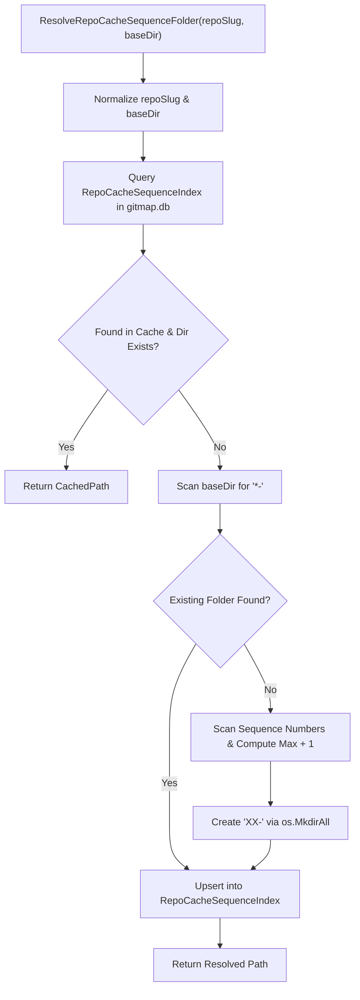
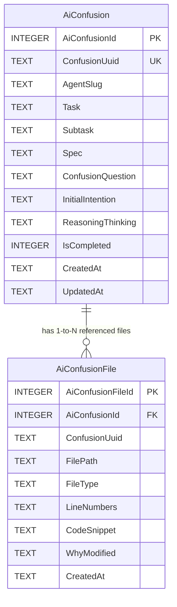
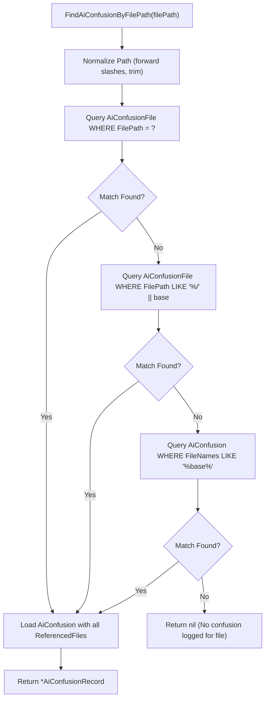

# Component and CLI Specification: AI Confusion Status, Sync, and Context View

- **Task Sequence:** 327
- **Task Slug:** `heatmap-status-improvement-and-ai-confusion-handling`
- **Spec Path:** `02-spec/21-app/327-heatmap-status-improvement-and-ai-confusion-handling/02-component-and-cli-spec.md`
- **Created At:** 2026-10-25
- **Status:** `APPROVED`

---

## 1. Overview & Architectural Goals

The AI Confusion subsystem inside GitMap (`gitmap rc ai-confusion`) provides autonomous AI agents, swarm workers, and developers with a centralized, conflict-free mechanism to record, synchronize, inspect, and resolve points of uncertainty during autonomous software engineering.

When an AI agent encounters conflicting specifications, legacy anti-patterns, missing context, or ambiguous intentions, it logs an episode into the repository's dedicated `ai-confusion.db`. This specification defines:
1. **Root SQLite Sequence Folder Caching (`RepoCacheSequenceIndex`):** Accelerating repository cache folder resolution (`XX-<repoSlug>`) via root `gitmap.db` caching to prevent repeated disk traversals.
2. **Normalized 1-to-N File Associations (`AiConfusionFile`):** Storing multiple file paths, line ranges, code snippets, and rationale per confusion episode.
3. **Autonomous Safe Synchronization Workflow (`gitmap rc ai-confusion status`):** Automatically synchronizing the repo-cache database using local export, git pull --rebase, delta replay via upsert, and atomic commit before rendering active status.
4. **Relative File Context Resolution (`gitmap rc ai-confusion view <filepath>`):** Automatically identifying the owning repository, matching referenced file records, and surfacing full agent thinking, subtask context, specs, and code snippets.

---

## 2. Root SQLite Sequence Folder Cache Architecture

### 2.1 Table Definition: `RepoCacheSequenceIndex`

Located in the root SQLite database (`gitmap.db` in `store.BinaryDataDir()`):

```sql
CREATE TABLE IF NOT EXISTS RepoCacheSequenceIndex (
    RepoSlug        TEXT PRIMARY KEY,
    SequenceFolder  TEXT NOT NULL,
    CachedPath      TEXT NOT NULL,
    UpdatedAt       TEXT NOT NULL
);
```

### 2.2 Resolution Lifecycle (`ResolveRepoCacheSequenceFolder`)



### 2.3 Confusion DB Path Resolution (`ResolveRepoConfusionDbPath`)

`ResolveRepoConfusionDbPath(repoSlug string) (string, error)` returns:
`<repo-cache>/XX-<repoSlug>/ai-confusion.db`

Ensuring each repository maintains its own isolated, portable confusion database within `repo-cache`.

---

## 3. Normalized 1-to-N Store Architecture

### 3.1 Entity Relationship



### 3.2 Transactional Integrity in `InsertAiConfusion`

When persisting a confusion episode:
1. A single SQLite transaction is initiated (`tx, err := s.db.Begin()`).
2. The master record is inserted into `AiConfusion`, capturing the generated `AiConfusionId`.
3. Every entry in `rec.ReferencedFiles` is inserted into `AiConfusionFile` bound to `AiConfusionId` and `ConfusionUuid`.
4. If no explicit `ReferencedFiles` exist but `rec.FileNames` is populated, a single synthesized `AiConfusionFile` entry is created with the provided `LineNumbers` and `CodeSnippet`.
5. The transaction commits atomically.

### 3.3 File Path Search (`FindAiConfusionByFilePath`)



---

## 4. CLI Command Specifications

### 4.1 Subcommand Dispatch

| Invocation | Action |
| :--- | :--- |
| `gitmap rc ai-confusion` (no args) | Runs `gitmap rc ai-confusion status` by default |
| `gitmap rc ai-confusion status` | Runs safe pull/sync on repo-cache and renders formatted active confusion status card |
| `gitmap rc ai-confusion view <filepath>` | Resolves relative file path to confusion record and renders full context card |
| `gitmap rc ai-confusion view --file <filepath>` | Explicit flag alternative for file-path context view |
| `gitmap rc ai-confusion view [--id <id>]` | Views specific episode by integer ID or UUID |
| `gitmap rc ai-confusion add ...` | Ingests new episode from CLI parameters or JSON file |
| `gitmap rc ai-confusion complete <id>` | Marks episode as resolved with optional resolution notes |
| `gitmap rc ai-confusion sync` | Manual trigger for 6-stage synchronization |

### 4.2 Status Output Schema & Rendering

When running `gitmap rc ai-confusion status`:
1. Executes safe sync against `repo-cache`.
2. Lists all active episodes (`IsCompleted = 0`).
3. For each active episode, displays:
   - ID & UUID badge
   - Agent Slug & Task/Subtask hierarchy
   - Target files, line numbers, and file types
   - Core confusion question
   - Initial intention vs observed ambiguity
   - Suggested CLI inspection and resolution commands

### 4.3 File Context View Rendering

When a developer or AI runs `gitmap rc ai-confusion view cli/store/example.go`:
- Displays owning repository sequence folder.
- Surfaces agent thinking and reasoning chain.
- Displays line numbers and verbatim code snippets.
- Highlights why the file was modified and what blocked resolution.

---

## 5. Coding Guideline Compliance

All implementations adhere strictly to GitMap coding rules:
- **Leaf Error Sovereignty:** Functions returning `error` return errors directly (`return err` or `return apperror.Wrap(...)`).
- **15-Line Function Limit:** Functions <= 8 lines preferred, <= 15 lines max.
- **Zero Nested Ifs:** All branches flattened via guard clauses and early returns.
- **Positive Booleans:** Prefixes restricted to `is*` and `has*`.
- **Return Styling:** Mandatory blank lines before `if`, after `}`, and before `return`.
