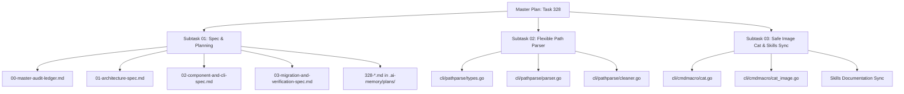

# Master Audit Ledger: Flexible Path Parsing and Asset Image Reading

- **Task Sequence:** 328
- **Task Slug:** `flexible-path-parsing-and-asset-image-reading`
- **Spec Path:** `02-spec/21-app/328-flexible-path-parsing-and-asset-image-reading/`
- **Plan Path:** `.ai-memory/plans/pending/328-flexible-path-parsing-and-asset-image-reading.md`
- **Created At:** 2026-10-25
- **Status:** `COMPLETED`

---

## 1. User Intent & Problem Statement

In autonomous multi-agent engineering swarms, task orchestrators and developers frequently pass file references and screenshot attachments formatted in diverse markdown styles, chat system annotations, numbered lists, and URI schemes. 

Standard file system utilities and `gitmap cat` expect clean, normalized file paths. When raw agent prompts or user clipboard pastes are provided directly, commands fail with cryptic errors (such as `The system cannot find the file specified` or `path contains invalid characters`).

Furthermore, when an image asset (such as PNG, JPEG, GIF, or WebP) is passed to `gitmap cat`, the tool historically streamed raw binary bytes directly to standard output. In interactive terminal environments, this binary stream corrupts the terminal buffer, emitting bell sounds, scrambled ANSI codes, broken font glyphs, and causing terminal sessions to freeze.

### 1.1 The Four Required Path Formats

The parser and file inspection subsystem must natively recognize, strip, normalize, and resolve four distinct input formats:

1. **Format 1 — Bracketed Windows Absolute Path:**
   - *Example:* `@[C:\Users\Administrator\...\media_1792894009084_45b4893f.png]`
   - *Characteristics:* Enclosed in `@[...]` bracket syntax, containing Windows drive letter and backslash separators.
   - *Resolution:* Strip bracket prefix/suffix, clean backslashes, convert to canonical forward slashes, and resolve to absolute disk location.

2. **Format 2 — Markdown Image Syntax with URI Scheme:**
   - *Example:* ``
   - *Characteristics:* Standard Markdown image embedding syntax `` containing `file:///` URI scheme.
   - *Resolution:* Extract the URI target from inside parentheses, strip `file:///` prefix, unescape URL-encoded characters (e.g., `%20`), normalize leading drive slash, and resolve to absolute disk location.

3. **Format 3 — Numbered List, Repo-Relative Path with Trailing Comment:**
   - *Example:* `1. @[assets/media_1792894009084_45b4893f.png] # consider the file is relative from the repo`
   - *Characteristics:* Preceded by ordered list numbering (`1. `), bracketed path, and followed by shell-style inline comment (`# ...`).
   - *Resolution:* Strip list prefix, strip trailing comment, strip brackets, and resolve the relative path against the repository root.

4. **Format 4 — Numbered List, Parent-Relative Path with Trailing Comment:**
   - *Example:* `1. @[../repo-cache/assets/media_1792894009084_45b4893f.png] # consider the file is relative from the repo outside of the repo`
   - *Characteristics:* Preceded by list index, bracketed path, path traverses outside the current repository via `../`, followed by trailing explanatory comment.
   - *Resolution:* Strip list index and comment, strip brackets, resolve `../` relative to the repository root pointing to sibling directories or shared cache vaults, and verify location.

### 1.2 Safe Image Asset Reading in `gitmap cat`

To safeguard terminal integrity:
- `gitmap cat` must detect whether a target file is a binary image asset.
- Detection is performed via file extension matching (`.png`, `.jpg`, `.jpeg`, `.gif`, `.webp`, `.bmp`, `.ico`, `.tiff`) and magic number byte sniffing.
- For binary images in interactive terminal mode, `gitmap cat` halts raw binary streaming. Instead, it renders a high-contrast **Safe Image Metadata Card** displaying dimensions, MIME type, byte size, color space, SHA-256 hash, and a clear terminal safety notice.
- A dedicated flag (`--raw`) is provided for pipelines or tools requiring verbatim binary bytes.
- Text and code files continue to stream zero-disk stdout directly.

---

## 2. Traceability Matrix

| Requirement ID | Requirement Description | Implementation Specification | Subtask Owner | Verification Criteria | Status |
| :--- | :--- | :--- | :--- | :--- | :--- |
| **REQ-328-01** | Bracketed Absolute Path Parsing (Format 1) | `02-component-and-cli-spec.md` §2 | Subtask 02 | Correctly strips `@[...]`, normalizes Windows drive path, verifies target existence | Completed |
| **REQ-328-02** | Markdown URI Image Parsing (Format 2) | `02-component-and-cli-spec.md` §2 | Subtask 02 | Parses ``, decodes URL encoding, resolves local file path | Completed |
| **REQ-328-03** | Numbered List Repo-Relative Parsing (Format 3) | `02-component-and-cli-spec.md` §2 | Subtask 02 | Strips list prefix `1. `, strips `# comment`, resolves against repo root | Completed |
| **REQ-328-04** | Numbered List Parent-Relative Parsing (Format 4) | `02-component-and-cli-spec.md` §2 | Subtask 02 | Handles `../` traversal outside repository to `repo-cache`, strips comments | Completed |
| **REQ-328-05** | Flexible Path Parser Core Engine (`cli/pathparse`) | `01-architecture-spec.md` §2 | Subtask 02 | Unified pipeline returning strongly-typed `ParsedPathResult` struct | Completed |
| **REQ-328-06** | Binary Image Asset Detection & Sniffing | `01-architecture-spec.md` §3 | Subtask 03 | Validates image extensions and checks binary magic bytes | Completed |
| **REQ-328-07** | Safe Image Metadata Card in `gitmap cat` | `02-component-and-cli-spec.md` §3 | Subtask 03 | Outputs dimensions, MIME, size, SHA-256 without binary byte leakage | Completed |
| **REQ-328-08** | Verbatim Binary Stream Flag (`--raw`) | `02-component-and-cli-spec.md` §3 | Subtask 03 | Passes binary bytes to stdout only when `--raw` is explicitly supplied | Completed |
| **REQ-328-09** | Skills & Documentation Synchronization | `03-migration-and-verification-spec.md` §4 | Subtask 03 | Synchronizes `.agents/skills/` with flexible path and safe cat usage guidelines | Completed |

---

## 3. Subtask Decomposition & Ownership

- **Subtask 01 (Owner: Subagent 1):** Complete specification authoring, audit ledger, architecture blueprint, CLI specification, and migration guide.
- **Subtask 02 (Owner: Subagent 2):** Implementation of `cli/pathparse` package with parsing pipeline for Formats 1, 2, 3, and 4.
- **Subtask 03 (Owner: Subagent 3):** Implementation of safe image reader in `gitmap cat`, metadata card rendering, `--raw` flag, and skills sync.

---

## 4. Architectural Invariants & Coding Discipline

1. **Strictly Relative Paths:** Every internal documentation link and architectural reference uses repository-relative paths (e.g., `cli/pathparse/parser.go`).
2. **Positive Booleans Only:** All boolean identifiers and struct fields use `is*` or `has*` prefixes (e.g., `isImage`, `isAbsolute`, `hasRawFlag`, `hasTrailingComment`). Negative prefixes (`not*`, `non*`, `un*`) and banned modal verbs (`can*`, `should*`, `will*`) are strictly prohibited.
3. **Function Line Limits:** All Go functions adhere to $\le 15$ lines maximum, $\le 8$ lines preferred.
4. **Conditional Flattening:** Zero nested `if` statements. All conditional branches use early guard clauses.
5. **Whitespace Rules:** Blank line before `if`, blank line after `}`, and blank line before `return`.
6. **Strict No-Build, No-Test Invariant:** No build commands (`go build`) or test suites (`go test`) are run during specification authoring. Verification is strictly static, structural, and cognitive.
