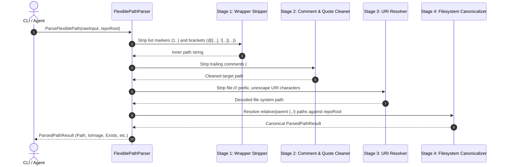
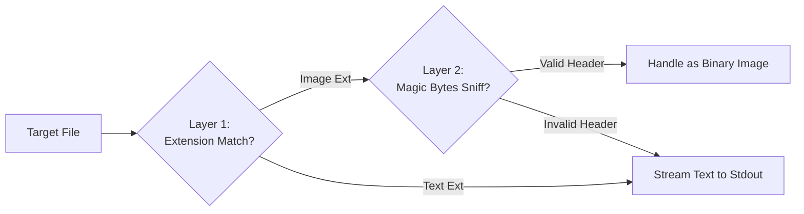

# Architecture Specification: Flexible Path Parsing and Asset Image Reading

- **Spec ID:** `02-spec/21-app/328-flexible-path-parsing-and-asset-image-reading/01-architecture-spec.md`
- **Feature Slug:** `flexible-path-parsing-and-asset-image-reading`
- **Module:** `cli/pathparse`, `cli/cmdmacro`, `cli/fsutil`
- **Status:** APPROVED
- **Version:** 1.0.0
- **Target Audience:** Autonomous AI Agents, Multi-Agent Swarms, GitMap Core Engineers
- **Target Release:** Minor Bump

---

## 1. Executive Summary & Architectural Overview

Autonomous engineering swarms and human engineers frequently interact with mixed file representations in chat windows, issue trackers, and pull requests. In typical workflows, file paths are provided inside conversational markup:
- Wrapped in bracket tags: `@[path]`
- Wrapped in Markdown image syntax: ``
- Prefixed with ordered list numbers: `1. @[path]`
- Annotated with inline comments: `@[path] # explanatory comment`
- Pointing to external caches: `@[../repo-cache/assets/...]`

When standard tools receive these strings without sanitization, execution terminates with path lookup errors. Furthermore, when binary assets (such as PNG or JPEG images) are displayed via terminal streaming commands (`gitmap cat`), stdout becomes flooded with binary control codes, corrupting terminal emulation buffers and freezing agent loops.

This architecture specification introduces two tightly integrated subsystems:
1. **The Flexible Path Parser (`cli/pathparse`):** A deterministic, four-stage normalization pipeline that strips wrappers, decodes URIs, strips inline comments, and resolves canonical file paths across both intra-repo and parent-traversal references.
2. **The Safe Image Reader (`cli/cmdmacro/cat.go`):** A defensive streaming guard that inspects file extensions and binary headers, preventing terminal corruption by rendering structured asset metadata cards unless an explicit `--raw` flag is provided.

```mermaid
flowchart TD
    INPUT[Raw Input String] --> PARSER[Flexible Path Parser\ncli/pathparse]
    PARSER --> STAGE1[Stage 1: Strip List Prefix & Wrappers\n@[...], ]
    STAGE1 --> STAGE2[Stage 2: Strip Inline Comments & Quotes\n# ..., // ...]
    STAGE2 --> STAGE3[Stage 3: Decode URI & Scheme\nfile:///, %20, drive letter]
    STAGE3 --> STAGE4[Stage 4: Canonicalize & Resolve\nRepo-Relative vs Parent ../ vs Absolute]
    
    STAGE4 --> RESULT[ParsedPathResult]
    RESULT --> CAT[gitmap cat Execution]
    
    CAT --> CHECK_IMAGE{Is Target\nBinary Image?}
    CHECK_IMAGE -- Yes --> CHECK_RAW{Has --raw Flag\nor Pipe?}
    CHECK_RAW -- No --> SAFE_CARD[Render Safe Image Metadata Card\nDimensions, MIME, Size, Hash]
    CHECK_RAW -- Yes --> STREAM_BYTES[Stream Raw Bytes to Stdout]
    CHECK_IMAGE -- No --> STREAM_TEXT[Stream Plain Text to Stdout]
```

---

## 2. Flexible Path Parsing Architecture (`cli/pathparse`)

### 2.1 The Four-Stage Normalization Pipeline

The parsing pipeline processes inputs through four discrete, pure transformation stages:



#### Stage 1: Wrapper & Prefix Extraction
Identifies and strips leading list decorators and outer wrapper syntax:
- **Ordered List Numerals:** Matches `^\s*\d+[\.\)]\s*` (e.g., `1. `, `02) `).
- **Bullet Markers:** Matches `^\s*[\*\-]\s*`.
- **Bracket Notation:** Extracts path enclosed in `@[...]` or `[...]`.
- **Markdown Image Syntax:** Matches `!\[([^\]]*)\]\(([^)]+)\)` and extracts the target URL from inside the parentheses.

#### Stage 2: Inline Comment & Quote Cleaning
Strips metadata annotations appended to the path:
- **Shell & Python Comments:** Truncates string at first unescaped `#` marker (e.g., `# consider the file is relative...`).
- **C-Style Inline Comments:** Truncates string at `//`.
- **Surrounding Quotes:** Strips matching leading and trailing single quotes (`'`) or double quotes (`"`).
- **Whitespace Normalization:** Trims leading and trailing whitespace characters.

#### Stage 3: URI Scheme & Percent-Encoding Resolution
Handles web and file URI conventions:
- **File URI Scheme:** Strips `file:///` and `file://` prefixes.
- **Windows Drive Extraction:** On Windows, converts `/C:/Users/...` (standard URI output) to `C:/Users/...`.
- **Percent-Decoding:** Decodes URL-encoded escape sequences (e.g., `%20` $\rightarrow$ space, `%2B` $\rightarrow$ `+`).

#### Stage 4: Canonicalization & Relative Resolution
Resolves the cleaned path against the active repository root and determines traversal boundaries:
- **Slash Normalization:** Replaces all Windows backslashes (`\`) with canonical forward slashes (`/`).
- **Format 1 (Absolute):** If the path begins with a drive letter (`C:/`) or root slash (`/`), resolves absolute location directly.
- **Format 3 (Repo-Relative):** If the path is relative and does not begin with `..`, resolves against `repoRoot/path`.
- **Format 4 (Parent-Relative):** If the path begins with `../`, resolves upwards from `repoRoot` (e.g., pointing into sibling directories such as `../repo-cache/assets/...`). Evaluates `filepath.Clean` to ensure safe path containment.

### 2.2 Domain Data Model: `ParsedPathResult`

```go
package pathparse

// ParsedPathResult encapsulates the comprehensive metadata of a parsed file path.
type ParsedPathResult struct {
	RawInput            string `json:"rawInput"`
	CleanPath           string `json:"cleanPath"`
	ResolvedPath        string `json:"resolvedPath"`
	TrailingComment     string `json:"trailingComment"`
	HasMarkdownWrapper  bool   `json:"hasMarkdownWrapper"`
	HasBracketWrapper   bool   `json:"hasBracketWrapper"`
	HasListPrefix       bool   `json:"hasListPrefix"`
	HasTrailingComment  bool   `json:"hasTrailingComment"`
	IsAbsolute          bool   `json:"isAbsolute"`
	IsInsideRepo        bool   `json:"isInsideRepo"`
	IsParentRelative    bool   `json:"isParentRelative"`
	IsFileExists        bool   `json:"isFileExists"`
	IsDirectory         bool   `json:"isDirectory"`
	IsImage             bool   `json:"isImage"`
	ImageFormat         string `json:"imageFormat"`
}
```

---

## 3. Safe Image Asset Cat Subsystem (`cli/cmdmacro`)

### 3.1 Terminal Binary Corruption Hazard

Interactive terminals (PowerShell, Windows Terminal, ConHost, bash, zsh) interpret incoming byte streams through ANSI/VT100 parsers. Streaming binary raster images (PNG, JPEG, GIF, WebP) into standard output produces severe failure modes:
1. **Control Sequence Triggering:** Byte patterns matching `0x1B` (ESC) or `0x07` (BEL) cause terminal beeps, cursor repositioning, and mode switches.
2. **Buffer Freezing:** Incomplete escape sequences leave terminal state machines awaiting terminating bytes, freezing shell responsiveness.
3. **Font Corruption:** Character set shift codes (`0x0E`/`0x0F`) replace alphanumeric fonts with line-drawing symbols.

### 3.2 Dual-Layer Image Detection Pipeline

To provide complete protection without degrading text file streaming, `gitmap cat` applies a two-layer validation strategy:



#### Layer 1: Extension Matching
The following extensions are registered as image candidates:
- Raster Images: `.png`, `.jpg`, `.jpeg`, `.gif`, `.webp`, `.bmp`, `.ico`, `.tiff`
- Vector Graphics: `.svg` (treated as safe XML text, rendered directly unless `--meta` is requested)

#### Layer 2: Magic Byte Header Sniffing
If the extension matches or when sniffing untyped files, reads the first 16 bytes:
- **PNG:** `\x89PNG\r\n\x1a\n` (`89 50 4E 47 0D 0A 1A 0A`)
- **JPEG:** `\xFF\xD8\xFF`
- **GIF:** `GIF87a` or `GIF89a`
- **WebP:** `RIFF....WEBP` (`52 49 46 46 ... 57 45 42 50`)
- **BMP:** `BM` (`42 4D`)

### 3.3 Safe Metadata Card Rendering

When a binary image is confirmed and `--raw` is false:
1. The raw binary stream is intercepted.
2. The image configuration is read using Go's `image.DecodeConfig` (avoiding full memory decode of massive images).
3. A styled, high-contrast terminal card is rendered:

```text
┌─ GitMap Asset Inspector: Safe Image Reader ──────────────────────────┐
│ File:       assets/media_1792894009084_45b4893f.png                  │
│ Format:     PNG (image/png)                                          │
│ Dimensions: 1920 × 1080 px                                           │
│ Color Space:RGBA (8-bit per channel)                                 │
│ File Size:  248.52 KB (254,482 bytes)                                │
│ SHA-256:    e3b0c44298fc1c149afbf4c8996fb92427ae41e4649b934ca495... │
├──────────────────────────────────────────────────────────────────────┤
│ [SAFE IMAGE CAT: Terminal binary corruption prevented]               │
│ Tip: Use 'gitmap cat --raw <file>' to stream binary bytes to pipes.  │
└──────────────────────────────────────────────────────────────────────┘
```

---

## 4. Error Management & Architectural Compliance

### 4.1 Error Return Sovereignty
In accordance with GitMap coding guidelines:
- All leaf functions in `cli/pathparse` return typed `error` values (`*apperror.AppError`).
- Under no circumstances do parser functions invoke `os.Exit` or exit handlers.
- Errors bubble to `RunCat` and root command dispatchers.

### 4.2 Function Line Limits & Positive Booleans
- Every function in `cli/pathparse` and `cli/cmdmacro/cat_image.go` is strictly bounded to $\le 15$ lines.
- All boolean variables, struct fields, and functions use positive prefixes exclusively (`isImage`, `isAbsolute`, `hasRawFlag`, `hasBracketWrapper`).
- Zero nested conditionals are allowed; all logic uses early guard returns.
