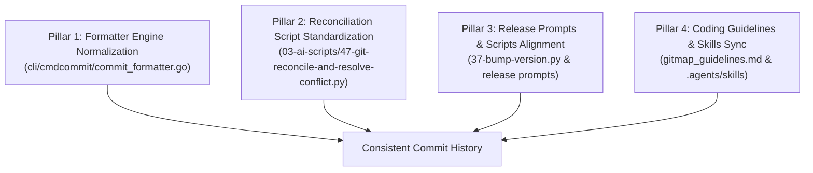

# Master Audit Ledger: Git Commit Prefix Inconsistency & Raw Git Fallback Remediation

> **Module:** `02-spec/21-app/331-git-commit-prefix-inconsistency-and-raw-git-fallback-remediation`  
> **Sequence ID:** 331  
> **Parent Prompt:** User Request (Commit History Inconsistency & Raw Git Auto-Resolve Audit)  
> **Date:** 2026-10-26  
> **Status:** Pending Implementation Plan  
> **Author:** Antigravity Architect  

---

## 1. Verbatim User Request & Issue Context

> "Why the commits look like this? Can you please find the root cause and fix it? Or do not fix it, just write this back, okay? In plan and pending mode, as fast as possible so that any other AI can complete it. Okay, so first write what needs to be done. Okay? Later on, other AI will fix it. Either it has to update the coding guideline or probably the `gitmap` or `gitmap` skill, where it needs to update, how it needs to update. Just write that as quick as possible."

### Visual Audit of User-Provided Screenshot (`media_1792952278328_cf85e61e.png`):
The user's Git commit history displays three distinct formatting anomalies in adjacent commits:
```text
20c88279c  Chore: DOCS - update subtasks status for plan 330
93f959675  Release: v6.615.0 file context menu powershell cleaner cascade flattening and ui help
8756ccc93  Feature: CONTEXTMENU - file right-click integration cascade flattening powershell cleaner and ui help
ffb07a0e4  Release: RELEASE - v6.614.0 context menu show log ui and update downgrade guard
fc789bb34  Feature: CONTEXTMENU - implement cross-platform context menu show log ui and update downgrade guard
90f75b081  fix: auto-resolve merge conflicts
853f7ee92  Release: VERSION - v6.613.0 hardened flexible path parsing and universal CLI expansion
```

---

## 2. Root Cause Analysis (4-Part RCA)

### 2.1 Anomaly 1: Dual-Format Releases (`Release: v6.615.0 ...` vs `Release: RELEASE - v6.614.0 ...`)
- **Mechanism:** In `cli/cmdcommit/commit_formatter.go`:
  - When invoked with `gitmap cpr "RELEASE - v6.614.0 <scope>"`, `tryParseHyphenSyntax()` matched `matches[1] = "RELEASE"` and `matches[2] = "v6.614.0 <scope>"`.
  - In `resolveHyphenModuleAndItem(prefix, mod, item)`, `isRedundantModule(prefix, upperMod)` checks if `upperMod == "RELEASE"`. It noticed `"RELEASE"` matches `prefix`, but then called `splitNestedHyphen("v6.614.0 <scope>")`. Because there was no second `" - "` in `v6.614.0 <scope>`, it returned `mod = "", hasMod = false`, producing `prefix + item` -> `"Release: v6.614.0 <scope>"`.
  - When `37-bump-version.py` or a release prompt generates a commit, some prompts instructed `gitmap cpr "RELEASE - vX.Y.Z <scope>"` while other prompts instructed `gitmap cpr "VERSION - vX.Y.Z <scope>"`. Because `"VERSION"` is not in `isCommitTypeToken()` (`FEATURE`, `FEAT`, `RELEASE`, `REL`, `BUG`, `CHORE`, `REFACTOR`, `REFACT`, `SPEC`), `"VERSION"` was treated as a valid module name, resulting in `"Release: VERSION - v6.613.0 ..."`.
- **Root Cause:** Inconsistent module token recognition in `commit_formatter.go` and conflicting release instructions across `01-prompts/17-release-management/` (`02-minor-bump.md`, `01-patch-bump.md`) vs `03-ai-scripts/37-bump-version.py`.

### 2.2 Anomaly 2: Dropped Module Scope in Release Commits
- **Mechanism:** The repository coding guideline dictates `"MODULE - summary"` format:
  ```text
  Feature: MODULE - summary
  Chore: MODULE - summary
  Release: RELEASE - v6.615.0 summary   (or Release: VERSION - v6.615.0 summary)
  ```
  However, `commit_formatter.go` line 183 actively strips the module if it equals the verb, leaving the commit as `Release: v6.615.0 ...` without a module identifier.
- **Root Cause:** Overzealous deduplication logic in `commit_formatter.go` that stripped the module when `mod == "RELEASE"`, causing release commits to look unstructured in Git history.

### 2.3 Anomaly 3: Raw Lowercase Commit `fix: auto-resolve merge conflicts` (Commit `90f75b081`)
- **Mechanism:** When git merge conflicts occur or when scripts like `03-ai-scripts/47-git-reconcile-and-resolve-conflict.py` execute, or when an AI agent falls back to raw `git commit -m "fix: auto-resolve merge conflicts"`, it completely bypasses `gitmap cbf` / `gitmap cpc`.
- **Root Cause:**
  1. Automated conflict resolution scripts (`03-ai-scripts/47-git-reconcile-and-resolve-conflict.py` line 90) had hardcoded fallback `git commit` calls using lowercase conventional syntax.
  2. The GitMap pre-commit hook (`hook_shim.go`) did not reject or normalize raw `git commit` messages that bypass GitMap verbs.
  3. AI skill `.agents/skills/git-reconcile-and-resolve-conflict/skill.md` instructed raw `git commit` instead of `gitmap cbf "GIT - auto-resolve merge conflicts"`.

---

## 3. Four Core Architectural Remediation Pillars



1. **Pillar 1 — Formatter Engine Normalization (`cli/cmdcommit/commit_formatter.go`):**
   - Standardize release module formatting: decide on single canonical standard (`Release: RELEASE - vX.Y.Z <scope>` or `Release: VERSION - vX.Y.Z <scope>`).
   - Fix `commit_formatter.go` so it deterministically preserves `RELEASE - vX.Y.Z` without arbitrarily stripping the module or producing inconsistent outputs.
2. **Pillar 2 — Auto-Reconcile & Script Enforcement:**
   - Update `03-ai-scripts/47-git-reconcile-and-resolve-conflict.py` to use `gitmap cbf "GIT - auto-resolve merge conflicts"` (or fallback `git commit -m "Fix: GIT - auto-resolve merge conflicts"` if gitmap binary is compiling).
3. **Pillar 3 — Release Automation Alignment:**
   - Update `03-ai-scripts/37-bump-version.py` and `01-prompts/17-release-management/` prompts to use the unified semantic commit standard.
4. **Pillar 4 — Guidelines & Skill Enforcement:**
   - Update `d:\work\gitmap\.agents\rules\gitmap_guidelines.md` and `.agents/skills/gitmap/skill.md` with explicit release and chore commit examples.
