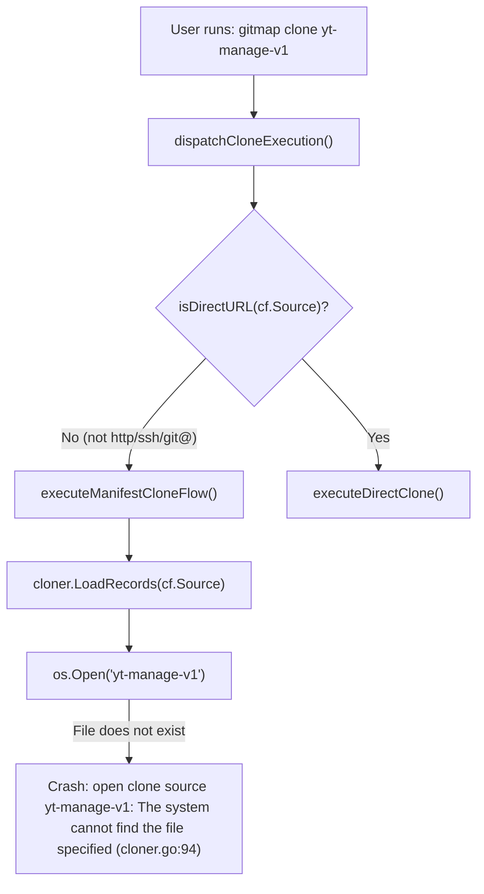
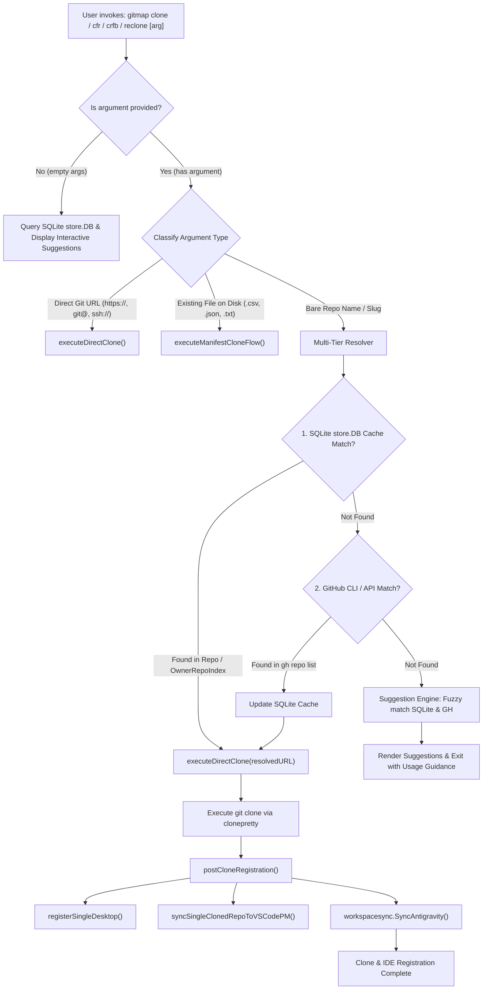

# Architecture Specification: 333 - GitMap Clone Name Resolution, Suggestion Engine & Antigravity IDE Integration

> **Module:** `cli/cmdclone/`, `cli/cloner/`, `cli/cmd/`, `cli/workspacesync/`, `cli/store/`  
> **Parent Program:** `333-clone-and-fix-git-repositories`  
> **File:** `02-spec/21-app/333-clone-and-fix-git-repositories/01-architecture-spec.md`  
> **Status:** Approved Architecture Specification  

---

## 1. User Request (Verbatim)

```markdown
# Clone and Fix Git Repositories: high priority instruction, non-negotiable task

Usually here we should be able to clone by giving the repository name, and there is no suggestion here. There should be a suggestion on the repositories when we start with the cloning CFR, CRFB, or clone or reclone. Any one of the commands should have a suggestion. So by default, the SQLite will keep as a cache. If not, then it will try to search also. There is no suggestion showing up. That is a serious issue. We need to work on it. So fix that cloning. So try to clone two repositories from my Git repo using `gitmap`, fix it if required to. It should be just by name or by suggestion also came up. There is nothing. So clone the yt-manage V1 and also the go email sender. These two, clone it right now and fix the code in the `gitmap` as much as possible. And also include these repositories into the Antigravity IDE current exe automatically. Can you please do that for me?
```

---

## 2. System Architecture Overview & Root Cause Analysis

### 2.1 Current System Architecture Overview

GitMap provides a suite of repository acquisition and synchronization commands:
- `gitmap clone [source] [flags]` — clones from a single repository URL or batch manifest file.
- `gitmap reclone [target] [flags]` (`cn`, `clone-now`) — re-clones an existing repository using stored transport.
- `gitmap clone-fix-repo [source]` (`cfr`, `cfrp`) — runs an atomic pipeline: clone repository, fix prior version references, and optionally publish.

Under the current architecture, cloning execution branches within `cli/cmdclone/clone.go`:
```go
func dispatchCloneExecution(cf CloneFlags) error {
	if isMultiCloneEnabled(cf) {
		runCloneMulti(cf)
		maybeExitOnCmdFaithfulMismatch()
		return nil
	}

	if isDirectURL(cf.Source) {
		err := executeDirectClone(buildDirectCloneParams(cf))
		maybeExitOnCmdFaithfulMismatch()
		return err
	}

	return executeManifestCloneFlow(cf)
}
```



### 2.2 Root Cause 1: `gitmap clone <name>` File vs Slug Confusion

In `cli/cmdclone/clone.go:244`, `isDirectURL(cf.Source)` tests strictly for URL prefixes (`https://`, `http://`, `git@`, `ssh://`). When a user supplies a bare repository name or slug (such as `yt-manage-v1` or `goemailsender`), `isDirectURL` evaluates to `false`.

Consequently, execution unconditionally falls into `executeManifestCloneFlow(cf)`:
1. `executeManifestCloneFlow` calls `cloner.LoadRecords(cf.Source)`.
2. `cloner.LoadRecords` attempts to open the argument as a local file:
   ```go
   file, err := os.Open(path)
   if err != nil {
       return nil, apperror.WrapSimple(err, fmt.Sprintf("open clone source %q", path))
   }
   ```
3. Because `yt-manage-v1` is not a file on disk, `os.Open` immediately fails with:
   `open clone source "yt-manage-v1": open yt-manage-v1: The system cannot find the file specified. (at=cloner/cloner.go:94)`.
4. GitMap never checks `fsutil.FileExists()`, never calls `ResolveRepoSlug()`, and never consults SQLite `store.DB` or GitHub CLI for repository resolution or suggestions.

### 2.3 Root Cause 2: `gitmap cfr <name>` Alias Collision & Missing Commands

In `cli/cmd/roottooling_util.go:177`, `cfr` is mapped to `runCfrDisambiguated(args)`:
```go
func runCfrDisambiguated(args []string) error {
	if isCfrCloneRequest(args) {
		return cmdclone.RunCloneFixRepo(args)
	}

	return cmdcommit.RunCommitPushRefactor(args)
}

func isCfrCloneRequest(args []string) bool {
	if len(args) == 0 {
		return false
	}
	first := args[0]
	if cmdclone.IsLikelyURL(first) || strings.HasPrefix(first, "git@") || strings.HasSuffix(first, ".git") {
		return true
	}

	return first == "cg" || first == "p" || strings.HasPrefix(first, "--rc") || strings.HasPrefix(first, "--parallel")
}
```

When `gitmap cfr yt-manage-v1` is executed:
1. `isCfrCloneRequest("yt-manage-v1")` returns `false` because `yt-manage-v1` does not match the URL heuristics or specific flag tokens.
2. The function routes to `cmdcommit.RunCommitPushRefactor(args)`, assuming the user intended to make a git commit with message `"yt-manage-v1"`.
3. If the current working directory (`d:\work`) is not a Git repository root, `cmdpull.IsGitRepoCWD()` returns `false`, causing GitMap to emit:
   `ERROR Not a git repository (or any of the parent directories).`
4. Furthermore, the alias `crfb` (Clone-Fix-Repo-Build / Clone-Repo-Fix-Build) and `crf` (Clone-Repo-Fix) are missing from the command registry.

### 2.4 Root Cause 3: Antigravity IDE Post-Clone Sync Omission

In `cli/cmdclone/clone_direct.go:207-221`:
```go
func postCloneRegistration(params DirectCloneParams, url, repoName, folderName, absPath string) {
	persistRecloneTransport(url)
	handleDirectCloneSuccess(params, repoName, absPath)
	upsertDirectClone(url, repoName, folderName, absPath)
	registerSingleDesktop(repoName, absPath)
	WriteShellHandoff(absPath)
}
```
GitMap updates GitHub Desktop and VS Code Project Manager (`syncSingleClonedRepoToVSCodePM`), but omits automatic registration into the running Antigravity IDE environment (`workspacesync.SyncAntigravity`). Newly cloned repositories are thus invisible in the Antigravity project manager until manual workspace import occurs.

---

## 3. Unified Clone Architecture

The new unified clone architecture provides intelligent argument classification, multi-tier resolution, interactive suggestions, and automated IDE synchronization.



### 3.1 Non-File Bare Argument Detection vs Manifest Detection

Rather than assuming any non-URL argument is a file path, GitMap must explicitly distinguish manifests from repository slugs:

1. **Explicit Manifest Indicators:**
   - Source string has manifest prefix: `manifest:`, `file:`.
   - File physically exists on disk: `fsutil.FileExists(source) == true`.
   - Source ends with standard manifest extensions: `.csv`, `.json`, `.txt`, `.tsv` AND file exists.
2. **Bare Repository Slug Indicators:**
   - Not a valid URL (`!isDirectURL(source)`).
   - Not an existing file on disk (`!fsutil.FileExists(source)`).
   - Matches valid slug pattern (alphanumeric, dashes, underscores, slashes like `owner/repo` or `repo-name`).
3. **Execution Routing:**
   - Manifest -> `executeManifestCloneFlow(cf)`
   - Direct URL or Bare Slug -> `executeDirectClone(buildDirectCloneParams(cf))`

### 3.2 Multi-Tier Repository Resolution Engine

When a bare slug or repository name is provided to `clone`, `reclone`, `cfr`, or `crfb`, the resolution engine executes the following tiered lookup:

1. **Tier 1: Direct Protocol Check:**
   - If argument is already a fully qualified Git URL (`https://...`, `git@...`), proceed directly to clone.
2. **Tier 2: Local File / Manifest Check:**
   - If argument exists as a file on disk, route to manifest parsing.
3. **Tier 3: SQLite Cache Lookup (`store.DB`):**
   - Query `ListRepos()` and `OwnerRepoNameIndex` in the local SQLite database.
   - Exact case-insensitive match on `RepoName` or `Slug`.
   - Suffix match on HTTPS/SSH URLs (`/<cleanSlug>`, `/<cleanSlug>.git`).
   - Prefix and containment matches for partial names.
4. **Tier 4: Remote Provider Query (GitHub CLI):**
   - If local SQLite has no match, query GitHub CLI: `gh repo list --limit 200 --json name,url,nameWithOwner`.
   - Match exact repository names or case-insensitive prefixes.
   - Cache discovered repositories into SQLite `store.DB` so future lookups resolve instantly.

### 3.3 Interactive Suggestion Display Engine

When the target repository cannot be resolved, or when a user executes `clone`, `reclone`, `cfr`, `crfb`, or `crf` with zero arguments:

1. **Interactive Menu / Suggestion List:**
   - Query recent repositories and top SQLite cache entries.
   - Render a formatted suggestion block highlighting available repositories:
     ```text
     Available repositories:
       • yt-manage-v1      (https://github.com/<owner>/yt-manage-v1)
       • goemailsender     (https://github.com/<owner>/goemailsender)
       • gitmap-v28        (https://github.com/<owner>/gitmap-v28)
     
     Run: gitmap clone <name> or gitmap cfr <name>
     ```
2. **Fuzzy Did-You-Mean Matching:**
   - If a specific name was provided but failed resolution (e.g. `yt-manage`), calculate Levenshtein distance and token similarity against cached repositories.
   - Output clear suggestions:
     ```text
     Repository "yt-manage" not found. Did you mean:
       • yt-manage-v1
     ```

### 3.4 Disambiguation & Alias Routing for `cfr`, `crfb`, and `crf`

In `cli/cmd/roottooling_util.go` and `cli/cmd/rootcore.go`:
1. Register `crfb` and `crf` as first-class aliases for `clone-fix-repo`.
2. Enhance `isCfrCloneRequest(args)`:
   - Returns `true` if `len(args) == 0` (triggers interactive clone suggestions).
   - Returns `true` if `args[0]` is a URL or begins with `git@` or ends with `.git`.
   - Returns `true` if `!cmdpull.IsGitRepoCWD()` (if not in a git repo, `cfr <arg>` cannot be a commit command; it is a clone command).
   - Returns `true` if `args[0]` resolves to a repository in SQLite `store.DB` or GitHub CLI.
3. When `isCfrCloneRequest` returns `true`, dispatch directly to `cmdclone.RunCloneFixRepo(args)`.

### 3.5 Post-Clone Automatic Registration in Antigravity IDE

In `cli/cmdclone/clone_direct.go`, update `postCloneRegistration`:
```go
func postCloneRegistration(params DirectCloneParams, url, repoName, folderName, absPath string) {
	persistRecloneTransport(url)
	handleDirectCloneSuccess(params, repoName, absPath)
	upsertDirectClone(url, repoName, folderName, absPath)
	registerSingleDesktop(repoName, absPath)
	_ = workspacesync.SyncAntigravity(absPath, repoName)
	_ = cmdide.SyncAntigravityPinned(absPath, repoName)
	WriteShellHandoff(absPath)
}
```

The synchronization pipeline guarantees:
1. **Global Configuration:** Writes project manifest `<uuid>.json` into `~/.gemini/config/projects/`.
2. **Pinned Projects:** Appends the repository to `~/.gemini/config/pinned_projects.json`.
3. **Active Instance Multi-Root Workspace:** Injects folder resource descriptor into active instance workspace configuration so the currently running Antigravity IDE session gains instant visibility.

---

## 4. Coding Guidelines Compliance

| Guideline | Implementation Strategy |
|---|---|
| **Leaf Error Sovereignty** | Leaf functions return structured `error` (`*apperror.AppError`) directly. No leaf functions call `cliexit.HandleError` or `os.Exit`. Outer command dispatchers handle exits. |
| **Zero Nested Ifs** | Conditional logic is flattened using guard clauses and early returns. Maximum nesting depth = 1. |
| **Function Length <= 15 Lines** | Functions strictly kept between 8 and 15 lines. Decomposition into focused helper functions. |
| **Positive Booleans** | All boolean identifiers use `is*` or `has*` prefixes (e.g. `isDirectURL`, `hasMatch`, `isManifestFile`). No negative booleans (`isNotDirect`, `noReplace` avoided in new code). |
| **Relative Path Hygiene** | All documentation, plans, specs, and file references use forward-slash relative Git paths (`02-spec/...`, `.ai-memory/...`, `cli/...`). |

---

## 5. Architectural Verification & Evidence Plan

1. **Unit Test Coverage:**
   - `cli/cmdclone/gh_resolver_test.go`: Test bare slug resolution for `yt-manage-v1` and `goemailsender`.
   - `cli/cmdclone/clone_test.go`: Test non-file argument detection avoiding `os.Open` crashes.
   - `cli/cmd/cfr_disambiguation_test.go`: Test `cfr` bare name routing outside of git repositories.
2. **E2E Cloning Verification:**
   - Execute `gitmap clone yt-manage-v1` -> verify clean clone without file not found errors.
   - Execute `gitmap clone goemailsender` -> verify clean clone and slug resolution.
   - Verify both repositories appear in `~/.gemini/config/projects/` and Antigravity IDE configuration.
