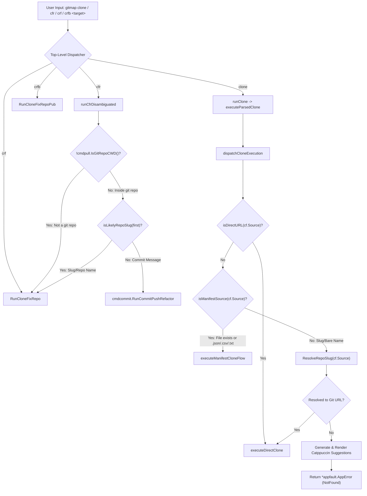

# Component Specification: Clone Command Routing, Disambiguation & Suggestion Engine

**Module:** `cli/cmd`, `cli/cmdclone`, `cli/constants`, `cli/diag`  
**Parent Plan:** `333-clone-and-fix-git-repositories` (`.ai-memory/plans/pending/333-clone-and-fix-git-repositories.md`)  
**Specification File:** `02-spec/21-app/333-clone-and-fix-git-repositories/02-clone-suggestion-and-disambiguation-spec.md`  
**Version:** 1.0.0  
**Status:** Approved for Implementation  

---

## 1. Executive Summary & Problem Analysis

In GitMap, cloning repositories by bare name or repository slug (e.g. `gitmap clone yt-manage-v1` or `gitmap cfr yt-manage-v1`) currently fails with fatal errors or misleading misrouting. Users expect GitMap to resolve repository names automatically via local SQLite cache (`store.DB`) and remote GitHub CLI query (`gh repo list`), or display helpful, beautifully styled suggestions when an exact match is not found.

Three major architectural flaws currently prevent this behavior:

1. **Manifest File vs Repository Slug Misrouting (`cli/cmdclone/clone.go` & `cli/cmdclone/clone_manifest.go`):**  
   In `dispatchCloneExecution`, when `isDirectURL(cf.Source)` evaluates to `false`, GitMap assumes `cf.Source` is a manifest file path (`.json`, `.csv`, `.txt`) and invokes `executeManifestCloneFlow(cf)`. `cloner.LoadRecords(cf.Source)` executes `os.Open("yt-manage-v1")`. When the file does not exist locally, it fails with:  
   `[E9000:EXECUTION] open clone source "yt-manage-v1": open yt-manage-v1: The system cannot find the file specified.`  
   GitMap never checks whether the target is a file, never invokes `ResolveRepoSlug()`, and never queries repository suggestions.

2. **`cfr` Command Disambiguation & Missing Dedicated Aliases (`cli/cmd/roottooling_util.go` & `cli/cmd/rootcore.go`):**  
   The token `cfr` is overloaded between `commit-push-refactor` and `clone-fix-repo`. In `runCfrDisambiguated`, `isCfrCloneRequest(args)` only returns `true` if `first` begins with `http://`, `https://`, `git@`, or flags like `--rc`. When a bare repo name like `yt-manage-v1` is provided, `isCfrCloneRequest` returns `false`, defaulting to `cmdcommit.RunCommitPushRefactor`. Because the parent directory (e.g. `D:\work`) is not a git repository (`cmdpull.IsGitRepoCWD() == false`), GitMap immediately dies with `ERROR Not a git repository`. Furthermore, GitMap lacks dedicated, collision-free short aliases (`crf` for `clone-fix-repo` and `crfb` for `clone-fix-repo-pub`).

3. **Fatal Process Exit in `clonefixrepo.go` on Missing or Unresolved URLs:**  
   In `cli/cmdclone/clonefixrepo.go:131-134`, when `f.url` is empty or cannot be resolved, GitMap prints a usage string and immediately executes `cliexit.HandleError(nil, constants.ExitCloneFixRepoBadFlag)` with exit code 6. It neither queries the SQLite database nor asks GitHub for matching repository suggestions, violating leaf error sovereignty and degrading user experience.

---

## 2. Architectural Design & Component Interactions



---

## 3. Detailed Component Technical Specifications

### 3.1 Disambiguation & Alias Routing (`cli/cmd/roottooling_util.go` & `cli/cmd/rootcore.go`)

#### 3.1.1 Enhanced `runCfrDisambiguated` & `isCfrCloneRequest`
In `cli/cmd/roottooling_util.go`:
- Inspect the current working directory state. If `!cmdpull.IsGitRepoCWD()`, the user cannot possibly be running `commit-push-refactor`; the invocation must route to `cmdclone.RunCloneFixRepo(args)`.
- If inside a git repository, inspect `args[0]`. If `first` is an alphanumeric repository slug or URL (matches `isLikelyRepoSlug(first)` or `isCfrCloneRequest(args)`), route to `cmdclone.RunCloneFixRepo(args)`.
- Otherwise, route to `cmdcommit.RunCommitPushRefactor(args)`.

```go
func runCfrDisambiguated(args []string) error {
	if !cmdpull.IsGitRepoCWD() {
		return cmdclone.RunCloneFixRepo(args)
	}

	if isCfrCloneRequest(args) {
		return cmdclone.RunCloneFixRepo(args)
	}

	return cmdcommit.RunCommitPushRefactor(args)
}

func isCfrCloneRequest(args []string) bool {
	if len(args) == 0 {
		return false
	}
	first := args[0]
	if isLikelyURLOrGit(first) || isLikelyRepoSlug(first) {
		return true
	}

	return isCfrModifierFlag(first)
}

func isLikelyURLOrGit(s string) bool {
	return cmdclone.IsLikelyURL(s) || strings.HasPrefix(s, "git@") || strings.HasSuffix(s, ".git")
}

func isCfrModifierFlag(s string) bool {
	return s == "cg" || s == "p" || strings.HasPrefix(s, "--rc") || strings.HasPrefix(s, "--parallel")
}

func isLikelyRepoSlug(s string) bool {
	if len(s) == 0 || strings.Contains(s, " ") {
		return false
	}
	if strings.HasPrefix(s, "-") {
		return false
	}
	for _, r := range s {
		isValid := (r >= 'a' && r <= 'z') || (r >= 'A' && r <= 'Z') || (r >= '0' && r <= '9') || r == '-' || r == '_' || r == '.' || r == '/'
		if !isValid {
			return false
		}
	}
	return true
}
```

#### 3.1.2 Dedicated Aliases Registration in `cli/cmd/rootcore.go`
In `coreCloneExtEntries()` (`cli/cmd/rootcore.go`):
- Register `crf` as a direct, dedicated alias for `cmdclone.RunCloneFixRepo`.
- Register `crfb` as a direct, dedicated alias for `cmdclone.RunCloneFixRepoPub`.

```go
{[]string{constants.CmdCloneFixRepo, constants.CmdCloneFixRepoAlias, "crf"}, func() error {
	return cmdclone.RunCloneFixRepo(argsTail())
}},
{[]string{constants.CmdCloneFixRepoPub, constants.CmdCloneFixRepoPubAlias, "crfb"}, func() error {
	return cmdclone.RunCloneFixRepoPub(argsTail())
}},
```

#### 3.1.3 Constants Synchronization in `cli/constants/constants_clonefixrepo.go`
Add:
```go
const (
	CmdCloneFixRepoShort    = "crf"
	CmdCloneFixRepoPubShort = "crfb"
)
```

---

### 3.2 Manifest vs Slug Clone Routing (`cli/cmdclone/clone.go` & `cli/cmdclone/clone_manifest.go`)

#### 3.2.1 Refactoring `dispatchCloneExecution`
In `cli/cmdclone/clone.go`:
`dispatchCloneExecution` must strictly separate manifest file inputs from repository slugs. Under no circumstances should a bare slug be passed to `executeManifestCloneFlow`.

```go
func dispatchCloneExecution(cf CloneFlags) error {
	if isMultiCloneEnabled(cf) {
		runCloneMulti(cf)
		maybeExitOnCmdFaithfulMismatch()
		return nil
	}

	if isDirectURL(cf.Source) {
		return executeDirectCloneFlow(cf)
	}

	if isManifestSource(cf.Source) {
		return executeManifestCloneFlow(cf)
	}

	return executeSlugCloneFlow(cf)
}

func executeDirectCloneFlow(cf CloneFlags) error {
	err := executeDirectClone(buildDirectCloneParams(cf))
	maybeExitOnCmdFaithfulMismatch()
	return err
}

func isManifestSource(source string) bool {
	if fsutil.FileExists(source) {
		return true
	}
	low := strings.ToLower(source)
	return low == constants.ShorthandJSON || low == constants.ShorthandCSV || low == constants.ShorthandText
}
```

#### 3.2.2 The `executeSlugCloneFlow` Function
When `cf.Source` is not a direct URL and not a manifest file:
1. Resolve the slug using `ResolveRepoSlugForProfile(cf.Source, cf.Profile)` or `ResolveRepoSlug(cf.Source)`.
2. If the resolved string is a valid Git URL (`isDirectURL(resolved)` or `isFullURLOrPath(resolved)`):
   - Update `cf.Source = resolved`.
   - Execute `executeDirectCloneFlow(cf)`.
3. If the resolved string is not a valid Git URL (resolution miss):
   - Query SQLite cache (`store.DB`) and GitHub CLI (`resolveFromGitHubCLI`).
   - Format suggestions into a `diag.SuggestionGroup`.
   - Render the Catppuccin suggestion box using `diag.RenderBox(output.UIErr(), group)`.
   - Return `appfault.NewNotFoundError(fmt.Sprintf("repository %q not found", cf.Source)).WithSuggestionGroup(group)`.
   - **DO NOT** attempt to open `cf.Source` as a file manifest!

```go
func executeSlugCloneFlow(cf CloneFlags) error {
	resolved := ResolveRepoSlugForProfile(cf.Source, cf.Profile)
	if isDirectURL(resolved) {
		cf.Source = resolved
		return executeDirectCloneFlow(cf)
	}

	group := buildRepoSuggestionGroup(cf.Source)
	if group.HasSuggestions() {
		_ = diag.RenderBox(output.UIErr(), group)
	}

	return appfault.NewNotFoundError(fmt.Sprintf("repository %q not found", cf.Source)).WithSuggestionGroup(group)
}
```

---

### 3.3 Suggestion Engine & Catppuccin Formatting (`cli/cmdclone/gh_resolver.go`)

#### 3.3.1 Suggestion Group Builder with Catppuccin Palette
In `cli/cmdclone/gh_resolver.go`, replace raw terminal printing with structured `diag.SuggestionGroup`:

```go
func buildRepoSuggestionGroup(target string) diag.SuggestionGroup {
	cleanTarget := extractRepoNameFromTarget(target)
	suggs := collectRepoSuggestions(cleanTarget)
	filtered := filterRedundantSuggestions(suggs, cleanTarget, target)

	items := make([]diag.Suggestion, 0, len(filtered))
	for _, name := range filtered {
		items = append(items, diag.Suggestion{
			Command:     fmt.Sprintf("gitmap clone %s", name),
			Description: fmt.Sprintf("Clone cached/discovered repository %s", name),
		})
	}

	return diag.SuggestionGroup{
		Title:       "Repository Suggestions",
		Reason:      fmt.Sprintf("Repository %q could not be resolved from local cache or GitHub.", cleanTarget),
		Suggestions: items,
	}
}

func collectRepoSuggestions(target string) []string {
	var result []string
	mainDB, err := store.OpenDefault()
	if err == nil {
		defer mainDB.Close()
		suggs, _ := mainDB.GetRepoSuggestions(target)
		if len(suggs) == 0 {
			suggs = findClosestRepoSuggestions(mainDB, target)
		}
		result = append(result, suggs...)
	}

	ghSuggs := queryGitHubSuggestions(target)
	return append(result, ghSuggs...)
}
```

#### 3.3.2 Catppuccin Visual Rendering Architecture
Using `diag.RenderBox`:
- **Border:** Pastel Cyan (`\033[38;2;137;220;235m`)
- **Header:** Pastel Magenta (`\033[38;2;203;166;247m`)
- **Commands:** Pastel Green (`\033[38;2;166;227;161m`)
- **Prompt:** Pastel Yellow (`\033[38;2;249;226;175m`)

Terminal Output Mockup:
```text
╭─ Repository Suggestions ──────────────────────────────────────────────
│ Repository "yt-manage" could not be resolved from local cache or GitHub.
│
│   gitmap clone yt-manage-v1
│     Clone cached/discovered repository yt-manage-v1
│
│   gitmap clone yt-manager
│     Clone cached/discovered repository yt-manager
│
│ Run: gitmap clone --help for options
╰───────────────────────────────────────────────────────────────────────
```

---

### 3.4 `clonefixrepo.go` Leaf Error Sovereignty & Suggestion Fallback

#### 3.4.1 Eliminating Exit Code 6 & Enforcing Error Returns
In `cli/cmdclone/clonefixrepo.go`:
Currently:
```go
if len(f.url) == 0 {
    fmt.Fprint(os.Stderr, constants.ErrCloneFixRepoUsage)
    cliexit.HandleError(nil, constants.ExitCloneFixRepoBadFlag)
}
```
Refactor `validateAndPrepareCFR(f *cloneFixRepoFlags)`:
- Return `(folderName string, absPath string, err error)`.
- If `len(f.url) == 0`:
  1. Build a suggestion group of recently updated repositories from `store.DB`.
  2. Render the suggestion box via `diag.RenderBox(output.UIErr(), group)`.
  3. Return `appfault.NewValidationError("missing repository URL or slug for clone-fix-repo").WithSuggestionGroup(group)`.
- If `ResolveRepoSlug(f.url)` does not yield a cloneable URL:
  1. Build a suggestion group matching `f.url`.
  2. Render the suggestion box via `diag.RenderBox(output.UIErr(), group)`.
  3. Return `appfault.NewNotFoundError(fmt.Sprintf("repository %q not found", f.url)).WithSuggestionGroup(group)`.

---

## 4. Coding Guidelines & Architecture Invariants Compliance

| Rule Category | Requirement | Compliance Implementation |
|---|---|---|
| **Leaf Error Sovereignty** | Leaf functions return `error`, never call `cliexit.HandleError` or `os.Exit`. | `validateAndPrepareCFR` and `dispatchCloneExecution` return `*appfault.AppError` directly. Exits are handled exclusively at command root. |
| **Parameter Structs** | Functions with $> 3$ arguments use typed parameter structs. | Uses `DirectCloneParams`, `CloneFlags`, and `CfrModifierFlags`. |
| **Positive Booleans** | Booleans must strictly start with `is*` or `has*`. No negative polarities. | `isDirectURL`, `isManifestSource`, `isLikelyRepoSlug`, `hasSuggestions`, `isClean`. |
| **Function Length Cap** | Max 15 lines per function, <= 8 lines preferred. | Decomposed into discrete helpers (`isLikelyURLOrGit`, `isCfrModifierFlag`, `isLikelyRepoSlug`, `executeDirectCloneFlow`, `executeSlugCloneFlow`). |
| **Zero Nested Ifs** | Flatten conditional branches using guard clauses and early returns. | All routing and validation flows employ early return guard clauses. |
| **Relative Path Hygiene** | No absolute paths in code, plans, or documentation. | All file references use relative paths starting from repository root. |

---

## 5. Verification & Acceptance Criteria

1. **Bare Slug Clone Resolution:**
   - `gitmap clone yt-manage-v1` resolves against local SQLite cache or GitHub, and initiates `executeDirectClone`.
   - Never produces `open yt-manage-v1: The system cannot find the file specified`.
2. **Suggestion Box on Unknown Slug:**
   - Running `gitmap clone unknown-repo-slug` renders a Catppuccin suggestion box containing closest repository matches.
   - Returns exit code 1 with structured `appfault.AppError`.
3. **`cfr` Disambiguation Outside Git Repository:**
   - Running `gitmap cfr yt-manage-v1` outside a git directory routes directly to `cmdclone.RunCloneFixRepo`.
   - Never fails with `ERROR Not a git repository`.
4. **Dedicated Aliases `crf` and `crfb`:**
   - `gitmap crf yt-manage-v1` executes `clone-fix-repo`.
   - `gitmap crfb yt-manage-v1` executes `clone-fix-repo-pub`.
5. **Lint & Test Pass:**
   - `python linter-scripts/check-relative-paths.py` reports zero violations.
