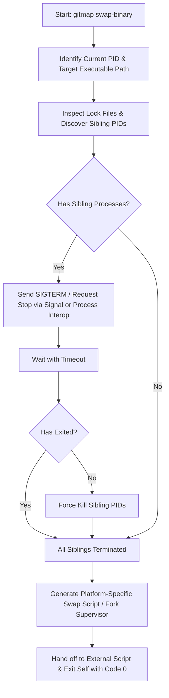

# Architecture Specification: Automatic Binary Swap & Process Handover

**Sequence ID:** 336  
**Document:** `01-architecture-spec.md`  
**Command:** `gitmap swap-binary`  
**Aliases:** `swap-bin`, `bin-swap`, `replace-bin`, `replace-binary`  
**Target Package:** `cli/cmdswapbin`  

---

## 1. Executive Summary & Problem Statement

When compiling or updating GitMap from source or downstream packages, the currently executing binary file (`gitmap` or `gitmap.exe`) is held locked by the OS or running daemon/agent processes.
- On **Windows**, executing binaries cannot be overwritten directly due to mandatory filesystem locks (`ERROR_SHARING_VIOLATION` / `0x20`). Attempts to overwrite an active `gitmap.exe` trigger immediate failure.
- On **Unix / macOS**, unlinking an active binary via `mv` or `rm` succeeds via inode unlinking, but running long-lived background daemons (e.g., daemon workers, file monitors, or terminal listeners) continue executing the old binary from memory until killed and restarted.
- When multiple subagents or background tasks invoke GitMap commands, concurrent instances may collide with the binary replacement operation.

The `gitmap swap-binary` command provides an atomic, self-terminating process-handoff workflow that discovers running instances, gracefully halts them, atomically swaps the newly built binary into place, verifies the installation via `--version`, and reports health back to the caller.

---

## 2. Command Architecture & Aliases

### 2.1 Command Dispatch
Registered in `cli/root.go`:
- Primary Command: `swap-binary`
- Aliases: `swap-bin`, `bin-swap`, `replace-bin`, `replace-binary`
- Category: Installation & Maintenance (`maintenance` / `system`)

### 2.2 CLI Signature & Flags
```bash
gitmap swap-binary [flags] <source-new-binary-path>
```

#### Flags:
- `--force` / `-f` (`bool`): Skip interactive confirmation prompt when terminating peer processes.
- `--target` / `-t` (`string`): Explicit target path for installation (defaults to `os.Executable()` path).
- `--backup` (`bool`): Retain `.old` binary backup upon successful swap (default `true`).
- `--timeout` (`duration`): Maximum duration to wait for graceful process termination before forceful kill (default `5s`).
- `--skip-verify` (`bool`): Skip running `<target> --version` post-swap verification check.

---

## 3. PID Discovery & Graceful Termination Workflow

Before binary modification occurs, GitMap must discover all sibling processes running the same executable to prevent locked file contention and stale process memory.



### 3.1 PID Discovery Algorithm
1. Retrieve target path via `os.Executable()` or flag `--target`.
2. Inspect GitMap runtime lock directory (`.gitmap/run/*.pid` or system process table).
3. Enumerate processes matching executable path:
   - **Windows**: Use `tasklist` or WMI / Toolhelp32 process snapshot matching `gitmap.exe` binary path, excluding current process PID (`os.Getpid()`).
   - **Unix / macOS**: Use `pgrep -f` or traverse `/proc` to match process names and target paths, excluding current PID.
4. Filter out current PID so the orchestrating process performs teardown.

### 3.2 Termination Ladder
1. **Graceful Stage**:
   - Send termination signal:
     - Windows: Send `CTRL_CLOSE_EVENT` or PowerShell `Stop-Process -Id <pid>`.
     - Unix: Send `kill -15 <pid>` (`SIGTERM`).
   - Poll process status up to configured `--timeout`.
2. **Forceful Stage**:
   - If processes remain active beyond timeout:
     - Windows: Execute `taskkill /F /PID <pid>`.
     - Unix: Execute `kill -9 <pid>` (`SIGKILL`).
3. **Lock File Eviction**: Remove stale PID and `.lock` files under `.gitmap/run/`.

---

## 4. Cross-Platform Execution Strategies

Because the current executing process cannot overwrite itself while alive, the command orchestrates a handoff by generating a transient runner script and spawning it in a detached subprocess before terminating itself with exit code 0.

### 4.1 Windows Strategy (PowerShell Runner)

On Windows, a running binary cannot be deleted, but it *can* be renamed.

#### Lifecycle Steps:
1. Validate `<source-new-binary>` exists, is valid executable format, and has positive size.
2. Resolve `<target-binary>` path (e.g., `C:\Users\...\go\bin\gitmap.exe` or `Program Files\GitMap\gitmap.exe`).
3. Generate a temporary detached script: `C:\Users\<user>\AppData\Local\Temp\gitmap-swap-<timestamp>.ps1`.
4. In the script:
   - Wait for caller PID (`$CallerPid`) to terminate:
     ```powershell
     while (Get-Process -Id $CallerPid -ErrorAction SilentlyContinue) {
         Start-Sleep -Milliseconds 100
     }
     ```
   - Kill any lingering sibling `gitmap.exe` instances if still active.
   - Rename existing target:
     ```powershell
     Move-Item -Path "$TargetPath" -Destination "$TargetPath.old" -Force
     ```
   - Copy or move source binary to target:
     ```powershell
     Copy-Item -Path "$SourcePath" -Destination "$TargetPath" -Force
     ```
   - Remove source binary if temporary staging was requested.
   - Run verification:
     ```powershell
     & "$TargetPath" --version
     ```
   - Clean up `.ps1` script upon success (or schedule delayed deletion).
5. Current Go binary launches PowerShell in detached background mode (`cmd /c start powershell ...` or `creationflags=DETACHED_PROCESS`).
6. Current Go binary exits immediately (`os.Exit(0)` or bubbles clean exit).

### 4.2 Unix / macOS Strategy (POSIX Bash Runner)

On Unix-like platforms (Linux, macOS, BSD):

#### Lifecycle Steps:
1. Validate `<source-new-binary>` exists and set initial execution permissions (`chmod 0755 "$SourcePath"`).
2. Generate a transient shell script: `/tmp/gitmap-swap-<timestamp>.sh`.
3. In the script:
   - Poll until caller PID exits:
     ```bash
     while kill -0 "$CALLER_PID" 2>/dev/null; do
         sleep 0.1
     done
     ```
   - Ensure any remaining child processes or daemons are stopped:
     ```bash
     kill -15 "$TARGET_PIDS" 2>/dev/null || true
     sleep 0.5
     kill -9 "$TARGET_PIDS" 2>/dev/null || true
     ```
   - Backup current binary:
     ```bash
     cp "$TARGET_PATH" "${TARGET_PATH}.old" 2>/dev/null || true
     ```
   - Move new binary atomically into place:
     ```bash
     mv -f "$SOURCE_PATH" "$TARGET_PATH" || cp -f "$SOURCE_PATH" "$TARGET_PATH"
     chmod 0755 "$TARGET_PATH"
     ```
   - Execute verification:
     ```bash
     "$TARGET_PATH" --version
     ```
   - Self-destruct temporary swap script (`rm -f "$0"`).
4. Launch script using `nohup /bin/sh "$SWAP_SCRIPT" > /tmp/gitmap-swap.log 2>&1 &` with detached session (`Setpgid: true`).
5. Current Go binary terminates cleanly with code 0.

---

## 5. Coding Guidelines Compliance

To comply with GitMap repository rules:

1. **Relative Paths**:
   - All filesystem paths within documentation and script templates must resolve relatively or dynamically via environment variables (`$HOME`, `$LOCALAPPDATA`, `os.UserHomeDir()`, `os.TempDir()`). Absolute hardcoded machine paths are strictly prohibited.
2. **Boolean Conventions**:
   - All boolean variables, fields, and flags must use `is` or `has` prefixes (e.g., `hasBackupEnabled`, `isForceRequested`, `isProcessActive`, `hasGracefulExit`, `isVerifySkipped`).
   - Negative booleans (e.g., `notForce`, `disableBackup`) are forbidden.
3. **Function Sizing & Complexity**:
   - Functions must stay within 8–15 lines.
   - Zero nested `if` statements: guard clauses and early returns for all validation checks.
4. **Error Management**:
   - Leaf functions return `*appfault.AppError` or standard `error`.
   - Never call `os.Exit` inside leaf functions; exit codes are bubbled up to `root.go` dispatchers.

---

## 6. Verification and Testing Contract

1. **Dry-Run Mode (`--dry-run`)**:
   - Emits planned swap steps, process discovery list, and generated script preview without terminating processes or modifying binaries.
2. **Post-Swap Verification**:
   - The launcher script executes `<target> --version` and inspects exit code.
   - If version inspection fails, the launcher automatically reverts `${TARGET_PATH}.old` back to `$TARGET_PATH` and exits with an error code.
