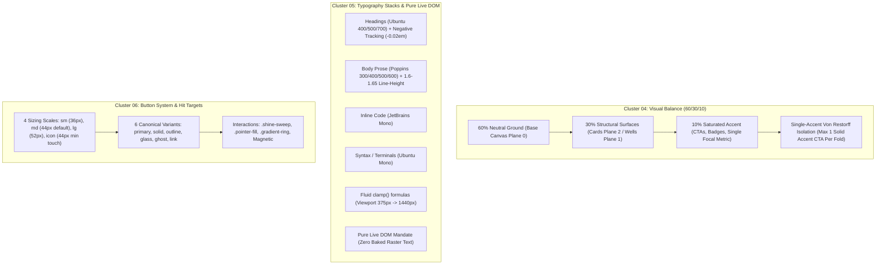
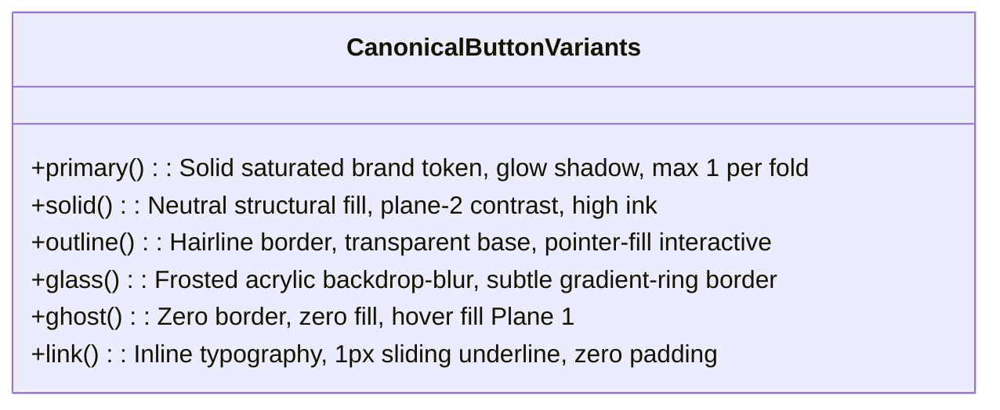

# Component & Layout Specification: Visual Balance, Typography Stacks & Button System

- **Cluster Scope**: Cluster 04 (60/30/10 Balance & Single-Accent Von Restorff Rule), Cluster 05 (Typography Stacks & Pure Live DOM Text Mandate), Cluster 06 (Button System Standards & Hit Target Geometry)
- **Specification ID**: `02-spec/21-app/340-next-100-ui-improvements/02-hierarchy-typography-and-buttons-spec.md`
- **Related Parent Spec**: `01-prompts/30-improvements/01-next-100-ui-improvements.md`
- **Associated Skills**: `next-100-ui-improvements`, `follow-ui-ux-design-system`, `theming-guidelines`, `react-frontend-guidelines`
- **Execution Invariant**: Pure live DOM typography, zero raster text baking, strict 44px min hit bounds, relative paths only, no-build/no-test compliance.

---

## 1. Executive Summary & Cluster Mapping

This specification establishes the architectural blueprints, mathematical geometry, CSS custom property contracts, and component implementations for Items 31 through 60 of the Next 100 UI Improvements catalog. It strictly standardizes:
1. **Cluster 04: Visual Hierarchy (Items 31–40)**: The 60/30/10 visual balance distribution rule and the Single-Accent Von Restorff psychological isolation principle across hero viewports and dense dashboard consoles.
2. **Cluster 05: Typography & Live DOM Mandate (Items 41–50)**: Fluid clamp font scaling formulas, strict multi-tiered typography stacks (Ubuntu, Poppins, JetBrains Mono, Ubuntu Mono), optical tracking, line-height measures, and a total ban on baked raster text.
3. **Cluster 06: Button System & Geometry (Items 51–60)**: 6 canonical button variants, 4 proportional sizing tiers guaranteeing a 44px minimum mobile touch target, 45-degree continuous sheen sweeps, radial cursor pointer-fill interactions, and magnetic cursor physics.



---

## 2. Cluster 04: 60/30/10 Visual Balance & Single-Accent Von Restorff Rule

### 2.1 Mathematical Surface Distribution (60/30/10 Rule)
Every viewport fold, modal, and dashboard grid must strictly allocate visible screen pixel surface area according to the triadic distribution rule:

1. **60% Dominant Neutral Base (Plane 0 Canvas & Section Wrappers)**:
   - Light Mode: `--canvas-base` (`#FBF9F6` or `#F8FAFC`).
   - Dark Mode: `--canvas-base` (`#0A0F1D` or `#0A0E17`).
   - Role: Provides cognitive rest, breathing room, and canvas grounding.
2. **30% Structural Surfaces (Plane 1 Wells, Plane 2 Cards, Dividers, Neutral Text)**:
   - Light Mode: Surface cards (`#FFFFFF`), inset wells (`#F1F5F9`), hairline borders (`--neutral-200` / `#E2E6ED`), body text ink (`--neutral-600` / `#48536B`).
   - Dark Mode: Surface cards (`#172036`), inset wells (`#10172A`), hairline borders (`rgba(255, 255, 255, 0.08)`), muted text ink (`--neutral-400` / `#8F9BB2`).
   - Role: Houses data tables, structural framing, content typography, and secondary UI chrome.
3. **10% Saturated Brand Accent (Plane 3 Focal Actions & Telemetry)**:
   - Brand tokens: `--blue-500` (`#2563EB` / `hsl(221, 83%, 53%)`), `--brand-primary` (`#0D2975`), `--brand-highlight` (`--cyan-400` / `#03D5E7`).
   - Role: Exclusively reserved for primary action CTAs, active filter pills, progress meters, and isolated focal KPI values. Total colored pixel count must not exceed 10% of the visible viewport bounding box.

### 2.2 The Single-Accent Von Restorff Principle
According to the Von Restorff isolation effect, an item that notably differs from its surroundings is most likely to be remembered and acted upon. When multiple high-contrast colored buttons compete in the same viewport, visual noise spikes, decision paralysis occurs, and cognitive load escalates.

#### Invariants:
1. **Singular Focal CTA**: At any given viewport scroll position or open modal dialog, **exactly ONE saturated accent-filled CTA button** may be visible.
2. **Primary/Secondary Pairing Pattern**: Every primary solid accent button MUST be paired with an `outline`, `ghost`, `glass`, or `link` secondary button.
3. **Anti-Pattern Elimination**: Side-by-side solid buttons (e.g. solid blue "Start Free" next to solid violet "Book Demo") are strictly banned.
4. **Restrained Notifications**: Full-bleed solid colored alert banners (e.g., solid red/blue alert blocks) are banned. Alerts must use neutral card backgrounds (`Plane 2`) with a surgical `2px` left accent border and an isolated accent icon.
5. **Dashboard Single KPI Highlight**: In metric grids (e.g., 4-card KPI rows), exactly ONE card (the critical conversion metric or anomalous telemetry) receives subtle accent tinting or an accent pill. The remaining 3 cards MUST remain neutral Plane 2 cards.
6. **Headline Gradient Constraint**: `<GradientText>` spans are limited to **at most ONE short phrase (2–4 words)** per headline. Entire paragraphs or multi-sentence headers wrapped in gradients are banned.

### 2.3 Dashboard & Hero Layout Archetypes

#### A. Hero Viewport CTA Pairing (Compliant vs Banned)
```tsx
// ❌ BANNED: Competing double accent solid buttons & gradient paragraph soup
export function BannedHeroActions() {
  return (
    <div className="flex gap-4">
      <button className="bg-blue-600 text-white px-6 py-3 rounded-lg font-semibold">
        Start Free Trial
      </button>
      <button className="bg-violet-600 text-white px-6 py-3 rounded-lg font-semibold">
        Schedule Enterprise Demo
      </button>
    </div>
  );
}

// ✅ COMPLIANT: Single-Accent Von Restorff CTA + Outline Secondary
export function CompliantHeroActions() {
  return (
    <div className="flex items-center gap-4">
      {/* Exactly ONE saturated primary accent CTA */}
      <Button variant="primary" size="lg" className="shine-sweep">
        Start Free Trial
      </Button>
      {/* Subdued structural secondary button */}
      <Button variant="outline" size="lg">
        Schedule Enterprise Demo
      </Button>
    </div>
  );
}
```

#### B. Dashboard KPI Metric Isolation
```tsx
// ✅ COMPLIANT: 4-Card KPI Grid with Single Focal Metric
export function DashboardKpiRow({ metrics }: { metrics: KpiData[] }) {
  return (
    <div className="grid grid-cols-1 md:grid-cols-4 gap-4 w-full">
      {metrics.map((item) => {
        const isFocalMetric = item.isKeyTarget; // Only 1 item has isKeyTarget === true
        
        return (
          <div
            key={item.id}
            className={cn(
              "rounded-xl p-5 transition-all duration-200 border",
              "bg-surface-card border-surface-border text-foreground", // Plane 2 neutral
              isFocalMetric && "ring-1 ring-brand-primary/40 shadow-glow-sm bg-surface-card/95"
            )}
          >
            <div className="flex items-center justify-between text-xs text-muted-foreground mb-2">
              <span>{item.label}</span>
              {isFocalMetric && (
                <span className="px-2 py-0.5 rounded-full text-[11px] font-medium bg-brand-primary/10 text-brand-primary border border-brand-primary/20">
                  Primary KPI
                </span>
              )}
            </div>
            <div className={cn("text-2xl font-bold font-heading", isFocalMetric ? "text-brand-primary" : "text-foreground")}>
              {item.value}
            </div>
            <div className="text-xs text-muted-foreground mt-1">{item.subtext}</div>
          </div>
        );
      })}
    </div>
  );
}
```

---

## 3. Cluster 05: Typography Stacks & Pure Live DOM Text Mandate

### 3.1 Multi-Tier Font Family Specifications

| Layer / Purpose | Primary Font Family | Fallback Stack | Allowed Font Weights | Letter Spacing (Tracking) |
| :--- | :--- | :--- | :--- | :--- |
| **Headings (`h1`-`h6`, Display)** | `'Ubuntu'` | `system-ui, -apple-system, 'Segoe UI', Roboto, sans-serif` | `400` (Regular), `500` (Medium), `700` (Bold) | Display/H1: `-0.02em`<br>H2-H3: `-0.01em`<br>H4-H6: `0` |
| **Body Prose, Tables & Labels** | `'Poppins'` | `system-ui, -apple-system, 'Segoe UI', sans-serif` | `300` (Light), `400` (Regular), `500` (Medium), `600` (Semi-Bold) | Body: `0`<br>Labels: `+0.01em` |
| **Inline Code, Badges & Chips** | `'JetBrains Mono'` | `'Fira Code', 'Cascadia Code', monospace` | `400` (Regular), `500` (Medium) | Inline: `-0.01em` |
| **Code Blocks, Syntax & CLI Logs** | `'Ubuntu Mono'` | `'Consolas', 'Courier New', monospace` | `400` (Regular), `700` (Bold) | Terminal: `0` |

### 3.2 Pure Live DOM Mandate (Total Ban on Baked Raster Text)
Under zero circumstances may textual content, feature lists, pricing matrices, statistical metrics, diagrams with text labels, or UI button labels be baked into PNG, JPEG, or WebP images.
- **Accessibility & Screen Readers**: All text must be accessible to DOM trees, assistive screen readers (`aria-*`), search engines, and browser translation engines.
- **Device Pixel Ratio & Zoom**: Live DOM text scales crisply to 4K displays and browser zoom levels without artifacting or raster blurring.
- **Copy/Paste**: All users must be able to highlight, select, and copy any character rendered on screen.

### 3.3 Fluid Clamp Typography Scaling Formulas
Headings scale fluidly between a minimum mobile viewport ($W_{\min} = 375\text{px}$) and a maximum desktop viewport ($W_{\max} = 1440\text{px}$).

#### Mathematical Derivation:
$$\text{font-size} = \text{clamp}(V_{\min}, V_{\text{fixed}} + S \cdot \text{vw}, V_{\max})$$
Where:
- $S = \frac{V_{\max} - V_{\min}}{W_{\max} - W_{\min}} \times 100$
- $V_{\text{fixed}} = V_{\min} - \frac{S \times W_{\min}}{100}$

#### Canonical Clamp Rules:
```css
:root {
  /* H1: 28px (1.75rem) at 375px -> 48px (3.0rem) at 1440px */
  --font-h1: clamp(1.75rem, 1.3099rem + 1.8779vw, 3rem);
  
  /* H2: 24px (1.5rem) at 375px -> 36px (2.25rem) at 1440px */
  --font-h2: clamp(1.5rem, 1.2359rem + 1.1268vw, 2.25rem);
  
  /* H3: 20px (1.25rem) at 375px -> 28px (1.75rem) at 1440px */
  --font-h3: clamp(1.25rem, 1.0739rem + 0.7512vw, 1.75rem);
  
  /* H4: 18px (1.125rem) at 375px -> 22px (1.375rem) at 1440px */
  --font-h4: clamp(1.125rem, 1.037rem + 0.3756vw, 1.375rem);
  
  /* Body Base: 15px (0.9375rem) at 375px -> 16px (1.0rem) at 1440px */
  --font-body: clamp(0.9375rem, 0.9155rem + 0.0939vw, 1rem);
  
  /* Body Small / Metadata: 13px (0.8125rem) -> 14px (0.875rem) */
  --font-sm: clamp(0.8125rem, 0.7905rem + 0.0939vw, 0.875rem);
}
```

### 3.4 Reading Ergonomics & Word Budgets
1. **Line-Height Multipliers**:
   - Headings (`h1`-`h3`): `1.15` to `1.25` (tight display ratio).
   - Headings (`h4`-`h6`): `1.3` to `1.4`.
   - Body Prose: Strictly `1.6` to `1.65` for effortless eye tracking.
   - Inline/Block Code: `1.5` to `1.55`.
2. **Optimal Reading Measure**:
   - Prose paragraphs must be capped at `65ch` to `75ch` (`max-w-prose` or `max-w-[68ch]`). Unbounded full-width body text spanning >1000px is prohibited.
3. **Content Word Budgets**:
   - Section Eyebrow: Maximum **3 words**, uppercase, tracking `+0.05em`, semi-bold (e.g. `DEPLOYMENT PIPELINE ENGINE`).
   - Section Headline (`H2`): Maximum **8 words**.
   - Lead Paragraph: Maximum **28 words**.
   - Card Body Paragraph: Maximum **32 words**.

---

## 4. Cluster 06: Button System Standards & Hit Target Geometry

### 4.1 The 4 Proportional Sizing Scales
Interactive components must ensure zero accidental clicks on touchscreens while remaining proportional across viewport layouts:

| Size Identifier | Overall Height | Horizontal Padding | Typography Token | Icon Bounding Box | Min Touch Target |
| :--- | :--- | :--- | :--- | :--- | :--- |
| `sm` | `36px` (`h-9`) | `12px` (`px-3`) | `13px / 0.8125rem` (`text-xs` font-medium) | `14x14px` | Expanded to 44px via touch hit slop |
| `md` **(Default)** | **`44px` (`h-11`)** | **`18px` (`px-4.5`)** | **`14px / 0.875rem` (`text-sm` font-medium)** | **`16x16px`** | **`44x44px` Native** |
| `lg` | `52px` (`h-13`) | `24px` (`px-6`) | `16px / 1.0rem` (`text-base` font-semibold) | `18x18px` | `52x52px` Native |
| `icon` | **`44px` (`h-11 w-11`)**| `0px` (Square) | N/A | `20x20px` | **`44x44px` Native** |

> [!IMPORTANT]
> **44×44px Hit Target Geometry Invariant**:
> Every clickable element, button, tab bar icon, and dropdown trigger must have a minimum physical hit target of **44×44px** per WCAG 2.2 Success Criterion 2.5.8 (Target Size). For `sm` (36px) buttons, a pseudo-element (`::after`) must expand the touch hit boundary to at least 44px:
> ```css
> .btn-hit-target-guard::after {
>   content: '';
>   position: absolute;
>   top: 50%;
>   left: 50%;
>   transform: translate(-50%, -50%);
>   min-width: 44px;
>   min-height: 44px;
>   width: 100%;
>   height: 100%;
> }
> ```

### 4.2 The 6 Canonical Button Variants



1. **`primary` (Von Restorff Hero CTA)**:
   - Fill: `hsl(var(--brand-primary))` (`#2563EB` / `#0D2975`).
   - Text: High contrast stark white `#FFFFFF`.
   - Shadow: `0 1px 2px rgba(0,0,0,0.1), 0 4px 14px hsl(var(--brand-primary) / 0.35)`.
   - Invariant: Maximum ONE per visible viewport fold.
2. **`solid` (Neutral Structural)**:
   - Fill: Light: `#090E18` (dark ink) | Dark: `#FFFFFF` (light ink) or `#1E2945` (elevated).
   - Text: Contrasting inverted ink.
   - Border: Hairline `1px solid transparent`.
3. **`outline` (Interactive Wireframe)**:
   - Fill: Transparent.
   - Border: `1px solid hsl(var(--border))`.
   - Text: `hsl(var(--foreground))`.
   - Hover: Employs `.pointer-fill` or smooth background shift to `hsl(var(--accent) / 0.08)`.
4. **`glass` (Frosted Acrylic)**:
   - Fill: `hsl(var(--surface-card) / 0.65)`.
   - Backdrop Filter: `blur(12px) saturate(180%)`.
   - Border: `1px solid hsl(var(--border) / 0.5)` with optional `.gradient-ring`.
5. **`ghost` (Subtle Utility)**:
   - Fill: Transparent.
   - Border: None.
   - Text: `hsl(var(--muted-foreground))`.
   - Hover: `hsl(var(--accent) / 0.12)`, text turns `hsl(var(--foreground))`.
6. **`link` (Typographic Action)**:
   - Fill: Transparent, zero container padding.
   - Text: `hsl(var(--brand-secondary))`.
   - Underline: `1px` animated hairline expanding from left (`scale-x-0 -> scale-x-100`).

### 4.3 Advanced Interaction Effects

#### A. Continuous Sheen Sweep (`.shine-sweep`)
A 45-degree angled specular highlight beam sweeps seamlessly across the button surface on a 3-second loop:
```css
@keyframes shine-sweep-anim {
  0% { transform: translateX(-150%) skewX(-20deg); }
  50%, 100% { transform: translateX(250%) skewX(-20deg); }
}

.shine-sweep {
  position: relative;
  overflow: hidden;
}

.shine-sweep::before {
  content: '';
  position: absolute;
  top: 0;
  left: 0;
  width: 40%;
  height: 100%;
  background: linear-gradient(
    90deg,
    transparent 0%,
    rgba(255, 255, 255, 0.28) 50%,
    transparent 100%
  );
  transform: translateX(-150%) skewX(-20deg);
  animation: shine-sweep-anim 3.2s cubic-bezier(0.4, 0, 0.2, 1) infinite;
  pointer-events: none;
}
```

#### B. Radial Pointer-Fill (`.pointer-fill`)
Captures pointer entrance coordinate $(X, Y)$ and radiates background color outward:
```tsx
import React, { useRef } from 'react';

export function PointerFillWrapper({ children, className }: { children: React.ReactNode; className?: string }) {
  const containerRef = useRef<HTMLDivElement>(null);

  const handleMouseMove = (e: React.MouseEvent<HTMLDivElement>) => {
    if (!containerRef.current) return;
    const rect = containerRef.current.getBoundingClientRect();
    const x = e.clientX - rect.left;
    const y = e.clientY - rect.top;
    containerRef.current.style.setProperty('--mouse-x', `${x}px`);
    containerRef.current.style.setProperty('--mouse-y', `${y}px`);
  };

  return (
    <div
      ref={containerRef}
      onMouseMove={handleMouseMove}
      className={cn("relative overflow-hidden group pointer-fill-host", className)}
    >
      <div className="absolute inset-0 pointer-events-none opacity-0 group-hover:opacity-100 transition-opacity duration-300 bg-[radial-gradient(circle_at_var(--mouse-x,0px)_var(--mouse-y,0px),hsl(var(--brand-primary)/0.12)_0%,transparent_60%)]" />
      {children}
    </div>
  );
}
```

#### C. Tactile Active Depression & Magnetic Cursor Wrap
- **Depression**: Active state executes `transform: scale(0.98)` over `80ms` with reduced elevation shadow.
- **Magnetic Attraction**: Hero CTA button wrapped in `<Magnetic strength={0.22}>` shifts offset $(dx, dy)$ toward cursor up to $\pm 6\text{px}$.

---

## 5. Complete Production React Component Implementation

```tsx
// Location: components/ui/button.tsx
// Adheres strictly to React guidelines, positive booleans, 44px min hit target, and 6 canonical variants

import * as React from "react";
import { cva, type VariantProps } from "class-variance-authority";
import { cn } from "@/lib/utils";

const buttonVariants = cva(
  "inline-flex items-center justify-center whitespace-nowrap rounded-lg font-medium select-none transition-all duration-200 outline-none focus-visible:ring-2 focus-visible:ring-brand-primary/50 focus-visible:ring-offset-2 active:scale-[0.98] disabled:pointer-events-none disabled:opacity-50 relative isolate",
  {
    variants: {
      variant: {
        primary:
          "bg-brand-primary text-white shadow-md shadow-brand-primary/25 hover:bg-brand-primary/90 border border-transparent",
        solid:
          "bg-foreground text-background hover:bg-foreground/90 border border-transparent shadow-sm",
        outline:
          "border border-border bg-transparent text-foreground hover:bg-accent/10 hover:border-brand-primary/40",
        glass:
          "bg-surface-card/65 backdrop-blur-xl border border-border/50 text-foreground hover:bg-surface-card/85 shadow-sm",
        ghost:
          "bg-transparent text-muted-foreground hover:bg-accent/10 hover:text-foreground",
        link:
          "text-brand-secondary underline-offset-4 hover:underline p-0 h-auto font-normal",
      },
      size: {
        sm: "h-9 px-3 text-xs tracking-wide after:absolute after:inset-y-[-4px] after:inset-x-0 after:content-['']", // Enforces 44px touch target slop
        md: "h-11 px-4.5 text-sm", // Native 44px height
        lg: "h-13 px-6 text-base font-semibold", // Native 52px height
        icon: "h-11 w-11 p-0", // Native 44x44px square
      },
      hasShineSweep: {
        true: "shine-sweep",
      },
    },
    defaultVariants: {
      variant: "outline",
      size: "md",
      hasShineSweep: false,
    },
  }
);

export interface ButtonProps
  extends React.ButtonHTMLAttributes<HTMLButtonElement>,
    VariantProps<typeof buttonVariants> {
  asChild?: boolean;
  isLoading?: boolean;
  leftIcon?: React.ReactNode;
  rightIcon?: React.ReactNode;
}

export const Button = React.forwardRef<HTMLButtonElement, ButtonProps>(
  (
    {
      className,
      variant,
      size,
      hasShineSweep,
      isLoading = false,
      leftIcon,
      rightIcon,
      children,
      disabled,
      ...props
    },
    ref
  ) => {
    const isInteractive = !disabled && !isLoading;

    return (
      <button
        ref={ref}
        disabled={!isInteractive}
        className={cn(buttonVariants({ variant, size, hasShineSweep, className }))}
        {...props}
      >
        {isLoading && (
          <svg
            className="animate-spin -ml-1 mr-2 h-4 w-4 text-current"
            xmlns="http://www.w3.org/2000/svg"
            fill="none"
            viewBox="0 0 24 24"
            aria-hidden="true"
          >
            <circle
              className="opacity-25"
              cx="12"
              cy="12"
              r="10"
              stroke="currentColor"
              strokeWidth="4"
            />
            <path
              className="opacity-75"
              fill="currentColor"
              d="M4 12a8 8 0 018-8V0C5.373 0 0 5.373 0 12h4zm2 5.291A7.962 7.962 0 014 12H0c0 3.042 1.135 5.824 3 7.938l3-2.647z"
            />
          </svg>
        )}
        {!isLoading && leftIcon && <span className="mr-2 inline-flex">{leftIcon}</span>}
        <span>{children}</span>
        {!isLoading && rightIcon && <span className="ml-2 inline-flex">{rightIcon}</span>}
      </button>
    );
  }
);

Button.displayName = "Button";
```

---

## 6. Migration & Refactoring Checklist

Teams refactoring existing views to meet this standard must execute the following checklist in sequence:

### Phase 1: Cluster 04 (Visual Balance & Von Restorff)
- [ ] **Scan Viewport CTA Density**: Inspect every page hero section. Verify that no more than ONE solid accent CTA exists. Refactor competing buttons into `outline` or `ghost`.
- [ ] **Audit Surface Area Ratios**: Check that canvas base neutral coverage is $\ge 60\%$ and accent colors occupy $\le 10\%$ of visible pixels.
- [ ] **Sanitize Dashboard Metrics**: Locate multi-card metric grids. Strip saturated fills from sibling cards, leaving at most one focal card highlighted.
- [ ] **Refactor Notification Banners**: Replace full-bleed saturated background banners with neutral Plane 2 cards carrying a 2px left accent border.
- [ ] **Restrict Gradient Typography**: Ensure `<GradientText>` wraps no more than 2–4 words per headline.

### Phase 2: Cluster 05 (Typography & Live DOM)
- [ ] **Configure Font Stacks**: Add Google/System font imports for `Ubuntu` (headings), `Poppins` (body), `JetBrains Mono` (inline code), and `Ubuntu Mono` (code blocks).
- [ ] **Eliminate Baked Raster Text**: Audit all image assets in `public/` and `assets/`. Extract any embedded text into pure live DOM elements with absolute/flex positioning.
- [ ] **Apply CSS Fluid Clamp**: Replace static `rem`/`px` font sizes on `h1`-`h4` with fluid `clamp()` formulas.
- [ ] **Enforce Line-Height & Measure**: Apply `leading-[1.6]` to body copy and cap width at `max-w-prose` (`68ch`).
- [ ] **Optical Heading Tracking**: Add tracking `-0.02em` (`tracking-tight`) to display titles and `+0.05em` (`tracking-wider`) uppercase to 3-word section eyebrows.

### Phase 3: Cluster 06 (Button System & Geometry)
- [ ] **Deploy Canonical Button Component**: Mount `components/ui/button.tsx` with all 6 variants and 4 proportional size tiers.
- [ ] **Verify 44px Hit Target Guard**: Verify that `sm` (36px) buttons declare the `::after` hit slop expansion so touchscreens meet the 44px minimum target.
- [ ] **Calibrate Interactive Effects**: Add `.shine-sweep` animation to primary hero CTAs; implement `.pointer-fill` radial lighting on outline cards.
- [ ] **Validate Tactile Feedback**: Confirm `:active` states depress by `scale(0.98)` with crisp 80ms recovery timing.
- [ ] **Zero Negative Booleans**: Ensure all boolean props adhere to `isInteractive`, `isLoading`, `hasShineSweep` with zero negated names.
