# Navigation Physics, Motion & Component Decomposition Specification
## Header & Safe-Region Physics, Spacing Rhythm, CSS3 Hardware Motion & React Deconstruction

- **Cluster Scope**: Cluster 07 (Header, Navigation & Safe-Region Physics), Cluster 08 (Spacing Scales, Containers & Band Rhythm), Cluster 09 (CSS3 Hardware-Accelerated Motion & Accessibility), Cluster 10 (Frontend Code Hygiene & React Component Deconstruction)
- **Specification ID**: `02-spec/21-app/340-next-100-ui-improvements/03-navigation-motion-and-hygiene-spec.md`
- **Related Parent Specs**: `01-prompts/30-improvements/01-next-100-ui-improvements.md`, `02-spec/21-app/340-next-100-ui-improvements/00-master-audit-ledger.md`
- **Associated Skills**: `next-100-ui-improvements`, `follow-ui-ux-design-system`, `theming-guidelines`, `react-frontend-guidelines`
- **Execution Invariants**: Zero runtime JavaScript animation dependencies, pure hardware-accelerated transform/opacity, 220ms safe-region debouncing, strict <= 80-100 line React component ceiling, relative paths only, no-build/no-test execution.

---

## 1. Executive Summary & Cluster Architecture

This specification formalizes the architectural blueprints, mathematical geometry, CSS animation rules, and structural component deconstruction models for **Items 61 through 100** of the Next 100 UI Improvements catalog. 

```mermaid
graph TD
    subgraph Cluster07 ["Cluster 07: Header, Navigation & Safe-Region Physics"]
        H72["Sticky 72px Glass Header (h-[72px] top-0 z-50 backdrop-blur-xl)"]
        ScrollTrig["12px Viewport Scroll Trigger (Hairline to Elevated Shadow)"]
        SafeQuad["Pointer Safe-Region Geometry (pad = 14px Quad Buffer)"]
        DebounceClose["220ms Debounced Close Physics + Re-entry Cancellation"]
        MobileDrawer["Sticky-Preserving Mobile Drawer (Event Interception, No Body Overflow Tampering)"]
        H72 --> ScrollTrig --> SafeQuad --> DebounceClose --> MobileDrawer
    end

    subgraph Cluster08 ["Cluster 08: Spacing Scales, Containers & Band Rhythm"]
        Grid48["4px/8px Modular Spacing Grid (Multiples of 4px & 8px Only)"]
        Max1280["1280px Container Boundary (max-w-7xl with px-4 sm:px-6 lg:px-8)"]
        Bands["Alternating Section Band Rhythm (Light -> Soft -> Light -> Soft)"]
        DarkVoid["Single Dark Void Section Allocation (Max 1 Per Landing)"]
        RhythmScale["Section Padding Clamps: Standard clamp(72px, 8vw, 120px), Tight clamp(40px, 5vw, 64px)"]
        RadiusScale["Corner Radius Hierarchy: Input 8px, Button 12px, Card 20px, Pill 9999px"]
        Grid48 --> Max1280 --> Bands --> DarkVoid --> RhythmScale --> RadiusScale
    end

    subgraph Cluster09 ["Cluster 09: CSS3 Hardware-Accelerated Motion & Accessibility"]
        GPUOnly["GPU-Accelerated CSS3 Properties (transform, opacity ONLY)"]
        BanJS["Total Ban on JS Motion Libraries (No framer-motion, gsap, anime.js)"]
        Timings["Transition Timings: 0.15s Transform, 0.2s Color/Shadow, Easing Decel"]
        RestrainedHover["Restrained Hover Transforms: translateY(-2px), scale(1.02)"]
        ReducedMotion["prefers-reduced-motion: 0.01ms Durations & Zero Transform"]
        Marquee["GPU CSS3 Marquee: translate3d(-50%, 0, 0) + Pause-on-Hover"]
        GridAccordion["Zero-JS Height Accordion: grid-template-rows: 0fr -> 1fr"]
        GPUOnly --> BanJS --> Timings --> RestrainedHover --> ReducedMotion --> Marquee --> GridAccordion
    end

    subgraph Cluster10 ["Cluster 10: Frontend Code Hygiene & React Deconstruction"]
        Cap80["Strict Component Length Ceiling: <= 80-100 lines"]
        HookSplit["Separation of Presentation & Business Logic (Custom Hooks)"]
        TypeSplit["Dedicated TypeScript Prop Interfaces in types.ts (Zero Any)"]
        BoolClean["Strict Boolean Naming (is/has prefix, Positive Logic, Implicit Check)"]
        DecompPlans["Concrete Deconstructions: Database.tsx (762L), RepoSettings.tsx (531L), DocsSidebar.tsx (199L)"]
        Cap80 --> HookSplit --> TypeSplit --> BoolClean --> DecompPlans
    end
```



---

## 2. Cluster 07: Header, Navigation & Safe-Region Physics (Items 61–70)

### 2.1 Sticky 72px Glassmorphic Header Geometry (Item 61)
The primary desktop and mobile viewport header is strictly standardized to a fixed physical height of `72px` (`h-[72px]`).

```css
/* Sticky 72px Glassmorphic Header Foundation */
.header-surface {
  position: sticky;
  top: 0;
  left: 0;
  right: 0;
  width: 100%;
  height: 72px;
  z-index: 50;
  display: flex;
  align-items: center;
  background-color: hsl(var(--background) / 0.85);
  backdrop-filter: blur(16px);
  -webkit-backdrop-filter: blur(16px);
  border-bottom: 1px solid hsl(var(--border) / 0.4);
  transition: 
    background-color 0.2s cubic-bezier(0.16, 1, 0.3, 1),
    border-color 0.2s cubic-bezier(0.16, 1, 0.3, 1),
    box-shadow 0.3s cubic-bezier(0.16, 1, 0.3, 1);
  will-change: transform, box-shadow;
}

.header-inner {
  width: 100%;
  max-width: 1280px;
  margin-left: auto;
  margin-right: auto;
  padding-left: 1.5rem;   /* 24px */
  padding-right: 1.5rem;  /* 24px */
  display: flex;
  align-items: center;
  justify-content: space-between;
}
```

### 2.2 12px Viewport Scroll Trigger Physics (Item 62)
To avoid unnecessary visual noise when the user is at the top of the viewport, the header rests with a transparent-tinted hairline border (`hsl(var(--border) / 0.25)`) and zero elevation shadow. Once viewport scroll displacement strictly exceeds `12px`, elevation elevates with a 420ms cubic-bezier transition:

```typescript
// src/hooks/use-scroll-trigger.ts
import { useState, useEffect } from "react";

export function useScrollTrigger(thresholdPx: number = 12): boolean {
  const [hasScrolled, setHasScrolled] = useState<boolean>(false);

  useEffect(() => {
    let ticking = false;

    const handleScroll = () => {
      if (!ticking) {
        window.requestAnimationFrame(() => {
          const currentY = window.scrollY || document.documentElement.scrollTop;
          const isPastThreshold = currentY > thresholdPx;
          setHasScrolled(isPastThreshold);
          ticking = false;
        });
        ticking = true;
      }
    };

    // Run initial check
    handleScroll();

    window.addEventListener("scroll", handleScroll, { passive: true });
    return () => window.removeEventListener("scroll", handleScroll);
  }, [thresholdPx]);

  return hasScrolled;
}
```

```css
/* Elevation state triggered by hasScrolled */
.header-surface[data-scrolled="true"] {
  background-color: hsl(var(--background) / 0.95);
  border-bottom-color: hsl(var(--border));
  box-shadow: 
    0 4px 6px -1px hsl(var(--shadow-color) / 0.05),
    0 10px 15px -3px hsl(var(--shadow-color) / 0.08),
    inset 0 -1px 0 0 hsl(var(--border) / 0.2);
}
```

### 2.3 Pointer Safe-Region Geometry & 220ms Close Debounce (Items 63–65)
Traditional dropdown menus collapse instantaneously when the cursor cuts corners between the navigation trigger and the floating dropdown card. This produces cursor trajectory dropouts. GitMap establishes a mathematical 2-rectangle bounding hull expanded by `pad = 14px`, governed by a `220ms` close debounce timer.

```
       [ Trigger Button ] ◄── Expanded by pad = 14px
       │      ▲         │
       │  gap │ (safe)  │ ◄── Safe bridge prevents dismissal
       ▼      ▼         ▼
┌───────────────────────────────┐
│       MegaPanel Card          │ ◄── Expanded by pad = 14px
│                               │
└───────────────────────────────┘
```

#### Mathematical Safe-Region Hull Formulation
For Trigger Rect $R_T = [x_{t1}, y_{t1}, x_{t2}, y_{t2}]$ and Panel Rect $R_P = [x_{p1}, y_{p1}, x_{p2}, y_{p2}]$ with padding $\delta = 14\text{px}$:
$$\text{InsideSafeRegion}(x, y) = \text{PointInRect}(x, y, R_T^\delta) \lor \text{PointInRect}(x, y, R_P^\delta)$$
$$\text{where } R^\delta = [x_1 - \delta,\, y_1 - \delta,\, x_2 + \delta,\, y_2 + \delta]$$

```typescript
// src/hooks/use-navigation-physics.ts
import { useState, useRef, useEffect, useCallback } from "react";

interface NavigationPhysicsOptions {
  paddingPx?: number;
  debounceMs?: number;
}

export function useNavigationPhysics<T extends string>(options: NavigationPhysicsOptions = {}) {
  const { paddingPx = 14, debounceMs = 220 } = options;
  const [activePanel, setActivePanel] = useState<T | null>(null);
  
  const triggerRef = useRef<HTMLElement | null>(null);
  const panelRef = useRef<HTMLElement | null>(null);
  const closeTimerRef = useRef<ReturnType<typeof setTimeout> | null>(null);

  const clearTimer = useCallback(() => {
    if (closeTimerRef.current) {
      clearTimeout(closeTimerRef.current);
      closeTimerRef.current = null;
    }
  }, []);

  const openImmediate = useCallback((key: T) => {
    clearTimer();
    setActivePanel(key);
  }, [clearTimer]);

  const scheduleDebouncedClose = useCallback(() => {
    clearTimer();
    closeTimerRef.current = setTimeout(() => {
      setActivePanel(null);
    }, debounceMs);
  }, [clearTimer, debounceMs]);

  const dismissImmediate = useCallback(() => {
    clearTimer();
    setActivePanel(null);
  }, [clearTimer]);

  useEffect(() => {
    if (!activePanel) return;

    const handlePointerMove = (e: PointerEvent) => {
      const x = e.clientX;
      const y = e.clientY;

      const triggerEl = triggerRef.current;
      const panelEl = panelRef.current;
      if (!triggerEl && !panelEl) return;

      const isInsideRect = (el: HTMLElement | null): boolean => {
        if (!el) return false;
        const rect = el.getBoundingClientRect();
        return (
          x >= rect.left - paddingPx &&
          x <= rect.right + paddingPx &&
          y >= rect.top - paddingPx &&
          y <= rect.bottom + paddingPx
        );
      };

      const isSafe = isInsideRect(triggerEl) || isInsideRect(panelEl);

      if (isSafe) {
        clearTimer();
      } else {
        scheduleDebouncedClose();
      }
    };

    const handleKeyDown = (e: KeyboardEvent) => {
      if (e.key === "Escape") {
        dismissImmediate(); // Item 65: Instant Escape dismissal (0ms)
      }
    };

    const handleWindowScroll = () => {
      dismissImmediate(); // Item 65: Instant Scroll dismissal (0ms)
    };

    window.addEventListener("pointermove", handlePointerMove, { passive: true });
    window.addEventListener("keydown", handleKeyDown);
    window.addEventListener("scroll", handleWindowScroll, { passive: true });

    return () => {
      window.removeEventListener("pointermove", handlePointerMove);
      window.removeEventListener("keydown", handleKeyDown);
      window.removeEventListener("scroll", handleWindowScroll);
      clearTimer();
    };
  }, [activePanel, paddingPx, clearTimer, scheduleDebouncedClose, dismissImmediate]);

  return {
    activePanel,
    triggerRef,
    panelRef,
    openImmediate,
    scheduleDebouncedClose,
    dismissImmediate,
  };
}
```

### 2.4 Navigation Link Micro-Interactions (Items 66–69)

#### Character-Staggered `SlideSwapLabel` (Item 66)
Navigation labels feature a staggered vertical character slide-up interaction using CSS transitions:
```tsx
// src/components/ui/SlideSwapLabel.tsx
import React from "react";

interface SlideSwapLabelProps {
  label: string;
  className?: string;
}

export function SlideSwapLabel({ label, className = "" }: SlideSwapLabelProps) {
  const characters = Array.from(label);

  return (
    <span className={`inline-flex overflow-hidden font-medium select-none ${className}`}>
      {characters.map((char, index) => {
        const delay = index * 0.04; // 0.04s stagger
        return (
          <span
            key={index}
            className="inline-block relative overflow-hidden transition-transform duration-500 ease-[cubic-bezier(0.16,1,0.3,1)]"
            style={{ transitionDelay: `${delay}s` }}
          >
            <span className="block translate-y-0 group-hover:-translate-y-full transition-transform duration-500">
              {char === " " ? "\u00A0" : char}
            </span>
            <span className="absolute inset-0 block translate-y-full group-hover:translate-y-0 text-primary transition-transform duration-500">
              {char === " " ? "\u00A0" : char}
            </span>
          </span>
        );
      })}
    </span>
  );
}
```

#### Underline Indicator & Rotating Chevron (Items 67–68)
```css
/* Animated Nav Underline Indicator (Item 67) */
.nav-link-underline {
  position: relative;
}
.nav-link-underline::after {
  content: "";
  position: absolute;
  bottom: -4px;
  left: 0;
  width: 100%;
  height: 1px;
  background-color: hsl(var(--primary));
  transform: scaleX(0);
  transform-origin: left center;
  transition: transform 240ms cubic-bezier(0.16, 1, 0.3, 1);
}
.nav-link-underline:hover::after,
.nav-link-underline[data-active="true"]::after {
  transform: scaleX(1);
}

/* 14px Rotating Chevron Indicator (Item 68) */
.nav-chevron {
  width: 14px;
  height: 14px;
  transition: transform 240ms cubic-bezier(0.16, 1, 0.3, 1);
}
.nav-chevron[data-expanded="true"] {
  transform: rotate(180deg);
}
```

#### Avant-Garde MegaPanel Dropdown Entrance (Item 69)
```css
/* Card MegaPanel Entrance Physics */
.megapanel-card {
  position: absolute;
  top: 100%;
  left: 0;
  width: 100%;
  transform-origin: top center;
  animation: megapanel-enter 260ms cubic-bezier(0.16, 1, 0.3, 1) forwards;
}

@keyframes megapanel-enter {
  from {
    opacity: 0;
    transform: translateY(-8px) scale(0.985);
  }
  to {
    opacity: 1;
    transform: translateY(0) scale(1);
  }
}
```

### 2.5 Sticky-Preserving Mobile Navigation Drawer (Item 70)
Setting `document.body.style.overflow = "hidden"` destroys sticky header layout across Safari, Firefox, and WebKit on mobile. The mobile drawer is positioned strictly at `top-[72px] bottom-0` without tampering with the body overflow, intercepting wheel and touch bubbling instead:

```typescript
// src/hooks/use-sticky-scroll-lock.ts
import { useEffect } from "react";

export function useStickyScrollLock(isOpen: boolean) {
  useEffect(() => {
    if (!isOpen) return;

    const preventDefault = (e: TouchEvent | WheelEvent) => {
      // Allow scroll inside the mobile drawer container itself
      const target = e.target as HTMLElement | null;
      const isInsideDrawer = target?.closest("[data-mobile-drawer='true']");
      if (!isInsideDrawer) {
        e.preventDefault();
      }
    };

    window.addEventListener("wheel", preventDefault, { passive: false });
    window.addEventListener("touchmove", preventDefault, { passive: false });

    return () => {
      window.removeEventListener("wheel", preventDefault);
      window.removeEventListener("touchmove", preventDefault);
    };
  }, [isOpen]);
}
```

---

## 3. Cluster 08: Spacing Scales, Containers & Band Rhythm (Items 71–80)

### 3.1 4px/8px Modular Spacing Grid Matrix (Item 71)
All margins, paddings, gaps, and component heights must align to exact 4px and 8px units. Raw fractional units (e.g. `13px`, `17px`, `21px`) are banned.

| Spacing Token | Pixel Equiv | Tailwind Class | Architectural Role |
|:---|:---|:---|:---|
| `space-1` | 4px | `p-1`, `gap-1`, `m-1` | Micro padding, badge horizontal margins |
| `space-2` | 8px | `p-2`, `gap-2`, `m-2` | Compact list row gap, button inner gaps |
| `space-3` | 12px | `p-3`, `gap-3`, `m-3` | Input field inner padding, dropdown padding |
| `space-4` | 16px | `p-4`, `gap-4`, `m-4` | Modal inner margins, compact card padding |
| `space-6` | 24px | `p-6`, `gap-6`, `m-6` | **Standard card internal padding & grid gap** |
| `space-8` | 32px | `p-8`, `gap-8`, `m-8` | **Featured card padding & major column gaps** |
| `space-12` | 48px | `p-12`, `gap-12` | Sub-section vertical rhythm |
| `space-16` | 64px | `p-16`, `gap-16` | Compact section interstitial padding |
| `space-24` | 96px | `py-24` | Standard page section vertical padding |

### 3.2 1280px Container Boundary & Gutters (Item 72)
Every page view and dashboard console content area is capped at `1280px` (`max-w-7xl` or `max-w-[1280px]`) with responsive horizontal gutters:
```tsx
<div className="w-full max-w-7xl mx-auto px-4 sm:px-6 lg:px-8">
  {/* Content */}
</div>
```

### 3.3 Alternating Section Band Rhythm & Single Dark Void Allocation (Items 73–74)
Landing pages and feature documentation must alternate surface background tones to maintain optical pacing without visual exhaustion:
- Cycle: `light` (`Plane 0: hsl(0 0% 100%)`) $\rightarrow$ `soft` (`Plane 1: hsl(220 20% 97%)`) $\rightarrow$ `light` $\rightarrow$ `soft`. Zero consecutive identical bands.
- **Single Dark Void Allocation (Item 74)**: A maximum of ONE full dark void section (`bg-slate-950 text-slate-100`) is permitted per landing page, reserved exclusively for interactive terminal/code execution or architecture demonstration.

### 3.4 Vertical Section Rhythm & Card Geometry Scales (Items 75–80)

#### Fluid Section Padding Formulas (Items 75–76)
- **Standard Page Sections (Item 75)**: `clamp(72px, 8vw, 120px)`
  ```css
  padding-top: clamp(72px, 8vw, 120px);
  padding-bottom: clamp(72px, 8vw, 120px);
  ```
- **Tight Interstitial Sections (Item 76)**: `clamp(40px, 5vw, 64px)`
  ```css
  padding-top: clamp(40px, 5vw, 64px);
  padding-bottom: clamp(40px, 5vw, 64px);
  ```

#### Card Grid Gaps & Internal Padding Hierarchy (Items 77–78)
- Card grids must apply uniform `gap-6` (24px) for 3-up/4-up grids, and `gap-8` (32px) for 2-up feature comparison grids.
- Standard utility cards apply `p-6` (24px). Featured, pricing, or hero cards apply `p-8` (32px).

#### Corner Radius Hierarchy (Item 79)
| Component Type | Radius Value | Tailwind Class | Token |
|:---|:---|:---|:---|
| Form Inputs, Checkboxes, Micro Badges | `8px` | `rounded-lg` | `--radius-sm` |
| Action Buttons, Dropdown Menus, Tooltips | `12px` | `rounded-xl` | `--radius-md` |
| Surface Cards, Containers, Modal Panels | `20px` | `rounded-2xl` | `--radius-lg` |
| Status Pills, Avatar Badges, Filter Tags | `9999px` | `rounded-full` | `--radius-full` |

#### Flexbox Bottom Action Baseline Alignment (Item 80)
To prevent staggered card action buttons in uneven content grids, all card bodies must use flex-column layout with `mt-auto` on the card footer:
```tsx
<div className="flex flex-col h-full p-6 rounded-2xl bg-card border border-border">
  <h3 className="text-xl font-bold font-heading">{title}</h3>
  <p className="text-muted-foreground mt-2">{description}</p>
  {/* Baseline alignment push */}
  <div className="mt-auto pt-6 flex items-center justify-between">
    <Button variant="primary" size="sm">Launch Repo</Button>
  </div>
</div>
```

---

## 4. Cluster 09: CSS3 Hardware-Accelerated Motion & Accessibility (Items 81–90)

### 4.1 GPU Acceleration Invariant & JavaScript Animation Ban (Items 81–82)
All interactive visual transitions must strictly execute on the GPU compositing pipeline via `transform` and `opacity` only. 
- Total ban on animating layout triggers: `top`, `left`, `width`, `height`, `margin`, `padding`.
- Total ban on runtime JavaScript animation dependencies (`framer-motion`, `gsap`, `anime.js`, `react-spring`). All UI dynamics must execute through pure CSS3.

```css
/* ✅ CORRECT: GPU-Composited Hardware Transform */
.card-hover-fx {
  transition: transform 0.15s cubic-bezier(0.16, 1, 0.3, 1), box-shadow 0.2s ease;
  will-change: transform;
}
.card-hover-fx:hover {
  transform: translateY(-2px) scale(1.015);
}

/* ❌ BANNED: Layout Reflow Trigger */
.card-hover-bad:hover {
  margin-top: -2px; /* Causes layout recalculation */
  height: 240px;    /* Reflows parent document */
}
```

### 4.2 Restrained Hover Transforms & Standardized Timings (Items 83–84)
- **Transform Duration**: `0.15s` (150ms) with `cubic-bezier(0.16, 1, 0.3, 1)` easing.
- **Color & Shadow Duration**: `0.2s` (200ms) with `ease` or `cubic-bezier(0.4, 0, 0.2, 1)`.
- **Restrained Motion Bounds**: Interactive hovers are strictly capped to `translateY(-2px)` and `scale(1.02)`. Over-exaggerated bouncing, wobbling, or 3D tilting is prohibited in production consoles.

### 4.3 Prefers-Reduced-Motion Strict Compliance (Item 85)
For users with vestibular disorders or motion sensitivity, all durations are collapsed to `0.01ms` and physical displacements are disabled:

```css
@media (prefers-reduced-motion: reduce) {
  *,
  *::before,
  *::after {
    animation-duration: 0.01ms !important;
    animation-iteration-count: 1 !important;
    transition-duration: 0.01ms !important;
    scroll-behavior: auto !important;
    transform: none !important;
  }
}
```

### 4.4 Hardware-Accelerated CSS Marquee Animation (Item 86)
For partner logos, tech stacks, and GitMap cluster telemetry tickers:
```css
.marquee-track {
  display: flex;
  width: max-content;
  animation: marquee-scroll 32s linear infinite;
  will-change: transform;
}

.marquee-track:hover,
.marquee-track:focus-within {
  animation-play-state: paused;
}

@keyframes marquee-scroll {
  from {
    transform: translate3d(0, 0, 0);
  }
  to {
    transform: translate3d(-50%, 0, 0);
  }
}
```

### 4.5 Smooth Zero-JS Height Accordions (Item 87)
Accordion transitions historically required JavaScript `element.scrollHeight` polling. GitMap uses pure CSS Grid fraction interpolation (`grid-template-rows: 0fr -> 1fr`):

```css
.accordion-wrapper {
  display: grid;
  grid-template-rows: 0fr;
  transition: grid-template-rows 240ms cubic-bezier(0.16, 1, 0.3, 1);
}

.accordion-wrapper[data-expanded="true"] {
  grid-template-rows: 1fr;
}

.accordion-content {
  overflow: hidden;
}
```

### 4.6 3D Perspective Card Flip & Non-Blocking Focus Rings (Items 88–90)

#### 3D Flip Card Perspective (Item 88)
```css
.perspective-card-container {
  perspective: 1400px;
}
.card-flipper {
  transition: transform 820ms cubic-bezier(0.16, 1, 0.3, 1);
  transform-style: preserve-3d;
}
.card-flipper[data-flipped="true"] {
  transform: rotateY(180deg);
}
.card-face-front,
.card-face-back {
  backface-visibility: hidden;
  -webkit-backface-visibility: hidden;
}
.card-face-back {
  transform: rotateY(180deg);
}
```

#### Non-Blocking Focus Rings & Mobile Tap Highlight Sanitization (Items 89–90)
```css
/* Non-blocking keyboard focus rings (Item 89) */
:focus {
  outline: none;
}
:focus-visible {
  outline: 2px solid hsl(var(--ring));
  outline-offset: 2px;
}

/* Sanitization of intrusive mobile grey tap highlights (Item 90) */
* {
  -webkit-tap-highlight-color: transparent;
}
```

---

## 5. Cluster 10: Frontend Code Hygiene & React Component Deconstruction (Items 91–100)

### 5.1 Architectural Rules for Component Health (Items 91–98)
1. **Strict 80–100 Line Ceiling (Item 91)**: Any `.tsx` component exceeding 80–100 lines must be decomposed into single-responsibility child components.
2. **Separation of Presentation & Data (Item 92)**: Data queries, mutations, filter calculations, and keyboard listeners must reside in dedicated custom hooks (`useDatabaseViewer`, `useRepoSettings`, `useDocsNavigation`).
3. **Dedicated TypeScript Prop Interfaces (Item 93)**: All interfaces reside in dedicated `types.ts` files with zero raw `any`.
4. **Strict Boolean Naming (Item 94)**: Every boolean identifier begins strictly with `is` or `has` (`isLoading`, `hasBorder`, `isSelected`). Evaluated implicitly without redundant `=== true`.
5. **Elimination of Nested JSX Ternaries (Item 95)**: Nested ternaries (`a ? b ? c : d : e`) are strictly banned in JSX templates. Replace with discrete render helper functions or early returns.
6. **Semantic HTML Landmark Usage (Item 96)**: Eliminate `div` soups; enforce `<header>`, `<nav>`, `<main>`, `<section>`, `<aside>`, `<footer>`.
7. **Aspect Ratios & CLS Prevention (Item 97)**: Explicit `aspect-ratio` or `width`/`height` on all media elements.
8. **Accessible SVG Wrappers (Item 98)**: All icon instances feature `aria-hidden="true"` or explicit `<title>` elements.

---

## 6. Concrete Deconstruction Plans for Oversized Components

### 6.1 `src/pages/Database.tsx` (Current: 762 lines $\rightarrow$ Target: $\le$ 70 lines coordinator + 6 modules)

#### Target File Structure
```
src/pages/Database.tsx                                (Main Coordinator: ~60 lines)
src/components/database/
├── types.ts                                          (Domain interfaces: ClassifiedCell, InspectTarget)
├── use-database-viewer.ts                           (Custom Hook: query state, filtering, clipboard)
├── DatabaseHeader.tsx                               (Page title, breadcrumb & refresh trigger: ~35 lines)
├── DatabaseToolbar.tsx                              (DB switcher tabs, table selector, search input: ~75 lines)
├── DatabaseGrid.tsx                                 (Virtual table layout & column headers: ~70 lines)
├── DatabaseCellRenderer.tsx                         (Type-aware cell badges & click targets: ~65 lines)
└── CellInspectionModal.tsx                          (Detailed drawer modal for JSON/Hex/Text view: ~80 lines)
```

#### Coordinator Implementation Blueprint
```tsx
// src/pages/Database.tsx
import DocsLayout from "@/components/docs/DocsLayout";
import { useDatabaseViewer } from "@/components/database/use-database-viewer";
import { DatabaseHeader } from "@/components/database/DatabaseHeader";
import { DatabaseToolbar } from "@/components/database/DatabaseToolbar";
import { DatabaseGrid } from "@/components/database/DatabaseGrid";
import { CellInspectionModal } from "@/components/database/CellInspectionModal";

export default function DatabasePage() {
  const {
    activeDb,
    activeTable,
    filterQuery,
    filteredRows,
    availableTables,
    inspectTarget,
    hasCopied,
    onSelectDb,
    onSelectTable,
    onChangeFilter,
    onOpenInspect,
    onCloseInspect,
    onCopyRaw,
  } = useDatabaseViewer();

  return (
    <DocsLayout>
      <div className="w-full max-w-7xl mx-auto px-4 sm:px-6 lg:px-8 py-8 space-y-6">
        <DatabaseHeader />
        <DatabaseToolbar
          activeDb={activeDb}
          activeTable={activeTable}
          filterQuery={filterQuery}
          availableTables={availableTables}
          onSelectDb={onSelectDb}
          onSelectTable={onSelectTable}
          onChangeFilter={onChangeFilter}
        />
        <DatabaseGrid rows={filteredRows} onInspect={onOpenInspect} />
        {inspectTarget && (
          <CellInspectionModal
            target={inspectTarget}
            hasCopied={hasCopied}
            onClose={onCloseInspect}
            onCopyRaw={onCopyRaw}
          />
        )}
      </div>
    </DocsLayout>
  );
}
```

---

### 6.2 `src/pages/RepoSettings.tsx` (Current: 531 lines $\rightarrow$ Target: $\le$ 65 lines coordinator + 5 modules)

#### Target File Structure
```
src/pages/RepoSettings.tsx                            (Main Coordinator: ~55 lines)
src/components/repo-settings/
├── types.ts                                          (RepoScanItem, ScanReposResponse, FilterMode)
├── use-repo-settings.ts                             (API queries, optimistic toggle, batch actions)
├── RepoSettingsHeader.tsx                           (Header, status counts & sync button: ~45 lines)
├── RepoSettingsFilters.tsx                          (Search input, active/excluded toggle chips: ~60 lines)
├── RepoRangeActionCard.tsx                          (Batch range enablement card: ~65 lines)
└── RepoSettingsTable.tsx                            (Repository tabular row presentation: ~75 lines)
```

#### Coordinator Implementation Blueprint
```tsx
// src/pages/RepoSettings.tsx
import DocsLayout from "@/components/docs/DocsLayout";
import { useRepoSettings } from "@/components/repo-settings/use-repo-settings";
import { RepoSettingsHeader } from "@/components/repo-settings/RepoSettingsHeader";
import { RepoSettingsFilters } from "@/components/repo-settings/RepoSettingsFilters";
import { RepoRangeActionCard } from "@/components/repo-settings/RepoRangeActionCard";
import { RepoSettingsTable } from "@/components/repo-settings/RepoSettingsTable";

export default function RepoSettingsPage() {
  const {
    filteredRepos,
    totalCount,
    excludedCount,
    searchQuery,
    filterMode,
    rangeInput,
    isLoading,
    isSubmitting,
    onSearchChange,
    onFilterModeChange,
    onRangeInputChange,
    onToggleRepo,
    onBatchRangeAction,
    onRefresh,
  } = useRepoSettings();

  return (
    <DocsLayout>
      <div className="w-full max-w-7xl mx-auto px-4 sm:px-6 lg:px-8 py-8 space-y-6">
        <RepoSettingsHeader
          totalCount={totalCount}
          excludedCount={excludedCount}
          isLoading={isLoading}
          onRefresh={onRefresh}
        />
        <RepoRangeActionCard
          rangeInput={rangeInput}
          isSubmitting={isSubmitting}
          onRangeChange={onRangeInputChange}
          onSubmitRange={onBatchRangeAction}
        />
        <RepoSettingsFilters
          searchQuery={searchQuery}
          filterMode={filterMode}
          onSearchChange={onSearchChange}
          onFilterModeChange={onFilterModeChange}
        />
        <RepoSettingsTable
          repos={filteredRepos}
          isLoading={isLoading}
          onToggleRepo={onToggleRepo}
        />
      </div>
    </DocsLayout>
  );
}
```

---

### 6.3 `src/components/docs/DocsSidebar.tsx` (Current: 199 lines $\rightarrow$ Target: $\le$ 75 lines coordinator + 4 modules)

#### Target File Structure
```
src/components/docs/DocsSidebar.tsx                  (Sidebar Root Container: ~60 lines)
src/components/docs/sidebar/
├── types.ts                                          (SidebarNavItem, NavCategory)
├── nav-items-data.ts                                (Static navigation item index)
├── SidebarHeader.tsx                                (Logo brand, collapse toggle: ~40 lines)
├── SidebarSearch.tsx                                (Quick filter input: ~45 lines)
├── SidebarNavSection.tsx                            (Accordion group & active link items: ~70 lines)
└── SidebarThemeToggle.tsx                           (Dark/light switch & version badge: ~40 lines)
```

#### Root Container Implementation Blueprint
```tsx
// src/components/docs/DocsSidebar.tsx
import { useSidebar } from "@/components/ui/sidebar";
import { useTheme } from "@/contexts/ThemeContext";
import { SidebarHeader } from "./sidebar/SidebarHeader";
import { SidebarSearch } from "./sidebar/SidebarSearch";
import { SidebarNavSection } from "./sidebar/SidebarNavSection";
import { SidebarThemeToggle } from "./sidebar/SidebarThemeToggle";
import { NAV_CATEGORIES } from "./sidebar/nav-items-data";

export function DocsSidebar() {
  const { state, toggleSidebar } = useSidebar();
  const isCollapsed = state === "collapsed";
  const { isDark, toggleTheme } = useTheme();

  return (
    <aside
      aria-label="Documentation Navigation"
      className={`h-screen sticky top-0 flex flex-col border-r border-border bg-sidebar transition-all duration-300 ${
        isCollapsed ? "w-16" : "w-64"
      }`}
    >
      <SidebarHeader isCollapsed={isCollapsed} onToggle={toggleSidebar} />
      {!isCollapsed && <SidebarSearch />}
      <div className="flex-1 overflow-y-auto px-3 py-2 space-y-4">
        {NAV_CATEGORIES.map((category) => (
          <SidebarNavSection
            key={category.id}
            category={category}
            isCollapsed={isCollapsed}
          />
        ))}
      </div>
      <SidebarThemeToggle
        isCollapsed={isCollapsed}
        isDark={isDark}
        onToggleTheme={toggleTheme}
      />
    </aside>
  );
}
```

---

## 7. Automated Plan Enqueueing & Continuous 100-Cycle Architecture (Items 99–100)

1. **Automated Plan Registration (Item 99)**: Discovered items and decomposed components are recorded directly as pending improvement specs in `.ai-memory/plans/pending/340-next-100-ui-improvements.md` and decomposed subtasks in `.ai-memory/plans/subtasks/`.
2. **Continuous 100-Improvement Cycle (Item 100)**: Execution of micro-batches terminates with automated scanning hooks generating the subsequent cycle of improvements, preserving an evergreen audit trail of UI polish and accessibility compliance.
