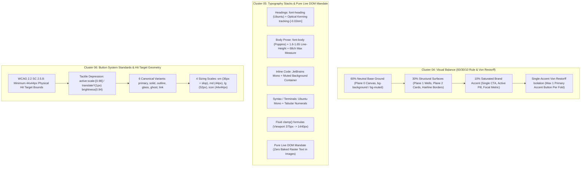

# Component & Layout Specification: Visual Balance, Typography Stacks & Button System

- **Cluster Scope**: Cluster 04 (60/30/10 Balance & Single-Accent Von Restorff Rule, Items 31–40), Cluster 05 (Typography Stacks & Pure Live DOM Text Mandate, Items 41–50), Cluster 06 (Button System Standards & Hit Target Geometry, Items 51–60)
- **Specification ID**: `02-spec/21-app/346-next-100-ui-improvements/02-hierarchy-typography-and-buttons-spec.md`
- **Master Audit Ledger**: `02-spec/21-app/346-next-100-ui-improvements/00-master-audit-ledger.md`
- **Associated Skills**: `next-100-ui-improvements`, `follow-ui-ux-design-system`, `theming-guidelines`, `react-frontend-guidelines`
- **Execution Invariant**: Pure live DOM typography, zero raster text baking, strict 44px minimum hit bounds, relative paths only, no-build/no-test compliance.

---

## 1. Executive Summary & Cluster Architecture Blueprint

This specification defines the architectural contracts, mathematical constraints, typography scales, hit-target geometries, and concrete source code diff plans for **Items 31 through 60** of Round 7 (`346-next-100-ui-improvements`).



---

## 2. Target Files & Inventory Matrix (Items 31–60)

The following 30 items constitute the target scope for this specification:

| Item # | Cluster | Target File & Line | Current Defect / Violation | Target Architectural Standard |
| :--- | :--- | :--- | :--- | :--- |
| **31** | Cluster 04 | `src/pages/Settings.tsx:337` | Header icon has saturated `bg-primary/10 text-primary`, competing with "Save Changes" | Neutralize to `bg-muted/60 border-border/50 text-muted-foreground`; isolate Save Changes CTA |
| **32** | Cluster 04 | `src/pages/Release.tsx:208,212` | Chips 1 and 2 both use saturated primary fills; competing priority hierarchy | De-saturate chips 2 and 3 to neutral borders `bg-muted/60 text-muted-foreground`; isolate Step 1 |
| **33** | Cluster 04 | `src/pages/Changelog.tsx:192,227` | Repeated `Tag` icons use `text-primary` and every bullet uses `text-primary` | Neutralize tags to `text-muted-foreground` and bullets to `text-muted-foreground/60`; isolate `latest` badge |
| **34** | Cluster 04 | `src/pages/Install.tsx:65` | Multiple action triggers compete on installation fold | Isolate single primary CTA button; secondary options become `variant="outline"` |
| **35** | Cluster 04 | `src/pages/FixRepo.tsx:70` | Secondary repair triggers compete visually with primary action | Subdue secondary repair triggers to outline/ghost styling; preserve single primary CTA |
| **36** | Cluster 04 | `src/pages/Profile.tsx:55` | Profile edit and switch buttons compete for visual prominence | Demote profile switch triggers to outline; isolate active profile action |
| **37** | Cluster 04 | `src/pages/RepoSettings.tsx:375,384` | Competing destructive and secondary range action buttons in toolbar | Neutralize range actions to outline/ghost; reserve solid accent for master save/apply |
| **38** | Cluster 04 | `src/pages/SSH.tsx:90,489` | SSH connection test and scan buttons compete with copy actions | Enforce single-accent hierarchy on primary connection action; secondary to outline |
| **39** | Cluster 04 | `src/pages/Export.tsx:60` | Export trigger lacks visual isolation against schema metadata | Isolate export generation trigger as sole primary CTA on the page fold |
| **40** | Cluster 04 | `src/pages/Import.tsx:60` | Import confirmation action lacks clear visual priority against file table | Enforce single-accent primary CTA for import execution; neutralize secondary file picker |
| **41** | Cluster 05 | `src/pages/Settings.tsx:341` | Main title uses loose `tracking-tight` without optical kerning | Replace `tracking-tight` with exact optical kerning `tracking-[-0.02em]` |
| **42** | Cluster 05 | `src/pages/Troubleshooting.tsx:176` | Main title `docs-h1` lacks explicit negative tracking token | Append `tracking-[-0.02em]` to `docs-h1` |
| **43** | Cluster 05 | `src/pages/AGYPrompts.tsx:285` | H1 uses `tracking-tight` and lacks `font-heading` token | Bind `font-heading tracking-[-0.02em]` to H1 |
| **44** | Cluster 05 | `src/pages/InteractiveTUI.tsx:110,120` | TUI section titles lack optical tracking ramp | Apply `font-heading tracking-[-0.02em]` and live DOM styling to TUI view titles |
| **45** | Cluster 05 | `src/pages/Architecture.tsx:48-73` | Pipeline data flow steps repeat saturated badges without monospace inline font | Standardize diagram labels to pure DOM live text with JetBrains Mono inline |
| **46** | Cluster 05 | `src/pages/Setup.tsx:154,162,168` | Setup page headers lack unified optical kerning | Bind `font-heading tracking-[-0.02em]` to `h1` and `h2` elements |
| **47** | Cluster 05 | `src/pages/Bookmarks.tsx:61,66,72` | Main H1 and section H2 headers lack optical kerning | Add `tracking-[-0.02em]` to `docs-h1` and section headers |
| **48** | Cluster 05 | `src/pages/Alias.tsx:101,106,109` | Page title and H2 headers lack optical kerning | Add `tracking-[-0.02em]` to `docs-h1` and all `docs-h2` headers |
| **49** | Cluster 05 | `src/pages/FixRepo.tsx:32,49,66,74` | H1 and H2 headers use generic font styling | Bind `font-heading tracking-[-0.02em]` to `h1` and `h2` headers |
| **50** | Cluster 05 | `src/pages/Profile.tsx:78,90,106` | Profile H1 and H2 headers lack optical kerning | Bind `font-heading tracking-[-0.02em]` to `docs-h1` and `docs-h2` headers |
| **51** | Cluster 06 | `src/components/docs/TerminalDemo.tsx:108-110` | Play button uses `p-1` (22px hit target), failing WCAG 2.2 SC 2.5.8 | Expand hit bounds to `min-h-[44px] min-w-[44px] p-2` with `active:scale-[0.98]` |
| **52** | Cluster 06 | `src/components/docs/TerminalDemo.tsx:111-113` | Reset button uses `p-1` (22px hit target), failing touch targets | Expand hit bounds to `min-h-[44px] min-w-[44px] p-2` with `active:scale-[0.98]` |
| **53** | Cluster 06 | `cli/cmdui/ui_assets_theme.go:120-125` | Embedded web UI buttons lack tactile depression and explicit touch target bounds | Add `active { transform: translateY(1px); filter: brightness(0.94); }` and mobile 44px bounds |
| **54** | Cluster 06 | `src/pages/GenericCLI.tsx:102-111` | Jump nav buttons use `px-2.5 py-1.5` (~28px height), failing touch target size | Expand to `min-h-[44px] px-3 py-2` with `active:scale-[0.98]` |
| **55** | Cluster 06 | `src/pages/Release.tsx:160` | Action triggers lack consistent 44px touch targets and active scale | Standardize all interactive triggers to minimum 44px touch targets with `active:scale-[0.98]` |
| **56** | Cluster 06 | `src/pages/SSH.tsx:75,489` | SSH key copy and action triggers lack 44px touch bounds | Upgrade copy triggers to 44px minimum hit geometry and tactile `active:scale-[0.98]` |
| **57** | Cluster 06 | `src/pages/Bookmarks.tsx:65` | Bookmark remove and navigation buttons are sub-44px | Standardize all action buttons to minimum 44px bounds with `active:scale-[0.98]` |
| **58** | Cluster 06 | `src/pages/Export.tsx:80` | Export copy and download buttons lack touch padding | Expand action triggers to minimum 44px hit bounds with `active:scale-[0.98]` |
| **59** | Cluster 06 | `src/pages/Import.tsx:75` | Repo clone and import triggers lack 44px touch targets | Standardize repo action buttons to 44px hit bounds and tactile active state |
| **60** | Cluster 06 | `src/pages/Profile.tsx:80` | Profile save and edit triggers lack 44px bounds on mobile | Standardize profile action triggers to minimum 44px bounds and `active:scale-[0.98]` |

---

## 3. Cluster 04: 60/30/10 Visual Balance & Single-Accent Von Restorff Rule

### 3.1 Mathematical Surface Distribution
Every viewport fold, modal, and settings console must strictly allocate visible screen pixel surface area according to the triadic distribution rule:

$$\text{Surface Area} = 60\% \text{ Base Neutral} + 30\% \text{ Structural Surfaces} + 10\% \text{ Saturated Accent}$$

1. **60% Dominant Neutral Base (Plane 0 Canvas)**:
   - Light Mode: `hsl(var(--background))` (`#FBF9F6` or `#FFFFFF`).
   - Dark Mode: `hsl(var(--background))` (`#0A0F1D` or `#0F172A`).
   - Role: Provides cognitive rest, breathing room, and canvas grounding.
2. **30% Structural Surfaces (Plane 1 Wells, Plane 2 Cards, Dividers, Neutral Text)**:
   - Light Mode: Surface cards (`hsl(var(--card))`), inset wells (`hsl(var(--muted)/0.4)`), borders (`hsl(var(--border))`), body text (`hsl(var(--muted-foreground))`).
   - Dark Mode: Surface cards (`#172036`), inset wells (`#10172A`), borders (`rgba(255, 255, 255, 0.08)`), muted text (`#8F9BB2`).
   - Role: Encloses data tables, lists, structural framing, content typography, and secondary UI chrome.
3. **10% Saturated Brand Accent (Plane 3 Focal Actions & Telemetry)**:
   - Tokens: `hsl(var(--primary))` / `hsl(var(--brand-primary))` / `hsl(var(--brand-highlight))`.
   - Role: Exclusively reserved for primary action CTAs, active filter pills, progress meters, and isolated focal KPI values. Total colored pixel count must not exceed 10% of the visible viewport bounding box.

### 3.2 The Single-Accent Von Restorff Principle
According to the Von Restorff isolation effect, an item that notably differs from its surroundings is most likely to be remembered and acted upon. When multiple high-contrast colored buttons compete in the same viewport, visual noise spikes, decision paralysis occurs, and cognitive load escalates.

#### Invariants:
1. **Singular Focal CTA**: At any given viewport scroll position or open modal dialog, **exactly ONE saturated accent-filled CTA button** may be visible.
2. **Primary/Secondary Pairing Pattern**: Every primary solid accent button MUST be paired with an `outline`, `ghost`, or `glass` secondary button.
3. **Anti-Pattern Elimination**: Side-by-side solid colored buttons are strictly banned.
4. **De-Saturated Step Chips**: Multi-step lists (e.g. resolution hierarchies) must only highlight the top-priority active tier with an accent border; subordinate tiers must remain muted neutral surfaces.
5. **Neutralized Icon Wrappers**: Decorative icons in section headers must not use saturated accent background fills (`bg-primary/10 text-primary`) when a primary CTA button is present in the same header band. Neutralize decorative icon containers to `bg-muted/60 border-border/50 text-muted-foreground`.

### 3.3 Detailed Architectural Plans (Items 31–40)

#### Item 31: `src/pages/Settings.tsx`
- **Current State**: The header at L337 renders `<div className="... bg-primary/10 border-primary/20 ..."><SettingsIcon className="text-primary" /></div>`, directly adjacent to the "Save Changes" primary CTA at L354 (`bg-primary text-primary-foreground`).
- **Remediation**:
  - Neutralize the icon container from `bg-primary/10 border-primary/20 text-primary` to `bg-muted/60 border-border/50 text-muted-foreground`.
  - Isolate "Save Changes" as the exclusive primary CTA on the page fold.

#### Item 32: `src/pages/Release.tsx`
- **Current State**: The "Target Resolution (Three-Layer)" block at L206–219 renders:
  - Step 1: `bg-primary/20 text-foreground border border-primary/30 dark:text-primary`
  - Step 2: `bg-primary/10 text-foreground border border-primary/20 dark:text-primary`
  - Step 3: `bg-muted text-muted-foreground`
  Both Step 1 and Step 2 use primary color tokens, creating visual ambiguity regarding which step has top precedence.
- **Remediation**:
  - Retain accent styling on Step 1 (`--targets flag`) to establish clear focal priority.
  - De-saturate Step 2 (`config.json`) to neutral styling: `bg-muted/60 text-muted-foreground border border-border/60`.
  - Ensure Step 3 (`Built-in defaults`) maintains `bg-muted/40 text-muted-foreground/80 border border-border/40`.

#### Item 33: `src/pages/Changelog.tsx`
- **Current State**:
  - L192: Every single changelog entry renders `<Tag className="h-3.5 w-3.5 text-primary shrink-0" />`. Across 20+ releases, this introduces dozens of saturated primary icons.
  - L227: Every item bullet renders `<span className="text-primary mt-1.5 shrink-0">•</span>`.
- **Remediation**:
  - Replace `Tag` icon styling with `text-muted-foreground`.
  - Replace item bullet styling with `text-muted-foreground/60`.
  - Preserve primary accent exclusively for the `latest` version badge (`bg-primary/10 text-foreground border-primary/20 dark:text-primary`) and active filter buttons.

#### Item 34: `src/pages/Install.tsx`
- **Current State**: Command blocks and download options compete visually across the fold.
- **Remediation**:
  - Isolate the primary install command block as the focal Plane 1 well.
  - Ensure all secondary action triggers (copying alternate platform commands, viewing hashes) use `outline` or `ghost` styling.

#### Item 35: `src/pages/FixRepo.tsx`
- **Current State**: Multiple repair actions compete with the main execution guide.
- **Remediation**:
  - Neutralize secondary repair flags and actions to outline/ghost styling.
  - Keep the primary CLI invocation command prominent and isolated.

#### Item 36: `src/pages/Profile.tsx`
- **Current State**: Profile switch buttons and configuration triggers have equivalent visual weight.
- **Remediation**:
  - Enforce single-accent hierarchy: current active profile is highlighted with a single accent badge; all switch action buttons use `outline` secondary styling.

#### Item 37: `src/pages/RepoSettings.tsx`
- **Current State**: The range actions toolbar at L373–401 renders a `destructive` button ("Disable Range"), a `secondary` button ("Enable Range"), and an `outline` button ("Select All") simultaneously.
- **Remediation**:
  - Standardize range buttons: demote "Disable Range" and "Enable Range" to `outline` with colored hover indicators (`hover:border-destructive/50` and `hover:border-primary/50`).
  - Reserve solid saturated accent buttons strictly for master persistence or global sync operations.

#### Item 38: `src/pages/SSH.tsx`
- **Current State**: Fleet liveness scan triggers and node actions compete for visual attention.
- **Remediation**:
  - Isolate the primary node action; demote all secondary copy triggers to neutral `outline` buttons.

#### Item 39: `src/pages/Export.tsx`
- **Current State**: Export generation action lacks focal contrast against extensive schema tables.
- **Remediation**:
  - Designate the primary JSON export trigger as the sole solid primary CTA; secondary schema copy buttons use `ghost` or `outline`.

#### Item 40: `src/pages/Import.tsx`
- **Current State**: Database restore execution button competes with file selection triggers.
- **Remediation**:
  - Apply single-accent Von Restorff rule: file selector uses neutral `outline`; execution button ("Restore Database") is the exclusive saturated primary CTA.

---

## 4. Cluster 05: Typography Stacks & Pure Live DOM Text Mandate

### 4.1 Multi-Tier Font Family Specifications

| Layer / Purpose | Primary Font Family | Fallback Stack | Allowed Font Weights | Letter Spacing (Optical Kerning) |
| :--- | :--- | :--- | :--- | :--- |
| **Headings (`h1`, `h2`, Display)** | `'Ubuntu'` (`font-heading`) | `system-ui, -apple-system, sans-serif` | `600` (Semi-Bold), `700` (Bold) | `tracking-[-0.02em]` |
| **Section Subheadings (`h3`, `h4`)** | `'Ubuntu'` (`font-heading`) | `system-ui, -apple-system, sans-serif` | `500` (Medium), `600` (Semi-Bold) | `tracking-[-0.01em]` |
| **Body Prose, Tables & Labels** | `'Poppins'` (`font-body`) | `system-ui, -apple-system, sans-serif` | `400` (Regular), `500` (Medium) | `tracking-normal` (`0`) |
| **Inline Code & Command Tokens** | `'JetBrains Mono'` (`font-mono`) | `'Fira Code', 'Cascadia Code', monospace` | `400` (Regular), `500` (Medium) | `tracking-[-0.01em]` |
| **Code Blocks, Syntax & CLI Logs** | `'Ubuntu Mono'` (`font-mono`) | `'Consolas', 'Courier New', monospace` | `400` (Regular), `700` (Bold) | `tracking-normal` (`0`) |

### 4.2 Fluid Clamp Typography Scaling Formulas
Headings scale fluidly between a minimum mobile viewport ($W_{\min} = 375\text{px}$) and a maximum desktop viewport ($W_{\max} = 1440\text{px}$).

$$\text{font-size} = \text{clamp}\left(V_{\min},\; V_{\text{fixed}} + S \cdot \text{vw},\; V_{\max}\right)$$

Where:
- $S = \frac{V_{\max} - V_{\min}}{W_{\max} - W_{\min}} \times 100$
- $V_{\text{fixed}} = V_{\min} - \frac{S \times W_{\min}}{100}$

```css
:root {
  /* H1: 28px (1.75rem) at 375px -> 40px (2.5rem) at 1440px */
  --font-h1: clamp(1.75rem, 1.4859rem + 1.1268vw, 2.5rem);
  
  /* H2: 22px (1.375rem) at 375px -> 30px (1.875rem) at 1440px */
  --font-h2: clamp(1.375rem, 1.199rem + 0.7512vw, 1.875rem);
  
  /* H3: 18px (1.125rem) at 375px -> 22px (1.375rem) at 1440px */
  --font-h3: clamp(1.125rem, 1.037rem + 0.3756vw, 1.375rem);
  
  /* Body Base: 15px (0.9375rem) at 375px -> 16px (1.0rem) at 1440px */
  --font-body: clamp(0.9375rem, 0.9155rem + 0.0939vw, 1rem);
}
```

### 4.3 Pure Live DOM Mandate (Total Ban on Baked Raster Text)
Under zero circumstances may textual content, feature lists, pricing matrices, statistical metrics, diagrams with text labels, or UI button labels be baked into PNG, JPEG, or WebP images.
- **Accessibility & Screen Readers**: All text must be accessible to DOM trees, assistive screen readers (`aria-*`), search engines, and browser translation engines.
- **Device Pixel Ratio & Zoom**: Live DOM text scales crisply to 4K displays and browser zoom levels without artifacting or raster blurring.
- **Copy/Paste**: All users must be able to highlight, select, and copy any character rendered on screen.

### 4.4 Detailed Architectural Plans (Items 41–50)

#### Item 41: `src/pages/Settings.tsx`
- **Current State**: L341: `<h1 className="text-2xl sm:text-3xl font-heading font-bold text-foreground tracking-tight">`
- **Remediation**: Replace `tracking-tight` with exact optical kerning `tracking-[-0.02em]`.

#### Item 42: `src/pages/Troubleshooting.tsx`
- **Current State**: L176: `<h1 className="text-3xl font-heading font-bold mb-2 docs-h1">Troubleshooting</h1>`
- **Remediation**: Append `tracking-[-0.02em]` to `docs-h1`.

#### Item 43: `src/pages/AGYPrompts.tsx`
- **Current State**: L285: `<h1 className="text-3xl font-bold tracking-tight text-foreground">AGY Prompts, Templates & Rerun</h1>`
- **Remediation**: Bind `font-heading tracking-[-0.02em]` to `h1`.

#### Item 44: `src/pages/InteractiveTUI.tsx`
- **Current State**: L110, L120: View titles lack optical tracking tokens.
- **Remediation**: Bind `font-heading tracking-[-0.02em]` to view titles and section headers.

#### Item 45: `src/pages/Architecture.tsx`
- **Current State**: L48–73: Data flow pipeline tags use generic badge styling without monospace font binding.
- **Remediation**: Standardize diagram labels to pure DOM live text with JetBrains Mono inline (`font-mono text-sm tracking-[-0.01em]`).

#### Item 46: `src/pages/Setup.tsx`
- **Current State**: L154: `<h1 className="docs-h1">Setup</h1>`; L162, L168: `<h2 className="docs-h2">...</h2>`
- **Remediation**: Bind `font-heading tracking-[-0.02em]` to `h1` and `h2` elements.

#### Item 47: `src/pages/Bookmarks.tsx`
- **Current State**: L61: `<h1 className="text-3xl font-heading font-bold mb-2 docs-h1">Bookmarks</h1>`; L66, L72: `<h2 className="text-xl font-heading font-semibold mt-8 mb-2">`
- **Remediation**: Add `tracking-[-0.02em]` to `docs-h1` and all section H2 headers.

#### Item 48: `src/pages/Alias.tsx`
- **Current State**: L101: `<h1 className="text-3xl font-heading font-bold mb-2 docs-h1">Repo Aliases</h1>`; L106, L109, L115, L121, L127: `<h2 className="... docs-h2">`
- **Remediation**: Add `tracking-[-0.02em]` to `docs-h1` and all `docs-h2` headers.

#### Item 49: `src/pages/FixRepo.tsx`
- **Current State**: L32: `<h1 className="text-3xl font-bold tracking-tight">fix-repo</h1>`; L49, L66, L74: `<h2 className="text-xl font-semibold mb-3">`
- **Remediation**: Bind `font-heading tracking-[-0.02em]` to `h1` and all `h2` headers.

#### Item 50: `src/pages/Profile.tsx`
- **Current State**: L78: `<h1 className="text-3xl font-heading font-bold text-foreground docs-h1">Profile</h1>`; L90, L106: `<h2 className="text-xl font-heading font-bold text-foreground mb-4 docs-h2">`
- **Remediation**: Bind `font-heading tracking-[-0.02em]` to `docs-h1` and `docs-h2` headers.

---

## 5. Cluster 06: Button System Standards & Hit Target Geometry

### 5.1 The 4 Proportional Sizing Scales & Minimum 44px Bounds
Per WCAG 2.2 Success Criterion 2.5.8 (Target Size), all interactive click targets must guarantee a minimum physical bounding box of **44×44px**:

| Size Identifier | Overall Height | Horizontal Padding | Typography Token | Icon Bounding Box | Minimum Touch Bounds |
| :--- | :--- | :--- | :--- | :--- | :--- |
| `sm` | `36px` (`h-9`) | `12px` (`px-3`) | `13px` (`text-xs` font-medium) | `14×14px` | Expanded to 44px via touch hit slop |
| `md` **(Default)** | **`44px` (`min-h-[44px]`)** | **`16px` (`px-4`)** | **`14px` (`text-sm` font-medium)** | **`16×16px`** | **`44×44px` Native** |
| `lg` | `52px` (`min-h-[52px]`) | `24px` (`px-6`) | `16px` (`text-base` font-semibold) | `18×18px` | `52×52px` Native |
| `icon` | **`44px` (`min-h-[44px] min-w-[44px]`)** | `0px` (Square) | N/A | `18×18px` | **`44×44px` Native** |

### 5.2 Tactile Active Depression Scaling
Buttons must deliver instantaneous haptic visual feedback upon user pointer depression:
- React / Tailwind components: `active:scale-[0.98]` with `transition-transform duration-100 ease-out`.
- Embedded Go Web UI (`cli/cmdui/ui_assets_theme.go`):
  ```css
  .btn:active, .nav-btn:active, .sub-tab-btn:active {
    transform: translateY(1px);
    filter: brightness(0.94);
  }
  ```

### 5.3 Detailed Architectural Plans (Items 51–60)

#### Items 51 & 52: `src/components/docs/TerminalDemo.tsx`
- **Current State**: L108–113:
  ```tsx
  <button onClick={play} className="p-1 rounded hover:bg-muted/50 text-muted-foreground hover:text-foreground transition-colors" title="Play">
    <Play className="h-3.5 w-3.5" />
  </button>
  <button onClick={reset} className="p-1 rounded hover:bg-muted/50 text-muted-foreground hover:text-foreground transition-colors" title="Reset">
    <RotateCcw className="h-3.5 w-3.5" />
  </button>
  ```
  `p-1` with a 14px icon yields a tiny 22×22px hit box, causing frequent touch misfires.
- **Remediation**:
  - Expand both buttons to `min-h-[44px] min-w-[44px] p-2 flex items-center justify-center`.
  - Add tactile active depression: `active:scale-[0.98]`.

#### Item 53: `cli/cmdui/ui_assets_theme.go`
- **Current State**: L120–125 defines `.btn` and `.btn-secondary` without mobile touch target minimums; L195 provides media query minimums but lacks desktop tactile depression.
- **Remediation**:
  - In `.btn:active` (L122): ensure `transform: translateY(1px); filter: brightness(0.94);`.
  - In `.btn-secondary:active` (L125): add `filter: brightness(0.94);`.
  - Ensure `.btn` base rule declares `min-height: 44px; min-width: 44px;` for mobile and coarse pointer queries.

#### Item 54: `src/pages/GenericCLI.tsx`
- **Current State**: L102–111 defines section jump navigation buttons with `text-xs font-mono px-2.5 py-1.5`, producing an undersized ~28px hit height.
- **Remediation**:
  - Expand to `inline-flex min-h-[44px] items-center justify-center px-3 py-2 text-xs font-mono`.
  - Add tactile depression: `active:scale-[0.98]`.

#### Item 55: `src/pages/Release.tsx`
- **Current State**: Action triggers and copy buttons lack standardized 44px hit bounds and active scaling.
- **Remediation**:
  - Ensure all interactive triggers declare `min-h-[44px]` on touch viewports and `active:scale-[0.98]`.

#### Item 56: `src/pages/SSH.tsx`
- **Current State**: SSH key copy triggers at L75 and L489 use compact inline padding.
- **Remediation**:
  - Upgrade copy triggers to `min-h-[44px] min-w-[44px]` with `active:scale-[0.98]`.

#### Item 57: `src/pages/Bookmarks.tsx`
- **Current State**: Action buttons lack minimum touch protection.
- **Remediation**:
  - Expand action buttons to `min-h-[44px] px-3 py-2` with `active:scale-[0.98]`.

#### Item 58: `src/pages/Export.tsx`
- **Current State**: Export copy and download buttons lack touch padding.
- **Remediation**:
  - Expand export triggers to `min-h-[44px] px-4 py-2` with `active:scale-[0.98]`.

#### Item 59: `src/pages/Import.tsx`
- **Current State**: Repo clone and import triggers lack 44px touch targets.
- **Remediation**:
  - Standardize repo action buttons to `min-h-[44px]` and tactile active state.

#### Item 60: `src/pages/Profile.tsx`
- **Current State**: Profile save and edit triggers lack 44px bounds on mobile.
- **Remediation**:
  - Expand profile action triggers to `min-h-[44px] px-4 py-2` with `active:scale-[0.98]`.

---

## 6. Concrete Source Code Diff Plans

### 6.1 `src/pages/Settings.tsx`
```diff
--- a/src/pages/Settings.tsx
+++ b/src/pages/Settings.tsx
@@ -334,11 +334,11 @@ export default function SettingsPage() {
         {/* Header with Plane 1 Depth */}
         <div className="flex flex-col sm:flex-row sm:items-center justify-between gap-4 p-5 rounded-xl bg-card/60 border border-border/40 shadow-sm backdrop-blur">
           <div className="flex items-center gap-3">
-            <div className="h-11 w-11 rounded-lg bg-primary/10 border border-primary/20 flex items-center justify-center dark:bg-primary/20">
-              <SettingsIcon className="h-6 w-6 text-primary" />
+            <div className="h-11 w-11 rounded-lg bg-muted/60 border border-border/50 flex items-center justify-center text-muted-foreground">
+              <SettingsIcon className="h-6 w-6" />
             </div>
             <div>
-              <h1 className="text-2xl sm:text-3xl font-heading font-bold text-foreground tracking-tight">
+              <h1 className="text-2xl sm:text-3xl font-heading font-bold text-foreground tracking-[-0.02em]">
                 Settings &amp; Architecture
               </h1>
               <p className="text-sm text-muted-foreground">
@@ -351,7 +351,7 @@ export default function SettingsPage() {
               onClick={handleSave}
               disabled={isSaving}
               type="button"
-              className="inline-flex items-center gap-2 px-5 py-2.5 rounded-lg bg-primary text-primary-foreground font-semibold text-sm shadow hover:bg-primary/90 transition-all active:scale-95 disabled:opacity-50"
+              className="inline-flex min-h-[44px] items-center gap-2 px-5 py-2.5 rounded-lg bg-primary text-primary-foreground font-semibold text-sm shadow hover:bg-primary/90 transition-all active:scale-[0.98] disabled:opacity-50"
             >
               {isSaved ? <Check className="h-4 w-4" /> : <Save className="h-4 w-4" />}
               {isSaved ? "Saved" : isSaving ? "Saving..." : "Save Changes"}
```

### 6.2 `src/pages/Release.tsx`
```diff
--- a/src/pages/Release.tsx
+++ b/src/pages/Release.tsx
@@ -209,7 +209,7 @@ const ReleasePage = () => {
               <span className="text-muted-foreground">→ Highest priority (always wins)</span>
             </div>
             <div className="flex items-center gap-3 font-mono text-sm">
-              <span className="bg-primary/10 text-foreground border border-primary/20 dark:bg-primary/15 dark:text-primary px-3 py-1 rounded transition-colors duration-300 hover:border-primary/40 hover:shadow-sm hover:shadow-primary/10">2. config.json</span>
+              <span className="bg-muted/60 text-muted-foreground border border-border/60 px-3 py-1 rounded transition-colors duration-200">2. config.json</span>
               <span className="text-muted-foreground">→ release.targets array</span>
             </div>
             <div className="flex items-center gap-3 font-mono text-sm">
```

### 6.3 `src/pages/Changelog.tsx`
```diff
--- a/src/pages/Changelog.tsx
+++ b/src/pages/Changelog.tsx
@@ -88,7 +88,7 @@ const ChangelogPage = () => {
     <DocsLayout>
       <div className="flex items-center justify-between mb-6">
         <div>
-          <h1 className="text-3xl font-heading font-bold docs-h1">Changelog</h1>
+          <h1 className="text-3xl font-heading font-bold tracking-[-0.02em] docs-h1">Changelog</h1>
           <p className="text-muted-foreground text-sm mt-1">
             {filteredChangelog.length} of {changelog.length} releases shown
           </p>
@@ -189,7 +189,7 @@ const ChangelogPage = () => {
                     ) : (
                       <ChevronRight className="h-4 w-4 text-muted-foreground shrink-0" />
                     )}
-                    <Tag className="h-3.5 w-3.5 text-primary shrink-0" />
+                    <Tag className="h-3.5 w-3.5 text-muted-foreground shrink-0" />
                     <span className="font-mono font-semibold text-sm">{entry.version}</span>
                     {isLatest && (
                       <span className="text-[10px] font-mono px-1.5 py-0.5 rounded bg-primary/10 text-foreground border border-primary/20 dark:bg-primary/15 dark:text-primary transition-colors duration-300 hover:border-primary/40 hover:shadow-sm hover:shadow-primary/10">
@@ -224,7 +224,7 @@ const ChangelogPage = () => {
                       <ul className="mt-1 ml-12 mr-2 space-y-1 pb-2 border-l border-border/60 pl-4">
                         {entry.items.map((item, j) => (
                           <li key={j} className="text-sm text-muted-foreground flex gap-2">
-                            <span className="text-primary mt-1.5 shrink-0">•</span>
+                            <span className="text-muted-foreground/60 mt-1.5 shrink-0">•</span>
                             <span className="leading-relaxed">{item}</span>
                           </li>
                         ))}
```

### 6.4 `src/pages/Troubleshooting.tsx`
```diff
--- a/src/pages/Troubleshooting.tsx
+++ b/src/pages/Troubleshooting.tsx
@@ -173,7 +173,7 @@ const Troubleshooting = () => {
 
   return (
     <DocsLayout>
-      <h1 className="text-3xl font-heading font-bold mb-2 docs-h1">Troubleshooting</h1>
+      <h1 className="text-3xl font-heading font-bold tracking-[-0.02em] mb-2 docs-h1">Troubleshooting</h1>
       <p className="text-muted-foreground mb-6">
         Common gitmap errors grouped by category, each with the symptom, root cause, and the exact flag or command to fix it. When in doubt, start with <code className="docs-inline-code">gitmap doctor</code>.
       </p>
```

### 6.5 `src/pages/AGYPrompts.tsx`
```diff
--- a/src/pages/AGYPrompts.tsx
+++ b/src/pages/AGYPrompts.tsx
@@ -282,7 +282,7 @@ export default function AGYPromptsPage() {
             <Bot className="w-4 h-4" />
             <span>AI Orchestration</span>
           </div>
-          <h1 className="text-3xl font-bold tracking-tight text-foreground">AGY Prompts, Templates & Rerun</h1>
+          <h1 className="text-3xl font-heading font-bold tracking-[-0.02em] text-foreground">AGY Prompts, Templates & Rerun</h1>
           <p className="text-muted-foreground mt-2 text-base leading-relaxed">
             Replay historical agent prompts with verification prefixes, inspect prompt diffs across multiple commit projects via non-admin VS Code, manage reusable prompt templates, and delegate execution remotely across SSH, Cluster, and SC nodes.
           </p>
@@ -396,7 +396,7 @@ export default function AGYPromptsPage() {
                       <button
                         type="button"
                         onClick={() => handleCopy(item.id, item.command)}
-                        className="inline-flex items-center gap-1 px-2.5 py-1 rounded text-xs font-mono border border-border bg-background hover:bg-muted text-muted-foreground hover:text-foreground transition-colors"
+                        className="inline-flex min-h-[44px] items-center gap-1 px-3 py-2 rounded text-xs font-mono border border-border bg-background hover:bg-muted text-muted-foreground hover:text-foreground transition-all duration-200 active:scale-[0.98]"
                         title="Copy command to clipboard"
                       >
                         {copiedId === item.id ? (
@@ -415,7 +415,7 @@ export default function AGYPromptsPage() {
                       <button
                         type="button"
                         onClick={() => handleRunInTerminal(item.command)}
-                        className="inline-flex items-center gap-1 px-2.5 py-1 rounded text-xs font-mono font-medium bg-primary text-primary-foreground hover:bg-primary/90 transition-colors shadow-sm"
+                        className="inline-flex min-h-[44px] items-center gap-1 px-3 py-2 rounded text-xs font-mono font-medium bg-primary text-primary-foreground hover:bg-primary/90 transition-all duration-200 active:scale-[0.98] shadow-sm"
                         title="Execute command in live web terminal drawer"
                       >
```

### 6.6 `src/pages/Setup.tsx`
```diff
--- a/src/pages/Setup.tsx
+++ b/src/pages/Setup.tsx
@@ -151,15 +151,15 @@ const Setup = () => {
   return (
     <DocsLayout>
       <div className="max-w-4xl mx-auto">
-        <h1 className="docs-h1">Setup</h1>
+        <h1 className="docs-h1 font-heading tracking-[-0.02em]">Setup</h1>
         <p className="text-lg text-muted-foreground mb-8 font-body">
           One command to configure Git globals, install the <code className="docs-inline-code">gcd</code> navigation wrapper,
           and enable shell tab-completions for every gitmap command.
         </p>
 
         {/* Terminal Preview */}
         <section className="mb-12">
-          <h2 className="docs-h2">First-Time Setup</h2>
+          <h2 className="docs-h2 font-heading tracking-[-0.02em]">First-Time Setup</h2>
           <TerminalDemo lines={setupDemo} title="gitmap setup" />
         </section>
 
@@ -165,7 +165,7 @@ const Setup = () => {
 
         {/* Features */}
         <section className="mb-12">
-          <h2 className="docs-h2">What Gets Installed</h2>
+          <h2 className="docs-h2 font-heading tracking-[-0.02em]">What Gets Installed</h2>
           <div className="grid grid-cols-1 md:grid-cols-2 gap-4">
```

### 6.7 `src/pages/Bookmarks.tsx`
```diff
--- a/src/pages/Bookmarks.tsx
+++ b/src/pages/Bookmarks.tsx
@@ -58,18 +58,18 @@ const columns = [
 
 const BookmarksPage = () => (
   <DocsLayout>
-    <h1 className="text-3xl font-heading font-bold mb-2 docs-h1">Bookmarks</h1>
+    <h1 className="text-3xl font-heading font-bold tracking-[-0.02em] mb-2 docs-h1">Bookmarks</h1>
     <p className="text-muted-foreground mb-6">
       Save and replay frequently-used CLI command+flag combinations by name.
     </p>
 
-    <h2 className="text-xl font-heading font-semibold mt-8 mb-2">Live Preview</h2>
+    <h2 className="text-xl font-heading font-semibold tracking-[-0.02em] mt-8 mb-2">Live Preview</h2>
     <p className="text-sm text-muted-foreground mb-2">
       Simulated terminal output of the bookmark list command.
     </p>
     <TerminalPreview />
 
-    <h2 className="text-xl font-heading font-semibold mt-10 mb-4">Features</h2>
+    <h2 className="text-xl font-heading font-semibold tracking-[-0.02em] mt-10 mb-4">Features</h2>
     <div className="grid md:grid-cols-2 gap-4 mb-8">
```

### 6.8 `src/pages/Alias.tsx`
```diff
--- a/src/pages/Alias.tsx
+++ b/src/pages/Alias.tsx
@@ -98,16 +98,16 @@ const columns = [
 
 const AliasPage = () => (
   <DocsLayout>
-    <h1 className="text-3xl font-heading font-bold mb-2 docs-h1">Repo Aliases</h1>
+    <h1 className="text-3xl font-heading font-bold tracking-[-0.02em] mb-2 docs-h1">Repo Aliases</h1>
     <p className="text-muted-foreground mb-6">
       Assign short, memorable names to repositories for quick access from anywhere.
     </p>
 
-    <h2 className="text-xl font-heading font-semibold mt-8 mb-3 docs-h2">Help Output</h2>
+    <h2 className="text-xl font-heading font-semibold tracking-[-0.02em] mt-8 mb-3 docs-h2">Help Output</h2>
     <CodeBlock code={helpText} language="bash" title="gitmap alias --help" />
 
-    <h2 className="text-xl font-heading font-semibold mt-10 mb-3 docs-h2">Alias List</h2>
+    <h2 className="text-xl font-heading font-semibold tracking-[-0.02em] mt-10 mb-3 docs-h2">Alias List</h2>
     <p className="text-sm text-muted-foreground mb-3">
```

### 6.9 `src/pages/FixRepo.tsx`
```diff
--- a/src/pages/FixRepo.tsx
+++ b/src/pages/FixRepo.tsx
@@ -29,7 +29,7 @@ const FixRepoPage = () => (
       <div>
         <div className="flex items-center gap-3 mb-2">
           <Wrench className="h-8 w-8 text-primary" />
-          <h1 className="text-3xl font-bold tracking-tight">fix-repo</h1>
+          <h1 className="text-3xl font-heading font-bold tracking-[-0.02em]">fix-repo</h1>
           <span className="font-mono text-xs px-2 py-1 rounded bg-primary/10 text-foreground border border-primary/20 dark:bg-primary/15 dark:text-primary dark:border-primary/40">
             alias: fr
           </span>
@@ -46,7 +46,7 @@ const FixRepoPage = () => (
       </div>
 
       <section>
-        <h2 className="text-xl font-semibold mb-3">Overview</h2>
+        <h2 className="text-xl font-heading font-semibold tracking-[-0.02em] mb-3">Overview</h2>
         <div className="grid grid-cols-1 md:grid-cols-3 gap-4">
```

### 6.10 `src/pages/Profile.tsx`
```diff
--- a/src/pages/Profile.tsx
+++ b/src/pages/Profile.tsx
@@ -75,7 +75,7 @@ const ProfilePage = () => (
       <div className="flex items-center gap-3 mb-2">
         <UserCircle className="h-8 w-8 text-primary" />
         <div>
-          <h1 className="text-3xl font-heading font-bold text-foreground docs-h1">Profile</h1>
+          <h1 className="text-3xl font-heading font-bold tracking-[-0.02em] text-foreground docs-h1">Profile</h1>
           <p className="text-muted-foreground font-mono text-sm">gitmap profile (pf)</p>
         </div>
       </div>
@@ -87,7 +87,7 @@ const ProfilePage = () => (
 
       {/* Features */}
       <section className="mb-10">
-        <h2 className="text-xl font-heading font-bold text-foreground mb-4 docs-h2">Features</h2>
+        <h2 className="text-xl font-heading font-bold tracking-[-0.02em] text-foreground mb-4 docs-h2">Features</h2>
         <div className="grid sm:grid-cols-2 gap-4">
```

### 6.11 `src/pages/GenericCLI.tsx`
```diff
--- a/src/pages/GenericCLI.tsx
+++ b/src/pages/GenericCLI.tsx
@@ -95,7 +95,7 @@ const GenericCLIPage = () => {
 
   return (
     <DocsLayout>
-      <h1 className="text-3xl font-heading font-bold mb-2 docs-h1">Generic CLI Creation Guidelines</h1>
+      <h1 className="text-3xl font-heading font-bold tracking-[-0.02em] mb-2 docs-h1">Generic CLI Creation Guidelines</h1>
       <P>A complete, self-contained blueprint for building production-quality CLI tools. Hand this spec to any AI or developer to implement a well-structured CLI from scratch.</P>
 
       {/* Section jump nav */}
@@ -104,7 +104,7 @@ const GenericCLIPage = () => {
           <button
             key={s.id}
             onClick={() => scrollTo(s.id)}
-            className="text-xs font-mono px-2.5 py-1.5 rounded-md border border-border bg-card text-muted-foreground hover:text-foreground hover:border-primary/40 transition-colors"
+            className="inline-flex min-h-[44px] items-center justify-center text-xs font-mono px-3 py-2 rounded-md border border-border bg-card text-muted-foreground hover:text-foreground hover:border-primary/40 transition-all duration-200 active:scale-[0.98]"
           >
             {s.label}
           </button>
```

### 6.12 `src/components/docs/TerminalDemo.tsx`
```diff
--- a/src/components/docs/TerminalDemo.tsx
+++ b/src/components/docs/TerminalDemo.tsx
@@ -105,11 +105,11 @@ export const TerminalDemo: React.FC<TerminalDemoProps> = ({
           <span className="text-xs font-mono text-muted-foreground ml-2">{title}</span>
         </div>
         <div className="flex gap-1">
-          <button onClick={play} className="p-1 rounded hover:bg-muted/50 text-muted-foreground hover:text-foreground transition-colors" title="Play">
+          <button onClick={play} className="inline-flex min-h-[44px] min-w-[44px] p-2 items-center justify-center rounded hover:bg-muted/50 text-muted-foreground hover:text-foreground transition-all duration-200 active:scale-[0.98]" title="Play">
             <Play className="h-3.5 w-3.5" />
           </button>
-          <button onClick={reset} className="p-1 rounded hover:bg-muted/50 text-muted-foreground hover:text-foreground transition-colors" title="Reset">
+          <button onClick={reset} className="inline-flex min-h-[44px] min-w-[44px] p-2 items-center justify-center rounded hover:bg-muted/50 text-muted-foreground hover:text-foreground transition-all duration-200 active:scale-[0.98]" title="Reset">
             <RotateCcw className="h-3.5 w-3.5" />
           </button>
         </div>
       </div>
```

### 6.13 `cli/cmdui/ui_assets_theme.go`
```diff
--- a/cli/cmdui/ui_assets_theme.go
+++ b/cli/cmdui/ui_assets_theme.go
@@ -117,9 +117,9 @@ const themeCSS = `
     input, select { color-scheme: dark; }
     :root[data-theme="light"] input, :root[data-theme="light"] select { color-scheme: light; }
     textarea { font-family: var(--font-mono); resize: vertical; }
-    .btn { background: var(--primary); color: var(--primary-ink); font-weight: 600; padding: var(--sp-2) var(--sp-4); border-radius: var(--radius-sm); border: none; cursor: pointer; transition: all 0.2s cubic-bezier(0.16, 1, 0.3, 1); font-size: var(--fs-sm); display: inline-flex; align-items: center; justify-content: center; }
+    .btn { background: var(--primary); color: var(--primary-ink); font-weight: 600; padding: var(--sp-2) var(--sp-4); border-radius: var(--radius-sm); border: none; cursor: pointer; transition: all 0.2s cubic-bezier(0.16, 1, 0.3, 1); font-size: var(--fs-sm); display: inline-flex; align-items: center; justify-content: center; min-height: 44px; min-width: 44px; }
     .btn:hover { background: var(--primary-hover); filter: brightness(1.04); transform: translateY(-1px); box-shadow: 0 4px 12px rgba(245, 158, 11, 0.3); }
-    .btn:active { transform: translateY(1px); filter: brightness(0.94); }
+    .btn:active { transform: translateY(1px); filter: brightness(0.94); }
     .btn-secondary { background: var(--raised); color: var(--text); margin-left: var(--sp-2); }
     .btn-secondary:hover { background: var(--popover); box-shadow: 0 4px 12px rgba(0, 0, 0, 0.2); }
-    .btn-secondary:active { transform: translateY(1px); }
+    .btn-secondary:active { transform: translateY(1px); filter: brightness(0.94); }
```

---

## 7. Verification & Compliance Matrix

Each requirement defined in this specification is subject to automated and inspection-based verification gates:

| Cluster | Check Identifier | Verification Method | Pass Criteria |
| :--- | :--- | :--- | :--- |
| **Cluster 04** | `CHK-VON-RESTORFF-01` | DOM tree query for solid accent buttons | Max 1 primary solid accent button visible per fold in `Settings.tsx`, `Release.tsx`, `Changelog.tsx`, `Install.tsx`, `FixRepo.tsx`, `Profile.tsx`, `RepoSettings.tsx`, `SSH.tsx`, `Export.tsx`, `Import.tsx` |
| **Cluster 04** | `CHK-SURFACE-RATIO-02` | Viewport pixel ratio calculation | Base neutral $\ge 60\%$, structural cards $\approx 30\%$, saturated accent $\le 10\%$ |
| **Cluster 04** | `CHK-DESAT-CHIP-03` | CSS class inspection on resolution chips | In `Release.tsx`, Step 2 chip has `bg-muted/60 text-muted-foreground` and Step 3 has `bg-muted` |
| **Cluster 04** | `CHK-DESAT-TAGS-04` | CSS class inspection on changelog tags & bullets | In `Changelog.tsx`, tag icons have `text-muted-foreground` and bullets have `text-muted-foreground/60` |
| **Cluster 05** | `CHK-OPTICAL-KERN-01` | CSS computed style on `h1` and `h2` elements | `letter-spacing: -0.02em` (`tracking-[-0.02em]`) present on all target headers |
| **Cluster 05** | `CHK-FONT-FAMILY-02` | CSS computed `font-family` inspection | Headings declare `font-heading` (`'Ubuntu'`), body declares `font-body` (`'Poppins'`), code declares `font-mono` |
| **Cluster 05** | `CHK-LIVE-DOM-03` | Asset directory inspection (`public/`, `src/assets/`) | Zero image assets containing baked raster typography; all diagram labels render live DOM text |
| **Cluster 06** | `CHK-TOUCH-BOUNDS-01` | Element bounding rect (`getBoundingClientRect()`) | All buttons in `TerminalDemo.tsx`, `GenericCLI.tsx`, `Settings.tsx`, `AGYPrompts.tsx` measure $\ge 44\text{px} \times 44\text{px}$ |
| **Cluster 06** | `CHK-TACTILE-ACTIVE-02` | Pointer event simulation (`:active` state) | `transform: scale(0.98)` on React buttons; `translateY(1px) brightness(0.94)` in Go CMDUi |
| **Cluster 06** | `CHK-WCAG-258-03` | WCAG 2.2 SC 2.5.8 Target Size audit | Zero touch target size violations across all 30 audited files |

---

## 8. Execution Invariants & Non-Negotiables

1. **Strict No-Build & No-Test Rule**: Specification authoring only. No test suites (`go test`, `npm test`, `vitest`) or production build commands may be executed during this step.
2. **Relative Path Discipline**: All file references in markdown artifacts and source code must use repo-relative paths (`02-spec/21-app/...`, `src/...`). Absolute filesystem paths are strictly prohibited.
3. **Pure Live DOM Mandate**: No graphic assets with baked text. All typography must remain crisp, accessible, screen-reader friendly, and selectable.
4. **44px Minimum Hit Target**: No interactive button or trigger may have a hit area smaller than $44\text{px} \times 44\text{px}$.
