# Navigation Physics, Motion & Component Decomposition Specification
## Header & Safe-Region Physics, Spacing Rhythm, CSS3 Hardware Motion & React Deconstruction (Round 7)

- **Cluster Scope**: Cluster 07 (Header, Navigation & Safe-Region Physics, Items 61–70), Cluster 08 (Spacing Scales, Containers & Band Rhythm, Items 71–80), Cluster 09 (CSS3 Hardware-Accelerated Motion & Accessibility, Items 81–90), Cluster 10 (Frontend Code Hygiene & React Component Deconstruction, Items 91–100)
- **Specification ID**: `02-spec/21-app/346-next-100-ui-improvements/03-navigation-motion-and-hygiene-spec.md`
- **Task Slug**: `346-next-100-ui-improvements` (Round 7)
- **Related Parent Specs**: `01-prompts/30-improvements/01-next-100-ui-improvements.md`, `02-spec/21-app/346-next-100-ui-improvements/00-master-audit-ledger.md`
- **Associated Skills**: `next-100-ui-improvements`, `follow-ui-ux-design-system`, `theming-guidelines`, `react-frontend-guidelines`
- **Execution Invariants**: Zero runtime JavaScript animation dependencies, pure hardware-accelerated transform/opacity, 220ms safe-region debouncing, dynamic viewport height (`100dvh`), strict $\le$ 100 line React component ceiling, relative paths only, no-build/no-test execution.

---

## 1. Executive Summary & Cluster Architecture

This specification establishes the concrete technical blueprints, exact geometric formulas, hardware-accelerated motion rules, and modular React deconstruction architectures for **Items 61 through 100** of Round 7 (`346-next-100-ui-improvements`).

```mermaid
flowchart TD
    subgraph Cluster07 ["Cluster 07: Header, Navigation & Safe-Region Physics (Items 61–70)"]
        H72["Embedded Web UI Header: 72px Min-Height + Glassmorphic Backdrop Blur (12px)"]
        SafeBar["Sticky Savebar Physics: calc(var(--sp-3) + env(safe-area-inset-bottom, 0px))"]
        SafeHeader["Header Safe-Area Inset: calc(var(--sp-2) + env(safe-area-inset-top, 0px))"]
        StickyNav["Settings Tab Bar: sticky top-0 z-20 backdrop-blur-md bg-background/80"]
        DebounceClose["Sidebar Mobile Sheet: 220ms Safe-Region Debounce Interaction"]
        DialogDvh["Modal Boundaries: max-h-[calc(100dvh-2rem-env(...))] overflow-y-auto"]
        H72 --> SafeBar --> SafeHeader --> StickyNav --> DebounceClose --> DialogDvh
    end

    subgraph Cluster08 ["Cluster 08: Spacing Scales, Containers & Band Rhythm (Items 71–80)"]
        GutterStepping["Standard Responsive Gutters: px-4 sm:px-6 lg:px-8"]
        GridRhythm["Standard Vertical Rhythm: space-y-8 (32px / 8pt Scale)"]
        DocContainers["Unified Docs Width: max-w-4xl mx-auto (CloneFixRepo, CommitIn, MakePublic, etc.)"]
        SubPanel["GenericCLI Sub-Panels: Standardize Arbitrary Padding to p-4 sm:p-6"]
        GutterStepping --> GridRhythm --> DocContainers --> SubPanel
    end

    subgraph Cluster09 ["Cluster 09: CSS3 Hardware-Accelerated Motion & Accessibility (Items 81–90)"]
        GPUOffCanvas["Sidebar Transitions: transform-gpu + will-change-transform"]
        TactileDepress["Nav Buttons: transform: translateY(1px); filter: brightness(0.95);"]
        CompositeLayer["Card Hover Isolation: transform: translateZ(0); will-change: transform;"]
        DialogGPU["Modal Dialog Entrance: transform-gpu on DialogContent"]
        OpacityPulse["Cursor Pulse: pure opacity transition + will-change: opacity"]
        GPUOffCanvas --> TactileDepress --> CompositeLayer --> DialogGPU --> OpacityPulse
    end

    subgraph Cluster10 ["Cluster 10: Frontend Code Hygiene & React Component Deconstruction (Items 91–100)"]
        SettingsDecomp["Settings.tsx (591L -> <= 90L): Extract referenceReposData, NodeResourceCard, UiUxRepoCatalogCard"]
        CommitInDecomp["CommitIn.tsx (257L -> <= 95L): Extract Flags, AutoInit, SponsorTemplates, ExitCodes Tables"]
        BookmarksDecomp["Bookmarks.tsx (171L -> <= 65L): Extract TerminalPreview, SchemaTable, FileLayoutTable"]
        ProjectDialogDecomp["ProjectDetailDialog.tsx (190L -> <= 65L): Extract ProjectDetailSections"]
        SettingsDecomp --> CommitInDecomp --> BookmarksDecomp --> ProjectDialogDecomp
    end
```



### 1.1 Master Target Files & Impact Ledger

| Item ID | File Path | Cluster | Current State | Target Specification |
|---|---|---|---|---|
| **61** | `cli/cmdui/ui_assets_theme.go:97` | Cluster 07 | `min-height: 72px; padding: var(--sp-2) var(--sp-6);` | Glassmorphic 72px header with `backdrop-filter: blur(12px)` and top safe-area inset `calc(var(--sp-2) + env(safe-area-inset-top, 0px))` |
| **62** | `cli/cmdui/ui_assets_theme.go:147` | Cluster 07 | `position: sticky; bottom: 0; padding: var(--sp-3) var(--sp-4);` | Glassmorphic sticky savebar with `backdrop-filter: blur(12px)` and `padding-bottom: calc(var(--sp-3) + env(safe-area-inset-bottom, 0px))` |
| **63** | `cli/cmdui/ui_assets_markup_misc.go:29-35` | Cluster 07 | Fixed header without safe-area padding containment | Ensure top safe-area inset inherits without clipping on notched devices |
| **64** | `src/pages/Settings.tsx:363` | Cluster 07 | Static `bg-muted/30 border border-border/40` tab bar | Sticky glassmorphic: `sticky top-0 z-20 bg-background/80 backdrop-blur-md border border-border/40 shadow-sm` |
| **65** | `src/pages/ReleaseVersion.tsx:62-65` | Cluster 07 | Standard static header block | Sticky navigation indicator with 72px clearance and safe-padding |
| **66** | `src/components/docs/troubleshooting/TroubleshootingIssueCard.tsx:19-23` | Cluster 07 | `px-5 py-3 border-b` header | Standardized 44px hit-target padding and safe boundary alignment |
| **67** | `src/components/ui/sidebar.tsx:182` | Cluster 07 | Direct `onOpenChange={setOpenMobile}` | 220ms safe-region debounced close physics for mobile drawer |
| **68** | `src/components/ui/dialog.tsx:38-39` | Cluster 07 | `max-h-[calc(100vh-2rem)] overflow-y-auto` | Dynamic dvh & safe-insets: `max-h-[calc(100dvh-2rem-env(safe-area-inset-top,0px)-env(safe-area-inset-bottom,0px))] overflow-y-auto` |
| **69** | `src/pages/Watch.tsx:40` | Cluster 07 | Static terminal preview header | Safe-region container padding and sticky pause/resume control clearance |
| **70** | `src/pages/Bookmarks.tsx:60` | Cluster 07 | Direct `<DocsLayout>` child with unwrapped content | Standardized safe-region container: `<div className="max-w-4xl mx-auto px-4 sm:px-6 lg:px-8 space-y-8">` |
| **71** | `src/pages/CloneFixRepo.tsx:14` | Cluster 08 | `<div className="max-w-4xl space-y-10">` | Responsive gutter stepping: `<div className="max-w-4xl mx-auto px-4 sm:px-6 lg:px-8 space-y-8">` |
| **72** | `src/pages/CommitIn.tsx:15` | Cluster 08 | `<div className="max-w-4xl space-y-10">` | Standardized 8pt rhythm: `<div className="max-w-4xl mx-auto px-4 sm:px-6 lg:px-8 space-y-8">` |
| **73** | `src/pages/GenericCLI.tsx:25` | Cluster 08 | Sub-panel arbitrary padding: `px-4 pb-5 pt-3 space-y-4` | Standardized 8pt scale padding: `p-4 sm:p-6 space-y-4` |
| **74** | `src/pages/MakePublic.tsx:24` | Cluster 08 | `<div className="max-w-4xl space-y-10">` | Responsive gutter stepping: `<div className="max-w-4xl mx-auto px-4 sm:px-6 lg:px-8 space-y-8">` |
| **75** | `src/pages/MergeLeft.tsx:28` | Cluster 08 | `<div className="max-w-4xl space-y-10">` | Responsive gutter stepping: `<div className="max-w-4xl mx-auto px-4 sm:px-6 lg:px-8 space-y-8">` |
| **76** | `src/pages/Replace.tsx:22` | Cluster 08 | `<div className="max-w-4xl space-y-10">` | Responsive gutter stepping: `<div className="max-w-4xl mx-auto px-4 sm:px-6 lg:px-8 space-y-8">` |
| **77** | `src/pages/DiffProfiles.tsx:60` | Cluster 08 | Ad-hoc card padding | Standardized 8pt scale card padding (`p-4 sm:p-6`) |
| **78** | `src/pages/Setup.tsx:50` | Cluster 08 | Variable 10px-14px gaps | Standardized 8pt step rhythm (`space-y-8` and `gap-4`) |
| **79** | `src/pages/Bookmarks.tsx:73,92` | Cluster 08 | Mixed grid spacing `mb-8`, `mt-10` | Standardized 8pt rhythm (`space-y-8`, `gap-4`) |
| **80** | `src/pages/Profile.tsx:50` | Cluster 08 | Non-standard form row gaps | Standardized 8pt vertical rhythm (`space-y-6`) |
| **81** | `src/components/ui/sidebar.tsx:188, 225` | Cluster 09 | Missing GPU compositing layers | Add `transform-gpu` and `will-change-transform` to `SheetContent` and desktop sidebar |
| **82** | `cli/cmdui/ui_assets_theme.go:91-92` | Cluster 09 | `.nav-btn:hover { transform: translateX(2px); }` | Add active tactile depression: `transform: translateY(1px); filter: brightness(0.95);` and `will-change: transform` |
| **83** | `cli/cmdui/ui_assets_theme.go:108` | Cluster 09 | Card hover transform lacks 3D layer promotion | Add `transform: translateZ(0); will-change: transform;` for GPU layer isolation |
| **84** | `cli/cmdui/ui_assets_theme.go:156` | Cluster 09 | Basic toast positioning | Safe-area insets: `right: calc(var(--sp-4) + env(safe-area-inset-right, 0px)); bottom: calc(var(--sp-4) + env(safe-area-inset-bottom, 0px));` |
| **85** | `src/components/docs/TerminalDemo.tsx:124` | Cluster 09 | `animate-pulse` (layout repaint) | Pure opacity animation: `transition-opacity duration-300 will-change-[opacity]` |
| **86** | `src/components/projects/ProjectDetailDialog.tsx:57` | Cluster 09 | Standard `DialogContent` transition | Add `transform-gpu` and `will-change-[transform,opacity]` to `DialogContent` |
| **87** | `src/pages/InteractiveTUI.tsx:80` | Cluster 09 | Abrupt tab view switching | Hardware-accelerated CSS3 fade-in transitions (`transition-opacity transform-gpu`) |
| **88** | `src/pages/Watch.tsx:80` | Cluster 09 | Basic tick rerenders | Hardware-accelerated CSS pulse on live sync dot |
| **89** | `src/pages/Setup.tsx:75` | Cluster 09 | Static step reveal | GPU accelerated slide-in micro-transitions |
| **90** | `src/pages/Bookmarks.tsx:70` | Cluster 09 | Instant unmounts | GPU-accelerated transition on row removal |
| **91** | `src/pages/Settings.tsx` | Cluster 10 | Monolithic 590-line component | Deconstruct into `referenceReposData.ts`, `NodeResourceCard.tsx`, `UiUxRepoCatalogCard.tsx` ($\le$ 90 lines) |
| **92** | `src/pages/Release.tsx` | Cluster 10 | Monolithic 662-line page | Extract release step card into `ReleaseStepCard.tsx` |
| **93** | `src/pages/DiffProfiles.tsx` | Cluster 10 | Monolithic 213-line page | Extract profile selector into `DiffProfileSelector.tsx` |
| **94** | `src/pages/SSH.tsx` | Cluster 10 | Monolithic 497-line page | Extract SSH node credentials into `SSHNodeCard.tsx` |
| **95** | `src/pages/Bookmarks.tsx` | Cluster 10 | Monolithic 170-line page | Extract `BookmarkTerminalPreview.tsx`, `BookmarkSchemaTable.tsx`, `BookmarkFileLayoutTable.tsx` ($\le$ 65 lines) |
| **96** | `src/pages/Setup.tsx` | Cluster 10 | Monolithic 287-line page | Extract setup step block into `SetupStepBlock.tsx` |
| **97** | `src/pages/History.tsx` | Cluster 10 | 149 lines | Retain lean deconstructed layout $\le$ 135 lines |
| **98** | `src/pages/Commands.tsx` | Cluster 10 | 261 lines | Keep lean category buttons $\le$ 90 lines |
| **99** | `src/pages/Pipeline.tsx` | Cluster 10 | 106 lines | Keep lean status cards $\le$ 90 lines |
| **100** | `src/pages/Dashboard.tsx` | Cluster 10 | 126 lines | Keep lean feature grid $\le$ 90 lines |

---

## 2. Cluster 07: Header, Navigation & Safe-Region Physics (Items 61–70)

### 2.1 Embedded Web UI Header & Savebar Safe-Region Physics (Items 61, 62, 63)

In embedded web environments (e.g., GitMap Web UI rendered inside WebView, Safari iOS, or Chromium fullscreen shells with notches and dynamic island cutouts), fixed and sticky interface headers and action savebars risk content clipping under physical device bezels.

#### Mathematical Safe-Region Padding Formulas
For top navigation header:
$$\text{PaddingTop} = \text{clamp}(12\text{px},\, \text{var}(--\text{sp}-2) + \text{env}(\text{safe-area-inset-top},\, 0\text{px}),\, 48\text{px})$$
$$\text{MinHeight} = 72\text{px} + \text{env}(\text{safe-area-inset-top},\, 0\text{px})$$

For bottom sticky action savebar:
$$\text{PaddingBottom} = \text{clamp}(16\text{px},\, \text{var}(--\text{sp}-3) + \text{env}(\text{safe-area-inset-bottom},\, 0\text{px}),\, 40\text{px})$$

#### Implementation in `cli/cmdui/ui_assets_theme.go`
```css
/* Item 61: Embedded Web UI Header Geometry & Glassmorphism */
header {
  min-height: 72px;
  border-bottom: 1px solid var(--border);
  padding: calc(var(--sp-2) + env(safe-area-inset-top, 0px)) var(--sp-6) var(--sp-2) var(--sp-6);
  display: flex;
  align-items: center;
  justify-content: space-between;
  gap: var(--sp-3);
  background: rgba(var(--card-rgb, 24, 27, 39), 0.75);
  backdrop-filter: blur(12px);
  -webkit-backdrop-filter: blur(12px);
}

/* Item 62: Embedded Web UI Sticky Savebar Safe-Area Inset */
.settings-savebar {
  position: sticky;
  bottom: 0;
  background: rgba(var(--card-rgb, 24, 27, 39), 0.85);
  backdrop-filter: blur(12px);
  -webkit-backdrop-filter: blur(12px);
  border-top: 1px solid var(--border);
  padding: var(--sp-3) var(--sp-4) calc(var(--sp-3) + env(safe-area-inset-bottom, 0px)) var(--sp-4);
  display: flex;
  justify-content: flex-end;
  z-index: 10;
}
```

#### Safe Header Shell Inheritance in `cli/cmdui/ui_assets_markup_misc.go` (Item 63)
In `cli/cmdui/ui_assets_markup_misc.go:29-35`, the `<header>` element is rendered within `#main-content`. To ensure child elements inherit the safe boundary without overflow or content displacement:
```html
<header style="box-sizing: border-box; width: 100%;">
  <div style="display:flex;align-items:center;gap:var(--sp-3);min-height:48px;">
    <button class="hamburger" onclick="toggleSidebar()" aria-label="Toggle navigation" aria-expanded="false">
      <svg viewBox="0 0 24 24" width="20" height="20" fill="none" stroke="currentColor" stroke-width="2" stroke-linecap="round" aria-hidden="true"><path d="M3 6h18M3 12h18M3 18h18"/></svg>
    </button>
    <h2 id="header-title" style="margin:0;line-height:1.2;">Settings</h2>
  </div>
  <div style="display:flex;align-items:center;gap:var(--sp-2);">
    <div id="status-indicator"><span class="status-dot" aria-hidden="true"></span><span class="badge badge-online">Connected</span></div>
    <button id="btn-fullscreen" class="btn" style="padding:4px 10px;font-size:var(--fs-xs);background:var(--raised);border:1px solid var(--border);" title="Toggle Fullscreen (F11)">⛶ Fullscreen</button>
    <button id="btn-exit" class="btn" style="padding:4px 10px;font-size:var(--fs-xs);background:var(--error);color:#fff;" title="Close application window and stop server">✕ Close Window</button>
  </div>
</header>
```

---

### 2.2 Sticky Glassmorphic Settings Navigation Bar (Item 64)

In `src/pages/Settings.tsx:363`, the preferences tab selector is positioned as a static block. When scrolling long panels (e.g. instances or themes), users lose tab navigation context.

#### Target Implementation
```tsx
{/* Tab Navigation (Plane 1 Raised Well with Glassmorphic Sticky Physics) */}
<div className="sticky top-0 z-20 flex gap-2 p-1.5 rounded-lg bg-background/80 backdrop-blur-md border border-border/40 overflow-x-auto shadow-sm">
  <button
    type="button"
    onClick={() => setActiveTab("all")}
    className={`px-3.5 py-1.5 rounded-md text-xs sm:text-sm font-medium transition-all ${
      activeTab === "all"
        ? "bg-card text-foreground shadow-sm border border-border/60"
        : "text-muted-foreground hover:text-foreground"
    }`}
  >
    📑 All Preferences
  </button>
  <button
    type="button"
    onClick={() => setActiveTab("instances")}
    className={`px-3.5 py-1.5 rounded-md text-xs sm:text-sm font-medium transition-all ${
      activeTab === "instances"
        ? "bg-card text-foreground shadow-sm border border-border/60"
        : "text-muted-foreground hover:text-foreground"
    }`}
  >
    🛸 Antigravity Multi-Instance
  </button>
  {/* Additional tabs */}
</div>
```

---

### 2.3 Safe-Region Debouncing in Sidebar Interactions (Item 67)

In `src/components/ui/sidebar.tsx:182`, touch gestures on mobile viewports can trigger erratic sheet dismissals when panning near viewport bezels or interactive edges. A `220ms` debounce gate ensures accidental micro-dismissals are suppressed.

#### Mathematical Safe-Region Debounce Formulation
Let $t_{\text{event}}$ be the event timestamp and $\tau_{\text{debounce}} = 220\text{ms}$:
$$\text{AllowClose}(t) = \begin{cases} 
\text{true} & \text{if } t - t_{\text{lastOpen}} \ge \tau_{\text{debounce}} \\
\text{false} & \text{if } t - t_{\text{lastOpen}} < \tau_{\text{debounce}} 
\end{cases}$$

#### Target Code Blueprint in `src/components/ui/sidebar.tsx`
```tsx
// Inside Sidebar Component for isMobile
const lastToggleRef = React.useRef<number>(0);

const handleOpenMobileChange = React.useCallback((open: boolean) => {
  const now = Date.now();
  if (!open && now - lastToggleRef.current < 220) {
    // Suppress rapid rebound dismissal
    return;
  }
  lastToggleRef.current = now;
  setOpenMobile(open);
}, [setOpenMobile]);

if (isMobile) {
  return (
    <Sheet open={openMobile} onOpenChange={handleOpenMobileChange} {...props}>
      <SheetContent
        data-sidebar="sidebar"
        data-mobile="true"
        className="w-[--sidebar-width] bg-sidebar p-0 text-sidebar-foreground [&>button]:hidden transform-gpu will-change-transform"
        style={{ "--sidebar-width": SIDEBAR_WIDTH_MOBILE } as React.CSSProperties}
        side={side}
      >
        <div className="flex h-full w-full flex-col">{children}</div>
      </SheetContent>
    </Sheet>
  );
}
```

---

### 2.4 Dynamic Viewport Height & Safe-Area Bounds for Dialog Modals (Item 68)

In `src/components/ui/dialog.tsx:38-39`, modal height is currently bounded by `max-h-[calc(100vh-2rem)]`. In mobile browsers (Safari, Chrome Mobile), `100vh` ignores URL address bars and home indicator notches, resulting in bottom button clipping.

#### Target Implementation
```tsx
// src/components/ui/dialog.tsx:38
<DialogPrimitive.Content
  ref={ref}
  className={cn(
    "fixed left-[50%] top-[50%] z-50 grid w-full max-w-lg max-h-[calc(100dvh-2rem-env(safe-area-inset-top,0px)-env(safe-area-inset-bottom,0px))] overflow-y-auto translate-x-[-50%] translate-y-[-50%] transform-gpu gap-4 border bg-background p-6 shadow-2xl duration-200 will-change-[transform,opacity] dark:bg-plane-elevated dark:border-white/10 dark:shadow-[inset_0_1px_0_rgba(255,255,255,0.16),0_16px_36px_-4px_rgba(0,0,0,0.35)] data-[state=open]:animate-in data-[state=closed]:animate-out data-[state=closed]:fade-out-0 data-[state=open]:fade-in-0 data-[state=closed]:zoom-out-95 data-[state=open]:zoom-in-95 data-[state=closed]:slide-out-to-left-1/2 data-[state=closed]:slide-out-to-top-[48%] data-[state=open]:slide-in-from-left-1/2 data-[state=open]:slide-in-from-top-[48%] sm:rounded-lg",
    className,
  )}
  {...props}
>
```

---

### 2.5 Standardized Safe-Region Container Wrappers (Items 65, 66, 69, 70)

1. **`src/pages/Bookmarks.tsx:60` (Item 70)**: 
   Currently `<DocsLayout>` directly renders headings without a container bounding wrapper.
   Wrap content in:
   `<div className="max-w-4xl mx-auto px-4 sm:px-6 lg:px-8 space-y-8">`
2. **`src/pages/ReleaseVersion.tsx:62-65` (Item 65)**:
   Add sticky clearance and high-contrast header alignment with `space-y-4` and safe padding.
3. **`src/components/docs/troubleshooting/TroubleshootingIssueCard.tsx:19-23` (Item 66)**:
   Ensure minimum 44px hit-target padding on copy link button and fix button with safe margin bounds.
4. **`src/pages/Watch.tsx:40` (Item 69)**:
   Align watch refresh header controls with safe navigation bounds and 44px touch targets.

---

## 3. Cluster 08: Spacing Scales, Containers & Band Rhythm (Items 71–80)

### 3.1 Responsive Gutter Stepping & 8pt Rhythm Mandate

Documentation layouts must maintain uniform horizontal gutter progression across responsive breakpoints and strict 8pt vertical spacing intervals:
- **Mobile (< 640px)**: `px-4` (16px) gutter
- **Tablet (640px – 1024px)**: `sm:px-6` (24px) gutter
- **Desktop ($\ge$ 1024px)**: `lg:px-8` (32px) gutter
- **Vertical Spacing Rhythm**: `space-y-8` (32px, exact 8pt grid unit)
- **Container Boundary**: `max-w-4xl mx-auto` (896px max width, centered)

```
┌──────────────────────────────────────────────────────────────┐
│  max-w-4xl mx-auto px-4 sm:px-6 lg:px-8                      │
│  ┌────────────────────────────────────────────────────────┐  │
│  │ Title & Hero Header                                    │  │
│  └────────────────────────────────────────────────────────┘  │
│  ▲ space-y-8 (32px)                                          │
│  ▼                                                           │
│  ┌────────────────────────────────────────────────────────┐  │
│  │ Content Section 1                                      │  │
│  └────────────────────────────────────────────────────────┘  │
│  ▲ space-y-8 (32px)                                          │
│  ▼                                                           │
│  ┌────────────────────────────────────────────────────────┐  │
│  │ Content Section 2 (Tables / CodeBlocks)                │  │
│  └────────────────────────────────────────────────────────┘  │
└──────────────────────────────────────────────────────────────┘
```

---

### 3.2 Documentation Layout Standardization (Items 71, 72, 74, 75, 76, 79)

#### 1. `src/pages/CloneFixRepo.tsx:14` (Item 71)
```diff
- <div className="max-w-4xl space-y-10">
+ <div className="max-w-4xl mx-auto px-4 sm:px-6 lg:px-8 space-y-8">
```

#### 2. `src/pages/CommitIn.tsx:15` (Item 72)
```diff
- <div className="max-w-4xl space-y-10">
+ <div className="max-w-4xl mx-auto px-4 sm:px-6 lg:px-8 space-y-8">
```

#### 3. `src/pages/MakePublic.tsx:24` (Item 74)
```diff
- <div className="max-w-4xl space-y-10">
+ <div className="max-w-4xl mx-auto px-4 sm:px-6 lg:px-8 space-y-8">
```

#### 4. `src/pages/MergeLeft.tsx:28` (Item 75)
```diff
- <div className="max-w-4xl space-y-10">
+ <div className="max-w-4xl mx-auto px-4 sm:px-6 lg:px-8 space-y-8">
```

#### 5. `src/pages/Replace.tsx:22` (Item 76)
```diff
- <div className="max-w-4xl space-y-10">
+ <div className="max-w-4xl mx-auto px-4 sm:px-6 lg:px-8 space-y-8">
```

#### 6. `src/pages/Bookmarks.tsx:60` (Item 79)
```diff
  const BookmarksPage = () => (
    <DocsLayout>
+     <div className="max-w-4xl mx-auto px-4 sm:px-6 lg:px-8 space-y-8">
        <h1 className="text-3xl font-heading font-bold mb-2 docs-h1">Bookmarks</h1>
        ...
+     </div>
    </DocsLayout>
  );
```

---

### 3.3 Generic CLI Sub-Panel Padding Standardization (Item 73)

In `src/pages/GenericCLI.tsx:25`, expandable sub-panels use arbitrary padding `px-4 pb-5 pt-3 space-y-4`. This violates the 8pt rhythm, producing visual jitter against outer cards.

#### Target Implementation
```tsx
// src/pages/GenericCLI.tsx:25
{open && <div className="p-4 sm:p-6 space-y-4">{children}</div>}
```

---

### 3.4 Card Grid & Panel Rhythm Alignments (Items 77, 78, 80)

1. **`src/pages/DiffProfiles.tsx:60` (Item 77)**: Standardize card internal padding to `p-4 sm:p-6` and grid gaps to `gap-4 sm:gap-6`.
2. **`src/pages/Setup.tsx:50` (Item 78)**: Replace arbitrary 10px-14px spacing between setup guide blocks with `space-y-8`.
3. **`src/pages/Profile.tsx:50` (Item 80)**: Align profile settings rows to uniform 8pt spacing scale (`space-y-6`).

---

## 4. Cluster 09: CSS3 Hardware-Accelerated Motion & Accessibility (Items 81–90)

### 4.1 Off-Canvas Sidebar GPU Composite Layer Isolation (Item 81)

When the sidebar opens or collapses, animating non-promoted DOM elements triggers full-document layout repaints on low-end hardware. Adding `transform-gpu` and `will-change-transform` elevates the layer directly to the GPU compositing thread.

#### Target Code in `src/components/ui/sidebar.tsx`
```tsx
// L188: SheetContent for mobile
<SheetContent
  data-sidebar="sidebar"
  data-mobile="true"
  className="w-[--sidebar-width] bg-sidebar p-0 text-sidebar-foreground [&>button]:hidden transform-gpu will-change-transform"
  style={{ "--sidebar-width": SIDEBAR_WIDTH_MOBILE } as React.CSSProperties}
  side={side}
>

// L225: Fixed container for desktop
<div
  className={cn(
    "fixed inset-y-0 z-10 hidden h-svh w-[--sidebar-width] transition-[left,right,width] duration-200 ease-linear md:flex transform-gpu will-change-transform",
    side === SidebarSideType.Left
      ? "left-0 group-data-[collapsible=offcanvas]:left-[calc(var(--sidebar-width)*-1)]"
      : "right-0 group-data-[collapsible=offcanvas]:right-[calc(var(--sidebar-width)*-1)]",
    ...
```

---

### 4.2 Tactile Button Depression & Compositing Layer Isolation in Go Web Assets (Items 82, 83)

In `cli/cmdui/ui_assets_theme.go`, embedded web navigation buttons and card elements need tactile feedback and composite layer promotion to prevent frame drops during hover transitions.

#### Target CSS in `cli/cmdui/ui_assets_theme.go`
```css
/* Item 82: Navigation Button Tactile Physics */
.nav-btn {
  display: flex;
  align-items: center;
  gap: var(--sp-2);
  width: 100%;
  padding: var(--sp-2) var(--sp-3);
  border: none;
  background: transparent;
  color: var(--muted);
  border-radius: var(--radius-sm);
  cursor: pointer;
  text-align: left;
  font-size: var(--fs-sm);
  font-weight: 500;
  transition: all 0.2s cubic-bezier(0.16, 1, 0.3, 1);
  will-change: transform;
}
.nav-btn:hover {
  background: var(--card);
  color: var(--text);
  transform: translateX(2px);
}
.nav-btn:active {
  transform: translateY(1px);
  filter: brightness(0.95);
}

/* Item 83: Full GPU Compositing Layer Isolation for Cards */
.card {
  background: var(--card);
  border: 1px solid var(--border);
  box-shadow: inset 0 1px 0 rgba(255, 255, 255, 0.05), 0 2px 4px rgba(0, 0, 0, 0.25);
  border-radius: var(--radius-md);
  padding: var(--sp-5);
  margin-bottom: var(--sp-5);
  transition: transform 0.25s cubic-bezier(0.16, 1, 0.3, 1), box-shadow 0.25s cubic-bezier(0.16, 1, 0.3, 1), border-color 0.25s cubic-bezier(0.16, 1, 0.3, 1);
  animation: appEntrance 0.35s cubic-bezier(0.16, 1, 0.3, 1);
  transform: translateZ(0);
  will-change: transform;
}
.card:hover {
  transform: translateY(-1px) translateZ(0);
  box-shadow: 0 8px 24px rgba(0, 0, 0, 0.4), inset 0 1px 0 rgba(255, 255, 255, 0.08);
  border-color: rgba(245, 158, 11, 0.25);
}
```

---

### 4.3 Safe-Area Toast Notification Positioning (Item 84)

In `cli/cmdui/ui_assets_theme.go:156`, toast stacks must respect both bottom and right safe-area boundaries to prevent collisions with curved screen corners or floating actions:
```css
#toast-stack {
  position: fixed;
  right: calc(var(--sp-4) + env(safe-area-inset-right, 0px));
  bottom: calc(var(--sp-4) + env(safe-area-inset-bottom, 0px));
  z-index: 200;
  display: flex;
  flex-direction: column;
  gap: var(--sp-2);
  max-width: 360px;
  transform: translateZ(0);
}
```

---

### 4.4 Modal Entrance GPU Acceleration (Item 86)

In `src/components/projects/ProjectDetailDialog.tsx:57`:
```diff
- <DialogContent className="sm:max-w-lg max-h-[85vh] overflow-y-auto">
+ <DialogContent className="sm:max-w-lg max-h-[85vh] overflow-y-auto transform-gpu will-change-[transform,opacity]">
```

---

### 4.5 Micro-Motion Hardware Upgrades (Items 85, 87, 88, 89, 90)

1. **`src/components/docs/TerminalDemo.tsx:124` (Item 85)**:
   Replace standard `animate-pulse` (which toggles opacity and filter properties causing paint cycles) with pure opacity keyframes:
   ```tsx
   {isPlaying && (
     <span className="inline-block w-2 h-4 bg-primary/80 animate-[pulse_1s_cubic-bezier(0.4,0,0.6,1)_infinite] will-change-[opacity]" />
   )}
   ```
2. **`src/pages/InteractiveTUI.tsx:80` (Item 87)**:
   Add hardware-accelerated transitions to tab switching: `transition-opacity duration-200 transform-gpu`.
3. **`src/pages/Watch.tsx:80` (Item 88)**:
   Apply `transform-gpu` to watch pulse indicators for zero layout reflow.
4. **`src/pages/Setup.tsx:75` (Item 89)**:
   Elevate setup code reveals with `transform-gpu` and `will-change-[opacity,transform]`.
5. **`src/pages/Bookmarks.tsx:70` (Item 90)**:
   Apply `transform-gpu` to bookmark card removals.

---

## 5. Cluster 10: Frontend Code Hygiene & React Component Deconstruction (Items 91–100)

### 5.1 Architectural Rules for Component Health

1. **Strict 100-Line Limit**: No React component or page should exceed 100 lines. Preferred target: $\le$ 80 lines.
2. **Static Data Extraction**: Large arrays, tables, mock records, and metadata dictionaries must live in dedicated `.ts` files (e.g. `referenceReposData.ts`), not inside JSX files.
3. **Dedicated Sub-Components**: Complex card sections, tabular renders, and forms must be extracted into single-purpose modular components under `src/components/<domain>/`.
4. **Strong Typing & Zero `any`**: All extracted modules must declare explicit TypeScript prop interfaces.

---

### 5.2 Deep Deconstruction Plan 1: `src/pages/Settings.tsx` (590 lines $\rightarrow$ $\le$ 90 lines)

#### Target File Structure
```
src/pages/Settings.tsx                               (Main Page Orchestrator: ~85 lines)
src/components/settings/
├── referenceReposData.ts                            (Reference repo static dataset: ~80 lines)
├── NodeResourceCard.tsx                             (Node benchmark & PAE recency card: ~65 lines)
├── UiUxRepoCatalogCard.tsx                          (Curated design repo catalog card: ~60 lines)
├── StorageTempCard.tsx                              (Already extracted)
├── PipelineMonitorCard.tsx                          (Already extracted)
├── PullCacheCard.tsx                                (Already extracted)
├── TerminalThemeCard.tsx                            (Already extracted)
├── GitHubAuthCard.tsx                               (Already extracted)
├── AntigravityInstancesCard.tsx                     (Already extracted)
└── CommitScheduleCard.tsx                           (Already extracted)
```

#### Blueprint: `src/components/settings/referenceReposData.ts`
```typescript
export interface ReferenceRepoItem {
  name: string;
  repo: string;
  url: string;
  category: string;
  description: string;
  badge: string;
}

export const referenceRepositories: ReferenceRepoItem[] = [
  {
    name: "shadcn/ui",
    repo: "shadcn-ui/ui",
    url: "https://github.com/shadcn-ui/ui",
    category: "Design System & Accessible Primitives",
    description: "Copy-paste accessible React components built on Radix UI and Tailwind CSS with first-class HSL token architecture.",
    badge: "Radix + Tailwind",
  },
  {
    name: "Radix Primitives",
    repo: "radix-ui/primitives",
    url: "https://github.com/radix-ui/primitives",
    category: "Headless Component Architecture",
    description: "Unstyled, fully accessible UI components with WAI-ARIA compliance.",
    badge: "WAI-ARIA Standard",
  },
  {
    name: "Aceternity UI",
    repo: "mannupaaji/aceternity-ui",
    url: "https://github.com/mannupaaji/aceternity-ui",
    category: "Visual Craft & Canvas Animations",
    description: "High-craft modern interactive components, border beams, and glowing cards.",
    badge: "Canvas UI",
  },
  {
    name: "Magic UI",
    repo: "magicuidesign/magicui",
    url: "https://github.com/magicuidesign/magicui",
    category: "Micro-Interactions & Landing UI",
    description: "20+ copy-paste components for high-conversion landing pages.",
    badge: "Creative Engineering",
  },
  {
    name: "Tremor",
    repo: "tremorlabs/tremor",
    url: "https://github.com/tremorlabs/tremor",
    category: "Data Telemetry & Dashboards",
    description: "Modular dashboard and telemetry components with clean dark mode neutral depth cards.",
    badge: "Analytics UI",
  },
  {
    name: "Lucide Icons",
    repo: "lucide-icons/lucide",
    url: "https://github.com/lucide-icons/lucide",
    category: "Vector Iconography",
    description: "Consistent, clean vector iconography system with uniform 24px viewports.",
    badge: "Vector Icons",
  },
  {
    name: "Modern CSS Solutions",
    repo: "moderncss.dev",
    url: "https://moderncss.dev",
    category: "CSS3 Architecture & Layout Patterns",
    description: "Deep-dive CSS3 recipes for grid, flexbox, fluid typography, and forms.",
    badge: "CSS3 Standard",
  },
  {
    name: "CodyHouse Framework",
    repo: "CodyHouse/codyhouse-framework",
    url: "https://github.com/CodyHouse/codyhouse-framework",
    category: "Token Architecture & Typography Scales",
    description: "Production-ready design tokens, typography scales, and modular CSS classes.",
    badge: "Tokens & Scales",
  },
  {
    name: "CSS-Tricks Guides",
    repo: "css-tricks.com",
    url: "https://css-tricks.com",
    category: "Subgrid & Custom Properties",
    description: "Authoritative guides on fluid typography and micro-animations.",
    badge: "Layout Guide",
  },
];
```

#### Blueprint: `src/components/settings/NodeResourceCard.tsx`
```tsx
import { Cpu } from "lucide-react";

interface NodeResourceCardProps {
  nodeResourceThreshold: number;
  onNodeResourceThresholdChange: (val: number) => void;
  paeRecencyHours: number;
  onPaeRecencyHoursChange: (val: number) => void;
}

export function NodeResourceCard({
  nodeResourceThreshold,
  onNodeResourceThresholdChange,
  paeRecencyHours,
  onPaeRecencyHoursChange,
}: NodeResourceCardProps) {
  return (
    <div className="rounded-xl bg-card border border-border/50 p-6 shadow-sm space-y-6">
      <div className="flex items-center justify-between border-b border-border/40 pb-4">
        <div className="flex items-center gap-2.5">
          <Cpu className="h-5 w-5 text-primary" />
          <div>
            <h2 className="text-lg font-heading font-semibold text-foreground">
              Node Resource Benchmark &amp; PAE Commit Recency
            </h2>
            <p className="text-xs text-muted-foreground">
              Configure CPU/RAM idle benchmarks for parallel execution and lookback window.
            </p>
          </div>
        </div>
        <span className="text-xs px-2.5 py-1 rounded-full bg-muted text-muted-foreground border border-border/60 font-medium">
          Fleet Engine Tuning
        </span>
      </div>

      <div className="grid sm:grid-cols-2 gap-6">
        <div className="space-y-3">
          <div className="flex items-center justify-between">
            <label className="text-xs font-semibold text-foreground uppercase tracking-wider">
              Node Resource Benchmark Threshold
            </label>
            <span className="text-xs font-mono font-bold px-2 py-0.5 rounded bg-primary/10 text-primary">
              {nodeResourceThreshold}%
            </span>
          </div>
          <input
            type="range"
            min="10"
            max="90"
            step="5"
            value={nodeResourceThreshold}
            onChange={(e) => onNodeResourceThresholdChange(Number(e.target.value))}
            className="w-full accent-primary cursor-pointer"
          />
          <p className="text-xs text-muted-foreground">
            Idle utilization threshold (default: 30%). When nodes report CPU/RAM below this level, concurrency is boosted.
          </p>
        </div>

        <div className="space-y-3">
          <div className="flex items-center justify-between">
            <label className="text-xs font-semibold text-foreground uppercase tracking-wider">
              PAE Commit Recency Window
            </label>
            <span className="text-xs font-mono font-bold px-2 py-0.5 rounded bg-primary/10 text-primary">
              {paeRecencyHours} hours
            </span>
          </div>
          <input
            type="number"
            min="1"
            max="720"
            value={paeRecencyHours}
            onChange={(e) => onPaeRecencyHoursChange(Math.max(1, Number(e.target.value)))}
            className="w-full bg-muted/20 border border-border/60 text-foreground px-3.5 py-2 rounded-lg text-sm focus:outline-none focus:ring-1 focus:ring-primary font-mono"
          />
          <p className="text-xs text-muted-foreground">
            Lookback hours for <code className="text-primary font-mono font-semibold">gitmap pae</code> (default: 48h).
          </p>
        </div>
      </div>
    </div>
  );
}
```

#### Blueprint: `src/components/settings/UiUxRepoCatalogCard.tsx`
```tsx
import { Sparkles, ExternalLink } from "lucide-react";
import { referenceRepositories } from "./referenceReposData";

export function UiUxRepoCatalogCard() {
  return (
    <div className="rounded-xl bg-card border border-border/50 p-6 shadow-sm space-y-6">
      <div className="flex items-center justify-between border-b border-border/40 pb-4">
        <div className="flex items-center gap-2.5">
          <Sparkles className="h-5 w-5 text-primary" />
          <div>
            <h2 className="text-lg font-heading font-semibold text-foreground">
              Authoritative UI/UX &amp; CSS3 Repository Index
            </h2>
            <p className="text-xs text-muted-foreground">
              Curated benchmarks for layout, accessibility primitives, tokens, and micro-interactions.
            </p>
          </div>
        </div>
        <span className="text-xs px-2.5 py-1 rounded-full bg-muted text-muted-foreground border border-border/60 font-medium">
          Design Reference Spec
        </span>
      </div>

      <div className="grid sm:grid-cols-2 lg:grid-cols-3 gap-4">
        {referenceRepositories.map((repo) => (
          <div
            key={repo.name}
            className="p-4 rounded-lg bg-muted/15 border border-border/40 hover:border-primary/50 transition-all flex flex-col justify-between group"
          >
            <div className="space-y-2">
              <div className="flex items-start justify-between gap-2">
                <h3 className="font-heading font-bold text-sm text-foreground group-hover:text-primary transition-colors">
                  {repo.name}
                </h3>
                <span className="text-[10px] px-2 py-0.5 rounded-md bg-muted text-muted-foreground border border-border/40 font-mono">
                  {repo.badge}
                </span>
              </div>
              <div className="text-[11px] text-primary font-medium tracking-tight">
                {repo.category}
              </div>
              <p className="text-xs text-muted-foreground leading-relaxed">
                {repo.description}
              </p>
            </div>
            <div className="pt-3 mt-3 border-t border-border/30 flex items-center justify-between text-xs">
              <span className="text-[11px] text-muted-foreground font-mono truncate max-w-[170px]">
                {repo.repo}
              </span>
              <a
                href={repo.url}
                target="_blank"
                rel="noopener noreferrer"
                className="inline-flex items-center gap-1 text-primary hover:underline font-semibold text-xs"
              >
                <span>Explore</span>
                <ExternalLink className="h-3 w-3" />
              </a>
            </div>
          </div>
        ))}
      </div>
    </div>
  );
}
```

---

### 5.3 Deep Deconstruction Plan 2: `src/pages/CommitIn.tsx` (256 lines $\rightarrow$ $\le$ 95 lines)

#### Target File Structure
```
src/pages/CommitIn.tsx                               (Main Page Orchestrator: ~85 lines)
src/pages/commit-in/
├── CommitInFlagsTable.tsx                           (Flags table: ~40 lines)
├── CommitInAutoInitTable.tsx                        (Auto-init explanation & table: ~40 lines)
├── CommitInSponsorTemplates.tsx                     (SEO & Sponsor template drawer: ~45 lines)
└── CommitInExitCodesTable.tsx                       (Exit codes table: ~35 lines)
```

#### Blueprint: `src/pages/commit-in/CommitInFlagsTable.tsx`
```tsx
import { commitInFlags as flags } from "../commitInData";

export function CommitInFlagsTable() {
  return (
    <section>
      <h2 className="text-xl font-semibold mb-3">Flags</h2>
      <div className="overflow-x-auto">
        <table className="w-full text-sm border border-border rounded-lg">
          <thead>
            <tr className="bg-muted/50">
              <th className="text-left px-4 py-2 font-medium">Flag</th>
              <th className="text-left px-4 py-2 font-medium">Default</th>
              <th className="text-left px-4 py-2 font-medium">Description</th>
            </tr>
          </thead>
          <tbody>
            {flags.map((f) => (
              <tr key={f.flag} className="border-t border-border">
                <td className="px-4 py-2 font-mono text-primary">{f.flag}</td>
                <td className="px-4 py-2 font-mono text-muted-foreground">{f.def}</td>
                <td className="px-4 py-2 text-muted-foreground">{f.desc}</td>
              </tr>
            ))}
          </tbody>
        </table>
      </div>
    </section>
  );
}
```

#### Blueprint: `src/pages/commit-in/CommitInAutoInitTable.tsx`
```tsx
import { commitInAutoInit as autoInit } from "../commitInData";

export function CommitInAutoInitTable() {
  return (
    <section>
      <h2 className="text-xl font-semibold mb-3">How &lt;source&gt; auto-init works</h2>
      <p className="text-sm text-muted-foreground mb-3">
        You never have to <code>git init</code> first. <code>commit-in</code> resolves
        <code> &lt;source&gt;</code> through a fixed dispatch table — no prompts, no flags:
      </p>
      <div className="overflow-x-auto">
        <table className="w-full text-sm border border-border rounded-lg">
          <thead>
            <tr className="bg-muted/50">
              <th className="text-left px-4 py-2 font-medium">If &lt;source&gt; is…</th>
              <th className="text-left px-4 py-2 font-medium">commit-in does…</th>
            </tr>
          </thead>
          <tbody>
            {autoInit.map((row) => (
              <tr key={row.when} className="border-t border-border">
                <td className="px-4 py-2 text-muted-foreground">{row.when}</td>
                <td className="px-4 py-2 font-mono text-xs">{row.then}</td>
              </tr>
            ))}
          </tbody>
        </table>
      </div>
    </section>
  );
}
```

#### Blueprint: `src/pages/commit-in/CommitInSponsorTemplates.tsx`
```tsx
import { riseUpAsiaTemplates } from "../commitInData";

export function CommitInSponsorTemplates() {
  return (
    <section>
      <h2 className="text-xl font-semibold mb-3 flex items-center gap-2">
        <span>Rise Up Asia LLC — SEO & Sponsor Templates</span>
        <span className="text-xs font-normal px-2 py-0.5 rounded bg-primary/10 text-primary border border-primary/20">
          --sponsor / --seo-template riseup
        </span>
      </h2>
      <p className="text-sm text-muted-foreground mb-4">
        Appended to commit messages and PR bodies during multi-repo consolidation.
      </p>
      <div className="space-y-2 max-h-96 overflow-y-auto pr-2 border border-border rounded-lg p-3 bg-card/50">
        {riseUpAsiaTemplates.map((template, idx) => (
          <div key={idx} className="p-3 rounded border border-border/60 bg-muted/30 text-xs text-foreground/90 font-mono flex items-start justify-between gap-3">
            <span className="flex-1">
              <strong className="text-primary mr-2">#{idx + 1}</strong>
              {template}
            </span>
          </div>
        ))}
      </div>
    </section>
  );
}
```

#### Blueprint: `src/pages/commit-in/CommitInExitCodesTable.tsx`
```tsx
import { commitInExitCodes as exitCodes } from "../commitInData";

export function CommitInExitCodesTable() {
  return (
    <section>
      <h2 className="text-xl font-semibold mb-3">Exit Codes</h2>
      <div className="overflow-x-auto">
        <table className="w-full text-sm border border-border rounded-lg">
          <thead>
            <tr className="bg-muted/50">
              <th className="text-left px-4 py-2 font-medium">Code</th>
              <th className="text-left px-4 py-2 font-medium">Meaning</th>
            </tr>
          </thead>
          <tbody>
            {exitCodes.map((e) => (
              <tr key={e.code} className="border-t border-border">
                <td className="px-4 py-2 font-mono text-primary">{e.code}</td>
                <td className="px-4 py-2 text-muted-foreground">{e.meaning}</td>
              </tr>
            ))}
          </tbody>
        </table>
      </div>
    </section>
  );
}
```

---

### 5.4 Deep Deconstruction Plan 3: `src/pages/Bookmarks.tsx` (170 lines $\rightarrow$ $\le$ 65 lines)

#### Target File Structure
```
src/pages/Bookmarks.tsx                              (Main Page Orchestrator: ~60 lines)
src/components/bookmarks/
├── BookmarkTerminalPreview.tsx                      (Simulated TUI preview: ~45 lines)
├── BookmarkSchemaTable.tsx                          (SQLite table schema view: ~40 lines)
└── BookmarkFileLayoutTable.tsx                      (Go package layout table: ~35 lines)
```

#### Blueprint: `src/components/bookmarks/BookmarkTerminalPreview.tsx`
```tsx
const MOCK_BOOKMARKS = [
  { name: "ssh-scan", command: "scan", args: "", flags: "--mode ssh", created: "2026-03-15 09:12" },
  { name: "quick-status", command: "status", args: "", flags: "", created: "2026-03-14 14:30" },
  { name: "scan-projects", command: "scan", args: "./projects", flags: "--mode ssh --open", created: "2026-03-12 11:45" },
  { name: "daily-pull", command: "pull", args: "", flags: "--all", created: "2026-03-10 08:00" },
];

export function BookmarkTerminalPreview() {
  return (
    <div className="rounded-lg border border-border overflow-hidden my-6">
      <div className="bg-terminal px-4 py-2 flex items-center gap-2 border-b border-border">
        <div className="flex gap-1.5">
          <span className="w-3 h-3 rounded-full bg-red-500/80" />
          <span className="w-3 h-3 rounded-full bg-yellow-500/80" />
          <span className="w-3 h-3 rounded-full bg-green-500/80" />
        </div>
        <span className="text-xs font-mono text-muted-foreground ml-2">gitmap bookmark list</span>
      </div>
      <div className="bg-terminal p-4 font-mono text-sm leading-relaxed overflow-x-auto">
        <div className="text-primary font-bold text-xs">
          {"  "}NAME{"              "}COMMAND{"    "}ARGS{"          "}FLAGS{"                "}CREATED
        </div>
        {MOCK_BOOKMARKS.map((b) => (
          <div key={b.name} className="text-terminal-foreground text-xs">
            {"  "}
            <span className="inline-block w-[120px] text-foreground">{b.name}</span>
            <span className="inline-block w-[72px] text-primary">{b.command}</span>
            <span className="inline-block w-[100px] text-muted-foreground">{b.args || "—"}</span>
            <span className="inline-block w-[140px] text-muted-foreground">{b.flags || "—"}</span>
            <span className="text-muted-foreground">{b.created}</span>
          </div>
        ))}
        <div className="mt-3 text-muted-foreground text-xs border-t border-border/50 pt-2">
          {MOCK_BOOKMARKS.length} bookmarks saved
        </div>
      </div>
    </div>
  );
}
```

#### Blueprint: `src/components/bookmarks/BookmarkSchemaTable.tsx`
```tsx
const schema = [
  ["Id", "TEXT", "PRIMARY KEY", "Timestamp-based unique ID"],
  ["Name", "TEXT", "NOT NULL UNIQUE", "User-chosen bookmark name"],
  ["Command", "TEXT", "NOT NULL", "Command name (e.g. scan)"],
  ["Args", "TEXT", "DEFAULT ''", "Positional arguments"],
  ["Flags", "TEXT", "DEFAULT ''", "Flags (e.g. --mode ssh)"],
  ["CreatedAt", "TEXT", "DEFAULT CURRENT_TIMESTAMP", ""],
];

export function BookmarkSchemaTable() {
  return (
    <div className="rounded-lg border border-border overflow-hidden">
      <table className="w-full text-sm">
        <thead>
          <tr className="bg-muted/50">
            <th className="text-left font-mono font-semibold px-4 py-2">Column</th>
            <th className="text-left font-mono font-semibold px-4 py-2">Type</th>
            <th className="text-left font-mono font-semibold px-4 py-2">Constraints</th>
            <th className="text-left font-mono font-semibold px-4 py-2">Notes</th>
          </tr>
        </thead>
        <tbody>
          {schema.map(([col, type, constraints, notes]) => (
            <tr key={col} className="border-t border-border">
              <td className="px-4 py-2 font-mono text-primary">{col}</td>
              <td className="px-4 py-2 font-mono text-muted-foreground">{type}</td>
              <td className="px-4 py-2 text-muted-foreground">{constraints}</td>
              <td className="px-4 py-2 text-muted-foreground">{notes}</td>
            </tr>
          ))}
        </tbody>
      </table>
    </div>
  );
}
```

#### Blueprint: `src/components/bookmarks/BookmarkFileLayoutTable.tsx`
```tsx
const files = [
  ["constants/constants_bookmark.go", "SQL, command names, messages"],
  ["model/bookmark.go", "BookmarkRecord struct"],
  ["store/bookmark.go", "Bookmark CRUD operations"],
  ["cmd/bookmark.go", "Bookmark command routing"],
  ["cmd/bookmarksave.go", "Save subcommand"],
  ["cmd/bookmarklist.go", "List and delete subcommands"],
  ["cmd/bookmarkrun.go", "Run (replay) subcommand"],
];

export function BookmarkFileLayoutTable() {
  return (
    <div className="rounded-lg border border-border overflow-hidden">
      <table className="w-full text-sm">
        <thead>
          <tr className="bg-muted/50">
            <th className="text-left font-mono font-semibold px-4 py-2">File</th>
            <th className="text-left font-mono font-semibold px-4 py-2">Purpose</th>
          </tr>
        </thead>
        <tbody>
          {files.map(([file, purpose]) => (
            <tr key={file} className="border-t border-border">
              <td className="px-4 py-2 font-mono text-primary">{file}</td>
              <td className="px-4 py-2 text-muted-foreground">{purpose}</td>
            </tr>
          ))}
        </tbody>
      </table>
    </div>
  );
}
```

#### Lean BookmarksPage Coordinator Blueprint
```tsx
// src/pages/Bookmarks.tsx
import DocsLayout from "@/components/docs/DocsLayout";
import CodeBlock from "@/components/docs/CodeBlock";
import { Bookmark, Play, Trash2, Save, Database } from "lucide-react";
import { BookmarkTerminalPreview } from "@/components/bookmarks/BookmarkTerminalPreview";
import { BookmarkSchemaTable } from "@/components/bookmarks/BookmarkSchemaTable";
import { BookmarkFileLayoutTable } from "@/components/bookmarks/BookmarkFileLayoutTable";

const features = [
  { icon: Save, title: "Save Commands", desc: "Store frequently-used command+flag combinations under a memorable name." },
  { icon: Play, title: "Replay via Dispatch", desc: "Replayed bookmarks go through the standard dispatch function." },
  { icon: Database, title: "SQLite Persistence", desc: "Bookmarks are stored in a dedicated Bookmarks table with unique constraints." },
  { icon: Trash2, title: "Safe Deletion", desc: "Delete bookmarks by name. Unique name constraint prevents overwriting." },
];

const BookmarksPage = () => (
  <DocsLayout>
    <div className="max-w-4xl mx-auto px-4 sm:px-6 lg:px-8 space-y-8">
      <div>
        <h1 className="text-3xl font-heading font-bold mb-2 docs-h1">Bookmarks</h1>
        <p className="text-muted-foreground">Save and replay frequently-used CLI command+flag combinations by name.</p>
      </div>

      <section>
        <h2 className="text-xl font-heading font-semibold mb-2">Live Preview</h2>
        <BookmarkTerminalPreview />
      </section>

      <section>
        <h2 className="text-xl font-heading font-semibold mb-4">Features</h2>
        <div className="grid md:grid-cols-2 gap-4">
          {features.map((f) => (
            <div key={f.title} className="rounded-lg border border-border bg-card p-4">
              <f.icon className="h-5 w-5 text-primary mb-2" />
              <h3 className="font-mono font-semibold text-sm mb-1">{f.title}</h3>
              <p className="text-xs text-muted-foreground">{f.desc}</p>
            </div>
          ))}
        </div>
      </section>

      <section className="space-y-3">
        <h2 className="text-xl font-heading font-semibold">Subcommands</h2>
        <CodeBlock code="gitmap bookmark save ssh-scan scan --mode ssh" title="Save a command bookmark" />
        <CodeBlock code="gitmap bookmark list" title="List all saved bookmarks" />
        <CodeBlock code="gitmap bookmark run ssh-scan" title="Replay a saved bookmark" />
        <CodeBlock code="gitmap bookmark delete ssh-scan" title="Remove a bookmark" />
      </section>

      <section>
        <h2 className="text-xl font-heading font-semibold mb-3">Table Schema</h2>
        <BookmarkSchemaTable />
      </section>

      <section>
        <h2 className="text-xl font-heading font-semibold mb-3">File Layout</h2>
        <BookmarkFileLayoutTable />
      </section>
    </div>
  </DocsLayout>
);

export default BookmarksPage;
```

---

### 5.5 Deep Deconstruction Plan 4: `src/components/projects/ProjectDetailDialog.tsx` (189 lines $\rightarrow$ $\le$ 65 lines)

#### Target File Structure
```
src/components/projects/ProjectDetailDialog.tsx       (Main Dialog Coordinator: ~60 lines)
src/components/projects/ProjectDetailSections.tsx    (GoMetadataSection, CSharpMetadataSection, MetadataCell: ~80 lines)
```

#### Blueprint: `src/components/projects/ProjectDetailSections.tsx`
```tsx
import { Separator } from "@/components/ui/separator";
import { Badge } from "@/components/ui/badge";
import { Code2, Hash, FileCode } from "lucide-react";

export const MetadataCell = ({ label, value, isBreakAll = false }: { label: string; value: string; isBreakAll?: boolean }) => (
  <div className="rounded-md bg-muted p-3">
    <span className="text-xs text-muted-foreground block">{label}</span>
    <span className={`font-mono text-sm text-foreground ${isBreakAll ? "break-all" : ""}`}>{value}</span>
  </div>
);

export const GoMetadataSection = ({ moduleName, goVersion, runnables }: {
  moduleName: string;
  goVersion: string;
  runnables: { name: string; relativePath: string }[];
}) => {
  const hasRunnables = runnables.length > 0;

  return (
    <>
      <Separator />
      <div className="space-y-3">
        <h3 className="font-mono text-sm font-semibold text-foreground flex items-center gap-2">
          <Code2 className="h-4 w-4 text-primary" />
          Go Metadata
        </h3>
        <div className="grid grid-cols-2 gap-3">
          <MetadataCell label="Module" value={moduleName} isBreakAll />
          <MetadataCell label="Go Version" value={goVersion} />
        </div>
        {hasRunnables && (
          <div>
            <span className="text-xs text-muted-foreground block mb-2">Runnable Entry Points</span>
            <div className="space-y-1.5">
              {runnables.map((runnable) => (
                <div key={runnable.name} className="flex items-center gap-2 rounded-md bg-muted px-3 py-2">
                  <FileCode className="h-3.5 w-3.5 text-primary shrink-0" />
                  <span className="font-mono text-sm font-medium text-foreground">{runnable.name}</span>
                  <span className="font-mono text-xs text-muted-foreground ml-auto truncate">{runnable.relativePath}</span>
                </div>
              ))}
            </div>
          </div>
        )}
      </div>
    </>
  );
};

export const CSharpMetadataSection = ({ slnName, sdkVersion, projectFiles }: {
  slnName: string;
  sdkVersion: string;
  projectFiles: { fileName: string; targetFramework: string; outputType: string }[];
}) => {
  const hasProjectFiles = projectFiles.length > 0;

  return (
    <>
      <Separator />
      <div className="space-y-3">
        <h3 className="font-mono text-sm font-semibold text-foreground flex items-center gap-2">
          <Hash className="h-4 w-4 text-primary" />
          C# Metadata
        </h3>
        <div className="grid grid-cols-2 gap-3">
          <MetadataCell label="Solution" value={slnName} />
          <MetadataCell label="SDK Version" value={sdkVersion} />
        </div>
        {hasProjectFiles && (
          <div>
            <span className="text-xs text-muted-foreground block mb-2">Project Files</span>
            <div className="space-y-1.5">
              {projectFiles.map((file) => (
                <div key={file.fileName} className="flex items-center gap-2 rounded-md bg-muted px-3 py-2">
                  <FileCode className="h-3.5 w-3.5 text-primary shrink-0" />
                  <span className="font-mono text-sm text-foreground">{file.fileName}</span>
                  <Badge variant="outline" className="text-[10px] px-1.5 py-0 ml-auto">{file.targetFramework}</Badge>
                  <span className="text-xs text-muted-foreground">{file.outputType}</span>
                </div>
              ))}
            </div>
          </div>
        )}
      </div>
    </>
  );
};
```

#### Lean Dialog Blueprint in `src/components/projects/ProjectDetailDialog.tsx`
```tsx
import { format } from "date-fns";
import { FolderGit2, MapPin, FileText, Clock, FolderOpen } from "lucide-react";
import { Badge } from "@/components/ui/badge";
import { Dialog, DialogContent, DialogHeader, DialogTitle } from "@/components/ui/dialog";
import { ProjectTypes } from "@/components/projects/TypeBadge";
import { ROOT_RELATIVE_PATH, ROOT_RELATIVE_LABEL } from "@/constants";
import type { DetectedProject } from "@/components/projects/types";
import { GoMetadataSection, CSharpMetadataSection } from "./ProjectDetailSections";

interface DetailRowProps {
  icon: typeof MapPin;
  label: string;
  value: string;
}

const DetailRow = ({ icon: Icon, label, value }: DetailRowProps) => (
  <div className="flex items-start gap-3 py-2">
    <Icon className="h-4 w-4 text-muted-foreground mt-0.5 shrink-0" />
    <div className="min-w-0">
      <span className="text-xs text-muted-foreground block">{label}</span>
      <span className="font-mono text-sm text-foreground break-all">{value}</span>
    </div>
  </div>
);

interface ProjectDetailDialogProps {
  project: DetectedProject | null;
  open: boolean;
  onOpenChange: (isOpen: boolean) => void;
}

const ProjectDetailDialog = ({ project, open, onOpenChange }: ProjectDetailDialogProps) => {
  if (!project) return null;

  const typeConfig = ProjectTypes[project.projectType];
  const TypeIcon = typeConfig.icon;
  const isRootPath = project.relativePath === ROOT_RELATIVE_PATH;

  return (
    <Dialog open={open} onOpenChange={onOpenChange}>
      <DialogContent className="sm:max-w-lg max-h-[85vh] overflow-y-auto transform-gpu will-change-[transform,opacity]">
        <DialogHeader>
          <DialogTitle className="flex items-center gap-2 font-mono text-lg">
            <Badge variant="outline" className={`${typeConfig.color} font-mono text-xs gap-1 border`}>
              <TypeIcon className="h-3 w-3" />
              {typeConfig.label}
            </Badge>
            <span className="truncate">{project.projectName}</span>
          </DialogTitle>
        </DialogHeader>

        <div className="space-y-1">
          <DetailRow icon={FolderGit2} label="Repository" value={project.repoName} />
          <DetailRow icon={FolderOpen} label="Absolute Path" value={project.absolutePath} />
          <DetailRow icon={MapPin} label="Repo Path" value={project.repoPath} />
          <DetailRow icon={MapPin} label="Relative Path" value={isRootPath ? ROOT_RELATIVE_LABEL : project.relativePath} />
          <DetailRow icon={FileText} label="Primary Indicator" value={project.primaryIndicator} />
          <DetailRow icon={Clock} label="Detected At" value={format(new Date(project.detectedAt), "PPpp")} />
        </div>

        {project.goMetadata && (
          <GoMetadataSection
            moduleName={project.goMetadata.moduleName}
            goVersion={project.goMetadata.goVersion}
            runnables={project.goMetadata.runnables}
          />
        )}

        {project.csharpMetadata && (
          <CSharpMetadataSection
            slnName={project.csharpMetadata.slnName}
            sdkVersion={project.csharpMetadata.sdkVersion}
            projectFiles={project.csharpMetadata.projectFiles}
          />
        )}
      </DialogContent>
    </Dialog>
  );
};

export default ProjectDetailDialog;
```

---

## 6. Comprehensive Verification Matrix & QA Invariants

| Category | Invariant Rule | Verification Method | Pass Criteria |
|---|---|---|---|
| **Safe-Area Physics** | `env(safe-area-inset-top)` and `env(safe-area-inset-bottom)` applied to sticky and fixed elements | CSS Inspection on `header`, `.settings-savebar`, `#toast-stack`, `DialogContent` | Zero clipping on mobile devices with notches or dynamic island |
| **Debounce Physics** | 220ms minimum gate for sheet dismissal and flyout menus | Pointer and gesture testing in `use-navigation-physics.ts` and `sidebar.tsx` | Accidental touches within 220ms cancel dismissal |
| **Container Width** | `max-w-4xl mx-auto px-4 sm:px-6 lg:px-8 space-y-8` | DOM tree inspection across all documentation views | Perfect horizontal gutter alignment on all viewports |
| **Sub-panel Rhythm** | Standardized 8pt scale padding (`p-4 sm:p-6`) | Class audits in `GenericCLI.tsx`, `DiffProfiles.tsx` | No arbitrary `pb-5 pt-3` padding |
| **GPU Motion** | Hardware layer promotion via `transform-gpu` and `will-change: transform` | Chrome DevTools Layers / Rendering Panel | Zero layout recalculation or paint cycles during transitions |
| **Component Health** | Every React page and card component $\le$ 100 lines | `Get-Content <file> \| Measure-Object -Line` | 100% compliance: Settings.tsx $\le$ 90L, CommitIn.tsx $\le$ 95L, Bookmarks.tsx $\le$ 65L, ProjectDetailDialog.tsx $\le$ 65L |
| **No-Build Invariant** | Specification authored without invoking test suites, builds, or git commands | Static markdown file generation | Zero side effects on working tree code files |
