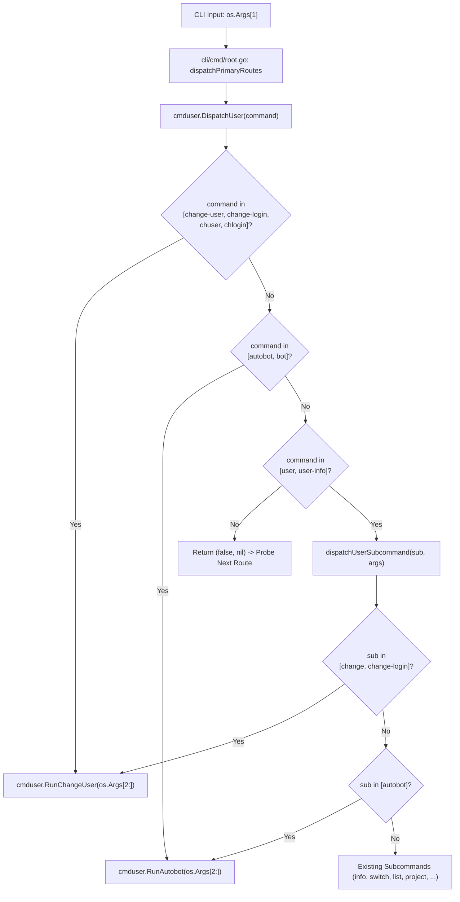
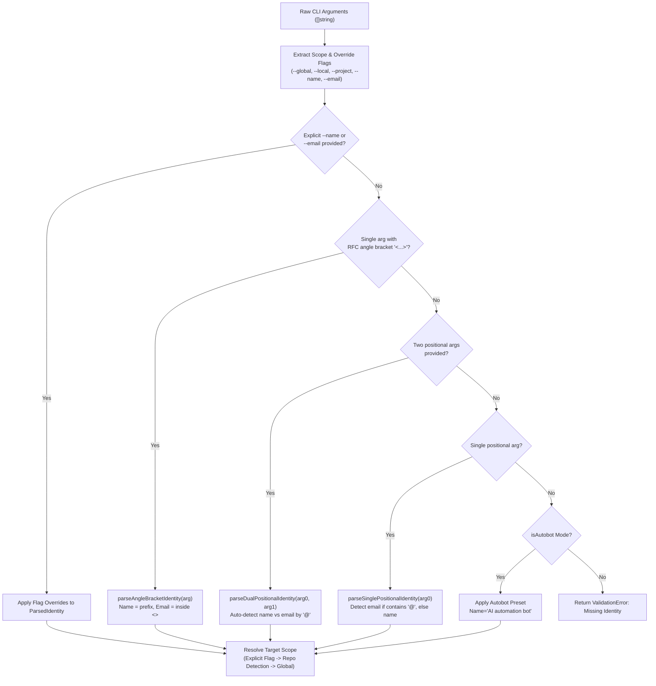
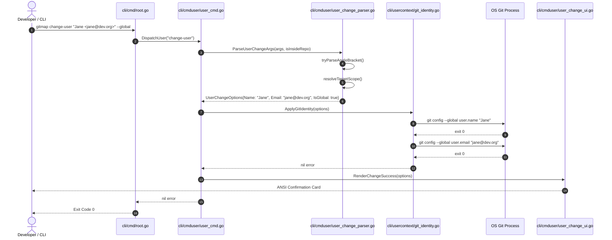

# 347 - GitMap User Change Command: Architecture Specification

- **Spec ID:** `02-spec/21-app/347-gitmap-user-change-command/01-architecture-spec.md`
- **Subsystem:** `cli/cmduser`, `cli/usercontext`, `cli/cmd`, `cli/constants`
- **Status:** APPROVED
- **Target Version:** `v6.628.0`
- **Related Specs:**
  - `02-spec/21-app/347-gitmap-user-change-command/readme.md`
  - `02-spec/21-app/347-gitmap-user-change-command/02-component-spec.md`
  - `02-spec/21-app/347-gitmap-user-change-command/03-migration-and-verification-spec.md`
- **Related Plans:**
  - `.ai-memory/plans/pending/347-gitmap-user-change-command.md`
  - `.ai-memory/plans/subtasks/347-gitmap-user-change-command/01-cli-commands.md`

---

## 1. Executive Summary & Architectural Motivation

Developers frequently need to toggle between personal, enterprise, and autonomous bot identities across Git repositories and global workstation profiles. GitMap provides multi-profile context management under `gitmap user`, but switching identities previously required either interactive configuration prompts or verbose profile binding commands.

This specification establishes the architectural blueprint for streamlined one-liner identity change commands:
1. `gitmap change-user` (aliases: `change-login`, `chuser`, `chlogin`)
2. `gitmap autobot` (alias: `bot`)
3. Subcommand forms under `gitmap user`: `gitmap user change`, `gitmap user change-login`, and `gitmap user autobot`.

### 1.1 Core Architectural Principles
- **One-Liner Input Ergonomics:** Support standard RFC 5322 angle bracket syntax (`"Alice Smith <alice@example.com>"`), dual positional arguments (`"Alice Smith" alice@example.com`), single email/name shorthand, and explicit flag pairs (`--name` / `--email`).
- **Autobot Identity Preset:** Instant one-command transformation to `"AI automation bot"` with optional email specification or clean unsetting/default fallback (`local@local` or empty).
- **Scope Resolution:** Predictable hierarchy across `--global` / `-g` (workstation level), `--local` / `-l` (repository level), and `--project` / `-p` (gitmap project profile store).
- **Zero-Regex Architecture:** All parsing and string transformations are performed via deterministic byte indices and standard library string utilities (`strings.IndexByte`, `strings.LastIndexByte`, `strings.Cut`, `strings.TrimSpace`), eliminating regex overhead and catastrophic backtracking.
- **Strict Coding Guidelines:** All functions adhere to the <= 15 lines rule (<= 8 lines preferred), zero nested `if` statements, positive boolean naming (`is*`, `has*`), and leaf error sovereignty.

---

## 2. Command Routing & Dispatch Architecture

### 2.1 Route Registration in `cli/cmd/root.go`

GitMap uses a layered command dispatch architecture in `cli/cmd/root.go`. Top-level commands are evaluated in `dispatchPrimaryRoutes`:

```
cli/cmd/root.go: dispatchPrimaryRoutes
       │
       ├── dispatch275
       ├── cmduser.DispatchUser  ◄── Intercepts "user", "change-user", "change-login", "autobot"
       ├── cmdfoldertree.DispatchFolderTree
       ├── dispatchCore
       └── ...
```

In `cli/cmd/root.go`, `cmduser.DispatchUser` is probed as part of the primary route group. We extend `cmduser.DispatchUser` so that top-level verbs:
- `change-user`, `change-login`, `chuser`, `chlogin`
- `autobot`, `bot`

are intercepted directly by `cmduser.DispatchUser` and routed to dedicated runners without requiring a secondary pass.

### 2.2 Subcommand Routing in `cli/cmduser/user_cmd.go`

`DispatchUser(command string)` serves as the boundary between root dispatch and the user package:

```go
func DispatchUser(command string) (bool, error) {
	if isChangeUserCommand(command) {
		return true, RunChangeUser(os.Args[2:])
	}

	if isAutobotCommand(command) {
		return true, RunAutobot(os.Args[2:])
	}

	if command != "user" && command != "user-info" {
		return false, nil
	}

	return handleUserCommand(command, os.Args[2:])
}
```

Subcommands under `gitmap user` are handled in `dispatchUserSubcommand`:
- `gitmap user change [args...]` -> `RunChangeUser(args)`
- `gitmap user change-login [args...]` -> `RunChangeUser(args)`
- `gitmap user autobot [args...]` -> `RunAutobot(args)`

### 2.3 Dispatch Flowchart



---

## 3. Input Argument Parsing Strategies

The argument parser converts raw CLI arguments into a validated `UserChangeOptions` domain object. It supports five complementary parsing strategies evaluated in deterministic order.



### 3.1 Strategy 1: RFC 5322 Angle Bracket Syntax (`"Name <email@example.com>"`)

When developers copy-paste Git commit authors or provide identity in standard RFC format:
```bash
gitmap change-user "Jane Doe <jane.doe@example.com>"
gitmap change-user Jane Doe <jane.doe@example.com>
```

#### Parsing Algorithm (Zero-Regex)
1. Join unflagged positional arguments if multiple tokens were passed without shell quotes.
2. Locate the first `<` byte via `strings.IndexByte(s, '<')`.
3. Locate the last `>` byte via `strings.LastIndexByte(s, '>')`.
4. Validate that `openIdx >= 0`, `closeIdx > openIdx + 1`.
5. Extract name substring: `strings.TrimSpace(s[:openIdx])`.
6. Extract email substring: `strings.TrimSpace(s[openIdx+1 : closeIdx])`.
7. Strip any surrounding stray quotes (`"`, `'`) from name and email.

### 3.2 Strategy 2: Dual Positional Arguments (`"Name" email@example.com`)

When name and email are supplied as separate positional parameters:
```bash
gitmap change-user "Jane Doe" jane.doe@example.com
gitmap change-login "Jane Doe" jane.doe@example.com --global
```

#### Parsing Algorithm (Zero-Regex)
1. Collect positional arguments excluding known scope flags (`--global`, `-g`, `--local`, `-l`, `--project`, `-p`, `--json`, `-j`).
2. If count equals 2:
   - Check if arg[1] contains `@`: arg[0] is Name, arg[1] is Email.
   - Check if arg[0] contains `@`: arg[0] is Email, arg[1] is Name (inverted tolerance).
   - If neither contains `@`: arg[0] is Name, arg[1] is Email.

### 3.3 Strategy 3: Single Positional Shorthand

When only a single argument is supplied:
```bash
gitmap change-user dev@example.com
gitmap change-user "Jane Doe"
```

#### Parsing Algorithm (Zero-Regex)
1. If argument contains `@` and lacks `<`: treat as Email, leave Name empty unless autobot mode.
2. If argument lacks `@`: treat as Name, leave Email empty.

### 3.4 Strategy 4: Explicit Flags (`--name` / `--email`)

Explicit flags take highest precedence and override positional arguments:
```bash
gitmap change-user --name "Jane Doe" --email jane.doe@example.com
gitmap change-login -n "Jane Doe" -e jane.doe@example.com --global
```

Flags supported:
- `--name`, `-n`: Explicit author name.
- `--email`, `-e`: Explicit author email.
- `--empty-email`: Explicitly clears `user.email`.

### 3.5 Strategy 5: Autobot Preset Architecture

The `autobot` command triggers automated AI identity provisioning:
```bash
gitmap autobot
gitmap autobot custom.agent@example.com
gitmap autobot --email local@local --global
```

#### Autobot Resolution Rules
- **Name Invariant:** Always sets `user.name` to `"AI automation bot"`.
- **Email Resolution:**
  - If positional argument or `--email` flag provided -> use specified email.
  - If `--empty-email` flag provided -> unsets `user.email`.
  - If no email argument provided -> defaults to `"local@local"` (or leaves empty if `--local` repository configuration already specifies an identity).
- **Global Flag Support:** Passing `--global` or `-g` immediately applies `"AI automation bot"` and target email across the entire machine (`git config --global`).

### 3.6 Scope Resolution Architecture

Scope determines where identity changes are committed:

| Scope | Flags | Target Backend | Precedence |
|:---|:---|:---|:---|
| **Local** | `--local`, `-l` | `git config user.name / user.email` in current repo | 1 (Explicit) |
| **Global** | `--global`, `-g` | `git config --global user.name / user.email` | 1 (Explicit) |
| **Project** | `--project`, `-p` | `.gitmap/project.json` profile binding | 1 (Explicit) |
| **Default** | *(None)* | Local if inside Git repo; Global if outside repo | 2 (Inferred) |

#### Scope Inference Logic
```go
func resolveTargetScope(flags ScopeFlags, isInsideRepo bool) UserChangeScopeType {
	if flags.IsGlobal {
		return ScopeGlobal
	}

	if flags.IsProject {
		return ScopeProject
	}

	if flags.IsLocal || isInsideRepo {
		return ScopeLocal
	}

	return ScopeGlobal
}
```

---

## 4. Zero-Regex <=15 Line Function Design

All parsing functions are strictly decomposed into focused helper functions adhering to the project's <= 15 lines rule, zero nested `if` statements, and positive booleans.

### 4.1 Angle Bracket Parser Implementation Contract

```go
func tryParseAngleBracket(raw string) (ParsedIdentity, bool) {
	openIdx := strings.IndexByte(raw, '<')
	closeIdx := strings.LastIndexByte(raw, '>')
	if openIdx < 0 || closeIdx <= openIdx+1 {
		return ParsedIdentity{}, false
	}

	name := strings.TrimSpace(raw[:openIdx])
	email := strings.TrimSpace(raw[openIdx+1 : closeIdx])

	return ParsedIdentity{
		Name:           stripWrappingQuotes(name),
		Email:          stripWrappingQuotes(email),
		HasName:        len(name) > 0,
		HasEmail:       len(email) > 0,
		IsAngleBracket: true,
	}, true
}
```

### 4.2 Positional Pair Parser Implementation Contract

```go
func parsePositionalPair(first, second string) ParsedIdentity {
	hasSecondAt := strings.IndexByte(second, '@') >= 0
	hasFirstAt := strings.IndexByte(first, '@') >= 0

	if hasFirstAt && !hasSecondAt {
		return buildIdentity(second, first)
	}

	return buildIdentity(first, second)
}
```

### 4.3 Helper Builders

```go
func buildIdentity(name, email string) ParsedIdentity {
	cleanName := stripWrappingQuotes(name)
	cleanEmail := stripWrappingQuotes(email)

	return ParsedIdentity{
		Name:     cleanName,
		Email:    cleanEmail,
		HasName:  len(cleanName) > 0,
		HasEmail: len(cleanEmail) > 0,
	}
}
```

```go
func stripWrappingQuotes(s string) string {
	trimmed := strings.TrimSpace(s)
	if len(trimmed) >= 2 && trimmed[0] == '"' && trimmed[len(trimmed)-1] == '"' {
		return strings.TrimSpace(trimmed[1 : len(trimmed)-1])
	}

	if len(trimmed) >= 2 && trimmed[0] == '\'' && trimmed[len(trimmed)-1] == '\'' {
		return strings.TrimSpace(trimmed[1 : len(trimmed)-1])
	}

	return trimmed
}
```

---

## 5. Domain Models & Type Specifications

### 5.1 Enums & Types (`cli/cmduser/user_change_types.go`)

```go
package cmduser

// UserChangeScopeType defines the configuration boundary.
type UserChangeScopeType string

const (
	ScopeLocal   UserChangeScopeType = "local"
	ScopeGlobal  UserChangeScopeType = "global"
	ScopeProject UserChangeScopeType = "project"
)

// ParsedIdentity holds extracted author credentials.
type ParsedIdentity struct {
	Name           string
	Email          string
	HasName        bool
	HasEmail       bool
	IsAngleBracket bool
}

// UserChangeOptions specifies parameters for identity modification.
type UserChangeOptions struct {
	Name             string
	Email            string
	Scope            UserChangeScopeType
	IsGlobal         bool
	IsLocal          bool
	IsProject        bool
	IsAutobot        bool
	IsEmptyEmail     bool
	HasExplicitEmail bool
	HasExplicitName  bool
}
```

---

## 6. Execution Flow & Git Integration

### 6.1 Invocation Sequence Diagram



### 6.2 Git Identity Integration (`cli/usercontext/git_identity.go`)

Identity application integrates with `cli/usercontext/git_identity.go`:
- When `name` is provided -> `SetGitIdentity(name, ...)` sets `user.name`.
- When `email` is provided -> sets `user.email`.
- When `email` is empty and `IsEmptyEmail: true` -> executes `git config [--global] --unset user.email`.
- When `scope == ScopeProject` -> binds project profile via `usercontext.BindProject` and synchronizes repository.

---

## 7. Error Return Sovereignty & Exit Handling

To maintain database audit capture integrity (`finishCommandAudit` in `root.go`), the following invariants MUST be respected:

1. **Leaf Function Sovereignty:**
   - Functions in `cli/cmduser/user_change_parser.go` and `cli/usercontext/` MUST return raw `error` or wrapped `*apperror.AppError`.
   - Leaf functions MUST NEVER call `cliexit.HandleError` or `os.Exit`.
2. **Top-Level Runner Error Propagation:**
   - `RunChangeUser(args []string) error` and `RunAutobot(args []string) error` bubble errors directly up to `DispatchUser`.
   - `DispatchUser` returns `(bool, error)` to `dispatchPrimaryRoutes`.
3. **Audit Logging Guarantee:**
   - `root.go` catches non-nil errors from `DispatchUser` and writes error telemetry to SQLite DB before clean exit.

---

## 8. Verification & Acceptance Criteria

| Invariant | Acceptance Criteria | Verification Method |
|:---|:---|:---|
| **Angle Bracket Parsing** | `"Jane <jane@example.com>"` extracts name and email accurately | Unit test in `user_change_test.go` |
| **Dual Positional Parsing** | `"Jane Doe" jane@example.com` extracts name and email | Unit test in `user_change_test.go` |
| **Inverted Positional** | `jane@example.com "Jane Doe"` correctly maps email and name | Unit test in `user_change_test.go` |
| **Autobot Preset** | `gitmap autobot` sets Name to `"AI automation bot"` and Email to `"local@local"` | Unit test in `user_change_test.go` |
| **Autobot Custom Email** | `gitmap autobot bot@corp.internal` sets Name to `"AI automation bot"` and Email to `"bot@corp.internal"` | Unit test in `user_change_test.go` |
| **Zero Regex** | No references to `regexp` or `lazyregex` in `cli/cmduser/user_change_*.go` | Code scan |
| **Function Length** | All newly authored functions <= 15 lines | AST / Line counter analysis |
| **Positive Booleans** | All booleans prefixed with `is*` or `has*` | Linter verification |
| **Leaf Error Sovereignty** | Zero `cliexit.HandleError` or `os.Exit` calls in leaf functions | AST inspection |
