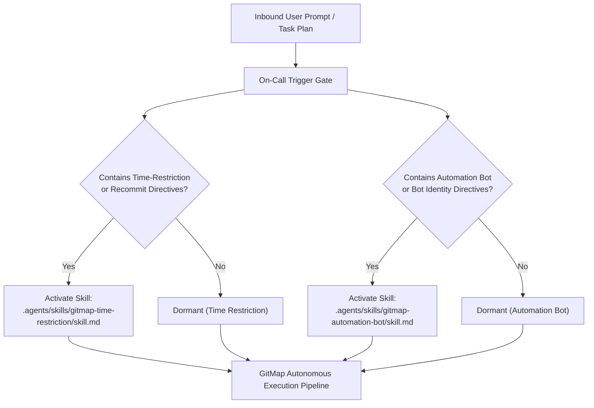
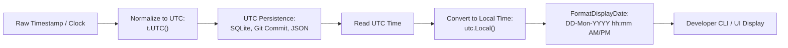
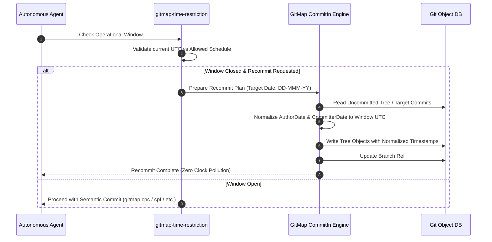

# 348 - Recommit and Skill Creation Instructions: Architecture Specification

- **Spec ID:** `02-spec/21-app/348-recommit-and-skill-creation-instructions/01-architecture-spec.md`
- **Subsystem:** `cli/cmd/commitin`, `cli/cmdcommitin`, `cli/cmduser`, `.agents/skills`, `01-prompts`
- **Status:** APPROVED
- **Target Version:** `v6.629.0`
- **Related Specs:**
  - `02-spec/21-app/348-recommit-and-skill-creation-instructions/readme.md`
  - `02-spec/21-app/348-recommit-and-skill-creation-instructions/02-component-spec.md`
  - `02-spec/21-app/348-recommit-and-skill-creation-instructions/03-migration-and-verification-spec.md`
  - `02-spec/21-app/347-gitmap-user-change-command/01-architecture-spec.md`
  - `02-spec/13-generic-cli/14-date-formatting.md`
- **Related Plans:**
  - `.ai-memory/plans/pending/348-recommit-and-skill-creation-instructions.md`
  - `.ai-memory/plans/subtasks/348-recommit-and-skill-creation-instructions/01-skills-architecture.md`
  - `.ai-memory/plans/subtasks/348-recommit-and-skill-creation-instructions/02-letterly-and-execution-prompts.md`
  - `.ai-memory/plans/subtasks/348-recommit-and-skill-creation-instructions/03-antigravity-integration-and-release.md`

---

## 1. Executive Summary & Architectural Motivation

Autonomous coding agents executing multi-step tasks across large repositories frequently require specialized operational postures that must not be forced into every standard development turn. Two recurring postures are:
1. **Time-Restricted Work & Historical Recommit Disciplines:** Constraining commit activity to sanctioned maintenance windows, normalizing chronological git histories via GitMap's `commitin` engine, and strictly enforcing the repository's unified date/time standard (`DD-MMM-YY`, UTC persistence, local display, date-only branches, zero time pollution).
2. **AI Automation Bot Identity & Sandboxed Execution:** Seamlessly shifting execution identities to `"AI automation bot <local@local>"` (or designated machine profiles), automating Git identity scoping (local vs. global vs. project), and executing unattended multi-agent pipelines with bounded safety gates.

Previously, these operational postures lacked dedicated, standalone agent skills. Attempting to embed these specialized rules directly into the default execution prompts bloated standard turns with unnecessary instructions. Conversely, leaving them undocumented led to inconsistent manual workarounds, divergent branch naming schemes, and non-standard date formats.

This architectural specification establishes:
- The design of two discrete **on-call** Antigravity skills:
  - `gitmap-time-restriction` (`.agents/skills/gitmap-time-restriction/skill.md`)
  - `gitmap-automation-bot` (`.agents/skills/gitmap-automation-bot/skill.md`)
- Strict **on-call trigger semantics** ensuring these skills activate only when requested by the user or an invoking prompt.
- The repository-wide **Date/Time Standard** (`DD-MMM-YY`, UTC persistence, local display, date-only branches, zero time pollution).
- The **GitMap Recommit & CommitIn Engine** integration architecture.
- The **Prompt Integration Architecture** introducing Letterly Prompt `12` and Execution Prompt `09` (V7) while keeping existing V6 prompts strictly immutable.

---

## 2. On-Call Trigger Semantics & Gating Architecture

### 2.1 The On-Call Principle

Skills in GitMap follow an explicit activation taxonomy:
- **Core / Always-Available Skills:** Foundational skills such as `gitmap`, `coding-guidelines`, and `follow-coding-guidelines` that govern standard syntax, formatting, and file hygiene.
- **On-Call Specialized Skills:** Domain-specific procedures that are dormant by default and are activated **if and only if** the user request, parent task plan, or orchestrator prompt explicitly calls for them.



### 2.2 Trigger Mapping Matrix

| Skill Slug | Primary Trigger Keywords | Secondary Intent Patterns | Activation Condition | Default Posture |
|:---|:---|:---|:---|:---|
| `gitmap-time-restriction` | `time-restriction`, `time restrict`, `recommit`, `commitin`, `backdate`, `work-window` | "restrict commits to window", "rewrite commit dates", "normalize timestamps", "replay commits with date" | User prompt or Letterly directive explicitly includes keyword or intent | **Dormant**; standard commits proceed with current wall-clock time |
| `gitmap-automation-bot` | `automation-bot`, `autobot`, `bot identity`, `bot mode`, `ai bot`, `switch to bot` | "run as automation bot", "set author to AI bot", "switch user to bot", "unattended automation" | User prompt, Letterly directive, or CI/CD orchestrator explicitly requests bot identity | **Dormant**; commits retain active developer profile |

### 2.3 Gating Invariants
- **No Implicit Activation:** An agent MUST NOT activate `gitmap-time-restriction` or `gitmap-automation-bot` during regular feature, bug fix, or chore tasks unless explicitly commanded.
- **No Cross-Pollution:** The presence of `gitmap-time-restriction` MUST NOT alter git user configuration unless `gitmap-automation-bot` is also commanded.
- **Strict Relative Path Reference:** All referencing prompts, plans, and subtasks MUST refer to these skills using relative repository paths only:
  - `.agents/skills/gitmap-time-restriction/skill.md`
  - `.agents/skills/gitmap-automation-bot/skill.md`

---

## 3. Date and Time Standard Architecture

### 3.1 The Canonical Layout: `DD-MMM-YY` and `DD-Mon-YYYY`

GitMap enforces a single, deterministic date representation standard across all files, commit messages, database columns, and branch identifiers.

```
Display Layout: DD-Mon-YYYY hh:mm AM/PM (Local Timezone)
Compact Date:   DD-MMM-YY (e.g., 29-Oct-26)
Persistence:    UTC ISO-8601 / Unix Epoch Seconds
```

| Component | Format Code | Allowed Values | Example |
|:---|:---|:---|:---|
| Day | `02` | `01` - `31` (2 digits, zero-padded) | `29` |
| Month | `Jan` | `Jan`, `Feb`, `Mar`, `Apr`, `May`, `Jun`, `Jul`, `Aug`, `Sep`, `Oct`, `Nov`, `Dec` | `Oct` |
| Two-Digit Year | `06` | `24`, `25`, `26`, `27` | `26` |
| Four-Digit Year | `2006` | `2024`, `2025`, `2026` | `2026` |
| Time | `03:04 PM` | 12-hour clock with `AM` / `PM` | `11:18 AM` |

### 3.2 Architectural Pipeline: Storage vs. Display

To prevent timezone skew and inconsistent chronological sorting across multi-node environments, the date/time pipeline enforces strict separation between internal persistence and human-facing display:



1. **UTC Persistence Rule:** Every stored timestamp (SQLite tables, ledger entries, agent task records, JSON artifacts) MUST be written in UTC. No local timezone offsets may be persisted into data layers.
2. **Local Display Rule:** Whenever timestamps are presented to human developers in terminal logs, ANSI cards, or tables, they MUST be converted to the machine's local timezone via `gitutil.FormatDisplayDate(t)` defined in `cli/gitutil/dateformat.go`.
3. **Date-Only Branching Standard:** Feature and maintenance branches referencing dates MUST use the compact date format `DD-MMM-YY` (lowercase, hyphen-separated) without time components:
   - Valid: `feature/29-oct-26-user-change`
   - Valid: `task/29-oct-26-time-restriction`
   - Strictly Banned: `feature/2026-10-29-14-30-00`, `task/oct29_2026_11am`
4. **Zero Time Pollution:** Time strings (hours, minutes, seconds, milliseconds) MUST NEVER be embedded into directory names, branch slugs, or commit titles. Adding high-churn clock values to static identifiers causes cache invalidation, merge conflicts, and dirty working trees.

---

## 4. GitMap Recommit and CommitIn Engine Integration

### 4.1 GitMap CommitIn Subsystem Architecture

GitMap contains an enterprise-grade commit replay, hydration, and historical migration engine located in `cli/cmd/commitin/` and exposed via `cli/cmdcommitin/`.

```
cli/cmd/commitin/
├── orchestrator/          # Pipeline coordinator, dry-run planner, execution context
│   ├── pipeline.go        # Multi-stage replay pipeline
│   ├── commit.go          # Git commit applicator with author/date overrides
│   ├── conflict.go        # Conflict detection and resolution strategy
│   └── setup.go           # Workspace hydration and branch initialization
├── message/               # Commit message parsing, prefixing, and semantic cleanup
│   ├── affix.go           # Prefix and suffix normalization
│   ├── pipeline.go        # Message transformation pipeline
│   └── types.go           # Message transformation options
├── runlog/                # Execution audit, SQLite run recording, tag replay
│   ├── runlog.go          # SQLite runlog recorder
│   ├── releasebranch.go   # Release branch naming resolution
│   └── types.go           # Runlog domain types
└── workspace/             # Isolated repo cloning, locks, and path resolution
```

### 4.2 Recommit & Time-Restricted Mechanics

When the `gitmap-time-restriction` skill is active, GitMap interacts with the git object database using controlled timestamps:



### 4.3 GitMap CLI Command Taxonomy for Identity and Recommit

The on-call skills leverage native GitMap CLI verbs rather than raw git commands:

| Capability | Prohibited Shell Command | Mandatory GitMap Command | Architectural Purpose |
|:---|:---|:---|:---|
| **Identity Switch to Bot** | `git config user.name "bot" && git config user.email "..."` | `gitmap autobot` or `gitmap user autobot` | Atomically configures `"AI automation bot <local@local>"` with scope isolation and ANSI status report |
| **Identity Switch to User** | `git config user.name "..." && git config user.email "..."` | `gitmap change-user "<Name> <email>"` | Parses RFC 5322 or dual positional inputs with zero-regex and applies local/global scope cleanly |
| **Historical Recommit** | `git commit --amend --date="..."` | `gitmap recommit --date "<DD-MMM-YY>" [--window "<hours>"]` | Replays commit with normalized UTC author and committer dates without interactive rebasing |
| **Batch Migration** | Shell scripts looping `git cherry-pick` | `gitmap commitin walk --source <repo> --target <repo>` | Enterprise-grade multi-repo commit streaming with deduplication and runlog audit |
| **Semantic Commit Verbs** | Raw `git commit -m "..."` | `gitmap cpr` (release), `gitmap cpc` (chore), `gitmap cbf` (fix), `gitmap cfr` (refactor), `gitmap cpf` (feature) | Automatically injects uppercase semantic prefix and validates leaf error sovereignty |

---

## 5. Prompt Integration Architecture

### 5.1 Preservation of Existing Prompts (V6 Immutability)

Per user requirements, existing production prompts MUST NOT be mutated:
- `01-prompts/14-execute/02-execute-parent-task-with-n-steps-v6.md` remains untouched as the immutable V6 standard.
- Existing Letterly prompts (`01-prompts/22-letterly/01-*` through `11-*`) remain preserved.

### 5.2 New Prompt Manifest

Two new prompt files are introduced to support time-restriction and recommit workflows:

```
01-prompts/
├── 14-execute/
│   ├── 02-execute-parent-task-with-n-steps-v6.md       # UNTOUCHED (V6 Immutable)
│   └── 09-execute-parent-task-with-n-steps-v7.md       # NEW V7 Execution Standard
└── 22-letterly/
    ├── 03-execute-n-steps-letterly.md                 # UNTOUCHED (V6 Format)
    ├── 11-git-pull-first-letterly.md                  # UNTOUCHED
    └── 12-execute-recommit-time-restricted-letterly.md # NEW Letterly Recommit Prompt
```

### 5.3 Prompt Dependency & Reference Flow

The new prompts declare explicit relative references to the on-call skills:

```markdown
<!-- Reference from 01-prompts/22-letterly/12-execute-recommit-time-restricted-letterly.md -->
### On-Call Skill References:
- Time Restriction & Recommit: `.agents/skills/gitmap-time-restriction/skill.md`
- Automation Bot Identity:     `.agents/skills/gitmap-automation-bot/skill.md`
- Core GitMap Command Matrix:  `.agents/skills/gitmap/skill.md`
```

When an agent executes with Letterly Prompt `12`, it reads the on-call skill definitions and applies the time-restriction and bot configuration steps before generating code or modifying the repository.

---

## 6. Coding Guidelines & Invariant Rules

All implementation code, scripts, and specifications authored under this subsystem MUST strictly adhere to repository guidelines:

| Invariant | Standard | Architectural Enforcement |
|:---|:---|:---|
| **Relative Git Paths** | Always relative (e.g. `02-spec/21-app/...`, `.agents/skills/...`) | TOTAL BAN on absolute paths (`/abs/path`). Enforced across specs, plans, code, and release notes. |
| **Boolean Naming** | Strictly `is*` or `has*` | NO `can*`, `should*`, `was*`, `will*`. NO negative booleans (`isNotValid`, `hasNoErrors`). |
| **Function Length** | <= 15 lines max, <= 8 lines preferred | Break complex logic into discrete single-responsibility helper functions. |
| **Nested Conditionals** | Zero nested `if` statements | Flatten all branching using guard clauses and early returns. |
| **Leaf Error Sovereignty** | Leaf functions return `error` directly | BANNED: calling `cliexit.HandleError` or `os.Exit` inside leaf functions. Bubble errors to `root.go` dispatchers for DB audit capture. |
| **Date/Time Uniformity** | DD-MMM-YY, UTC persistence, local display | Single layout constant, zero time pollution in branches/filenames. |

---

## 7. Architectural Risk Assessment & Mitigations

| Identified Risk | Severity | Root Cause | Mitigation Strategy |
|:---|:---:|:---|:---|
| **Accidental Automatic Skill Activation** | High | Agents eagerly loading all skills in `.agents/skills/` | Distinct `name` and metadata in YAML frontmatter; explicit on-call instructions instructing agents to ignore the skill unless explicitly prompted. |
| **Timezone Skew in Recommits** | Medium | Workstations computing dates in varying local offsets | Normalize every incoming timestamp to `t.UTC()` before performing commit object calculations. |
| **Working Tree Pollution via Clock Data** | Medium | Generating branch names with seconds or time components | Enforce date-only branch naming rule (`feature/DD-MMM-YY-slug`) via CI and git hooks. |
| **Mutation of V6 Prompts** | Critical | Accidental edits to legacy execution templates | Maintain V6 files as read-only; author V7 and Letterly 12 as separate additive artifacts. |
