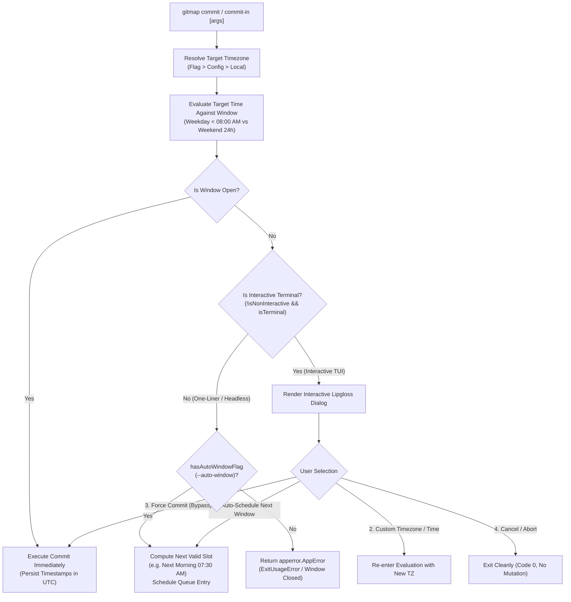
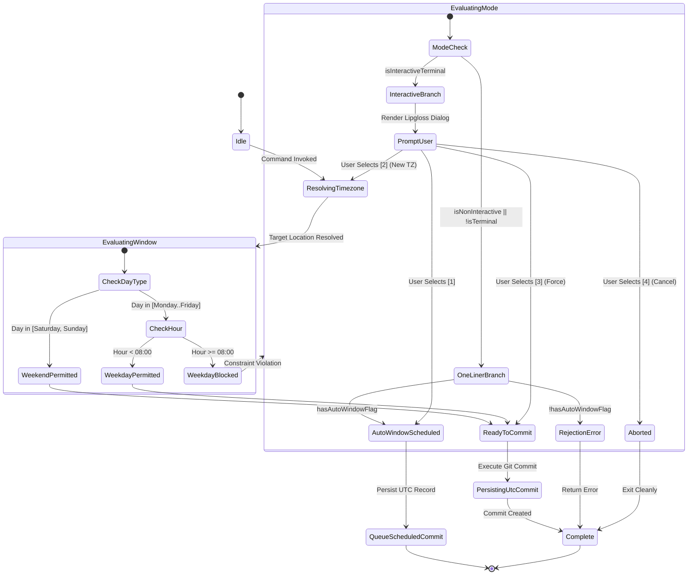
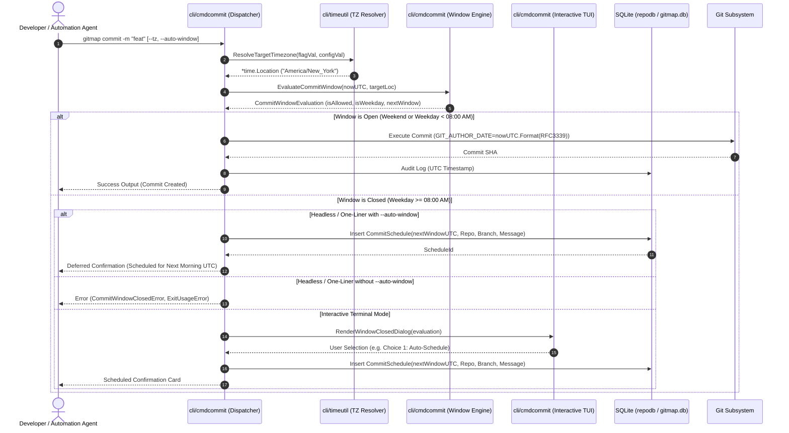

# 349 - GitMap Timezone and Commit Scheduling: Architecture Specification

- **Spec ID:** `02-spec/21-app/349-gitmap-timezone-and-commit-scheduling/01-architecture-spec.md`
- **Subsystem:** `cli/cmdcommit`, `cli/cmdschedule`, `cli/cmdcommitin`, `cli/timeutil`, `cli/config`, `cli/constants`
- **Status:** APPROVED
- **Target Version:** `v6.630.0`
- **Related Specs:**
  - `02-spec/13-generic-cli/14-date-formatting.md`
  - `02-spec/21-app/348-recommit-and-skill-creation-instructions/01-architecture-spec.md`
  - `02-spec/21-app/347-gitmap-user-change-command/01-architecture-spec.md`
  - `02-spec/02-coding-guidelines/readme.md`
  - `02-spec/03-error-manage/readme.md`
- **Related Plans:**
  - `.ai-memory/plans/subtasks/349-gitmap-timezone-and-commit-scheduling/01-timezone-scheduling-architecture.md`

---

## 1. Executive Summary & Architectural Motivation

In modern distributed development environments and autonomous multi-agent pipelines, engineering teams often operate across disparate time zones and enforce strict production commit schedules. To maintain high developer velocity while preventing uncoordinated merges and unexpected releases during active business hours, teams require an intelligent, timezone-aware commit scheduling mechanism.

This specification establishes the architectural design for **GitMap Timezone Resolution and Commit Window Scheduling**:
1. **Target Timezone Resolution Hierarchy:** A deterministic three-tier hierarchy that resolves the operational timezone across CLI flags, persistent configuration settings, and host system defaults.
2. **Commit Window Policy Engine:**
   - **Weekday Constraint (Monday through Friday):** Commits are strictly constrained to hours before 08:00 AM (`00:00:00` to `07:59:59`) in the resolved target timezone. At or after 08:00 AM, immediate commits are blocked and redirected to scheduling or override pipelines.
   - **Weekend Rule (Saturday and Sunday):** Commits are permitted anytime throughout the 24-hour cycle (`00:00:00` to `23:59:59`) without time-of-day restrictions.
3. **Dual Interaction Paradigms:**
   - **One-Liner Flag Mode:** Scriptable, deterministic flags (`--tz`, `--schedule`, `--auto-window`, `--non-interactive`) enabling headless automation bots and CI/CD pipelines to calculate windows and queue commits without human intervention.
   - **Interactive Terminal Mode:** Rich terminal prompts providing visual feedback, explaining window closures, and enabling developers to schedule for the next morning window, adjust target timezones, or apply governed overrides.
4. **Universal UTC Storage Invariant:** Irrespective of the target timezone used for scheduling or display, all underlying SQLite database timestamps and Git commit metadata (`GIT_AUTHOR_DATE`, `GIT_COMMITTER_DATE`) are persisted strictly in UTC (`t.UTC()`).
5. **Architectural Guardrails:** Full adherence to leaf error return sovereignty, zero nested conditionals, positive boolean naming (`is*`, `has*` only), and strict 15-line function limits.

---

## 2. Target Timezone Resolution Hierarchy

### 2.1 The Three-Tier Precedence Order

When a commit or scheduling operation is initiated, GitMap determines the active target timezone through a strict, deterministic resolution hierarchy. Higher-tier sources supersede lower-tier sources without ambiguity:

```
┌─────────────────────────────────────────────────────────────┐
│ 1. CLI Flags: --tz / --timezone <IANA or Alias>             │  ◄── Highest Priority
└──────────────────────────────┬──────────────────────────────┘
                               │ (if omitted or empty)
                               ▼
┌─────────────────────────────────────────────────────────────┐
│ 2. GitMap Config: commit_timezone in Setting Split-DB       │  ◄── Persistent Preference
└──────────────────────────────┬──────────────────────────────┘
                               │ (if unconfigured or empty)
                               ▼
┌─────────────────────────────────────────────────────────────┐
│ 3. Host System Local Timezone: time.Local (OS environment)  │  ◄── Default Fallback
└─────────────────────────────────────────────────────────────┘
```

| Tier | Source | Resolution Mechanism | Example Values |
|:---|:---|:---|:---|
| **Tier 1 (Highest)** | Command-Line Flag | `--tz="America/New_York"` or `--timezone="UTC"` | `America/New_York`, `Asia/Tokyo`, `Europe/London`, `UTC` |
| **Tier 2 (Config)** | GitMap Database | `Setting` table key `commit_timezone` via `config.GetSetting` | `Asia/Singapore`, `US/Pacific`, `Australia/Sydney` |
| **Tier 3 (Fallback)** | System Environment | Host operating system timezone via `time.Local` | Machine local location (e.g. `Local`, `EDT`, `JST`) |

### 2.2 Timezone Location Loading & Validation

Timezone strings are validated using Go's `time.LoadLocation(name)`. To prevent crashes and ambiguous behaviors, GitMap incorporates deterministic alias translation and sanitized error wrapping:

```go
// TimezoneResolution captures the resolved location and provenance.
type TimezoneResolution struct {
	Location   *time.Location
	SourceType TimezoneSourceType
	RawName    string
	IsExplicit bool
}
```

#### Timezone Alias Normalization
Common shorthand aliases are transparently mapped to standard IANA timezone database identifiers before resolution:
- `"local"` / `""` -> System `time.Local`
- `"utc"` / `"zulu"` -> `time.UTC`
- `"est"` / `"edt"` -> `"America/New_York"`
- `"cst"` / `"cdt"` -> `"America/Chicago"`
- `"mst"` / `"mdt"` -> `"America/Denver"`
- `"pst"` / `"pdt"` -> `"America/Los_Angeles"`
- `"gmt"` -> `"Etc/GMT"`

If an unresolvable or invalid timezone identifier is supplied via CLI flags or config, the parser immediately yields a structured `apperror.AppError` with exit code `ExitUsageError`. Under leaf error sovereignty, this error bubbles to the root dispatcher without triggering `os.Exit` inside the lookup leaf.

---

## 3. Commit Window Policy & Constraint Engine

### 3.1 Business Policy Invariants

The commit window policy protects core business hours by restricting developer commit traffic during weekday workdays while leaving weekends unencumbered:

1. **Weekday Policy (Monday, Tuesday, Wednesday, Thursday, Friday):**
   - **Allowed Window:** `00:00:00` <= `TargetTime` < `08:00:00` (strictly before 08:00 AM).
   - **Closed Window:** `08:00:00` <= `TargetTime` <= `23:59:59`. Immediate commits are disallowed.
2. **Weekend Policy (Saturday, Sunday):**
   - **Allowed Window:** `00:00:00` <= `TargetTime` <= `23:59:59` (full 24-hour unconstrained access).

```
Target Time (Weekday: Mon-Fri)
00:00                    08:00                                        23:59
├──────────────────────────┼────────────────────────────────────────────┤
│   COMMITS ALLOWED        │              WINDOW CLOSED                 │
│   (Before 08:00 AM)      │   (Requires --schedule or --auto-window)   │
└──────────────────────────┴────────────────────────────────────────────┘

Target Time (Weekend: Sat-Sun)
00:00                                                                 23:59
├───────────────────────────────────────────────────────────────────────┤
│                   COMMITS PERMITTED 24 HOURS                          │
└───────────────────────────────────────────────────────────────────────┘
```

### 3.2 Window Evaluation Logic & Domain Types

```go
// CommitWindowEvaluation models the outcome of checking a timestamp against policies.
type CommitWindowEvaluation struct {
	TargetTime          time.Time
	TargetLocation      *time.Location
	IsAllowed           bool
	IsWeekday           bool
	IsWeekend           bool
	IsBeforeCutoff      bool
	NextAvailableWindow time.Time
}
```

The validation algorithm computes day-of-week and hour in the resolved target location:
1. Convert timestamp `t` to target location: `locTime := t.In(targetLoc)`.
2. Extract weekday: `weekday := locTime.Weekday()`.
3. Check weekend status: if `weekday == time.Saturday || weekday == time.Sunday`, commit is unconditionally allowed (`IsAllowed = true`).
4. Check weekday cutoff: if `locTime.Hour() < 8`, commit is allowed (`IsAllowed = true`).
5. If closed (`locTime.Hour() >= 8`), calculate `NextAvailableWindow`.

### 3.3 Next-Available Window Calculation (`--auto-window`)

When a commit is requested during a closed window (e.g. Wednesday at 14:30), the `--auto-window` engine computes the earliest subsequent open slot:
- If current day is **Monday through Thursday**: The next valid window opens at `00:00:00` of the following morning, with the default scheduled target set to `07:30:00 AM` in the target timezone.
- If current day is **Friday at or after 08:00 AM**: The next valid window opens immediately at Saturday `00:00:00 AM` (since weekends are unconstrained 24h).
- If current day is **Sunday**: Commits are already unconstrained; if scheduling in advance, Monday `07:30:00 AM` is targeted.

---

## 4. Dual Operational Paradigms: One-Liner CLI vs. Interactive Mode

GitMap provides two operational paths to satisfy both headless automation environments and developer-centric interactive terminals.



### 4.1 One-Liner Flag Mode (Headless / Automated Pipelines)

In non-interactive shells, continuous integration runners, or autonomous agent execution loops, GitMap operates without blocking terminal inputs.

#### Supported CLI Flags
- `--tz <name>` / `--timezone <name>`: Explicitly declare target timezone (e.g. `--tz="UTC"`, `--tz="America/New_York"`).
- `--schedule <time-spec>`: Explicitly schedule commit execution for a specific timestamp (e.g. `--schedule="tomorrow 07:15"` or ISO-8601).
- `--auto-window`: Automatically defer and schedule the commit for the next compliant window if current target time is outside the permitted window.
- `--non-interactive` / `-y`: Explicitly suppress interactive terminal dialogs.
- `--force-window`: Administrative override to bypass weekday cutoff (generates audit warning).

#### Headless Behavior Matrix
| Current Window | `--auto-window` | `--schedule` | Result | Exit Code |
|:---|:---|:---|:---|:---|
| **Open** | Ignored | Omitted | Immediate Commit executed in UTC | `0` (Success) |
| **Open** | Ignored | Specified | Scheduled for requested time (UTC) | `0` (Success) |
| **Closed** | `true` | Omitted | Scheduled for next morning 07:30 AM (UTC) | `0` (Success) |
| **Closed** | `false` | Specified | Scheduled for requested time (UTC) | `0` (Success) |
| **Closed** | `false` | Omitted | Immediate failure with structured error message | `ExitUsageError` |

### 4.2 Interactive Terminal Mode

When GitMap detects an active TTY and no headless flags are supplied, encountering a closed commit window activates an interactive Lipgloss terminal dialog:

```
┌─────────────────────────────────────────────────────────────────────────────┐
│ ⚠️  GITMAP COMMIT WINDOW RESTRICTION                                        │
├─────────────────────────────────────────────────────────────────────────────┤
│ Target Timezone: America/New_York (Resolved via --tz flag)                  │
│ Current Time:    29-Oct-2026 02:45 PM EDT (Weekday)                         │
│ Allowed Window:  Monday - Friday, strictly before 08:00 AM                  │
│ Status:          WINDOW CLOSED (Current hour 14:00 >= 08:00)                │
├─────────────────────────────────────────────────────────────────────────────┤
│ Select an action:                                                           │
│   [1] Schedule commit for next available window (30-Oct-2026 07:30 AM EDT) │
│   [2] Change target timezone                                                │
│   [3] Force commit now (Record audit override)                              │
│   [4] Cancel commit operation                                               │
└─────────────────────────────────────────────────────────────────────────────┘
```

The interactive prompt allows rapid keyboard selection (`1`-`4` or arrow navigation) and ensures developer intention is respected without losing staged changes or command context.

---

## 5. Storage Invariant & Timestamp Serialization

### 5.1 Universal UTC Persistence

A foundational architectural requirement in GitMap is that **all persistent storage layers operate exclusively in UTC**. Local timezones and target scheduling timezones are projection concepts used solely for business constraint evaluation and user presentation.

```
Input Local/Target Time ──► [ Constraint Engine: Target TZ ]
                                      │
                                      ▼
                            Normalize to UTC (t.UTC())
                                      │
             ┌────────────────────────┴────────────────────────┐
             ▼                                                 ▼
   Git Commit Metadata                              SQLite Persistence
   - GIT_AUTHOR_DATE: RFC3339 UTC                   - gitmap.db Setting: UTC
   - GIT_COMMITTER_DATE: RFC3339 UTC                - repodb / Schedule: UTC
   - Commit Object: Unix Seconds UTC                - RunLog: ISO-8601 UTC
```

### 5.2 Storage Schema & Data Modeling

#### 1. GitMap Split-DB `Setting` Table Key
- **Key:** `commit_timezone`
- **Value:** Canonical IANA timezone identifier (e.g. `America/New_York`).
- **Storage:** Persisted in `gitmap.db` via `constants.SQLUpsertSetting`.

#### 2. Commit Schedule Queue Table (`repodb` / `gitmap.db`)
Scheduled commits deferred via `--auto-window` or `--schedule` are stored in the `CommitSchedule` table:

```sql
CREATE TABLE IF NOT EXISTS CommitSchedule (
    ScheduleId         TEXT PRIMARY KEY,
    RepoPath           TEXT NOT NULL,
    BranchName         TEXT NOT NULL,
    TargetTimezone     TEXT NOT NULL,
    ScheduledUtc       TEXT NOT NULL,
    CreatedUtc         TEXT NOT NULL,
    CommitMessage      TEXT NOT NULL,
    AuthorName         TEXT NOT NULL,
    AuthorEmail        TEXT NOT NULL,
    IsAutoWindow       INTEGER NOT NULL DEFAULT 0,
    Status             TEXT NOT NULL DEFAULT 'PENDING'
);
```

All `*Utc` columns are formatted using `timeutil.FormatISO(t.UTC())`.

### 5.3 Date Formatting & Presentation Standard

In accordance with `02-spec/13-generic-cli/14-date-formatting.md`:
- All displayed timestamps render as: `DD-Mon-YYYY hh:mm AM/PM` followed by the timezone identifier.
- Presentation helper:
  ```go
  func FormatTargetDisplayDate(t time.Time, loc *time.Location) string {
      return t.In(loc).Format("02-Jan-2006 03:04 PM") + " " + loc.String()
  }
  ```

---

## 6. Architecture & Workflow Visualizations

### 6.1 State Machine: Commit Window & Scheduling Lifecycle



### 6.2 Sequence Diagram: End-to-End Execution Flow



---

## 7. Component Architecture & Code Implementation Contracts

### 7.1 Target Component Mapping

| Subsystem Package | Target File Path | Architectural Responsibility |
|:---|:---|:---|
| `cli/constants` | `cli/constants/constants_timezone.go` | Declare timezone setting keys, exit codes, default cutoff hours (`08:00 AM`), and flags. |
| `cli/timeutil` | `cli/timeutil/timezone_resolver.go` | Implement three-tier timezone resolution (`--tz` > config > local), location validation, and aliases. |
| `cli/cmdcommit` | `cli/cmdcommit/commit_window_types.go` | Declare domain models: `TimezoneResolution`, `CommitWindowEvaluation`, `CommitScheduleOptions`. |
| `cli/cmdcommit` | `cli/cmdcommit/commit_window_evaluator.go` | Core business logic for weekday cutoff, weekend pass, and next available window calculation. |
| `cli/cmdcommit` | `cli/cmdcommit/commit_window_ui.go` | Lipgloss interactive dialog for terminal-based closed window resolution. |
| `cli/cmdcommit` | `cli/cmdcommit/commit_schedule_store.go` | SQLite persistence layer for queuing deferred commits with UTC normalization. |
| `cli/cmdcommit` | `cli/cmdcommit/commit_cmd.go` | Wire window evaluation and scheduling into root commit command execution pipeline. |
| `cli/config` | `cli/config/settings.go` | Add `CommitTimezone` field and accessor `GetCommitTimezone()` to application settings. |

### 7.2 Strict Coding Guideline Conformance

1. **Leaf Error Return Sovereignty:**
   - Functions in `cli/timeutil` and `cli/cmdcommit` that evaluate windows or resolve timezones MUST return `(Result, error)` or `error` directly.
   - Under no circumstances shall leaf helpers invoke `cliexit.HandleError` or `os.Exit`.
   - Only top-level CLI runners (`RunCommit`, `RunSchedule`) intercept errors and invoke handlers.
2. **15-Line Function Limit:**
   - All helper functions MUST remain <= 15 lines of executable code (<= 8 lines preferred). Complex branches must be factored into discrete evaluation helpers.
3. **Zero Nested Ifs:**
   - Conditional structures must use guard clauses and early returns. No nested `if` statements are permitted.
4. **Positive Booleans Only:**
   - All boolean identifiers must begin with `is*` or `has*`:
     - Allowed: `isAllowed`, `isWeekday`, `isWeekend`, `isBeforeCutoff`, `isInteractive`, `isAutoWindow`, `hasCustomTz`, `hasExplicitSchedule`.
     - Forbidden: `isNotAllowed`, `hasNoTz`, `isBlocked`, `disabled`.
5. **Whitespace Rules:**
   - Exactly one blank line after closing brace `}` and one blank line before `return`.

---

## 8. Failure Modes, Edge Cases & Security Auditing

### 8.1 Daylight Saving Time (DST) Transitions
When converting times across spring-forward or fall-back boundaries:
- Go's `time.LoadLocation` handles standard IANA rules accurately.
- Storage in UTC (`t.UTC()`) guarantees absolute monotonic time representation without ambiguities or duplicate timestamp collisions during fall-back transitions.

### 8.2 Database Audit Trail
All commit attempts—both successful immediate commits, queued schedules, and administrative overrides—are logged to `gitmap.db` via `finishCommandAudit`. The audit record captures:
- Command name (`commit`, `cin`)
- Target timezone evaluated
- Window status (`ALLOWED`, `SCHEDULED`, `REJECTED`, `OVERRIDDEN`)
- Execution duration and UTC completion timestamp.

---

## 9. Specification Sign-Off & Verification Criteria

A pull request or task execution implementing this specification is considered complete if and only if:
1. `02-spec/21-app/349-gitmap-timezone-and-commit-scheduling/01-architecture-spec.md` is approved and verified.
2. `.ai-memory/plans/subtasks/349-gitmap-timezone-and-commit-scheduling/01-timezone-scheduling-architecture.md` subtask checklist is fully tracked.
3. Unit test coverage across `cli/timeutil/` and `cli/cmdcommit/` validates:
   - CLI flag overriding config and local timezone.
   - Weekday commit at 07:59 AM being allowed.
   - Weekday commit at 08:00 AM being rejected / deferred.
   - Weekend commit at any hour (00:00 - 23:59) being allowed.
   - All persisted timestamps across SQLite and Git commit records matching `t.UTC()`.
4. Zero lint or style errors under GitMap repository coding guidelines.
