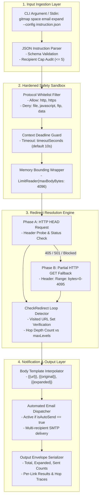

# JSON Instruction and Safety Specification

- **Spec ID:** `02-spec/21-app/351-json-instruction-and-cli-integration/01-json-instruction-and-safety-spec.md`
- **Status:** `APPROVED`
- **Version:** `1.0.0`
- **Subsystem:** Link Expansion Engine, JSON Automation Pipeline, Safety Sandbox
- **Dependencies:** `cli/linkexpander`, `cli/cmdspace`, `cli/apperror`, `cli/constants`
- **Version Baseline:** `v6.628.5`
- **Target Version:** `v6.629.0`

---

## 1. Executive Summary & Objective

The Link Expansion and Automation Engine provides a unified, secure, machine-readable JSON instruction format for automated link resolution, redirect unrolling, and transactional email notification delivery via the GitMap CLI.

Automated pipelines, CI/CD runners, and headless agents frequently need to resolve shortened or masked URLs, inspect deep affiliate or partnership landing destinations, and immediately alert stakeholders or downstream webhooks. Allowing unconstrained HTTP client execution introduces critical vulnerabilities: server-side request forgery (SSRF), infinite redirect loops, denial-of-service via huge payload downloads, and script injection.

This specification formalizes:
1. **Unified Instruction Schema:** A declarative JSON contract defining input links, delivery targets, redirect depths, and sandbox constraints.
2. **Hardened Safety Sandbox:** Strict protocol whitelisting (rejecting `file://`, `javascript:`, `data:`), memory bounding (`maxBodyBytes` streaming cutoffs), zero-JavaScript runtime execution, and loop/cycle detection.
3. **Optimized Request Pipeline:** Dual-strategy resolution utilizing lightweight HTTP `HEAD` probes with automatic fallback to partial byte-range `GET` requests (`Range: bytes=0-4095`).
4. **Structured Output Envelopes:** Exhaustive machine-readable JSON output telemetry capturing per-hop traces, status codes, delivery receipts, and strongly typed `AppError` details.

---

## 2. System Architecture & Execution Topology



---

## 3. Complete JSON Schema & Field Definitions

### 3.1 Formal JSON Schema (Draft-07)

```json
{
  "$schema": "http://json-schema.org/draft-07/schema#",
  "title": "LinkExpansionInstruction",
  "type": "object",
  "required": ["links"],
  "additionalProperties": false,
  "properties": {
    "links": {
      "type": "array",
      "description": "List of link target specifications to expand and optionally notify.",
      "minItems": 1,
      "items": {
        "type": "object",
        "required": ["url"],
        "additionalProperties": false,
        "properties": {
          "url": {
            "type": "string",
            "format": "uri",
            "description": "Target URL to expand."
          },
          "recipients": {
            "type": "array",
            "description": "Recipient email addresses. Maximum 5 addresses per link.",
            "maxItems": 5,
            "items": {
              "type": "string",
              "format": "email"
            }
          },
          "subject": {
            "type": "string",
            "description": "Email subject line used when isAutoSend is enabled."
          },
          "bodyTemplate": {
            "type": "string",
            "description": "Email body template supporting {{url}}, {{original}}, and {{expanded}} placeholders."
          }
        }
      }
    },
    "maxLevels": {
      "type": "integer",
      "description": "Maximum number of redirect hops to traverse. Default is 10. Value 0 halts on first redirect.",
      "minimum": 0,
      "maximum": 50,
      "default": 10
    },
    "infinite": {
      "type": "boolean",
      "description": "When true, disables maxLevels hop limit while maintaining strict cycle/loop detection.",
      "default": false
    },
    "safety": {
      "type": "object",
      "description": "Sandbox isolation and defensive execution constraints.",
      "additionalProperties": false,
      "properties": {
        "allowedProtocols": {
          "type": "array",
          "description": "Permitted URI schemes. Rejects file, javascript, data, ftp, etc.",
          "items": { "type": "string" },
          "default": ["http", "https"]
        },
        "maxBodyBytes": {
          "type": "integer",
          "description": "Maximum response payload bytes read before stream termination. Default is 4096.",
          "minimum": 256,
          "maximum": 1048576,
          "default": 4096
        },
        "timeoutSeconds": {
          "type": "integer",
          "description": "Per-request and cumulative hop execution timeout in seconds. Default is 10.",
          "minimum": 1,
          "maximum": 120,
          "default": 10
        },
        "noJavaScript": {
          "type": "boolean",
          "description": "Guarantees pure HTTP client HEAD/GET execution with zero DOM evaluation or script execution.",
          "default": true
        }
      }
    },
    "autoSend": {
      "type": "boolean",
      "description": "When true, automatically dispatches emails to configured recipients upon link expansion.",
      "default": false
    }
  }
}
```

### 3.2 Go Domain Type Models

Following GitMap strict boolean naming conventions (`is*` and `has*` only) and pointer reduction guidelines, the Go domain structures are defined as follows:

```go
package linkexpander

// LinkInstructionItem defines a single URL target and its notification configuration.
type LinkInstructionItem struct {
	URL          string   `json:"url"`
	Recipients   []string `json:"recipients,omitempty"`
	Subject      string   `json:"subject,omitempty"`
	BodyTemplate string   `json:"bodyTemplate,omitempty"`
}

// SafetyConfig defines sandbox constraints and resource limits.
type SafetyConfig struct {
	AllowedProtocols []string `json:"allowedProtocols"`
	MaxBodyBytes     int64    `json:"maxBodyBytes"`
	TimeoutSeconds   int      `json:"timeoutSeconds"`
	IsNoJavaScript   bool     `json:"noJavaScript"`
}

// ExpandInstruction defines the root configuration model parsed from JSON input.
type ExpandInstruction struct {
	Links       []LinkInstructionItem `json:"links"`
	MaxLevels   int                   `json:"maxLevels"`
	IsInfinite  bool                  `json:"infinite"`
	Safety      SafetyConfig          `json:"safety"`
	IsAutoSend  bool                  `json:"autoSend"`
}

// DefaultSafetyConfig returns hardened default security parameters.
func DefaultSafetyConfig() SafetyConfig {
	return SafetyConfig{
		AllowedProtocols: []string{"http", "https"},
		MaxBodyBytes:     4096,
		TimeoutSeconds:   10,
		IsNoJavaScript:   true,
	}
}

// DefaultExpandInstruction constructs an ExpandInstruction populated with safe defaults.
func DefaultExpandInstruction() ExpandInstruction {
	return ExpandInstruction{
		MaxLevels:  10,
		IsInfinite: false,
		Safety:     DefaultSafetyConfig(),
		IsAutoSend: false,
	}
}
```

### 3.3 Field-by-Field Technical Breakdown

| Field Name | Type | Default | Validation & Constraints | Description |
|---|---|---|---|---|
| `links` | `[]LinkInstructionItem` | *Required* | Min: 1 item | Collection of URLs to evaluate, resolve, and optionally send via email. |
| `links[].url` | `string` | *Required* | Valid absolute URI | Target URL to expand. Validated against `safety.allowedProtocols`. |
| `links[].recipients` | `[]string` | `[]` | Max 5 email addresses | Target recipients. Strict 5-recipient cap prevents accidental broadcast and mail server abuse. |
| `links[].subject` | `string` | `""` | Max 255 chars | Email subject line. Interpolated if placeholders are present. |
| `links[].bodyTemplate` | `string` | `""` | Supports `{{url}}`, `{{original}}`, `{{expanded}}` | Template body. Replaced with final resolved URLs during expansion. |
| `maxLevels` | `int` | `10` | `0 <= maxLevels <= 50` | Maximum redirect hops. When set to `0`, expansion stops at the initial target without following redirects. |
| `infinite` (`isInfinite`) | `bool` | `false` | Boolean flag | When `true`, overrides `maxLevels` restriction. Traversal continues until terminal destination or cycle detection. |
| `safety.allowedProtocols` | `[]string` | `["http", "https"]` | Normalized lowercase | Schemes permitted for execution. Any other scheme immediately halts execution with `apperror.ErrInvalidProtocol`. |
| `safety.maxBodyBytes` | `int64` | `4096` | `256 <= maxBodyBytes <= 1048576` | Response stream bound. Ensures memory safety against decompression bombs or oversized payload downloads. |
| `safety.timeoutSeconds` | `int` | `10` | `1 <= timeoutSeconds <= 120` | Execution deadline applied to HTTP client context across all hops. |
| `safety.noJavaScript` (`isNoJavaScript`) | `bool` | `true` | Must remain `true` | Enforces zero-DOM headless net/http operation. JavaScript execution engines (V8, NodeJS, Chrome) are never invoked. |
| `autoSend` (`isAutoSend`) | `bool` | `false` | Boolean flag | When `true`, invokes SMTP delivery engine for links containing valid recipients. |

---

## 4. Sandboxing & Safety Execution Engine

### 4.1 URL Protocol Sanitization & SSRF Defense

Before issuing network requests, every URL must pass pre-flight scheme validation:
1. **URI Parsing:** Input string is parsed via Go's standard library `net/url.ParseRequestURI`.
2. **Scheme Allowlist Audit:** Scheme is extracted, lowercased, and compared against `safety.allowedProtocols`.
   - Permitted: `http`, `https`.
   - Rejected: `file://`, `javascript:`, `ftp://`, `data:`, `gopher:`, `blob:`, `tel:`.
3. **Invalid Scheme Error:** If an unapproved scheme is detected, the engine aborts evaluation for that link and returns a typed error:
   ```go
   return apperror.Wrap(ErrInvalidProtocol, fmt.Sprintf("unsupported protocol scheme '%s'", parsedURL.Scheme))
   ```

### 4.2 Loop & Cycle Detection Architecture

Redirect tracking must protect the runtime against circular redirect configurations (e.g., `A -> B -> C -> A` or `A -> B -> B`).

1. **Visited Map State:** Each link expansion creates an isolated redirect tracking context containing a visited URL lookup table (`map[string]int`).
2. **Normalized Key Storage:** Before following a redirect in `http.Client.CheckRedirect`, the destination URL is stripped of trailing slashes and normalized:
   ```go
   func createRedirectHandler(maxLevels int, isInfinite bool, visited map[string]int, trace *[]string) func(req *http.Request, via []*http.Request) error {
       return func(req *http.Request, via []*http.Request) error {
           hopCount := len(via)
           targetURL := req.URL.String()
           *trace = append(*trace, targetURL)

           if _, hasSeen := visited[targetURL]; hasSeen {
               return apperror.Wrap(ErrRedirectLoopDetected, fmt.Sprintf("circular redirect detected at '%s'", targetURL))
           }
           visited[targetURL] = hopCount

           if !isInfinite && hopCount >= maxLevels {
               return http.ErrUseLastResponse
           }

           return nil
       }
   }
   ```
3. **Graceful Halting:** When `hopCount >= maxLevels` and `isInfinite` is `false`, the client returns `http.ErrUseLastResponse`, safely terminating traversal at the latest valid hop without raising a fatal system error.

### 4.3 Two-Phase Request Strategy (HEAD First with Byte-Range GET Fallback)

To minimize bandwidth consumption, latency, and resource footprint, the engine executes a conservative two-phase probe:

1. **Phase 1 (HTTP HEAD):**
   - Dispatches an HTTP `HEAD` request with standard User-Agent header (`gitmap-linkexpander/1.0`).
   - If the server responds with status `< 400` or returns a redirect location header, the redirect handler tracks the hop without downloading any response body.
2. **Phase 2 (HTTP GET Fallback):**
   - Certain web servers or CDN edge endpoints block or misconfigure `HEAD` requests (returning `405 Method Not Allowed`, `403 Forbidden`, or `501 Not Implemented`).
   - Upon encountering status code `>= 400` from `HEAD`, the engine initiates an HTTP `GET` request configured with a byte-range request header:
     ```http
     Range: bytes=0-4095
     ```
3. **Memory Bounding & Stream Truncation:**
   - Any response stream is wrapped in `io.LimitReader(resp.Body, safety.MaxBodyBytes)`.
   - The body reader is immediately drained up to the limit and closed via `defer resp.Body.Close()`, preventing connection leaks or memory starvation.

### 4.4 Error Management & Leaf Sovereignty

In adherence with GitMap Error Architecture guidelines:
- **Leaf Error Sovereignty:** All internal expansion methods (`ExpandURLWithInstruction`, `resolveRedirectHops`, `validateInstruction`) declare `error` return values and return raw or wrapped `*apperror.AppError` instances directly.
- **Zero OS Exit in Modules:** Under no circumstances may `os.Exit` or `cliexit.HandleError` be invoked inside `cli/linkexpander`.
- **Typed Error Taxonomies:**
  ```go
  var (
      ErrInvalidProtocol       = apperror.New(constants.CodeValidation, "ERR_INVALID_PROTOCOL", "unauthorized URL protocol scheme")
      ErrRedirectLoopDetected  = apperror.New(constants.CodeNetwork, "ERR_REDIRECT_LOOP", "circular redirect detected")
      ErrMaxHopsExceeded       = apperror.New(constants.CodeNetwork, "ERR_MAX_HOPS_EXCEEDED", "maximum redirect hops exceeded")
      ErrRecipientLimitExceed  = apperror.New(constants.CodeValidation, "ERR_RECIPIENT_LIMIT", "recipient count exceeds maximum allowance of 5")
      ErrRequestTimeout        = apperror.New(constants.CodeTimeout, "ERR_REQUEST_TIMEOUT", "link expansion request timed out")
  )
  ```

---

## 5. Output Schema & CLI Integration

### 5.1 JSON Output Envelope Schema

The output generated by the CLI link expansion command is structured as an authoritative, machine-readable envelope:

```json
{
  "$schema": "http://json-schema.org/draft-07/schema#",
  "title": "LinkExpansionResultEnvelope",
  "type": "object",
  "required": ["totalLinks", "expandedCount", "sentCount", "hasErrors", "results"],
  "properties": {
    "totalLinks": {
      "type": "integer",
      "description": "Total link items supplied in the instruction."
    },
    "expandedCount": {
      "type": "integer",
      "description": "Total links successfully processed and expanded."
    },
    "sentCount": {
      "type": "integer",
      "description": "Total automated emails successfully sent."
    },
    "hasErrors": {
      "type": "boolean",
      "description": "Indicates whether any individual link encountered an error."
    },
    "results": {
      "type": "array",
      "items": {
        "type": "object",
        "required": ["originalUrl", "expandedUrl", "isExpanded", "statusCode", "redirectHops"],
        "properties": {
          "originalUrl": { "type": "string" },
          "expandedUrl": { "type": "string" },
          "isExpanded": { "type": "boolean" },
          "statusCode": { "type": "integer" },
          "redirectHops": { "type": "integer" },
          "hopTrace": {
            "type": "array",
            "items": { "type": "string" }
          },
          "isEmailSent": { "type": "boolean" },
          "sentRecipients": {
            "type": "array",
            "items": { "type": "string" }
          },
          "error": {
            "type": "string",
            "description": "Failure description if link expansion or email dispatch encountered an error."
          }
        }
      }
    }
  }
}
```

### 5.2 Go Output Result Types

```go
package linkexpander

// LinkItemResult captures the evaluation outcome for an individual link instruction.
type LinkItemResult struct {
	OriginalURL    string   `json:"originalUrl"`
	ExpandedURL    string   `json:"expandedUrl"`
	IsExpanded     bool     `json:"isExpanded"`
	StatusCode     int      `json:"statusCode"`
	RedirectHops   int      `json:"redirectHops"`
	HopTrace       []string `json:"hopTrace,omitempty"`
	IsEmailSent    bool     `json:"isEmailSent"`
	SentRecipients []string `json:"sentRecipients,omitempty"`
	Error          string   `json:"error,omitempty"`
}

// BatchExpansionResult represents the complete top-level output envelope.
type BatchExpansionResult struct {
	TotalLinks    int              `json:"totalLinks"`
	ExpandedCount int              `json:"expandedCount"`
	SentCount     int              `json:"sentCount"`
	HasErrors     bool             `json:"hasErrors"`
	Results       []LinkItemResult `json:"results"`
}
```

### 5.3 CLI Invocation Interfaces

The Link Expansion engine integrates with `gitmap space email expand` and `gitmap space send-email` commands:

1. **File Configuration Mode:**
   ```bash
   gitmap space email expand --config ./instruction.json
   ```

2. **Standard Input Pipeline Mode:**
   ```bash
   cat instruction.json | gitmap space email expand -
   ```

3. **Inline Flag Overrides:**
   - `--max-levels <int>`: Overrides instruction `maxLevels`.
   - `--auto-send`: Overrides instruction `autoSend` to `true`.
   - `--json`: Emits strict JSON output envelope to stdout without terminal box decorations.

---

## 6. End-to-End Execution Example

### 6.1 Sample Input Instruction (`instruction.json`)

```json
{
  "links": [
    {
      "url": "https://serviceactivation.in/subscription/new/ALPHA100",
      "recipients": ["ops-team@example.com", "alerts@example.com"],
      "subject": "Partner Subscription Expanded: ALPHA100",
      "bodyTemplate": "Notice: The original URL {{original}} was expanded to {{expanded}}."
    },
    {
      "url": "https://short.io/xyz789",
      "recipients": ["admin@example.com"],
      "subject": "Direct Link Notification",
      "bodyTemplate": "Target resolved: {{url}}"
    }
  ],
  "maxLevels": 5,
  "infinite": false,
  "safety": {
    "allowedProtocols": ["http", "https"],
    "maxBodyBytes": 4096,
    "timeoutSeconds": 8,
    "noJavaScript": true
  },
  "autoSend": true
}
```

### 6.2 Sample Output Envelope (`stdout`)

```json
{
  "totalLinks": 2,
  "expandedCount": 2,
  "sentCount": 2,
  "hasErrors": false,
  "results": [
    {
      "originalUrl": "https://serviceactivation.in/subscription/new/ALPHA100",
      "expandedUrl": "https://serviceactivation.google.com/subscription/new/ALPHA100",
      "isExpanded": true,
      "statusCode": 200,
      "redirectHops": 1,
      "hopTrace": [
        "https://serviceactivation.google.com/subscription/new/ALPHA100"
      ],
      "isEmailSent": true,
      "sentRecipients": ["ops-team@example.com", "alerts@example.com"]
    },
    {
      "originalUrl": "https://short.io/xyz789",
      "expandedUrl": "https://destination.example.com/portal/login",
      "isExpanded": true,
      "statusCode": 200,
      "redirectHops": 2,
      "hopTrace": [
        "https://short.io/xyz789",
        "https://destination.example.com/portal/login"
      ],
      "isEmailSent": true,
      "sentRecipients": ["admin@example.com"]
    }
  ]
}
```

---

## 7. Security & Guardrails Matrix

| Threat Vector | Mitigation Strategy | Enforcement Mechanism |
|---|---|---|
| **SSRF via file/internal schemes** | Scheme restriction to `http` and `https`. | `safety.allowedProtocols` pre-flight filter; immediate rejection on unlisted schemes. |
| **Infinite Redirect Loops** | Canonical URL tracking in `CheckRedirect`. | Cycle detection terminates request chain with `ErrRedirectLoopDetected`. |
| **Resource Starvation (OOM)** | Stream reading bounded to `maxBodyBytes` (4 KB default). | `io.LimitReader` cuts stream; body immediately closed. |
| **Slowloris / Hanging Requests** | Context deadline with `timeoutSeconds` (10s default). | `http.Client.Timeout` applies globally across all hops. |
| **Spam / Relay Exploitation** | Hard limit of 5 recipients per target link. | Instruction parsing rejects payloads exceeding 5 recipients per item with `ErrRecipientLimitExceed`. |
| **Malicious DOM Execution** | Headless net/http curl-style HTTP requests. | Strict zero-JavaScript runtime enforcement (`isNoJavaScript = true`). |

---

## 8. Cross-References

- Link Expander Implementation: [expander.go](file:cli/linkexpander/expander.go)
- Link Expander Domain Types: [types.go](file:cli/linkexpander/types.go)
- Space Email CLI Command: [send_email.go](file:cli/cmdspace/send_email.go)
- GitMap Error Infrastructure: [apperror.go](file:cli/apperror/apperror.go)
- Spec Authoring Rules: [01-spec-rules.md](file:02-spec/01-spec-authoring-guide/01-spec-rules.md)

---

## 9. Acceptance Criteria

- [ ] **AC-01: Schema Validation:** The system parses valid JSON instructions adhering to the specification schema and rejects invalid JSON with typed validation errors.
- [ ] **AC-02: Protocol Filtering:** URLs specifying non-whitelisted schemes (e.g., `file:///etc/passwd`, `javascript:alert(1)`) are immediately rejected without dispatching network requests.
- [ ] **AC-03: Recipient Hard Limit:** Any link instruction containing more than 5 recipients fails validation with `ErrRecipientLimitExceed`.
- [ ] **AC-04: Cycle & Loop Detection:** Redirect chains containing repeating URLs terminate with `ErrRedirectLoopDetected` and record the cycle trace.
- [ ] **AC-05: Hop Depth Enforcement:** Redirect chains terminate when hop count reaches `maxLevels` unless `isInfinite` is enabled.
- [ ] **AC-06: HEAD First Strategy:** Requests attempt HTTP `HEAD` before falling back to partial `GET` with `Range: bytes=0-4095`.
- [ ] **AC-07: Memory Bounding:** Payloads exceeding `maxBodyBytes` are safely truncated without memory exhaustion.
- [ ] **AC-08: Template Interpolation:** When `isAutoSend` is enabled, email bodies correctly interpolate `{{url}}`, `{{original}}`, and `{{expanded}}` placeholders.
- [ ] **AC-09: Output Envelope Integrity:** JSON output accurately reports `totalLinks`, `expandedCount`, `sentCount`, `hasErrors`, and detailed per-link trace objects.
- [ ] **AC-10: Error Sovereignty:** Leaf functions in `cli/linkexpander` return typed `*apperror.AppError` values directly without invoking CLI exit handlers or `os.Exit`.
