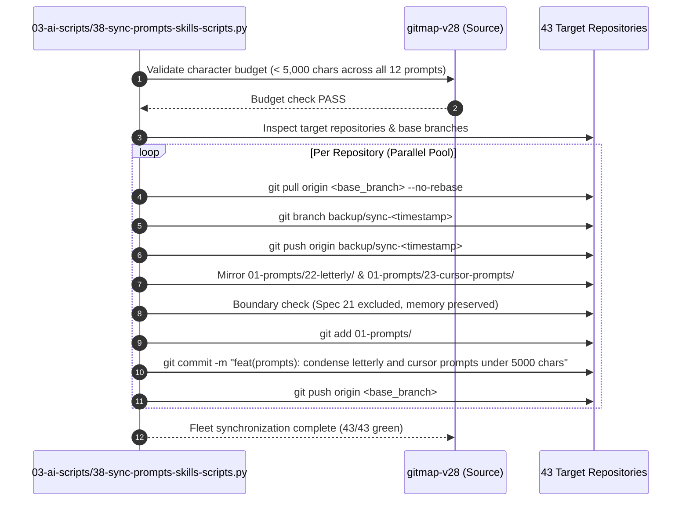

# 351 Prompt Condensation, Redundancy Elimination & Fleet Synchronization Specification

- **Specification Slug:** `351-json-instruction-and-cli-integration`
- **Document Sequence:** `03`
- **Document Path:** `02-spec/21-app/351-json-instruction-and-cli-integration/03-prompt-condensation-and-sync-spec.md`
- **Target Version:** `v6.631.0`
- **Subsystem:** `01-prompts/22-letterly/`, `01-prompts/23-cursor-prompts/`, `03-ai-scripts/38-sync-prompts-skills-scripts.py`

---

## 1. Executive Summary & Problem Statement

Over iterations of feature development, prompt formatters in `01-prompts/22-letterly/` and `01-prompts/23-cursor-prompts/` have accumulated significant redundancy, causing 12 prompt files to exceed 5,000 characters (ranging between 5,200 and 7,252 characters). This bloat exhausts model token context during ingestion, increases latency, and introduces maintenance drift.

The primary drivers of prompt bloat are:
1. **Double-Declarations:** Section 5 ("Under `# Actionable Items Must Follow Non-Negotiable`") and the "Output Format" section currently repeat the entire fixed checklist (pull rules, spec/plan structure, GitMap search primacy, relative path mandates) word-for-word in identical detail.
2. **Monolithic Inlined Domain Instructions:** In `03-execute-n-steps-letterly.md` (and cursor counterpart), items 5 through 8 exhaustively specify SQL repository rules, enum dispatch rules, enum authoring standards, and error-handling requirements across 4 massive paragraphs (~1,800 characters) instead of referencing the canonical skill.
3. **Verbose Execution Engine Declarations:** In `14-execute-recommit-time-restricted-letterly.md` (and cursor counterpart), items 8 and 9 contain verbose inlined paragraphs explaining Option 1 vs Option 2 and recommit mechanics instead of concisely pointing to the dedicated skills.
4. **Skill Link Inconsistencies:** Prompts have drifted in their relative skill link formatting, occasionally omitting the canonical `(file;.agents/skills/<skill-name>)` or `(file;.cursor/skills/<skill-name>)` format.

This specification establishes an immutable 5,000-character ceiling for all prompt formatters, defines targeted surgical replacements for `03` and `14`, mandates the elimination of double-declarations across all 12 prompt files, standardizes relative skill links, and defines the automated multi-repository fleet synchronization protocol using `03-ai-scripts/38-sync-prompts-skills-scripts.py --force`.

---

## 2. Character Budget & File Inventory

The 12 bloated prompt files across Letterly and Cursor directories must be pruned to strictly under 5,000 characters:

| Target Prompt File | Current Chars | Target Budget | Target Reduction | Primary Remediation Focus |
| :--- | :---: | :---: | :---: | :--- |
| `01-prompts/22-letterly/02-desktop-letterly.md` | 5,403 | < 3,500 | ~35% | Eliminate Section 5 checklist duplication; reference Output Format template. |
| `01-prompts/22-letterly/03-execute-n-steps-letterly.md` | 6,581 | < 3,600 | ~45% | Replace items 5-8 with 2-line directive to `sql-repository-pattern-and-enum-actions`; eliminate double-declaration. |
| `01-prompts/22-letterly/06-cicd-fix-release-letterly.md` | 5,273 | < 3,300 | ~37% | Eliminate Section 5 checklist duplication; streamline RCA items in template. |
| `01-prompts/22-letterly/09-execute-with-verification-letterly.md` | 5,734 | < 3,400 | ~40% | Eliminate Section 5 checklist duplication; consolidate verification directives. |
| `01-prompts/22-letterly/10-execute-with-release-letterly.md` | 5,295 | < 3,300 | ~37% | Eliminate Section 5 checklist duplication; reference release skill. |
| `01-prompts/22-letterly/14-execute-recommit-time-restricted-letterly.md` | 7,229 | < 3,800 | ~47% | Replace verbose items 8 and 9 with concise references to `execute-parent-task-with-n-steps-v7` and `gitmap-time-restriction`; eliminate double-declaration. |
| `01-prompts/23-cursor-prompts/02-desktop-letterly-cursor.md` | 5,368 | < 3,500 | ~35% | Eliminate Section 5 duplication; ensure `.cursor/skills` links. |
| `01-prompts/23-cursor-prompts/03-execute-n-steps-letterly-cursor.md` | 6,510 | < 3,600 | ~45% | Replace items 5-8 with 2-line directive to `sql-repository-pattern-and-enum-actions`; ensure `.cursor/skills` links. |
| `01-prompts/23-cursor-prompts/06-cicd-fix-release-letterly-cursor.md` | 5,201 | < 3,300 | ~37% | Eliminate Section 5 duplication; ensure `.cursor/skills` links. |
| `01-prompts/23-cursor-prompts/09-execute-with-verification-letterly-cursor.md` | 5,662 | < 3,400 | ~40% | Eliminate Section 5 duplication; ensure `.cursor/skills` links. |
| `01-prompts/23-cursor-prompts/10-execute-with-release-letterly-cursor.md` | 5,223 | < 3,300 | ~37% | Eliminate Section 5 duplication; ensure `.cursor/skills` links. |
| `01-prompts/23-cursor-prompts/14-execute-recommit-time-restricted-letterly-cursor.md` | 7,252 | < 3,800 | ~47% | Replace items 8 and 9 with references to `execute-parent-task-with-n-steps-v7` and `gitmap-time-restriction`; ensure `.cursor/skills` links. |

---

## 3. Targeted Refactoring Directives

### 3.1 Prompt 03: SQL Repository Pattern & Enum Actions Replacement

In `01-prompts/22-letterly/03-execute-n-steps-letterly.md` and `01-prompts/23-cursor-prompts/03-execute-n-steps-letterly-cursor.md`, items 5 through 8 currently span over 1,800 characters describing database repository isolation, enum-only action dispatching, enum utility methods (`String`, `Parse`, `IsValid`, `All`), and typed error wrapping.

**The Refactored Standard:**
Replace items 5 through 8 with a concise, non-negotiable two-line directive referencing the dedicated skill:

```markdown
5. Enforce SQL repository pattern in every language and enum-driven action dispatch: all SQL behind repository interfaces, every action a named enum member dispatched via exhaustive switch/match with typed errors for unknown values.
6. Adhere strictly to @[sql-repository-pattern-and-enum-actions](file;.agents/skills/sql-repository-pattern-and-enum-actions) for all schema access, enum utilities (String, Parse, IsValid, All), and error wrapping.
```
*(For cursor prompts, replace `.agents/skills/` with `.cursor/skills/`)*

Subsequent items are renumbered sequentially (7..N).

### 3.2 Prompt 14: V7 Master Engine & Recommit Time Restriction Replacement

In `01-prompts/22-letterly/14-execute-recommit-time-restricted-letterly.md` and `01-prompts/23-cursor-prompts/14-execute-recommit-time-restricted-letterly-cursor.md`, items 8 and 9 contain verbose inlined paragraphs explaining Option 1 morning cutoff (< 08:00 AM), Option 2 unrestricted mode, autobot flags, and historical recommit mechanics.

**The Refactored Standard:**
Replace verbose items 8 and 9 with concise references:

```markdown
8. Execute via V7 Master Engine: Adhere to @[execute-parent-task-with-n-steps-v7](file;.agents/skills/execute-parent-task-with-n-steps-v7) supporting Option 1 (Time-Restricted: weekday commits strictly < 08:00 AM in target timezone; weekend anytime) and Option 2 (Unrestricted Time), plus `gitmap autobot` configuration.
9. Recommit & History Adjustment (On-Call): When recommit is commanded, inspect git log and execute atomic recommits via `gitmap` semantic commit verbs per @[gitmap-time-restriction](file;.agents/skills/gitmap-time-restriction) without polluting history.
```
*(For cursor prompts, replace `.agents/skills/` with `.cursor/skills/`)*

### 3.3 Double-Declaration Elimination Rule

Across all prompt formatters, Section 5 must NEVER repeat the entire checklist item by item if the same checklist is already authored in the `Output Format` section.

**Anti-Pattern (Duplication):**
```markdown
# Section 5:
5. Under `# Actionable Items Must Follow Non-Negotiable`, ensure:
   - Item 1: `1. Git pull BEFORE starting any work...`
   - Item 2: `2. Write spec under 02-spec/21-app/XX-<slug>/...`
   - Item 3: `3. Search codebase exclusively via GitMap...`
   - Item 4: `4. Strictly use relative Git paths...`
   ...
# Output Format:
# Actionable Items Must Follow Non-Negotiable
1. Git pull BEFORE starting any work...
2. Write spec under 02-spec/21-app/XX-<slug>/...
3. Search codebase exclusively via GitMap...
4. Strictly use relative Git paths...
```

**Approved Pattern (Referential Economy):**
```markdown
5. Construct `# Actionable Items Must Follow Non-Negotiable`: include standard fixed items 1-4 verbatim as shown in the Output Format below (pull first, spec/plan enqueue, GitMap search primacy, relative Git paths mandate), followed by domain-specific directives extracted from input text as items 5..N.
```

By specifying the structure by reference rather than by repetition, over 1,500 redundant characters are eradicated from every single prompt formatter.

### 3.4 Skill Link URI Standard

All skill and file links within prompt formatters must strictly adhere to relative URIs:
- For Letterly formatters (`01-prompts/22-letterly/`):
  `@[<skill-name>](file;.agents/skills/<skill-name>)` or `[<skill-name>](file;.agents/skills/<skill-name>)`
- For Cursor formatters (`01-prompts/23-cursor-prompts/`):
  `@[<skill-name>](file;.cursor/skills/<skill-name>)` or `[<skill-name>](file;.cursor/skills/<skill-name>)`
- File links:
  `[relative/path](file;relative/path)` or `[relative/path](file:///relative/path)`
- Absolute paths (`D:\...`, `C:\...`, `/Users/...`) are **strictly prohibited**.

---

## 4. Multi-Repository Fleet Synchronization Protocol

Once the prompt formatters in the `gitmap-v28` repo are pruned and validated under 5,000 characters, changes must be mirrored across the entire fleet of 43 connected repositories using the canonical synchronization script.

### 4.1 Synchronization Architecture



### 4.2 Script Execution & Invocation Guardrails

The synchronization execution must be executed with the `--force` flag:
```powershell
python 03-ai-scripts/38-sync-prompts-scripts.py --force
```
*(or canonical path: `python 03-ai-scripts/38-sync-prompts-skills-scripts.py --force`)*

**Strict Non-Negotiable Boundaries during Synchronization:**
1. **Spec 21 Exclusion:** Never sync `02-spec/21-*` through `02-spec/25-*` (domain application specs).
2. **Additive-Only AI Scripts:** New scripts are added; scripts modified by target repos are never overwritten.
3. **Bump Script Protection:** Never overwrite target repository `bump*` scripts.
4. **Memory & Plans Protection:** Never touch or overwrite `.ai-memory/memory/` or `.ai-memory/plans/`.
5. **Archive & History Exclusion:** Never sync `06-archive/`, `06-old-prompts/`, or deprecated folders.

---

## 5. Verification Matrix & Acceptance Criteria (V-01 through V-10)

| ID | Gate / Acceptance Criteria | Target Deliverable | Verification Tool / Command |
| :--- | :--- | :--- | :--- |
| **V-01** | Prompt Character Limit: All 12 files strictly < 5,000 characters | `01-prompts/22-letterly/`, `01-prompts/23-cursor-prompts/` | Python script checking `len(content) < 5000` |
| **V-02** | Prompt 03 Directive: Items 5-8 replaced with 2-line skill reference | `03-execute-n-steps-letterly.md`, `03-execute-n-steps-letterly-cursor.md` | Content audit for `sql-repository-pattern-and-enum-actions` |
| **V-03** | Prompt 14 Directive: Items 8 & 9 replaced with V7 & time-restriction refs | `14-execute-recommit-time-restricted-letterly.md`, cursor counterpart | Content audit for `execute-parent-task-with-n-steps-v7` |
| **V-04** | Double-Declaration Elimination: Section 5 does not duplicate Output Format | All 12 target prompt files | Diff inspection against baseline commit |
| **V-05** | Skill Link Hygiene: Valid relative links (`.agents/skills/` and `.cursor/skills/`) | All 12 target prompt files | Regex audit for `(file;.agents/skills/...)` syntax |
| **V-06** | Zero Absolute Paths: No drive letters (`C:`, `D:`) or home directory prefixes | All 12 target prompt files | Codebase search verifying relative paths only |
| **V-07** | Non-Negotiable Invariants: Items 1-4 intact across all templates | All 12 target prompt files | Template inspection for pull, spec, search, relative paths |
| **V-08** | Fleet Sync Script Execution: `38-sync-prompts-skills-scripts.py --force` runs cleanly | `03-ai-scripts/38-sync-prompts-skills-scripts.py` | Script execution with exit code 0 |
| **V-09** | Boundary Protection: Spec 21 and `.ai-memory` excluded from fleet overwrite | Target repositories | Git diff across target repositories |
| **V-10** | Release Ceremony: Atomic commit and tag push for GitMap | GitMap repository | `gitmap cpr "v6.631.0 prompt condensation and fleet sync"` |

---

## 6. Document Metadata & Signoff

- **Author:** Authoring Subagent 3 (Phase 1 Spec Authoring)
- **Approved By:** Unified Task Orchestrator
- **Status:** APPROVED
- **Date:** 29-Oct-2026
