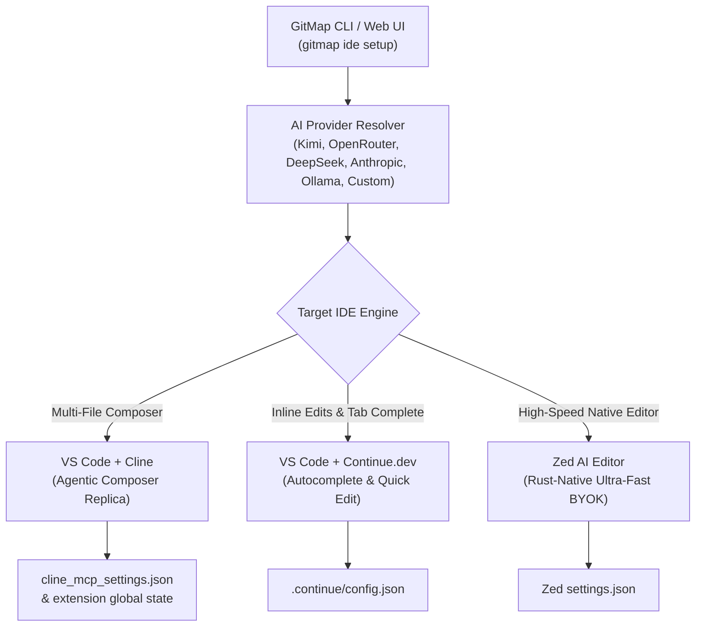

# Specification: Cursor-Like AI IDE Setup from GitMap

> **Document Version:** 1.0.0  
> **Status:** Active  
> **Scope:** GitMap Core CLI & Web UI (`cli/cmdide`, `cli/cmdui`, `src/pages/IDE.tsx`)  
> **Traceability:** Task-352 / Spec 352  

---

## 1. Executive Summary & Problem Statement

Developers increasingly rely on Cursor for agentic multi-file code editing, smart inline completions, and prompt-driven development. However, proprietary AI editors pose critical challenges:
1. **Vendor Lock-In & Privacy**: Proprietary IDEs gate features behind closed infrastructure, requiring enterprise source code to route through third-party proprietary backends.
2. **Subscription Fatigue**: Developers frequently pay for redundant subscriptions while maintaining their own Bring-Your-Own-Key (BYOK) API keys with OpenAI, Anthropic, DeepSeek, Moonshot/Kimi, or self-hosted Ollama.
3. **Multi-Editor Fragmentation**: Development teams split their workflows between VS Code, Zed, and Cursor, resulting in fragmented configuration files, inconsistent prompt behaviors, and manual copy-pasting of API keys and endpoints.

### 1.1 The GitMap Solution

GitMap provides automated, zero-friction, one-command AI IDE configuration directly from the GitMap CLI (`gitmap ide setup`) and GitMap Web UI (`/ide/setup`). GitMap configures open-source tools to deliver a full Cursor-grade experience:



### 1.2 The Three Replicated Cursor Pillars

| Cursor Capability | Open-Source Equivalent | Configured Target | Purpose & Ergonomics |
|:---|:---|:---|:---|
| **Cursor Composer** | **VS Code + Cline** | VS Code Extension Config & Global Storage | Multi-file autonomous editing, terminal command execution, filesystem diff inspection, MCP server integration. |
| **Cursor Inline Edit & Tab Autocomplete** | **VS Code + Continue.dev** | `~/.continue/config.json` | Instant inline code transformations (`Cmd/Ctrl+I`), context-aware tab completions (ghost text), and chat sidebar (`Cmd/Ctrl+L`). |
| **High-Speed Native AI Editor** | **Zed AI Editor** | `Zed/settings.json` | Sub-millisecond keystroke latency, native Rust architecture, built-in assistant panel, inline prompt transforms, and direct local Ollama/remote BYOK support. |

---

## 2. Multi-Provider Presets Architecture

GitMap ships with built-in presets for major production LLMs, featuring balanced parameters for context window sizing, temperature defaults, and streaming endpoints.

### 2.1 Supported Provider Presets

| Provider Key | Provider Name | Default Base URL | Default Model | Fallback Models | Context Window | Auth Header Scheme |
|:---|:---|:---|:---|:---|:---:|:---|
| `kimi` | Moonshot Kimi | `https://api.moonshot.cn/v1` | `kimi-k3.1-pro` | `moonshot-v1-128k`, `moonshot-v1-32k` | 128,000 | `Bearer <API_KEY>` |
| `openrouter` | OpenRouter | `https://openrouter.ai/api/v1` | `moonshotai/kimi-k3.1-pro` | `anthropic/claude-3.7-sonnet`, `deepseek/deepseek-chat` | 128,000 | `Bearer <API_KEY>` |
| `deepseek` | DeepSeek | `https://api.deepseek.com/v1` | `deepseek-chat` | `deepseek-reasoner` | 64,000 | `Bearer <API_KEY>` |
| `anthropic` | Anthropic Claude | `https://api.anthropic.com/v1` | `claude-3-7-sonnet-20250219` | `claude-3-5-sonnet-latest`, `claude-3-5-haiku-latest` | 200,000 | `x-api-key: <API_KEY>` |
| `ollama` | Local Ollama | `http://localhost:11434/v1` | `deepseek-r1` | `qwen2.5-coder:32b`, `llama3.3:70b` | 32,000 | None / Optional |
| `custom` | Custom Endpoint | `--base-url <url>` | `--model <id>` | Configurable via CLI/UI | User-defined | `Bearer <API_KEY>` |

### 2.2 Provider Environment Variable Cascades

When `--api-key` is omitted on the CLI, GitMap scans environment variables in deterministic order:
1. Provider-specific variable (e.g., `KIMI_API_KEY`, `MOONSHOT_API_KEY`, `OPENROUTER_API_KEY`, `DEEPSEEK_API_KEY`, `ANTHROPIC_API_KEY`).
2. Generic GitMap fallback: `GITMAP_AI_API_KEY`.
3. Standard fallback: `OPENAI_API_KEY`.

---

## 3. Cross-Platform Configuration Targets

GitMap resolves target configuration directories across Windows, macOS, and Linux, ensuring existing user keys (snippets, custom keybindings, other MCP servers) are merged rather than overwritten.

### 3.1 Path Matrix by Operating System

| Target Tool | Platform | Configuration File Path |
|:---|:---|:---|
| **Cline (VS Code)** | **Windows** | `%APPDATA%\Code\User\globalStorage\saoudrizwan.claude-dev\settings\cline_mcp_settings.json` |
| | **macOS** | `~/Library/Application Support/Code/User/globalStorage/saoudrizwan.claude-dev/settings/cline_mcp_settings.json` |
| | **Linux** | `~/.config/Code/User/globalStorage/saoudrizwan.claude-dev/settings/cline_mcp_settings.json` |
| **Continue.dev** | **Windows** | `%USERPROFILE%\.continue\config.json` |
| | **macOS** | `~/.continue/config.json` |
| | **Linux** | `~/.continue/config.json` |
| **Zed Editor** | **Windows** | `%APPDATA%\Zed\settings.json` |
| | **macOS** | `~/.config/zed/settings.json` |
| | **Linux** | `~/.config/zed/settings.json` |

### 3.2 Target 1: VS Code + Cline Configuration (Composer Equivalent)

Cline configuration injects provider settings into Cline's settings store and sets up GitMap MCP server tools for repository indexing and fast search.

#### JSON Target Payload (`cline_mcp_settings.json`):
```json
{
  "mcpServers": {
    "gitmap": {
      "command": "gitmap",
      "args": ["mcp", "serve"],
      "disabled": false,
      "autoApprove": [
        "gitmap_scan_repos",
        "gitmap_search_files",
        "gitmap_get_repo_info"
      ]
    }
  }
}
```

#### Cline Extension State Injection:
GitMap configures the active model provider in Cline's state:
```json
{
  "apiProvider": "openai-compatible",
  "openAiBaseUrl": "https://api.moonshot.cn/v1",
  "openAiApiKey": "sk-...",
  "openAiModelId": "kimi-k3.1-pro",
  "openAiCustomModelInfo": {
    "maxTokens": 8192,
    "contextWindow": 131072,
    "supportsImages": true,
    "supportsPromptCache": true
  }
}
```

### 3.3 Target 2: VS Code + Continue.dev (Inline Edit & Autocomplete)

Continue.dev manages chat, inline code generation (`Ctrl+I`), and tab completions through `~/.continue/config.json`.

#### JSON Target Payload (`config.json`):
```json
{
  "models": [
    {
      "title": "GitMap Cursor Composer (Kimi K3.1 Pro)",
      "provider": "openai",
      "model": "kimi-k3.1-pro",
      "apiBase": "https://api.moonshot.cn/v1",
      "apiKey": "sk-...",
      "contextLength": 128000,
      "roles": ["chat", "edit"]
    }
  ],
  "tabAutocompleteModel": {
    "title": "GitMap Autocomplete",
    "provider": "openai",
    "model": "kimi-k3.1-pro",
    "apiBase": "https://api.moonshot.cn/v1",
    "apiKey": "sk-..."
  },
  "allowAnonymousTelemetry": false
}
```

### 3.4 Target 3: Zed Editor (`settings.json`)

Zed's assistant panel and inline assists use the `language_models` and `assistant` schema blocks.

#### JSON Target Payload (`Zed settings.json`):
```json
{
  "language_models": {
    "openai_compatible": {
      "gitmap_preset": {
        "api_url": "https://api.moonshot.cn/v1",
        "available_models": [
          {
            "name": "kimi-k3.1-pro",
            "max_tokens": 128000,
            "supports_streaming": true
          }
        ]
      }
    }
  },
  "assistant": {
    "default_model": {
      "provider": "openai_compatible",
      "model": "kimi-k3.1-pro"
    },
    "version": "2"
  },
  "features": {
    "inline_completion_provider": "supermaven"
  }
}
```

### 3.5 Safe Atomic Mutation Strategy

To prevent corrupting existing configuration files:
1. **Existence Check**: Detect whether the target directory and file exist.
2. **Backup Generation**: Copy existing configuration to `<path>.bak.<timestamp>`.
3. **Deep JSON Merge**: Parse the existing JSON object, overlay GitMap's target keys, and retain user-defined rules, plugins, and hotkeys.
4. **Atomic Write**: Write merged contents to a temporary sibling file (`<path>.tmp.<pid>`), flush to disk, and rename atomically over the destination.

---

## 4. CLI Command Syntax & Flags

The CLI interface provides both high-level automated execution and granular flag overrides.

### 4.1 Command Grammar

```bash
gitmap ide setup [target] [flags]
```

#### Aliases:
- `gitmap ide cursor-setup`
- `gitmap ide setup-ai`

### 4.2 Argument: `[target]`

- `all` (default): Configures Cline, Continue.dev, and Zed.
- `cline`: Configures only VS Code + Cline (Composer replica).
- `continue`: Configures only VS Code + Continue.dev (Inline edits & tab autocomplete).
- `zed`: Configures only Zed AI Editor.
- `vscode`: Configures both Cline and Continue.dev in VS Code.

### 4.3 Flags Reference

| Flag | Shorthand | Type | Default | Description |
|:---|:---:|:---:|:---:|:---|
| `--provider` | `-p` | string | `kimi` | AI provider preset (`kimi`, `openrouter`, `deepseek`, `anthropic`, `ollama`, `custom`). |
| `--model` | `-m` | string | preset default | Model identifier override (e.g. `kimi-k3.1-pro`, `deepseek-chat`). |
| `--base-url` | `-u` | string | preset default | Custom base URL for OpenAI-compatible endpoints. |
| `--api-key` | `-k` | string | env var | API Key for the target provider. |
| `--dry-run` | `-d` | bool | `false` | Inspect target files and planned mutations without writing changes. |
| `--json` | `-j` | bool | `false` | Output results as structured JSON for automation and Web UI integration. |
| `--test` | `-t` | bool | `true` | Run pre-flight connectivity and auth probe before modifying configuration files. |
| `--force` | `-f` | bool | `false` | Bypass confirmation prompts and overwrite conflicting configurations. |

### 4.4 Example Invocations

#### 1. Zero-Config One-Shot Setup with Kimi
```bash
gitmap ide setup --provider kimi --api-key sk-xxxxxx
```

#### 2. Local Privacy-First Setup with Ollama
```bash
gitmap ide setup all --provider ollama --model deepseek-r1
```

#### 3. High-Performance DeepSeek Setup for VS Code Only
```bash
gitmap ide setup vscode --provider deepseek --api-key sk-xxxxxx --test
```

#### 4. Dry-Run Inspection with JSON Output
```bash
gitmap ide setup --provider openrouter --dry-run --json
```

---

## 5. Go Structs & Models in `cli/cmdide/`

The implementation lives under `cli/cmdide/` and adheres strictly to repository coding standards:
- **Positive Booleans Only**: Fields MUST use `is*` or `has*` prefix.
- **Function Size Limit**: Functions <= 15 lines max (<= 8 lines preferred).
- **Leaf Error Sovereignty**: Functions return `error` or `*apperror.AppError` directly; never invoke exit handlers.
- **Vertical Spacing**: Blank line after `}` and blank line before `return`.

### 5.1 Enums: `cli/cmdide/enums/ide_config_target_enum.go`

```go
package enums

// IDEConfigTarget represents an AI editor setup target.
type IDEConfigTarget string

const (
	ConfigTargetAll      IDEConfigTarget = "all"
	ConfigTargetCline    IDEConfigTarget = "cline"
	ConfigTargetContinue IDEConfigTarget = "continue"
	ConfigTargetZed      IDEConfigTarget = "zed"
	ConfigTargetVSCode   IDEConfigTarget = "vscode"
)

// AIProviderType represents a recognized AI model provider.
type AIProviderType string

const (
	ProviderKimi       AIProviderType = "kimi"
	ProviderOpenRouter AIProviderType = "openrouter"
	ProviderDeepSeek   AIProviderType = "deepseek"
	ProviderAnthropic  AIProviderType = "anthropic"
	ProviderOllama     AIProviderType = "ollama"
	ProviderCustom     AIProviderType = "custom"
)
```

### 5.2 Structs: `cli/cmdide/ide_setup_types.go`

```go
package cmdide

import "github.com/alimtvnetwork/gitmap-v28/cli/cmdide/enums"

// IDESetupOptions captures user options for the setup command.
type IDESetupOptions struct {
	Target          enums.IDEConfigTarget `json:"target"`
	Provider        enums.AIProviderType  `json:"provider"`
	ModelID         string                `json:"modelId"`
	BaseURL         string                `json:"baseUrl"`
	APIKey          string                `json:"apiKey,omitempty"`
	IsDryRun        bool                  `json:"isDryRun"`
	IsJSON          bool                  `json:"isJSON"`
	IsTestEnabled   bool                  `json:"isTestEnabled"`
	IsForceOverride bool                  `json:"isForceOverride"`
}

// AIProviderPreset holds connection defaults for a provider.
type AIProviderPreset struct {
	ProviderKey    enums.AIProviderType `json:"providerKey"`
	DisplayName    string               `json:"displayName"`
	DefaultBaseURL string               `json:"defaultBaseUrl"`
	DefaultModelID string               `json:"defaultModelId"`
	ContextWindow  int                  `json:"contextWindow"`
	HasStreaming   bool                 `json:"hasStreaming"`
	HeaderScheme   string               `json:"headerScheme"`
}

// IDETargetResult details the mutation result for a single target IDE.
type IDETargetResult struct {
	TargetName    string `json:"targetName"`
	ConfigPath    string `json:"configPath"`
	IsTargetFound bool   `json:"isTargetFound"`
	IsUpdated     bool   `json:"isUpdated"`
	BackupPath    string `json:"backupPath,omitempty"`
	ErrorMessage  string `json:"errorMessage,omitempty"`
}

// IDESetupResult aggregates results across all configured targets.
type IDESetupResult struct {
	Provider       enums.AIProviderType `json:"provider"`
	ModelID        string               `json:"modelId"`
	IsTestPassed   bool                 `json:"isTestPassed"`
	TestLatencyMS  int64                `json:"testLatencyMs"`
	HasErrors      bool                 `json:"hasErrors"`
	TargetResults  []IDETargetResult    `json:"targetResults"`
	RemediationTip string               `json:"remediationTip,omitempty"`
}
```

### 5.3 Function Decomposition Plan

All functions are constrained to <= 15 lines with single responsibilities:

| Function | File | Purpose |
|:---|:---|:---|
| `RunIDESetup(args []string) error` | `ide_setup_cmd.go` | Top-level dispatcher parsing flags and running setup. |
| `resolveProviderPreset(opts IDESetupOptions) AIProviderPreset` | `ide_setup_presets.go` | Maps provider enum to endpoints and defaults. |
| `testProviderConnection(preset AIProviderPreset, key string) (int64, error)` | `ide_setup_test.go` | Sends lightweight probe to verify connectivity and auth. |
| `applyClineConfig(opts IDESetupOptions) IDETargetResult` | `ide_setup_cline.go` | Backs up and writes Cline MCP and provider settings. |
| `applyContinueConfig(opts IDESetupOptions) IDETargetResult` | `ide_setup_continue.go` | Merges provider into `.continue/config.json`. |
| `applyZedConfig(opts IDESetupOptions) IDETargetResult` | `ide_setup_zed.go` | Merges assistant block into Zed's `settings.json`. |
| `formatSetupOutput(res IDESetupResult, isJSON bool) string` | `ide_setup_render.go` | Formats output for terminal or returns JSON. |

---

## 6. Web UI Architecture & REST API Endpoints

The GitMap Web UI exposes the IDE setup engine via an interactive visual dashboard in `src/pages/IDE.tsx`.

### 6.1 UI Component Architecture

```
src/components/ide/
├── IDESetupDashboard.tsx    # Main setup page container
├── ProviderPresetCards.tsx  # Interactive cards for Kimi, OpenRouter, DeepSeek, Anthropic, Ollama
├── TargetEditorToggles.tsx  # Checkboxes for Cline, Continue, Zed with detected installation badges
├── ConnectionProbeBar.tsx   # "Test Connection" button with real-time latency pill and status dot
└── ConfigDiffModal.tsx      # Side-by-side view of proposed JSON mutations before applying
```

### 6.2 REST API Endpoints in `cli/cmdui/ui_server.go`

#### `GET /api/ide/presets`
Returns all available provider presets and detected local IDE installations:
```json
{
  "isSuccess": true,
  "presets": [
    {
      "providerKey": "kimi",
      "displayName": "Moonshot Kimi K3.1 Pro",
      "defaultBaseUrl": "https://api.moonshot.cn/v1",
      "defaultModelId": "kimi-k3.1-pro",
      "contextWindow": 128000
    }
  ],
  "installedTargets": {
    "isVSCodeInstalled": true,
    "isClineDetected": true,
    "isContinueDetected": true,
    "isZedInstalled": true
  }
}
```

#### `POST /api/ide/test-connection`
Probes the selected endpoint with provided API key and returns response latency:
```json
// Request
{
  "provider": "kimi",
  "baseUrl": "https://api.moonshot.cn/v1",
  "modelId": "kimi-k3.1-pro",
  "apiKey": "sk-..."
}

// Response
{
  "isSuccess": true,
  "isReachable": true,
  "latencyMs": 342,
  "message": "Connection verified successfully."
}
```

#### `POST /api/ide/setup`
Applies configuration changes to selected editor targets.

---

## 7. Security, Privacy & Key Hygiene

1. **Zero Secret Leakage**: API keys MUST NEVER be output to CLI logs, stdout, or stored in plaintext database audit logs (`installation.db` or `gitmap.db`).
2. **Restricted File Permissions**: Newly created configuration files on Unix/macOS are written with `0600` permissions (owner read/write only).
3. **Local-Only Communication**: Probe calls during `--test` communicate directly with the designated provider base URL; no telemetry or tokens route through GitMap servers.
4. **Environment Isolation**: Custom API keys can be passed strictly via environment variables to avoid appearing in shell command history (`.bash_history` / PSReadline).

---

## 8. Acceptance Criteria

- [ ] **AC-1**: `gitmap ide setup` provides a default target of `all`, configuring Cline, Continue.dev, and Zed.
- [ ] **AC-2**: All 5 preset providers (`kimi`, `openrouter`, `deepseek`, `anthropic`, `ollama`) and `custom` are supported with valid defaults.
- [ ] **AC-3**: Target paths accurately resolve across Windows, macOS, and Linux without hardcoded drive letters or absolute Unix paths.
- [ ] **AC-4**: Configuration updates preserve pre-existing user settings via non-destructive JSON merging and create timestamped backups.
- [ ] **AC-5**: The `--dry-run` flag details all file paths and planned JSON changes without modifying the filesystem.
- [ ] **AC-6**: The `--test` flag validates credentials and endpoint health prior to applying changes.
- [ ] **AC-7**: All Go struct boolean fields use `is*` or `has*` prefixes, and all functions remain <= 15 lines.
- [ ] **AC-8**: Command aliases `gitmap ide cursor-setup` and `gitmap ide setup-ai` route directly to `gitmap ide setup`.
