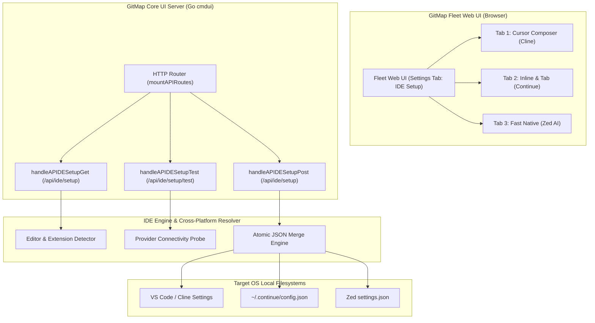

# UI Server & Web Integration Specification: Cursor-Like IDE Setup from GitMap

> **Specification Number:** 352-02  
> **Module:** `02-spec/21-app/352-cursor-like-ide-setup-from-gitmap`  
> **Document Version:** 1.0.0  
> **Status:** Active  
> **Updated:** 2026-10-29  
> **AI Confidence:** Production-Ready  
> **Ambiguity:** None  
> **Scope:** GitMap Core CLI & Fleet Web UI (`cli/cmdui`, `src/pages/Settings.tsx`, `cli/cmdcursor`, `cli/cmdide`)  
> **Traceability:** Task-352  

---

## 1. Executive Summary & Purpose

The **Cursor-Like IDE Setup from GitMap** capability democratizes next-generation AI-assisted coding by enabling one-click configuration of modern open-source and native editors into high-performance, Cursor-equivalent environments. Rather than locking developers into proprietary editor builds, GitMap orchestrates two complementary paradigms:
1. **VS Code + Cline / Continue.dev**: Replicates Cursor's dual superpowers—agentic full-codebase editing (**Composer** via Cline) and millisecond-level inline tab autocompletion (**Cursor Tab** via Continue.dev).
2. **Zed AI**: Configures the high-performance Rust-native editor with state-of-the-art LLM backends (Anthropic, OpenAI-compatible, Ollama) for ultra-low-latency developer workflows.

This specification details the **REST API server endpoints**, **Fleet Web UI components**, **cross-platform filesystem resolution**, **atomic JSON configuration merging**, and **AppError envelope architecture** that power the web-based interactive setup flow accessible via `gitmap ui`.

---

## 2. Architecture & Component Boundaries

### 2.1 System Architecture



### 2.2 Component Roles

| Component | Repository Path | Responsibility |
|:---|:---|:---|
| **API Server Routing** | `cli/cmdui/ui_server.go` | Registers `/api/ide/setup` and `/api/ide/setup/test` into `mountAPIRoutes`. |
| **IDE Handlers** | `cli/cmdui/ui_server_ide.go` | Orchestrates detection, validation, credential testing, and atomic config application. |
| **Data Types & Envelopes** | `cli/cmdui/ui_server_ide_types.go` | Defines strongly-typed request/response payloads, provider presets, and status structs. |
| **Web UI Markup** | `cli/cmdui/ui_assets_markup_settings_b.go` | Injects the responsive IDE setup card, 3 visual tabs, provider dropdowns, and test controls. |
| **Client Logic** | `cli/cmdui/ui_assets_js_settings.go` | Manages frontend tab transitions, credential mask toggles, live probe execution, and toasts. |
| **Core File Engine** | `cli/cmdide/config_merge.go` | Executes cross-platform directory resolution, non-destructive JSON merges, and `.bak` backups. |

---

## 3. REST API Endpoint Specifications

All endpoints adhere to GitMap's universal REST API conventions:
- Content-Type: `application/json; charset=utf-8`
- Error response envelopes using `apperror.AppError` structures
- Strict positive boolean field naming starting exclusively with `is` or `has` (no negative booleans)
- Zero nested `if` statements in handler implementations

```
┌────────────────────────────────────────────────────────────────────────┐
│                        REST API ENDPOINT MATRIX                        │
├──────────────────────┬────────┬────────────────────────────────────────┤
│ Endpoint             │ Method │ Purpose                                │
├──────────────────────┼────────┼────────────────────────────────────────┤
│ /api/ide/setup       │ GET    │ Detect editors, extensions & presets   │
│ /api/ide/setup       │ POST   │ Apply AI configuration (supports dry)  │
│ /api/ide/setup/test  │ POST   │ Probe endpoint connectivity & auth     │
└──────────────────────┴────────┴────────────────────────────────────────┘
```

---

### 3.1 `GET /api/ide/setup` — Environment & Detection Status

Scans the host system to determine which supported IDEs and extensions are installed, inspects their current configuration state, and returns available provider presets.

#### 3.1.1 Go Struct Definitions

```go
package cmdui

// IDESetupDetectionResponse represents the scan response for /api/ide/setup.
type IDESetupDetectionResponse struct {
	IsSuccess       bool              `json:"isSuccess"`
	DetectedEditors []EditorStatus    `json:"detectedEditors"`
	Presets         []ProviderPreset  `json:"presets"`
	ErrorMessage    string            `json:"errorMessage,omitempty"`
}

// EditorStatus encapsulates detection data for a single IDE and its AI tools.
type EditorStatus struct {
	EditorID        string            `json:"editorId"`        // "vscode", "cursor", "zed"
	DisplayName     string            `json:"displayName"`     // "Visual Studio Code"
	IsInstalled     bool              `json:"isInstalled"`
	BinaryPath      string            `json:"binaryPath"`
	ConfigPath      string            `json:"configPath"`
	Extensions      []ExtensionStatus `json:"extensions"`
}

// ExtensionStatus details the setup state of a specific AI plugin.
type ExtensionStatus struct {
	ExtensionID     string            `json:"extensionId"`     // "cline", "continue", "zed-native"
	DisplayName     string            `json:"displayName"`     // "Cline (Claude Dev)"
	IsInstalled     bool              `json:"isInstalled"`
	IsConfigured    bool              `json:"isConfigured"`
	ActiveProvider  string            `json:"activeProvider"`  // "kimi", "openrouter", "deepseek", etc.
	ActiveModel     string            `json:"activeModel"`
	ConfigPath      string            `json:"configPath"`
}

// ProviderPreset defines known API endpoints, recommended models, and defaults.
type ProviderPreset struct {
	PresetID        string            `json:"presetId"`        // "kimi", "openrouter", "deepseek", "anthropic", "ollama", "custom"
	DisplayName     string            `json:"displayName"`     // "Kimi K3.1 Pro (Moonshot AI)"
	DefaultBaseURL  string            `json:"defaultBaseUrl"`  // "https://api.moonshot.cn/v1"
	DefaultModel    string            `json:"defaultModel"`    // "moonshot-v1-32k"
	SupportedModels []string          `json:"supportedModels"`
	RequiresAPIKey  bool              `json:"requiresApiKey"`
	HelpURL         string            `json:"helpUrl"`
}
```

#### 3.1.2 Request Parameters
None. Query parameters are ignored.

#### 3.1.3 Successful Response Example (`200 OK`)

```json
{
  "isSuccess": true,
  "detectedEditors": [
    {
      "editorId": "vscode",
      "displayName": "Visual Studio Code",
      "isInstalled": true,
      "binaryPath": "/usr/bin/code",
      "configPath": "/home/developer/.config/Code/User/settings.json",
      "extensions": [
        {
          "extensionId": "cline",
          "displayName": "Cline (Cursor Composer)",
          "isInstalled": true,
          "isConfigured": false,
          "activeProvider": "",
          "activeModel": "",
          "configPath": "/home/developer/.config/Code/User/globalStorage/saoudrizwan.claude-dev/settings/cline_mcp_settings.json"
        },
        {
          "extensionId": "continue",
          "displayName": "Continue.dev (Cursor Tab & Autocomplete)",
          "isInstalled": true,
          "isConfigured": true,
          "activeProvider": "ollama",
          "activeModel": "qwen2.5-coder:7b",
          "configPath": "/home/developer/.continue/config.json"
        }
      ]
    },
    {
      "editorId": "zed",
      "displayName": "Zed",
      "isInstalled": true,
      "binaryPath": "/usr/local/bin/zed",
      "configPath": "/home/developer/.config/zed/settings.json",
      "extensions": [
        {
          "extensionId": "zed-native",
          "displayName": "Zed AI Native Assistant",
          "isInstalled": true,
          "isConfigured": false,
          "activeProvider": "",
          "activeModel": "",
          "configPath": "/home/developer/.config/zed/settings.json"
        }
      ]
    }
  ],
  "presets": [
    {
      "presetId": "kimi",
      "displayName": "Kimi K3.1 Pro (Moonshot AI)",
      "defaultBaseUrl": "https://api.moonshot.cn/v1",
      "defaultModel": "moonshot-v1-32k",
      "supportedModels": [
        "moonshot-v1-8k",
        "moonshot-v1-32k",
        "moonshot-v1-128k",
        "kimi-k1.5-preview"
      ],
      "requiresApiKey": true,
      "helpUrl": "https://platform.moonshot.cn/docs"
    },
    {
      "presetId": "openrouter",
      "displayName": "OpenRouter Universal",
      "defaultBaseUrl": "https://openrouter.ai/api/v1",
      "defaultModel": "anthropic/claude-3.5-sonnet",
      "supportedModels": [
        "anthropic/claude-3.5-sonnet",
        "deepseek/deepseek-coder",
        "meta-llama/llama-3.3-70b-instruct"
      ],
      "requiresApiKey": true,
      "helpUrl": "https://openrouter.ai/keys"
    },
    {
      "presetId": "deepseek",
      "displayName": "DeepSeek Coder / V3",
      "defaultBaseUrl": "https://api.deepseek.com/v1",
      "defaultModel": "deepseek-coder",
      "supportedModels": [
        "deepseek-coder",
        "deepseek-chat",
        "deepseek-reasoner"
      ],
      "requiresApiKey": true,
      "helpUrl": "https://platform.deepseek.com/api_keys"
    },
    {
      "presetId": "anthropic",
      "displayName": "Anthropic Claude Official",
      "defaultBaseUrl": "https://api.anthropic.com/v1",
      "defaultModel": "claude-3-5-sonnet-20241022",
      "supportedModels": [
        "claude-3-5-sonnet-20241022",
        "claude-3-5-haiku-20241022"
      ],
      "requiresApiKey": true,
      "helpUrl": "https://console.anthropic.com/settings/keys"
    },
    {
      "presetId": "ollama",
      "displayName": "Ollama (Local Offline)",
      "defaultBaseUrl": "http://localhost:11434/v1",
      "defaultModel": "qwen2.5-coder:7b",
      "supportedModels": [
        "qwen2.5-coder:7b",
        "deepseek-coder-v2:16b",
        "llama3.1:8b"
      ],
      "requiresApiKey": false,
      "helpUrl": "https://ollama.com/library"
    },
    {
      "presetId": "custom",
      "displayName": "Custom OpenAI-Compatible API",
      "defaultBaseUrl": "",
      "defaultModel": "",
      "supportedModels": [],
      "requiresApiKey": true,
      "helpUrl": ""
    }
  ]
}
```

---

### 3.2 `POST /api/ide/setup` — Apply Configuration

Writes or updates the target editor and extension configuration files. Preserves all existing user preferences through deep JSON merging, optionally creates backups, and supports dry-run mode for pre-flight verification.

#### 3.2.1 Go Struct Definitions

```go
package cmdui

// IDESetupApplyRequest specifies the configuration target and credentials.
type IDESetupApplyRequest struct {
	TargetEditor    string `json:"targetEditor"`    // "vscode", "cursor", "zed"
	TargetExtension string `json:"targetExtension"` // "cline", "continue", "zed-native"
	PresetID        string `json:"presetId"`        // "kimi", "openrouter", "deepseek", etc.
	BaseURL         string `json:"baseUrl"`
	APIKey          string `json:"apiKey"`
	ModelName       string `json:"modelName"`
	IsDryRun        bool   `json:"isDryRun"`        // If true, calculates diff without writing to disk
}

// IDESetupApplyResponse reports operation outcome, backup path, and diff.
type IDESetupApplyResponse struct {
	IsSuccess       bool   `json:"isSuccess"`
	TargetFile      string `json:"targetFile"`
	BackupFile      string `json:"backupFile,omitempty"`
	IsDryRun        bool   `json:"isDryRun"`
	DiffSummary     string `json:"diffSummary"`
	ErrorMessage    string `json:"errorMessage,omitempty"`
}
```

#### 3.2.2 Request Body Example

```json
{
  "targetEditor": "vscode",
  "targetExtension": "continue",
  "presetId": "kimi",
  "baseUrl": "https://api.moonshot.cn/v1",
  "apiKey": "sk-kimi-live-credential-sample-token",
  "modelName": "moonshot-v1-32k",
  "isDryRun": false
}
```

#### 3.2.3 Successful Response Example (`200 OK`)

```json
{
  "isSuccess": true,
  "targetFile": "/home/developer/.continue/config.json",
  "backupFile": "/home/developer/.continue/config.json.bak.1741285000",
  "isDryRun": false,
  "diffSummary": "Added model 'moonshot-v1-32k' under provider 'openai'; updated tabAutocompleteModel to 'moonshot-v1-32k'; preserved 4 custom slash commands.",
  "errorMessage": ""
}
```

#### 3.2.4 Dry-Run Response Example (`200 OK`)

```json
{
  "isSuccess": true,
  "targetFile": "/home/developer/.config/zed/settings.json",
  "backupFile": "",
  "isDryRun": true,
  "diffSummary": "Dry-run validation successful. Would modify 'language_models.openai.api_url' -> 'https://api.moonshot.cn/v1' and 'assistant.default_model.model' -> 'moonshot-v1-32k'. Existing 18 editor themes and keybinding maps will be preserved.",
  "errorMessage": ""
}
```

---

### 3.3 `POST /api/ide/setup/test` — Live Provider Probe

Validates that the provided Base URL, API key, and model parameters are functional before modifying editor configs. Performs an HTTP probe to the provider's `/models` or `/chat/completions` endpoint with a strict 7-second timeout.

#### 3.3.1 Go Struct Definitions

```go
package cmdui

// IDEConnectivityTestRequest contains connection details to probe.
type IDEConnectivityTestRequest struct {
	PresetID        string `json:"presetId"`
	BaseURL         string `json:"baseUrl"`
	APIKey          string `json:"apiKey"`
	ModelName       string `json:"modelName"`
}

// IDEConnectivityTestResponse reports latency, model response, and validation status.
type IDEConnectivityTestResponse struct {
	IsSuccess       bool   `json:"isSuccess"`
	HTTPStatusCode  int    `json:"httpStatusCode"`
	LatencyMs       int64  `json:"latencyMs"`
	ModelEcho       string `json:"modelEcho,omitempty"`
	ErrorMessage    string `json:"errorMessage,omitempty"`
	ErrorCode       string `json:"errorCode,omitempty"`
}
```

#### 3.3.2 Request Body Example

```json
{
  "presetId": "deepseek",
  "baseUrl": "https://api.deepseek.com/v1",
  "apiKey": "sk-deepseek-live-test-key",
  "modelName": "deepseek-coder"
}
```

#### 3.3.3 Successful Probe Response (`200 OK`)

```json
{
  "isSuccess": true,
  "httpStatusCode": 200,
  "latencyMs": 284,
  "modelEcho": "GitMap AI connection verified successfully.",
  "errorMessage": ""
}
```

#### 3.3.4 Failed Probe Response (`422 Unprocessable Entity` or `200 OK` with `isSuccess: false`)

```json
{
  "isSuccess": false,
  "httpStatusCode": 401,
  "latencyMs": 142,
  "modelEcho": "",
  "errorMessage": "Authentication failed: invalid API key provided for DeepSeek endpoint.",
  "errorCode": "IDE_PROVIDER_AUTH_FAILED"
}
```

---

## 4. Web UI Component & Visual Design

The Web UI component lives inside GitMap's Fleet Web UI (`gitmap ui`), rendered within the **Settings** view as a dedicated sub-navigation tab: **"Cursor IDE Setup"** (`#subnav-ide` / `#settings-pane-ide`).

### 4.1 Visual Hierarchy & 3-Tab Architecture

The interface features an elevated card container conforming to GitMap's Dracula/Nord dark UI design system, with responsive sub-tabs representing the three supported Cursor-like editor modes:

```
┌────────────────────────────────────────────────────────────────────────┐
│  ⚡ Cursor-Like IDE Setup & Provider Orchestrator                       │
│  Configure zero-lock-in AI environments with Kimi, DeepSeek & Ollama   │
├────────────────────────────────────────────────────────────────────────┤
│  [ Tab 1: Cursor Composer ]  [ Tab 2: Inline & Tab ]  [ Tab 3: Zed AI ]│
│    (VS Code + Cline)           (VS Code + Continue)     (Fast Native)  │
├────────────────────────────────────────────────────────────────────────┤
│                                                                        │
│  Editor Status: [🟢 VS Code Detected: /usr/bin/code]                   │
│  Extension:     [🟢 Cline v3.1.2 Installed]  [⚪ Unconfigured]          │
│                                                                        │
│  Provider Preset:                                                      │
│  ┌──────────────────────────────────────────────────────────────┐     │
│  │ Kimi K3.1 Pro (Moonshot AI)                                ▼ │     │
│  └──────────────────────────────────────────────────────────────┘     │
│                                                                        │
│  API Base URL:                                                         │
│  ┌──────────────────────────────────────────────────────────────┐     │
│  │ https://api.moonshot.cn/v1                                   │     │
│  └──────────────────────────────────────────────────────────────┘     │
│                                                                        │
│  API Key:                                                              │
│  ┌────────────────────────────────────────────────────────┬─────┐     │
│  │ ••••••••••••••••••••••••••••••••••••••••••••••••••••   │ 👁️  │     │
│  └────────────────────────────────────────────────────────┴─────┘     │
│                                                                        │
│  Target Model:                                                         │
│  ┌──────────────────────────────────────────────────────────────┐     │
│  │ moonshot-v1-32k                                            ▼ │     │
│  └──────────────────────────────────────────────────────────────┘     │
│                                                                        │
│  [x] Dry-run validation only (preview changes without writing)         │
│                                                                        │
│  ┌─────────────────────────┐       ┌──────────────────────────────┐    │
│  │ ⚡ Test Connection      │       │ 🚀 Apply Configuration       │    │
│  └─────────────────────────┘       └──────────────────────────────┘    │
│  Latency: 284ms [🟢 OK]             Status: Ready to configure         │
└────────────────────────────────────────────────────────────────────────┘
```

---

### 4.2 Tab Matrix & Functional Focus

```markdown
| Tab # | Title | Target Tools | Cursor Feature Parity | Primary Workflows |
|:---:|:---|:---|:---|:---|
| **Tab 1** | **Cursor Composer (Agentic)** | VS Code / Cursor + **Cline** | Multi-file codebase synthesis, autonomous bash execution, MCP tools | Complex refactors, spec implementations, multi-agent workflows |
| **Tab 2** | **Cursor Inline & Tab (Completion)** | VS Code + **Continue.dev** | Tab autocompletion, fill-in-the-middle (FIM), inline edit diffs | High-frequency coding, instant completions, quick inline Q&A |
| **Tab 3** | **Fast Native Editor (Zed AI)** | **Zed** + Native Assistant | Sub-second latency, clean native Rust UI, memory-efficient prompts | High-speed navigation, rapid single-file edits, offline Ollama |
```

---

### 4.3 HTML & DOM Markup Specification

Below is the production-ready DOM layout incorporated into `cli/cmdui/ui_assets_markup_settings_b.go`:

```html
<!-- Sub-tab Navigation Entry in Settings -->
<button type="button" class="sub-tab-btn" onclick="showSettingsSubTab('ide-setup')" id="subnav-ide-setup">
  <span data-icon="cpu"></span>Cursor IDE Setup
</button>

<!-- IDE Setup Pane Content -->
<div class="card card-hero settings-subtab-pane" id="settings-pane-ide-setup" style="display: none;">
  <div class="card-header" style="margin-bottom: var(--sp-4);">
    <h3 style="margin: 0; display: flex; align-items: center; gap: var(--sp-2);">
      <span data-icon="cpu"></span> Cursor-Like IDE Setup &amp; Provider Orchestrator
    </h3>
    <p class="text-muted" style="margin-top: var(--sp-1); font-size: 0.88rem;">
      Transform standard open-source editors into high-performance Cursor equivalents using open models and custom providers.
    </p>
  </div>

  <!-- Inner IDE Mode Tabs -->
  <div class="ide-tab-bar" style="display: flex; gap: var(--sp-2); margin-bottom: var(--sp-4); border-bottom: 1px solid var(--border);">
    <button type="button" class="tab-btn active" id="ide-tab-cline" onclick="selectIDEMode('cline')">
      <span data-icon="terminal"></span> Cursor Composer (Cline)
    </button>
    <button type="button" class="tab-btn" id="ide-tab-continue" onclick="selectIDEMode('continue')">
      <span data-icon="zap"></span> Cursor Inline &amp; Tab (Continue)
    </button>
    <button type="button" class="tab-btn" id="ide-tab-zed" onclick="selectIDEMode('zed')">
      <span data-icon="layers"></span> Fast Native Editor (Zed AI)
    </button>
  </div>

  <!-- Detection Status Pill Bar -->
  <div id="ide-detection-banner" class="status-banner" style="display: flex; gap: var(--sp-3); align-items: center; padding: var(--sp-2) var(--sp-3); background: var(--bg-surface); border-radius: 6px; margin-bottom: var(--sp-4); font-size: 0.85rem;">
    <span id="ide-editor-badge" class="badge badge-success">Scanning editors...</span>
    <span id="ide-extension-badge" class="badge badge-muted">Scanning extension...</span>
    <span id="ide-config-status-badge" class="badge badge-muted">Checking config...</span>
  </div>

  <!-- Configuration Form -->
  <form id="ide-setup-form" onsubmit="event.preventDefault(); applyIDEConfiguration();">
    <div class="form-group">
      <label for="ide-preset-select">Provider Preset</label>
      <select id="ide-preset-select" onchange="handleIDEPresetChange()">
        <option value="kimi">Kimi K3.1 Pro (Moonshot AI)</option>
        <option value="openrouter">OpenRouter Universal</option>
        <option value="deepseek">DeepSeek Coder / V3</option>
        <option value="anthropic">Anthropic Claude Official</option>
        <option value="ollama">Ollama (Local Offline)</option>
        <option value="custom">Custom OpenAI-Compatible API</option>
      </select>
    </div>

    <div class="form-group">
      <label for="ide-base-url">API Base URL</label>
      <input type="text" id="ide-base-url" placeholder="https://api.moonshot.cn/v1" required>
      <small class="text-muted" id="ide-base-url-help">Endpoint conforming to OpenAI or Anthropic specs.</small>
    </div>

    <div class="form-group">
      <label for="ide-api-key">API Key / Secret Token</label>
      <div style="display: flex; gap: var(--sp-2);">
        <input type="password" id="ide-api-key" placeholder="sk-..." style="flex: 1;">
        <button type="button" class="btn btn-secondary" onclick="toggleIDEKeyVisibility()" id="btn-toggle-key">
          <span data-icon="eye"></span>
        </button>
      </div>
      <small class="text-muted">Stored locally in your editor configuration. Never leaves your workstation.</small>
    </div>

    <div class="form-group">
      <label for="ide-model-select">Target Model Name</label>
      <input type="text" id="ide-model-name" list="ide-model-datalist" placeholder="moonshot-v1-32k" required>
      <datalist id="ide-model-datalist">
        <option value="moonshot-v1-32k"></option>
        <option value="moonshot-v1-128k"></option>
      </datalist>
    </div>

    <div class="form-group" style="display: flex; align-items: center; gap: var(--sp-2); margin-top: var(--sp-2);">
      <input type="checkbox" id="ide-dry-run-checkbox">
      <label for="ide-dry-run-checkbox" style="margin-bottom: 0; cursor: pointer;">
        Dry-run validation only (preview changes without modifying files)
      </label>
    </div>

    <!-- Action Buttons & Status -->
    <div style="display: flex; align-items: center; justify-content: space-between; margin-top: var(--sp-4); padding-top: var(--sp-3); border-top: 1px solid var(--border);">
      <div style="display: flex; align-items: center; gap: var(--sp-2);">
        <button type="button" class="btn btn-secondary" id="btn-test-ide-connection" onclick="testIDEConnection()">
          <span data-icon="zap"></span> Test Connection
        </button>
        <span id="ide-test-result" style="font-size: 0.85rem; font-weight: 500;"></span>
      </div>

      <button type="submit" class="btn btn-primary" id="btn-apply-ide-setup">
        <span data-icon="check-circle"></span> Apply Configuration
      </button>
    </div>
  </form>
</div>
```

---

### 4.4 Client JavaScript Engine

Below is the state and event management logic embedded into `cli/cmdui/ui_assets_js_settings.go`:

```javascript
// State container for IDE Setup
const ideSetupState = {
  activeMode: 'cline', // 'cline' | 'continue' | 'zed'
  detectionData: null,
  presets: [],
  isTesting: false,
  isApplying: false
};

// Initializer invoked on Settings load
async function loadIDESetupPane() {
  try {
    const res = await fetch('/api/ide/setup');
    if (!res.ok) {
      showToast('Failed to load IDE setup details', 'error');
      return;
    }
    const data = await res.json();
    if (!data.isSuccess) {
      showToast(data.errorMessage || 'Unknown error querying IDEs', 'error');
      return;
    }
    ideSetupState.detectionData = data.detectedEditors;
    ideSetupState.presets = data.presets;
    renderIDEPresetsDropdown();
    updateIDEDetectionBanner();
  } catch (err) {
    showToast('Network error loading IDE setup: ' + err.message, 'error');
  }
}

// Mode Selection Handler
function selectIDEMode(mode) {
  ideSetupState.activeMode = mode;
  document.querySelectorAll('.ide-tab-bar .tab-btn').forEach(b => b.classList.remove('active'));
  const activeBtn = document.getElementById('ide-tab-' + mode);
  if (activeBtn) {
    activeBtn.classList.add('active');
  }
  updateIDEDetectionBanner();
}

// Update detection badges based on active tab
function updateIDEDetectionBanner() {
  if (!ideSetupState.detectionData) {
    return;
  }
  const editorBadge = document.getElementById('ide-editor-badge');
  const extBadge = document.getElementById('ide-extension-badge');
  const cfgBadge = document.getElementById('ide-config-status-badge');

  const isZed = ideSetupState.activeMode === 'zed';
  const targetEditorId = isZed ? 'zed' : 'vscode';
  const targetExtId = isZed ? 'zed-native' : ideSetupState.activeMode;

  const editor = ideSetupState.detectionData.find(e => e.editorId === targetEditorId);
  if (!editor || !editor.isInstalled) {
    editorBadge.className = 'badge badge-danger';
    editorBadge.textContent = (isZed ? 'Zed' : 'VS Code') + ' Not Found';
    extBadge.className = 'badge badge-muted';
    extBadge.textContent = 'Extension N/A';
    cfgBadge.className = 'badge badge-muted';
    cfgBadge.textContent = 'Unconfigured';
    return;
  }

  editorBadge.className = 'badge badge-success';
  editorBadge.textContent = editor.displayName + ' Detected';

  const ext = editor.extensions ? editor.extensions.find(x => x.extensionId === targetExtId) : null;
  if (!ext || !ext.isInstalled) {
    extBadge.className = 'badge badge-warning';
    extBadge.textContent = targetExtId + ' Not Installed';
  } else {
    extBadge.className = 'badge badge-success';
    extBadge.textContent = ext.displayName + ' Installed';
  }

  if (ext && ext.isConfigured) {
    cfgBadge.className = 'badge badge-info';
    cfgBadge.textContent = 'Configured (' + ext.activeProvider + ')';
  } else {
    cfgBadge.className = 'badge badge-muted';
    cfgBadge.textContent = 'Unconfigured';
  }
}

// Connectivity Probe Execution
async function testIDEConnection() {
  const btn = document.getElementById('btn-test-ide-connection');
  const resLabel = document.getElementById('ide-test-result');
  const presetId = document.getElementById('ide-preset-select').value;
  const baseUrl = document.getElementById('ide-base-url').value.trim();
  const apiKey = document.getElementById('ide-api-key').value.trim();
  const modelName = document.getElementById('ide-model-name').value.trim();

  btn.disabled = true;
  resLabel.className = 'text-muted';
  resLabel.textContent = 'Probing endpoint...';

  try {
    const res = await fetch('/api/ide/setup/test', {
      method: 'POST',
      headers: { 'Content-Type': 'application/json' },
      body: JSON.stringify({ presetId, baseUrl, apiKey, modelName })
    });
    const data = await res.json();
    if (data.isSuccess) {
      resLabel.className = 'text-success';
      resLabel.textContent = '✓ Connected (' + data.latencyMs + 'ms)';
    } else {
      resLabel.className = 'text-danger';
      resLabel.textContent = '✗ Probe Failed: ' + (data.errorMessage || 'Invalid credentials');
    }
  } catch (err) {
    resLabel.className = 'text-danger';
    resLabel.textContent = '✗ Connection Error: ' + err.message;
  } finally {
    btn.disabled = false;
  }
}
```

---

## 5. Cross-Platform OS Handling & Safe JSON Merging

### 5.1 OS-Aware Directory Matrix

To ensure flawless portability without hardcoded Windows backslashes (`\`) or Unix slashes (`/`), all path resolution utilizes Go's standard `filepath.Join`, `os.UserHomeDir`, `os.UserConfigDir`, and `runtime.GOOS`.

```markdown
| Target IDE / Tool | OS Platform | Resolved Configuration Path |
|:---|:---|:---|
| **VS Code (User Settings)** | Windows | `%APPDATA%\Code\User\settings.json` |
| | macOS | `~/Library/Application Support/Code/User/settings.json` |
| | Linux | `~/.config/Code/User/settings.json` |
| **Cline Extension** | Windows | `%APPDATA%\Code\User\globalStorage\saoudrizwan.claude-dev\settings\cline_mcp_settings.json` |
| | macOS | `~/Library/Application Support/Code/User/globalStorage/saoudrizwan.claude-dev/settings/cline_mcp_settings.json` |
| | Linux | `~/.config/Code/User/globalStorage/saoudrizwan.claude-dev/settings/cline_mcp_settings.json` |
| **Continue.dev** | Cross-Platform | `~/.continue/config.json` (`filepath.Join(userHome, ".continue", "config.json")`) |
| **Zed AI** | Windows | `%APPDATA%\Zed\settings.json` |
| | macOS | `~/.config/zed/settings.json` |
| | Linux | `~/.config/zed/settings.json` |
```

#### 5.1.1 Path Resolution Implementation Example

```go
package cmdide

import (
	"os"
	"path/filepath"
	"runtime"

	"github.com/alimtvnetwork/gitmap-v28/cli/apperror"
)

// ResolveContinueConfigPath computes the standard Continue.dev config file location.
func ResolveContinueConfigPath() (string, error) {
	home, err := os.UserHomeDir()
	if err != nil {
		return "", apperror.WrapSimple(err, "resolve_home_dir")
	}

	return filepath.Join(home, ".continue", "config.json"), nil
}

// ResolveZedSettingsPath locates the Zed settings.json across all platforms.
func ResolveZedSettingsPath() (string, error) {
	if runtime.GOOS == "windows" {
		appData := os.Getenv("APPDATA")
		if appData == "" {
			home, err := os.UserHomeDir()
			if err != nil {
				return "", apperror.WrapSimple(err, "resolve_user_home")
			}
			return filepath.Join(home, "AppData", "Roaming", "Zed", "settings.json"), nil
		}
		return filepath.Join(appData, "Zed", "settings.json"), nil
	}

	home, err := os.UserHomeDir()
	if err != nil {
		return "", apperror.WrapSimple(err, "resolve_home_dir")
	}

	return filepath.Join(home, ".config", "zed", "settings.json"), nil
}
```

---

### 5.2 Atomic Safe JSON File Merging

Editor configuration files frequently contain custom user themes, keybindings, font ligatures, and workspace exclusions. Overwriting the file completely causes catastrophic configuration loss. GitMap mandates an **Atomic Deep Merge** strategy:

```
┌────────────────────────────────────────────────────────────────────────┐
│                      ATOMIC DEEP MERGE WORKFLOW                        │
├────────────────────────────────────────────────────────────────────────┤
│ 1. Read existing config file if present; parse into map[string]any.   │
│ 2. If file is absent, initialize fresh root map[string]any.           │
│ 3. Deep-merge provider configuration tree into target keys.            │
│ 4. Generate timestamped backup: target.json.bak.<unix_epoch>.          │
│ 5. Serialize merged map with 2-space indentation (MarshalIndent).      │
│ 6. Write to temporary atomic staging file: target.json.tmp.<pid>.      │
│ 7. Atomically rename target.json.tmp.<pid> -> target.json.             │
└────────────────────────────────────────────────────────────────────────┘
```

#### 5.2.1 Deep Merge Implementation

```go
package cmdide

// DeepMergeMaps merges source keys into dest recursively without dropping unmentioned keys.
func DeepMergeMaps(dest map[string]any, src map[string]any) map[string]any {
	out := make(map[string]any)
	for k, v := range dest {
		out[k] = v
	}

	for k, srcVal := range src {
		if destVal, exists := out[k]; exists {
			destMap, isDestMap := destVal.(map[string]any)
			srcMap, isSrcMap := srcVal.(map[string]any)
			if isDestMap && isSrcMap {
				out[k] = DeepMergeMaps(destMap, srcMap)
				continue
			}
		}
		out[k] = srcVal
	}

	return out
}
```

#### 5.2.2 Atomic Write Pattern with Rollback

```go
package cmdide

import (
	"encoding/json"
	"fmt"
	"os"
	"path/filepath"
	"time"

	"github.com/alimtvnetwork/gitmap-v28/cli/apperror"
)

// AtomicWriteJSONFile creates parent dirs, creates a .bak copy, writes to .tmp, and renames.
func AtomicWriteJSONFile(targetPath string, data map[string]any) error {
	dir := filepath.Dir(targetPath)
	if err := os.MkdirAll(dir, 0755); err != nil {
		return apperror.WrapSimple(err, "mkdir_config_dir")
	}

	// Step 1: Backup if exists
	if _, err := os.Stat(targetPath); err == nil {
		bakPath := fmt.Sprintf("%s.bak.%d", targetPath, time.Now().Unix())
		if raw, readErr := os.ReadFile(targetPath); readErr == nil {
			_ = os.WriteFile(bakPath, raw, 0644)
		}
	}

	// Step 2: Marshal
	bytes, err := json.MarshalIndent(data, "", "  ")
	if err != nil {
		return apperror.WrapSimple(err, "marshal_merged_json")
	}

	// Step 3: Write staging file
	tmpPath := fmt.Sprintf("%s.tmp.%d", targetPath, os.Getpid())
	if err := os.WriteFile(tmpPath, bytes, 0644); err != nil {
		return apperror.WrapSimple(err, "write_tmp_json")
	}

	// Step 4: Atomic rename
	if err := os.Rename(tmpPath, targetPath); err != nil {
		_ = os.Remove(tmpPath)
		return apperror.WrapSimple(err, "atomic_rename_config")
	}

	return nil
}
```

---

## 6. Error Handling & Universal Response Envelopes

In strict compliance with GitMap's Error Architecture and Coding Guidelines:
- Leaf functions declare `error` and return `apperror.AppError` instances directly.
- HTTP handlers intercept errors, log database audit traces where appropriate, and wrap errors in standardized JSON envelopes.
- Boolean fields must always be positive (`isSuccess: false`, `isInstalled: false`).

### 6.1 Error Code Registry

| Error Code | HTTP Status | Description | User Remediation |
|:---|:---:|:---|:---|
| `IDE_EDITOR_NOT_FOUND` | 404 | Target IDE executable or data directory missing. | Prompt user to install VS Code, Cursor, or Zed first. |
| `IDE_EXTENSION_NOT_FOUND` | 404 | Target extension (Cline/Continue) not installed. | Suggest installing the extension from the marketplace. |
| `IDE_CONFIG_SYNTAX_ERROR` | 422 | Existing settings file is malformed JSON. | Point user to the created `.bak` file or auto-repair. |
| `IDE_PROVIDER_TIMEOUT` | 504 | Connectivity probe timed out after 7 seconds. | Verify Base URL, firewall, or reverse proxy settings. |
| `IDE_PROVIDER_AUTH_FAILED` | 401 | Provider rejected API key or authorization token. | Check API key validity and billing balance. |
| `IDE_WRITE_PERMISSION_DENIED` | 403 | Filesystem permission denied creating config file. | Check write permissions on user config directory. |

### 6.2 HTTP Handler Error Mapping Example

```go
package cmdui

import (
	"encoding/json"
	"net/http"

	"github.com/alimtvnetwork/gitmap-v28/cli/constants"
)

func writeJSONError(w http.ResponseWriter, statusCode int, errorCode string, message string) {
	w.Header().Set(constants.HeaderContentType, constants.MediaTypeJSON)
	w.WriteHeader(statusCode)
	_ = json.NewEncoder(w).Encode(map[string]any{
		"isSuccess":    false,
		"errorCode":    errorCode,
		"errorMessage": message,
	})
}
```

---

## 7. Verification & Acceptance Criteria

### 7.1 Acceptance Criteria

1. **GET Detection Accuracy**: `GET /api/ide/setup` correctly identifies installed instances of VS Code, Cursor, and Zed on Windows, macOS, and Linux, and reports their binary paths and config paths.
2. **Preset Listing**: `GET /api/ide/setup` delivers complete presets for Kimi, OpenRouter, DeepSeek, Anthropic, Ollama, and Custom with their canonical default Base URLs and recommended models.
3. **Connectivity Probe**: `POST /api/ide/setup/test` executes an active probe against the supplied Base URL with a hard 7-second timeout, returning millisecond latency on success and structured `IDE_PROVIDER_AUTH_FAILED` on 401 responses.
4. **Dry-Run Non-Destructive Invariant**: When `isDryRun: true` is passed to `POST /api/ide/setup`, the response returns the computed diff summary while the filesystem remains 100% untouched.
5. **Atomic Backup Creation**: When `POST /api/ide/setup` updates an existing configuration file, a `.bak.<timestamp>` file containing the exact prior contents is created in the same directory before changes are written.
6. **Key Preservation Invariant**: Deep JSON merging preserves all unrelated user settings (e.g. `editor.fontSize`, `workbench.colorTheme`) while adding or updating AI provider blocks.
7. **Cross-Platform Path Hygiene**: Path resolution functions use `filepath.Join` exclusively, producing 0 hardcoded slash/backslash lint errors across Windows and Unix platforms.
8. **UI Tab Parity**: Fleet Web UI renders 3 functional tabs ("Cursor Composer", "Cursor Inline & Tab", "Fast Native Editor") with dynamic detection badges matching server scan states.
9. **Boolean Naming Compliance**: Every boolean field in all API payloads and internal structs begins strictly with `is` or `has` (`isSuccess`, `isInstalled`, `isConfigured`, `isDryRun`, `hasApiKey`).
10. **Leaf Error Sovereignty**: All internal engine functions return typed errors without calling `os.Exit` or CLI exit handlers, enabling root HTTP dispatchers to render structured envelopes.
