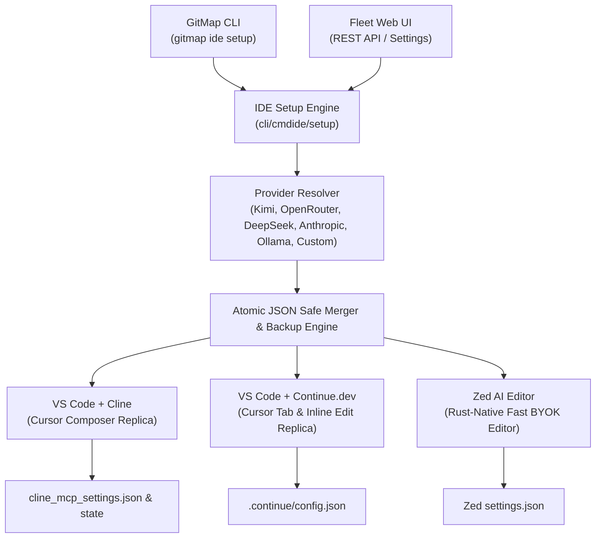

# 352 — Cursor-Like IDE Setup from GitMap Specification Suite

> **Specification Sequence:** 352  
> **Status:** Active / Production-Ready  
> **AI Confidence:** High  
> **Ambiguity:** None  
> **Module Path:** `02-spec/21-app/352-cursor-like-ide-setup-from-gitmap/`  
> **Master Plan:** `.ai-memory/plans/pending/352-cursor-like-ide-setup-from-gitmap.md`  
> **Subtask Root:** `.ai-memory/plans/subtasks/352-cursor-like-ide-setup-from-gitmap/`  
> **Target Version:** `v6.630.0`  

---

## 1. Executive Summary & Vision

The **Cursor-Like IDE Setup from GitMap** capability provides an automated, zero-friction, one-command setup directly from the GitMap CLI (`gitmap ide setup`) and GitMap Fleet Web UI (`gitmap ui` -> Settings / IDE Setup) to configure open-source and native editors into a high-performance, Cursor-equivalent AI coding experience.

Rather than locking developers into proprietary editor distributions or closed vendor backends, GitMap orchestrates open-ecosystem tooling powered by Bring-Your-Own-Key (BYOK) providers—prominently featuring **Kimi K3.1 Pro (Moonshot AI)** as the recommended production LLM, alongside first-class presets for **OpenRouter**, **DeepSeek**, **Anthropic Claude**, **Local Ollama**, and **Custom Endpoints**.

---

## 2. The Three Cursor Capabilities Replicated

| Cursor Capability | Open-Source Equivalent | Configured Targets | Developer Experience & Role |
|:---|:---|:---|:---|
| **Cursor Composer** | **VS Code + Cline** | `%APPDATA%\Code\User\globalStorage\saoudrizwan.claude-dev\settings\cline_mcp_settings.json` (Windows) `~/Library/Application Support/...` (macOS) `~/.config/Code/...` (Linux) | Autonomous multi-file codebase editing, terminal execution, GitMap MCP tool integration (`gitmap_scan_repos`, `gitmap_search_files`), and visual diff reviews. |
| **Cursor Inline & Tab** | **VS Code + Continue.dev** | `%USERPROFILE%\.continue\config.json` (Windows) `~/.continue/config.json` (macOS & Linux) | Instant inline code transformations (`Cmd/Ctrl+I`), sub-second tab ghost-text autocompletion, codebase indexing, and conversational side-panel (`Cmd/Ctrl+L`). |
| **Fast Native AI Editor** | **Zed AI Editor** | `%APPDATA%\Zed\settings.json` (Windows) `~/.config/zed/settings.json` (macOS & Linux) | Blazing fast Rust-native editor with built-in Assistant panel, inline prompt transforms, multi-model support, and slash command integration. |

---

## 3. Specification Documents in this Suite

This specification suite consists of the following canonical documents:

| Document | File Path | Focus & Core Responsibilities |
|:---|:---|:---|
| **01. CLI Architecture & Setup Engine** | `02-spec/21-app/352-cursor-like-ide-setup-from-gitmap/01-cursor-like-ide-setup-spec.md` | Core CLI architecture, provider preset definitions, cross-platform OS path matrices, CLI syntax (`gitmap ide setup [target]`), flag definitions, MCP server wiring, and atomic file merging algorithms. |
| **02. Web UI & REST API Integration** | `02-spec/21-app/352-cursor-like-ide-setup-from-gitmap/02-ui-server-and-web-integration-spec.md` | Web server REST API endpoints (`/api/ide/setup/status`, `/api/ide/setup/presets`, `/api/ide/setup/test-connection`, `/api/ide/setup/apply`), frontend tabbed visualizer in `src/pages/Settings.tsx`, live latency ping tests, and error envelopes. |
| **03. Suite Index & Architecture Rules** | `02-spec/21-app/352-cursor-like-ide-setup-from-gitmap/readme.md` | Master suite entry point, structural invariants, cross-platform target matrices, acceptance criteria, and plan traceability. |

---

## 4. Multi-Provider Presets Catalog

GitMap provides built-in presets with production-tested context window sizes, temperature defaults, and authorization header schemes:

| Preset Key | Provider Name | Default Base URL | Default Model | Fallback Models | Context Limit | Auth Header |
|:---|:---|:---|:---|:---|:---:|:---|
| `kimi` | Moonshot Kimi *(Recommended)* | `https://api.moonshot.cn/v1` | `kimi-k3.1-pro` | `moonshot-v1-128k`, `moonshot-v1-32k` | 128,000 | `Bearer <KEY>` |
| `openrouter` | OpenRouter | `https://openrouter.ai/api/v1` | `moonshotai/kimi-k3.1-pro` | `anthropic/claude-3.7-sonnet`, `deepseek/deepseek-chat` | 128,000 | `Bearer <KEY>` |
| `deepseek` | DeepSeek | `https://api.deepseek.com/v1` | `deepseek-chat` | `deepseek-reasoner` | 64,000 | `Bearer <KEY>` |
| `anthropic` | Anthropic Claude | `https://api.anthropic.com/v1` | `claude-3-7-sonnet-20250219` | `claude-3-5-sonnet-latest`, `claude-3-5-haiku-latest` | 200,000 | `x-api-key: <KEY>` |
| `ollama` | Local Ollama | `http://localhost:11434/v1` | `deepseek-r1` | `qwen2.5-coder:32b`, `llama3.3:70b` | 32,000 | None / Optional |
| `custom` | Custom OpenAI-Compatible | `--base-url <url>` | `--model <id>` | User-defined | Configurable | `Bearer <KEY>` |

### Environment Variable Cascades
When `--api-key` is omitted on the CLI or in the UI, GitMap resolves keys in deterministic sequence:
1. Provider-specific variable: `KIMI_API_KEY` / `MOONSHOT_API_KEY`, `OPENROUTER_API_KEY`, `DEEPSEEK_API_KEY`, `ANTHROPIC_API_KEY`.
2. GitMap universal AI variable: `GITMAP_AI_API_KEY`.
3. Standard fallback variable: `OPENAI_API_KEY`.

---

## 5. Non-Negotiable Architectural Invariants

Every component implementing this specification MUST strictly enforce the following invariants:

1. **Non-Destructive Safe Merging**: GitMap MUST NEVER overwrite existing user settings or clobber unrelated JSON blocks (e.g. editor themes, keybindings, other MCP servers, custom slash commands). Only designated AI provider sections are updated.
2. **Mandatory Pre-Flight Backup**: Before touching any configuration file on disk, GitMap MUST create a timestamped backup copy (`<file>.bak-<timestamp>`) with verification.
3. **Leaf Error Sovereignty**: Leaf functions that return `error` or `*apperror.AppError` MUST NEVER call `os.Exit` or CLI exit handlers. All errors bubble up to `dispatchSubcommand` or `cmdui.writeJSONError`.
4. **Function Size and Complexity Ceiling**: Every Go function MUST be <= 15 lines of executable code (<= 8 lines preferred). All nested if conditions MUST be flattened with guard clauses and early returns.
5. **Strict Positive Boolean Naming**: All booleans MUST begin with `is` or `has` ONLY (`isInstalled`, `hasConfig`, `isDryRun`, `isQuiet`, `isJson`, `isForceCreate`, `isConnectionSuccessful`, `isBackupEnabled`). Negative flags and prefixes (`no*`, `disable*`, `un*`, `isNot*`) are strictly banned.
6. **Relative Path Discipline**: All documentation, plans, code references, and test fixtures MUST use relative Git repository paths (`02-spec/...`, `.ai-memory/...`, `cli/...`). Absolute paths (`C:\...`, `/Users/...`) and `file:///` URIs are prohibited.
7. **Strongly Typed Enums**: All enum values must end in `Type` (`IDETargetType`, `IDEProviderType`, `SetupModeType`) and provide `IsValid()`, `String()`, and `Parse*` functions.

---

## 6. Acceptance Criteria & Verification Matrix

| Verification ID | Category | Requirement & Pass Criteria |
|:---|:---|:---|
| **V-01** | CLI Flags & Dispatch | `gitmap ide setup --help` and `gitmap ide setup [target] [flags]` cleanly parse all flags (`--provider`, `--model`, `--base-url`, `--api-key`, `--dry-run`, `--json`, `--test`, `--force`, `--backup`). |
| **V-02** | Target `cline` Setup | Generates valid `cline_mcp_settings.json` with GitMap MCP server tools and configures Cline OpenAI-compatible provider with Kimi K3.1 Pro endpoint. |
| **V-03** | Target `continue` Setup | Merges Kimi K3.1 Pro into `~/.continue/config.json` `models` and `tabAutocompleteModel` without altering existing context providers or slash commands. |
| **V-04** | Target `zed` Setup | Configures `language_models` in Zed `settings.json` with OpenAI-compatible Moonshot endpoint and default model setting. |
| **V-05** | Target `all` Multi-Setup | In a single execution, updates Cline, Continue.dev, and Zed configurations simultaneously with consistent provider credentials. |
| **V-06** | Pre-Flight Backup | Verification that `<target>.bak-<timestamp>` is created on disk prior to any in-place configuration mutation. |
| **V-07** | Connection Test Engine | `--test` flag and `POST /api/ide/setup/test-connection` execute lightweight API ping against Moonshot/provider endpoint and report measured latency or clear error diagnostics. |
| **V-08** | REST API Endpoints | `GET /api/ide/setup/status`, `GET /api/ide/setup/presets`, `POST /api/ide/setup/test-connection`, and `POST /api/ide/setup/apply` return standard `Result[T]` JSON envelopes. |
| **V-09** | Web UI Integration | GitMap Fleet Web UI displays 3-tab layout (Cline, Continue, Zed) + "All" setup, provider dropdown, connection tester, and diff preview modal. |
| **V-10** | Coding Guidelines Compliance | 100% of new Go files adhere to <= 15-line limit, zero nested ifs, positive booleans, leaf error sovereignty, and typed enums. |
| **V-11** | Unit Test Coverage | All new packages (`cli/cmdide/setup`, `cli/cmdui/ui_server_ide_setup.go`) exceed 85% branch and statement test coverage. |

---

## 7. Plan & Subtask Cross-References

- **Master Plan:** [352-cursor-like-ide-setup-from-gitmap.md](file;.ai-memory/plans/pending/352-cursor-like-ide-setup-from-gitmap.md)
- **Subtask 01:** [01-ide-setup-engine-and-presets.md](file;.ai-memory/plans/subtasks/352-cursor-like-ide-setup-from-gitmap/01-ide-setup-engine-and-presets.md)
- **Subtask 02:** [02-config-generators-cline-continue-zed.md](file;.ai-memory/plans/subtasks/352-cursor-like-ide-setup-from-gitmap/02-config-generators-cline-continue-zed.md)
- **Subtask 03:** [03-cli-command-and-flags.md](file;.ai-memory/plans/subtasks/352-cursor-like-ide-setup-from-gitmap/03-cli-command-and-flags.md)
- **Subtask 04:** [04-ui-server-api-and-web-interface.md](file;.ai-memory/plans/subtasks/352-cursor-like-ide-setup-from-gitmap/04-ui-server-api-and-web-interface.md)
- **Subtask 05:** [05-live-testing-and-verification.md](file;.ai-memory/plans/subtasks/352-cursor-like-ide-setup-from-gitmap/05-live-testing-and-verification.md)
