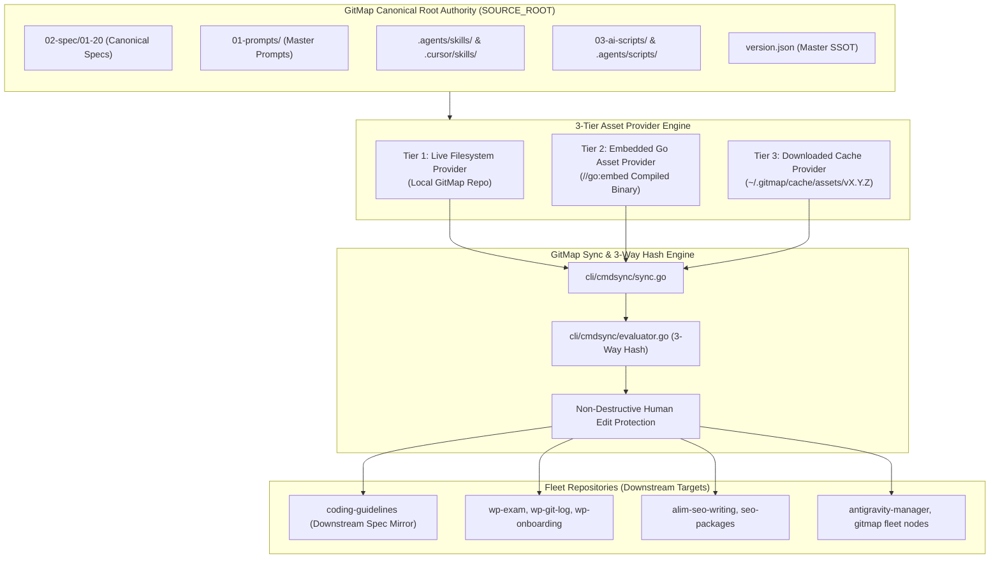
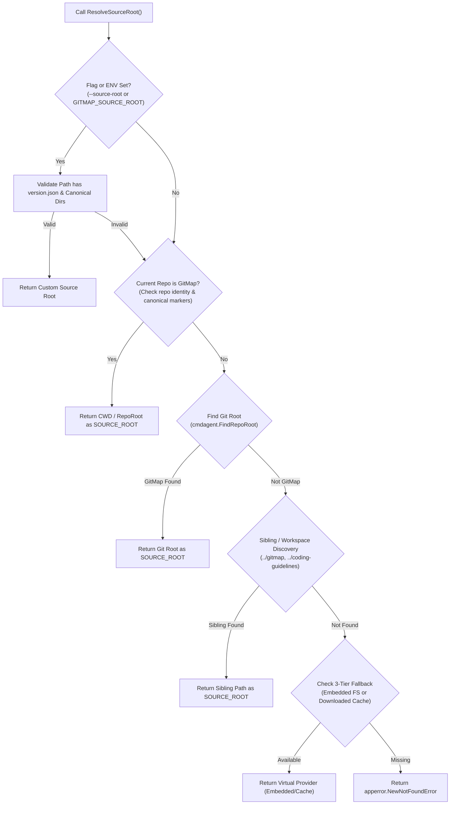
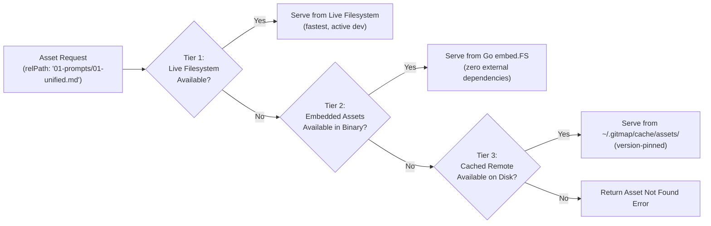
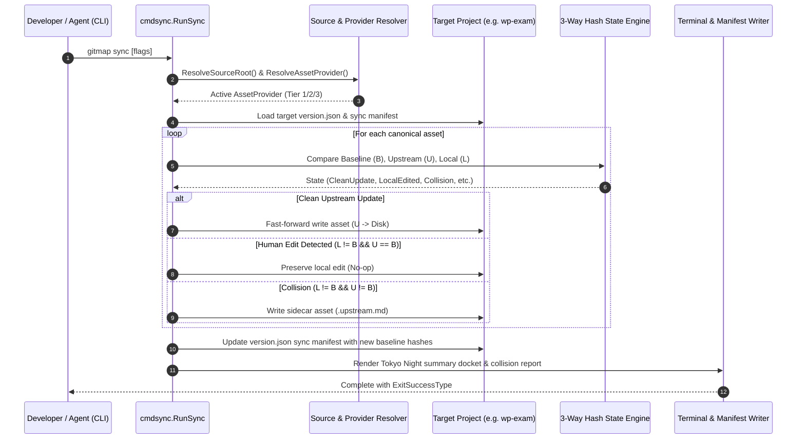

# Spec 363: GitMap Synchronization & Version Control — Overview and Architecture

- **Spec Number:** 363
- **Document:** 01
- **Title:** Overview and Architecture: GitMap as Canonical Root Authority & 3-Tier Asset Provider
- **Slug:** `363-gitmap-synchronization-and-version-control`
- **File Path:** `02-spec/21-app/363-gitmap-synchronization-and-version-control/01-overview-and-architecture.md`
- **Status:** Approved
- **Created Date:** 31-Oct-26
- **Architecture Standards:** GitMap V7 Engine, 3-Tier Asset Provider, Leaf Error Sovereignty, Positive Booleans, <= 15 Line Functions, Zero Absolute Paths

---

## 1. System Intent & Architectural Inversion

### 1.1 Historical Context & Problem Statement
In earlier iterations of the multi-repository ecosystem, the external repository `coding-guidelines` was treated as the nominal source of truth for guidelines, prompts, and skills. However, operational reality evolved:
1. **Tooling Nexus Disconnect**: `gitmap` is the active development engine where CLI tools, high-speed scanners, AST parsers, and AI task orchestrators are engineered, tested, and released.
2. **Brittle Source Discovery**: The existing `ResolveSourceRoot` implementation in `cli/cmdsync/defaults.go` was rigidly coupled to directory names containing `"coding-guidelines"`. When running `gitmap sync` inside the `gitmap` repository or in standalone installations without a local `coding-guidelines` folder, resolution failed or required awkward workarounds.
3. **Distribution Gaps**: Standalone installations of the `gitmap` binary across fleet nodes (e.g., Ubuntu servers, macOS workstations, Windows developer machines) had no native way to seed or update guidelines without cloning the entire source repository.

### 1.2 System Intent: GitMap as Canonical Single Root Authority
This specification inverts the authority hierarchy:
- **GitMap is the Single Canonical Root Authority (`SOURCE_ROOT`)** for all:
  - Core specification standards: `02-spec/01-spec-authoring-guide/` through `02-spec/20-app-spec-audit/`.
  - Canonical AI prompts: `01-prompts/`.
  - Canonical agent skills: `.agents/skills/` and `.cursor/skills/`.
  - Shared AI automation scripts: `03-ai-scripts/` and `.agents/scripts/`.
- **Downstream Fleet Targets**:
  - The `coding-guidelines` repository is transitioned into a downstream target that mirrors GitMap's canonical specifications.
  - All 43+ connected fleet repositories (e.g., `wp-*`, `seo-*`, `alim-*`, `mobile-*`, `desktop-*`) receive synchronized updates originating from GitMap.
- **Strict Boundary Isolation**:
  - Application-specific specs (`02-spec/21-app/*` and higher) are strictly local to each repository and are never overwritten or pushed downstream.
  - Runtime memory (`.ai-memory/`), local configuration (`.env`), and version control metadata (`.git/`) remain strictly isolated per repository.

---

## 2. Architectural Topology

### 2.1 Multi-Tier Distribution Topology Diagram



### 2.2 Synchronization Boundary Matrix

| Asset Category | Path Pattern | Propagation Direction | Sync Policy |
| :--- | :--- | :--- | :--- |
| **Canonical Specs** | `02-spec/01-*` to `02-spec/20-*` | GitMap $\to$ Downstream | 3-Way Hash with Human Edit Protection |
| **Application Specs** | `02-spec/21-*` through `99-*` | Project-Local Only | **NEVER SYNCED** (Excluded) |
| **AI Master Prompts**| `01-prompts/*.md` | GitMap $\to$ Downstream | 3-Way Hash with Human Edit Protection |
| **Agent Skills** | `.agents/skills/*` | GitMap $\to$ Downstream | 3-Way Hash with Sidecar Collision Guard |
| **IDE Skills** | `.cursor/skills/*` | GitMap $\to$ Downstream | 3-Way Hash with Sidecar Collision Guard |
| **Automation Scripts**| `03-ai-scripts/*.py` | GitMap $\to$ Downstream | Add-only / Upstream Update (Non-destructive) |
| **Agent Scripts** | `.agents/scripts/*` | GitMap $\to$ Downstream | Add-only / Upstream Update |
| **Project Memory** | `.ai-memory/*` | Project-Local Only | **NEVER SYNCED** (Excluded) |
| **Local Secrets** | `.env*`, `*.key`, `*.pem` | Project-Local Only | **NEVER SYNCED** (Strictly Excluded) |

---

## 3. Decoupling Source Root Resolution

### 3.1 Deficiency of Legacy Resolution
The legacy `ResolveSourceRoot()` function relied on the following hardcoded check:
```go
// Legacy fragile logic
if err == nil && isCanonicalSourceRepo(cwd) && strings.Contains(strings.ToLower(cwd), "coding-guidelines") {
    return filepath.Clean(cwd), true
}
```
This design was flawed because:
- It prevented `gitmap` itself from acting as the source root.
- It broke if the repository folder was renamed or cloned under another name (e.g., `gitmap-v28`, `cg-repo`).
- It provided zero fallback when executing a compiled binary outside of a source tree.

### 3.2 Autonomous Discovery Algorithm
The decoupled `ResolveSourceRoot()` operates across 5 discrete discovery stages:



#### Canonical Authority Signature Validation
A directory qualifies as an authoritative `SOURCE_ROOT` if and only if:
1. `version.json` exists and its `RepoSlug` equals `"gitmap-v28"` or `Title` equals `"GitMap"`.
2. Required canonical directories exist:
   - `01-prompts/`
   - `02-spec/02-coding-guidelines/`
   - `.agents/skills/`

---

## 4. 3-Tier Asset Provider Architecture

To support offline execution, lightweight binary installs, and developer source trees, GitMap introduces a pluggable, layered asset provider system:



### 4.1 Tier 1: Live Filesystem Provider (`LiveFsProvider`)
- **Use Case**: Active development within or adjacent to the `gitmap` repository.
- **Characteristics**:
  - Direct file I/O operations via OS filesystem.
  - Instant reflection of changes without requiring binary recompilation.
  - Streaming SHA-256 calculation directly from file descriptors.

### 4.2 Tier 2: Embedded Go Asset Provider (`EmbeddedAssetProvider`)
- **Use Case**: Standalone compiled `gitmap` binaries distributed across fleet servers, CI/CD runners, and developer machines where the GitMap source repository is not cloned.
- **Characteristics**:
  - Compiles canonical prompts, skills, and specs directly into the Go binary using `//go:embed`.
  - Zero filesystem dependencies; cannot be broken by missing sibling directories.
  - Provides immutable baseline assets for seeding new repositories or restoring corrupted assets.

### 4.3 Tier 3: Downloaded Cache Provider (`CachedRemoteProvider`)
- **Use Case**: Slim binary builds (where assets are omitted to reduce binary size) or dynamically fetching updated asset packs from GitHub Releases without replacing the binary.
- **Characteristics**:
  - Downloads release asset archives (`gitmap-assets-vX.Y.Z.tar.gz`) from GitHub.
  - Unpacks into user cache directory (`~/.gitmap/cache/assets/vX.Y.Z/`).
  - Cryptographically verifies the archive against published SHA-256 checksums before unpacking.

### 4.4 Pluggable Go Interface Contract
All asset providers implement a unified interface in `cli/cmdsync/`:

```go
// AssetProvider abstracts asset retrieval across filesystem, embedded binary, and remote cache.
type AssetProvider interface {
	ReadAsset(relPath string) ([]byte, error)
	ListAssets(prefix string) ([]string, error)
	HasAsset(relPath string) bool
	ProviderType() enums.AssetProviderType
}
```

---

## 5. Fleet Synchronization Workflow

When a developer or agent executes `gitmap sync`, the execution lifecycle proceeds through six deterministic phases:



---

## 6. Acceptance Criteria & Invariants

1. **Root Authority Invariant**: `gitmap` is the authoritative origin for all coding guidelines (`02-spec/01-20`), master prompts (`01-prompts`), and canonical skills (`.agents/skills`, `.cursor/skills`).
2. **Decoupled Resolution**: `ResolveSourceRoot` must succeed when executed from within `gitmap`, from an external repo with sibling `gitmap`, or via `--source-root` override. Zero reliance on hardcoded `"coding-guidelines"` string.
3. **Multi-Tier Fallback**: When no live filesystem source root exists, `gitmap sync` gracefully falls back to Tier 2 (Embedded) or Tier 3 (Cache) without crashing.
4. **Non-Destructive Guarantee**: Local human edits are protected. Collisions produce sidecars (`.upstream.md`) and never destroy local code.
5. **Guideline Compliance**:
   - Zero absolute paths across all documentation and code.
   - All Go functions $\le$ 15 lines.
   - All booleans strictly follow `is*` or `has*` naming.
   - All errors returned via `apperror.Wrap` or typed app errors.
