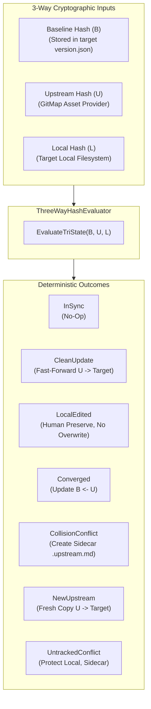

# Spec 363: GitMap Synchronization & Version Control — 3-Way Hash & Version Schema

- **Spec Number:** 363
- **Document:** 02
- **Title:** 3-Way Hash State Engine, Collision Detection & version.json Schema Specification
- **Slug:** `363-gitmap-synchronization-and-version-control`
- **File Path:** `02-spec/21-app/363-gitmap-synchronization-and-version-control/02-3way-hash-and-version-schema.md`
- **Status:** Approved
- **Created Date:** 31-Oct-26
- **Architecture Standards:** 3-Way Hash Engine, Non-Destructive Sidecars, SSOT version.json Schema, Leaf Error Sovereignty, Positive Booleans, <= 15 Line Functions, Zero Absolute Paths

---

## 1. The 3-Way Hash State Engine

### 1.1 Conceptual Model
Traditional 2-way file synchronization compares only the upstream file ($U$) and the local file ($L$). If $U \neq L$, the synchronizer faces an ambiguous dilemma: did upstream change, or did the developer modify the local copy? Blindly overwriting $L$ with $U$ destroys local modifications, while skipping the update starves the target repo of upstream improvements and bug fixes.

To resolve this fundamentally, GitMap implements a **3-Way Hash State Engine** utilizing a common ancestor baseline:
- **Baseline Hash ($B$)**: The SHA-256 cryptographic digest of the asset recorded in the target repository's `version.json` at the time of the previous successful synchronization.
- **Upstream Hash ($U$)**: The SHA-256 cryptographic digest of the canonical asset provided by the active GitMap Asset Provider (Tier 1 Live FS, Tier 2 Embedded, or Tier 3 Remote Cache).
- **Local Hash ($L$)**: The SHA-256 cryptographic digest of the live asset file on the target repository's filesystem.



### 1.2 State Evaluation Matrix & Decision Table

The evaluator checks the three digests against the following deterministic truth table:

| Case | Condition | State Enum | Action Taken | Result Status | `isHumanPreserved` |
| :---: | :--- | :--- | :--- | :--- | :---: |
| **1** | $B == U$ AND $B == L$ | `SyncStateInSync` | **No-op**: Files are identical. Zero disk writes. | `InSync` | `false` |
| **2** | $B == L$ AND $B \neq U$ | `SyncStateCleanUpdate` | **Fast-Forward**: Write $U \to \text{target}$. Update $B \leftarrow U$. | `Updated` | `false` |
| **3** | $B == U$ AND $B \neq L$ | `SyncStateLocalEdited` | **Preserve**: Developer edited local file; upstream unchanged. Do NOT overwrite. | `HumanPreserved` | `true` |
| **4** | $B \neq U$ AND $B \neq L$ AND $U == L$ | `SyncStateConverged` | **Converge**: Upstream and local changed identically. Update $B \leftarrow U$. | `Converged` | `false` |
| **5** | $B \neq U$ AND $B \neq L$ AND $U \neq L$ | `SyncStateCollision` | **Protect & Sidecar**: True conflict. Keep local $L$; write upstream $U$ to `.upstream` sidecar. | `ConflictSidecarCreated` | `true` |
| **6** | $B == \emptyset$ AND $L == \emptyset$ AND $U \neq \emptyset$ | `SyncStateNewUpstream` | **Fresh Add**: Write $U \to \text{target}$. Initialize $B \leftarrow U$. | `Added` | `false` |
| **7** | $B == \emptyset$ AND $L \neq \emptyset$ AND $U \neq L$ | `SyncStateUntrackedLocal` | **Protect & Sidecar**: Local file exists untracked. Keep $L$; write $U$ to `.upstream` sidecar. | `ConflictUntrackedPreserved` | `true` |

---

## 2. Collision Detection & Non-Destructive Protection

### 2.1 The Non-Destructive Invariant
> **Core Guarantee**: `gitmap sync` SHALL NEVER overwrite, obliterate, or silently discard human developer edits or local repository customizations.

When a collision occurs (Case 5 or Case 7):
1. **Primary Target File Preserved**: The target filesystem file at `relPath` remains completely untouched.
2. **Sidecar Generation**: The upstream content is materialized alongside the original file using the naming pattern:
   $$\text{sidecarPath} = \text{filepath.Dir}(\text{relPath}) + \text{"/"} + \text{baseName} + \text{".upstream"} + \text{ext}$$
   - *Example*: `.agents/skills/gitmap/skill.md` $\to$ `.agents/skills/gitmap/skill.upstream.md`
   - *Example*: `02-spec/02-coding-guidelines/01-rules.md` $\to$ `02-spec/02-coding-guidelines/01-rules.upstream.md`
3. **Collision Header**: For Markdown assets, the sidecar is prepended with an informative Tokyo Night alert card:
   ```markdown
   > [!WARNING] GITMAP UPSTREAM CONFLICT SIDECAR
   > This file contains upstream changes from GitMap v6.635.3 that conflict with local edits.
   > Local File: skill.md (SHA: a1b2c3d4...)
   > Upstream File: skill.upstream.md (SHA: e5f6a7b8...)
   > Baseline File: version.json (SHA: 99887766...)
   >
   > To resolve:
   > 1. Keep your edits: gitmap sync --resolve-mine .agents/skills/gitmap/skill.md
   > 2. Accept upstream: gitmap sync --resolve-theirs .agents/skills/gitmap/skill.md
   ```

### 2.2 Terminal Collision Docket
During `gitmap sync`, any detected collisions are surfaced in a high-visibility terminal docket:

```text
===============================================================================================
                       GITMAP ASSET SYNCHRONIZATION CONFLICT REPORT                            
===============================================================================================
 TARGET REPOSITORY : wp-exam
 CONFLICT COUNT    : 1 collision detected (Human edits preserved)

 [!] CONFLICT : .agents/skills/gitmap/skill.md
     Baseline (B) : 998877665544... (v6.620.0)
     Upstream (U) : e5f6a7b8c9d0... (v6.635.3)
     Local    (L) : a1b2c3d4e5f6... (Modified by Human)
     Action       : Generated sidecar -> .agents/skills/gitmap/skill.upstream.md

 RESOLUTION COMMANDS:
   gitmap sync --resolve-mine   .agents/skills/gitmap/skill.md
   gitmap sync --resolve-theirs .agents/skills/gitmap/skill.md
   gitmap sync --diff           .agents/skills/gitmap/skill.md
===============================================================================================
```

---

## 3. `version.json` Schema Specification

`version.json` serves as the Single Source of Truth (SSOT). It supports two operational profiles:
1. **Root Authority Profile**: Deployed at the root of the canonical `gitmap` repository.
2. **Downstream Target Profile**: Deployed at the root of all synchronized fleet repositories.

### 3.1 GitMap Root Authority Profile Schema
At the root of `gitmap`, `version.json` records authoritative version numbers, component sections, metadata, and the catalog of canonical assets.

```json
{
  "$schema_description": "GitMap Canonical Root Authority Version Manifest",
  "Version": "6.635.3",
  "Title": "GitMap",
  "RepoSlug": "gitmap-v28",
  "RepoUrl": "https://github.com/alimtvnetwork/gitmap-v28",
  "LastCommitSha": "fd487dd0b5eab289a3847e9f58428add7907bdb5",
  "Description": "Git repository scanner, manager, and navigator CLI with parallel cloning, SSH cluster fleet management, and AI agent task orchestration.",
  "backend": "inherit",
  "frontend": "inherit",
  "cli": "inherit",
  "linters": "3.79.0",
  "authority": {
    "isSourceRoot": true,
    "canonicalSpecs": "02-spec/01-20",
    "promptsDir": "01-prompts",
    "skillsDirs": [".agents/skills", ".cursor/skills"],
    "scriptsDirs": ["03-ai-scripts", ".agents/scripts"]
  },
  "stats": {
    "totalFiles": 707,
    "totalLines": 149488
  }
}
```

### 3.2 Downstream Target Profile Schema (`sync` block)
In downstream repositories, `version.json` maintains its standard project fields while incorporating a dedicated `"sync"` block to persist 3-way baseline states.

```json
{
  "Version": "1.4.2",
  "Title": "WP Exam",
  "RepoSlug": "wp-exam",
  "sync": {
    "sourceRoot": "gitmap",
    "sourceVersion": "6.635.3",
    "sourceCommitSha": "fd487dd0b5eab289a3847e9f58428add7907bdb5",
    "lastSyncedAt": "2026-10-31T17:50:00Z",
    "providerType": "LiveFS",
    "hasCollisions": true,
    "collisionCount": 1,
    "assets": {
      "01-prompts/01-unified-ai-prompt-v4.md": {
        "baselineHash": "e3b0c44298fc1c149afbf4c8996fb92427ae41e4649b934ca495991b7852b855",
        "lastSyncedAt": "2026-10-31T17:50:00Z",
        "status": "InSync",
        "isHumanPreserved": false
      },
      "02-spec/02-coding-guidelines/01-architecture.md": {
        "baselineHash": "fa7c89b21345dc67e890123456789abcdef0123456789abcdef0123456789abc",
        "lastSyncedAt": "2026-10-31T17:50:00Z",
        "status": "Updated",
        "isHumanPreserved": false
      },
      ".agents/skills/gitmap/skill.md": {
        "baselineHash": "99887766554433221100aabbccddeeff00112233445566778899aabbccddeeff",
        "lastSyncedAt": "2026-10-31T17:50:00Z",
        "status": "ConflictSidecarCreated",
        "isHumanPreserved": true,
        "sidecarPath": ".agents/skills/gitmap/skill.upstream.md"
      }
    }
  }
}
```

---

## 4. Concrete Go Structs for `cli/model/`

The domain models are defined in `cli/model/sync_manifest.go` and integrated into `cli/model/version_manifest.go`:

```go
package model

import "time"

// SyncProviderType represents the asset provider tier utilized during synchronization.
type SyncProviderType string

const (
	SyncProviderLiveFS   SyncProviderType = "LiveFS"
	SyncProviderEmbedded SyncProviderType = "Embedded"
	SyncProviderCache    SyncProviderType = "RemoteCache"
)

// SyncAssetStatusType defines the operational status of an asset following evaluation.
type SyncAssetStatusType string

const (
	SyncStatusInSync          SyncAssetStatusType = "InSync"
	SyncStatusUpdated         SyncAssetStatusType = "Updated"
	SyncStatusAdded           SyncAssetStatusType = "Added"
	SyncStatusHumanPreserved  SyncAssetStatusType = "HumanPreserved"
	SyncStatusSidecarCreated  SyncAssetStatusType = "ConflictSidecarCreated"
	SyncStatusUntrackedLocal  SyncAssetStatusType = "ConflictUntrackedPreserved"
)

// SyncAssetRecord holds baseline cryptographic hashes and conflict flags for a single file.
type SyncAssetRecord struct {
	BaselineHash     string              `json:"baselineHash"`
	LastSyncedAt     string              `json:"lastSyncedAt"`
	Status           SyncAssetStatusType `json:"status"`
	IsHumanPreserved bool                `json:"isHumanPreserved"`
	SidecarPath      string              `json:"sidecarPath,omitempty"`
}

// SyncManifest encapsulates downstream synchronization tracking metadata within version.json.
type SyncManifest struct {
	SourceRoot      string                     `json:"sourceRoot"`
	SourceVersion   string                     `json:"sourceVersion"`
	SourceCommitSha string                     `json:"sourceCommitSha,omitempty"`
	LastSyncedAt    string                     `json:"lastSyncedAt"`
	ProviderType    SyncProviderType           `json:"providerType"`
	HasCollisions   bool                       `json:"hasCollisions"`
	CollisionCount  int                        `json:"collisionCount"`
	Assets          map[string]SyncAssetRecord `json:"assets"`
}

// HasActiveCollisions checks whether any unresolved conflict sidecars exist.
func (sm *SyncManifest) HasActiveCollisions() bool {
	if sm == nil {
		return false
	}

	return sm.HasCollisions && sm.CollisionCount > 0
}

// GetBaselineHash retrieves the baseline hash for a relative path or returns empty string.
func (sm *SyncManifest) GetBaselineHash(relPath string) string {
	if sm == nil || sm.Assets == nil {
		return ""
	}
	record, exists := sm.Assets[relPath]
	if !exists {
		return ""
	}

	return record.BaselineHash
}
```

Integration into `RepositoryVersionManifest` in `cli/model/version_manifest.go`:

```go
// Extended RepositoryVersionManifest in cli/model/version_manifest.go
type RepositoryVersionManifest struct {
	SchemaDescription string                   `json:"$schema_description,omitempty"`
	Version           string                   `json:"Version"`
	Title             string                   `json:"Title,omitempty"`
	RepoSlug          string                   `json:"RepoSlug,omitempty"`
	Backend           *ComponentVersion        `json:"backend,omitempty"`
	Frontend          *ComponentVersion        `json:"frontend,omitempty"`
	CLI               *ComponentVersion        `json:"cli,omitempty"`
	Sync              *SyncManifest            `json:"sync,omitempty"`
}
```

---

## 5. Concrete Go Engine for `cli/cmdsync/`

The 3-way evaluation logic and state transitions are authored in `cli/cmdsync/evaluator.go`:

```go
package cmdsync

import (
	"path/filepath"
	"strings"

	"github.com/alimtvnetwork/gitmap-v28/cli/model"
)

// ThreeWayHashInput bundles the cryptographic digests for tri-state evaluation.
type ThreeWayHashInput struct {
	RelPath      string
	BaselineHash string
	UpstreamHash string
	LocalHash    string
	HasLocal     bool
	HasBaseline  bool
}

// ThreeWayHashResult represents the evaluated state and prescribed synchronization action.
type ThreeWayHashResult struct {
	RelPath          string
	Status           model.SyncAssetStatusType
	IsActionRequired bool
	IsSidecarNeeded  bool
	IsHumanPreserved bool
	NewBaselineHash  string
	SidecarPath      string
}

// EvaluateTriState executes deterministic 3-way hash state analysis.
func EvaluateTriState(in ThreeWayHashInput) ThreeWayHashResult {
	if !in.HasBaseline {
		return evaluateUntrackedBaseline(in)
	}

	return evaluateTrackedBaseline(in)
}

func evaluateUntrackedBaseline(in ThreeWayHashInput) ThreeWayHashResult {
	if !in.HasLocal {
		return buildNewUpstreamResult(in)
	}
	if in.UpstreamHash == in.LocalHash {
		return buildConvergedResult(in)
	}

	return buildUntrackedConflictResult(in)
}

func evaluateTrackedBaseline(in ThreeWayHashInput) ThreeWayHashResult {
	if in.UpstreamHash == in.LocalHash {
		return buildInSyncResult(in)
	}
	if in.BaselineHash == in.LocalHash && in.BaselineHash != in.UpstreamHash {
		return buildCleanUpdateResult(in)
	}
	if in.BaselineHash == in.UpstreamHash && in.BaselineHash != in.LocalHash {
		return buildLocalEditedResult(in)
	}

	return buildCollisionConflictResult(in)
}

func buildInSyncResult(in ThreeWayHashInput) ThreeWayHashResult {
	return ThreeWayHashResult{
		RelPath:          in.RelPath,
		Status:           model.SyncStatusInSync,
		IsActionRequired: false,
		IsSidecarNeeded:  false,
		IsHumanPreserved: false,
		NewBaselineHash:  in.UpstreamHash,
	}
}

func buildCleanUpdateResult(in ThreeWayHashInput) ThreeWayHashResult {
	return ThreeWayHashResult{
		RelPath:          in.RelPath,
		Status:           model.SyncStatusUpdated,
		IsActionRequired: true,
		IsSidecarNeeded:  false,
		IsHumanPreserved: false,
		NewBaselineHash:  in.UpstreamHash,
	}
}

func buildLocalEditedResult(in ThreeWayHashInput) ThreeWayHashResult {
	return ThreeWayHashResult{
		RelPath:          in.RelPath,
		Status:           model.SyncStatusHumanPreserved,
		IsActionRequired: false,
		IsSidecarNeeded:  false,
		IsHumanPreserved: true,
		NewBaselineHash:  in.BaselineHash,
	}
}

func buildConvergedResult(in ThreeWayHashInput) ThreeWayHashResult {
	return ThreeWayHashResult{
		RelPath:          in.RelPath,
		Status:           model.SyncStatusInSync,
		IsActionRequired: false,
		IsSidecarNeeded:  false,
		IsHumanPreserved: false,
		NewBaselineHash:  in.UpstreamHash,
	}
}

func buildNewUpstreamResult(in ThreeWayHashInput) ThreeWayHashResult {
	return ThreeWayHashResult{
		RelPath:          in.RelPath,
		Status:           model.SyncStatusAdded,
		IsActionRequired: true,
		IsSidecarNeeded:  false,
		IsHumanPreserved: false,
		NewBaselineHash:  in.UpstreamHash,
	}
}

func buildUntrackedConflictResult(in ThreeWayHashInput) ThreeWayHashResult {
	sidecar := computeSidecarPath(in.RelPath)

	return ThreeWayHashResult{
		RelPath:          in.RelPath,
		Status:           model.SyncStatusUntrackedLocal,
		IsActionRequired: true,
		IsSidecarNeeded:  true,
		IsHumanPreserved: true,
		NewBaselineHash:  in.BaselineHash,
		SidecarPath:      sidecar,
	}
}

func buildCollisionConflictResult(in ThreeWayHashInput) ThreeWayHashResult {
	sidecar := computeSidecarPath(in.RelPath)

	return ThreeWayHashResult{
		RelPath:          in.RelPath,
		Status:           model.SyncStatusSidecarCreated,
		IsActionRequired: true,
		IsSidecarNeeded:  true,
		IsHumanPreserved: true,
		NewBaselineHash:  in.BaselineHash,
		SidecarPath:      sidecar,
	}
}

func computeSidecarPath(relPath string) string {
	ext := filepath.Ext(relPath)
	base := strings.TrimSuffix(relPath, ext)

	return base + ".upstream" + ext
}
```

---

## 6. Acceptance Criteria & Invariants

1. **Deterministic Tri-State Outcomes**: Every canonical asset evaluated across $B$, $U$, and $L$ maps into one of the 7 discrete states with 100% determinism.
2. **Zero Destructive Overwrites**: In any scenario where $L \neq B$ and $U \neq B$, the local file $L$ is strictly preserved on disk without modification.
3. **Sidecar Deliverability**: Upstream content in collision states is written exclusively to `<name>.upstream<ext>` sidecars.
4. **Manifest Synchronization**: Target repository `version.json` records updated baseline hashes only upon clean fast-forward updates or user resolutions.
5. **Coding Guideline Conformance**:
   - Zero absolute paths throughout specification and code.
   - All Go functions $\le$ 15 lines.
   - Zero nested conditionals (all flattened with guard clauses and helper dispatchers).
   - Blank line after `}` and blank line before `return`.
   - Positive boolean naming (`is*`, `has*`).
