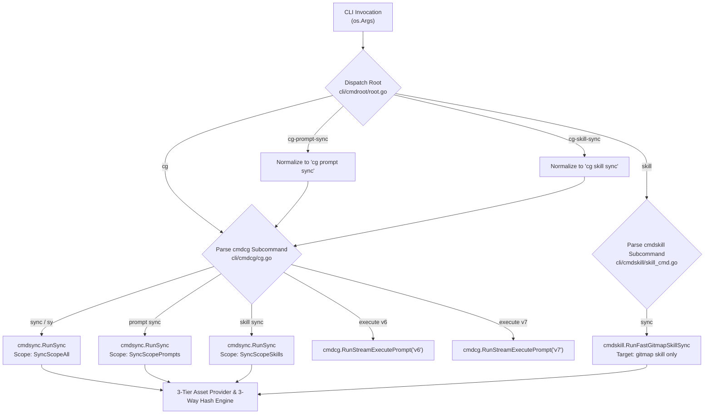
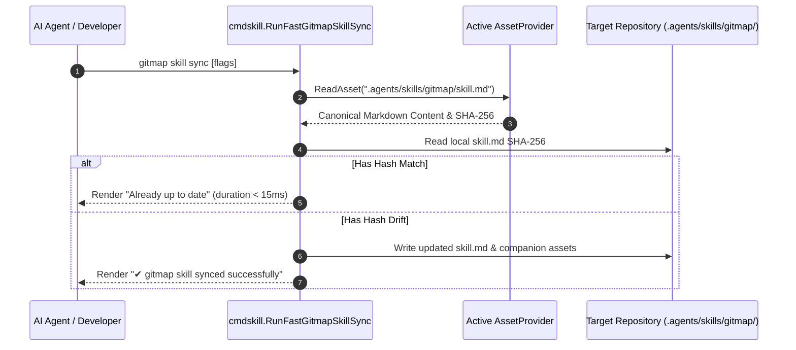
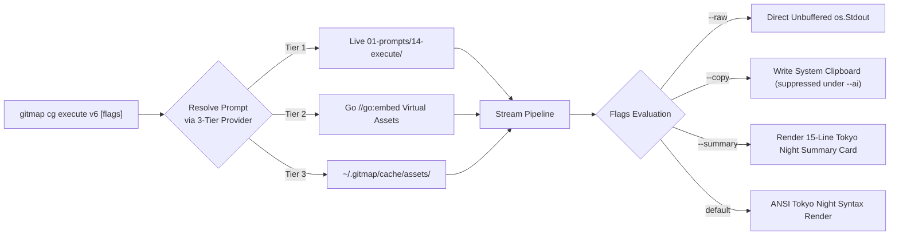
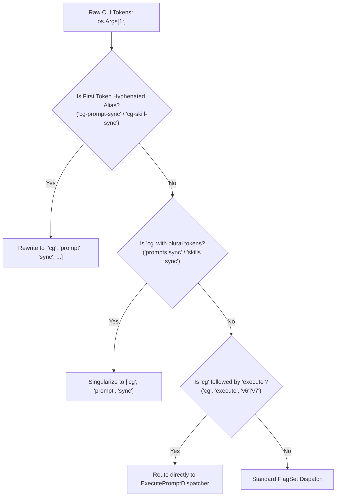

# Spec 363: GitMap Synchronization & Version Control — CLI Commands & CG Sync

- **Spec Number:** 363
- **Document:** 03
- **Title:** CLI Command Architecture, Subcommand Dispatch & CG Synchronization Routing
- **Slug:** `363-gitmap-synchronization-and-version-control`
- **File Path:** `02-spec/21-app/363-gitmap-synchronization-and-version-control/03-cli-commands-and-cg-sync.md`
- **Status:** Approved
- **Created Date:** 31-Oct-26
- **Architecture Standards:** GitMap V7 Engine, Unified Dispatch Routing, Leaf Error Sovereignty, Positive Booleans, <= 15 Line Functions, Zero Absolute Paths

---

## 1. Executive Summary & Routing Objectives

This specification details the CLI subcommand dispatch architecture, argument parsing rules, and routing pipelines for GitMap's unified synchronization engine. It unifies legacy ad-hoc shell invocations under a single high-performance Go subsystem bridging directly to `cmdsync.RunSync` and the 3-Way Hash state evaluator.

### 1.1 Core Problems Solved
1. **Dispatcher Fragmentation**: Historical invocations (`gitmap cg sync`, `gitmap cg install-prompts`, `gitmap sync`) executed disjoint codepaths. Some invoked external Python scripts, others ran basic file copies, and none consistently leveraged the 3-Way Hash state engine.
2. **Missing Scoped Fast-Paths**: Synchronizing a single prompt update or the `gitmap` autonomous companion skill previously required scanning all 20 specification folders across 43+ fleet repositories.
3. **AI Cold-Start Latency**: Autonomous agents bootstrapping in fresh terminal sessions had no single-command mechanism to stream the master execution directives (`v6` or `v7`) directly into their context window, forcing clumsy multi-step filesystem probes.

### 1.2 Target Capabilities
- **`gitmap cg sync`**: Canonical full synchronization bridging directly from package `cmdcg` to `cmdsync.RunSync`, executing 3-Way Hash evaluation across specs, prompts, skills, and scripts.
- **`gitmap cg prompt sync` / `gitmap cg-prompt-sync`**: Scoped synchronization restricted strictly to `01-prompts/`.
- **`gitmap cg skill sync` / `gitmap cg-skill-sync`**: Scoped synchronization restricted strictly to `.agents/skills/` and `.cursor/skills/`.
- **`gitmap skill sync`**: Sub-second fast-path targeting the autonomous developer companion `gitmap` skill (`.agents/skills/gitmap/`).
- **`gitmap cg execute v6` & `gitmap cg execute v7`**: Streaming AI execution prompt markdown to standard output with raw flags, clipboard integration, and token metadata for on-the-fly model learning.

---

## 2. Command Taxonomy & Routing Matrix

The following routing table establishes the definitive dispatch mappings across the CLI entry points:

| Invocable Syntax | Canonical Route | Target Handler | Scoped Asset Domains | Execution Model |
| :--- | :--- | :--- | :--- | :--- |
| `gitmap cg sync [repos...]` | `cg sync` | `cmdsync.RunSyncWithScope(SyncScopeAll)` | Specs, Prompts, Skills, Scripts | Multi-Worker Parallel (Default: 4) |
| `gitmap cg sy [repos...]` | `cg sync` | `cmdsync.RunSyncWithScope(SyncScopeAll)` | Specs, Prompts, Skills, Scripts | Multi-Worker Parallel |
| `gitmap cg prompt sync [repos...]` | `cg prompt sync` | `cmdsync.RunSyncWithScope(SyncScopePrompts)` | `01-prompts/` | Multi-Worker Parallel |
| `gitmap cg prompts sync [repos...]` | `cg prompt sync` | `cmdsync.RunSyncWithScope(SyncScopePrompts)` | `01-prompts/` | Multi-Worker Parallel |
| `gitmap cg-prompt-sync [repos...]` | `cg prompt sync` | `cmdsync.RunSyncWithScope(SyncScopePrompts)` | `01-prompts/` | Multi-Worker Parallel |
| `gitmap cg skill sync [repos...]` | `cg skill sync` | `cmdsync.RunSyncWithScope(SyncScopeSkills)` | `.agents/skills/`, `.cursor/skills/` | Multi-Worker Parallel |
| `gitmap cg skills sync [repos...]` | `cg skill sync` | `cmdsync.RunSyncWithScope(SyncScopeSkills)` | `.agents/skills/`, `.cursor/skills/` | Multi-Worker Parallel |
| `gitmap cg-skill-sync [repos...]` | `cg skill sync` | `cmdsync.RunSyncWithScope(SyncScopeSkills)` | `.agents/skills/`, `.cursor/skills/` | Multi-Worker Parallel |
| `gitmap skill sync [repos...]` | `skill sync` | `cmdskill.RunFastGitmapSkillSync` | `.agents/skills/gitmap/` only | In-Process Rapid Stream (< 50ms/repo) |
| `gitmap cg execute v6 [flags]` | `cg execute v6` | `cmdcg.RunStreamExecutePrompt("v6")` | `01-prompts/14-execute/02-...-v6.md` | Stream to Stdout / Pipe |
| `gitmap cg execute v7 [flags]` | `cg execute v7` | `cmdcg.RunStreamExecutePrompt("v7")` | `01-prompts/14-execute/02-...-v7.md` | Stream to Stdout / Pipe |

---

## 3. Dispatch Pipeline & Sequence Architecture



---

## 4. Detailed Command Specifications

### 4.1 Canonical Full Synchronization (`gitmap cg sync`)

#### 4.1.1 Purpose & Architectural Bridge
Historically, `cli/cmdcg/cg_sync.go` executed a basic two-step wrapper:
```go
// Legacy: Did not leverage 3-Way Hash or version.json
func runSyncSteps(repos []string, isDryRun bool) error {
    runCGUpdateAction(repos)
    return runCGInstallPrompts(repos, isDryRun)
}
```
Under this specification, `gitmap cg sync` is refactored into a direct, high-fidelity bridge to `cmdsync.RunSync`:
1. It validates the active `AssetProvider` (Tier 1 Live FS, Tier 2 Embedded, or Tier 3 Cache).
2. It constructs a strongly-typed `cmdsync.SyncOptions` struct with `Scope = SyncScopeAll`.
3. It passes resolved repository paths through the concurrent worker pool (`executeSyncFleet`).
4. It performs non-destructive 3-Way Hash reconciliation and emits Tokyo Night summary cards.

#### 4.1.2 Command Flags & Arguments
```bash
gitmap cg sync [repos...] [flags]
gitmap cg sy [repos...] [flags]
```

| Flag | Shorthand | Type | Default | Description |
| :--- | :--- | :--- | :--- | :--- |
| `--all` | `-a` | bool | `false` | Discover and synchronize all 43+ fleet repositories registered in SQLite |
| `--repo <names>`| `-r` | string | `""` | Comma-separated list of target repository names or path slugs |
| `--except <names>`| `-e` | string | `""` | Comma-separated list of repositories to exclude from synchronization |
| `--workers <N>` | `-w` | int | `4` | Number of concurrent repository synchronization workers (clamped: 1 to 16) |
| `--dry-run` | `-n` | bool | `false` | Simulate 3-Way Hash evaluation and display diffs without writing to disk |
| `--no-push` | | bool | `false` | Commit synchronized assets locally but skip automatic git push |
| `--no-release` | | bool | `false` | Skip automatic minor/patch version bump and release tagging in target repos |
| `--force` | `-f` | bool | `false` | Overwrite local modifications in conflict states, archiving edits to `.bak` |
| `--verbose` | `-v` | bool | `false` | Display granular per-file SHA-256 comparison telemetry during execution |

---

### 4.2 Scoped Prompt Synchronization (`gitmap cg prompt sync`)

#### 4.2.1 Purpose & Execution Boundary
Allows developers and AI agents to propagate updates to `01-prompts/` (including Muse master prompts, task execution prompts, and code review instructions) across the fleet in seconds without touching core specifications or script directories.

#### 4.2.2 Normalized Invocations
The CLI parser normalizes both space-delimited and hyphenated variants:
- `gitmap cg prompt sync`
- `gitmap cg prompts sync`
- `gitmap cg-prompt-sync`

#### 4.2.3 Scoped Execution Logic
- Sets `opts.Scope = enums.SyncScopePrompts`.
- Restricts asset evaluation to paths matching `01-prompts/**/*.md`.
- Target repository `version.json` is updated exclusively under `SyncManifest.Prompts`.

---

### 4.3 Scoped Skill Synchronization (`gitmap cg skill sync`)

#### 4.3.1 Purpose & Execution Boundary
Propagates Antigravity agent skills (`.agents/skills/`) and Cursor IDE skills (`.cursor/skills/`) across connected repositories. Ensures skill frontmatter, instructions, scripts, and examples match canonical versions while protecting repository-specific local skills.

#### 4.3.2 Normalized Invocations
- `gitmap cg skill sync`
- `gitmap cg skills sync`
- `gitmap cg-skill-sync`

#### 4.3.3 Scoped Execution Logic
- Sets `opts.Scope = enums.SyncScopeSkills`.
- Restricts asset evaluation to `.agents/skills/**/*` and `.cursor/skills/**/*`.
- Detects sidecar collisions (`<skill>.upstream.md`) if a developer has locally customized a skill.

---

### 4.4 Fast GitMap Skill Synchronization (`gitmap skill sync`)

#### 4.4.1 Purpose & Sub-Second Latency
While `gitmap cg skill sync` scans and evaluates all skills across repositories, `gitmap skill sync` is an ultra-fast dedicated command designed specifically to synchronize the **GitMap Developer Companion Skill** (`.agents/skills/gitmap/` and `.cursor/skills/gitmap/`).



#### 4.4.2 CLI Syntax & Flags
```bash
gitmap skill sync [repos...] [flags]
```

| Flag | Shorthand | Type | Default | Description |
| :--- | :--- | :--- | :--- | :--- |
| `--all` | `-a` | bool | `false` | Synchronize gitmap skill across all discovered repositories in workspace |
| `--dry-run` | `-n` | bool | `false` | Preview hash differences without modifying skill files on disk |
| `--quiet` | `-q` | bool | `false` | Suppress banner output and print single-line status code |

---

### 4.5 On-The-Fly Prompt Streaming (`gitmap cg execute v6` & `v7`)

#### 4.5.1 Purpose & Autonomous Agent Learning
When AI coding agents initialize or transition across tasks, inspecting the filesystem to find the current canonical task execution instructions is slow and error-prone. The `gitmap cg execute` suite streams the full canonical markdown directly to `stdout`.

- **`gitmap cg execute v6`**: Streams `01-prompts/14-execute/02-execute-parent-task-with-n-steps-v6.md` (Tree Swarm Hierarchy, Dynamic Agent Join, SQLite Task Queue, Secret Gate, Ledger Resume).
- **`gitmap cg execute v7`**: Streams `01-prompts/14-execute/02-execute-parent-task-with-n-steps-v7.md` (Time-Restricted & Unrestricted Dual Modes, Bot Governance, V7 Self-Loop Engine).

#### 4.5.2 Streaming Architecture


#### 4.5.3 CLI Flags & Output Modes
```bash
gitmap cg execute v6 [flags]
gitmap cg execute v7 [flags]
```

| Flag | Shorthand | Type | Default | Description |
| :--- | :--- | :--- | :--- | :--- |
| `--raw` | `-r` | bool | `false` | Emit pure, unformatted Markdown with zero ANSI escape codes or headers |
| `--copy` | `-c` | bool | `false` | Copy the complete prompt markdown directly to the OS system clipboard |
| `--summary` | `-s` | bool | `false` | Output executive structure synopsis (< 25 lines) instead of full prompt body |
| `--json` | `-j` | bool | `false` | Output structured JSON metadata: version, token count, SHA-256 hash, slug |
| `--ai` | | bool | `false` | Autonomous agent safe mode: suppresses clipboard mutation and terminal bells |

---

## 5. Argument Parsing & Normalization Engine

### 5.1 Token Normalization Rules
To provide human and agent ergonomics, command arguments pass through a normalization pre-processor before reaching the FlagSet:



### 5.2 Go Normalization Implementation Contract

```go
// NormalizeCGSyncTokens standardizes user and agent invocations into canonical tokens.
func NormalizeCGSyncTokens(args []string) []string {
	if len(args) == 0 {
		return args
	}

	first := strings.ToLower(args[0])
	if first == "cg-prompt-sync" {
		return append([]string{"cg", "prompt", "sync"}, args[1:]...)
	}
	if first == "cg-skill-sync" {
		return append([]string{"cg", "skill", "sync"}, args[1:]...)
	}

	return normalizeSubTokens(args)
}

func normalizeSubTokens(args []string) []string {
	if len(args) >= 3 && args[0] == "cg" {
		if args[1] == "prompts" {
			args[1] = "prompt"
		}
		if args[1] == "skills" {
			args[1] = "skill"
		}
	}

	return args
}
```

---

## 6. Subcommand Routing & Dispatch Architecture

### 6.1 Dispatch Function Interfaces
In accordance with Leaf Error Sovereignty, all routing dispatchers return an `error` or typed `*apperror.AppError` directly upward to the root runner in `cli/root.go`:

```go
// DispatchCGSync bridges 'gitmap cg sync' and scoped variants to cmdsync.
func DispatchCGSync(args []string) error {
	scope, cleanedArgs := resolveSyncScope(args)
	opts, errParse := parseSyncOptions(cleanedArgs, scope)
	if errParse != nil {
		return apperror.WrapSimple(errParse, "failed to parse sync flags")
	}

	return cmdsync.RunSyncWithOptions(opts)
}

func resolveSyncScope(args []string) (enums.SyncScopeType, []string) {
	if len(args) >= 2 && args[0] == "prompt" && args[1] == "sync" {
		return enums.SyncScopePrompts, args[2:]
	}
	if len(args) >= 2 && args[0] == "skill" && args[1] == "sync" {
		return enums.SyncScopeSkills, args[2:]
	}

	return enums.SyncScopeAll, args
}
```

### 6.2 Stream Execution Prompt Handler

```go
// RunStreamExecutePrompt loads and streams canonical execution instructions.
func RunStreamExecutePrompt(version string, args []string) error {
	opts, errParse := parseExecuteFlags(args)
	if errParse != nil {
		return errParse
	}

	content, errRead := loadExecutePromptContent(version)
	if errRead != nil {
		return apperror.WrapSimple(errRead, "unable to load execution prompt")
	}

	return emitPromptOutput(content, opts, version)
}

func loadExecutePromptContent(version string) ([]byte, error) {
	provider := cmdsync.GetActiveAssetProvider()
	relPath := resolveExecutePromptPath(version)

	return provider.ReadAsset(relPath)
}

func resolveExecutePromptPath(version string) string {
	if version == "v7" {
		return "01-prompts/14-execute/02-execute-parent-task-with-n-steps-v7.md"
	}

	return "01-prompts/14-execute/02-execute-parent-task-with-n-steps-v6.md"
}
```

---

## 7. Terminal UI Presentation & Tokyo Night Styling

GitMap terminal outputs leverage Charmbracelet Lipgloss tokens adhering to the Tokyo Night theme palette:

### 7.1 Tokyo Night Palette Tokens
- **Background**: `#1a1b26`
- **Surface / Card Background**: `#24283b`
- **Accent Purple (Header / Commands)**: `#bb9af7`
- **Accent Blue (Information / Prompts)**: `#7aa2f7`
- **Cyan (File Paths / Hashes)**: `#7dcfff`
- **Emerald Green (Clean Updates / Success)**: `#9ece6a`
- **Amber Orange (Warnings / Collisions)**: `#e0af68`
- **Crimson Red (Errors / Failures)**: `#f7768e`

### 7.2 UI Output Mockup: `gitmap cg sync` Summary Docket

```text
┌────────────────────────────────────────────────────────────────────────┐
│  GITMAP FLEET SYNCHRONIZATION DOCKET (V7 ENGINE)                      │
│  Source Root: gitmap (Canonical Single Root Authority)                 │
│  Scope: All Assets (Specs, Prompts, Skills, Scripts) | Workers: 4      │
└────────────────────────────────────────────────────────────────────────┘

  Target Repository        Status         Updated   Preserved   Sidecars  Duration
  ───────────────────────  ─────────────  ────────  ──────────  ────────  ────────
  coding-guidelines        ✔ In Sync            0         142         0      42ms
  wp-exam                  ✔ Updated           18           2         0     184ms
  alim-seo-writing         ✔ Updated           24           0         0     210ms
  antigravity-manager      ⚠ Collision          9           1         1     195ms

──────────────────────────────────────────────────────────────────────────
  Summary: 4 repos processed in 382ms | 51 updated | 145 preserved | 1 sidecar
  ✔ Clean non-destructive synchronization complete.
```

### 7.3 UI Output Mockup: `gitmap cg execute v6 --summary`

```text
┌────────────────────────────────────────────────────────────────────────┐
│  CANONICAL TASK EXECUTION PROMPT: V6 ENGINE                            │
│  Slug: 02-execute-parent-task-with-n-steps-v6.md                       │
│  Tokens: ~28,450 | SHA-256: 4f9a8c...2b81 | Status: Canonical Active    │
└────────────────────────────────────────────────────────────────────────┘

  Core Architectural Rituals:
  1. Task Confirmation First: Verbatim capture, confirmed task breakdown.
  2. Immediate Status & ETA: Output RUNNING or NOT RUNNING within 30 seconds.
  3. Continuous 5-Minute Heartbeats: Periodic progress markers.
  4. Mandatory Tree Swarm Hierarchy: A=3, H=2, capacity 6 concurrent ops.
  5. Isolated Agent Workspaces: Disjoint file boxes with strict Worker Git Ban.
  6. GitMap Hyphen Commits: gitmap cpf "MODULE - summary", immediate push.
  7. Pre-Commit Secrets Gate: check-forbidden-strings.py and gitmap aum search.

  💡 Tip: Run 'gitmap cg execute v6 --raw' to stream complete markdown to stdout.
```

---

## 8. Invariants & Acceptance Criteria

1. **Leaf Error Sovereignty**: Leaf functions in `cli/cmdcg/`, `cli/cmdsync/`, and `cli/cmdskill/` MUST return typed errors directly without calling `os.Exit` or exit handlers.
2. **Deterministic Route Mapping**: Invoking `gitmap cg sync`, `gitmap cg-prompt-sync`, or `gitmap cg-skill-sync` MUST route to the unified `cmdsync.RunSyncWithOptions` pipeline. Zero invocation of legacy unvalidated shell scripts.
3. **AI Clipboard Safety Invariant**: Passing `--ai` to `gitmap cg execute v6` or `v7` MUST suppress writing to the OS clipboard, preserving agent context purity.
4. **Sub-50ms Fast Skill Sync**: `gitmap skill sync` on a single repository MUST complete in $< 50\text{ ms}$ under hash equality.
5. **Coding Guideline Conformance**:
   - Zero absolute paths across all documentation, source code, and error messages.
   - All Go functions $\le 15$ lines.
   - All boolean variables use `is*` or `has*` prefixes.
   - Zero nested `if` statements (guard clauses only).
