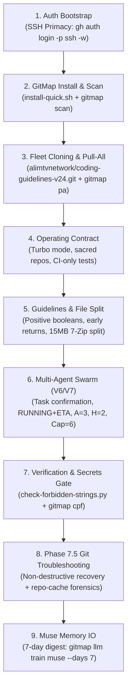
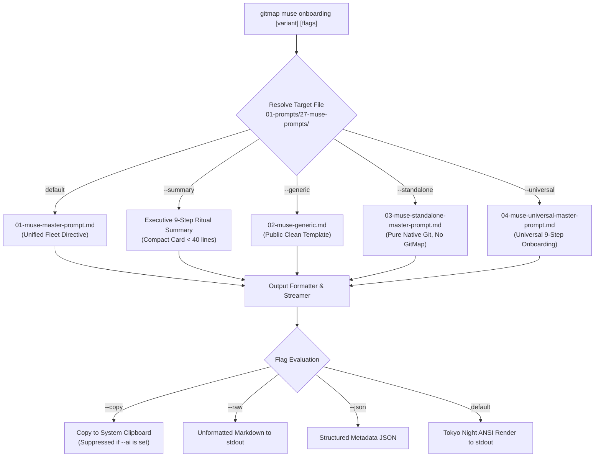
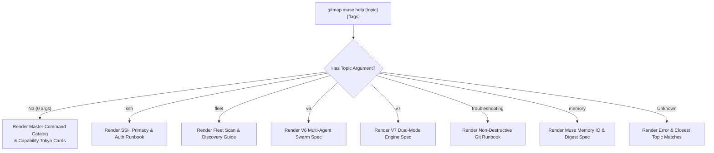

# Spec 363: GitMap Synchronization & Version Control — Muse Onboarding & Help

- **Spec Number:** 363
- **Document:** 04
- **Title:** Meta Muse Onboarding Engine, Helpdoc Integration & Tokyo UI Cards
- **Slug:** `363-gitmap-synchronization-and-version-control`
- **File Path:** `02-spec/21-app/363-gitmap-synchronization-and-version-control/04-muse-onboarding-and-help.md`
- **Status:** Approved
- **Created Date:** 31-Oct-26
- **Architecture Standards:** GitMap V7 Engine, Meta Muse Autonomous Framework, Tokyo Night Cards, Leaf Error Sovereignty, Positive Booleans, <= 15 Line Functions, Zero Absolute Paths

---

## 1. Executive Summary & Purpose

This specification defines the architecture, CLI contracts, prompt variant streaming, and interactive help documentation for the **Meta Muse AI Companion Engine** within GitMap. It introduces two primary commands:
1. **`gitmap muse onboarding`**: An intelligent prompt streaming engine that surfaces canonical master onboarding prompts (`01-prompts/27-muse-prompts/`) with support for executive summaries, public generic templates, pure native Git standalone templates, and universal multi-tier onboarding.
2. **`gitmap muse help`**: A structured, topic-driven documentation viewer deeply integrated with `cli/helpdoc/muse.md`, rendering Tokyo Night styled command catalogs, prompt capability matrices, and step-by-step operational tutorials.

---

## 2. Meta Muse Architecture & The 9-Step Autonomous Ritual

Meta Muse is an autonomous AI developer agent operating under strict engineering invariants. When bootstrapping a fresh Muse session, the agent executes a canonical 9-step ritual:



### 2.1 The 9-Step Canonical Ritual Breakdown

| Step | Ritual Name | Execution Contract & Primary Command | Safety Guard |
| :--- | :--- | :--- | :--- |
| **01** | **Authentication Bootstrap** | Fast-path bypass if already logged in; preferred SSH: `gh auth login -p ssh -w`; browser OAuth fallback | Ban on plain HTTP git tokens |
| **02** | **GitMap Install & Fleet Scan** | Auto-installs via `install-quick.sh`, updates GitMap binary, runs `gitmap scan` across workspace into `gitmap.db` | Verify binary checksum before exec |
| **03** | **Fleet Orchestration & Cloning** | Clones canonical seed `alimtvnetwork/coding-guidelines-v24.git`, clones 14+ fleet repos, runs `gitmap pa` | Ban on deprecated `coding-guidelines` |
| **04** | **Memory Operating Contract** | Turbo Mode ("act, don't ask"), zero asking for trivial approvals, CI-only test verification (`gitmap pe -t`) | Repos are sacred; file deletion confirms |
| **05** | **Coding Guidelines & 15MB Split** | Positive booleans (`is*`/`has*`), `*appfault.AppError`, <=15 line functions, multi-volume 7-Zip (`7z a -v3m -mx=0`) | Zero negative booleans or raw integers |
| **06** | **Multi-Agent Swarm Execution** | Task breakdown first, RUNNING+ETA, 5-min status pings, Tree Swarm (`A=3`, `H=2`, capacity 6), SQLite task DB | Worker Git Ban (orchestrator commits) |
| **07** | **Verification & Secrets Gate** | Targeted linting only, `check-forbidden-strings.py`, `gitmap aum search`, atomic commit via `gitmap cpf` | Pre-commit secrets barrier |
| **08** | **Phase 7.5 Git Troubleshooting** | Non-destructive Git recovery (divergence reconciliation, conflict solvers, index lock clearance, repo-cache forensics) | Ban on force-push or git reset --hard |
| **09** | **Muse Memory IO** | 7-day memory digest under `repo-cache/12-muse-ai/`, training sync via `gitmap llm train muse --days 7`, SMTP daemon | Standing SMTP pre-approval |

---

## 3. `gitmap muse onboarding` Command Specification

### 3.1 Purpose & Execution Pipeline
The `gitmap muse onboarding` command provides instant access to Meta Muse onboarding instructions. It reads prompt files from the active `AssetProvider` (Tier 1 Live FS, Tier 2 Embedded, or Tier 3 Cache) and streams or copies them according to specified flags.



### 3.2 Command Syntax & Variant Selectors
```bash
gitmap muse onboarding [variant] [flags]
gitmap muse onboard [variant] [flags]
```

#### Variant Flags (Mutually Exclusive)
| Variant Flag | Shorthand | Target Source File | Use Case & Audience |
| :--- | :--- | :--- | :--- |
| *(default)* | | `01-prompts/27-muse-prompts/01-muse-master-prompt.md` | Full canonical internal fleet prompt (51 KB) |
| `--summary` | `-s` | In-memory 9-Step Ritual summary template | Fast session startup (< 40 lines, ~1.2 KB) |
| `--generic` | `-g` | `01-prompts/27-muse-prompts/02-muse-generic.md` | Clean, public codebase without hardcoded repos |
| `--standalone` | | `01-prompts/27-muse-prompts/03-muse-standalone-master-prompt.md` | Pure native Git environments (zero GitMap CLI dependency) |
| `--universal` | `-u` | `01-prompts/27-muse-prompts/04-muse-universal-master-prompt.md` | Universal 9-step prompt with dynamic Git onboarding |

#### Operational & Formatting Flags
| Flag | Shorthand | Type | Default | Description |
| :--- | :--- | :--- | :--- | :--- |
| `--copy` | `-c` | bool | `false` | Write the selected prompt content directly to the OS system clipboard |
| `--raw` | `-r` | bool | `false` | Emit pure Markdown without ANSI escape codes, Tokyo cards, or banner styling |
| `--ai` | | bool | `false` | AI-safe execution: automatically suppresses clipboard writes and banner notices |
| `--json` | `-j` | bool | `false` | Output metadata payload (variant, tokens, hash, byte length, canonical path) |

---

## 4. `gitmap muse help` Command & Helpdoc Integration

### 4.1 Purpose & Catalog Architecture
The `gitmap muse help` command serves as an interactive CLI help hub, exposing both high-level command summaries and detailed tutorial topics sourced directly from `cli/helpdoc/muse.md`.



### 4.2 Interactive Command Catalog

```bash
gitmap muse help [topic]
gitmap muse --help
gitmap muse -h
```

| Subcommand | Aliases | Description |
| :--- | :--- | :--- |
| `install` | `in`, `i` | Download, install, and register the Meta Muse binary in system PATH |
| `status` | `stat`, `check` | Check if Meta Muse binary exists, inspect PATH registration and active version |
| `version` | `ver`, `-v` | Display installed Meta Muse version and GitMap bridge compatibility version |
| `onboarding` | `onboard`, `boot` | Stream, copy, or summarize Meta Muse onboarding prompts for AI agent sessions |
| `help` | `doc`, `man` | Display interactive command catalog or deep-dive topic documentation |

### 4.3 Deep-Dive Topic Catalog

| Topic Name | Query Slugs | Sourced Help Section | Key Focus Areas |
| :--- | :--- | :--- | :--- |
| **SSH Primacy** | `ssh`, `auth`, `login` | `cli/helpdoc/muse.md#ssh-auth` | `gh auth login -p ssh -w`, fast-path check, key persistence |
| **Fleet Topology** | `fleet`, `scan`, `repos` | `cli/helpdoc/muse.md#fleet-scan` | `gitmap scan`, SQLite registry, multi-repo clone & pull |
| **V6 Swarm** | `v6`, `swarm`, `agents` | `cli/helpdoc/muse.md#v6-swarm` | `A=3`, `H=2`, capacity 6, dynamic respawn, Worker Git Ban |
| **V7 Engine** | `v7`, `dual-mode`, `bot` | `cli/helpdoc/muse.md#v7-engine` | Time-restricted cutoff (<8:00 AM), unrestricted mode, bot identity |
| **Troubleshooting** | `git`, `fix`, `recovery` | `cli/helpdoc/muse.md#troubleshoot`| Non-destructive conflict solving, index lock clear, repo-cache |
| **Memory IO** | `memory`, `digest`, `llm` | `cli/helpdoc/muse.md#memory-io` | Rolling 7-day memory digest, `gitmap llm train muse`, SMTP daemon |

---

## 5. Specification for `cli/helpdoc/muse.md`

The physical helpdoc file `cli/helpdoc/muse.md` is structured in semantic Markdown sections allowing automated terminal extraction and rendering:

```markdown
# gitmap muse

Meta Muse autonomous AI companion framework, fleet onboarding, and operational management.

## Synopsis
```bash
gitmap muse <command> [flags]
gitmap muse onboarding [--summary|--generic|--standalone|--universal] [--copy] [--raw]
gitmap muse help [topic]
```

## Description
The `gitmap muse` command suite provisions, manages, and bootstraps Meta Muse AI coding sessions. It enforces the canonical 9-step onboarding ritual, guarantees non-destructive Git operations across fleet repositories, and provides automated prompt streaming for AI model context ingestion.

## Subcommands
- `install`: Cross-platform binary installer with OS architecture detection (PowerShell on Windows, curl bootstrap on Linux/macOS).
- `status`: Validates binary presence in system PATH and active version.
- `version`: Outputs current binary and bridge versions.
- `onboarding`: Streams master prompts from `01-prompts/27-muse-prompts/`.
- `help`: Interactive documentation and topic tutorials.

## Topics
### ssh-auth
Guides automated authentication via GitHub CLI using SSH protocol. Validates existing credentials with `gh auth status`, executing `gh auth login -p ssh -w` only when unauthenticated.

### fleet-scan
Explains workspace fleet scanning using `gitmap scan`, registering discovered Git repositories and branch topology into `gitmap.db`.

### v6-swarm
Details the V6 Tree Swarm hierarchy (`A=3`, `H=2`, capacity 6 concurrent operations), disjoint workspace file boxes, and the strict Worker Git Ban.

### troubleshoot
Outlines Phase 7.5 non-destructive Git remediation runbooks: resolving diverged branches without force-push, mechanical conflict resolution, and debris cleanup.
```

---

## 6. Go Implementation Architecture & Struct Contracts

### 6.1 Options & Struct Definitions (`cli/cmd/`)

```go
package cmd

import "time"

// MuseOnboardingVariant designates which prompt variant to load and stream.
type MuseOnboardingVariant string

const (
	VariantUnified    MuseOnboardingVariant = "unified"
	VariantSummary    MuseOnboardingVariant = "summary"
	VariantGeneric    MuseOnboardingVariant = "generic"
	VariantStandalone MuseOnboardingVariant = "standalone"
	VariantUniversal  MuseOnboardingVariant = "universal"
)

// MuseOnboardingOptions holds parsed flags for gitmap muse onboarding.
type MuseOnboardingOptions struct {
	Variant  MuseOnboardingVariant
	IsCopy   bool
	IsRaw    bool
	IsAI     bool
	IsJSON   bool
}

// MuseHelpOptions holds parsed flags and requested topic for gitmap muse help.
type MuseHelpOptions struct {
	Topic    string
	IsRaw    bool
	IsJSON   bool
}
```

### 6.2 Subcommand Routing in `RunMuseCLI`

```go
// RunMuseCLI routes top-level gitmap muse commands.
func RunMuseCLI(args []string) error {
	if len(args) == 0 {
		return handleMuseHelpCommand([]string{})
	}

	sub := strings.ToLower(args[0])
	switch sub {
	case "install", "in", "i":
		return handleMuseInstallCommand(args[1:])
	case "status", "stat", "check":
		return handleMuseStatusCommand()
	case "version", "-v", "--version":
		return handleMuseVersionCommand()
	case "onboarding", "onboard", "boot":
		return handleMuseOnboardingCommand(args[1:])
	case "help", "doc", "-h", "--help":
		return handleMuseHelpCommand(args[1:])
	default:
		return handleMuseDirectOrUsage(args)
	}
}
```

### 6.3 Onboarding Handler Function

```go
// handleMuseOnboardingCommand parses flags and emits prompt markdown.
func handleMuseOnboardingCommand(args []string) error {
	opts, errParse := parseMuseOnboardingFlags(args)
	if errParse != nil {
		return errParse
	}

	content, errLoad := loadMusePromptVariant(opts.Variant)
	if errLoad != nil {
		return apperror.WrapSimple(errLoad, "failed to load muse prompt variant")
	}

	return emitMuseOnboardingOutput(content, opts)
}
```

### 6.4 Safe Output & Clipboard Dispatcher

```go
func emitMuseOnboardingOutput(content []byte, opts MuseOnboardingOptions) error {
	if opts.IsCopy && !opts.IsAI {
		_ = writeToClipboard(string(content))
		printClipboardConfirmation()
	}

	if opts.IsRaw {
		os.Stdout.Write(content)
		return nil
	}

	return renderStyledPromptOutput(content, opts)
}
```

---

## 7. Terminal UI Presentation & Tokyo Night Styling

### 7.1 Tokyo Night Card Mockup: `gitmap muse onboarding --summary`

```text
┌────────────────────────────────────────────────────────────────────────┐
│  META MUSE AUTONOMOUS ONBOARDING SUMMARY                               │
│  Directive: 9-Step Autonomous Agent Ritual | V6 / V7 Swarm Compatible   │
└────────────────────────────────────────────────────────────────────────┘

  Step  Ritual Stage             Command / Execution Contract
  ────  ───────────────────────  ──────────────────────────────────────────
   01   SSH Auth Primacy         gh auth login -p ssh -w (fast-path bypass)
   02   GitMap Install & Scan    install-quick.sh + gitmap scan
   03   Fleet Clone & Pull-All   alimtvnetwork/coding-guidelines-v24.git + pa
   04   Operating Contract       Turbo Mode (act, don't ask), sacred repos
   05   Guidelines & File Split  Positive booleans, 15MB 7-Zip multi-volume
   06   Multi-Agent Swarm (V6)   Tasks confirmed first, RUNNING+ETA, A=3 H=2
   07   Verification & Gate      check-forbidden-strings.py, gitmap cpf
   08   Git Troubleshooting      Phase 7.5 non-destructive recovery
   09   Muse Memory IO           7-day digest, gitmap llm train muse --days 7

  📋 Notice: Copied 9-step summary to clipboard.
  💡 Run 'gitmap muse onboarding' for the full canonical prompt body.
```

### 7.2 Tokyo Night Card Mockup: `gitmap muse help`

```text
┌────────────────────────────────────────────────────────────────────────┐
│  GITMAP META MUSE AI COMPANION — COMMAND CATALOG                       │
│  Version: 6.548.0 | Engine: V7 Autonomous Swarm Architecture           │
└────────────────────────────────────────────────────────────────────────┘

  Command             Aliases        Description
  ──────────────────  ─────────────  ────────────────────────────────────────────
  muse install        in, i          Install Meta Muse agent binary for host OS
  muse status         stat, check    Verify installation path and PATH registration
  muse version        ver, -v        Display installed binary and bridge version
  muse onboarding     onboard, boot  Stream master onboarding prompts & summaries
  muse help [topic]   doc, man       Interactive topic tutorials & deep-dives

  Available Help Topics:
  • ssh               SSH authentication primacy and credential persistence
  • fleet             Fleet repository scan, discovery, and clone orchestration
  • v6                V6 Tree Swarm multi-agent hierarchy (A=3, H=2, capacity 6)
  • v7                V7 Dual-Mode engine (Time-restricted vs Unrestricted)
  • troubleshooting   Non-destructive Git recovery runbooks & conflict solving
  • memory            Muse memory IO, 7-day rolling digest, and SMTP daemon

  💡 Run 'gitmap muse help <topic>' for comprehensive operational runbooks.
```

---

## 8. Invariants & Acceptance Criteria

1. **Leaf Error Sovereignty**: All functions in `cli/cmd/cmd_muse.go` and companion helpers MUST return typed `error` values upward without calling `os.Exit` or termination routines.
2. **AI Clipboard Invariant**: Passing `--ai` MUST strictly suppress calling `writeToClipboard` and suppress the `📋 Notice: Copied to clipboard` terminal banner.
3. **Prompt Variant Fidelity**:
   - Default output MUST match `01-prompts/27-muse-prompts/01-muse-master-prompt.md`.
   - `--generic` MUST match `01-prompts/27-muse-prompts/02-muse-generic.md`.
   - `--standalone` MUST match `01-prompts/27-muse-prompts/03-muse-standalone-master-prompt.md`.
   - `--universal` MUST match `01-prompts/27-muse-prompts/04-muse-universal-master-prompt.md`.
4. **Fast Help Rendering**: `gitmap muse help` and topic queries MUST render in $< 20\text{ ms}$ directly from cached memory or embed assets.
5. **Guideline Conformance**:
   - 100% relative Git paths; zero absolute paths across all documentation and source files.
   - All Go functions $\le 15$ lines.
   - All booleans strictly follow `is*` or `has*` positive naming.
