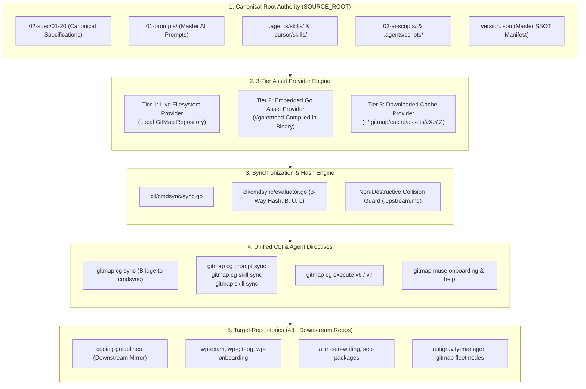

# Spec 363: GitMap Synchronization & Version Control — Specification Index

> **Specification ID:** `363-gitmap-synchronization-and-version-control`  
> **Target Subsystems:** `cli/cmdsync/`, `cli/cmdcg/`, `cli/cmdskill/`, `cli/cmd/cmd_muse.go`, `cli/helpdoc/muse.md`, `version.json`  
> **Status:** Approved / Ratified  
> **Architecture Lead:** GitMap Architecture Swarm (Subagent 1 & Subagent 2)  
> **Creation Date:** 31-Oct-26  
> **Version Target:** `v6.548.0`  

---

## 1. Executive Summary

Specification 363 establishes GitMap as the **Single Canonical Root Authority (`SOURCE_ROOT`)** across the multi-repository ecosystem. It fundamentally transforms the legacy model where `coding-guidelines` was treated as an external upstream, converting `coding-guidelines` into a downstream target that mirrors GitMap's authoritative standards.

This specification suite delivers an enterprise synchronization, version control, and AI onboarding platform consisting of four core pillars:
1. **Decoupled Source Discovery & 3-Tier Asset Provider**: Dynamic discovery of `SOURCE_ROOT` across local repositories, Go `//go:embed` binaries, and remote release asset caches.
2. **Non-Destructive 3-Way Hash State Engine**: Cryptographic tri-state evaluation ($B, U, L$) protecting local human edits, fast-forwarding clean upstream updates, and creating sidecar files (`.upstream.md`) on collisions.
3. **Unified CLI Command Routing & Scoped Fast-Paths**: First-class routing for `gitmap cg sync` (bridging to `cmdsync.RunSync`), scoped synchronization (`gitmap cg prompt sync`, `gitmap cg skill sync`, `gitmap skill sync`), and instant AI execution prompt streaming (`gitmap cg execute v6` & `v7`).
4. **Meta Muse Onboarding Engine & Helpdoc Integration**: Seamless streaming of autonomous onboarding prompts (`gitmap muse onboarding` with `--summary`, `--generic`, `--standalone`, `--universal`) and interactive topic documentation (`gitmap muse help`).

---

## 2. System Architecture & Component Interactions

---

## 3. Specification Documents Index

The specification is structured into four specialized, interlocking modular documents:

| Document | Title | Primary Scope | Primary Owner |
| :--- | :--- | :--- | :--- |
| [01-overview-and-architecture.md](01-overview-and-architecture.md) | **Overview & Architecture** | Canonical Root Authority inversion, 3-Tier Asset Provider (Live FS, Embedded Go, Remote Cache), decoupled source discovery algorithm, synchronization boundaries. | Subagent 1 |
| [02-3way-hash-and-version-schema.md](02-3way-hash-and-version-schema.md) | **3-Way Hash & Version Schema** | Tri-state evaluation ($B, U, L$), 7 deterministic collision states, non-destructive sidecar resolution (`.upstream.md`), canonical `version.json` schema and sync manifest. | Subagent 1 |
| [03-cli-commands-and-cg-sync.md](03-cli-commands-and-cg-sync.md) | **CLI Commands & CG Sync** | Routing matrix, bridging `gitmap cg sync` to `cmdsync.RunSync`, scoped prompt/skill sync (`cg prompt sync`, `cg skill sync`, `skill sync`), on-the-fly streaming (`cg execute v6` / `v7`). | Subagent 2 |
| [04-muse-onboarding-and-help.md](04-muse-onboarding-and-help.md) | **Muse Onboarding & Help** | `gitmap muse onboarding` variants (`--summary`, `--generic`, `--standalone`, `--universal`, `--copy`, `--raw`, `--ai`), the 9-Step ritual, `gitmap muse help` and `cli/helpdoc/muse.md`. | Subagent 2 |

---

## 4. Subsystem Traceability & Implementation Matrix

| Subsystem / Feature | Primary Specification File | Affected Source & Target Paths |
| :--- | :--- | :--- |
| **Source Root Decoupling** | [01-overview-and-architecture.md](01-overview-and-architecture.md) | `cli/cmdsync/defaults.go`, `cli/cmdsync/resolver.go` |
| **3-Tier Asset Providers** | [01-overview-and-architecture.md](01-overview-and-architecture.md) | `cli/cmdsync/assets_live.go`, `cli/cmdsync/assets_embed.go`, `cli/cmdsync/assets_cache.go` |
| **3-Way Hash State Engine**| [02-3way-hash-and-version-schema.md](02-3way-hash-and-version-schema.md) | `cli/cmdsync/evaluator.go`, `cli/cmdsync/enums/sync_state_enum.go` |
| **version.json Sync Schema**| [02-3way-hash-and-version-schema.md](02-3way-hash-and-version-schema.md) | `version.json`, `cli/model/version.go`, `cli/cmdsync/manifest.go` |
| **`gitmap cg sync` Bridge** | [03-cli-commands-and-cg-sync.md](03-cli-commands-and-cg-sync.md) | `cli/cmdcg/cg_sync.go`, `cli/cmdcg/cg.go`, `cli/cmdsync/sync.go` |
| **Scoped Prompt & Skill Sync**| [03-cli-commands-and-cg-sync.md](03-cli-commands-and-cg-sync.md) | `cli/cmdcg/cg_prompt_sync.go`, `cli/cmdskill/skill_sync.go` |
| **Fast GitMap Skill Sync** | [03-cli-commands-and-cg-sync.md](03-cli-commands-and-cg-sync.md) | `cli/cmdskill/skill_cmd.go`, `.agents/skills/gitmap/SKILL.md` |
| **Prompt Streaming (`v6`/`v7`)**| [03-cli-commands-and-cg-sync.md](03-cli-commands-and-cg-sync.md) | `cli/cmdcg/cg_execute.go`, `01-prompts/14-execute/` |
| **Muse Onboarding Engine** | [04-muse-onboarding-and-help.md](04-muse-onboarding-and-help.md) | `cli/cmd/cmd_muse.go`, `01-prompts/27-muse-prompts/` |
| **Muse CLI Helpdoc & Topics**| [04-muse-onboarding-and-help.md](04-muse-onboarding-and-help.md) | `cli/cmd/cmd_muse_help.go`, `cli/helpdoc/muse.md` |

---

## 5. Architectural Invariants & Non-Negotiable Standards

1. **Root Authority Invariant**: GitMap is the authoritative origin for all coding guidelines (`02-spec/01-20`), master prompts (`01-prompts`), and canonical skills (`.agents/skills`, `.cursor/skills`). Downstream repositories mirror these assets.
2. **Non-Destructive Local Edit Protection**: The 3-Way Hash engine ($B, U, L$) strictly preserves human local modifications. Collisions produce `.upstream.md` sidecars; local code is never blindly overwritten.
3. **Application Spec Isolation**: Application-specific specifications (`02-spec/21-app/*` and higher), runtime memory (`.ai-memory/`), local environment secrets (`.env*`), and git state (`.git/`) are never synchronized.
4. **Leaf Error Sovereignty**: All leaf functions returning errors MUST return typed `error` or `*apperror.AppError` values. Calling `cliexit.HandleError` or `os.Exit` inside leaf functions is prohibited.
5. **Positive Boolean Polarity**: All booleans must use `is*` or `has*` prefixes (e.g., `isDryRun`, `hasCollision`, `isOnline`). Inverted or negative boolean names are banned.
6. **15-Line Function Limit**: Go functions must not exceed 15 lines (8 lines or fewer preferred). Nested conditionals are flattened via early returns and guard clauses.
7. **100% Relative Git Paths**: Zero absolute paths (`C:\...`, `/home/...`, `file:///...`) in code, documentation, specs, or commit messages.
8. **AI Clipboard Safety**: When executing under `--ai`, commands emitting prompts (`cg execute`, `muse onboarding`) must suppress OS clipboard modifications and clipboard banners.
