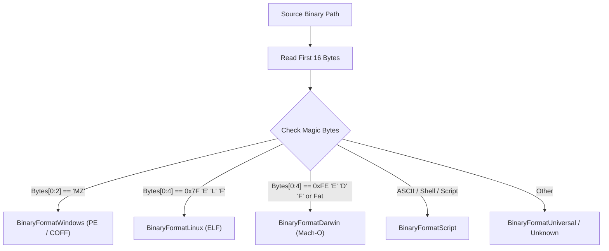
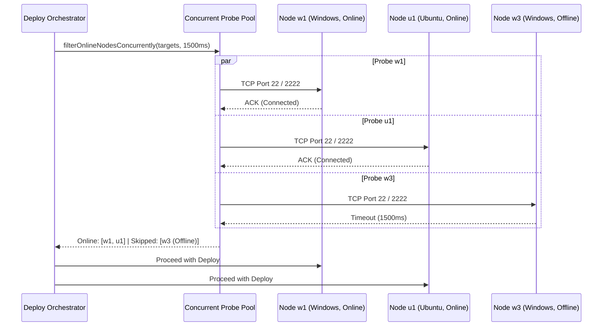

# 363.02 — OS-Aware Binary Deploy, Installation Engine & Diagnostic Feedback

> **Specification Sequence:** `363.02`  
> **Canonical Relative Path:** `02-spec/21-app/363-gitmap-command-enhancements/02-deploy-and-os-compat-spec.md`  
> **Parent Specification:** [00-overview.md](00-overview.md)  
> **Subtask Plan:** [.ai-memory/plans/subtasks/363-gitmap-command-enhancements/02-deploy-and-os-compat.md](../../../.ai-memory/plans/subtasks/363-gitmap-command-enhancements/02-deploy-and-os-compat.md)  
> **Target Package:** `cli/cmdssh/`  
> **Author:** GitMap Deploy and OS Compatibility Spec Author  
> **Date:** 31-Oct-26  
> **Status:** `active`  

---

## 1. Executive Summary & Purpose

The `gitmap deploy` command orchestrates multi-node binary distribution and automated installation across heterogeneous fleet clusters. In real-world multi-node environments, fleets comprise mixed operating systems (e.g. Windows workstation nodes `w1`, `w2`, `w3`, and Linux/Ubuntu server nodes `u1`, `u2`, `u3`).

Deploying platform-specific executables (such as a Windows Portable Executable `.exe`) to Linux nodes without verification results in non-runnable files, wasted bandwidth, and broken remote processes.

This specification establishes:
1. **Magic Byte Binary Format Inspection:** Deep inspection of binary headers (`MZ` for Windows PE, `\x7fELF` for Linux ELF, Mach-O magic for macOS) rather than relying solely on file extensions.
2. **Target Node OS Detection & Compatibility Matrix:** Cross-referencing detected binary architecture against `node.OS` from the Split-DB inventory, with fallback remote probe.
3. **Intelligent OS Incompatibility Filtering:** By default, automatically skipping incompatible targets (e.g. Windows `.exe` skipped on Ubuntu/Linux) while permitting explicit override via `--force` or `--force-copy`.
4. **Fast Concurrent Reachability Filtering:** Probing fleet targets via non-blocking TCP checks (`filterOnlineNodesConcurrently`) to gracefully bypass offline nodes without hanging.
5. **Post-Execution Suggestions & Diagnostic Feedback Docket:** Emitting structured execution dockets detailing what was transferred, what was skipped and why, with precise remediation commands (e.g. cross-compile instructions, wake/ping commands).
6. **Automated Remote Installation Hook:** Optional execution of post-transfer installation scripts and permission escalation via `--install`.

---

## 2. Command Invocation & Syntax Contracts

### 2.1 Grammar & Argument Dispatch

```text
gitmap deploy <target-token> <source-path> [dest-path] [flags]
```

Where:
- `<target-token>`: Single node alias (`u1`, `w1`), IP address (`192.168.1.10`), or fleet broad-cast token (`all`, `fleet`, `all-nodes`, or comma-separated list `u1,u2,w1`).
- `<source-path>`: Local file or folder path.
- `[dest-path]`: Optional remote destination path. When omitted, defaults to node-specific bin directories (`D:/work/bin` on Windows, `/usr/local/bin` or `~/.local/bin` on Linux).

### 2.2 CLI Flags Table

| Flag | Short | Default | Description |
| :--- | :--- | :--- | :--- |
| `--force` | `-f` | `false` | Force execution, overriding OS compatibility safety checks |
| `--force-copy` | | `false` | Exact alias for `--force`, enabling raw binary transfer despite OS mismatch |
| `--install` | `-i` | `false` | Trigger post-transfer installation and permission hardening |
| `--skip` | `-s` | `false` | Skip already identical remote files based on size and timestamp |
| `--overwrite` | `-o` | `true` | Overwrite destination file if it exists |
| `--json` | `-j` | `false` | Output structured JSON telemetry docket |
| `--dry-run` | `-n` | `false` | Preview transfer plan, node compatibility, and skip reasons without mutations |
| `--parallel` | `-p` | `4` | Concurrency worker pool size (1-16) |
| `--timeout` | | `1500ms` | Liveness TCP probe timeout per target node |

---

## 3. Binary Format & Magic Byte Detection Engine

### 3.1 Magic Byte Signatures

To prevent relying on brittle file extensions (which can be absent, stripped, or spoofed), the deployment engine reads the initial 4 to 16 bytes of the source binary prior to transport.



### 3.2 Magic Byte Match Rules

1. **Windows PE (Portable Executable):**
   - Header magic: `0x4D, 0x5A` (ASCII string `"MZ"`).
   - Format Enum: `BinaryFormatWindows`.
2. **Linux ELF (Executable and Linkable Format):**
   - Header magic: `0x7F, 0x45, 0x4C, 0x46` (`0x7F`, `'E'`, `'L'`, `'F'`).
   - Format Enum: `BinaryFormatLinux`.
3. **macOS Mach-O:**
   - Header magic: `0xFE, 0xED, 0xFA, 0xCE` (32-bit), `0xFE, 0xED, 0xFA, 0xCF` (64-bit), or Fat binary `0xCA, 0xFE, 0xBA, 0xBE`.
   - Format Enum: `BinaryFormatDarwin`.
4. **Scripts & Universal Archives:**
   - Shebang magic: `0x23, 0x21` (`"#!"`) or Zip/Tar archive headers.
   - Format Enum: `BinaryFormatScript` or `BinaryFormatUniversal`.

### 3.3 Binary Detection Signature Specification

```go
package cmdssh

import (
	"io"
	"os"
	"strings"

	"gitmap/cli/apperror"
)

type BinaryFormatType string

const (
	BinaryFormatWindows   BinaryFormatType = "windows-pe"
	BinaryFormatLinux     BinaryFormatType = "linux-elf"
	BinaryFormatDarwin    BinaryFormatType = "darwin-macho"
	BinaryFormatScript    BinaryFormatType = "script"
	BinaryFormatUniversal BinaryFormatType = "universal"
	BinaryFormatUnknown   BinaryFormatType = "unknown"
)

func DetectBinaryFormat(filePath string) (BinaryFormatType, *apperror.AppError) {
	file, err := os.Open(filePath)
	if err != nil {
		return BinaryFormatUnknown, apperror.NewNotFound("binary_file", "E404", "failed to open binary: "+filePath)
	}
	defer file.Close()

	buf := make([]byte, 16)
	bytesRead, err := file.Read(buf)
	if err != nil && err != io.EOF {
		return BinaryFormatUnknown, apperror.NewExecutionError("failed to read binary header: " + filePath)
	}

	if bytesRead >= 2 && buf[0] == 'M' && buf[1] == 'Z' {
		return BinaryFormatWindows, nil
	}

	if bytesRead >= 4 && buf[0] == 0x7F && buf[1] == 'E' && buf[2] == 'L' && buf[3] == 'F' {
		return BinaryFormatLinux, nil
	}

	if bytesRead >= 4 && (buf[0] == 0xFE && buf[1] == 0xED && buf[2] == 0xFA && (buf[3] == 0xCE || buf[3] == 0xCF)) {
		return BinaryFormatDarwin, nil
	}

	if bytesRead >= 2 && buf[0] == '#' && buf[1] == '!' {
		return BinaryFormatScript, nil
	}

	return inferFallbackFormat(filePath), nil
}

func inferFallbackFormat(filePath string) BinaryFormatType {
	lowerPath := strings.ToLower(filePath)
	if strings.HasSuffix(lowerPath, ".exe") || strings.HasSuffix(lowerPath, ".dll") {
		return BinaryFormatWindows
	}

	return BinaryFormatUniversal
}
```

---

## 4. Target Node OS Detection & Compatibility Matrix

### 4.1 Node OS Resolution

Node operating system classification follows a two-tier strategy:
1. **Inventory Record (`node.OS`):** Sourced from the local Split-DB (`gitmap.db` SSH connection table). Values include `"windows"`, `"linux"`, `"ubuntu"`, `"debian"`, `"darwin"`, or `"centos"`.
2. **Proactive Probe Fallback:** If `node.OS` is blank or unknown, an ephemeral probe queries the remote node (`uname -s` or `echo %OS%`).

### 4.2 OS Normalization

```go
type OperatingSystemType string

const (
	OSTypeWindows OperatingSystemType = "windows"
	OSTypeLinux   OperatingSystemType = "linux"
	OSTypeDarwin  OperatingSystemType = "darwin"
	OSTypeUnknown OperatingSystemType = "unknown"
)

func NormalizeNodeOS(rawOS string) OperatingSystemType {
	cleaned := strings.ToLower(strings.TrimSpace(rawOS))
	switch {
	case strings.Contains(cleaned, "win"):
		return OSTypeWindows
	case strings.Contains(cleaned, "linux"), strings.Contains(cleaned, "ubuntu"), strings.Contains(cleaned, "debian"), strings.Contains(cleaned, "centos"), strings.Contains(cleaned, "rhel"):
		return OSTypeLinux
	case strings.Contains(cleaned, "darwin"), strings.Contains(cleaned, "mac"):
		return OSTypeDarwin
	default:
		return OSTypeUnknown
	}
}
```

### 4.3 Compatibility Truth Table

| Binary Format | Target Node OS | Compatible? (`isCompatible`) | Default Action | Action With `--force` / `--force-copy` |
| :--- | :--- | :--- | :--- | :--- |
| `BinaryFormatWindows` (`.exe`) | `OSTypeWindows` | `true` | Transfer & Install | Transfer & Install |
| `BinaryFormatWindows` (`.exe`) | `OSTypeLinux` | `false` | **Skip Node** (`SkipReasonOSIncompatible`) | Transfer Raw (Skip Execution) |
| `BinaryFormatWindows` (`.exe`) | `OSTypeDarwin` | `false` | **Skip Node** (`SkipReasonOSIncompatible`) | Transfer Raw (Skip Execution) |
| `BinaryFormatLinux` (ELF) | `OSTypeLinux` | `true` | Transfer & Install | Transfer & Install |
| `BinaryFormatLinux` (ELF) | `OSTypeWindows` | `false` | **Skip Node** (`SkipReasonOSIncompatible`) | Transfer Raw (Skip Execution) |
| `BinaryFormatLinux` (ELF) | `OSTypeDarwin` | `false` | **Skip Node** (`SkipReasonOSIncompatible`) | Transfer Raw (Skip Execution) |
| `BinaryFormatDarwin` (Mach-O) | `OSTypeDarwin` | `true` | Transfer & Install | Transfer & Install |
| `BinaryFormatDarwin` (Mach-O) | `OSTypeLinux` / `Windows` | `false` | **Skip Node** (`SkipReasonOSIncompatible`) | Transfer Raw (Skip Execution) |
| `BinaryFormatScript` | Any | `true` | Transfer & Set Executable | Transfer & Set Executable |
| `BinaryFormatUniversal` | Any | `true` | Transfer | Transfer |

---

## 5. Offline & Unreachable Node Filtering

### 5.1 Motivation & Mechanics

When running `gitmap deploy all` or targeting multi-node groups, offline or suspended nodes must not block deployment to the remainder of the fleet. Sequential connection attempts with default SSH timeouts (10-30s) would stall operations for minutes.

The liveness filter uses concurrent goroutines with bounded TCP dials (default: 1500ms):



### 5.2 Concurrent Reachability Implementation Specification

```go
type NodeLivenessResult struct {
	Node        db.SSHConnection
	IsOnline    bool
	ProbeLatencyMs int64
	FailureReason  string
}

func filterOnlineNodesConcurrently(nodes []db.SSHConnection, probeTimeout time.Duration) ([]db.SSHConnection, []DeploySkippedRecord) {
	resultChan := make(chan NodeLivenessResult, len(nodes))
	var wg sync.WaitGroup

	for _, node := range nodes {
		wg.Add(1)
		go func(target db.SSHConnection) {
			defer wg.Done()
			probeNodeLiveness(target, probeTimeout, resultChan)
		}(node)
	}

	wg.Wait()
	close(resultChan)

	var onlineNodes []db.SSHConnection
	var skippedRecords []DeploySkippedRecord

	for res := range resultChan {
		if res.IsOnline {
			onlineNodes = append(onlineNodes, res.Node)
			continue
		}

		skippedRecords = append(skippedRecords, DeploySkippedRecord{
			NodeAlias:  res.Node.Alias,
			NodeIP:     res.Node.IPAddress,
			NodeOS:     res.Node.OS,
			SkipReason: SkipReasonNodeOffline,
			Message:    "Node unreachable via TCP probe: " + res.FailureReason,
		})
	}

	return onlineNodes, skippedRecords
}

func probeNodeLiveness(node db.SSHConnection, probeTimeout time.Duration, ch chan<- NodeLivenessResult) {
	t0 := time.Now()
	port := node.Port
	if port <= 0 {
		port = 22
	}

	targetAddr := fmt.Sprintf("%s:%d", node.IPAddress, port)
	conn, err := net.DialTimeout("tcp", targetAddr, probeTimeout)
	if err != nil {
		ch <- NodeLivenessResult{
			Node:          node,
			IsOnline:      false,
			FailureReason: err.Error(),
		}
		return
	}
	_ = conn.Close()

	ch <- NodeLivenessResult{
		Node:           node,
		IsOnline:       true,
		ProbeLatencyMs: time.Since(t0).Milliseconds(),
	}
}
```

---

## 6. Remote Installation Engine

When `--install` or `-i` is enabled, the deploy pipeline follows transfer with an installation hook tailored to the target operating system:

### 6.1 Linux & Ubuntu Installation Pipeline

1. **Permission Hardening:** `chmod 755 <destPath>`
2. **Path Relocation:** When target destination is in a user directory or temporary landing zone, link or move into system PATH:
   - Command: `sudo cp <destPath> /usr/local/bin/<binaryName> && sudo chmod +x /usr/local/bin/<binaryName>`
3. **Execution Verification:** Run `<binaryName> --version` or `<binaryName> -v` to ensure dynamic linking and library dependencies are satisfied.

### 6.2 Windows Installation Pipeline

1. **Execution Privileges:** Ensure binary is unblocked (`Unblock-File -Path <destPath>` via PowerShell).
2. **Path Registration:** Ensure `<destDir>` exists in machine or user environment `PATH`.
3. **Installer Flag Handling:** If the source binary is an installer package (`.exe`, `.msi`), invoke non-interactive silent execution flags:
   - Generic executable installer: `<destPath> /S /silent /quiet`
   - MSI Package: `msiexec.exe /i <destPath> /qn /norestart`
4. **Binary Update Replacement:** If the target binary is an active running process (e.g. `cursor.exe`, `gitmap.exe`), rename existing running binary to `.old` before staging new executable to prevent `ERROR_ACCESS_DENIED`.

---

## 7. Post-Execution Suggestions & Diagnostic Feedback Docket

### 7.1 Feedback Philosophy

Deploy commands targeting fleets must communicate clear outcomes:
1. What succeeded across which machines.
2. What was skipped, distinguishing between OS mismatch and offline state.
3. Concrete, copy-pasteable next steps that the operator can execute immediately.

### 7.2 Terminal UI Output Structure

When executing `gitmap deploy all ./gitmap.exe /bin/gitmap`:

```text
================================================================================
 GITMAP FLEET DEPLOYMENT DOCKET — v6.548.0
================================================================================
 Source Binary:    ./gitmap.exe (Format: windows-pe, Size: 18.4 MB)
 Remote Target:    /bin/gitmap
 Total Nodes:      5
 Mode:             Standard (Safe OS Filter Active)

 TARGET RESULTS SUMMARY:
 +--------+----------------+---------------+------------+---------------------------------------+
 | NODE   | IP ADDRESS     | OS            | STATUS     | DETAIL                                |
 +--------+----------------+---------------+------------+---------------------------------------+
 | w1     | 192.168.1.10   | Windows 11    | SUCCESS    | Deployed 18.4 MB in 412ms             |
 | w2     | 192.168.1.11   | Windows 10    | SUCCESS    | Deployed 18.4 MB in 389ms             |
 | u1     | 192.168.1.20   | Ubuntu 24.04  | SKIPPED    | OS Incompatible: Windows PE on Linux  |
 | u2     | 192.168.1.21   | Ubuntu 22.04  | SKIPPED    | OS Incompatible: Windows PE on Linux  |
 | w3     | 192.168.1.12   | Windows 11    | SKIPPED    | Offline: TCP probe timeout (1500ms)   |
 +--------+----------------+---------------+------------+---------------------------------------+

 EXECUTION TOTALS:
   ✓ Succeeded:          2
   ⊘ Skipped (OS):       2  (Incompatible binary architecture)
   ⊘ Skipped (Offline):  1  (Host unreachable)
   ✗ Failed:             0

 DIAGNOSTIC RECOMMENDATIONS & NEXT STEPS:
 --------------------------------------------------------------------------------
 1. Cross-Compile For Skipped Linux Nodes (u1, u2):
    $ GOOS=linux GOARCH=amd64 go build -o bin/linux_amd64/gitmap .
    $ gitmap deploy u1,u2 bin/linux_amd64/gitmap /usr/local/bin/gitmap --install

 2. Force Raw Transfer (If binary will be run under Wine/Emulation):
    $ gitmap deploy u1,u2 ./gitmap.exe /tmp/gitmap.exe --force-copy

 3. Investigate Offline Node (w3):
    $ gitmap ping w3
    $ gitmap ssh-check w3 --probe
    $ gitmap cluster wake w3

 4. Verify Fleet State:
    $ gitmap cluster nodes --status
================================================================================
```

### 7.3 Structured Go Types & Docket Schema

```go
package cmdssh

type SkipReasonType string

const (
	SkipReasonOSIncompatible SkipReasonType = "os-incompatible"
	SkipReasonNodeOffline    SkipReasonType = "node-offline"
	SkipReasonAlreadyExists  SkipReasonType = "already-exists"
	SkipReasonDryRunPreview  SkipReasonType = "dry-run-preview"
)

type DeploySkippedRecord struct {
	NodeAlias  string         `json:"node_alias"`
	NodeIP     string         `json:"node_ip"`
	NodeOS     string         `json:"node_os"`
	SkipReason SkipReasonType `json:"skip_reason"`
	Message    string         `json:"message"`
}

type DeployNodeSuccessRecord struct {
	NodeAlias   string `json:"node_alias"`
	NodeIP      string `json:"node_ip"`
	NodeOS      string `json:"node_os"`
	BytesCopied int64  `json:"bytes_copied"`
	DurationMs  int64  `json:"duration_ms"`
	HasInstalled bool  `json:"has_installed"`
}

type DeployExecutionDocket struct {
	SourcePath        string                    `json:"source_path"`
	SourceFormat      BinaryFormatType          `json:"source_format"`
	DestPath          string                    `json:"dest_path"`
	TotalTargets      int                       `json:"total_targets"`
	HasForceOverride  bool                      `json:"has_force_override"`
	HasInstallHook    bool                      `json:"has_install_hook"`
	IsDryRun          bool                      `json:"is_dry_run"`
	SuccessRecords    []DeployNodeSuccessRecord `json:"success_records"`
	SkippedRecords    []DeploySkippedRecord     `json:"skipped_records"`
	FailedRecords     []DeploySkippedRecord     `json:"failed_records"`
	Recommendations   []string                  `json:"recommendations"`
	TotalDurationMs   int64                     `json:"total_duration_ms"`
}
```

---

## 8. Error Architecture & Leaf Sovereignty

In adherence to GitMap error guidelines:
1. **Direct Leaf Error Returns:** Every leaf function that can fail returns `*apperror.AppError` or standard `error`. Never call `os.Exit` or `cliexit.HandleError` in transport or filtering functions.
2. **No Integer Exit Codes:** Command dispatchers receive the error and wrap with strongly-typed application codes (`constants.ExitGeneralError`, `constants.ExitUsageError`).
3. **Database Audit Capture:** All deployment summaries, skipped counts, and error reasons flow upward to `finishCommandAudit` in `cli/cmd/root.go`.

---

## 9. Verification & Acceptance Criteria

### 9.1 Test Matrix

| ID | Test Scenario | Expected Outcome |
| :--- | :--- | :--- |
| `TC-DEP-01` | Magic byte detection on Windows PE executable (`.exe`) | Returns `BinaryFormatWindows`, zero error |
| `TC-DEP-02` | Magic byte detection on Linux ELF binary | Returns `BinaryFormatLinux`, zero error |
| `TC-DEP-03` | Magic byte detection on shell script (`#!/bin/bash`) | Returns `BinaryFormatScript`, zero error |
| `TC-DEP-04` | Deploy Windows `.exe` to Ubuntu node (`u1`) without `--force` | Node skipped, `SkipReasonOSIncompatible` logged, diagnostic recommendation emitted |
| `TC-DEP-05` | Deploy Windows `.exe` to Ubuntu node (`u1`) with `--force` / `--force-copy` | Safety skip bypassed, transfer executed |
| `TC-DEP-06` | Deploy to multi-node list with offline node (`w3`) | Concurrent probe marks `w3` skipped (`SkipReasonNodeOffline`), remaining online nodes succeed |
| `TC-DEP-07` | Deploy with `--dry-run` | Zero files transferred, complete planned audit table emitted |
| `TC-DEP-08` | Deploy with `--json` | Valid JSON document containing `DeployExecutionDocket` emitted to standard output |
| `TC-DEP-09` | Deploy with `--install` on Linux | File transferred, `chmod 755` executed, version checked |

---

## 10. Related Specifications & Architecture Documents

- [00-overview.md](00-overview.md) — GitMap Command Enhancements Overview
- [01-alias-and-copy-move-spec.md](01-alias-and-copy-move-spec.md) — Alias Disambiguation & Copy/Move Syntax
- [03-fleet-software-update-spec.md](03-fleet-software-update-spec.md) — Fleet Software Update Engine (Cursor, VS Code, AGM, AGY)
- [.ai-memory/plans/subtasks/363-gitmap-command-enhancements/02-deploy-and-os-compat.md](../../../.ai-memory/plans/subtasks/363-gitmap-command-enhancements/02-deploy-and-os-compat.md) — Subtask 02 Implementation Plan
