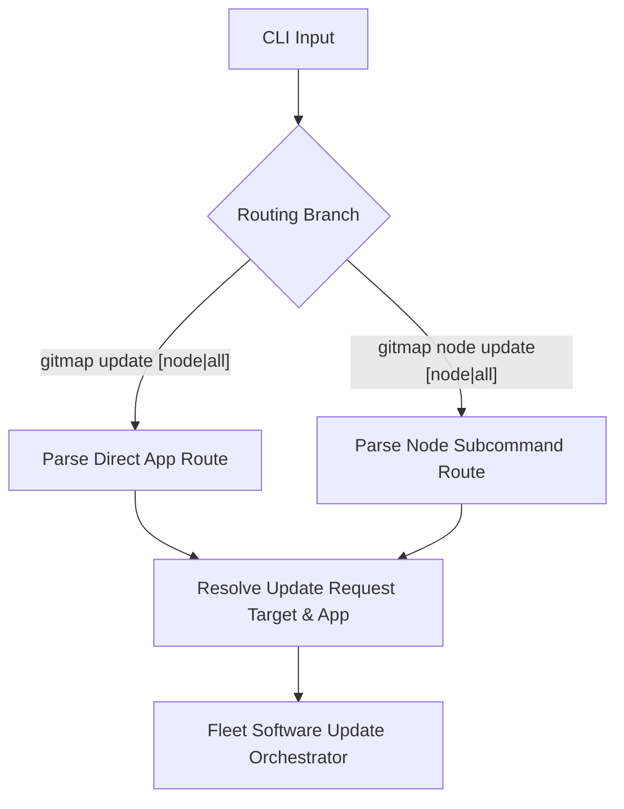
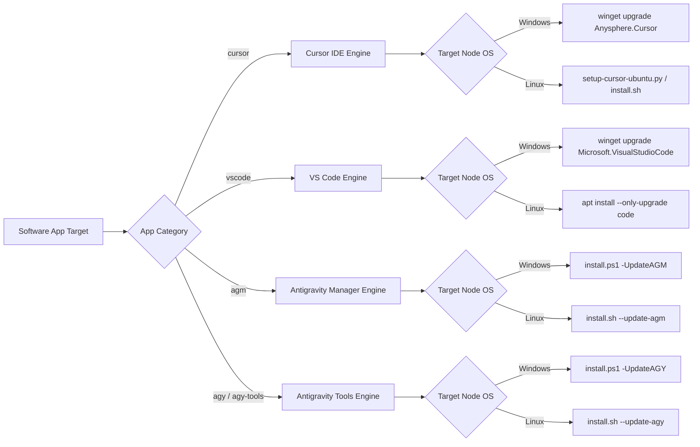
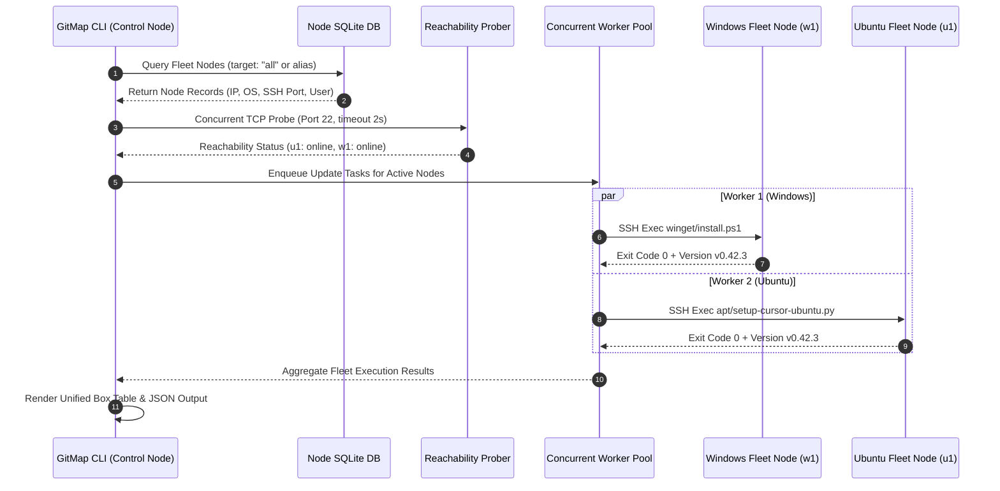

# 363 — Fleet Software Update Specification: Cursor, VS Code, AGM & AGY Tools

> **Specification Sequence:** `363`  
> **Canonical Path:** `02-spec/21-app/363-gitmap-command-enhancements/03-fleet-software-update-spec.md`  
> **Parent Plan:** `.ai-memory/plans/pending/363-gitmap-command-enhancements.md`  
> **Subtask Plan:** `.ai-memory/plans/subtasks/363-gitmap-command-enhancements/03-fleet-software-update.md`  
> **Author:** GitMap Architecture & Swarm Team  
> **Date:** 31-Oct-26  
> **Status:** `active`  

---

## 1. Executive Summary & Purpose

The **Fleet Software Update Engine** provides centralized, automated, and cross-platform updating for developer tools across all fleet nodes or targeted individual machines. As development environments expand across local workstations and remote Ubuntu/Debian fleet nodes, manual maintenance of core developer tools—specifically Cursor IDE, Visual Studio Code (VS Code), Antigravity Manager (AGM), and Antigravity Tools (AGY/AGY-Tools)—creates version skew and manual overhead.

### 1.1 Core Objectives
1. **Centralized Invocation:** Execute application updates on any single node, local host, or broadcast across the entire fleet (`all`).
2. **Dual-Syntax Routing:** Provide both direct app-level update commands (`gitmap update <app> [node|all]`) and node-centric command hierarchy (`gitmap node update <app> [node|all]`).
3. **Cross-Platform Execution Adapters:**
   - **Windows:** Utilize `winget` package manager with automatic silent agreement flags, fallback to repository-local PowerShell scripts (`install.ps1`).
   - **Linux / Ubuntu:** Utilize `apt` package manager, direct repository bash scripts (`install.sh`), and dedicated setup automation scripts (`repo-secrets/05-scripts/setup-cursor-ubuntu.py`).
4. **Resilient Fleet Execution:** Fast TCP reachability pre-flight checks, concurrent execution via bounded worker pools, non-blocking SSH dispatch, comprehensive telemetry collection, and clear UI progress reporting.
5. **Strict Coding Standard Adherence:** Positive booleans only (`is*`, `has*`), error return sovereignty via `*apperror.AppError`, zero nested conditionals, and 100% relative path hygiene.

---

## 2. Command Syntax & Dispatch Matrix

The engine supports two intuitive syntax branches that resolve to the same underlying orchestration logic:



### 2.1 Direct Update Syntax: `gitmap update <app> [node|all]`

| Command Syntax | Target Resolution | Description |
| :--- | :--- | :--- |
| `gitmap update cursor` | Local node (default) | Updates Cursor IDE on the local machine |
| `gitmap update cursor all` | All online fleet nodes + local | Broadcasts Cursor IDE update across the entire fleet |
| `gitmap update cursor <node>` | Specific node alias (e.g. `u1`, `w1`) | Dispatches Cursor IDE update to the specified node |
| `gitmap update vscode [node\|all]` | Specific node or fleet broadcast | Updates Visual Studio Code |
| `gitmap update agm [node\|all]` | Specific node or fleet broadcast | Updates Antigravity Manager daemon & binaries |
| `gitmap update agy [node\|all]` | Specific node or fleet broadcast | Updates Antigravity CLI and environment tools |
| `gitmap update agy-tools [node\|all]` | Specific node or fleet broadcast | Alias for `update agy` targeting developer tools |

### 2.2 Node Subcommand Syntax: `gitmap node update <app> [node|all]`

| Command Syntax | Target Resolution | Description |
| :--- | :--- | :--- |
| `gitmap node update cursor [node\|all]` | Target node or all nodes | Updates Cursor IDE via `node` subcommand tree |
| `gitmap node update vscode [node\|all]` | Target node or all nodes | Updates VS Code via `node` subcommand tree |
| `gitmap node update agm [node\|all]` | Target node or all nodes | Updates Antigravity Manager via `node` subcommand tree |
| `gitmap node update agy [node\|all]` | Target node or all nodes | Updates Antigravity CLI via `node` subcommand tree |
| `gitmap node update agy-tools [node\|all]` | Target node or all nodes | Updates Antigravity Tools via `node` subcommand tree |

### 2.3 Global Command Flags

| Flag | Shorthand | Type | Description |
| :--- | :--- | :--- | :--- |
| `--force` | `-f` | Boolean | Force reinstall/re-download even if already up to date |
| `--dry-run` | `-d` | Boolean | Simulate remote commands without making system changes |
| `--skip-offline` | `-s` | Boolean | Silently bypass unreachable nodes without emitting hard failures |
| `--parallel` | `-p` | Integer | Max concurrent worker threads (default: `4`, max: `8`) |
| `--timeout` | `-t` | Duration | SSH execution timeout per node (default: `180s`) |
| `--json` | `-j` | Boolean | Emit structured JSON output for automated scripting |

---

## 3. Supported Software Catalog & Update Strategies



### 3.1 Cursor IDE (`cursor`)
- **Windows Adapter:**
  - Primary: `winget upgrade Anysphere.Cursor --silent --accept-source-agreements --accept-package-agreements`
  - Exit Code Check: Exit code `0` (Success), `1641`/`3010` (Reboot required / Success), or `0x8a15002b` (No update available).
  - Fallback: Execute `powershell -NoProfile -ExecutionPolicy Bypass -File install.ps1 -UpdateCursor`.
- **Linux / Ubuntu Adapter:**
  - Primary: `python3 repo-secrets/05-scripts/setup-cursor-ubuntu.py --update`
  - Fallback: Execute `bash install.sh --update-cursor`.
  - Service Integration: Automatically triggers graceful reload of running Cursor sessions if `--force` is specified.

### 3.2 Visual Studio Code (`vscode`)
- **Windows Adapter:**
  - Primary: `winget upgrade Microsoft.VisualStudioCode --silent --accept-source-agreements --accept-package-agreements`
  - Fallback: Download latest User Installer from `update.code.visualstudio.com` and run silently `/verysilent /mergetasks=!runcode`.
- **Linux / Ubuntu Adapter:**
  - Primary: `sudo apt-get update -qq && sudo apt-get install --only-upgrade -y code`
  - Fallback: Fetch official `.deb` package and execute `sudo dpkg -i code_latest_amd64.deb`.

### 3.3 Antigravity Manager (`agm`)
- **Windows Adapter:**
  - Primary: `powershell -NoProfile -ExecutionPolicy Bypass -File install.ps1 -UpdateAGM`
  - Binary Swap: Closes active AGM process, swaps `agm.exe` inside `%LOCALAPPDATA%\Programs\AntigravityManager`, verifies version via `agm --version`, and restarts background daemon.
- **Linux / Ubuntu Adapter:**
  - Primary: `bash install.sh --update-agm`
  - Binary Swap: Replaces `/usr/local/bin/agm` or `~/.local/bin/agm`, fixes executable permissions (`0755`), and invokes `systemctl --user restart agm.service` if systemd user unit exists.

### 3.4 Antigravity Tools / IDE (`agy`, `agy-tools`)
- **Windows Adapter:**
  - Primary: `powershell -NoProfile -ExecutionPolicy Bypass -File install.ps1 -UpdateAGY`
  - Alternative: Python wheel update via `python -m pip install --upgrade antigravity-tools`.
- **Linux / Ubuntu Adapter:**
  - Primary: `bash install.sh --update-agy`
  - Alternative: `pip3 install --upgrade --user antigravity-tools`.

---

## 4. Multi-Node Fleet Execution Architecture



### 4.1 Reachability & Pre-Flight Probe
1. Before initiating heavy SSH update payloads, GitMap probes target nodes via high-speed non-blocking TCP socket connect (timeout: 1500ms).
2. If a node is unreachable:
   - If `--skip-offline` is `true`, node is marked as `SKIPPED_OFFLINE` with zero delay.
   - If `--skip-offline` is `false`, node is marked as `FAILED_OFFLINE` and reported in the failure summary.

### 4.2 Concurrency & Worker Pool Governance
- The update engine uses a bounded worker pool configured via `FleetUpdateOptions.ParallelWorkers` (default 4).
- Mutex-locked results collector captures telemetry from each worker safely.
- Output streaming maintains live spinners or progress indicators per node without interleaving stdout/stderr logs.

---

## 5. Go Data Structures & Interface Contracts

The implementation resides in `cli/cmdupdate` and exports hooks for `cli/cmdnodes`:

```go
package cmdupdate

import (
	"time"

	"github.com/alimtvnetwork/gitmap-v28/cli/apperror"
	"github.com/alimtvnetwork/gitmap-v28/cli/result"
)

// AppUpdateType defines strongly-typed supported application identifiers.
type AppUpdateType string

const (
	AppUpdateCursorType   AppUpdateType = "cursor"
	AppUpdateVSCodeType   AppUpdateType = "vscode"
	AppUpdateAGMType      AppUpdateType = "agm"
	AppUpdateAGYType      AppUpdateType = "agy"
	AppUpdateAGYToolsType AppUpdateType = "agy-tools"
)

// FleetUpdateStatusType defines outcome status for each node update.
type FleetUpdateStatusType string

const (
	FleetStatusSuccessType        FleetUpdateStatusType = "SUCCESS"
	FleetStatusAlreadyCurrentType FleetUpdateStatusType = "ALREADY_CURRENT"
	FleetStatusSkippedOfflineType FleetUpdateStatusType = "SKIPPED_OFFLINE"
	FleetStatusFailedType         FleetUpdateStatusType = "FAILED"
)

// FleetUpdateOptions encapsulates execution flags with strictly positive booleans.
type FleetUpdateOptions struct {
	App             AppUpdateType `json:"app"`
	Target          string        `json:"target"`
	IsForce         bool          `json:"isForce"`
	IsDryRun        bool          `json:"isDryRun"`
	IsSkipOffline   bool          `json:"isSkipOffline"`
	IsJSON          bool          `json:"isJSON"`
	ParallelWorkers int           `json:"parallelWorkers"`
	Timeout         time.Duration `json:"timeout"`
}

// NodeUpdateTarget defines the target machine specifications.
type NodeUpdateTarget struct {
	Alias       string `json:"alias"`
	Host        string `json:"host"`
	SSHPort     int    `json:"sshPort"`
	User        string `json:"user"`
	TargetOS    string `json:"targetOS"`
	IsLocalNode bool   `json:"isLocalNode"`
}

// NodeUpdateResult encapsulates telemetry and execution outcome for one node.
type NodeUpdateResult struct {
	NodeAlias       string                `json:"nodeAlias"`
	Host            string                `json:"host"`
	TargetOS        string                `json:"targetOS"`
	App             AppUpdateType         `json:"app"`
	Status          FleetUpdateStatusType `json:"status"`
	PreviousVersion string                `json:"previousVersion,omitempty"`
	UpdatedVersion  string                `json:"updatedVersion,omitempty"`
	Duration        time.Duration         `json:"duration"`
	DurationMs      int64                 `json:"durationMs"`
	OutputLogs      string                `json:"outputLogs,omitempty"`
	ErrorMessage    string                `json:"errorMessage,omitempty"`
	IsSuccess       bool                  `json:"isSuccess"`
	HasError        bool                  `json:"hasError"`
}

// FleetUpdateReport aggregates outcomes across all evaluated nodes.
type FleetUpdateReport struct {
	App          AppUpdateType      `json:"app"`
	TotalNodes   int                `json:"totalNodes"`
	SuccessCount int                `json:"successCount"`
	SkippedCount int                `json:"skippedCount"`
	FailureCount int                `json:"failureCount"`
	Results      []NodeUpdateResult `json:"results"`
	TotalElapsed time.Duration      `json:"totalElapsed"`
	IsAllSuccess bool               `json:"isAllSuccess"`
	HasFailures  bool               `json:"hasFailures"`
}

// FleetUpdateOrchestrator manages the end-to-end update workflow.
type FleetUpdateOrchestrator interface {
	Execute(opts FleetUpdateOptions) result.Result[FleetUpdateReport]
	ValidateOptions(opts FleetUpdateOptions) *apperror.AppError
}
```

---

## 6. Error Handling & Leaf Sovereignty

In adherence to GitMap guidelines:
1. **No Exit Handlers in Leaf Functions:** All execution functions (`executeLocalUpdate`, `executeRemoteSSHUpdate`, `probeNodeReachability`) return `*apperror.AppError` or standard Go `error`. They never call `os.Exit` or `cliexit.HandleError`.
2. **Top-Level Root Dispatch Only:** The CLI dispatch entrypoint (`RunUpdateCmd` or `RunNodeUpdateCmd`) inspects the returned `*apperror.AppError` and determines exit codes via `constants.ExitGeneralError` or `constants.ExitUsageError`.
3. **Structured AppError Codes:**
   - `ErrUnknownAppTarget`: When an unrecognized application name is supplied.
   - `ErrUnreachableFleetNode`: When a targeted node fails pre-flight TCP probe and `--skip-offline` is false.
   - `ErrExecutionFailure`: When an update script or package manager returns non-zero status.

---

## 7. Terminal UI & Reporting Layout

When executing in interactive mode (default, `--json` is false), GitMap renders a unified table with ANSI styling:

```text
● GitMap Fleet Software Update: cursor (Target: all nodes)
---------------------------------------------------------------------------------------
NODE ALIAS   HOST            OS       STATUS          PREV VER     NEW VER      DURATION
---------------------------------------------------------------------------------------
local (w0)   127.0.0.1       windows  ✔ SUCCESS       v0.42.2      v0.42.3        4.12s
u1           192.168.1.10    linux    ✔ SUCCESS       v0.41.8      v0.42.3        8.45s
u2           192.168.1.11    linux    ✔ ALREADY_CURR  v0.42.3      v0.42.3        1.20s
w1           192.168.1.20    windows  ⚠ SKIPPED       -            -              0.15s (offline)
---------------------------------------------------------------------------------------
Total Nodes: 4 | Updated: 2 | Already Current: 1 | Skipped: 1 | Failed: 0
Elapsed: 9.80s
```

---

## 8. Verification & Acceptance Criteria

| ID | Test Scenario | Expected Outcome |
| :--- | :--- | :--- |
| **AC-01** | `gitmap update cursor` on local Windows machine | Calls `winget upgrade Anysphere.Cursor`, reports success/already-current |
| **AC-02** | `gitmap update cursor all` with mixed OS nodes | Parallel updates on Windows (`winget`/`install.ps1`) and Linux (`setup-cursor-ubuntu.py`) |
| **AC-03** | `gitmap update vscode [node]` | Invokes VS Code update adapter on targeted node |
| **AC-04** | `gitmap update agm all` | Updates AGM daemon on all fleet nodes, performs binary swap and restart |
| **AC-05** | `gitmap update agy all` & `gitmap update agy-tools all` | Triggers AGY toolchain update across nodes |
| **AC-06** | `gitmap node update <app> [node\|all]` | Subcommand parity with direct `gitmap update <app>` |
| **AC-07** | Offline node handling with `--skip-offline` | Offline node is skipped cleanly in `<200ms` without blocking the pool |
| **AC-08** | Dry-run mode (`--dry-run`) | Prints simulated commands per node without modifying files or running winget/apt |
| **AC-09** | JSON output (`--json`) | Emits valid `FleetUpdateReport` JSON structure to stdout |
| **AC-10** | Error handling on invalid app | Emits `ErrUnknownAppTarget` error with suggestions of supported tools |
