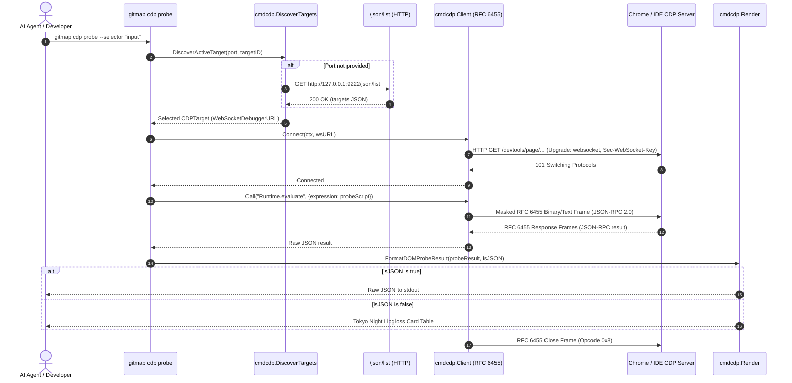

# Spec 366: Golang Script Creation and Analysis — Root Cause Analysis & Architecture

- **Task Code:** `366-golang-script-creation-and-analysis`
- **Slug:** `golang-script-creation-and-analysis`
- **Status:** `in-progress`
- **Date:** `31-Oct-26`

---

## 1. Executive Summary

Autonomous AI agents operating across Antigravity IDE, Cursor, and web-based visualizers routinely require low-level Chrome DevTools Protocol (CDP) connectivity to inspect active DOM hierarchies, verify input focus, and evaluate expressions within running browser contexts. In the absence of a standardized native GitMap CLI command, AI agents resorted to authoring ad-hoc, 70-line Python scripts utilizing raw TCP sockets and manual RFC 6455 WebSocket byte framing (`send_frame`/`recv_frame`).

These improvised Python scripts suffered from severe reliability bottlenecks:
1. Hardcoded ephemeral DevTools ports (e.g. `49994`) and volatile page target GUIDs (e.g. `3658C5BD...`), rendering them brittle across browser restarts.
2. Fragile unbuffered `recv()` sockets that dropped or truncated JSON payloads exceeding 64 KB (such as full DOM tree dumps).
3. Severe terminal transcript clutter, repeatedly dumping 70 lines of boilerplate socket masking logic per turn.
4. Architectural divergence from GitMap's core mandate that all developer automation must reside in centralized, auditable, and testable native Go CLI tools.

This specification details the 4-part Root Cause Analysis (RCA) and architecturally defines the native Go CDP engine within package `cli/cmdcdp/`. The engine provides a zero-dependency RFC 6455 WebSocket client using pure Go standard library primitives, automatic DevTools port and target discovery, structured DOM element probing, and Tokyo Night Lipgloss terminal cards alongside machine-readable JSON output.

---

## 2. Four-Part Grounded Root Cause Analysis (RCA)

### 2.1 Symptom

During automated web verification and IDE automation sessions:
- Autonomous agents repeatedly injected 70+ lines of ad-hoc Python scripts executing raw socket operations to communicate with Chrome DevTools Protocol over WebSockets.
- Scripts frequently threw unhandled exceptions:
  ```text
  ConnectionRefusedError: [Errno 111] Connection refused
  socket.timeout: timed out
  json.decoder.JSONDecodeError: Unterminated string starting at line 1 column 65536
  ```
- Terminal transcripts became cluttered with redundant Python socket framing functions (`send_frame(sock, data)`, `recv_frame(sock)`), diluting context windows and slowing down turn completion.
- Re-running the scripts after restarting Antigravity IDE or the target browser failed immediately because the target debugger port had shifted from `49994` to another ephemeral port, or the target page UUID had changed.

### 2.2 Root Cause

1. **Capability Void in Native CLI Tooling:** GitMap possessed robust CLI commands for git operations, fleet nodes, databases, and Chrome profile extraction, but lacked a native CDP inspection tool (`gitmap cdp`). Agents had no centralized mechanism to probe browser targets or evaluate DOM expressions.
2. **Hardcoded Ephemeral Ports and Target Identifiers:** Chrome and Chromium-based IDEs (Antigravity, Cursor, Electron) allocate random available ports when launched with `--remote-debugging-port=0` or dynamically bound ports. Agents hardcoded specific port numbers (e.g. `49994`) and target IDs into one-off scripts instead of dynamically querying the HTTP target registry (`http://127.0.0.1:<port>/json/list`).
3. **Fragile Custom Byte Framing and Unbuffered Sockets:** Hand-crafted Python framing implementations used naive `sock.recv(65536)` loops. When CDP serialized DOM responses or large script evaluations exceeding 64 KB, packet boundary fragmentation caused payload truncation and JSON parse errors. Furthermore, the scripts lacked WebSocket ping/pong keep-alives, connection timeouts, and masking key entropy validation.
4. **Tooling Governance and Coding Guideline Violations:** Writing ad-hoc scratch scripts bypassed GitMap's structured execution pipeline (`cliexit`, `apperror`, database audit logging via `finishCommandAudit`), violating core architectural standards against unmanaged scripts in production workspaces.

### 2.3 Resolution

Implement a native Go package `cli/cmdcdp/` fully integrated into the GitMap CLI hierarchy:
1. **Zero-Dependency RFC 6455 Client:** Build a clean, spec-compliant WebSocket client utilizing pure Go standard library packages (`net`, `crypto/rand`, `encoding/binary`, `encoding/json`). This eliminates third-party dependencies while guaranteeing robust frame assembly for payloads up to 16 MB.
2. **Automatic Target and Port Discovery:** Query `http://127.0.0.1:<port>/json/list` across standard debugging ports (`9222`, `9229`) and active local IDE debug endpoints. Automatically filter and select active `page` targets without requiring hardcoded GUIDs.
3. **Dedicated CLI Command Suite:** Register `gitmap cdp` with three discrete subcommands:
   - `gitmap cdp targets`: Discovers and displays active browser/IDE tabs and debugging targets.
   - `gitmap cdp probe`: Scans the active page DOM for form inputs, interactive elements, and specified CSS selectors.
   - `gitmap cdp eval "<js>"`: Evaluates arbitrary JavaScript within the target context and returns typed results.
4. **Dual Output Rendering:** Output styled Tokyo Night Lipgloss cards for human developers and terminal clarity, while supporting a clean `--json` flag for deterministic parsing by AI agents.

### 2.4 Prevention & Learnings

1. **Strict Ban on Ad-hoc Browser Socket Scripts:** Agents working within GitMap must use `gitmap cdp [targets|probe|eval]` instead of generating inline Python or Node.js WebSocket scripts.
2. **Deterministic Discovery First:** Never assume a static remote debugging port. The CDP engine must first probe the discovery endpoint (`/json/list` or `/json/version`) to obtain valid `webSocketDebuggerUrl` endpoints.
3. **Centralized Error and Audit Logging:** All CDP operations bubble structured `AppError` values up to root command dispatch, capturing exit codes and diagnostics in `finishCommandAudit`.

---

## 3. Architecture & Data Flow

### 3.1 Architectural Component Hierarchy

```
┌─────────────────────────────────────────────────────────────┐
│                    GitMap CLI Dispatch                      │
│                  (cli/cmd/root.go, cdp)                     │
└──────────────────────────────┬──────────────────────────────┘
                               │
                               ▼
┌─────────────────────────────────────────────────────────────┐
│                       cli/cmdcdp                            │
│  ┌─────────────────────────┐     ┌───────────────────────┐  │
│  │     cdp_cmd.go          │     │     discovery.go      │  │
│  │ (Cobra Command Routing) │     │  (Port & Target Scan) │  │
│  └───────────┬─────────────┘     └───────────┬───────────┘  │
│              │                               │              │
│              ▼                               ▼              │
│  ┌─────────────────────────┐     ┌───────────────────────┐  │
│  │        client.go        │◄────┤       types.go        │  │
│  │  (RFC 6455 WS Protocol) │     │ (DTOs, Interfaces)    │  │
│  └───────────┬─────────────┘     └───────────────────────┘  │
│              │                                              │
│              ├──────────────────────┬──────────────────────┐│
│              ▼                      ▼                      ▼│
│  ┌───────────────────────┐┌──────────────────┐┌───────────┐││
│  │       probe.go        ││     eval.go      ││ render.go │││
│  │ (DOM & Selector Hits) ││ (Runtime.eval)   ││(Lipgloss) │││
│  └───────────────────────┘└──────────────────┘└───────────┘││
└──────────────────────────────┬──────────────────────────────┘
                               │
                               ▼
┌─────────────────────────────────────────────────────────────┐
│              Browser / IDE Runtime (CDP Server)             │
│   • http://127.0.0.1:<port>/json/list                       │
│   • ws://127.0.0.1:<port>/devtools/page/<targetId>          │
└─────────────────────────────────────────────────────────────┘
```

### 3.2 End-to-End Sequence Diagram



---

## 4. RFC 6455 Pure Standard Library Implementation Design

The native Go CDP WebSocket client avoids third-party dependencies (`gorilla/websocket`, `x/net/websocket`) to preserve GitMap's minimal binary footprint and rapid compilation.

### 4.1 Handshake Protocol
1. Open a raw TCP connection to `host:port` via `net.Dialer` with a 5-second deadline.
2. Generate a 16-byte cryptographically secure random nonce via `crypto/rand`.
3. Base64-encode the nonce as `Sec-WebSocket-Key`.
4. Send standard HTTP upgrade request:
   ```http
   GET /devtools/page/<targetId> HTTP/1.1
   Host: 127.0.0.1:<port>
   Upgrade: websocket
   Connection: Upgrade
   Sec-WebSocket-Key: <base64-key>
   Sec-WebSocket-Version: 13
   ```
5. Read HTTP response status. Verify status line contains `101 Switching Protocols` and `Upgrade: websocket`.

### 4.2 Frame Masking and Transmission (Client to Server)
Under RFC 6455 Section 5.3, all frames transmitted from client to server MUST be masked with a 4-byte masking key:
- Byte 0: `FIN (0x80) | Opcode (0x01 for text)`
- Byte 1: `MASK (0x80) | PayloadLen` (if Len < 126, directly encoded; if 126 <= Len <= 65535, 126 followed by 2 bytes uint16; if Len > 65535, 127 followed by 8 bytes uint64).
- Bytes 2..5 (or subsequent): 4 random masking bytes.
- Payload bytes: Each byte `i` transformed via `payload[i] ^ mask[i % 4]`.

### 4.3 Frame Reading and De-fragmentation (Server to Client)
- Server-to-client frames are unmasked.
- The reader loops over incoming frames, handling unfragmented frames or concatenating continuation frames (`Opcode 0x0`) until `FIN == 1`.
- Handles `Ping (0x9)` by immediately replying with `Pong (0xA)`.
- Handles `Close (0x8)` by echoing a close frame and closing the underlying connection.
- Implements buffered streaming using `bufio.Reader` and `io.ReadFull` to ensure large payloads (>64 KB) are fully assembled without truncation.

---

## 5. Security & Safety Invariants

1. **Strict Loopback Binding:** The client will exclusively connect to loopback interfaces (`127.0.0.1`, `[::1]`, `localhost`). Outbound connection requests to external IP addresses or domains are rejected.
2. **Bounded Response Buffering:** Incoming frame payload reading is capped at a maximum of 16 MB (`maxPayloadBytes = 16 * 1024 * 1024`) to eliminate potential memory exhaustion attacks from malicious endpoints.
3. **Context-Driven Timeouts:** All network calls (HTTP discovery, WebSocket handshake, JSON-RPC round-trips) require a `context.Context` with an enforced timeout (default: 5 seconds, configurable via `--timeout`).
