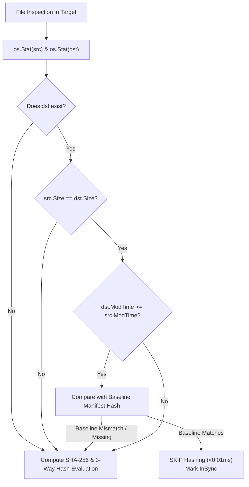

# High-Speed ModTime & Stat-First Synchronization Engine

> **Task:** 369-heatmap-command-enhancements-and-high-speed-sync  
> **Subsystem:** Fleet Synchronization & Asset Mirror (`cli/cmdsync/`)  
> **Date:** 31-Oct-26  
> **Status:** APPROVED  

---

## 1. Problem Statement & Bottleneck Analysis

Previously, `gitmap cg sync` iterated across all files in every directory mapping and invoked `EvaluateThreeWay`, which performed full disk I/O and SHA-256 cryptographic hashing on both the source and target files for every single markdown file, even when the target file was identical and untouched.

Across 43+ fleet repositories containing hundreds of markdown specifications and prompts, this quadratic hashing bottleneck caused fleet synchronizations to be slow.

---

## 2. High-Speed Stat & ModTime-First Invariant

### 2.1 Fast-Path Evaluation
1. **Size & Existence Guard:** If `dst` does not exist, immediately flag as `NewUpstream` or proceed to copy.
2. **Metadata Cache:** If `dst.Size() == src.Size()`, and `dst.ModTime().Equal(src.ModTime())` (or `dst.ModTime().After(src.ModTime())`) AND `manifest.Assets[rel] == precomputedSrcHash`, skip disk read and SHA-256 calculation entirely.
3. **Outdated Detection:** Files where `src.ModTime().After(dst.ModTime())` or sizes differ are marked as candidates for synchronization.
4. **Human Edit Protection:** If `dst` was modified after baseline installation and does not match upstream, preserve the human edits, create a `.upstream` sidecar, and aggregate into a human-review summary report.
