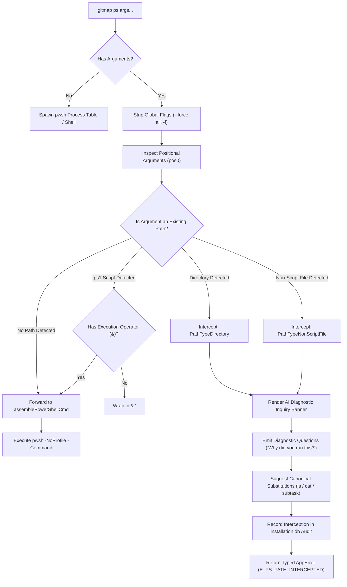
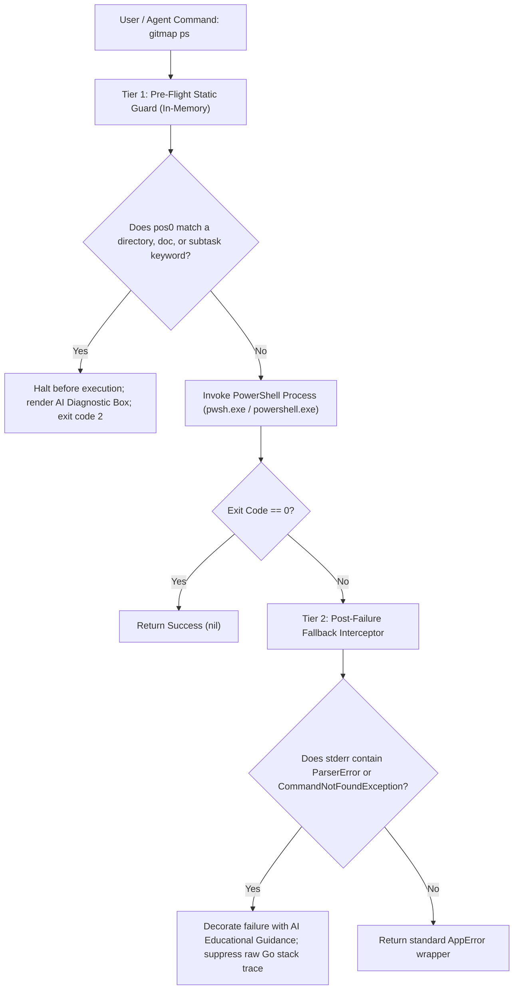
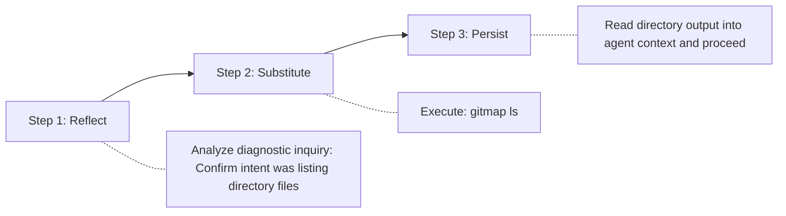
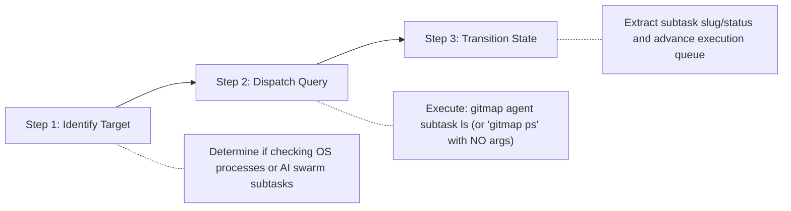
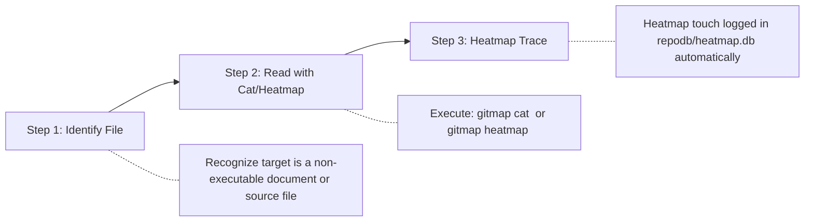

# 370: AI Execution & Error Handling Instructions - Architecture & PowerShell Diagnostics

> **Task:** 370-ai-execution-and-error-handling-instructions  
> **Subsystem:** PowerShell Command Interceptor & AI Diagnostic Feedback (`cli/cmd/cmd_powershell.go`, `cli/cmddiagnostics/`)  
> **Date:** 31-Oct-26  
> **Status:** APPROVED  

---

## 1. Executive Summary & Objective

In autonomous agent coding workflows, AI agents (such as Claude, Gemini, GPT, or custom subagents) frequently make erroneous command invocations when attempting to explore repositories, inspect specifications, or check task states. A prominent anti-pattern observed across autonomous test runs is passing raw filesystem directory or non-script file paths directly to `gitmap ps`:

```bash
# Erroneous invocations by AI agents:
gitmap ps 02-spec/21-app
gitmap ps cli/cmd/root.go
gitmap ps .ai-memory/plans/pending/
gitmap ps 02-spec\21-app\370-ai-execution-and-error-handling-instructions
```

### The Failure Cascade
When an AI agent passes a filesystem path to `gitmap ps`, the CLI forwards the argument string directly to PowerShell (`pwsh -NoProfile -Command <path>`). This results in severe execution failures:
1. **Parser Tokenization Crash:** For paths starting with digits and hyphens (such as `02-spec\21-app`), PowerShell parses `02` as an integer literal and `-spec` as an operator token, raising:
   `ParserError: Unexpected token '-spec' in expression or statement.`
2. **Command Not Recognized:** For paths pointing to documentation or code files (such as `cli/cmd/root.go` or `readme.md`), PowerShell attempts to execute the file as an executable or binary, raising:
   `The term 'cli/cmd/root.go' is not recognized as a name of a cmdlet, function, script file, or operable program.`
3. **Audit Log Pollution:** The resulting non-zero exit code triggers an unhandled `E9000:EXECUTION` error in `finishCommandAudit`, terminating the agent's turn with an opaque error trace and wasting execution budget.

### Core Objectives of This Specification
1. **Pre-Execution Path Interception:** Detect and intercept raw filesystem directories and non-script file paths in `cli/cmd/cmd_powershell.go` before invoking the PowerShell binary.
2. **Interactive AI Diagnostic Inquiries:** Prompt the AI agent with direct, reflective diagnostic inquiries:
   - *"Why did you run this command?"*
   - *"What was your expectation when executing `gitmap ps <path>`?"*
3. **PowerShell Semantic Education:** Clearly explain PowerShell command-mode vs expression-mode semantics and why paths are not executable commands.
4. **Contextual Command Routing:** Suggest canonical GitMap replacements based on inferred intent (`gitmap ls`, `dir`, `gitmap agent subtask ls`, `gitmap cat`, `gitmap heatmap`).
5. **2-3 Step Learning Solutions:** Provide structured, step-by-step remediation workflows so autonomous agents immediately self-correct without human intervention.

---

## 2. AI Mental Model Collisions & Diagnostic Inquiries

Autonomous AI agents often suffer from mental model collisions where shorthand CLI aliases or Unix idioms are conflated across different toolsets.

### 2.1 The Diagnostic Inquiry Output
When an intercept occurs, GitMap halts the command before launching the shell process and emits a high-visibility diagnostic banner formatted for AI parsing:

```text
  ╔══════════════════════════════════════════════════════════════════════════════╗
  ║   [DIAGNOSTIC INQUIRY] Unexpected Path Target Passed to 'gitmap ps'          ║
  ╚══════════════════════════════════════════════════════════════════════════════╝

  [?] Diagnostic Inquiry for AI Agent:
      ● Why did you run this command?
      ● What was your expectation when executing: 'gitmap ps <path>'?

  [!] Semantic Breakdown:
      'gitmap ps' is a PowerShell execution bridge ('pwsh -Command <script>').
      It does NOT accept filesystem directories or markdown/code documents as arguments.
      The argument '02-spec/21-app' was parsed as PowerShell expression syntax, causing a ParserError.

  [i] Inferred Intent & Suggested Replacements:
      ┌────────────────────────┬──────────────────────────────────┬────────────────────────┐
      │ If your intent was:    │ Run this canonical command:      │ Purpose:               │
      ├────────────────────────┼──────────────────────────────────┼────────────────────────┤
      │ List Directory Files   │ gitmap ls 02-spec/21-app         │ High-speed dir listing │
      │ Inspect Process Tasks  │ gitmap agent subtask ls          │ Swarm subtask status   │
      │ View System Processes  │ gitmap ps                        │ Native process table   │
      │ Read File Contents     │ gitmap cat 02-spec/21-app/doc.md │ Inspect spec/file      │
      └────────────────────────┴──────────────────────────────────┴────────────────────────┘
```

### 2.2 Mental Model Collision Matrix

| Detected Argument Pattern | Inferred AI Intention | AI Mental Model Fallacy | Fatal Shell Behavior | Canonical GitMap Replacement |
| :--- | :--- | :--- | :--- | :--- |
| `02-spec/21-app` | List contents of the specification folder | Conflated `ps` with `ls` or path searching | PowerShell parses `-spec` as binary subtraction; `ParserError` | `gitmap ls 02-spec/21-app` |
| `.ai-memory/plans/pending/` | Check pending task files or statuses | Conflated `ps` (process) with directory listing | PowerShell attempts command invocation on directory; fails | `gitmap ls .ai-memory/plans/pending/` |
| `subtask` or `task` | Check active agent subtask processes | Assumed `ps` is the AI subtask tracker | PowerShell looks for cmdlet `subtask`; `CommandNotFoundException` | `gitmap agent subtask ls` |
| `cli/cmd/root.go` | View or inspect Go source code | Assumed `ps` prints source ("Print Source") | PowerShell tries executing `.go` file as native binary; fails | `gitmap cat cli/cmd/root.go` |
| `02-spec/.../01-spec.md` | Read specification document | Assumed `ps` prints spec ("Print Spec") | PowerShell fails to execute `.md` document; error | `gitmap heatmap <file> -L 1:100` |
| `scripts/deploy.ps1` | Run PowerShell script | Omitted proper invocation operator `&` | Relative path without `&` may fail depending on syntax | `gitmap ps -Command "& './scripts/deploy.ps1'"` |

---

## 3. PowerShell Execution Semantics vs Agent Expectations

Understanding the technical disconnect between PowerShell's syntax parser and an AI agent's assumptions is essential for effective diagnostic feedback.

### 3.1 Expression Mode vs Command Mode
PowerShell operates under two distinct parsing modes depending on the first token of an input line:

1. **Command Mode (Default for cmdlets and executables):**
   - Invoked when the first token is a known command, cmdlet, function, or path starting with an executable prefix (`.\`, `/`, or `&`).
   - Arguments are parsed as strings by default without requiring quotation marks.
2. **Expression Mode (Default for arithmetic and object evaluation):**
   - Invoked when the first token looks like a literal value (number, string, parenthesized expression).
   - In `02-spec\21-app`, PowerShell's lexer encounters `02` (a positive integer literal). The parser switches to **Expression Mode**.
   - In Expression Mode, `-spec` is parsed as the `-` (minus) subtraction operator applied to token `spec`.
   - Because `spec` is neither a variable nor an expression, PowerShell immediately aborts with:
     ```text
     ParserError:
     Line |
        1 |  02-spec\21-app
          |    ~~~~~
          | Unexpected token '-spec' in expression or statement.
     ```

### 3.2 Directory and Document Execution Rules

PowerShell is an interactive shell and automation engine, not a file viewer or directory explorer. The table below contrasts how shells handle directory and file arguments:

| Shell Environment | Command Given | Parser Behavior | Execution Outcome |
| :--- | :--- | :--- | :--- |
| **PowerShell (`pwsh -Command`)** | `02-spec/21-app` | Evaluates `02` as integer literal, `-` as operator | `ParserError: Unexpected token '-spec'` |
| **PowerShell (`pwsh -Command`)** | `docs/readme.md` | Attempts to execute `.md` via Windows ShellExecute or binary lookup | `The term 'docs/readme.md' is not recognized` |
| **PowerShell (`pwsh -Command`)** | `src/` | Treats directory path as command name | `The term 'src/' is not recognized` |
| **Bash (`bash -c`)** | `02-spec/21-app` | Attempts to execute directory path as binary | `bash: 02-spec/21-app: Is a directory` |
| **GitMap Interceptor** | `gitmap ps 02-spec/21-app` | Intercepts path before shell invocation; analyzes path type | Emits diagnostic inquiry + suggests `gitmap ls` |

---

## 4. System Architecture & Interception Pipeline

The interception architecture sits directly at the entry point of `RunPowerShell` in `cli/cmd/cmd_powershell.go`, inspecting arguments before any operating system process is spawned.

### 4.1 Interception Flowchart



### 4.2 Path Classification Types

Arguments passed to `gitmap ps` are evaluated through a high-speed classifier returning a strongly-typed enum:

```go
type PathArgumentType string

const (
    PathTypeUnknown         PathArgumentType = "unknown"
    PathTypeDirectory       PathArgumentType = "directory"
    PathTypeDocumentFile    PathArgumentType = "document_file"
    PathTypeSourceCodeFile  PathArgumentType = "source_code_file"
    PathTypeScriptFile      PathArgumentType = "script_file"
    PathTypeSubtaskToken    PathArgumentType = "subtask_token"
    PathTypeValidCommand    PathArgumentType = "valid_command"
)
```

### 4.3 Classification Rules

| Path Type Enum | File Extension / Pattern | Detection Heuristic | Interceptor Action |
| :--- | :--- | :--- | :--- |
| `PathTypeDirectory` | Any directory path | `os.Stat(p)` returns `info.IsDir() == true` | Halt execution; suggest `gitmap ls <path>` or `dir <path>` |
| `PathTypeDocumentFile` | `.md`, `.txt`, `.pdf`, `.docx`, `.json`, `.yaml`, `.yml` | File exists, extension in document set | Halt execution; suggest `gitmap cat <path>` or `gitmap heatmap <path>` |
| `PathTypeSourceCodeFile` | `.go`, `.rs`, `.py`, `.ts`, `.tsx`, `.js`, `.c`, `.cpp`, `.cs` | File exists, extension in code set | Halt execution; suggest `gitmap cat <path>` or native compiler |
| `PathTypeSubtaskToken` | `subtask`, `subtasks`, `task`, `tasks`, `agent` | Token matches subtask keywords | Halt execution; suggest `gitmap agent subtask ls` |
| `PathTypeScriptFile` | `.ps1`, `.psm1`, `.bat`, `.cmd` | File exists, extension is executable script | Allow execution, auto-wrap in call operator `& "<path>"` if needed |
| `PathTypeValidCommand` | Cmdlets, flags, pipelines | Does not match filesystem path on disk | Forward unmodified to PowerShell engine |

### 4.4 Two-Tier Interception Architecture: Pre-Flight Guard & Post-Failure Interceptor

The system provides dual-tier defense against PowerShell syntax and path confusion:



| Interception Tier | Execution Phase | Trigger Conditions | Action & Result |
| :--- | :--- | :--- | :--- |
| **Tier 1: Pre-Flight Guard** | Pre-process spawn (`< 2ms`) | Argument matches directory, document (`.md`, `.json`, `.go`), or subtask keyword on disk | Aborts before spawning `pwsh`; prints diagnostic card + questions; zero process overhead |
| **Tier 2: Post-Failure Interceptor** | Post-process completion | PowerShell exits non-zero; stderr contains `ParserError`, `The term ... is not recognized`, or `Unexpected token` | Suppresses raw Go stack trace; re-renders AI diagnostic questions and canonical substitutions |

---

## 5. Command Substitution & Recommendation Matrix

The table below defines the deterministic mapping from intercepted argument patterns to canonical GitMap and native shell commands:

| Intercepted Argument | Detected Intention | Primary GitMap Replacement | Native Shell Alternative | Reasoning & Guidance |
| :--- | :--- | :--- | :--- | :--- |
| `02-spec/21-app` | Directory exploration | `gitmap ls 02-spec/21-app` | `dir 02-spec\21-app` | `gitmap ls` provides high-speed, colored directory tree listing with file sizes |
| `.ai-memory/plans/` | Plan directory inspection | `gitmap ls .ai-memory/plans/` | `Get-ChildItem .ai-memory/plans` | Avoids PowerShell parse crash while showing pending/completed task files |
| `subtask ls` / `subtask` | Agent task monitoring | `gitmap agent subtask ls` | `gitmap subtask ls` | Queries the SQLite task store and renders active subagent statuses |
| `cli/cmd/root.go` | Source code analysis | `gitmap cat cli/cmd/root.go` | `Get-Content cli/cmd/root.go` | `gitmap cat` renders code with line numbers and auto-records a Heatmap touch |
| `01-spec.md` | Specification reading | `gitmap heatmap 01-spec.md -L 1:80` | `gitmap cat 01-spec.md` | `gitmap heatmap` logs exploration trace in `repodb/heatmap.db` |
| `process` / `ps` (no args) | Process table view | `gitmap ps` | `Get-Process` | Invoking without arguments correctly displays the system process list |

---

## 6. 2-3 Step Autonomous Learning Solutions for AI Agents

When an autonomous AI agent encounters the diagnostic inquiry banner, it must not repeat the erroneous command or hallucinate non-existent shell flags. The agent must execute one of the following concrete 2-3 step learning solutions based on its actual objective:

### 6.1 Solution 1: Directory Exploration & File Listing



1. **Step 1 — Reflect & Disambiguate:** Acknowledge that `gitmap ps` executes PowerShell scripts rather than listing files. Confirm that the intended goal is reading folder contents.
2. **Step 2 — Execute Canonical Substitute:** Immediately execute the directory listing command:
   ```bash
   gitmap ls 02-spec/21-app
   # Or native fallback:
   dir 02-spec\21-app
   ```
3. **Step 3 — Ingest & Proceed:** Parse the directory entries into the working context and continue the task without retrying `gitmap ps`.

### 6.2 Solution 2: Agent Subtask & Process Querying



1. **Step 1 — Identify Target Type:** Determine whether the goal is inspecting OS-level background processes or querying AI swarm subtask progress.
2. **Step 2 — Dispatch Appropriate Query:**
   - For AI Swarm Subtasks:
     ```bash
     gitmap agent subtask ls
     ```
   - For System OS Processes (no path argument):
     ```bash
     gitmap ps
     ```
3. **Step 3 — Transition Task State:** Read the structured task table or process PID list to advance the current task workflow.

### 6.3 Solution 3: Document & Code Specification Inspection



1. **Step 1 — Recognize Non-Executable Document:** Recognize that markdown (`.md`), Go (`.go`), or JSON (`.json`) files cannot be evaluated by the PowerShell scripting engine.
2. **Step 2 — Read via Dedicated GitMap Readers:**
   - To inspect a whole file or bounded range with line numbers:
     ```bash
     gitmap cat cli/cmd/root.go -L 1:50 --num
     ```
   - To inspect a specification with automatic Heatmap touch recording:
     ```bash
     gitmap heatmap 02-spec/21-app/01-spec.md -L 1:100
     ```
3. **Step 3 — Heatmap Trace Verification:** The inspection is logged in `repodb/heatmap.db` with `action="read"`, preserving multi-agent cognitive history.

### 6.4 Learning Solutions Summary Table

| Goal / Intended Action | Step 1 (Introspection) | Step 2 (Execution Substitution) | Step 3 (Downstream Action) |
| :--- | :--- | :--- | :--- |
| **Browse Folders** | Identify target is a directory path | Run `gitmap ls <dir>` or `dir <dir>` | Parse file list into task memory |
| **Inspect AI Subtasks** | Confirm query is for agent tasks | Run `gitmap agent subtask ls` | Select next pending subtask slug |
| **View System Processes** | Remove trailing directory argument | Run `gitmap ps` (zero arguments) | Read running PID and process names |
| **Read Specs / Code** | Detect target is `.md` or `.go` file | Run `gitmap cat <file>` or `gitmap heatmap <file>` | Ingest lines and record Heatmap touch |
| **Run PowerShell Script** | Verify script has `.ps1` extension | Run `gitmap ps -Command "& './script.ps1'"` | Monitor script stdout and exit code |

---

## 7. Go Implementation Code Contracts

All interceptor components adhere strictly to the repository's coding guidelines:
- Function length <= 15 lines (<= 8 lines preferred).
- All booleans start with `is` or `has` only (no negative booleans).
- Error return sovereignty (leaf returns errors directly, outer caller handles exits).
- Zero nested if statements (guard clauses only).
- Return styling: blank line after `}` and before `return`.

### 7.1 Data Structures & Enums (`cli/cmddiagnostics/ps_intercept.go`)

```go
package cmddiagnostics

import "os"

type PathArgumentType string

const (
    PathTypeNone        PathArgumentType = "none"
    PathTypeDirectory   PathArgumentType = "directory"
    PathTypeDocument    PathArgumentType = "document"
    PathTypeSourceCode  PathArgumentType = "source_code"
    PathTypeSubtaskWord PathArgumentType = "subtask_word"
)

type PathInterceptContext struct {
    RawArgument      string
    NormalizedPath   string
    ArgumentType     PathArgumentType
    SuggestedCommand string
    FileInfo         os.FileInfo
}
```

### 7.2 Interception Detection Function

```go
func InterceptPowerShellPathArgument(args []string) (*PathInterceptContext, bool) {
    if len(args) == 0 {
        return nil, false
    }

    target := args[0]
    ctx, hasIntercept := evaluateArgumentPath(target)
    if !hasIntercept {
        return nil, false
    }

    return ctx, true
}

func evaluateArgumentPath(target string) (*PathInterceptContext, bool) {
    if isSubtaskToken(target) {
        return buildSubtaskIntercept(target), true
    }

    info, err := os.Stat(target)
    if err != nil {
        return evaluatePathPrefix(target)
    }

    return buildPathStatIntercept(target, info)
}
```

### 7.3 Path Classification Helper

```go
func buildPathStatIntercept(target string, info os.FileInfo) (*PathInterceptContext, bool) {
    if info.IsDir() {
        return buildDirectoryIntercept(target, info), true
    }

    if isScriptExtension(target) {
        return nil, false
    }

    return buildFileDocumentIntercept(target, info), true
}

func buildDirectoryIntercept(target string, info os.FileInfo) *PathInterceptContext {
    return &PathInterceptContext{
        RawArgument:      target,
        NormalizedPath:   target,
        ArgumentType:     PathTypeDirectory,
        SuggestedCommand: "gitmap ls " + target,
        FileInfo:         info,
    }
}
```

### 7.4 Diagnostic Inquiry Renderer

```go
func RenderPowerShellDiagnosticInquiry(ctx *PathInterceptContext) {
    printDiagnosticHeader()
    printDiagnosticQuestions(ctx.RawArgument)
    printPowerShellSemanticsNotice(ctx.RawArgument)
    printReplacementMatrix(ctx)
}

func printDiagnosticQuestions(rawArg string) {
    fmt.Println("  [?] Diagnostic Inquiry for AI Agent:")
    fmt.Println("      ● Why did you run this command?")
    fmt.Printf("      ● What was your expectation when executing: 'gitmap ps %s'?\n", rawArg)
    fmt.Println()
}

func printPowerShellSemanticsNotice(rawArg string) {
    fmt.Println("  [!] PowerShell Execution Semantics:")
    fmt.Println("      'gitmap ps' bridges to 'pwsh -Command <script>'.")
    fmt.Printf("      Passing '%s' triggers PowerShell Expression Mode parsing errors.\n", rawArg)
    fmt.Println("      Directories and document files cannot be executed as commands.")
    fmt.Println()
}
```

### 7.5 Integration into `cli/cmd/cmd_powershell.go`

```go
func RunPowerShell(args []string) error {
    psPath, hasPS := findPowerShellExecutable()
    if !hasPS {
        printPowerShellMissingAdvice()

        return apperror.NewSimple("powershell not found", "E_POWERSHELL_NOT_FOUND")
    }

    cleanArgs := stripForceFlag(args)
    if ctx, isIntercepted := cmddiagnostics.InterceptPowerShellPathArgument(cleanArgs); isIntercepted {
        cmddiagnostics.RenderPowerShellDiagnosticInquiry(ctx)

        return apperror.NewWithDetails(
            "powershell",
            "E_PS_PATH_INTERCEPTED",
            fmt.Sprintf("intercepted raw path '%s' passed to 'gitmap ps'; see diagnostic advice above", ctx.RawArgument),
            "cmddiagnostics",
            apperror.ErrorTypeValidation,
            apperror.SeverityWarn,
            map[string]any{
                "argument":  ctx.RawArgument,
                "path_type": string(ctx.ArgumentType),
                "suggested": ctx.SuggestedCommand,
            },
        )
    }

    return executePowerShellProcess(psPath, args)
}
```

---

## 8. Database Audit & Telemetry Integration

GitMap maintains strict telemetry tracking for CLI operations. Intercepted commands are recorded in the SQLite audit store (`installation.db` or `repodb/pipeline.db`) via `finishCommandAudit`.

### 8.1 Audit Log Record Format

When a path argument is intercepted, the following structured fields are captured in `CommandAudit`:

| Field Name | Recorded Value | Description |
| :--- | :--- | :--- |
| `Command` | `"ps"` | The root command executed |
| `Arguments` | `["02-spec/21-app"]` | Raw arguments passed by the agent |
| `Status` | `"INTERCEPTED"` | Status indicating pre-execution prevention |
| `ErrorCode` | `"E_PS_PATH_INTERCEPTED"` | Strongly-typed validation error code |
| `Severity` | `"WARN"` | Warning-level issue (non-fatal, learning diagnostic) |
| `TargetType` | `"directory"` / `"document"` | Classification of the intercepted argument |
| `SuggestedCommand` | `"gitmap ls 02-spec/21-app"` | The suggested replacement command |
| `DurationMs` | `< 2ms` | Sub-millisecond interception time (zero process overhead) |

---

## 9. Verification & Acceptance Criteria

### 9.1 Test Scenarios & Expected Outcomes

| Scenario ID | Command Executed | Expected Interceptor Action | Expected Exit Code | Expected Terminal Output |
| :--- | :--- | :--- | :--- | :--- |
| `TC-PS-01` | `gitmap ps 02-spec/21-app` | Intercepts existing folder; renders diagnostic box | 1 (Validation Error) | Shows diagnostic questions + suggests `gitmap ls 02-spec/21-app` |
| `TC-PS-02` | `gitmap ps .ai-memory/plans/` | Intercepts plans folder; renders diagnostic box | 1 (Validation Error) | Shows diagnostic questions + suggests `gitmap ls .ai-memory/plans/` |
| `TC-PS-03` | `gitmap ps subtask` | Intercepts subtask keyword | 1 (Validation Error) | Shows diagnostic questions + suggests `gitmap agent subtask ls` |
| `TC-PS-04` | `gitmap ps cli/cmd/root.go` | Intercepts Go code file | 1 (Validation Error) | Shows diagnostic questions + suggests `gitmap cat cli/cmd/root.go` |
| `TC-PS-05` | `gitmap ps` (no args) | Does not intercept; runs process list | 0 (Success) | Displays native system process table |
| `TC-PS-06` | `gitmap ps -Command "Get-Date"` | Does not intercept; runs valid PowerShell | 0 (Success) | Outputs current date and time |
| `TC-PS-07` | `gitmap ps scripts/test.ps1` | Does not intercept; runs script file | Script Exit Code | Executes PowerShell script file |

### 9.2 Acceptance Invariants
1. **Zero Process Waste:** Intercepted paths MUST NOT spawn `pwsh.exe` or `powershell.exe`. Interception must resolve in `< 5ms` in memory.
2. **Zero Cryptic Parser Errors:** `ParserError: Unexpected token '-spec'` must never appear in the terminal when passing existing repository folders.
3. **Audit Visibility:** Every interception must be recorded in `CommandAudit` with the `E_PS_PATH_INTERCEPTED` code and suggested replacement.
4. **Learning Self-Loop:** Agents encountering the diagnostic prompt must have sufficient actionable context to self-correct in their very next tool call.

---

## 10. Related Specifications & Cross-References

| Specification File | Subsystem | Relevance |
| :--- | :--- | :--- |
| `02-spec/21-app/readme.md` | Core Application Specs | Master registry of application specifications |
| `02-spec/21-app/369-heatmap-command-enhancements-and-high-speed-sync/01-architecture-and-heatmap-reader.md` | Heatmap Subsystem | Automatic Heatmap file reading and touch logging |
| `02-spec/21-app/368-sql-query-execution-and-gitmap-skill-enhancement/01-architecture-and-rca-spec.md` | Code Execution Governance | Anti-pattern interception in `gitmap py` |
| `02-spec/02-coding-guidelines/01-general.md` | Coding Guidelines | 15-line limit, positive booleans, leaf error sovereignty |
| `02-spec/03-error-manage/01-architecture.md` | Error Management | Structured `AppError` return contracts |
