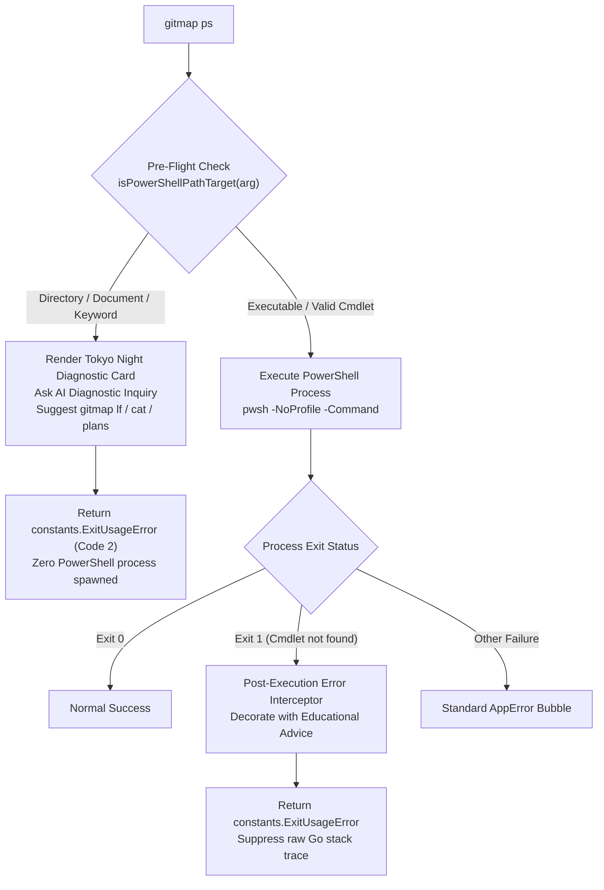

# 370-ai-execution-and-error-handling-instructions

> **Parent Task:** AI Execution & Error Handling Instructions  
> **Subsystem:** PowerShell Command Interception, Interactive AI Diagnostic Inquiries & Educational Error Guidance  
> **Target Release:** `v6.645.0`  
> **Date:** 31-Oct-26  
> **Status:** APPROVED  
> **Path Hygiene:** Strict Relative Paths Only  

---

## 1. Executive Summary

In multi-agent autonomous engineering workflows, AI coding agents frequently make mistaken command invocations when attempting to explore repositories, inspect specifications, or check task states. A recurring anti-pattern observed across autonomous runs is passing raw filesystem directories or non-script file paths directly to `gitmap ps` (e.g., `gitmap ps 02-spec/21-app`, `gitmap ps .ai-memory/plans/...`, `gitmap ps readme.md`).

Because `gitmap ps` forwards arguments to PowerShell (`pwsh -NoProfile -Command <args>`), these invocations lead to:
1. **PowerShell Parser Errors:** Paths starting with digits and hyphens (e.g. `02-spec/21-app`) cause tokenization crashes (`ParserError: Unexpected token '-spec'`).
2. **Cmdlet Resolution Failures:** Documents and directories are not executable binaries or cmdlets, producing `The term '...' is not recognized as a name of a cmdlet...` and `exit status 1`.
3. **Audit Log & Turn Waste:** Non-zero exit codes bubble up as unhandled `E9000:EXECUTION` Go errors in `finishCommandAudit`, terminating agent turns and consuming execution budget without actionable guidance.

This specification suite defines a comprehensive two-layer defense architecture combining pre-flight path interception, interactive AI diagnostic inquiries, PowerShell execution semantics education, actionable replacement command routing, 2-to-3 step learning solutions, and fleet-wide skill and guideline synchronization.

---

## 2. Specifications Index

| Specification Document | Focus Area & Description |
| :--- | :--- |
| [`01-architecture-and-powershell-diagnostics.md`](01-architecture-and-powershell-diagnostics.md) | High-level system architecture, argument pre-flight inspection, AI reflection inquiry framework, PowerShell execution semantics (command vs expression mode), and command routing matrix. |
| [`02-preflight-guard-and-interceptor-spec.md`](02-preflight-guard-and-interceptor-spec.md) | Technical implementation specs for `cli/cmd/cmd_powershell.go`, `cli/cmd/powershell_advice.go`, and `cli/cmd/powershell_interceptor.go`, two-layer defense engine, and Tokyo Night ANSI rendering. |
| [`03-skills-guidelines-and-verification.md`](03-skills-guidelines-and-verification.md) | Canonical skill updates (`.agents/skills/gitmap/skill.md`), anti-pattern guidelines (`10-anti-pattern-replacements.md`), automated unit/integration test specifications, and end-to-end verification checklist (`TC-PS-01` through `TC-PS-07`). |
| [`97-acceptance-criteria.md`](97-acceptance-criteria.md) | Measurable, testable criteria for implementation, interception performance (< 2ms), and verification invariants. |
| [`99-consistency-report.md`](99-consistency-report.md) | Structural health audit, relative path verification, and link integrity scorecard. |

---

## 3. Key Capabilities & Two-Layer Defense



| Capability | Description |
| :--- | :--- |
| **Pre-Flight Path Interception** | Intercepts raw directory and document file paths before launching PowerShell processes (< 2ms resolution, zero process overhead). |
| **Interactive AI Diagnostic Inquiries** | Surfaces high-visibility Tokyo Night banners asking reflective questions ("Why did you run this? What was your expectation?"). |
| **PowerShell Semantic Education** | Explains command mode vs expression mode and why hyphenated paths trigger unexpected parser tokens. |
| **Contextual Command Routing** | Guides agents to instant GitMap replacements: `gitmap ls`, `gitmap lf`, `gitmap plans`, `gitmap agent subtask ls`, `gitmap cat`, `gitmap heatmap`. |
| **2-3 Step Learning Solutions** | Step-by-step remediation recipes enabling autonomous agents to self-correct in their very next turn without human intervention. |
| **Post-Execution Fallback Interceptor** | Intercepts cmdlet-not-found errors during execution and decorates output with educational advice, suppressing raw Go stack traces. |
| **Fleet Skill & Guideline Sync** | Updates agent skills in `.agents/skills/` and guidelines in `02-spec/02-coding-guidelines/`, synchronizing across 40+ connected repositories via `gitmap cg sync`. |

---

## 4. Updates to Skills & Coding Guidelines

### 4.1 Skill Update (`.agents/skills/gitmap/skill.md`)
- **Rule 20 / Command Replacement Matrix:** Banning direct invocation of `gitmap ps <dir>` or `gitmap ps <file.md>`, mandating `gitmap lf <dir>` or `gitmap cat <filepath>`.
- **Section 3 (Runner Engines):** Adding educational warning box clarifying that `gitmap ps` executes code inside `pwsh`, not filesystem inspection.
- **2-to-3 Step Learning Roadmap:** Providing immediate steps for directory listing, file reading, and cmdlet execution.

### 4.2 Anti-Pattern Guideline (`02-spec/02-coding-guidelines/06-ai-optimization/10-anti-pattern-replacements.md`)
- **Anti-Pattern 6:** Dedicated section detailing Directory / Document Execution via `gitmap ps` vs Native GitMap Discovery.
- **Mental Model Collision Analysis:** Explains why agents confuse `ps` with "process status", "plan summary", or "path search".
- **Structured Code Examples:** Clear `❌ FORBIDDEN` vs `✅ REQUIRED` code blocks.

---

## 5. Subtask Alignment

| Code | Subtask ID | Title | Status | Owned Files / Subsystems |
| :--- | :--- | :--- | :--- | :--- |
| `TASK-01` | `sub-121922-task-01` | Architecture & Diagnostic Specifications Authoring | DONE | `02-spec/21-app/370-ai-execution-and-error-handling-instructions/` |
| `TASK-02` | `sub-121928-task-02` | PowerShell Argument Pre-Flight Inspection & AI Reflection Engine | PENDING | `cli/cmd/cmd_powershell.go`, `cli/cmd/powershell_advice.go` |
| `TASK-03` | `sub-121928-task-03` | PowerShell Error Post-Processing & Fallback Interceptor | PENDING | `cli/cmd/powershell_interceptor.go`, `cli/cmd/cmd_powershell_test.go` |
| `TASK-04` | `sub-121928-task-04` | Update Skills, Cheatsheets & Anti-Pattern Guidelines | PENDING | `.agents/skills/gitmap/skill.md`, `02-spec/02-coding-guidelines/` |
| `TASK-05` | `sub-121928-task-05` | High-Speed Fleet Synchronization Across Repositories | PENDING | `cli/cmdsync/`, fleet repositories |
| `TASK-06` | `sub-121929-task-06` | Compilation, Live Terminal Verification & Release Ceremony (v6.645.0) | PENDING | `cli/constants/constants.go`, `version.json`, `changelog.md` |

---

## 6. Acceptance & Verification Matrix (`TC-PS-01` to `TC-PS-07`)

| Scenario ID | Command Executed | Expected Interceptor Action | Exit Code | Expected Terminal Output |
| :--- | :--- | :--- | :--- | :--- |
| `TC-PS-01` | `gitmap ps 02-spec/21-app` | Intercepts existing folder; renders diagnostic card | `2` (`ExitUsageError`) | Prompts diagnostic questions + suggests `gitmap ls 02-spec/21-app` |
| `TC-PS-02` | `gitmap ps .ai-memory/plans/` | Intercepts plans folder; renders diagnostic card | `2` (`ExitUsageError`) | Prompts diagnostic questions + suggests `gitmap ls .ai-memory/plans/` |
| `TC-PS-03` | `gitmap ps subtask` | Intercepts subtask keyword | `2` (`ExitUsageError`) | Prompts diagnostic questions + suggests `gitmap agent subtask ls` |
| `TC-PS-04` | `gitmap ps cli/cmd/root.go` | Intercepts Go code file | `2` (`ExitUsageError`) | Prompts diagnostic questions + suggests `gitmap cat cli/cmd/root.go` |
| `TC-PS-05` | `gitmap ps` (no args) | Does not intercept; runs process list | `0` (Success) | Displays native system process table |
| `TC-PS-06` | `gitmap ps -Command "Get-Date"` | Does not intercept; runs valid PowerShell | `0` (Success) | Outputs current date and time |
| `TC-PS-07` | `gitmap ps scripts/test.ps1` | Does not intercept; runs script file | Script Exit Code | Executes PowerShell script file |

---

## 7. Implementation & Verification Commands

### Automated Test Suite
```bash
# Execute unit and scenario tests for PowerShell path interception and diagnostic rendering
go test -v ./cli/cmd/... -run "TestPowerShell|TestTC_PS"
```

### Manual Acceptance Verification
```bash
# 1. Directory path target interception
gitmap ps 02-spec/21-app

# 2. Document file target interception
gitmap ps readme.md

# 3. Subtask keyword interception
gitmap ps subtask

# 4. Valid PowerShell execution pass-through
gitmap ps "Write-Output 'GitMap verification successful'"
```

### Fleet Synchronization & Release
```bash
# High-speed fleet synchronization of updated skills and guidelines
gitmap cg sync

# Release ceremony for v6.645.0
gitmap cpr "v6.645.0 AI execution instructions and powershell pre-flight diagnostic interceptor"
```
