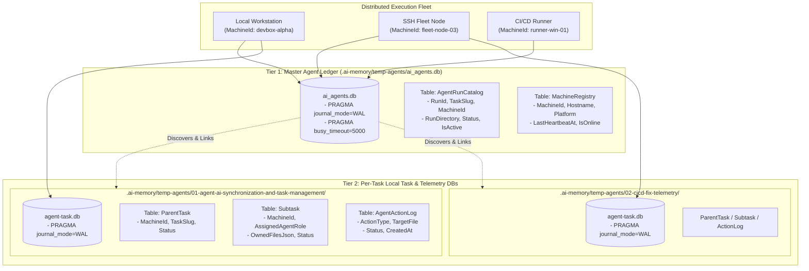
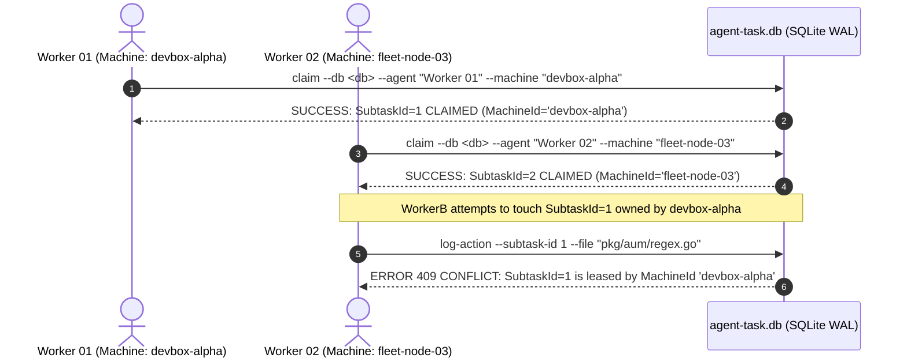
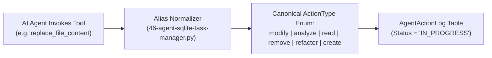

# Architecture Specification: Agent AI Synchronization and Task Management

- **Spec ID:** `02-spec/21-app/agent-ai-synchronization-and-task-management/01-architecture-spec.md`
- **Feature Slug:** `agent-ai-synchronization-and-task-management`
- **Status:** `APPROVED`
- **Version:** `1.0.0`
- **Subsystem:** Multi-Agent Coordination, Two-Tier SQLite Split-DB, Machine ID Lease Governance, ActionType Telemetry, Crash Forensics & Heatmap Engine
- **Dependencies:** `03-ai-scripts/46-agent-sqlite-task-manager.py`, `02-spec/21-app/06-database-and-split-db/01-architecture-spec.md`, `01-prompts/14-execute/02-execute-parent-task-with-n-steps-v6.md`

---

## 1. Executive Summary & Core Intent

The **Agent AI Synchronization and Task Management** architecture provides a fault-tolerant, concurrency-safe, multi-machine coordination engine for autonomous AI coding agents operating across Git repositories. It establishes an immutable single source of truth for task decomposition, in-flight agent actions, file reservations, crash forensics, and real-time concurrency heatmaps.

### 1.1 Core Problems Solved
1. **Multi-Agent File Collisions:** Concurrent subagents touching the same repository files without mutual awareness, causing overwritten edits and unmergeable work trees.
2. **Crash & Disconnect Blind Spots:** Agents silently failing mid-turn due to tool errors, timeouts, or process terminations, leaving working trees dirty with zero forensic trail of what file was being modified.
3. **Cross-Machine & Fleet Desynchronization:** Multi-environment execution (local workstation, SSH cluster nodes, remote CI runners) colliding on task claims and slug namespaces without deterministic host tracking.
4. **Unstructured File Mutation Vocabulary:** Inconsistent, informal action strings (`"editing"`, `"view"`, `"patching"`, `"ran code"`) preventing automated linting, heat mapping, and blast-radius analysis.

### 1.2 System Capabilities
- **Two-Tier SQLite Split-DB Architecture:** A global master ledger (`.ai-memory/temp-agents/ai_agents.db`) tracking all runs across machines, combined with isolated run-scoped task databases (`.ai-memory/temp-agents/<nn>-<slug>/agent-task.db`).
- **Deterministic Machine Identity:** Every task and subtask is tagged with a hardware/host-probed `MachineId` for cross-environment trace isolation and lease conflict resolution.
- **Canonical `ActionType` Enum:** Strictly typed enum (`modify`, `analyze`, `read`, `remove`, `refactor`, `create`) with automated alias normalization from IDE and agent tools.
- **Rule R-PRETOUCH Pre-Touch Logging:** Mandatory SQLite action registration before any file mutation or reading occurs, ensuring 100% crash reproducibility.
- **Sub-5ms Real-Time Heatmap Engine (`gitmap agent-ai heatmap discuss`):** High-speed aggregation of active agent file touches, contention scores, and collision avoidance alerts.

---

## 2. Two-Tier SQLite Split-DB Architecture

The storage architecture partitions agent coordination state across two distinct tiers to prevent multi-task database locking while maintaining centralized discovery.



### 2.1 Tier 1: Master Agent Ledger (`.ai-memory/temp-agents/ai_agents.db`)
- **Scope:** Repository-wide master registry across all historical and active runs.
- **Location:** `.ai-memory/temp-agents/ai_agents.db`.
- **Purpose:**
  - Enables sub-millisecond task resumption and fuzzy slug lookup without directory recursion.
  - Registers active machines, heartbeat timestamps, and in-flight runs.
  - Prevents slug collisions between parallel workers operating on separate branches or nodes.
- **Engine Rules:**
  - WAL mode enabled: `PRAGMA journal_mode = WAL;`.
  - Busy timeout: `PRAGMA busy_timeout = 5000;`.
  - Synchronous mode: `PRAGMA synchronous = NORMAL;`.

### 2.2 Tier 2: Per-Task Task Database (`agent-task.db`)
- **Scope:** Isolated run directory: `.ai-memory/temp-agents/<nn>-<slug>/agent-task.db`.
- **Tables:**
  - `ParentTask`: Master task definition, budget, status, and creator `MachineId`.
  - `Subtask`: Disjoint subtasks, assigned worker roles, `MachineId`, status, and owned relative paths.
  - `AgentActionLog`: Fine-grained audit log recording every single in-flight action, target file, canonical `ActionType`, and timestamp.
- **Isolation Guarantee:** High-frequency subtask state transitions and pre-touch action logging hit only the local `agent-task.db`, ensuring zero lock contention across distinct tasks.

---

## 3. Deterministic Machine Identity & Cross-Machine Synchronization

Distributed AI agents operating across multiple machines (e.g. developer laptop, staging server, SSH cluster worker) must reliably differentiate their tasks while maintaining lease safety.

### 3.1 Deterministic Machine ID Generation Algorithm
The `MachineId` is computed deterministically at process initialization using the following resolution ladder:

```
1. Environment Override:  $GITMAP_MACHINE_ID
2. Host Probe:            socket.gethostname().lower().strip()
3. Fallback OS Identifiers: $COMPUTERNAME (Win) / $HOSTNAME (Linux/macOS)
4. Sanitization:          re.sub(r'[^a-z0-9_-]', '-', raw_host)[:32]
5. Default Guarantee:     "devbox-local"
```

#### Specification Table: Machine ID Properties
| Attribute | Specification | Rationale |
| :--- | :--- | :--- |
| **Format** | Kebab-case / lowercase alphanumeric (`[a-z0-9_-]{3,32}`) | Clean JSON serialization and terminal logging |
| **Examples** | `devbox-alpha`, `ubuntu-build-02`, `win-runner-4` | Human-readable machine identification |
| **Storage** | `TEXT NOT NULL` in `ParentTask`, `Subtask`, `AgentRunCatalog` | Indexed across master and task SQLite stores |
| **Immutability** | Fixed for the lifetime of a specific execution run | Prevents identity mutation during agent turns |

### 3.2 Cross-Machine Conflict Resolution & Lease Fencing
When multiple machines access the same repository (e.g. via shared worktree, mounted network storage, or synchronized git branches), task claims must remain conflict-free:



#### Conflict Resolution Invariants:
1. **Machine-Fenced Claims:** When an agent claims a subtask, `Subtask.MachineId` is stamped with the claiming machine's ID.
2. **Pre-Touch Verification:** Any action logged to `AgentActionLog` must verify that the requesting agent's machine matches the `Subtask.MachineId` unless an explicit takeover flag (`--force-takeover`) is provided.
3. **Orphan Stealing & Handover:** If `Subtask.Status == 'IN_PROGRESS'` but the lease timestamp (`UpdatedAt`) is older than 600 seconds with no active heartbeat, another machine may steal the task by logging an audit event `ActionType = 'modify'`, `Details = 'Steal abandoned task from dead machine <OldMachineId>'`.

---

## 4. Canonical ActionType Enum & Alias Normalization

To guarantee consistent telemetry, automated blast-radius checking, and accurate heatmap generation, all agent file operations must be categorized under a canonical `ActionType` enum.

### 4.1 Canonical Enum Definitions
| ActionType | Classification | Description & Intent | File System Effect |
| :--- | :--- | :--- | :--- |
| **`modify`** | Mutation | Surgical modification of existing code or text content | Overwrites lines, in-place text replacement |
| **`analyze`** | Inspection | Non-destructive structural inspection, AST parsing, linting | Read-only; zero disk modifications |
| **`read`** | Inspection | Raw reading or viewing of file contents or headers | Read-only; zero disk modifications |
| **`remove`** | Mutation | Deleting, unlinking, or purging obsolete files | File unlinked from repository tree |
| **`refactor`** | Mutation | Architectural restructuring, function extraction, splitting | In-place rewrite or multiple file movements |
| **`create`** | Mutation | Authoring a brand new file, schema, or test suite | Creates new inode on disk |

### 4.2 Lifecycle Action Types
In addition to the 6 file mutation types, the engine records 3 task lifecycle actions:
- **`START`**: Worker claims subtask and initiates processing.
- **`COMPLETE`**: Worker finishes subtask and records verification evidence.
- **`FAIL`**: Worker terminates with an unrecoverable blocker or error.

### 4.3 Tool Alias Normalization Mappings
AI tools invoke varied IDE actions. The task manager automatically normalizes tool names and aliases to the canonical enum:

| Incoming Agent / Tool Action | Normalized ActionType | Rationale & Context |
| :--- | :--- | :--- |
| `replace_file_content` | **`modify`** | Primary surgical edit tool |
| `edit_file`, `patch`, `update` | **`modify`** | Generic text editing operations |
| `write_to_file` (existing file) | **`modify`** | File overwrite / update |
| `write_to_file` (new file) | **`create`** | New file creation |
| `create_file`, `touch`, `new` | **`create`** | File creation |
| `view_file`, `read_file`, `cat` | **`read`** | File inspection |
| `gitmap cat`, `read_resource` | **`read`** | Telemetry and resource reading |
| `analyze_file`, `search_web`, `ast` | **`analyze`** | Semantic analysis and exploration |
| `gitmap aum search`, `gitmap find` | **`analyze`** | Repository-wide indexing search |
| `run_linter`, `run_test`, `check` | **`analyze`** | Diagnostic quality verification |
| `delete_file`, `rm`, `unlink`, `purge` | **`remove`** | File deletion |
| `refactor_module`, `extract_type` | **`refactor`** | Structural code reorganization |



---

## 5. Crash Forensics & Rule R-PRETOUCH

### 5.1 Rule R-PRETOUCH (Pre-Touch Action Logging Invariant)
> **Invariant Rule R-PRETOUCH:**  
> An autonomous agent MUST NEVER mutate, create, delete, or read a repository file without logging the pending action into SQLite `AgentActionLog` FIRST.  
> The action record MUST be inserted with `Status = 'IN_PROGRESS'` immediately prior to tool dispatch.

### 5.2 Forensic Failure Mechanics
When an agent encounters a fatal runtime failure (e.g., process termination, out-of-memory kill, infinite loop turn timeout, or Windows file lock freeze), standard in-memory logs are lost. Under Rule R-PRETOUCH, the SQLite WAL journal holds the exact state:

```mermaid
sequenceDiagram
    autonumber
    actor Worker as Worker 01 (MachineId: devbox-alpha)
    participant Engine as Task Manager CLI
    participant DB as SQLite WAL (agent-task.db)
    actor Tool as File System Tool

    Worker->>Engine: log-action --action modify --file "pkg/scanner/scan.go"
    Engine->>DB: INSERT INTO AgentActionLog (ActionType='modify', TargetFile='pkg/scanner/scan.go', Status='IN_PROGRESS')
    DB-->>Engine: ActionLogId = 142
    Engine-->>Worker: {"status": "LOGGED", "actionLogId": 142}

    Note over Worker,Tool: Tool Execution Occurs
    Worker->>Tool: replace_file_content("pkg/scanner/scan.go")
    
    alt Happy Path
        Tool-->>Worker: OK (Modified lines 40-55)
        Worker->>Engine: complete --subtask-id 1 --evidence "PASS"
        Engine->>DB: UPDATE Subtask SET Status='DONE'; INSERT ActionType='COMPLETE'
    else Sudden Crash / Timeout
        Note over Worker,Tool: CRASH! Process Killed or File Lock Panic
        Note over DB: Record #142 remains Status='IN_PROGRESS' with TargetFile!
    end
```

### 5.3 Diagnostic Recovery Protocol (`diagnose`)
The diagnosis engine scans `agent-task.db` for uncompleted tasks where `Subtask.Status == 'IN_PROGRESS'`. It fetches the highest `ActionLogId` for that subtask to identify:
1. Exactly which worker crashed (`AssignedAgentRole`).
2. Exactly which machine executed the action (`MachineId`).
3. The exact file being touched (`LastTargetFile`).
4. The exact `ActionType` (`modify`, `create`, `refactor`, etc.).
5. The duration elapsed since the crash.

---

## 6. Real-Time Concurrency Heatmap Architecture (`gitmap agent-ai heatmap discuss`)

High-velocity multi-agent runs require instantaneous visibility into repository hotspots. The heatmap engine aggregates recent action logs and computes file contention metrics in `<5ms`.

### 6.1 Heatmap Metrics & Contention Scoring
For every touched file within an active time window (default: last 30 minutes), the engine computes:
- **`TouchCount` ($N$):** Total actions recorded on the target path.
- **`UniqueAgents` ($A$):** Number of distinct agents touching the file.
- **`MutationCount` ($M$):** Actions where `ActionType IN ('modify', 'create', 'remove', 'refactor')`.
- **`InspectionCount` ($I$):** Actions where `ActionType IN ('read', 'analyze')`.
- **`ContentionScore` ($S$):** Calculated as:
  $$S = (M \times 2.0) + (I \times 0.5) + (A > 1 \ ? \ 5.0 : 0.0)$$

### 6.2 Heat Severity Levels
| Score Range | Severity Level | Visual Color | Policy & Agent Action |
| :--- | :--- | :--- | :--- |
| $S \ge 10.0$ or $A \ge 2$ (with mutations) | **COLLISION_RISK** | ANSI Red | Immediate freeze; subtasks must arbitrate ownership |
| $4.0 \le S < 10.0$ | **WARM** | ANSI Yellow | Active file; avoid parallel edits |
| $0.5 \le S < 4.0$ | **COOL** | ANSI Green | Single reader or occasional edit; safe |
| $S = 0.0$ | **IDLE** | Dim / Gray | Untouched in current window |

### 6.3 Command Interface: `gitmap agent-ai heatmap discuss`
```bash
# High-speed CLI execution
gitmap agent-ai heatmap discuss

# Output JSON format for AI agent analysis
gitmap agent-ai heatmap discuss --json

# Filter by specific task slug or custom database
gitmap agent-ai heatmap discuss --slug agent-ai-synchronization-and-task-management --json
```

#### JSON Response Schema:
```json
{
  "timestamp": "2026-10-11T10:30:00Z",
  "taskSlug": "agent-ai-synchronization-and-task-management",
  "machineId": "devbox-alpha",
  "activeAgentsCount": 3,
  "hotspotFiles": [
    {
      "filePath": "03-ai-scripts/46-agent-sqlite-task-manager.py",
      "contentionScore": 12.5,
      "severity": "COLLISION_RISK",
      "touchCount": 6,
      "agents": ["Worker 01", "Worker 02"],
      "lastActionType": "modify",
      "lastTouchedAt": "2026-10-11T10:29:45Z"
    },
    {
      "filePath": "02-spec/21-app/agent-ai-synchronization-and-task-management/01-architecture-spec.md",
      "contentionScore": 2.0,
      "severity": "COOL",
      "touchCount": 1,
      "agents": ["Spec Worker 01"],
      "lastActionType": "create",
      "lastTouchedAt": "2026-10-11T10:28:10Z"
    }
  ],
  "collisionWarning": true,
  "discussionSummary": "Collision risk detected on 03-ai-scripts/46-agent-sqlite-task-manager.py: touched concurrently by Worker 01 and Worker 02."
}
```

---

## 7. Master Database Schema Definitions

All tables strictly enforce **PascalCase** naming for tables and columns, positive booleans (`IsActive`, `HasCompleted`, `IsBlocked`), and strict relative Git paths.

### 7.1 Tier 1: Master Agent Ledger (`ai_agents.db`) DDL
```sql
CREATE TABLE IF NOT EXISTS MachineRegistry (
    MachineRegistryId INTEGER PRIMARY KEY AUTOINCREMENT,
    MachineId TEXT NOT NULL UNIQUE,
    Hostname TEXT NOT NULL,
    Platform TEXT NOT NULL,
    IsOnline INTEGER NOT NULL DEFAULT 1,
    LastHeartbeatAt TEXT NOT NULL,
    CreatedAt TEXT NOT NULL
);

CREATE TABLE IF NOT EXISTS AgentRunCatalog (
    RunCatalogId INTEGER PRIMARY KEY AUTOINCREMENT,
    TaskSlug TEXT NOT NULL UNIQUE,
    TaskName TEXT NOT NULL,
    MachineId TEXT NOT NULL,
    RunDirectory TEXT NOT NULL,
    DatabasePath TEXT NOT NULL,
    Status TEXT NOT NULL DEFAULT 'ACTIVE',
    IsActive INTEGER NOT NULL DEFAULT 1,
    HasCompleted INTEGER NOT NULL DEFAULT 0,
    TotalSubtasks INTEGER NOT NULL DEFAULT 0,
    CompletedSubtasks INTEGER NOT NULL DEFAULT 0,
    CreatedAt TEXT NOT NULL,
    UpdatedAt TEXT NOT NULL,
    FOREIGN KEY (MachineId) REFERENCES MachineRegistry(MachineId)
);

CREATE INDEX IF NOT EXISTS idx_run_slug ON AgentRunCatalog(TaskSlug);
CREATE INDEX IF NOT EXISTS idx_run_status ON AgentRunCatalog(Status);
CREATE INDEX IF NOT EXISTS idx_run_machine ON AgentRunCatalog(MachineId);
```

### 7.2 Tier 2: Task-Scoped Task Database (`agent-task.db`) DDL
```sql
CREATE TABLE IF NOT EXISTS ParentTask (
    ParentTaskId INTEGER PRIMARY KEY AUTOINCREMENT,
    TaskName TEXT NOT NULL,
    TaskSlug TEXT NOT NULL,
    MachineId TEXT NOT NULL,
    RunDirectory TEXT NOT NULL,
    Status TEXT NOT NULL DEFAULT 'ACTIVE',
    IsActive INTEGER NOT NULL DEFAULT 1,
    HasCompleted INTEGER NOT NULL DEFAULT 0,
    TotalStepsBudget INTEGER NOT NULL DEFAULT 300,
    CurrentStep INTEGER NOT NULL DEFAULT 1,
    Notes TEXT NULL,
    CreatedAt TEXT NOT NULL,
    UpdatedAt TEXT NOT NULL
);

CREATE TABLE IF NOT EXISTS Subtask (
    SubtaskId INTEGER PRIMARY KEY AUTOINCREMENT,
    ParentTaskId INTEGER NOT NULL,
    TaskCode TEXT NOT NULL,
    Title TEXT NOT NULL,
    MachineId TEXT NOT NULL,
    AssignedAgentRole TEXT NULL,
    OwnedFilesJson TEXT NOT NULL DEFAULT '[]',
    Status TEXT NOT NULL DEFAULT 'PENDING',
    IsBlocked INTEGER NOT NULL DEFAULT 0,
    HasCompleted INTEGER NOT NULL DEFAULT 0,
    Evidence TEXT NULL,
    CreatedAt TEXT NOT NULL,
    UpdatedAt TEXT NOT NULL,
    FOREIGN KEY (ParentTaskId) REFERENCES ParentTask(ParentTaskId)
);

CREATE TABLE IF NOT EXISTS AgentActionLog (
    ActionLogId INTEGER PRIMARY KEY AUTOINCREMENT,
    SubtaskId INTEGER NOT NULL,
    MachineId TEXT NOT NULL,
    AgentRole TEXT NOT NULL,
    ActionType TEXT NOT NULL,
    TargetFile TEXT NULL,
    ActionDetails TEXT NOT NULL,
    Status TEXT NOT NULL DEFAULT 'IN_PROGRESS',
    CreatedAt TEXT NOT NULL,
    FOREIGN KEY (SubtaskId) REFERENCES Subtask(SubtaskId)
);

CREATE INDEX IF NOT EXISTS idx_subtask_parent ON Subtask(ParentTaskId);
CREATE INDEX IF NOT EXISTS idx_subtask_status ON Subtask(Status);
CREATE INDEX IF NOT EXISTS idx_subtask_machine ON Subtask(MachineId);
CREATE INDEX IF NOT EXISTS idx_action_subtask ON AgentActionLog(SubtaskId);
CREATE INDEX IF NOT EXISTS idx_action_file ON AgentActionLog(TargetFile);
CREATE INDEX IF NOT EXISTS idx_action_created ON AgentActionLog(CreatedAt);
```

---

## 8. Architectural Invariants

### 8.1 Invariant Table
| Invariant ID | Rule Name | Description & Verification |
| :--- | :--- | :--- |
| **INV-01** | `TwoTierIsolation` | Tier 1 holds catalog pointers; Tier 2 holds micro-actions. No worker queries external run DBs directly. |
| **INV-02** | `MachineIdPresence` | Every record in `ParentTask`, `Subtask`, and `AgentActionLog` MUST possess a valid non-empty `MachineId`. |
| **INV-03** | `Rule-Pretouch` | Zero file writes, reads, or deletes before recording `ActionType` in `AgentActionLog` with `Status = 'IN_PROGRESS'`. |
| **INV-04** | `ActionTypeStrictness` | Every `ActionType` stored in DB MUST match one of `modify`, `analyze`, `read`, `remove`, `refactor`, `create`, `START`, `COMPLETE`, `FAIL`. |
| **INV-05** | `StrictRelativePaths` | All file paths in `OwnedFilesJson` and `TargetFile` must be strictly relative forward-slash paths. Zero absolute paths, zero `file:///` URIs. |
| **INV-06** | `PositiveBooleansOnly` | Boolean flags must use positive naming (`IsActive`, `HasCompleted`, `IsBlocked`) storing integer `0` or `1`. |
| **INV-07** | `Sub5msHeatmap` | `heatmap discuss` queries must execute against indexed SQLite columns in under 5 milliseconds. |

---

## 9. Verification & Audit Procedures

1. **Schema DDL Verification:**
   ```bash
   python 03-ai-scripts/46-agent-sqlite-task-manager.py schema --ddl
   ```
   Assert that `MachineId` exists on `ParentTask`, `Subtask`, and `AgentActionLog`.

2. **ActionType Validation Check:**
   ```bash
   python 03-ai-scripts/46-agent-sqlite-task-manager.py log-action --db <db> --subtask-id 1 --agent "Worker 01" --action "replace_file_content" --file "02-spec/test.md"
   ```
   Verify that `replace_file_content` is automatically normalized to `modify` in the SQLite database record.

3. **Heatmap Speed & Collision Test:**
   ```bash
   python 03-ai-scripts/46-agent-sqlite-task-manager.py heatmap --db <db> --json
   ```
   Verify JSON output returns in `<5ms` and correctly reports active hotspots.
