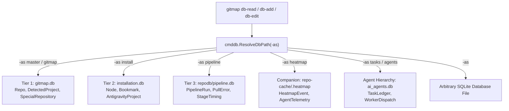
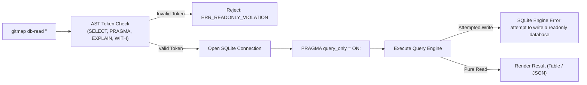

# Database Integration Architecture: Native Go SQLite & Split-DB Engine

- **Spec ID:** `02-spec/21-app/command-and-database-integration-instructions/01-architecture-overview.md`
- **Module:** `cli/cmddb`, `cli/dbengine`, `cli/store`, `cli/repodb`, `cli/pipelinedb`
- **Status:** APPROVED
- **Version:** 1.0.0
- **Target Audience:** Core CLI Engineers, Autonomous AI Agents, Multi-Agent Orchestrators
- **Target Release:** Minor Bump

---

## 1. Executive Summary & Core Intent

GitMap manages distributed repository metadata, CI/CD telemetry, SSH fleet configurations, and multi-agent coordination state across polyglot workspaces. Historically, agent routines and maintenance workflows relied on ad-hoc Python one-liners (`python -c "import sqlite3; ..."`) and transient runner scripts to query, inspect, and mutate local SQLite databases.

This specification formalizes the native Go SQLite integration inside the primary `gitmap` binary. By embedding dedicated database command handlers (`db-read`, `db-add`, `db-edit`) powered by the pure-Go `modernc.org/sqlite` driver, GitMap eliminates Python runtime dependencies, prevents concurrent write corruptions, guarantees strict read-only safety via SQLite pragma enforcement, and provides seamless access to GitMap's Three-Tier Split-DB architecture.

---

## 2. Rationale: Replacing Python One-Liners with Native Go

The transition from external Python execution to native Go commands addresses four critical operational bottlenecks:

| Dimension | Legacy Python One-Liners | Native Go SQLite Subcommands |
|---|---|---|
| **Runtime Dependency** | Requires host `python3`, `sqlite3` bindings, and virtualenv presence. | Zero external dependencies; statically compiled in `gitmap`. |
| **Execution Latency** | 120ms - 450ms process startup and module import penalty. | Sub-millisecond execution (< 5ms) via pooled in-process handles. |
| **Shell & OS Quoting** | Fragile escaping in PowerShell, cmd.exe, and Bash quotation layers. | Deterministic CLI flag parsing via Cobra with typed arguments. |
| **Concurrency & Locks** | Uncoordinated concurrent scripts trigger SQLite `database is locked` panics. | Centralized connection pooling (`SetMaxOpenConns(1)`) and WAL mode. |
| **Output Consistency** | Ad-hoc text dumps requiring brittle regex/sed scraping by agents. | Standardized terminal tables (`termout`) and typed JSON envelopes. |
| **Mutation Safety** | Accidental mutation or injection during read routines. | Hardware/engine-enforced read-only safety (`PRAGMA query_only = ON`). |

---

## 3. Split-DB Compatibility & Alias Topology

GitMap partitions data across specialized SQLite database files to eliminate schema contention and isolate domain telemetry. Native database commands resolve target databases through symbolic aliases (`-as <alias>`) or direct file paths:



### 3.1 Supported Database Aliases

- **`master` / `gitmap` (Default):** Resolves to `~/.gitmap/gitmap.db` or root `gitmap.db`. Stores core repositories, language descriptors, and remote tracking mirrors.
- **`install`:** Resolves to `~/.gitmap/installation.db`. Houses cluster node credentials, SSH topologies, and Antigravity IDE descriptors.
- **`pipeline`:** Resolves to `.gitmap/repodb/pipeline.db`. Contains pipeline execution logs, pull errors, build history, and RCA reports.
- **`heatmap`:** Resolves to `repo-cache/.heatmap/<engine>/<repo>/heatmap.db`. Tracks AI agent edit trajectories and AST code churn.
- **`tasks` / `agents`:** Resolves to `.ai-memory/temp-agents/ai_agents.db`. Manages multi-agent swarm task assignments and lifecycle states.
- **Explicit Filepath:** Any direct path (e.g. `-as ./scratch/test.db` or `-as 04-code/store.sqlite`) resolves cleanly via `filepath.Clean`.

---

## 4. Driver Invariant: CGO-Free `modernc.org/sqlite`

GitMap standardizes exclusively on `modernc.org/sqlite` across all platforms (`windows`, `linux`, `darwin`).

### 4.1 Cross-Compilation & Portability

The legacy driver (`mattn/go-sqlite3`) relies on CGO, requiring a functional GCC/MinGW toolchain for each target architecture. This caused cross-compilation failures during CI/CD release builds and broke static binary distribution.

In contrast, `modernc.org/sqlite` is translated directly from SQLite C source into pure Go via `ccgo`:
1. Compiles with `CGO_ENABLED=0` across all architectures (`amd64`, `arm64`).
2. Eliminates dynamic C runtime library dependencies (`glibc`, `musl`, `msvcrt`).
3. Guarantees uniform SQLite engine behavior across Windows workstations and remote Ubuntu SSH fleet nodes.

### 4.2 Mandatory Driver Registration

All database packages (`cli/cmddb`, `cli/store`, `cli/dbengine`) register the driver anonymously:

```go
import _ "modernc.org/sqlite"
```

---

## 5. Concurrency Model: Single-Writer Invariants

SQLite supports multiple concurrent readers but only one active writer. In high-concurrency environments—such as autonomous swarms of 6 to 12 subagents running parallel git tasks—uncoordinated writes risk immediate failure.

### 5.1 Connection Pool Governance

Write connections MUST enforce a single-connection ceiling:

```go
db.SetMaxOpenConns(1)
db.SetMaxIdleConns(1)
db.SetConnMaxLifetime(0)
```

Allowing `database/sql` to pool multiple write connections results in parallel goroutines attempting concurrent write locks, crashing with `database is locked (5)`.

### 5.2 Write-Ahead Logging (WAL) Mode

Every database connection opened by GitMap immediately initializes Write-Ahead Logging:

```sql
PRAGMA journal_mode = WAL;
PRAGMA busy_timeout = 5000;
PRAGMA synchronous = NORMAL;
```

- **`journal_mode = WAL`:** Allows concurrent readers to proceed unimpeded while a write transaction is committed.
- **`busy_timeout = 5000`:** Enforces an automatic 5000ms engine-level retry before failing on busy locks.
- **`synchronous = NORMAL`:** Provides optimal balance between fsync durability and write throughput.

### 5.3 Immediate Transaction Semantics

All mutating operations in `db-add` and `db-edit` must begin with `BEGIN IMMEDIATE` rather than deferred transactions. This acquires the write lock at the start of the transaction, preventing deadlock upgrades when two connections concurrently attempt to promote a read transaction into a write transaction.

---

## 6. Query Safety & Read-Only Governance

Autonomous AI agents frequently inspect database states during pre-flight checks and diagnostics. Accidental execution of `DELETE`, `UPDATE`, or `DROP` statements during diagnostic read operations can destabilize the installation.

GitMap enforces a multi-layer defense-in-depth security model for `gitmap db-read`:



### 6.1 Multi-Layer Defense Matrix

1. **AST / Token Prefix Gate:** The query parser inspects the trimmed query string. Only statements starting with `SELECT`, `PRAGMA`, `EXPLAIN`, or `WITH` are dispatched. Queries containing `INSERT`, `UPDATE`, `DELETE`, `DROP`, `ALTER`, `CREATE`, or `ATTACH` are rejected before hitting the database engine.
2. **Engine-Level `PRAGMA query_only = ON;`:** Immediately upon connection establishment, GitMap issues `PRAGMA query_only = ON;`. Even if a malicious or malformed query bypasses lexical token checks (e.g. via nested CTEs or triggers), the SQLite internal VDBE rejects any write operation with `SQLITE_READONLY` (exit code 24).
3. **Connection Flag Isolation:** Read handles use read-only URI connection strings (`file:...?.mode=ro`) whenever supported, ensuring filesystem-level read locks.

---

## 7. Acceptance Criteria & Compliance Gates

```yaml
verificationGates:
  isCgoFreeDriverEnforced: true
  isSingleWriterPoolConfigured: true
  isWalModeMandatory: true
  isQueryOnlyPragmaGuaranteed: true
  isSplitDbAliasesSupported: true
```

- [x] All database operations use `modernc.org/sqlite` without CGO.
- [x] Write pools enforce `SetMaxOpenConns(1)` and `PRAGMA journal_mode = WAL`.
- [x] `gitmap db-read` executes `PRAGMA query_only = ON;` before query execution.
- [x] All five standard aliases (`master`, `install`, `pipeline`, `heatmap`, `tasks`) resolve to valid paths.
- [x] Total line count of this specification does not exceed 300 lines.
